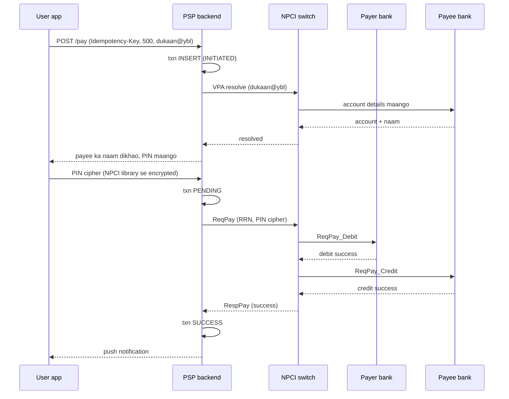
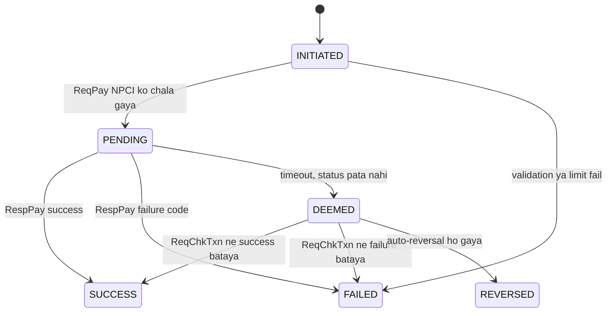

# C1 · UPI PSP app (PhonePe/Paytm)

Oct 12, 2026 · @saurav chaurasiya

Is doc me HLD ka boss level C1 — UPI PSP app ka poora end-to-end design hai.

---

## C1 — UPI PSP app (PhonePe/Paytm)

UPI PSP app woh app hai jisse tum kisi ko paise bhejte ho — PhonePe, Paytm, Google Pay, BHIM. PSP (Payment Service Provider — woh company jo NPCI se judi hoti hai aur customer ki taraf se payment request bhejti hai) khud paise apne paas nahi rakhta: woh tumhare bank account ko tumhare phone se jodta hai aur NPCI (National Payments Corporation of India — UPI ka central switch chalane wali sanstha) ke through do bank ke beech paisa move karata hai. Is level me hum woh poora system design karenge — VPA resolve karna, UPI PIN lena, debit-credit karana, aur fail hone pe paisa wapas karana.

### Ye cheez hai kya

- Kis category ki cheez hai: payments orchestration system — ye khud ledger (paise ka asli hisaab rakhne wali append-only table) nahi rakhta, do bank ke ledgers ke beech ka coordinator hai
- Kis problem ke liye banayi gayi: do alag bank, do alag app, ek second me paisa — bina account number aur IFSC poochhe
- Is lesson ke baad tum kya kar paoge: board pe poora UPI pay flow draw kar paoge, "paisa kat gaya par credit nahi hua" waala case handle kar paoge, aur capacity ke numbers (TPS, storage) zuban pe bol paoge

### Sawaal

Tumhe Paytm jaisa UPI PSP app design karna hai. 30 crore registered users, din ke 15 crore transactions, peak 8pm se 10pm. Ek transaction me do alag bank involved ho sakte hain, aur tumhara app na payer ka bank hai na payee ka. Requirements:

1. User apna bank account phone number se link kare aur ek VPA (Virtual Payment Address — `saurav@paytm` jaisa pata, jiske peeche asli account number chhupa rehta hai) banaye
2. `saurav@paytm` se `dukaan@ybl` ko 500 rupaye bheje, 15 second ke andar
3. UPI PIN sirf user ke phone pe enter ho, tumhare server pe padhne layak form me kabhi na aaye
4. Network timeout pe paisa na doosri baar kate, na gayab ho
5. Debit ho gaya par credit fail ho gaya — paisa apne aap wapas aaye

> Pehle khud socho — 5 min. Hints: (1) PSP ke paas paisa nahi hota, to woh exactly kya store karta hai? (2) Ek request me do bank hain — matlab ek "transaction" ke kam se kam teen hisse hain. (3) "Status pata nahi" aur "fail" do alag cheezein hain, code me bhi alag honi chahiye.

### Problem kyun aata hai

- PSP ke paas paisa nahi hota: debit payer ke bank me hota hai, credit payee ke bank me — do alag company, do alag database. Ek hi DB transaction me dono nahi ho sakte.
- Beech me teesra party hai: NPCI switch. Tumhara request NPCI ko jaata hai, NPCI dono bank se baat karta hai. Har hop pe timeout ho sakta hai.
- Timeout ka matlab "fail" nahi hota: response na aana sirf itna batata hai ki jawab kho gaya. Transaction andar se success bhi ho sakta hai. Isko in-doubt ya deemed transaction kehte hain.
- Paisa idempotent (ek hi request chahe 10 baar aaye, asar sirf ek baar ho) nahi hai by default: user ne 3 baar Pay dabaya to 1500 kat sakte hain.
- UPI PIN tumhare paas aata hi nahi: PIN app ke andar NPCI ki common library se encrypt hoke cipher ke roop me nikalta hai, PSP server ke paas use kholne ki key nahi hoti.
- Peak traffic: 15 crore/din → 15e7 / 1e5 = 1500 TPS (transactions per second — ek second me kitni requests) average, peak 3 se 5 guna = 5000 se 7500 TPS. Aur har txn ke peeche 4 se 6 internal call hain.

### Naive approach

- Ek `PaymentService` banao jo seedha NPCI ko ek HTTP call kare, response ka wait kare, aur jo mila woh user ko dikha de.
- Ek hi `payments` table: `txn_id, payer_vpa, payee_vpa, amount, status`, aur `status` me `SUCCESS` ya `FAILED`.

Woh exactly kahan tootta hai:

- NPCI call 15 second me timeout ho gaya. Ab `status` kya likhoge? `FAILED` likha, par bank me debit ho chuka tha — user ka paisa gayab aur tumhari book me "failed".
- User ne screen pe Retry dabaya. Naya `txn_id` bana, phir se debit — double debit.
- 7500 TPS pe 7500 thread NPCI ka response wait kar rahe hain — thread pool khatam, server down.
- Reconciliation (apni book ko bank aur NPCI ki book se milana) ke liye koi data hi nahi: na RRN (Retrieval Reference Number — 12 digit ka transaction number jiske saath hi switch aur bank se baat hoti hai), na bank ka response code.

### Sahi design

1. Teen alag store rakho: registration store (user, device aur account ka mapping), txn store (har transaction ka state machine), idempotency store (client ki request key se result). Teeno ki consistency aur size requirement alag hai.
2. Onboarding, ek baar: phone number se device binding (app SMS bhejta hai, number verify hota hai) → bank se account list → user account chunta hai → VPA bana ke NPCI mapper me register. VPA se account ka mapping NPCI ke mapper me rehta hai, tumhare paas sirf uska reference.
3. Pay request aate hi `txn` row banao `INITIATED` state me, saath me client ka `Idempotency-Key`. Pehle DB me likho, uske baad bahar call karo — ye write-ahead rule hai: bahar nikalne se pehle apna irada record karo.
4. VPA resolve: payee ka `dukaan@ybl` NPCI ko bhejo. NPCI payee ke PSP se account details maangta hai, tumhe naam wapas milta hai jo tum user ko confirm karne ke liye dikhate ho.
5. UPI PIN: app ke andar NPCI ki common library PIN ko encrypt karti hai; woh cipher tumhare server se sirf pass-through hoke NPCI jaata hai. Tumhara server use decrypt nahi kar sakta, isliye PIN storage ka sawaal hi nahi uthta.
6. `ReqPay` NPCI ko bhejo, txn `PENDING` kar do, aur HTTP thread chhod do. Asli jawab NPCI se async callback (`RespPay`) ke roop me aayega.
7. NPCI do leg chalata hai: `ReqPay_Debit` payer (remitter) bank ko aur `ReqPay_Credit` payee (beneficiary) bank ko. Dono ke response ke baad woh tumhe `RespPay` deta hai.
8. Callback aane pe state machine aage badhao: `PENDING` se `SUCCESS` ya `FAILED`. Callback na aaye to `ReqChkTxn` (check transaction status) poll karo — par switch ke rule ke hisaab se, pehla check nikalne se pehle ek minimum wait hota hai aur per transaction check ki ginti limited hoti hai.
9. Jo txn kuch ghante baad bhi `PENDING` hai usse `DEEMED` mark karo aur reconciliation batch me daalo. Guess karke `SUCCESS` ya `FAILED` kabhi mat likho.
10. Auto-reversal: debit hua par credit nahi, to beneficiary bank ko RBI ke TAT (Turn Around Time — fail hui transaction ko theek karne ki deadline) rules ke hisaab se paisa wapas karna hota hai. Tumhara kaam hai user ko exact status dikhana aur complaint raise karna, apne aap se reverse karna nahi.

Status machine — interview me asli marks yahi cheez deti hai:

Capacity ka hisaab:

- 15 crore txn/din → 15e7 / 1e5 ≈ 1500 TPS average, peak 4 guna ≈ 6000 TPS
- Har txn ke peeche \~5 internal call → peak pe \~30,000 internal requests per second
- Ek txn row \~500 bytes → 15e7 × 500 B ≈ 75 GB/din, 1 saal ≈ 27 TB. Isliye 90 din ka hot data SQL me, purana Cassandra ya object store me.
- Latency budget 15 second: VPA resolve \~1s, PIN user ka time, `ReqPay` se `RespPay` 3 se 8s. Tumhara apna code 200ms se zyada na le.

### Kya choose karein aur kyun

| Option | Kab use karo | Kab mat karo |
| --- | --- | --- |
| Sync call, HTTP thread hold karke | Internal low-latency call, jaise VPA resolve | `ReqPay` ke liye — 6000 TPS × 8s pe thread pool khatam |
| Async callback + state machine | `ReqPay`/`RespPay`, mandate, refund | Jab downstream sach me 50ms me jawab deta ho |
| SQL (Postgres/MySQL) txn store | Txn state, idempotency, limits — ACID chahiye | 27 TB history rakhne ke liye |
| Cassandra txn history | 90 din se purani history, sirf padhne ke liye | Live state machine ke liye, multi-row transaction nahi milta |
| Guess karke status likhna | Kabhi nahi | Hamesha — `DEEMED` state banao |
| `ReqChkTxn` polling | Callback na aane pe, switch ki allowed window me | Har txn pe by default — switch pe load aur limit breach |

### India me kaise hota hai

- UPI switch par pay flow ke message naam fixed hain: PSP `ReqPay` bhejta hai, NPCI `ReqPay_Debit` remitter bank ko aur `ReqPay_Credit` beneficiary bank ko bhejta hai, phir PSP ko `RespPay` deta hai. VPA se asli address nikaalne ke liye `ReqAuthDetails` aur `AuthValCust` chalte hain, aur status ke liye `ReqChkTxn` — woh bhi "only after the specified timeout" ([Oracle Banking Payments — India UPI](https://docs.oracle.com/cd/G15796_01/RHTML/India_UPI/Responsive%20HTML5/UPI/UPI/UPI.htm)).
- Mandate (AutoPay) ka flow alag hai: `ReqMandate` aur `RespMandate`. Agar bank ko `RespMandate` nahi milta to NPCI `ReqMandateConfirmation` bhejta hai, jis par bank mandate hata ke blocked amount unblock karta hai (wahi source).
- Fail hone pe paisa wapas karne ki deadline RBI ne fix ki hai: UPI me debit hua par beneficiary account credit nahi hua to beneficiary bank ko T+1 din tak auto-reversal karna hai; merchant payment me confirmation na milne pe T+5 din. Deri pe 100 rupaye per day compensation, aur woh bhi customer ki complaint ka intezaar kiye bina ([RBI — Harmonisation of Turn Around Time](https://www.rbi.org.in/scripts/NotificationUser.aspx?Id=11693&Mode=0)).
- Isi wajah se PSP app ki "paisa kat gaya" screen pe "T+1 me apne aap wapas" likha hota hai — woh marketing line nahi, regulation hai.

### Interview follow-ups

- **"User ne Pay 3 baar dabaya, kya hoga?"** — Client teeno baar ek hi `Idempotency-Key` bhejta hai. Server us key pe unique index rakhta hai: pehla insert jeetta hai, baaki ko wahi stored result milta hai. Naya `txn_id` kabhi mat banao.
- **"RespPay hi na aaye to?"** — Txn `DEEMED` jaata hai aur `ReqChkTxn` allowed window me chalta hai. User ko "pending" dikhao, "failed" nahi.
- **"PIN kahan store karte ho?"** — Kahin nahi. PIN NPCI ki library me encrypt hota hai aur cipher ke roop me pass-through jaata hai; PSP ke paas key nahi hoti.
- **"Hot merchant key ka problem?"** — Ek bade merchant ke VPA pe laakhon credit ek hi row pe girte hain. Us merchant ke credit ko queue ya shard karo.
- **"6000 TPS pe DB kaise bachaoge?"** — `user_id` pe shard, write path me sirf txn insert aur state update, history read replica ya Cassandra se. Limits aur velocity check Redis me.
- **"Ek hi txn ka callback do baar aaye?"** — Callback handler bhi idempotent: `(rrn, leg)` pe unique constraint, aur state machine me sirf aage ka transition allow.

### Self-check

1. PSP apne paas paisa nahi rakhta — to uske paas asli me kya store hota hai?
2. `PENDING` aur `DEEMED` me farak kya hai, aur `DEEMED` row ke saath kya karte hain?
3. `ReqPay` ke do leg kaunse hain aur unhe kaun bhejta hai?
4. UPI me debit-but-no-credit pe auto-reversal ki deadline kya hai, aur deri pe kya compensation?
5. 15 crore txn/din pe average TPS kitna, peak kitna?

### Notebook

PSP = orchestrator, paisa bank me rehta hai · pehle txn row likho (INITIATED), phir bahar call · `ReqPay` async, `RespPay` callback pe state machine · timeout = DEEMED, guess nahi · `ReqChkTxn` sirf allowed window me · 15 crore/din ≈ 1500 TPS avg, \~6000 peak, \~75 GB/din · debit-no-credit pe auto-reversal T+1, deri pe 100 rupaye/din · PIN pass-through cipher, PSP ke paas key nahi.

### Padhne ke liye

- [Oracle Banking Payments — India UPI: ReqPay, ReqChkTxn, mandate APIs](https://docs.oracle.com/cd/G15796_01/RHTML/India_UPI/Responsive%20HTML5/UPI/UPI/UPI.htm)
- [RBI — Harmonisation of Turn Around Time and customer compensation for failed transactions](https://www.rbi.org.in/scripts/NotificationUser.aspx?Id=11693&Mode=0)

### Deep Dive (SDE-2) — jab time ho

#### Idempotency ka exact schema

- Table: `idempotency(key PRIMARY KEY, user_id, request_hash, txn_id, response_json, created_at)`
- Flow: `INSERT ... ON CONFLICT (key) DO NOTHING`. Agar 0 row insert hui, matlab duplicate hai — stored `response_json` wapas bhej do, naya kuch mat karo.
- `request_hash` kyun chahiye: same key par alag body aa gayi (client ki galti) to 422 do. Warna purana jawab ek alag request ko mil jaayega.
- TTL 24 ghante se zyada rakho — bank aur switch ke retry isi window me aate hain.
- Store SQL me hi rakho. Redis me `noeviction` policy ke bina key memory pressure pe nikal sakti hai, aur tab double debit ka darwaza khul jaata hai.
- Detail: [L2.1 — Idempotency keys](https://claude.ai/code/artifact/c269ac61-440b-4525-bd04-31baf708dece)

#### DEEMED transactions ka reconciliation loop

- Din me switch aur sponsor bank se settlement file aati hai, RRN ke hisaab se.
- Apni book ko us file se milao aur teen bucket banao: sirf humare paas, sirf unke paas, aur amount/status mismatch.
- "Sirf humare paas + `DEEMED`" wali rows pe `ReqChkTxn` ka final jawab lo; phir bhi na mile to manual queue.
- Do metric dashboard pe hone chahiye: `deemed_open_count` aur `oldest_deemed_age_minutes`. Doosra badhna shuru ho to woh incident hai.
- Poora lesson: `L2.21 — Reconciliation` (abhi banna baaki)

#### Device binding aur VPA lifecycle

- Device binding: app phone se ek SMS bhejta hai, backend us SMS ke sender number se confirm karta hai ki SIM wahi hai. Phir device ko ek token milta hai.
- Naya phone = naya binding. Purane device ka token invalidate karo, warna chori hue phone se payment ho sakta hai.
- Tumhare DB me `(user_id, vpa, handle, account_reference, status)` rehta hai — asli account number aur IFSC plain me mat rakho, tokenize karo.
- VPA delete hone pe NPCI mapper se deregister bhi karna padta hai, warna paisa purane account pe jaata rahega.

#### Sponsor bank routing aur failover

- Ek bada PSP ek se zyada sponsor bank ke through chalta hai. Har bank ka success rate alag hota hai aur din bhar badalta rehta hai.
- Health-based routing: pichhle 5 minute ka per-bank success rate rakho, girne pe naye txn doosre bank pe bhejo. Jo txn chal rahe hain unhe switch mat karo.
- Jo bank down hai uske liye circuit breaker lagao — `L2.16 — Circuit breaker` (abhi banna baaki).
- Yaad rakho: routing sirf naye transaction pe lagti hai. Ek txn ka RRN aur sponsor bank jeevan bhar fixed rehte hain, warna reconciliation me woh row kahin nahi milegi.

#### Write path aur read path alag rakho

- Write path: idempotency insert → txn insert → state update. Isme koi join, koi aggregate nahi.
- Read path: history, search, monthly statement — replica ya Cassandra se, aur UI me "last updated" dikhao.
- Background: [L1.10b — Read path vs write path](https://claude.ai/code/artifact/99909fe9-731e-4e31-9e7d-36e0c5aed845)
- Notification, analytics aur ledger ko event chahiye — unhe seedha txn table se mat padhne do, [L2.11 — Outbox pattern](https://claude.ai/code/artifact/429b3ea6-a261-431d-a384-a0c6eb68a9f6) use karo.

---

## Aage kya

- Pichhla zone: [2D · Lock Fort (L2.13 se L2.15)](https://claude.ai/code/artifact/97588686-7110-4318-8124-3a8727c7604e)
- Agla boss: [C2 — Payment gateway (Razorpay)](https://claude.ai/code/artifact/789bc35f-d2eb-42fd-8b80-804af8af526b)
- Is level me jo cheezein use hui: [L2.1 — Idempotency keys](https://claude.ai/code/artifact/c269ac61-440b-4525-bd04-31baf708dece) · [L2.3 — Retries, backoff, jitter](https://claude.ai/code/artifact/c269ac61-440b-4525-bd04-31baf708dece) · [L2.15 — Hot wallet / hot key](https://claude.ai/code/artifact/97588686-7110-4318-8124-3a8727c7604e) · [L1.13 — Replication](https://claude.ai/code/artifact/99909fe9-731e-4e31-9e7d-36e0c5aed845)
