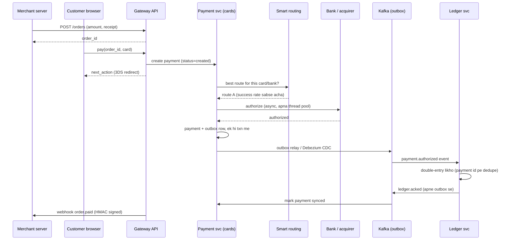
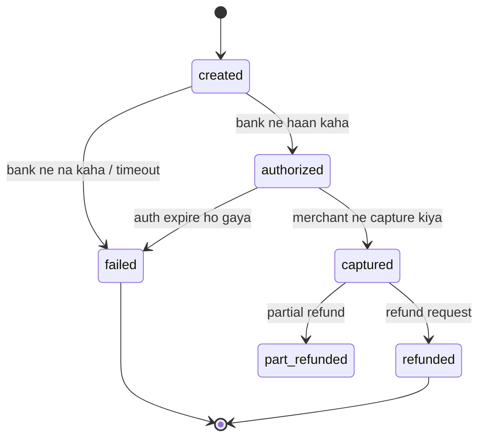

# C2 · Payment gateway (Razorpay)

Oct 15, 2026 · @saurav chaurasiya

**Is doc me 1 boss level hai:** C2 — Payment gateway (Razorpay). Boss level matlab case study, 150 XP. Pehle khud 45 min me kaagaz pe design karne ki koshish karo, phir doc padho.

---

## C2 — Payment gateway (Razorpay)

Payment gateway ek service hai jo merchant (dukaan — wo website ya app jo paisa collect karna chahti hai) aur paise ke asli rakhwaalon (bank, card network, UPI) ke beech khadi rehti hai. Merchant ko wo sirf ek API deti hai, aur andar se dozens of bank aur network integrations, paison ka hisaab, aur "payment hua ya nahi" ka final jawab sambhaalti hai. Razorpay, PayU, Cashfree, Paytm Payment Gateway — sab isi category me hain.

### Ye cheez hai kya

- Kis category ki cheez hai: ye ek orchestration plus ledger system hai. Gateway khud paisa apne paas nahi rakhta (paisa bank me rehta hai) — wo paison ki movement coordinate karta hai aur uska pakka, audit-ready record likhta hai.
- Kis problem ke liye banayi gayi: ek merchant ko 20 banks, 4 card networks, UPI aur wallets ke saath alag-alag integrate na karna pade, aur har rupee ka ek bharosemand record ho.
- Is lesson ke baad tum kya kar paoge: 45 minute ke interview me payment gateway end-to-end design kar paoge — order lifecycle, async bank calls, smart routing, webhooks, ledger, settlement aur reconciliation ke saath.

Isse pehle ka boss [C1 — UPI PSP app](https://claude.ai/code/artifact/b1a2731a-8cb5-4fa6-9e4b-307bdb7ec1aa) tha. Wahan tum consumer ki taraf khade the (user ke phone se paisa bhejna). Yahan tum merchant ki taraf khade ho (dukaan ke liye paisa collect karna). Dono ke problems alag hain.

### Sawaal

Tumhe Razorpay jaisa payment gateway design karna hai. 5 lakh Indian merchants ise use karti hain. Normal din pe 2,000 TPS (transactions per second — ek second me kitni payment requests aa rahi hain), Diwali sale ke peak minute me 10,000 TPS. Merchant ke checkout page pe customer khada hai, usse 2 second me jawab chahiye.

Lekin tumhare peeche ka bank gateway kabhi 5 se 10 second leta hai, aur kharab din me 30 percent requests pe timeout deta hai (timeout matlab jawab hi nahi aaya, tumne intezaar chhod diya).

Design karo: merchant-facing API, payment ka lifecycle, bank ke saath baat, merchant tak result pahunchana, aur T+1 settlement (merchant ke bank account me paisa agle working day) tak ka poora hisaab.

> Pehle khud socho — 5 min. Hints: (1) Customer ka wait aur bank ka wait ek hi thread pe mat baandho. (2) "Payment ka final sach kaun bolega" — customer ka browser, ya tumhara server? (3) Agar ek bank 10 second le raha hai, uske saath baaki 19 banks ke merchants kyun suffer karein?

### Problem kyun aata hai

- Bank aur card network tumhare control me nahi hain. Unki latency (ek request ka jawab aane me laga time) seconds me hai aur predictable nahi hai, jabki customer 2 second me jawab chahta hai.
- Customer har baar flow poora nahi karta. Wo browser band kar deta hai, ya network chala jaata hai. Paisa bank me kat gaya, aur tumhe pata hi nahi chala.
- Ek hi payment pe do baar paisa nahi katna chahiye. Retry, double-click, aur bank ka duplicate callback — teeno duplicate bana sakte hain.
- Paisa aaj aata hai, merchant ko kal milta hai (T+1). Beech me kisi ek jagah balance ka sach likha hona chahiye, warna dispute aur audit me tum fas jaoge.
- Har payment method ka apna protocol hai: cards pe 3DS redirect (bank ke page pe ja ke OTP), netbanking pe bank ka login form, UPI pe collect request aur push callback. Teeno ko ek hi code path me thoosna lamba dard hai.
- Ek slow downstream poore system ko kha sakta hai. Neeche wala naive design me exactly yahi hua hai, asli zindagi me.

### Naive approach

- Ek monolith (ek hi badi application — Razorpay ke case me PHP/Laravel), ek MySQL, ek hi thread pool. Merchant ki API request aayi, usi request ke andar bank ko synchronously call kiya, bank ka jawab aane tak wait kiya, phir merchant ko HTTP response diya.
- Tables ke beech database-level foreign keys lagaye, taaki data "sahi" rahe. Payment row aur balance row ek hi DB transaction me update ki.

Ye exactly kahan tootta hai:

- Bank slow hua (5 se 10 second), toh har worker thread bank ke intezaar me ek DB connection pakde baitha rehta hai. Connection pool khatam, MySQL ka `max_connections` limit hit, aur poora gateway gir jaata hai. Ye bilkul Razorpay ke saath IPL 2019 ke traffic me hua tha ([Razorpay ka monolith se microservices tak ka safar](https://arpitbhayani.me/videos/razorpay-journey-to-microservices-data-consistency/)).
- Ek bank ka kharab din baaki sab merchants ka din kharab kar deta hai. Isolation zero hai.
- Database-level foreign keys parent row pe write lock lete hain. Peak pe wahi lock writes ki lambi line lagwa deta hai — isliye Razorpay ne DB-level foreign keys hata ke referential check application layer me daal diya.
- Customer browser band kar deta hai. Bank ne paisa kaat liya, lekin tumhari row `created` pe hi atki hai. Paisa kahin hai aur record kahin.

### Sahi design

1. **Order pehle, payment baad me.** Merchant server-to-server `POST /orders` karta hai: amount, currency, aur `receipt` (merchant ke apne system ka order id). Amount server pe fix ho jaata hai, isliye browser amount ke saath chhed-chhaad nahi kar sakta.
2. **Checkout sirf collect karta hai, decide nahi karta.** Customer ka browser method chunta hai aur gateway ko bhejta hai. Browser ko kabhi sach ka source na maano — wo bas ek input device hai.
3. **Payment ek state machine hai, ek function call nahi.** `created` se `authorized` se `captured`, aur baad me `refunded`; side me `failed`. Har transition DB me timestamp ke saath likho, kabhi overwrite na karo.
4. **Bank ko async bulao.** API request par ek `payment` row likho (`status=created`) aur asli kaam ek queue me daalo. Merchant ko turant payment id aur next-action (redirect URL ya UPI intent) do. Bank ka jawab callback se ya polling se baad me aayega. Isse customer ka wait aur bank ka wait alag-alag ho jaate hain — yahi is poore design ki jaan hai.
5. **Method-wise alag service.** Cards service, Netbanking service, UPI service. Har ek ka apna thread pool, apna timeout, apna circuit breaker (ek switch jo baar-baar fail karne wale downstream ko bulana hi band kar deta hai — [L2.16](https://claude.ai/code/artifact/4769dea3-018e-41e1-ae18-253fa36a6d21)). Ek method ka bura din doosre method ko nahi lagta.
6. **Smart routing.** Ek hi card payment ke liye kai acquiring routes ho sakte hain. Ek routing service har route ka live success-rate aur latency dekh ke sabse healthy route chunti hai; kharab route ko thodi der ke liye traffic se hata deti hai. Razorpay ne iske liye alag service banayi, store MongoDB pe.
7. **Ledger alag service, double-entry me.** Payment service khud "paisa aaya" nahi likhti. Wo event bhejti hai, aur ledger service double-entry me entry likhti hai (har transaction me total debit = total credit, balance in entries ka sum hota hai — [L2.6](https://claude.ai/code/artifact/a7c567e0-66cb-46fe-b7c9-9c20739857eb)).
8. **Payment aur event ek hi DB transaction me — outbox.** Do databases ko ek saath commit karwane ka protocol 2PC (two-phase commit) kehlata hai; wo slow aur blocking hai, isliye payments me use nahi karte. Iski jagah business row aur ek `outbox` row ek hi local transaction me likho, aur ek relay baad me usko Kafka pe publish kare ([L2.11 Outbox](https://claude.ai/code/artifact/429b3ea6-a261-431d-a384-a0c6eb68a9f6), [L2.12 CDC](https://claude.ai/code/artifact/429b3ea6-a261-431d-a384-a0c6eb68a9f6)). Razorpay yahi karta hai: Debezium (ek CDC tool, jo DB ke binlog se changes padhta hai) outbox rows ko Kafka pe le jaata hai aur Ledger service unhe apply karti hai.
9. **Ledger wapas haan bolta hai.** Ledger apne outbox me ek acknowledgment likhti hai; wo CDC se wapas aata hai aur payment ko `synced` mark karta hai. Do-tarfa handshake. Normal events end-to-end 2 se 3 second lete hain; instant settlement wale P0 topics 1 second ke andar.
10. **Sweeper cron.** Jin payments ka acknowledgment kabhi nahi aaya, unhe ek background cron dhundta hai aur Ledger ko seedha REST ya gRPC pe call karta hai. Ye safety net hai — event pipeline kabhi 100 percent nahi hoti.
11. **Merchant ko webhook bhejo.** `order.paid` aur `payment.captured` jaise events merchant ke URL pe POST karo, HMAC signature ke saath. Signature raw request body pe banta hai — body ko parse kar ke dobara serialize karne se signature mismatch ho jaata hai, Razorpay ke docs me isi ki warning hai. Secret rotate karo toh purani retried requests purane secret se verify karni padti hain ([Razorpay webhooks docs](https://razorpay.com/docs/webhooks/orders.md)).
12. **Idempotent har layer pe.** Idempotent matlab same request do baar aaye toh asar ek hi baar ho. Ledger payment id pe dedupe karta hai, isliye at-least-once delivery (message kam se kam ek baar pahunchega, kabhi do baar bhi) se bhi double-posting nahi hoti ([L2.1 Idempotency keys](https://claude.ai/code/artifact/c269ac61-440b-4525-bd04-31baf708dece)).

Neeche ka diagram ek successful card payment ka poora raasta dikhata hai — order banne se le kar merchant ke webhook tak.

Payment ka lifecycle ek state machine hai. Ye diagram batata hai kaunse transition allowed hain — baaki sab ko code me reject karna hai.

Capacity ka hisaab, taaki interview me numbers ke saath bol sako:

- 10,000 TPS peak. Har payment pe \~6 DB writes (order, payment, 2 state transitions, outbox, ledger entries) matlab \~60,000 writes per second peak — ye ek single MySQL ke bas ki baat nahi, isliye merchant id pe sharding (data ko kai databases me baant dena — [L1.14](https://claude.ai/code/artifact/cfe905e6-6370-43e0-a337-764eeb9ddf1e)).
- Bank call 5 second, 10,000 TPS: Little's Law se ek saath 50,000 payments bank ke intezaar me honge. Thread-per-request model me 50,000 threads nahi chal sakte — isliye async, queue aur bounded pools.
- Har payment ka row \~1 KB. 10 crore payments per month = \~100 GB per month hot data, plus ledger entries. 6 mahine se purana data cold storage me bhejo, warna index phool jaate hain.
- Webhook fanout: 5 lakh merchants, agar 20 percent active hain aur har payment pe 2 events hain, toh peak pe \~20,000 outbound HTTP calls per second. Ye apna alag service banta hai, apni retry queue ke saath.

### Kya choose karein aur kyun

Bank ko kaise bulaya jaaye, ye is design ka sabse bada faisla hai.

| Option | Kab use karo | Kab mat karo |
| --- | --- | --- |
| Sync bank call (request ke andar hi wait) | Internal tools, kam traffic, jahan downstream 200 ms me jawab deta hai | Public payment API me kabhi nahi — ek slow bank poora thread pool kha jaata hai |
| Async + webhook/callback | Public payment gateway, cards aur netbanking, jahan 3DS ya bank page beech me aata hai | Jab client webhook receive hi nahi kar sakta (purana merchant) — wahan polling API do |
| Polling (merchant status poochta rahe) | Webhook fail ho jaaye, ya merchant ke paas public URL na ho | Primary mechanism ke roop me — isse tumhari API pe bekaar load aata hai, rate limit lagana padta hai |

Payment service se ledger tak data kaise pahunche:

| Option | Kab use karo | Kab mat karo |
| --- | --- | --- |
| 2PC (do DB ek saath commit) | Lagbhag kabhi nahi — ek hi DB ke andar distributed txn ho toh theek | Microservices ke beech: coordinator gir gaya toh locks pakde rehte hain, availability girti hai |
| Dual write (pehle DB, phir Kafka) | Jab event kho jaana acceptable ho (analytics, metrics) | Paise me kabhi nahi — DB commit hone ke baad Kafka write fail hua toh ledger me entry kabhi nahi aayegi |
| Outbox + CDC | Paise wale events, jahan event aur business row dono zaroori hain | Jab team ke paas CDC chalane ki ops capacity na ho — tab outbox + simple relay cron se shuru karo |

Ledger ko kitna fresh hona chahiye:

| Option | Kab use karo | Kab mat karo |
| --- | --- | --- |
| Strong consistency (payment commit ke saath hi ledger) | Wallet balance, jahan agla faisla usi balance pe hota hai | Merchant settlement me — wahan T+1 hai, isliye 2 to 3 second ka lag bilkul theek hai |
| Eventual consistency (eventual matlab kuch der baad sab replicas same ho jayenge) | Merchant settlement ledger, reporting, dashboards | Jab customer ko turant "balance kitna bacha" dikhana ho |

### India me kaise hota hai

- Razorpay ki shuruaat ek hi PHP (Laravel) monolith aur ek MySQL RDS se hui thi. IPL 2019 ke traffic me PHP workers slow bank gateways ka intezaar karte hue DB connections pakde rahe, MySQL `max_connections` pe pahunch gaya, aur cascading failure me merchants ko throttle karna pada ([Razorpay journey to microservices](https://arpitbhayani.me/videos/razorpay-journey-to-microservices-data-consistency/)).
- Uske baad monolith toda gaya: Order Service, Ledger Service (double-entry accounting), method-wise payment services (Cards, Net Banking, UPI), aur ek Smart Routing Service jo MongoDB pe chalti hai aur transaction ko sabse healthy gateway pe bhejti hai. Rollout ek internal experiment platform "Splits" se 0 percent se 100 percent tak staged kiya gaya (same source).
- Data consistency ke liye unhone DB-level foreign keys hata diye (write-lock bottleneck), 2PC reject kiya, aur transactional outbox apnaaya. Debezium CDC outbox events ko Kafka pe le jaata hai, Ledger Service apply karti hai; Ledger apne outbox me acknowledgment likhti hai jo CDC se wapas aa kar payment ko synced mark karta hai. Jo payment acknowledge nahi hua, uske liye sweeper cron Ledger ko seedha call karta hai. Ledger payment id pe dedupe karti hai (same source).
- Timing: normal events end-to-end 2 se 3 second, instant settlement wale P0 Kafka topics \~1 second (same source).
- Webhooks pe Razorpay ke apne docs do cheezein saaf kehte hain: `order.paid` ke payload me payment aur order dono entities hoti hain jabki `payment.captured` me sirf payment entity; aur signature raw request body pe banao — "Do not parse or cast the webhook request body" ([Razorpay webhooks docs](https://razorpay.com/docs/webhooks/orders.md)).

### Interview follow-ups

- **Customer ne pay kiya, bank ne paisa kaat liya, lekin tumhara callback kabhi nahi aaya. Kya karoge?** Ye "pending" payment hai, failed nahi. Ek reconciliation job bank se status poochti hai (exponential backoff ke saath, bank ke rate limits ke andar), aur jab tak sach pata nahi chalta payment `created` pe rehta hai. Din ke end me bank ki settlement file se mila ke sach final hota hai (Reconciliation — L2.21).
- **Merchant ne ek hi order ke liye do baar capture call kiya. Double capture kaise rokoge?** Capture ko state transition banao, not an action: `authorized` se `captured` hi allowed hai, aur wo conditional update hai (`UPDATE payment SET status='captured' WHERE id=? AND status='authorized'`). 0 rows affected matlab pehle hi ho chuka — wahi purana response wapas do.
- **Smart routing kis metric pe route chune?** Sliding window me per-route success rate aur p99 latency (p99 matlab 100 requests me 99 isse tezi se nipat jaati hain). Thoda exploration bhi rakho (traffic ka chhota hissa kharab route pe), warna ek baar neeche gaya route kabhi wapas nahi aayega.
- **Ek merchant peak pe 40 percent traffic bhej raha hai. Baaki merchants ko kaise bachaoge?** Per-merchant rate limiting plus bulkhead — alag queue aur alag worker pool, taaki ek merchant ka backlog doosron ki latency na badhaye ([L1.21 Rate limiting](https://claude.ai/code/artifact/6a87e8d2-04fb-418e-b433-e5a88508f83e)).
- **Ledger aur payment DB ka balance match nahi kar raha. Debug kaise karoge?** Teen jagah dekho: outbox me stuck rows (relay ruka hua), Kafka consumer lag, aur sweeper cron ka log. Ledger append-only hai isliye entry delete nahi karte — ulta correcting entry daalte hain.
- **Refund ko kyun nayi payment ki tarah treat karte hain?** Kyunki refund bhi bank ko jaata hai, fail ho sakta hai, aur apna lifecycle rakhta hai. Usko original payment ke status field me thoosne se tum ek row me do independent state machines bana dete ho.

### Self-check

1. Order aur payment do alag entities kyun hain? Agar amount sirf checkout request me aata, kya galat ho sakta tha?
2. Naive monolith me bank ki slowness se DB connections kaise khatam hue? Chain of events ek line me bolo.
3. Outbox pattern dual write se kaise behtar hai? Dual write exactly kab todta hai?
4. Webhook signature raw body pe kyun banate hain, parsed JSON pe kyun nahi?
5. Merchant settlement me eventual consistency theek hai, lekin wallet balance me nahi. Kyun?

### Notebook

PG = orchestration + ledger, paisa bank me rehta hai · Order server pe banao (amount fix), checkout sirf input device hai · Bank call async — customer ka wait aur bank ka wait alag, warna connection pool khatam (Razorpay IPL 2019) · Method-wise service + circuit breaker + smart routing on live success rate · Payment to Ledger = outbox + Debezium CDC + Kafka, ack wapas, sweeper cron safety net, dedupe on payment id · Webhook HMAC raw body pe, secret rotate pe purane se verify karo · Settlement T+1 isliye 2-3 sec eventual consistency acceptable.

### Padhne ke liye

- [Razorpay's journey from monolith to microservices, aur data consistency](https://arpitbhayani.me/videos/razorpay-journey-to-microservices-data-consistency/) — outbox, CDC, sweeper cron, foreign keys hatane ka faisla.
- [Razorpay webhooks documentation](https://razorpay.com/docs/webhooks/orders.md) — event names, payload shape, signature verification ke rules.

### Deep Dive (SDE-2) — jab time ho

#### Smart routing ko kaise banate hain

- Har route ke liye ek sliding window counter rakho: last 5 minute ke attempts, successes, aur latency buckets. Redis me ya in-memory with periodic sync.
- Score = success rate ka weight plus latency ka weight plus cost ka weight. Cost bhi matter karta hai — kuch acquirers sasta padte hain.
- Kharab route ko poori tarah band na karo. 1 se 5 percent probe traffic bhejte raho, warna recovery ka pata hi nahi chalega (ye circuit breaker ka half-open state hai).
- Routing decision payment row me likho. Warna jab ek route kharab nikle, tum nahi bata sakte ki kaunse payments usse gaye the.
- Sticky routing: ek hi payment ka retry usi route pe na bhejo jo abhi fail hua — warna tum same deewar se dobara takra rahe ho.

#### Idempotency poore gateway me

- Merchant-facing API pe `Idempotency-Key` header lo. Key plus request body ka hash store karo, response ke saath, 24 ghante se zyada TTL pe. Same key aur different body aaye toh 422 do, chup-chaap purana response na do.
- Bank callbacks duplicate aate hain. Callback handler ka pehla kaam: bank ka reference id dekh ke "ye already process ho chuka?" check karna.
- Ledger ke liye idempotency key = payment id plus event type. Isse at-least-once Kafka delivery se double entry nahi banti.
- Refund ki idempotency key merchant deta hai, warna network timeout pe retry karne se customer ko do baar refund mil jaayega.

#### Settlement aur escrow

- Settlement = merchant ke bank account me paisa bhejna, usually T+1 ya T+2. Beech ka paisa nodal ya escrow account me rehta hai, jise RBI regulate karta hai.
- Settlement amount = captured payments minus refunds minus gateway fees minus GST minus chargebacks minus kuch reserve (risky merchants pe rolling reserve).
- Ye ek batch job hai, lekin uska input ledger hai, payment table nahi. Ledger immutable hai, isliye kal ka settlement dobara chalao toh wahi jawab aayega — ye property audit me bachati hai.
- Instant settlement (T+0) ek paid feature hai. Wahi P0 Kafka topics wali baat — unka pipeline latency \~1 second rakha jaata hai.

#### Reconciliation bank files se

- Roz raat ko har bank aur network ek settlement file bhejta hai: unke hisaab se kaunse transactions successful hue aur kitna paisa settle hua.
- Teen buckets banao: (a) dono jagah hai aur amount match — theek; (b) tumhare paas hai, bank ke paas nahi — pending ya galat success; (c) bank ke paas hai, tumhare paas nahi — ye sabse khatarnak, customer ka paisa kat gaya aur tumne order fulfil nahi kiya.
- Bucket (c) pe automatic action: ya payment ko success mark karo aur merchant ko inform karo, ya auto-refund trigger karo. Manual queue chhoti rakho, warna wo kabhi khatam nahi hogi.
- Reconciliation ka output bhi ledger me jaata hai, correcting entries ke roop me. Ye hi L2.21 ka poora lesson hai ([2F · Recon Ruins](https://claude.ai/code/artifact/93d00bdd-f45f-441f-946c-c84355b5c05e)).

#### Cards, tokenization aur PCI scope

- Asli card number (PAN — primary account number) jitne kam systems me jaaye utna accha. RBI ke rules ke baad merchants aur gateways card number store nahi kar sakte; unki jagah network token aata hai.
- Practical design: ek chhota, alag "vault" service jo card data handle karti hai, aur baaki poora gateway sirf token dekhta hai. Isse PCI-DSS audit ka scope ek service tak simat jaata hai, 40 services tak nahi.
- Vault service ka apna DB, apne keys (HSM me), apna network segment. Baaki services uske API se token exchange karti hain.
- Ye L2.24 ka topic hai ([2G · Security Vault](https://claude.ai/code/artifact/f0f0e8e4-dde8-492e-9a80-08a35792d4e7), Tokenization aur PCI-DSS).

---

## Aage kya

- Pichhla boss: [C1 — UPI PSP app (PhonePe/Paytm)](https://claude.ai/code/artifact/b1a2731a-8cb5-4fa6-9e4b-307bdb7ec1aa)
- Agla boss: [C3 — Digital wallet](https://claude.ai/code/artifact/5d38db4f-e17f-433f-93ba-e9eb072c118e)
- Is doc ka LLD jodidar: [D2 — Digital wallet (Java machine coding)](https://claude.ai/code/artifact/4df48566-b65f-4525-ac39-494302d44562)
- Zone jahan se concepts aaye: [2A Idempotency Island](https://claude.ai/code/artifact/c269ac61-440b-4525-bd04-31baf708dece) · [2B Ledger Library](https://claude.ai/code/artifact/a7c567e0-66cb-46fe-b7c9-9c20739857eb) · [2C Saga Sea](https://claude.ai/code/artifact/429b3ea6-a261-431d-a384-a0c6eb68a9f6) · [2E Resilience Ridge](https://claude.ai/code/artifact/4769dea3-018e-41e1-ae18-253fa36a6d21)
