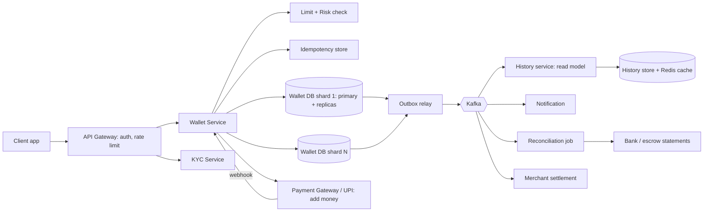
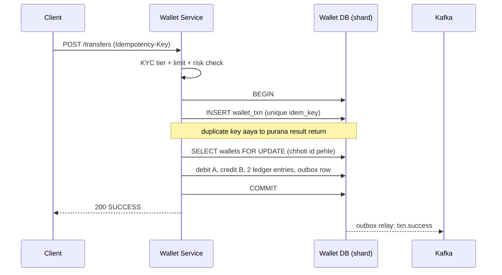
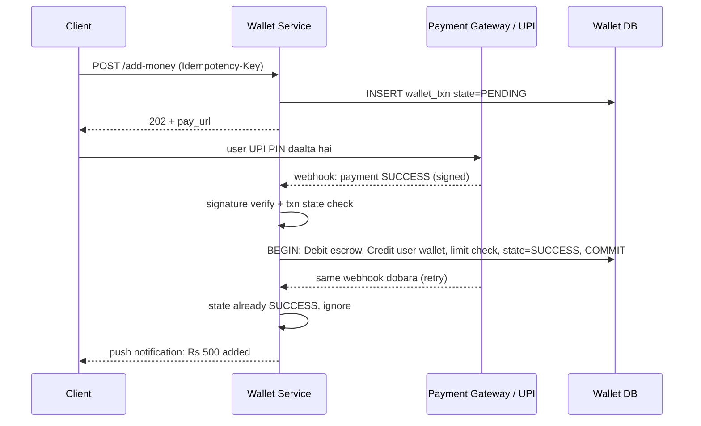

# C3 · Digital wallet

Oct 16, 2026 · @saurav chaurasiya

**Is doc me:** Paytm-Wallet jaisa digital wallet ka poora HLD: KYC tiers aur RBI PPI limits, add money, P2P transfer, merchant payment, balance consistency, ledger, idempotency aur reconciliation.

**Padhne ka tareeka** — pehle Sawaal pe 15 min khud design karo, phir Sahi design se compare karo. Deep Dive tab padho jab time ho.

---

## C3 — Digital wallet

**Digital wallet** (ya PPI — Prepaid Payment Instrument, yaani pehle se paise load karke baad me kharch karne wala instrument) ek aisa system hai jisme user ka paisa ek balance ke roop me rakha jata hai, aur wo us balance se P2P (person to person) transfer ya merchant payment karta hai. Sabse badi chunauti ye hai ki balance kabhi galat na ho, kabhi negative na jaye, aur ek hi payment do baar na kate.

### Ye cheez hai kya

- Category: Fintech core system — stateful, money-moving, strongly consistent service.
- Problem: UPI/card har baar bank se baat karte hain (slow, bank-dependent). Wallet me paisa pehle se hamare paas hota hai, to payment fast aur predictable hoti hai, aur RBI ke rules ke andar rehkar hum cashback, offers, small-ticket payments handle kar sakte hain.
- Is lesson ke baad tum kar paoge: wallet ka end-to-end design — KYC tier ke hisaab se limits lagana, add money / transfer / pay flows banana, aur double-spend ya duplicate debit rokna.

Analogy: wallet ek tiffin service ka prepaid coupon-book jaisa hai. Tum pehle coupons kharidte ho (add money), har tiffin pe coupon kat-ta hai (pay), aur dukandaar ke paas har coupon ka hisaab register me likha hota hai (ledger). Register aur coupon-count kabhi match na karein to jhagda pakka.

### Sawaal

Tumhe Paytm-Wallet jaisa system design karna hai. **50 million MAU** (monthly active users), **10 million DAU** (daily active users), har DAU roz \~3 wallet transactions. Festival (Diwali, IPL) pe peak load average ka \~10x. Transfer ka **p99 latency** (99% requests isse tez — worst-case ke kareeb ka latency) 300 ms se kam hona chahiye. Ek paisa bhi idhar-udhar nahi hona chahiye. RBI ke PPI rules follow karne hain: user ka KYC (Know Your Customer — user ki pehchaan verify karna) tier decide karega ki wo kitna balance rakh sakta hai aur kya kar sakta hai.

Design karo: add money, wallet-to-wallet transfer, merchant payment, balance, statement, aur reconciliation (apne books ko bank/gateway ke records se match karna).

> Pehle khud socho — 15 min. Hints: (1) Balance ek number hai ya ledger entries ka sum? Dono ka kya fayda-nuksan? (2) Network timeout pe user retry karega — double debit kaise rokoge? (3) Sender aur receiver alag DB shard pe ho to atomic transfer kaise karoge?

### Problem kyun aata hai

- Paisa ka kaam **concurrent** hota hai: ek user ke do phone se ek saath payment, ya merchant ke refund aur payment ek saath.
- Network unreliable hai: request gayi, response kho gaya. Client retry karega, aur bina protection ke dobara debit ho jayega.
- Add money ke liye bank/UPI/card gateway pe depend karna padta hai, jo kabhi slow ya "pending" status deta hai. Hum unke result ke bina balance nahi badha sakte.
- RBI limits hard rules hain: min-KYC user 10,000 se zyada balance nahi rakh sakta. Limit check race condition me toot sakta hai.
- Scale: peak pe \~3.5k transactions/sec, har transaction multiple rows likhta hai.
- Audit: regulator ya user poochhe "mera 500 rupaye kahan gaye" to har paise ka trail dikhana padega.

### Naive approach

- Ek `users` table me `balance` column. Transfer = `UPDATE balance = balance - 100 WHERE id = A` phir `UPDATE balance = balance + 100 WHERE id = B`. Koi ledger nahi, koi idempotency key nahi.
- Kahan toot-ta hai:
  - Do UPDATE ke beech server crash: A ke 100 kate, B ko mile nahi. 3.5k TPS pe roz kuch na kuch crash/timeout hoga, yaani paisa gayab.
  - Read-check-write race: balance 100 hai, do requests 80-80 ke aaye. Dono ne balance=100 padha, dono pass, balance -60. Double spend.
  - Retry: timeout ke baad client ne dobara bheja, to 2 baar debit. 0.1% bhi timeout ho to 30M/day me 30,000 galat transactions.
  - Balance galat nikla to proof nahi ki kab kya hua. History nahi, reconciliation impossible.
  - Ek hi DB, ek hi hot row (merchant ka balance) pe lakho updates: row lock contention, throughput dhaam.

### Sahi design

Pehle requirements, phir estimates, phir API, data model, architecture.

#### 1. Requirements

**Functional:**

- Wallet banana + KYC tier (min-KYC / full-KYC) assign karna.
- Add money (UPI / net banking / card se).
- P2P transfer (wallet to wallet) aur wallet se bank (full-KYC only).
- Pay merchant (QR / app / online checkout).
- Balance dekhna, statement / history.
- Refund, aur failed payments ka auto-reversal.

**Non-functional:**

- **Correctness pehle:** balance kabhi negative nahi, koi double debit nahi, har paisa traceable.
- Strong consistency (jo likha wo turant dikhe) balance aur debit/credit pe; history pe eventual consistency (thodi der baad dikhe, chalega) theek hai.
- Availability 99.95%+, transfer p99 < 300 ms.
- Durability: commit hone ke baad data kabhi na jaye (sync replication).
- Auditability: append-only trail, 8-10 saal retention.
- RBI PPI compliance: limits, KYC, escrow account.

#### 2. RBI PPI aur KYC tiers

RBI ki Master Direction on PPIs ke hisaab se wallet ke tiers (numbers 2021 Master Direction ke hain; RBI ne 2026 me naye rules/draft nikale hain, to implement karte waqt latest circular check karo aur limits **config** me rakho, code me hard-code nahi):

| Tier | Kya verify hota hai | Balance limit | Kya kar sakta hai |
| --- | --- | --- | --- |
| Min-KYC (small PPI) | Mobile + self-declared ID detail (OTP) | Kisi bhi time 10,000 tak; ek month me 10,000 load, saal me 1,20,000 load | Sirf goods/services kharidna. Wallet se bank / P2P transfer nahi. Cash load nahi |
| Full-KYC | Video KYC (V-CIP) ya Aadhaar e-KYC + PAN | Kisi bhi time 2,00,000 tak | Merchant pay, P2P, bank transfer (rules ke andar) |

- Limit check **do jagah** hoga: request time pe (fast reject) aur DB transaction ke andar (atomic, race-proof).
- Tier badalne pe (min se full) sirf `kyc_tier` aur limits change hote hain; ledger nahi chhedte.
- Customer ka paisa **escrow account** (bank me alag account) me rehta hai. Wallet ka balance humare liye liability (hum user ko dene wale hain), escrow us ka asset hai. Dono ka total hamesha match hona chahiye.

#### 3. Back-of-envelope estimates

(Estimation ka method [Part 0 · Base Camp](https://claude.ai/code/artifact/873676ef-93d2-45e6-a1bc-079a3fa419b3) me hai.)

- DAU 10M x 3 txn = 30M txn/day. Average TPS = 30M / 86,400 = \~350 TPS.
- Peak (10x) = \~3.5k TPS. Festival headroom ke liye 5k TPS plan karo.
- Har txn double-entry me kam se kam 2 ledger entries (debit + credit), add money/merchant pay me 2-4. Peak pe \~10k entry-writes/sec.
- Storage: txn row \~300 B, entry \~150 B x 3 = \~750 B per txn. 30M x 365 = \~11B txn/year, to \~8 TB/year. 5 saal retention = \~40 TB, to **sharding zaroori** hai.
- Read:write \~10:1 (balance dekhna, history) to peak pe \~35k read QPS. Balance read cache/replica se, lekin debit ke time source of truth primary DB.
- Bandwidth chhota hai (kuch MB/s); asli challenge QPS nahi, **correctness** hai.

#### 4. API design

Sab money-moving APIs me `Idempotency-Key` header mandatory hai (concept: [2A · Idempotency Island](https://claude.ai/code/artifact/c269ac61-440b-4525-bd04-31baf708dece)). Amount hamesha **paise** me, integer.

```text
POST /v1/wallets/{wid}/add-money
  Headers: Idempotency-Key: <uuid>
  Body: { amount_paise: 50000, source: "UPI", source_ref: "vpa@bank" }
  Resp: 202 { txn_id, state: "PENDING", pay_url }

POST /v1/transfers
  Headers: Idempotency-Key: <uuid>
  Body: { from_wallet, to_wallet, amount_paise, note }
  Resp: 200 { txn_id, state: "SUCCESS" | "PENDING" | "FAILED" }

POST /v1/payments        (merchant payment)
  Headers: Idempotency-Key: <uuid>
  Body: { wallet_id, merchant_id, amount_paise, order_id }
  Resp: 200 { txn_id, state }

GET  /v1/wallets/{wid}/balance
GET  /v1/wallets/{wid}/transactions?cursor=...&limit=20
GET  /v1/transactions/{txn_id}          (status polling)
```

- Add money 202 deta hai kyunki bank result async aata hai (webhook / callback).
- History pe **cursor pagination** (offset nahi), kyunki naye entries aate rehte hain.
- API design ke basics: [Part 0 · Base Camp](https://claude.ai/code/artifact/873676ef-93d2-45e6-a1bc-079a3fa419b3).

#### 5. Data model

Core idea: **ledger entries truth hain, balance unka running total hai.** (Detail: [2B · Ledger Library](https://claude.ai/code/artifact/a7c567e0-66cb-46fe-b7c9-9c20739857eb).) Schema ka tarika [1C · DB Dungeon](https://claude.ai/code/artifact/99909fe9-731e-4e31-9e7d-36e0c5aed845) me hai.

```sql
-- Wallet: ek user ka account. balance ek cached running total hai, truth ledger hai
CREATE TABLE wallet (
  wallet_id     BIGINT PRIMARY KEY,
  user_id       BIGINT NOT NULL,
  kyc_tier      SMALLINT NOT NULL,      -- 1 = min-KYC, 2 = full-KYC
  status        SMALLINT NOT NULL,      -- ACTIVE / FROZEN / CLOSED
  balance_paise BIGINT NOT NULL CHECK (balance_paise >= 0),  -- negative kabhi nahi
  version       BIGINT NOT NULL,        -- optimistic locking ke liye
  updated_at    TIMESTAMP NOT NULL
);

-- Transaction: ek business event (transfer, add money, pay). State machine yahan chalti hai
CREATE TABLE wallet_txn (
  txn_id        BIGINT PRIMARY KEY,
  idem_key      VARCHAR(64) NOT NULL,
  txn_type      SMALLINT NOT NULL,      -- ADD_MONEY / P2P / MERCHANT_PAY / REFUND
  state         SMALLINT NOT NULL,      -- INIT / PENDING / SUCCESS / FAILED / REVERSED
  amount_paise  BIGINT NOT NULL,
  from_wallet   BIGINT, to_wallet BIGINT,
  created_at    TIMESTAMP NOT NULL,
  UNIQUE (from_wallet, idem_key)        -- duplicate request yahin rukega
);

-- Ledger entry: append-only, kabhi UPDATE/DELETE nahi. Har txn ke entries ka sum = 0
CREATE TABLE ledger_entry (
  entry_id      BIGINT PRIMARY KEY,
  txn_id        BIGINT NOT NULL,
  wallet_id     BIGINT NOT NULL,        -- user wallet ya system account (escrow, fee, merchant payable)
  direction     CHAR(1) NOT NULL,       -- D = debit, C = credit
  amount_paise  BIGINT NOT NULL CHECK (amount_paise > 0),
  balance_after BIGINT NOT NULL,
  created_at    TIMESTAMP NOT NULL
);
CREATE INDEX ix_entry_wallet_time ON ledger_entry (wallet_id, created_at DESC);

-- Outbox: DB commit ke saath hi event save, phir Kafka pe publish
CREATE TABLE outbox (
  id BIGINT PRIMARY KEY, topic VARCHAR(64), payload JSON, published BOOLEAN DEFAULT FALSE
);

-- Usage counters: monthly/yearly load limit check ke liye
CREATE TABLE wallet_usage (
  wallet_id BIGINT, period CHAR(7),     -- jaise 2026-10
  loaded_paise BIGINT, PRIMARY KEY (wallet_id, period)
);
```

- **Shard key = wallet\_id** (consistent hashing / range; [1D · Shard Mountains](https://claude.ai/code/artifact/cfe905e6-6370-43e0-a337-764eeb9ddf1e)). Ek wallet ka wallet row, uski ledger entries aur usage ek hi shard pe, to single-wallet operations local ACID (Atomicity-Consistency-Isolation-Durability: all-or-nothing wala DB guarantee) hain.
- **System accounts** bhi wallet rows hain: escrow, fee income, merchant payable. Isse har txn balanced rehta hai.

#### 6. High-level architecture

Neeche diagram me client se DB tak ka flow hai. Wallet Service hi paisa move karti hai; baaki sab uske aas-paas helper hain.



Flow ka summary:

1. Gateway auth aur rate limit lagata hai, phir Wallet Service ko deta hai.
2. Wallet Service idempotency key check karti hai, limits aur risk dekhti hai.
3. Paisa move karne ka kaam ek DB transaction me hota hai (ledger entries + balance update + outbox).
4. Outbox se Kafka ([1E · Kafka River](https://claude.ai/code/artifact/eeb39ee8-3f52-4c04-b57b-68213f02c429)) pe event jata hai; history, notification, reconciliation, settlement apna kaam async karte hain.
5. Read side (history, statement) alag read model se aata hai (CQRS — write aur read ke liye alag models). Cache ka tarika [1B · Cache Caves](https://claude.ai/code/artifact/32bb1c8e-3433-417c-a3f4-3a34babed6bf) me hai.

#### 7. Flow: P2P transfer (same shard)

Sender aur receiver ek hi shard pe hon to ek local DB transaction kaafi hai. Neeche sequence me row lock aur idempotency dikhai hai.



- **Lock ordering:** hamesha chhoti wallet\_id pehle lock karo. Warna A->B aur B->A ek saath chale to deadlock (dono ek doosre ka lock wait kar rahe) ho jayega.
- Balance update: `UPDATE wallet SET balance_paise = balance_paise - :amt, version = version + 1 WHERE wallet_id = :id AND balance_paise >= :amt`. Agar 0 rows update hui to insufficient balance.
- Locking ke options: [2D · Lock Fort](https://claude.ai/code/artifact/97588686-7110-4318-8124-3a8727c7604e).

#### 8. Flow: Add money

Add money me bank/UPI ka result async aata hai, isliye txn pehle `PENDING` hota hai aur balance tab badhta hai jab gateway ka confirmed webhook aaye. Gateway ke andar ka design [C2 · Payment gateway](https://claude.ai/code/artifact/789bc35f-d2eb-42fd-8b80-804af8af526b) me hai.



- Webhook **duplicate** aa sakta hai; txn state machine ([2C · Saga Sea](https://claude.ai/code/artifact/429b3ea6-a261-431d-a384-a0c6eb68a9f6)) dobara credit nahi hone deti.
- Agar webhook kabhi aaya hi nahi (lost), to ek **status-poll job** `PENDING` txns ko gateway se poochhta hai. Phir bhi mismatch ho to reconciliation pakadta hai.
- Credit se pehle min-KYC ka 10,000 balance aur monthly load limit check hota hai. Limit paar ho rahi ho to payment refund hota hai gateway ko wapas.

#### 9. Flow: Pay merchant

- User ka wallet debit hota hai, aur credit **merchant payable** (system account) me jata hai. Merchant ko asli bank payout T+1 settlement me milta hai ([C9 · Merchant settlement](https://claude.ai/code/artifact/e627a8b4-90e3-47e2-a4a4-0043ee7c4032)).
- Ledger entries: Debit user wallet 500, Credit merchant payable 495, Credit fee income 5 (MDR — merchant discount rate, merchant se liya jane wala charge). Sum zero.
- Merchant ke wallet row pe lakho updates ek hi row pe = **hot row**. Fix: merchant payable ko N sub-accounts (buckets) me baanto, ya merchant ka balance seedha update na karke sirf ledger entries append karo aur batch me aggregate karo.

#### 10. Cross-shard transfer

A shard 1 pe, B shard 7 pe. Ek DB transaction dono me nahi chalegi. Distributed 2PC (two-phase commit — sab participants se poochho, phir sab ek saath commit) slow aur blocking hai, to saga use karo ([2C · Saga Sea](https://claude.ai/code/artifact/429b3ea6-a261-431d-a384-a0c6eb68a9f6)).

1. Shard 1 pe local transaction: A ko debit karo aur paisa `in_transit` system account me daalo, txn state `DEBITED`.
2. Outbox event se shard 7 ko bolo: B ko credit karo. Shard 7 local transaction me credit karta hai, state `CREDITED`.
3. Credit fail ho (B frozen, limit cross) to **compensating transaction** (pehle ka kaam ulta karne wala naya kaam) chalao: in\_transit se A ko wapas credit.
4. Har step idempotent hai (txn\_id par), to retry safe hai.

- User ko "PENDING" dikhta hai kuch seconds; final state notification se aata hai. Kam hi cross-shard hoga agar user-clusters ko samajhdaari se shard karein, par design me handle zaroori hai.

#### 11. Balance consistency kaise rakhte hain

- Debit sirf **primary** DB pe, same transaction me ledger entry + balance update.
- Check-and-update ek hi SQL me (`WHERE balance >= amt`), to read-then-write race hi nahi bachta.
- Replica se balance dikhana chalega (UI ke liye), par debit decision kabhi replica se nahi ([2F · Recon Ruins](https://claude.ai/code/artifact/93d00bdd-f45f-441f-946c-c84355b5c05e), replicas & caching in payments).
- Invariants jo hamesha true hone chahiye: `wallet.balance == SUM(credits) - SUM(debits)` har wallet ke liye; aur har txn ke entries ka sum zero. Inhe ek background checker roz verify karta hai.

### Kya choose karein aur kyun

| Option | Kab use karo | Kab mat karo |
| --- | --- | --- |
| Balance column + ledger (dono, ek transaction me) | Production wallet; fast reads aur audit trail dono chahiye | Kabhi nahi chhodna; sirf ye hi sahi hai |
| Sirf ledger, balance = SUM on read | Chhote scale, ya audit tool | Millions of entries wale wallet pe, kyunki har read pe SUM slow |
| Pessimistic lock (`SELECT FOR UPDATE`) | Hot wallets, high contention, short transaction | Lamba external call lock ke andar mat karo |
| Optimistic (version column) | Kam contention, zyadatar user wallets | Merchant jaise hot rows pe, retries toofan bana denge |
| 2PC cross-shard | Same datacenter, kam participants, strict atomicity | Scale pe; coordinator SPOF (single point of failure — ek jagah fail to sab fail) aur blocking |
| Saga with compensation | Cross-shard / cross-service transfer | Jahan intermediate state dikhana ban hai (rare) |
| Synchronous bank debit har payment pe | Jab wallet na ho, seedha UPI | Wallet ka point hi khatam ho jata hai |

### India me kaise hota hai

- RBI **PPI Master Direction** wallet ke liye rulebook hai: KYC tiers, balance limits, escrow, interoperability (wallet se UPI QR scan). Official text: [RBI Master Directions](https://www.rbi.org.in/scripts/BS_ViewMasDirections.aspx?id=12094). Naye 2026 changes ka coverage: [Medianama on RBI PPI rules](https://www.medianama.com/2026/04/223-rbi-prepaid-payment-instruments-rules-wallet-limits-escrow-norms/). Law-firm summary: [Trilegal on PPI Master Directions](https://trilegal.com/knowledge_repository/new-master-directions-on-prepaid-payment-instruments/).
- Paytm, PhonePe, Amazon Pay jaise PPI issuers ko RBI authorisation chahiye, aur customer funds escrow account me alag rakhne padte hain.
- Wallet add-money aur UPI dono NPCI/bank rails use karte hain; ye hamare UPI app design se connect hota hai: [C1 · UPI PSP app](https://claude.ai/code/artifact/b1a2731a-8cb5-4fa6-9e4b-307bdb7ec1aa).
- Wallet ka double-entry design samajhne ke liye ek achha engineering article: [Modern Treasury, Accounting for Developers Part II](https://www.moderntreasury.com/journal/accounting-for-developers-part-ii). Interview-style walkthrough: [Digital wallet system design (techinterview.org)](https://techinterview.org/system-design-wallet-service/).
- Is wallet ka LLD twin (classes, patterns, Java code) yahan hai: [D2 Digital wallet](https://claude.ai/code/artifact/4df48566-b65f-4525-ac39-494302d44562).

### Interview follow-ups

- **Ek user ne do phone se ek saath 80+80 bheje, balance 100 hai. Kya hoga?** — Dono requests same wallet row pe aati hain. `UPDATE ... WHERE balance >= 80` row lock leta hai; pehla pass, doosre ko 20 dikhta hai to 0 rows update hoti hain aur wo fail. Row lock hi serialization deta hai.
- **Client ne timeout ke baad retry kiya, double debit kaise rokoge?** — Idempotency key + unique constraint `(wallet, idem_key)`. Retry pe purana result return hota hai, naya debit nahi. Detail: [2A · Idempotency Island](https://claude.ai/code/artifact/c269ac61-440b-4525-bd04-31baf708dece).
- **Balance column aur ledger mismatch ho jaye to?** — Ledger truth hai. Roz ka checker `balance == sum(entries)` verify karta hai; mismatch pe alert, wallet freeze, aur ledger se balance rebuild. Reason: [2B · Ledger Library](https://claude.ai/code/artifact/a7c567e0-66cb-46fe-b7c9-9c20739857eb).
- **Cross-shard transfer me credit fail ho gaya, ab?** — Saga ka compensating step: in\_transit se sender ko wapas credit. Har step txn\_id pe idempotent, state machine se track.
- **Merchant wallet hot row kaise handle karoge?** — Merchant payable ko sub-account buckets me baanto, ya append-only ledger rakho aur balance batch me aggregate karo. Hot key: ek hi key pe bahut zyada traffic.
- **Min-KYC user ka 10,000 limit race se kaise paar na ho?** — Limit check DB transaction ke andar, balance update ke saath (`WHERE balance + :amt <= :limit`), request-level check sirf fast reject ke liye.
- **Add money ka webhook kho gaya to?** — Pending-txn poll job gateway se status poochhta hai, aur end of day reconciliation bank settlement file se match karta hai: [2F · Recon Ruins](https://claude.ai/code/artifact/93d00bdd-f45f-441f-946c-c84355b5c05e).

### Self-check

1. Min-KYC aur full-KYC wallet me kya fark hai (limit aur allowed actions)? Limits code me hard-code kyun nahi karni chahiye?
2. Double-entry me add money, P2P aur merchant pay ke ledger entries likho. Har txn ka sum zero kyun hota hai?
3. Read-then-write ki jagah conditional UPDATE kyun balance race rokta hai?
4. Same-shard aur cross-shard transfer ka design fark samjhao. Saga me compensation kab chalta hai?
5. Idempotency key ka unique constraint duplicate retry kaise rokta hai? Webhook duplicate pe kya hota hai?

### Notebook

Paisa hamesha paise (integer) me, kabhi float nahi · Ledger entries append-only aur sum zero; balance sirf cached running total · Debit decision hamesha primary DB pe, conditional UPDATE ke saath · Har money API pe Idempotency-Key + unique constraint · Same-shard = local ACID, cross-shard = saga + in\_transit account · Min-KYC 10,000 balance cap, full-KYC 2 lakh (limits config me rakho) · Add money async: PENDING, webhook se SUCCESS, poll + reconciliation backup · Merchant payable hot row ko buckets me baanto.

### Padhne ke liye

- [RBI Master Directions on PPIs](https://www.rbi.org.in/scripts/BS_ViewMasDirections.aspx?id=12094)
- [Modern Treasury: Accounting for Developers Part II](https://www.moderntreasury.com/journal/accounting-for-developers-part-ii)
- [Modern Treasury: How to scale a ledger, Part III](https://www.moderntreasury.com/journal/how-to-scale-a-ledger-part-iii)
- [System Design: Digital Wallet Service](https://techinterview.org/system-design-wallet-service/)

### Deep Dive (SDE-2) — jab time ho

#### Hot wallet / hot row ka scaling

- Problem: ek merchant (jaise Swiggy ya IRCTC jaisa bada biller) pe ek second me hazaaron credits aate hain, sab ek row update karte hain aur lock queue ban jaati hai.
- Option 1: **Sub-account buckets** — merchant payable ko 64 rows me baanto, credit random bucket me. Balance = sum of buckets (read pe thoda zyada kaam, par write throughput 64x).
- Option 2: **Pure append** — sirf ledger entry insert karo (no row lock), balance ek async aggregator nikalta hai. Merchant ko real-time exact balance nahi chahiye hota, eventual theek hai.
- Option 3: Micro-batching — 100 ms ke credits ek entry me jod do.
- Debit-side (user wallet) pe contention kam hota hai, isliye wahan simple row lock theek hai.

#### Holds / authorisation aur refunds

- Kuch flows (cab booking, hotel) me pehle paisa **hold** hota hai, baad me capture. Hold = balance se `available` ghatta hai par `ledger` balance wahi rehta hai. Do fields: `balance` aur `held`.
- Capture < hold ho to bacha hua release hota hai. Hold expire ho to auto-release (TTL job).
- Refund = naya reverse txn jo original txn\_id ko reference karta hai; purani entries kabhi edit nahi hoti. Refund system ka detail: [C6 · Refund system](https://claude.ai/code/artifact/0938c098-ccc8-4c99-9412-35f2d202ffaa).
- Refund ka total kabhi original amount se zyada nahi; ye bhi DB constraint ya conditional check se enforce karo.

#### Reconciliation aur invariants

- Teen layers match karni hain: internal ledger, gateway/UPI settlement files, aur bank escrow statement. Ye [2F · Recon Ruins](https://claude.ai/code/artifact/93d00bdd-f45f-441f-946c-c84355b5c05e) ka core hai.
- Daily job: escrow balance == sum of all user wallet balances + merchant payable + fee payable. Mismatch pe wo account freeze karke ops ko ticket.
- Break types: gateway success par humare yahan PENDING (missing credit), humare yahan SUCCESS par gateway fail (excess credit), amount mismatch, duplicate. Har type ka auto-fix ya manual queue.
- Reconciliation ke liye Kafka event stream aur ledger snapshot dono use karo; point-in-time compare ke liye cutoff timestamp fix rakho.

#### Failure modes, security aur observability

- DB primary fail: sync replica promote hota hai (RPO zero — recovery point objective, kitna data khoya jaa sakta hai). Failover ke dauran writes fail-fast, PENDING dikhao, retries idempotent hain.
- Outbox relay down ho to events ruk jaate hain par paisa safe hai; relay wapas aate hi catch-up karta hai. Consumers duplicate events sambhaalne ke liye idempotent hone chahiye.
- Fraud/velocity checks: ek wallet se 1 minute me 20 transfers, naya device, unusual amount. Risk engine sync (pehle se block) aur async (baad me freeze) dono. Ye [2G · Security Vault](https://claude.ai/code/artifact/f0f0e8e4-dde8-492e-9a80-08a35792d4e7) aur [C7 · Fraud detection engine](https://claude.ai/code/artifact/fb52d447-8183-4e92-94e4-e704674416b9) me aayega.
- Rate limiting aur circuit breaker: [2E · Resilience Ridge](https://claude.ai/code/artifact/4769dea3-018e-41e1-ae18-253fa36a6d21).
- Metrics: transfer success rate, p99 latency, PENDING txns ka age, reconciliation breaks ka count, ledger invariant violations (target zero). Dashboards ka tarika: [1F · Ops Tower](https://claude.ai/code/artifact/6a87e8d2-04fb-418e-b433-e5a88508f83e).

---

## Aage kya

- Pichhla: [C2 · Payment gateway](https://claude.ai/code/artifact/789bc35f-d2eb-42fd-8b80-804af8af526b)
- Agla: [C4 · Ledger service](https://claude.ai/code/artifact/820a1941-be5c-4b54-8a42-0a9fad2a8704)
- LLD twin: [D2 Digital wallet](https://claude.ai/code/artifact/4df48566-b65f-4525-ac39-494302d44562)
- Related: [2B · Ledger Library](https://claude.ai/code/artifact/a7c567e0-66cb-46fe-b7c9-9c20739857eb), [2A · Idempotency Island](https://claude.ai/code/artifact/c269ac61-440b-4525-bd04-31baf708dece), [2C · Saga Sea](https://claude.ai/code/artifact/429b3ea6-a261-431d-a384-a0c6eb68a9f6), [2F · Recon Ruins](https://claude.ai/code/artifact/93d00bdd-f45f-441f-946c-c84355b5c05e), [1C · DB Dungeon](https://claude.ai/code/artifact/99909fe9-731e-4e31-9e7d-36e0c5aed845)
