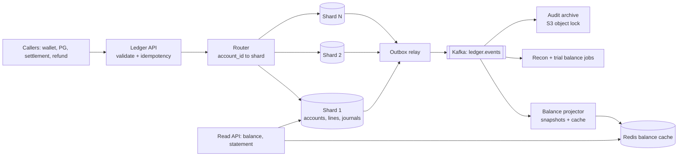
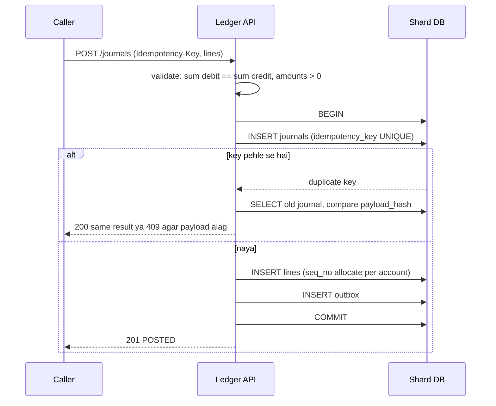
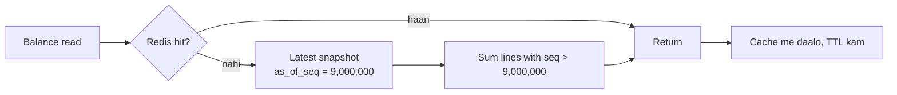
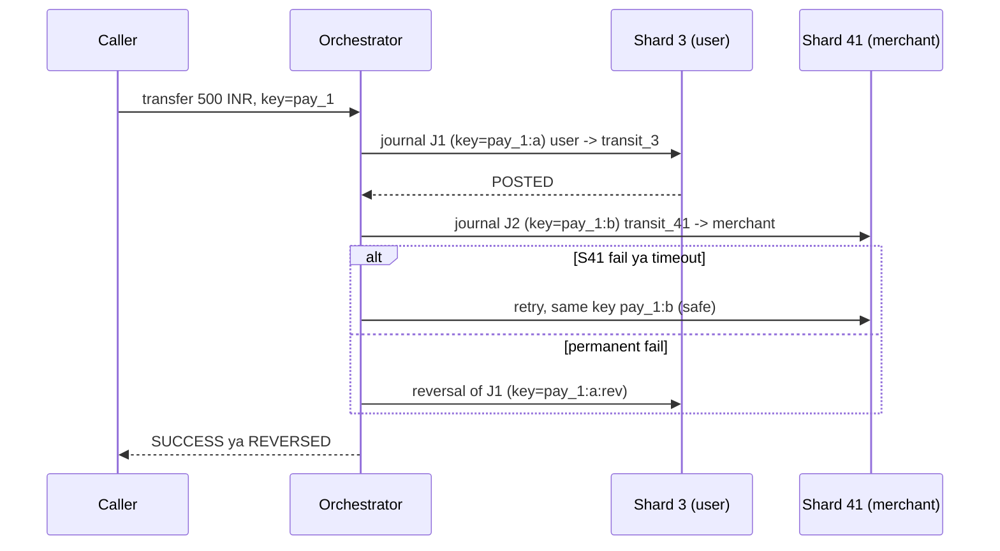

# C4 · Ledger service

Oct 16, 2026 · @saurav chaurasiya

**Is doc me:** ek central double-entry ledger service ka poora HLD (boss level) — accounts, journal entries, immutability, balance + snapshots, idempotent posting, sharding by account, hot accounts, audit aur reconciliation hooks.

**Padhne ka tareeka** — pehle Sawaal padho aur 15 min khud design karo, phir Sahi design se compare karo. Deep Dive tab padho jab core clear ho jaye.

---

## C4 — Ledger service

Ledger service ek aisa central system hai jo company ke har paise ki harkat ko **double-entry** (har movement ki do side: ek account se debit, doosre me credit) records ke roop me likhta hai, aur likhne ke baad kabhi badalta nahi. Wallet, gateway, settlement, refund — sab apna paisa ka hisaab isi ek jagah post karte hain.

### Ye cheez hai kya

- Category: HLD boss level — ek financial system of record (source of truth) ka design.
- Problem: bahut saari services (wallet, PG, settlement) apne apne balance rakhengi to kabhi match nahi karenge. Ek jagah, ek rule: **total debit = total credit**, aur history kabhi delete nahi hoti.
- Is lesson ke baad tum kar paoge: accounts + journal entries ka schema banana, idempotent posting API likhna, balance snapshot se compute karna, account se shard karna, hot merchant/pool account ko sambhalna, aur audit + recon hooks lagana.
- Analogy: ye ek **bahi-khata** hai jisme pen se likhte hain. Galti ho to page phaadte nahi, nayi line likh kar sudhaarte hain (reversal), aur har page pe dono taraf ka jod barabar hota hai.

Pehle ye basics padh lo, kyunki ye lesson inpe khada hai:

- [2B · Ledger Library](https://claude.ai/code/artifact/a7c567e0-66cb-46fe-b7c9-9c20739857eb) — double-entry, balances, CQRS (command query responsibility segregation — write aur read model alag) ka base.
- [2A · Idempotency Island](https://claude.ai/code/artifact/c269ac61-440b-4525-bd04-31baf708dece) — idempotent (same request baar baar bhejo to effect ek hi baar ho) posting.
- [1D · Shard Mountains](https://claude.ai/code/artifact/cfe905e6-6370-43e0-a337-764eeb9ddf1e) — sharding (data ko alag alag machines me baantna).
- [2D · Lock Fort](https://claude.ai/code/artifact/97588686-7110-4318-8124-3a8727c7604e) — locking, hot account ke liye.
- [2F · Recon Ruins](https://claude.ai/code/artifact/93d00bdd-f45f-441f-946c-c84355b5c05e) — reconciliation (do sources ke records match karna).

### Sawaal

Tum ek Paytm-jaisi company ke liye **central ledger service** design kar rahe ho. Rozana **10 crore (100M) business transactions** aate hain (UPI, wallet, card, settlement, refund). Peak pe average ka lagbhag 10 guna load, festive sale me aur zyada. Har transaction ek journal entry banata hai jisme 2 se 6 lines hoti hain (user debit, merchant credit, fee, GST).

Requirements ke numbers:

- Posting latency: **p99 (99% requests is time se tez) < 50 ms**.
- Balance read: **p99 < 20 ms**.
- Durability: ek bhi acknowledged entry kabhi lost nahi honi chahiye (RPO = 0, RPO matlab kitna data loss sahna hai).
- Kuch merchant aur pool accounts (jaise "UPI settlement pool") pe **10,000+ credits per second** aate hain.
- Retention: 8 saal (audit/regulatory), multi-currency abhi scope se bahar (sirf INR, paise me minor units).

> Pehle khud socho — 15 min. Hints: (1) Ek journal entry ke andar kya invariant (hamesha sach rehne wali shart) hona chahiye aur DB me usse kaise enforce karoge? (2) Balance ko column me store karoge ya lines se compute karoge — dono ke trade-offs? (3) Jab ek transfer ke do accounts alag shards pe hon aur ek merchant account pe lakhon credits aa rahe hon, to kya tootega?

### Problem kyun aata hai

- Har service apna balance column rakhti hai: `UPDATE wallet SET balance = balance - 100`. Koi history nahi, koi proof nahi ki paisa kahan gaya.
- Retry ya network timeout se ek hi payment do baar post ho jata hai (double debit).
- Ek hi merchant row pe lakhon updates aate hain, row lock pe sab line me lag jate hain.
- Audit ya RBI inspection me poochha jaye "3 March ko is account ka balance kya tha?" — aur jawab nahi mil pata kyunki purane values overwrite ho gaye.
- Services ke balance aur bank statement me fark aata hai aur kisi ko pata nahi kyun.

### Naive approach

- Ek `accounts` table me `balance` column, aur har payment me do rows pe `UPDATE`. Saath me ek `transactions` table jo best-effort log hai.
- Kahan tootta hai:
  - **Lost update / drift**: balance column aur log alag likhe jate hain; ek fail ho to dono ka hisaab alag. Daily recon me lakhon mismatches.
  - **Hot row**: 10,000 credits/sec ek merchant row pe. Ek row update lagbhag 1–2 ms lock rakhta hai, to ek row pe max \~500–1000 updates/sec. 10x load = request queue, timeouts, phir client retry storm.
  - **Overwrite = no audit**: `UPDATE` purana value mita deta hai. 8 saal ka history proof impossible.
  - **Double post**: bina idempotency key ke retry se 2 entries.
  - **Single DB**: 100M txn/day x 4 lines = 400M rows/day, ek machine pe fit nahi hoga.

### Sahi design

#### 1. Requirements

Functional:

- Account create/close, account ke types: user wallet, merchant, bank-nostro (bank me rakha company ka paisa), fee, GST, pool, suspense (anjaan paisa ruka hua).
- Journal entry post karna: balanced lines (sum debit = sum credit), idempotent.
- Balance aur statement read karna, kisi bhi past time ke liye (as-of).
- Reversal (galti sudhaarna) aur hold/release (paisa rokna).
- Audit trail aur reconciliation hooks.

Non-functional:

- Strong consistency har account ke andar (ek account ki entries ka total order).
- Immutability: append-only.
- High availability (SLO: availability, SLO matlab service level objective — target jo hum khud ke liye set karte hain, 99.99%).
- Horizontal scale (shards add karke).
- Hot accounts pe bhi throughput.

#### 2. Back-of-envelope estimates

- Journals: 100M/day. Average = 100M / 86,400 = lagbhag **1,160 journals/sec**. Peak 10x = **\~12K journals/sec**.
- Lines: avg 4 per journal. Peak = \~**48K line-writes/sec**.
- Storage: ek line lagbhag 200 bytes (ids, amount, direction, seq, timestamps). 400M lines/day x 200 B = **80 GB/day**, saal me **\~29 TB**. Indexes ke saath \~60 TB/saal.
- Hot tier: 13 mahine online (\~65 TB), baaki cold storage (S3 + Parquet), 8 saal retention.
- Shards: peak 48K line-writes/sec ko 64 shards pe baanto to \~750 lines/sec per shard. Ek achhi SQL primary ke liye aaram se.
- Balance reads: maan lo 20x write = \~1M reads/sec peak. Cache + snapshot se, direct DB nahi.

#### 3. Core model

- **Account**: ek naam wala bucket jahan paisa rehta hai. Normal side: asset account ka balance debit pe badhta hai, liability ka credit pe (customer wallet company ke liye liability hai).
- **Journal entry**: ek business event ka record. Andar 2+ **lines**. Rule: sum(debit) == sum(credit).
- **Line**: (account, direction DEBIT/CREDIT, amount in paise). Amount hamesha positive integer, kabhi float nahi.
- **Balance**: stored value nahi, lines ka derived function. Performance ke liye snapshot (neeche) rakhte hain.
- Immutability: line ya journal pe UPDATE/DELETE nahi. Galti ho to **reversal journal** (ulta entry) post karo aur dono history me rehte hain.

#### 4. API design

Post ek journal (sirf ye ek write API):

```
POST /v1/journals
Idempotency-Key: pay_8f3a21
{
  "txn_ref": "UPI_TXN_991823",
  "effective_at": "2026-10-16T10:15:00+05:30",
  "lines": [
    {"account_id": "acc_user_77",    "direction": "DEBIT",  "amount_paise": 50000},
    {"account_id": "acc_merch_12",   "direction": "CREDIT", "amount_paise": 49000},
    {"account_id": "acc_fee_rev",    "direction": "CREDIT", "amount_paise": 847},
    {"account_id": "acc_gst_pay",    "direction": "CREDIT", "amount_paise": 153}
  ],
  "metadata": {"source": "wallet-svc", "reason": "merchant_payment"}
}
=> 201 {"journal_id": "jr_01J...", "status": "POSTED"}
=> 200 same body agar same key + same payload dobara aaye
=> 409 agar same key but alag payload
=> 422 agar debit != credit
```

Read APIs:

- `GET /v1/accounts/{id}/balance?as_of=...` — ledger balance + available balance.
- `GET /v1/accounts/{id}/lines?cursor=...` — statement, cursor pagination (offset nahi).
- `POST /v1/journals/{id}/reverse` — reversal journal banata hai (naya idempotency key chahiye).
- `POST /v1/holds` aur `POST /v1/holds/{id}/capture|release` — pehle paisa rokna, baad me capture.

#### 5. Data model

Tables (SQL, shard key = `account_id`):

```
accounts(account_id PK, type, normal_side, currency, status, created_at)

journals(journal_id PK, idempotency_key UNIQUE, payload_hash, txn_ref,
         effective_at, posted_at, reverses_journal_id NULL, metadata JSON)

lines(account_id, seq_no,            -- PK(account_id, seq_no)
      journal_id, direction, amount_paise, line_hash,
      posted_at)

balance_snapshots(account_id, as_of_seq, balance_paise, created_at)

outbox(event_id PK, journal_id, payload, published_at NULL)
```

- `seq_no` har account ke andar 1, 2, 3 ... gap-free counter. Isse ordering milti hai aur gap = missing entry turant pakdi jati hai.
- `line_hash` = hash(previous line hash + this line). Hash chain se tamper detect hota hai (Audit section me).
- DB level pe UPDATE/DELETE ki grant nahi di jati; sirf INSERT.

#### 6. High-level architecture



Posting flow (ek shard ke andar):



#### 7. Idempotent posting

- Caller har logical payment ke liye ek stable `Idempotency-Key` bhejta hai (jaise `pay_<payment_id>`), retry pe wahi key. Detail [2A · Idempotency Island](https://claude.ai/code/artifact/c269ac61-440b-4525-bd04-31baf708dece) me hai.
- `journals.idempotency_key` pe **UNIQUE constraint** aur journal + lines + outbox ek hi DB transaction me. Isse "check phir insert" ki race nahi bachti.
- Duplicate aaye to purana result lauta do. `payload_hash` alag ho to 409, kyunki ek hi key do alag paise ke liye use hui.
- Key ka scope = `(caller_service, key)`, taaki do services ki keys na takraayen.
- Key ko ledger me hi store karte hain (alag Redis me nahi), kyunki Redis lose ho to double post ho sakta hai.

#### 8. Balance compute aur snapshots

- Balance = sum(credit) - sum(debit) (liability account ke liye) saari lines pe. Lakhon lines pe har read me sum karna mehnga hai.
- **Snapshot**: har N lines (ya har raat) pe `(account_id, as_of_seq, balance)` save karo. Balance = snapshot + sirf uske baad ki lines ka sum.
- Snapshot bhi ek derived cache hai: galat nikle to lines se dobara bana sakte ho. Source of truth hamesha lines.
- Read path: Redis cache -> miss pe latest snapshot + delta lines. Cache invalidation outbox events se hoti hai ([1B · Cache Caves](https://claude.ai/code/artifact/32bb1c8e-3433-417c-a3f4-3a34babed6bf)).
- **Ledger balance vs available balance**: available = ledger balance - active holds. Debit allow karne se pehle available check hota hai.
- Overdraft check (balance negative na ho) wahi shard pe, usi transaction me, account row pe lock (ya per-account sequencer) lekar. Locking ke options [2D · Lock Fort](https://claude.ai/code/artifact/97588686-7110-4318-8124-3a8727c7604e) me.
- As-of balance: `seq` ya `posted_at` ke hisaab se snapshot + delta. Audit ke "3 March ko balance kya tha" ka jawab yehi hai.



#### 9. Sharding by account

- Shard key = `account_id` (consistent hashing ya fixed 64 logical shards -> physical nodes). Basics [1D · Shard Mountains](https://claude.ai/code/artifact/cfe905e6-6370-43e0-a337-764eeb9ddf1e) me.
- Fayda: ek account ki saari lines ek shard pe, to `seq_no`, overdraft check aur balance ek hi jagah strong consistent.
- Problem: ek journal ke accounts alag shards pe ho sakte hain (user shard 3, merchant shard 41). Distributed transaction (2PC) ledger me slow aur fragile hai.
- Solution: **transit (clearing) account per shard**. Cross-shard transfer ko do chhote journals me todte hain, har journal apne shard me balanced:
  - Shard 3: DEBIT user, CREDIT `transit_3` (50,000)
  - Shard 41: DEBIT `transit_41`, CREDIT merchant (50,000)
  - Dono transit accounts ka total hamesha zero ke paas hona chahiye; koi non-zero ho jaye to recon alert.
- Dono journals ek saga se jodte hain (steps + compensating transaction, yaani pehla step ho gaya aur doosra fail to ulta entry). Saga detail [2C · Saga Sea](https://claude.ai/code/artifact/429b3ea6-a261-431d-a384-a0c6eb68a9f6) me, aur sharded txn ke patterns [2F · Recon Ruins](https://claude.ai/code/artifact/93d00bdd-f45f-441f-946c-c84355b5c05e) me.
- Same-shard journals (bahut saare) seedha ek local ACID transaction (atomic, consistent, isolated, durable) me jaate hain.
- Resharding ke liye logical shards ko pehle se zyada rakho (jaise 256 logical, 16 physical) taaki account move na karna pade, sirf logical shard ko doosre node pe le jao.



#### 10. Hot accounts (merchant / pool)

Hot account = ek aisa account jispe bahut saari entries ek saath aati hain (hot key). Normal row-lock design yahan toot jata hai.

- **Insert-only lines**: balance column update hi mat karo. Credit sirf ek naya line INSERT hai, to row pe lock contention nahi. Balance snapshot + delta se aata hai.
- **Credit-only fast path**: merchant ko credit karne ke liye balance check nahi chahiye, to `seq_no` ke liye bhi per-account lock zaroori nahi; ek batch sequencer lines ko group karke seq assign karta hai.
- **Group commit / micro-batching**: ek shard writer 5–10 ms ke window me us account ki 50 lines ek insert me likhta hai. Throughput \~50x.
- **Sub-accounts (bucketing)**: merchant account ko 32 sub-accounts me baanto (`acc_merch_12#00` ... `#31`); writer random/round-robin bucket chuntaa hai. Logical balance = 32 buckets ka sum (background projector isse cache karta hai).
- **Debit on hot pool** (jaise settlement payout) ke liye bucket-level limits: har bucket ko pehle se balance ka hissa allocate, taaki overdraft check local rahe.
- **Ghatao hot-ness**: bahut se pool credits ko pehle per-minute aggregate journal me roll-up karo (ek line = 1 minute ka total) jahan business allow kare, aur individual detail alag event store me rakho.

| Technique | Kab use karo | Kab mat karo |
| --- | --- | --- |
| Insert-only lines + snapshot | Hamesha, default | Jab sirf 10 txn/sec ho aur simple row balance chalta ho |
| Group commit | Credit-heavy merchant | Strict per-call 5 ms se kam latency chahiye |
| Sub-accounts | 1K+ writes/sec ek account pe | Account pe har debit pe exact balance check ho |
| Pre-aggregation | Pool/settlement, per-event line ki zaroorat nahi | Har event ka alag legal record chahiye |

#### 11. Immutability aur audit

- DB user ko sirf INSERT/SELECT; UPDATE/DELETE revoke. Migrations alag privileged role se, reviewed.
- **Reversal, never edit**: galat journal ka ulta journal post hota hai (`reverses_journal_id` set). Original bacha rehta hai.
- **Hash chain**: `line_hash = H(prev_line_hash || account_id || seq_no || direction || amount || journal_id)`. Beech ki koi row badli to aage ke saare hash toot jate hain. Periodically chain ka head hash ek alag trust zone (ya signed log) me daalo.
- **WORM archive** (write once read many): outbox events Kafka se S3 object lock (compliance mode) me jaate hain. Ledger DB hack bhi ho jaye to archive se compare kar sakte ho.
- Har journal me kaun (service identity), kyun (reason code), kab, kis request id se — ye metadata mandatory.
- Manual adjustment (ops team) ke liye maker-checker: ek banata hai, doosra approve karta hai, dono ids journal metadata me.

#### 12. Reconciliation hooks

- **Trial balance**: har ghante/daily job: poore ledger me sum(debit) == sum(credit) aur har shard pe alag. Nahi to P1 alert.
- **Transit/suspense accounts zero-check**: cross-shard transit accounts aur suspense accounts ka balance threshold ke upar rahe to alert.
- **Gap detection**: har account me `seq_no` gap-free hona chahiye. Gap = lost write.
- **External match**: bank statement / NPCI settlement file ke saath ledger ke nostro account ka match ([2F · Recon Ruins](https://claude.ai/code/artifact/93d00bdd-f45f-441f-946c-c84355b5c05e)). Ledger sirf events aur snapshots expose karta hai; matching logic recon system (C5 · Reconciliation system) ka kaam hai.
- **Hook**: `ledger.events` Kafka topic (outbox se, at-least-once; [1E · Kafka River](https://claude.ai/code/artifact/eeb39ee8-3f52-4c04-b57b-68213f02c429)) + daily balance snapshot export + `GET /v1/accounts/{id}/lines?as_of` read-only API.
- Consumers idempotent hone chahiye, kyunki at-least-once me duplicate events aate hain.

#### 13. Failure modes

- Shard primary down: replica promote (sync replica, RPO = 0). Replication ke trade-offs [1C · DB Dungeon](https://claude.ai/code/artifact/99909fe9-731e-4e31-9e7d-36e0c5aed845) me.
- Orchestrator crash beech me: saga state durable hai, resume hota hai; steps idempotent hain.
- Kafka down: outbox me events jama rehte hain, posting chalti rehti hai; Kafka aane pe relay catch up karta hai.
- Cache stale: balance reads ke liye `?consistent=true` jo DB se padhta hai (debit decisions hamesha DB se).

### Kya choose karein aur kyun

| Option | Kab use karo | Kab mat karo |
| --- | --- | --- |
| Stored balance column + log | Chhota internal tool, audit zaroori nahi | Paisa, regulation, ya multi-service system |
| Append-only lines + snapshot (hamara design) | Payments, wallet, settlement; audit + scale chahiye | Sirf cache-type data jahan loss chalta hai |
| Event sourcing poora (har state event se) | Domain bahut complex, replay zaroori | Team ko tooling nahi, simple ledger kaafi hai |
| Purpose-built ledger DB (jaise TigerBeetle) | Bahut high TPS, simple debit/credit model | Metadata-heavy queries, team ko SQL ecosystem chahiye |
| 2PC across shards | Kabhi-kabhi, low volume | High TPS ledger (coordinator SPOF aur lock hold time) |
| Transit account + saga | Cross-shard transfers at scale | Jab sab accounts ek hi shard me hon (seedha local txn) |

### India me kaise hota hai

- Payment companies me ledger aur bank/NPCI settlement ke beech daily reconciliation compulsory hota hai; UPI me NPCI ka settlement file aur bank ka statement ledger se match hota hai. Detail [2F · Recon Ruins](https://claude.ai/code/artifact/93d00bdd-f45f-441f-946c-c84355b5c05e) me.
- Paytm, PhonePe, Razorpay jaise players ka internal architecture public nahi hai, isliye yahan unke exact internals ka claim nahi; global fintech jinke blogs public hain unka pattern wahi hai jo upar hai.
- Stripe ka Ledger: har money movement ko double-entry me record karna, immutable events, aur isse reconciliation aur financial reporting chalana. Padho: [Ledger: Stripe's system for tracking and validating money movement](https://stripe.com/br/blog/ledger-stripe-system-for-tracking-and-validating-money-movement).
- Modern Treasury ki ledger design: immutable entries, account balances, aur data immutability ka argument: [Data immutability](https://www.moderntreasury.com/learn/data-immutability).
- Indian context ka ek important point: RBI/auditors minimum retention aur auditability maangte hain, isliye WORM archive aur as-of balance queries design ka hissa hain, baad ki sochi hui cheez nahi.
- Wallet jaise PPI (prepaid payment instrument) products me user ke wallet balance ka ledger aur bank me escrow account ka balance roz match karna padta hai, isi ka hook upar "External match" me hai.

### Interview follow-ups

- **Debit aur credit ek hi shard pe na ho to kya?** — Har shard pe transit account, do chhote balanced journals, saga se jodo. 2PC avoid karo.
- **Balance column kyun nahi rakha?** — Hot row contention aur overwrite se audit trail ka loss. Derived balance + snapshot, aur cache.
- **Galat entry post ho gayi, kaise theek karoge?** — Delete nahi; reversal journal (`reverses_journal_id`) post karo. Original history me rehti hai.
- **Ek merchant account pe 10K credits/sec?** — Insert-only lines, group commit, sub-account buckets, aur snapshot + delta se balance.
- **Idempotency key Redis me kyun nahi?** — Redis lose ho to double post. UNIQUE constraint ledger DB me, ek transaction me journal ke saath.
- **Ledger tamper hua to kaise pata chalega?** — Per-account hash chain, S3 object lock archive se compare, aur trial balance job.
- **Past date ka balance kaise?** — Snapshot jo `as_of_seq` se pehle ka ho + uske baad ki lines tak ka sum.

### Self-check

1. Double-entry ka invariant kya hai aur use DB me kahan enforce karoge?
2. Balance ko column me store karne ke 3 nuksan batao.
3. Cross-shard transfer transit accounts se kaise hota hai? Kaun sa pattern use hua?
4. Hot merchant account ke liye teen techniques naam lo.
5. Idempotency key same ho par payload alag aaye to kya karoge, aur kyun?

### Notebook

Ledger = append-only lines, balance sirf derived (snapshot + delta) · journal me sum(debit) == sum(credit), amounts integer paise · galti = reversal, kabhi UPDATE/DELETE nahi · idempotency = UNIQUE key + payload hash, ledger DB me hi · shard by account\_id, cross-shard = transit account + saga · hot account = insert-only + group commit + sub-account buckets · audit = hash chain + WORM archive + trial balance + seq gap check

### Padhne ke liye

- [Ledger: Stripe's system for tracking and validating money movement](https://stripe.com/br/blog/ledger-stripe-system-for-tracking-and-validating-money-movement)
- [Modern Treasury — Data immutability](https://www.moderntreasury.com/learn/data-immutability)
- [Modern Treasury — Announcing Ledgers](https://www.moderntreasury.com/journal/announcing-ledgers)

### Deep Dive (SDE-2) — jab time ho

#### Pending, posted, aur holds ka state machine

- Entry states: PENDING (hold) -> POSTED ya VOIDED. PENDING lines available balance ghatati hain par ledger balance nahi.
- Capture partial ho sakta hai (auth 1000, capture 800): capture journal alag, bacha 200 release.
- State change bhi immutable: nayi row/event, purani row nahi badalti. State machine ke patterns [2C · Saga Sea](https://claude.ai/code/artifact/429b3ea6-a261-431d-a384-a0c6eb68a9f6) me.

#### Per-account sequencing aur locking

- Seq allocation ke 3 tarike: row lock par `UPDATE accounts SET next_seq = next_seq + 1 RETURNING`, single-writer-per-account actor (queue), ya optimistic check `(account_id, expected_seq)` pe retry. Compare [2D · Lock Fort](https://claude.ai/code/artifact/97588686-7110-4318-8124-3a8727c7604e) se.
- Single writer per account = no lock, high throughput, par failover pe fencing token chahiye warna do writers.
- Hot accounts me seq ko batch me allocate karo (ek range reserve), warna seq counter hi bottleneck ban jata hai.

#### Backdated entries aur effective date

- `posted_at` (system time) aur `effective_at` (business date) alag. Backdated entry aaye to purane snapshot invalid ho sakte hain.
- Fix: snapshot `seq` pe banao (posted order), effective-date balance ke liye alag index; ya snapshot rebuild job.
- Day-end cut-off: books close ke baad backdating band; correction next day ke adjustment se.

#### CQRS aur read scaling

- Write path: ledger shards. Read path: Kafka se projector balance, statement, search ke read models banata hai (CQRS, [2B · Ledger Library](https://claude.ai/code/artifact/a7c567e0-66cb-46fe-b7c9-9c20739857eb)).
- Read models eventually consistent (thodi der me sach) hain; debit decision kabhi read model se nahi, hamesha shard se.
- Statement pagination `(account_id, seq_no)` cursor se; seq index primary key hi hai, to fast.

#### Multi-region aur disaster recovery

- Ledger ek region me primary rakho, doosre region me sync/semi-sync replica. Active-active writes ledger me risky hain (same account pe conflicting seq).
- Account ko ek home region assign karo; failover pe fenced promotion. Patterns [2E · Resilience Ridge](https://claude.ai/code/artifact/4769dea3-018e-41e1-ae18-253fa36a6d21) me.
- DR drill: replica se trial balance run karke verify karo ki RPO = 0 sach hai.

#### Archival aur partitioning

- Lines table ko time ya account-range se partition karo; 13 mahine se purani partitions Parquet me S3 pe, snapshot ke saath.
- Archive se balance verify: snapshot + archived lines ka sum phir hash chain se compare.
- Delete nahi, sirf tier change; legal hold lag jaye to retention extend.

---

## Aage kya

- Pichhla: [C3 · Digital wallet](https://claude.ai/code/artifact/5d38db4f-e17f-433f-93ba-e9eb072c118e)
- Agla: [C5 · Reconciliation system](https://claude.ai/code/artifact/eaf670e9-264a-4515-9040-708f2a52badd)
- Related: [2B · Ledger Library](https://claude.ai/code/artifact/a7c567e0-66cb-46fe-b7c9-9c20739857eb), [2A · Idempotency Island](https://claude.ai/code/artifact/c269ac61-440b-4525-bd04-31baf708dece), [1D · Shard Mountains](https://claude.ai/code/artifact/cfe905e6-6370-43e0-a337-764eeb9ddf1e), [2F · Recon Ruins](https://claude.ai/code/artifact/93d00bdd-f45f-441f-946c-c84355b5c05e), [2D · Lock Fort](https://claude.ai/code/artifact/97588686-7110-4318-8124-3a8727c7604e)
