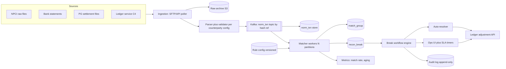
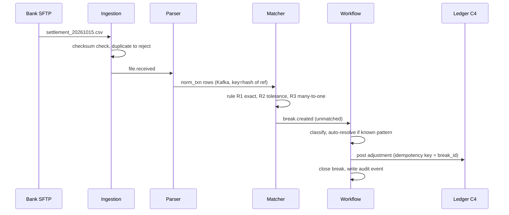

# C5 · Reconciliation system

Oct 16, 2026 · @saurav chaurasiya

**Is doc me:** payments company ka end-to-end reconciliation platform: bank/NPCI/PG files ingest, three-way recon, 2+ crore rows/day ka matching engine, break workflow, ops UI, auto-resolution, SLAs aur audit.

**Padhne ka tareeka** — pehle Sawaal pe 15 min khud design karo, phir Sahi design ke diagrams se apna design compare karo. [2F · Recon Ruins](https://claude.ai/code/artifact/93d00bdd-f45f-441f-946c-c84355b5c05e) me recon ke basics hain; yahan poora system design hai.

---

## C5 — Reconciliation system

Reconciliation (recon — do ya teen sources ke records ko match karke dekhna ki paisa aur status dono jagah same hai) ek platform hai jo har din crore-level transactions ko ledger, PG aur bank/NPCI files se match karta hai. Jo match nahi hota use "break" bolte hain, aur break ko owner, SLA aur audit trail ke saath resolve karna system ka asli kaam hai.

### Ye cheez hai kya

- Category: batch + near-real-time data platform (ingestion, matching engine, workflow engine, ops UI).
- Problem: hamara ledger kehta hai "paisa gaya", bank kehta hai "nahi aaya" ya "alag amount aaya". Ye gap pakadna, explain karna aur theek karna zaroori hai warna paisa leak hota hai aur RBI audit fail hota hai.
- Is lesson ke baad tum kar paoge: multi-counterparty ingestion design, config-driven matching rules, matcher ko 2+ crore rows/day pe scale karna, break/exception workflow aur audit trail design karna.
- Analogy: shaadi ke baad hisaab. Caterer ki bill, tumhari diary aur bank statement teeno ko milana; jo line nahi mile use alag list me daal ke ek-ek ke peeche padna.

### Sawaal

Tum Paytm jaisi company ke payments platform me ho. Roz \~2 crore transactions: UPI (\~1.4 crore), cards/netbanking via PG (\~40 lakh), wallet/IMPS/NEFT payouts (\~20 lakh). Counterparties: NPCI (UPI raw files, har cycle), 8-10 acquiring banks, 3-4 PGs/aggregators, payout banks. Har source ka alag file format (CSV, fixed-width, XML, JSON via SFTP/API) aur alag timing.

Requirement: T+1 subah 9 baje tak sab files match ho jayein, match rate 99.9%+, har break ka owner aur SLA ho, aur auditor kisi bhi purane din ka result "as-of" dobara dekh sake.

> Pehle khud socho — 15 min. Hints: (1) Har bank ka file format alag hai, to ingestion ko kaise generic banaoge? (2) Match key kya hogi jab RRN (retrieval reference number — UPI txn ka bank-side unique number) kabhi missing ho? (3) Break resolve hone ke baad ledger me kya likhoge, bina purani entry badle?

### Problem kyun aata hai

- Teen alag sources of truth: hamara ledger (internal), PG/switch ka record, aur bank/NPCI ka settlement file. Teeno apne-apne time pe update hote hain.
- Timeouts aur deemed approvals: UPI me debit hua par credit status unknown rehta hai; baad me NPCI ka file hi sach batata hai.
- File issues: duplicate file, late file, partial file, format change bina bataye (NPCI ne raw file format ke changes ke circulars nikale hain).
- Amount/fee/GST/MDR (merchant discount rate — merchant se liya jaane wala fee) differences: rounding aur fee deductions se amount thoda alag aata hai.
- Scale: 2 crore/din ka matlab \~230 rows/sec average, par file ek saath aati hai, to matcher ko burst me \~50-100K rows/sec chahiye.

### Naive approach

- Ek cron job: raat ko bank CSV load karo, ek SQL query `ledger LEFT JOIN bank ON rrn` chalao, mismatch ko Excel me ops ko mail karo.
- Kahan toot-ta hai:
  - 2 crore x 2 sources ka join ek DB pe 40-60 min leke aur production ledger DB ko slow karta hai.
  - Sirf exact RRN match: RRN missing ya amount me 1 paisa fark ho to turant false break; ops ko roz 50,000+ "breaks" milte hain jo asli me break nahi.
  - Naya bank aaya to code change + deploy; 10 banks = 10 alag scripts.
  - Excel/mail pe koi owner, SLA ya audit nahi; ek break do baar fix ho sakta hai.
  - Job beech me fail ho to restart se duplicate entries.

### Sahi design

#### Requirements

- Functional:
  1. Multi-counterparty file ingestion (SFTP/API/email), parse, validate, normalize.
  2. Two-way aur three-way matching (ledger vs PG vs bank/NPCI).
  3. Config-driven matching rules (exact, tolerance, many-to-one) bina code deploy ke.
  4. Break (exception) ka lifecycle: detect, classify, assign, resolve, close.
  5. Auto-resolution (known patterns) aur manual resolution with maker-checker (ek banda propose kare, doosra approve).
  6. Ledger me adjustment entries (C4 ledger service ke through) aur settlement-ready reports.
  7. Ops dashboard, SLA aging, audit trail, as-of replay.
- Non-functional:
  - Throughput: 2+ crore rows/din, 10x growth ready. Batch SLA: T+1 9 AM tak 99.9% matched.
  - Idempotent (ek hi kaam dobara karo to result same) ingestion aur matching: same file do baar aaye to kuch nahi badle.
  - Auditability: har decision ka rule version aur reason stored, kuch delete nahi hota.
  - Correctness over latency: galat match galat no-match se zyada khatarnak hai.
  - Availability: matcher down ho to bhi payments chalte rahein (recon async hai, payment path me nahi).

#### Back-of-envelope

- 2 crore txn/din x \~3 sources = \~6 crore source rows/din.
- Row size \~500 bytes normalized => 6 crore x 0.5 KB = \~30 GB/din; raw files alag: \~15 GB/din compressed. 1 saal hot+cold = \~11 TB normalized; raw archive 7 saal (RBI retention) => object storage.
- Matching: 6 crore rows / 30 min target = \~33K rows/sec. 20 partitions x 3-5K rows/sec/worker comfortably fits.
- Breaks: 0.1% = 20,000 breaks/din; 50 ops log x \~200 breaks/din = 10,000 manual capacity, to auto-resolution ko 50%+ breaks khatam karne chahiye.

#### API design

- Ops/system APIs (REST):
  - `POST /v1/recon/runs` body `{ "recon_type":"UPI_3WAY", "business_date":"2026-10-15", "idempotency_key":"..." }` - run trigger.
  - `GET /v1/recon/runs/{id}` - status, counts (matched/unmatched/auto-resolved).
  - `GET /v1/breaks?status=OPEN&owner=me&sla_breached=true&cursor=...` - ops queue.
  - `POST /v1/breaks/{id}/actions` body `{ "action":"PROPOSE_ADJUSTMENT", "reason":"..." }` - maker; `POST /v1/breaks/{id}/approve` - checker.
  - `PUT /v1/recon/rules/{type}` - rules ka naya version (draft -> approved -> active).
- Internal events (Kafka): `file.received`, `file.parsed`, `recon.run.completed`, `break.created`, `break.resolved`.

#### Data model

- `source_file`(file\_id, counterparty, business\_date, checksum UNIQUE, status, row\_count, received\_at) - checksum UNIQUE se duplicate file reject.
- `norm_txn`(txn\_pk, source, counterparty, external\_ref/RRN, our\_txn\_id, amount\_paise, currency, direction, status, txn\_ts, value\_date, file\_id, row\_no, raw\_json\_ref) - sab sources ka common format; partition by business\_date, key by hash(external\_ref).
- `match_group`(group\_id, run\_id, rule\_id, rule\_version, confidence, matched\_at) + `match_member`(group\_id, txn\_pk, side). Many-to-one (ek settlement = bahut txns) isi se chalega.
- `recon_break`(break\_id, run\_id, type, txn\_pk, amount\_diff, status, owner, sla\_due\_at, opened\_at, closed\_at, resolution\_code).
- `break_event`(break\_id, seq, actor, action, from\_status, to\_status, note, at) - append-only audit log.
- `rule_config`(rule\_set, version, json, status, approved\_by).
- Amounts hamesha paise me integer (BigDecimal/long), kabhi float nahi.

#### High-level architecture

Neeche flow: files -> ingestion -> normalization -> partitioned matcher -> breaks -> workflow -> ledger adjustment.



Ek din ka sequence (file aane se break close hone tak):



Design ke steps:

1. **Ingestion**: har counterparty ka config (path, schedule, format, column mapping, checksum rule). File aate hi checksum se dedupe, raw S3 me archive, `source_file` row. Naya bank = naya config, code nahi.
2. **Parse + normalize**: counterparty-specific mapper (config se) common `norm_txn` banata hai. Bad rows `quarantine` me jaati hain, poori file fail nahi hoti; file ka row\_count aur control total (header ka total amount) verify hota hai.
3. **Partition**: Kafka me key = hash(RRN ya our\_txn\_id). Ek hi txn ke teeno sources ek hi partition me aate hain, to matcher ko cross-node join nahi karna padta.
4. **Matching engine**: rules ek ordered list me (strict pehle, loose baad me). Har rule hash-join (bucket key se) + tolerance check karta hai. Matched rows consume ho jaate hain, baaki agle rule me jaate hain.
5. **Break detection**: end of window pe jo unmatched bacha, use type ke saath classify karo: `LEDGER_ONLY`, `BANK_ONLY`, `AMOUNT_MISMATCH`, `STATUS_MISMATCH`, `DUPLICATE`. Late-file ke liye grace window (jaise T+2) rakho, tab tak "pending" rahe, break nahi.
6. **Workflow**: break ka state machine `OPEN -> AUTO_RESOLVED | ASSIGNED -> PROPOSED -> APPROVED -> CLOSED` (state machine ka concept [L2.12](https://claude.ai/code/artifact/429b3ea6-a261-431d-a384-a0c6eb68a9f6) me hai). Har transition `break_event` me append hota hai.
7. **Resolution**: ledger adjustment [C4 · Ledger service](https://claude.ai/code/artifact/820a1941-be5c-4b54-8a42-0a9fad2a8704) ke through, idempotency key = break\_id, taaki retry se double posting na ho ([L2.1](https://claude.ai/code/artifact/c269ac61-440b-4525-bd04-31baf708dece)).

Matching engine ka chhota Java demo (Strategy pattern: har rule ek object, order config se; hash-join O(n+m)). Isse samajh aata hai ki strict rule pehle chalta hai aur loose rule sirf bacha hua pakadta hai.

```java
import java.util.*;

public class Demo {
    // ek side ka record: ledger ya bank/NPCI file ka row
    record Txn(String id, String rrn, long paise, long ts, String src) {}

    // Strategy pattern: har matching rule ek alag object, config se order me lagta hai
    interface MatchRule {
        String name();
        String key(Txn t);                       // bucket key - isi se hash join hota hai
        boolean accept(Txn a, Txn b);            // key same ho to extra check (tolerance etc.)
    }

    static class ExactRrn implements MatchRule {
        public String name() { return "R1_EXACT_RRN_AMT"; }
        public String key(Txn t) { return t.rrn(); }
        public boolean accept(Txn a, Txn b) { return a.paise() == b.paise(); }
    }

    static class AmountTimeWindow implements MatchRule {
        final long toleranceMs;
        AmountTimeWindow(long ms) { toleranceMs = ms; }
        public String name() { return "R2_AMT_TIME_WINDOW"; }
        public String key(Txn t) { return String.valueOf(t.paise()); }
        public boolean accept(Txn a, Txn b) { return Math.abs(a.ts() - b.ts()) <= toleranceMs; }
    }

    // ledger side ko bucket me daalo, bank side stream karo: O(n+m) hash join
    static List<String> run(MatchRule rule, List<Txn> ledger, List<Txn> bank, Set<String> used) {
        Map<String, Deque<Txn>> idx = new HashMap<>();
        for (Txn l : ledger) if (!used.contains(l.id())) idx.computeIfAbsent(rule.key(l), k -> new ArrayDeque<>()).add(l);
        List<String> out = new ArrayList<>();
        for (Txn b : bank) {
            if (used.contains(b.id())) continue;
            Deque<Txn> cands = idx.get(rule.key(b));
            if (cands == null) continue;
            Iterator<Txn> it = cands.iterator();
            while (it.hasNext()) {
                Txn l = it.next();
                if (rule.accept(l, b)) {
                    used.add(l.id()); used.add(b.id()); it.remove();
                    out.add(rule.name() + ": " + l.id() + " <-> " + b.id());
                    break;
                }
            }
        }
        return out;
    }

    public static void main(String[] args) {
        List<Txn> ledger = List.of(
            new Txn("L1", "RRN100", 50000, 1000, "LEDGER"),
            new Txn("L2", "RRN101", 25000, 2000, "LEDGER"),
            new Txn("L3", null,     99900, 3000, "LEDGER"),   // RRN nahi mila, sirf amount+time
            new Txn("L4", "RRN103", 70000, 4000, "LEDGER"),   // bank me aaya hi nahi
            new Txn("L5", "RRN104", 10000, 5000, "LEDGER"));  // amount mismatch
        List<Txn> bank = List.of(
            new Txn("B1", "RRN100", 50000, 1100, "BANK"),
            new Txn("B2", "RRN101", 25000, 2100, "BANK"),
            new Txn("B3", "RRNX",   99900, 3500, "BANK"),
            new Txn("B4", "RRN104", 10100, 5100, "BANK"),
            new Txn("B5", "RRN999", 12345, 6000, "BANK"));    // ledger me nahi hai

        // config-driven order: pehle strict rule, phir loose
        List<MatchRule> rules = List.of(new ExactRrn(), new AmountTimeWindow(1000));
        Set<String> used = new HashSet<>();
        for (MatchRule r : rules) run(r, ledger, bank, used).forEach(System.out::println);

        System.out.println("--- breaks ---");
        for (Txn t : ledger) if (!used.contains(t.id())) System.out.println("BREAK ledger-only: " + t.id() + " rrn=" + t.rrn() + " paise=" + t.paise());
        for (Txn t : bank) if (!used.contains(t.id())) System.out.println("BREAK bank-only: " + t.id() + " rrn=" + t.rrn() + " paise=" + t.paise());
    }
}
```

Isko chalane pe bilkul ye output aata hai:

```text
R1_EXACT_RRN_AMT: L1 <-> B1
R1_EXACT_RRN_AMT: L2 <-> B2
R2_AMT_TIME_WINDOW: L3 <-> B3
--- breaks ---
BREAK ledger-only: L4 rrn=RRN103 paise=70000
BREAK ledger-only: L5 rrn=RRN104 paise=10000
BREAK bank-only: B4 rrn=RRN104 paise=10100
BREAK bank-only: B5 rrn=RRN999 paise=12345
```

- L1/L2 R1 se match hue (RRN aur amount same). L3 ka RRN null tha, R1 ne use skip kiya, R2 ne amount + 500 ms ke time gap se pakda.
- L5 aur B4 ka RRN same hai par amount 100 paise alag hai, isliye R1 ne reject kiya; real system me ise `AMOUNT_MISMATCH` break me classify karte hain (do alag "only" breaks ek hi mismatch ke do half hain).
- Production me: ye har Kafka partition ke andar chalega, rule order/tolerance `rule_config` se aayega, aur null-key rows ko alag handle karenge.

### Kya choose karein aur kyun

Matching engine ka compute kahan chalayein:

| Option | Kab use karo | Kab mat karo |
| --- | --- | --- |
| SQL join in RDBMS | Chhota volume (<10 lakh/din), ek hi source | 2 crore+ rows; prod DB pe load aur slow joins |
| Spark/Flink batch (partitioned) | Bade daily files, T+1 SLA, rules complex | Real-time (seconds) matching chahiye |
| Kafka + stateful matcher workers | Streaming recon, partition-local join, scale-out easy | Team ko state store (RocksDB) operate nahi karna |
| Third-party recon SaaS | Jaldi launch, standard formats | Custom NPCI/bank formats, data residency, cost at scale |

Matching style:

| Rule type | Kab use karo | Kab mat karo |
| --- | --- | --- |
| Exact key (RRN + amount) | 90%+ rows, sabse sasta aur safe | Key missing/duplicate ho |
| Tolerance (amount +/- fee, time window) | Fee/rounding, RRN missing | Bina secondary key ke; false match risk |
| Many-to-one (settlement = sum of txns) | Bank batch settlement, PG payout | Bahut bade groups (subset-sum NP-hard, group key se limit karo) |
| Fuzzy/ML scoring | Last 0.1% jo rules se na mile, suggestions ke liye | Auto-close ke liye; sirf "suggest", approve human kare |

### India me kaise hota hai

- NPCI UPI ke liye settlement aur raw data files deta hai; members ko un files se apna ledger match karna hota hai. Process: [NPCI UPI Settlement Process](https://www.npci.org.in/PDF/npci/others/UPI-Settlement-Process.pdf).
- NPCI raw file ke format/timeline badalne par circular nikalta hai, isliye parser config-driven rakhna zaroori hai: [OC 152 - Revised timelines on changes in UPI raw file](https://www.npci.org.in/PDF/npci/upi/circular/2022/OC-152-Revised-timelines-on-Changes-in-UPI-raw-file.pdf).
- Debit reversal aur deemed approval ke rules recon ke break types decide karte hain: [NPCI Circular 17 - Debit Reversals and Deemed Approval](https://www.npci.org.in/PDF/npci/upi/circular/2017/Circular-17-Debit-Reversals-and-Deemed-Approval_0.pdf).
- IMPS me DMS se RGCS (NPCI ka settlement/reconciliation system) migration: [IMPS OC 67](https://www.npci.org.in/PDF/npci/imps/circular/2016/IMPS-I-OC-67-I-FY-15-16-I-Migration-from-DMS-to-RGCS-w.e.f-27th-Feb-2016.pdf).
- Industry writeups ka common theme: recon ab finance ka nahi, engineering ka function ban raha hai: [Yuno - Reconciliation is becoming an engineering function](https://www.y.uno/en/blog/reconciliation-is-becoming-an-engineering-function-not-a-finance-one).
- Paytm/PhonePe/Razorpay jaisi companies ka exact internal design public nahi hai; upar ka design NPCI docs aur standard industry patterns pe based hai.

### Interview follow-ups

- **Ek bank ka file do baar aa gaya to?** — `source_file.checksum` UNIQUE; duplicate reject ya no-op. Rows pe bhi (counterparty, file\_id, row\_no) unique, to partial replay safe hai.
- **Bank file late aayi to breaks kaise bachaoge?** — Grace window (T+1/T+2) ke andar unmatched rows `PENDING` rehte hain, break sirf window ke baad. File-arrival SLA alert alag se.
- **Matcher ko 10x scale kaise karoge?** — Kafka partitions badhao (hash(ref) key), stateless-ish workers, partition-local hash join. Hot counterparty ho to key me date/ref mix karo (hot key — ek key pe bahut zyada load).
- **Auto-resolution kab safe hai?** — Sirf known, low-risk patterns (jaise fee rounding < Rs 1, ya reversal already posted) aur threshold amount ke neeche. Baaki maker-checker. Har auto-action ka rule version audit me.
- **Rule change se purane din ka result badal jaye to?** — Rules versioned aur immutable; run `rule_version` store karta hai. Replay as-of old version se, naye se nahi.
- **Many-to-one match (settlement batch) kaise?** — Group key se (settlement\_id/batch\_id) ledger rows ko sum karo, bank ke ek row se compare karo. Subset-sum search mat karo.
- **Ledger adjustment double na ho?** — Idempotency key = break\_id, aur ledger entries append-only reversal se ([C4](https://claude.ai/code/artifact/820a1941-be5c-4b54-8a42-0a9fad2a8704)); purani entry kabhi edit nahi.

### Self-check

1. Two-way aur three-way recon me kya farak hai, aur UPI me teen sources kaun se hain?
2. Matching rules strict se loose order me kyun chalte hain? Ulta chalaoge to kya bigdega?
3. Kafka key hash(RRN) rakhne se matcher ko kya fayda milta hai?
4. Break ke states likho aur batao kaunse transition audit me jaate hain.
5. 2 crore rows/din ke liye matcher throughput ka estimate kaise nikaloge, peak ko dhyan me rakhke?

### Notebook

Recon = ledger vs PG vs bank/NPCI match, unmatched = break · Ingestion idempotent via file checksum · Rules versioned, config-driven, strict pehle loose baad me · Partition by hash(ref) = join partition-local · Amount hamesha paise me (integer) · Break = state machine + append-only audit + maker-checker · Late file ke liye grace window, turant break nahi · Ledger adjustment idempotency key = break\_id.

### Padhne ke liye

- [UPI Settlement Process (NPCI)](https://www.npci.org.in/PDF/npci/others/UPI-Settlement-Process.pdf)
- [Payment Reconciliation System Development Guide - Architecture, Data Model, Exception Handling](https://trio.dev/?p=41098)
- [Simetrik - A guide to modern payments reconciliation](https://simetrik.com/blog/from-wheres-that-transaction-to-all-matched-next-a-guide-to-modern-payments-reconciliation/)
- [2F · Recon Ruins (L2.21 basics)](https://claude.ai/code/artifact/93d00bdd-f45f-441f-946c-c84355b5c05e)

### Deep Dive (SDE-2) — jab time ho

#### Scaling the matcher

- Partition key = hash(RRN) (ya our\_txn\_id agar RRN null); null-key rows ke liye fallback queue jahan secondary key (amount + time bucket) se re-partition hota hai.
- Windowed state: har partition me RocksDB/Redis state store; rows tab tak rakho jab tak grace window khatam na ho, phir evict karke break emit.
- Hot counterparty/key: salting ya sub-partition; rebalancing ke time state restore (changelog topic) ka cost dhyan me rakho.
- Batch vs stream: daily files ke liye batch (Spark) simple; intraday UPI ke liye micro-batch har 15 min, taaki breaks jaldi dikhein.
- Backpressure ([L1.x / L2.17a](https://claude.ai/code/artifact/4769dea3-018e-41e1-ae18-253fa36a6d21)): file burst me parser fast, matcher slow ho to Kafka lag buffer bane, par alert lagao.

#### Config-driven rules aur multi-counterparty

- Rule DSL (JSON/YAML): `{ "id":"R2", "key":["amount"], "tolerance":{"time_ms":60000, "amount_paise":0}, "priority":2 }`.
- Lifecycle: draft -> backtest on last 7 days -> approve (checker) -> activate with effective-from date. Rollback = purana version re-activate.
- Per-counterparty profiles: field mapping, timezone (bank IST vs UTC), cut-off times, fee model, status code mapping (`00` success etc.).
- Canary rules: naya rule shadow mode me chalao, match diff compare karo, fir enforce.

#### Exceptions workflow, SLA aur audit

- Break classification -> routing: type + amount + age se queue aur owner (L1 ops, L2 bank-liaison). SLA timers: aging buckets 0-1d, 2-3d, 4-7d, 7d+; escalation auto.
- Auto-resolution patterns: duplicate debit -> auto reversal request; bank-only success jisme ledger pending -> ledger success mark (status sync); fee rounding -> write-off entry.
- Maker-checker: proposer aur approver alag users; amount thresholds pe higher approval.
- Audit: append-only `break_event`, WORM (write once read many) storage for exports, as-of replay: (run\_id, rule\_version, file checksums) se result dobara reproduce ho sake. Retention RBI guidelines ke hisaab se (typically 5-8 saal; apni compliance team se confirm karo).
- Observability: match rate by counterparty, break aging, auto-resolve %, file lateness, ingest-to-match latency ([1F Ops Tower](https://claude.ai/code/artifact/6a87e8d2-04fb-418e-b433-e5a88508f83e)).

---

## Aage kya

- Pichhla: [C4 · Ledger service](https://claude.ai/code/artifact/820a1941-be5c-4b54-8a42-0a9fad2a8704)
- Agla: [C6 · Refund system](https://claude.ai/code/artifact/0938c098-ccc8-4c99-9412-35f2d202ffaa)
- Related: [2F · Recon Ruins](https://claude.ai/code/artifact/93d00bdd-f45f-441f-946c-c84355b5c05e), [2B · Ledger Library](https://claude.ai/code/artifact/a7c567e0-66cb-46fe-b7c9-9c20739857eb)
