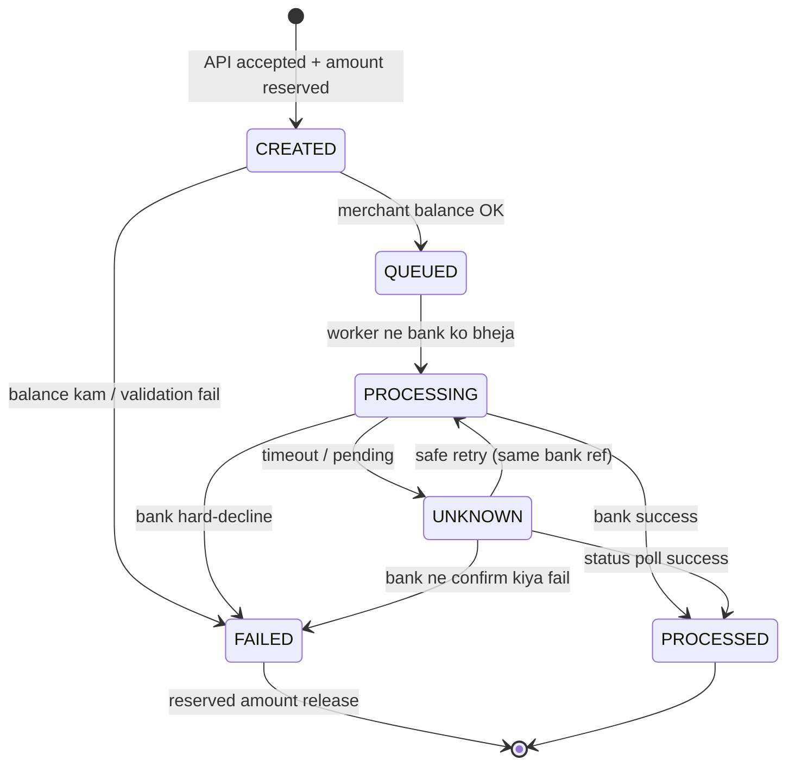
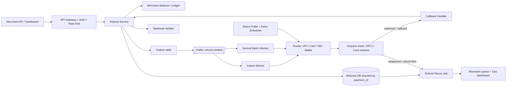
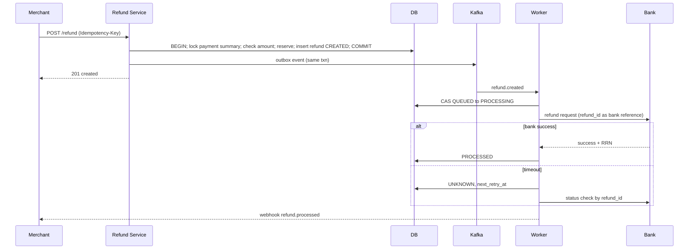

# C6 · Refund system

Oct 16, 2026 · @saurav chaurasiya

**Is doc me:** payment gateway (Razorpay / Paytm PG jaisa) ka refund system — full/partial refund, instant vs normal, refund to source, state machine, idempotency, async bank responses, recon aur RBI TAT rules.

**Padhne ka tareeka** — pehle Sawaal pe 15 min khud socho, phir Sahi design padho. SDE-1 ke liye Deep Dive ke pehle tak kaafi hai; SDE-2 ke liye Deep Dive bhi padho.

---

## C6 — Refund system

Refund system woh service hai jo customer ke already-captured payment ka paisa (poora ya kuch hissa) wapas usi jagah bhejti hai jahan se aaya tha — UPI, card ya wallet. Isme paisa merchant ke balance se nikalta hai aur bank/network ke through customer tak jaata hai, aur beech me kai din lag sakte hain.

### Ye cheez hai kya

- Category: HLD boss — payments backend ka ek async, state-machine-driven workflow.
- Problem: customer ne order cancel kiya ya product return hua, to paisa safely, sirf ek baar, aur sahi account me wapas jaana chahiye.
- Is lesson ke baad tum kar paoge: refund API design, refund state machine, double-refund rokna, bank ke late/unknown response sambhalna, aur recon + RBI TAT rules explain karna.
- Analogy: dukaan se kapde return kiye — dukaandar receipt dekhta hai (original payment), ek baar hi paisa deta hai (idempotency), aur paisa usi card pe jaata hai jisse khareeda tha (refund to source).

### Sawaal

Tum ek payment gateway (Razorpay / Paytm PG jaisa) ke refund team me ho. Roz 20 crore payments process hote hain, aur lagbhag 3-5% payments refund hote hain. Sale days (Big Billion Days, Diwali) pe refund peak 10x ho jaata hai.

- Merchants API se full aur partial refund maangte hain (ek payment pe multiple partial refunds bhi).
- Do speeds chahiye: normal (3-5 working days) aur instant (UPI/debit card pe kuch minutes me, extra fee ke saath).
- Refund hamesha original source pe jaana chahiye. Bank ka response kabhi turant, kabhi 2 din baad, kabhi kabhi aata hi nahi.
- Merchant ke balance se paisa kat'ta hai, to balance kam hone pe refund queue ya reject hona chahiye.
- Duplicate request (network retry) pe double refund bilkul nahi hona chahiye — paisa gaya to gaya.

> Pehle khud socho — 15 min. Hints: (1) Refund ka state machine kya hoga — created, processing, processed, failed, aur unknown? (2) Ek payment pe total refund amount captured amount se zyada kaise nahi hone denge jab 2 requests parallel aayein? (3) Bank ne timeout diya — retry karein ya pehle status poochhein?

### Problem kyun aata hai

- Refund ek **async** kaam hai: hamari taraf se request jaati hai, bank/NPCI ka final jawab baad me aata hai (async = jawab turant nahi, baad me).
- Paisa nikalna irreversible hai — galti ka matlab asli paisa ka nuksaan, isliye correctness latency se upar hai.
- Parallel requests: merchant dashboard + API + support agent, teeno ek hi payment pe refund maang sakte hain.
- Bank side unreliable hai: timeout, "pending", ya success bhej ke baad me fail.
- RBI ke TAT (turnaround time — kitne din me kaam khatam karna zaroori hai) rules hain, deadline miss pe customer ko compensation dena padta hai.
- Merchant balance kam ho to kya karein — fail, queue ya negative balance allow?

### Naive approach

- Pehla idea: `POST /refund` aaya, DB me payment ka amount check kiya, bank API sync call ki, success aaya to response de diya.
- Break point 1: bank call 30 sec le sakti hai. 5,000 refund/sec peak pe 150,000 threads chahiye — service gir jaayegi.
- Break point 2: bank ne timeout diya, merchant ne retry kiya, bank ne dono process kar diye — double refund. 20 crore payments x 4% = 80 lakh refunds/day, even 0.01% duplicate = 800 galat refunds roz.
- Break point 3: check-then-act race: `SELECT refunded_so_far` aur `UPDATE` alag hone se 2 parallel partial refunds mil ke payment amount se zyada nikal sakte hain.
- Break point 4: koi state nahi, to "pending" refund ka kuch pata nahi — recon aur customer support dono andhe.

### Sahi design

#### Requirements

- Functional: full refund, multiple partial refunds, refund speed (normal / instant), refund to source (UPI/card/netbanking/wallet), refund status API + webhook, merchant dashboard bulk refund, notes/reason.
- Functional: refund sirf captured payment pe; total refunds <= captured amount; merchant balance check.
- Non-functional: **exactly-once effect** (ek refund request = ek hi paisa-nikasi), availability 99.95% for API, create API p99 (99% requests is time ke andar — slowest 1% chhod ke) < 300 ms.
- Non-functional: durability (koi refund kabhi khona nahi chahiye), auditability, RBI TAT compliance, peak 10x scale.

#### Back-of-envelope estimates

- 20 crore payments/day x 4% refund = 80 lakh refunds/day, yaani \~90 refunds/sec average (80,00,000 / 86,400).
- Peak 10x = \~1,000/sec; sale spikes pe 5,000/sec tak plan karo. Instant refund share maan lo 20%.
- Row size \~1 KB (ids, amount, state, timestamps, bank ref) x 80 lakh = \~8 GB/day, \~3 TB/year. Isliye sharding (data ko kai DB machines me baantna) by `payment_id` aur purana data archive.
- Bank calls: normal refunds batch me jaati hain (har bank ka cut-off time), instant refunds real-time rail pe. Bank API ke saath \~200-500 req/sec per bank ka limit assume karo, to rate limiter + queue zaroori hai.
- Status polling: unknown refunds \~1% = 80,000/day, har ek ko multiple baar poll — chhota load, par scheduler chahiye.

#### API design

Ye merchant-facing refund create API hai. `Idempotency-Key` header ya merchant ka `receipt` unique hota hai, taaki retry safe rahe (idempotent = same request baar baar bhejo, effect ek hi baar).

```text
POST /v1/payments/{payment_id}/refund
Headers: Idempotency-Key: ord_98123_ref_1
Body: { "amount": 25000, "speed": "optimum" | "normal" | "instant", "receipt": "ref_1", "notes": {"reason": "size issue"} }

201 -> { "id": "rfnd_Ab12", "payment_id": "pay_X9", "amount": 25000, "status": "created", "speed_requested": "optimum" }

GET  /v1/refunds/{refund_id}                -> status, speed_processed, arn/rrn
GET  /v1/payments/{payment_id}/refunds      -> list
Webhook: refund.created, refund.processed, refund.failed, refund.speed_changed
```

- Amount paise me (integer), float kabhi nahi.
- `speed=optimum` ka matlab: pehle instant try karo, na ho paye to normal pe fallback. Razorpay me `speed_requested` aur `speed_processed` alag fields hote hain.

#### Data model

Ye do tables ka schema hai: payment pe running total (guard) aur har refund ki row (state machine).

```sql
-- payment par refund ka running total, row-level lock se guard
CREATE TABLE payment_refund_summary (
  payment_id        VARCHAR(32) PRIMARY KEY,
  captured_amount   BIGINT NOT NULL,           -- paise
  refunded_amount   BIGINT NOT NULL DEFAULT 0, -- processed + in-flight reserved
  version           INT NOT NULL,
  CHECK (refunded_amount <= captured_amount)
);

CREATE TABLE refunds (
  refund_id         VARCHAR(32) PRIMARY KEY,
  payment_id        VARCHAR(32) NOT NULL,
  merchant_id       VARCHAR(32) NOT NULL,
  amount            BIGINT NOT NULL,
  status            VARCHAR(16) NOT NULL,      -- created/queued/processing/processed/failed/unknown
  speed_requested   VARCHAR(10), speed_processed VARCHAR(10),
  instrument        VARCHAR(10),               -- upi/card/netbanking/wallet
  idempotency_key   VARCHAR(64) NOT NULL,
  bank_ref          VARCHAR(64),               -- RRN / ARN
  attempt_count     INT DEFAULT 0,
  next_retry_at     TIMESTAMP,
  tat_deadline      TIMESTAMP,                 -- RBI TAT ke hisaab se
  created_at TIMESTAMP, updated_at TIMESTAMP,
  UNIQUE (merchant_id, idempotency_key)
);
```

- `CHECK (refunded_amount <= captured_amount)` DB-level last guard hai — code me bug ho tab bhi over-refund nahi hoga.
- `UNIQUE (merchant_id, idempotency_key)` duplicate request ko DB level pe rok deta hai. Ye [L2.1 — Idempotency keys](https://claude.ai/code/artifact/c269ac61-440b-4525-bd04-31baf708dece) pe depend karta hai.
- Paisa ka hisaab [2B · Ledger Library](https://claude.ai/code/artifact/a7c567e0-66cb-46fe-b7c9-9c20739857eb) ke double-entry ledger me hota hai: refund ke time merchant payable debit, refund-in-transit credit.

#### Refund state machine

Ye diagram refund ke saare states aur transitions dikhata hai. State machine ka concept [2C · Saga Sea](https://claude.ai/code/artifact/429b3ea6-a261-431d-a384-a0c6eb68a9f6) me hai.



- Terminal states: `PROCESSED` aur `FAILED`. Terminal se wapas koi transition nahi.
- `UNKNOWN` sabse khatarnak state hai: yahan galat retry = double refund. Pehle status poochho, phir decide karo.
- Har transition ek DB transaction me, `UPDATE ... WHERE status = <expected>` (compare-and-set) ke saath.

#### High-level architecture

Ye flow dikhata hai ki request kaise accept hoti hai, queue me jaati hai, bank tak pahunchti hai aur recon se verify hoti hai.



Create refund ka step-by-step sequence (happy path aur timeout path dono):



Design steps:

1. **Validate + reserve in one transaction**: payment row pe `SELECT ... FOR UPDATE` (row lock — jab tak transaction chale, koi aur us row ko nahi badal sakta), check `captured - refunded >= amount`, phir `refunded_amount += amount` aur refund row insert. Ye [2D · Lock Fort](https://claude.ai/code/artifact/97588686-7110-4318-8124-3a8727c7604e) ka pessimistic locking hai.
2. **Idempotency**: same key dobara aaye to purana response return karo, naya refund nahi.
3. **Outbox pattern**: DB write aur Kafka event ek hi transaction se — [L1.20 outbox](https://claude.ai/code/artifact/eeb39ee8-3f52-4c04-b57b-68213f02c429) se dual-write problem hat'ti hai.
4. **Async workers**: API turant 201 deta hai; asli bank call worker karta hai. Isse API fast rehti hai.
5. **Bank ko hamara `refund_id` bhejo** as reference — bank side bhi dedupe kar sakta hai, aur retry safe banta hai.
6. **Unknown handling**: timeout pe retry nahi, pehle status check; poll schedule exponential backoff (1m, 5m, 30m, 2h...). Retry rules [L2.2 retries](https://claude.ai/code/artifact/c269ac61-440b-4525-bd04-31baf708dece) jaise.
7. **Failure pe release**: FAILED hone pe reserved amount wapas (`refunded_amount -= amount`) aur merchant balance restore — compensating transaction (pichhla kaam undo karne wala naya kaam) ki tarah.
8. **Merchant balance check**: refund se pehle merchant ka settlement balance / reserve dekho. Kam ho to: `CREATED -> FAILED` (insufficient balance) ya merchant-config ke hisaab se hold queue me rakho aur next settlement se kaato.
9. **Recon**: roz bank ki refund file se match karo — [2F · Recon Ruins](https://claude.ai/code/artifact/93d00bdd-f45f-441f-946c-c84355b5c05e).

### Kya choose karein aur kyun

| Option | Kab use karo | Kab mat karo |
| --- | --- | --- |
| Normal refund (batch, 3-5 working days) | Cheap hai, bulk refunds, jab customer ko jaldi nahi | Jab customer ko turant paisa chahiye (high-value, trust issue) |
| Instant refund (UPI / eligible debit card, real-time rail) | Customer experience, support escalations, sale-day returns | Jab merchant balance kam ho ya instrument eligible nahi (credit card, wallet) — extra fee lagti hai |
| Optimum (pehle instant, fail ho to normal) | Default choice; merchant ko speed ki chinta nahi | Jab merchant ko exact cost/speed guarantee chahiye |
| Sync bank call in API | Sirf chhote internal tools | Production — timeout, thread exhaustion, double refund risk |
| Async + state machine + outbox | Production refund system | Kabhi nahi — yehi sahi path hai |
| Row lock (pessimistic) on payment | Ek payment pe low contention, correctness pehle | Hot payment pe bahut parallel writes (rare) |
| Optimistic version check | Contention kam, retries sasti | Jab retries mehengi hon |

### India me kaise hota hai

- Razorpay refunds ko do speeds me deta hai: normal (5-7 working days tak) aur instant (eligible payments pe real-time), aur `speed_requested` vs `speed_processed` alag track karta hai. Dekho [Razorpay refund speed docs](https://razorpay.com/docs/payments/refunds/refund-speed.md) aur [instant refunds idempotent API](https://razorpay.com/docs/api/refunds/instant-refunds-idempotent).
- Paytm Payment Gateway me bhi refund API (sync aur async) aur instant refund option hai. Dekho [Paytm refund API](https://paytmpayments.com/docs/refund-api/), [instant refund](https://www.paytmpayments.com/docs/instant-refund) aur [refund management](https://paytmpayments.com/docs/refund-management). Paytm me merchant ka apna `refId` idempotency ka kaam karta hai.
- RBI ka TAT framework: [Harmonisation of Turn Around Time (TAT) and customer compensation for failed transactions using authorised Payment Systems](https://www.rbi.org.in/scripts/NotificationUser.aspx?Id=11693). Mota-mota: UPI / IMPS ke failed (debit hua par credit nahi) transactions pe auto-reversal T+1 din (T = transaction ka din), card-not-present failures pe T+5 din, aur deadline miss hone pe Rs 100 per din customer compensation. Exact numbers circular se verify kar lena, ye aksar update hote hain.
- Refund-to-source: card refund card network ke through ARN (acquirer reference number) ke saath jaata hai, UPI refund original VPA/bank account me NPCI rail se, wallet refund wapas wallet balance me.
- Practical baat: instant refund ka balance paisa gateway ko pehle apne pool se dena padta hai, baad me merchant ke settlement se adjust hota hai.

### Interview follow-ups

- **Double refund kaise rokte ho?** — 3 layers: idempotency key (UNIQUE constraint), payment row lock + `refunded <= captured` check, aur bank ko hamara `refund_id` reference bhejna taaki bank bhi dedupe kare.
- **Bank timeout aaya, retry karein?** — Seedha retry nahi. `UNKNOWN` state me daalo, bank se status poochho (by refund\_id), tabhi retry ya mark failed. Blind retry = double refund.
- **Do partial refunds parallel aaye, total amount se zyada?** — `SELECT FOR UPDATE` ya optimistic version + DB CHECK constraint. Reservation pehle hoti hai, bank call baad me.
- **Instant refund fail hua to?** — `optimum` speed me automatic normal pe fallback; `speed_processed` field me dikhao. Customer ko notify karo aur TAT deadline track karo.
- **Merchant balance kam hai?** — Config ke hisaab se reject (insufficient balance), hold queue, ya negative balance allow karke next settlement se recover. Dispute-prone merchants ke liye reserve rakho.
- **RBI TAT miss hua to?** — `tat_deadline` column pe alert; breach hone pe automatic compensation (Rs 100 per din) trigger. Bank-side delay me bank compensate karta hai, hamari galti me hum.
- **Refund recon kaise?** — Roz bank ki refund file ko `refunds` table se match (refund\_id / RRN / amount); mismatch teen type: missing at bank, missing at us, amount diff. Ye [2F · Recon Ruins](https://claude.ai/code/artifact/93d00bdd-f45f-441f-946c-c84355b5c05e) jaisa flow hai.

### Self-check

1. Refund ke 6 states likho aur batao `UNKNOWN` kyun alag state hai.
2. Ek payment pe parallel do partial refunds me over-refund kaise hota hai aur 3 guards kaun se hain?
3. Instant aur normal refund me kya fark hai, aur `optimum` kya karta hai?
4. RBI TAT rules mein UPI aur card failures ka T+kitna aur compensation kitna hai?
5. Refund FAILED hone pe reserved amount aur merchant balance ka kya hota hai, aur kyun?

### Notebook

Refund = async + state machine (CREATED, QUEUED, PROCESSING, PROCESSED, FAILED, UNKNOWN) · Reserve amount pehle, bank call baad me · Idempotency key UNIQUE + payment row lock + CHECK constraint = triple guard · Timeout = UNKNOWN, retry se pehle status check · Refund to source: UPI via NPCI, card via ARN, wallet balance me · RBI TAT: UPI T+1, card T+5, Rs 100/din compensation · Roz refund recon bank file se, mismatch ops queue me · Scale: \~90/sec avg, \~1,000/sec peak.

### Padhne ke liye

- [RBI: Harmonisation of TAT and customer compensation for failed transactions](https://www.rbi.org.in/scripts/NotificationUser.aspx?Id=11693)
- [Razorpay: Refund speed](https://razorpay.com/docs/payments/refunds/refund-speed.md)
- [Razorpay: Instant refunds API (idempotent)](https://razorpay.com/docs/api/refunds/instant-refunds-idempotent)
- [Paytm Payments: Refund API](https://paytmpayments.com/docs/refund-api/)

### Deep Dive (SDE-2) — jab time ho

#### Idempotency aur concurrency ki gehraai

- Idempotency key ke saath request body ka hash bhi store karo; same key par alag amount aaye to 409/422 error do, purana response nahi.
- Key ka TTL (kitne din tak yaad rakhna) 24h-7d; usse zyada purani key pe naya refund allow ho sakta hai — business decision.
- Hot payment (jaise ek bade order pe 50 partial refunds) pe row lock queue banta hai; per-payment ordering ke liye Kafka partition key = `payment_id` rakho, to ek hi consumer us payment ke refunds serially chalaye.
- Optimistic locking: `UPDATE ... SET refunded = refunded + :amt, version = version + 1 WHERE payment_id = :id AND version = :v AND refunded + :amt <= captured`. 0 rows affected = retry.

#### Async bank responses aur unknown state

- Teen response paths: sync response, webhook/callback, aur polling. Teeno ek hi idempotent `apply_bank_result(refund_id, result)` function se guzarte hain.
- Callback duplicate ya out-of-order aa sakta hai (success ke baad purana "pending"). Terminal state par aane ke baad late events ignore, par log karo.
- UPI mein refund original txn ke reference se jaata hai; NPCI ka response pending ho sakta hai aur baad me deemed approved/failed, to polling schedule bank-wise tune karo.
- Circuit breaker + bulkhead (har bank ki alag thread pool/queue) taaki ek bank ki outage poore system ko na roke — [2E · Resilience Ridge](https://claude.ai/code/artifact/4769dea3-018e-41e1-ae18-253fa36a6d21).

#### Ledger, balance aur settlement

- Refund ledger entries: refund create par `merchant_payable` debit, `refund_in_transit` credit; PROCESSED par `refund_in_transit` debit, `bank_nodal` credit. FAILED par reverse. Dekho [2B · Ledger Library](https://claude.ai/code/artifact/a7c567e0-66cb-46fe-b7c9-9c20739857eb).
- Merchant balance check ke liye pura ledger scan nahi; cached/materialised balance (CQRS read model) + reserve rule.
- Settlement ke baad refund: payment already settle ho chuka to refund ka paisa merchant ke agle settlement se kaatna padta hai (negative settlement). Pehle settle na hua ho to payment ko hi cancel/void kar sakte hain (cheaper).
- Chargeback alag cheez hai: customer bank se dispute karta hai; refund merchant-initiated hai. Dono ka double payout na ho, iske liye chargeback par refund block karo.

#### Scale, sharding aur recon

- Shard key `payment_id` (refund aur payment ek hi shard me, taaki lock + check ek local transaction rahe). Merchant-wise reporting ke liye alag read replica / analytics store — [1D · Shard Mountains](https://claude.ai/code/artifact/cfe905e6-6370-43e0-a337-764eeb9ddf1e) aur [2F · Recon Ruins](https://claude.ai/code/artifact/93d00bdd-f45f-441f-946c-c84355b5c05e).
- Sale-day spike: Kafka queue buffer banta hai, API turant 201 deta hai, workers bank rate limit ke andar drain karte hain — backpressure (upstream ko dheema karna jab downstream bhar jaye) queue length pe.
- Recon: T+1 bank refund file vs `refunds` table; auto-fix easy cases (PROCESSING par bank success dikhaye to mark PROCESSED), baaki ops ko.
- RBI TAT dashboards: `now() > tat_deadline AND status != PROCESSED` ki query + alert, aur compensation job ka audit trail.

---

## Aage kya

- Pichhla: [C5 · Reconciliation system](https://claude.ai/code/artifact/eaf670e9-264a-4515-9040-708f2a52badd)
- Agla: [C7 · Fraud detection engine](https://claude.ai/code/artifact/fb52d447-8183-4e92-94e4-e704674416b9)
- Related: [2C · Saga Sea](https://claude.ai/code/artifact/429b3ea6-a261-431d-a384-a0c6eb68a9f6), [2A · Idempotency Island](https://claude.ai/code/artifact/c269ac61-440b-4525-bd04-31baf708dece), [2F · Recon Ruins](https://claude.ai/code/artifact/93d00bdd-f45f-441f-946c-c84355b5c05e)
