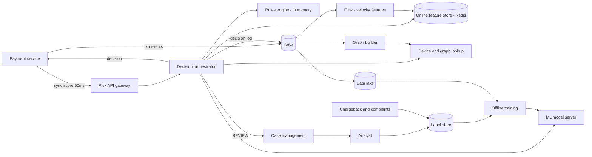
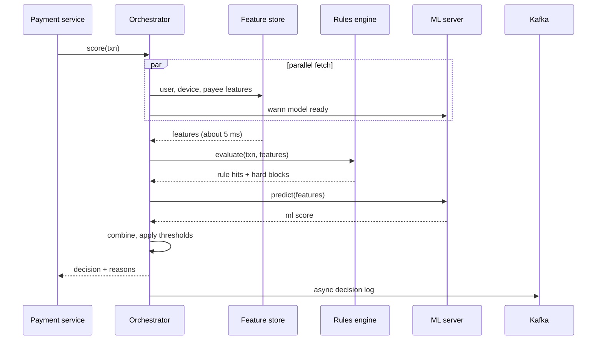

# C7 · Fraud detection engine

Oct 16, 2026 · @saurav chaurasiya

**Is doc me:** UPI/card/wallet payments ke liye real-time fraud detection engine ka poora HLD: requirements, estimates, rules + ML scoring, streaming features, device fingerprint, graph (mule) signals, case management, feedback loop, shadow mode aur scale.

**Padhne ka tareeka** — Pehle Sawaal ke 15 min khud socho, phir Sahi design ke diagrams padho. Deep Dive tab padho jab interview me SDE-2 level depth chahiye.

---

## C7 — Fraud detection engine

Fraud detection engine ek aisa service hai jo har payment ke paise nikalne se pehle usko ek risk score deta hai aur decide karta hai: allow, extra verification (step-up), ya block. Ye payment ke critical path pe baithta hai, isliye tez bhi hona chahiye aur galat bhi kam hona chahiye.

### Ye cheez hai kya

- **Category:** real-time decision system (rules engine + ML model + streaming data pipeline), payment path ke andar inline.
- **Problem:** fraudster ek second me kai transactions kar sakta hai, aur paisa ek baar nikla to wapas lana mushkil hai (UPI me irrevocable settlement hota hai). Isliye payment hone SE PEHLE \~50 ms me faisla chahiye.
- **Is lesson ke baad tum kya kar paoge:** inline scoring path design karna, velocity features ke liye Flink + Kafka + feature store samjhana, rules vs ML ka tradeoff batana, mule-account graph signals aur feedback loop explain karna, aur naye rule ko shadow mode me safely rollout karna.
- **Analogy:** airport security. Pehle X-ray (fast rules) sab ke bags check karta hai, shak hone par hi hand-check (manual review) hota hai. Har bag ko 10 minute hand-check karoge to flight chhoot jayegi, aur bilkul check nahi karoge to risk.

### Sawaal

Tum Paytm ke payments platform pe ho. Roz **50 crore** UPI/wallet/card transactions aate hain, peak pe **40,000 TPS** (transactions per second — ek second me kitne transactions). Har transaction pe fraud decision **p99 < 50 ms** (p99 latency — 100 me se 99 requests isse tez complete hon) me chahiye. Fraud loss 0.01% se neeche rakhna hai, lekin genuine users ka galat block (false positive) 0.5% se kam. Festival sale pe traffic 3x ho jata hai. Design karo.

> Pehle khud socho — 15 min. Hints: (1) 50 ms me DB se history kaise laoge, har baar raw transactions scan nahi kar sakte. (2) Rule badalne me deploy ka wait na ho, aur naya rule galat ho to kitne users block ho jayenge? (3) Fraud ka confirmation 30-60 din baad chargeback/complaint se aata hai, model ko label kab milega?

### Problem kyun aata hai

- **Speed vs depth tradeoff:** jitna zyada check, utna zyada latency. Payment ka SLA (service level agreement — promise kiya hua performance) 2-3 second ka hota hai, usme fraud ko sirf 50 ms milte hain.
- **Fraud ka pattern roz badalta hai:** kal ka rule aaj bypass ho jata hai. Isliye rule ko code deploy ke bina badalna zaroori hai.
- **Fraud rare hai:** 10,000 me 1 transaction fraud. Class imbalance (ek class bahut kam) ki wajah se simple accuracy bekar hai.
- **Labels late aate hain:** chargeback/complaint 30-90 din baad aata hai. Model purane data pe train hota hai.
- **Mule accounts:** fraudster ka paisa seedha uske account me nahi aata. Wo kai kiraye ke accounts (mule — jo account sirf paisa aage pass karne ke liye use hote hain) se ghumata hai. Ek transaction akele dekhne se ye nahi pakda jata.
- **Fail-open vs fail-closed:** fraud service down ho to payments rok doge (safe, par business band) ya chala doge (chalega, par risk)?

### Naive approach

- Har payment pe DB se last 30 din ke transactions `SELECT ... WHERE user_id = ?` karo, application me count/sum nikaalo, 10-20 `if` rules lagao, aur decision do.
- **Kahan toot-ta hai:**
  - 40,000 TPS x user ki 30 din ki history (avg 60 rows) = 24 lakh row reads per second. OLTP (online transaction processing — live payments wala) DB jhel nahi paata, aur payment DB ka load fraud check ki wajah se badh jata hai.
  - Query latency 80-300 ms, budget 50 ms ka tha.
  - Rules code me hardcoded: ek threshold badalne ke liye release chahiye (2-3 din), tab tak fraudster paisa nikal chuka.
  - ML nahi, to naye pattern pakad me nahi aate. Sirf ML ho to explain nahi kar sakte ki RBI/user ko kyun block kiya.
  - Fraud service ka timeout payment ko latka deta hai, koi fallback nahi.

### Sahi design

#### Requirements

- **Functional:**
  - Inline risk score + decision (ALLOW / STEP\_UP / REVIEW / BLOCK) har payment pe, 50 ms me.
  - Rules engine: ops/risk team bina deploy ke rule add/edit kar sake, versioned.
  - ML model scoring (gradient boosted trees jaise XGBoost/LightGBM) rules ke saath.
  - Streaming velocity features: "last 5 min me is user ke kitne txns", "is device pe kitne alag users".
  - Device fingerprint + graph signals (mule/ring detection).
  - Case management: suspicious cases analyst ko queue me, decision wapas feed ho.
  - Feedback labels (chargeback, user complaint, analyst verdict) se model retrain.
  - Shadow mode: naya rule/model production traffic pe chale par decision na badle.
- **Non-functional:**
  - Latency p99 < 50 ms (engine ke andar), availability 99.99%.
  - Throughput 40k TPS normal, 120k TPS burst (festival).
  - Fail-safe: fraud service down hone par bhi payment path band na ho (degraded mode).
  - Auditability: har decision ka reason code aur feature snapshot save ho (RBI audit, dispute).
  - PII (personally identifiable information — user ki pehchaan wali jaankari) ka masking.

#### Back-of-envelope estimates

- 50 crore txns/day = 5 x 10^8 / 86,400 = \~5,800 TPS average. Peak 7x = \~40,000 TPS, festival burst \~120k TPS.
- Decision log: har decision \~1.5 KB (features + score + reasons) x 5 x 10^8 = \~750 GB/day. 90 din hot = \~68 TB, baaki cold storage (object store / data lake).
- Feature store online (Redis): 10 crore active users x \~40 features x \~16 bytes = \~64 GB, plus devices/payees. Replication ke saath \~300-400 GB cluster. RAM me fit.
- Per request budget (50 ms): API + network 5 ms, feature fetch 10 ms (parallel reads), rules 3 ms, ML inference 10 ms, decision + async log 2 ms, buffer 20 ms.
- Rule engine in-memory: 500 rules x 40k TPS = 2 crore rule evaluations/sec. Isliye rules compiled/pre-indexed hone chahiye, per-request parsing nahi.

#### API design

- Sync scoring API (payment service call karta hai):

```text
POST /v1/risk/score
{ "txnId": "T123", "userId": "u1", "payeeId": "p9", "amountPaise": 450000,
  "channel": "UPI", "deviceId": "d77", "ip": "x.x.x.x", "ts": 1760600000 }

200 { "txnId": "T123", "decision": "STEP_UP", "score": 72,
      "reasons": ["NEW_DEVICE", "VELOCITY_5MIN"], "ruleSetVersion": "v128", "modelVersion": "m41" }
```

- Idempotent: same `txnId` pe dubara call aaye to wahi decision (cached) wapas, taki payment retry pe score alag na aaye.
- Async APIs: `POST /v1/cases/{id}/verdict` (analyst), `POST /v1/labels` (chargeback feed), `PUT /v1/rules/{id}` (risk ops).

#### Data model

| Store | Key | Value | Kyun |
| --- | --- | --- | --- |
| Online feature store (Redis) | `user:{id}` | counters, sums, last-seen device, avg amount | 1-2 ms reads |
| Decision log (Kafka then data lake) | `txnId` | features snapshot, score, decision, reasons, versions | audit + training data |
| Rules store (Postgres) | `ruleId, version` | DSL expression, action, status (DRAFT/SHADOW/LIVE) | versioned, auditable |
| Graph store | node: user/device/payee/card, edge: txn/uses | counts, first/last seen | mule rings |
| Case DB (Postgres) | `caseId` | txn refs, assignee, status, verdict | analyst workflow |
| Label store | `txnId` | label (FRAUD/GENUINE), source, labelledAt | retraining |

#### High-level architecture

Neeche ka diagram inline scoring path aur streaming/feedback loop dono dikhata hai:



Request ka flow time ke order me:



Step by step:

1. Payment service sync call karta hai (hard timeout 40 ms) fraud API ko `txnId`, user, payee, device, amount ke saath.
2. Orchestrator feature store se user/device/payee features **parallel** me laata hai. Ye features pehle se Flink ne streaming me calculate karke rakhe hote hain (raw history scan nahi).
3. Rules engine in-memory compiled rules chalata hai. Hard rules (sanctioned payee, blacklisted device) seedha BLOCK dete hain, soft rules score badhate hain.
4. ML model (GBT) features pe probability nikaalta hai. Model server pe warm rehta hai, batching nahi, p99 \~10 ms.
5. Combiner: `final = max(hardRules, f(ruleScore, mlScore))`, phir threshold: low = ALLOW, mid = STEP\_UP (PIN/OTP dobara), high = BLOCK, borderline high-value = REVIEW queue.
6. Decision wapas bhejo, aur decision log + features snapshot Kafka pe async daalo (critical path se bahar).
7. Kafka se Flink naye velocity counters update karta hai, graph builder edges update karta hai, data lake training data jama karta hai.
8. Chargeback/complaint/analyst verdict se labels aate hain, retraining chalti hai, naya model pehle shadow me jaata hai.

#### Chhota runnable demo: rules + velocity + shadow

Ye Java demo ek simple engine hai: Strategy pattern me rules (har rule ek `Rule` object), sliding window velocity counter (jo production me Flink/Redis karta hai), aur shadow rule jo score log karta hai par decision nahi badalta.

```java
import java.util.*;

public class Demo {
    enum Decision { ALLOW, REVIEW, BLOCK }

    record Txn(String id, String userId, String deviceId, String payeeId, long amountPaise, long tsSec) {}

    // Sliding window velocity counter (Flink ka kaam yahan in-memory simulate ho raha hai)
    static class Velocity {
        private final Map<String, Deque<Long>> events = new HashMap<>();
        void record(String key, long ts) { events.computeIfAbsent(key, k -> new ArrayDeque<>()).addLast(ts); }
        int count(String key, long now, long windowSec) {
            Deque<Long> q = events.getOrDefault(key, new ArrayDeque<>());
            while (!q.isEmpty() && q.peekFirst() < now - windowSec) q.pollFirst();
            return q.size();
        }
    }

    // Strategy pattern: har rule ek alag object, score add karta hai
    interface Rule {
        String name();
        int score(Txn t, Velocity v);
    }

    static class HighAmountRule implements Rule {
        public String name() { return "HIGH_AMOUNT"; }
        public int score(Txn t, Velocity v) { return t.amountPaise() >= 50_000_00 ? 40 : 0; }
    }
    static class VelocityRule implements Rule {
        public String name() { return "VELOCITY_5MIN"; }
        public int score(Txn t, Velocity v) { return v.count("u:" + t.userId(), t.tsSec(), 300) >= 4 ? 50 : 0; }
    }
    static class NewDeviceRule implements Rule {
        private final Set<String> known;
        NewDeviceRule(Set<String> known) { this.known = known; }
        public String name() { return "NEW_DEVICE"; }
        public int score(Txn t, Velocity v) { return known.contains(t.deviceId()) ? 0 : 30; }
    }
    static class MulePayeeRule implements Rule {
        // payee ko 1 ghante me 3+ txn aayein to mule jaisa fan-in pattern (demo me txn count, real me distinct payers)
        public String name() { return "MULE_PAYEE_FANIN"; }
        public int score(Txn t, Velocity v) { return v.count("p:" + t.payeeId(), t.tsSec(), 3600) >= 3 ? 45 : 0; }
    }

    static class Engine {
        final List<Rule> live = new ArrayList<>();
        final List<Rule> shadow = new ArrayList<>();
        final Velocity velocity = new Velocity();

        Decision decide(Txn t) {
            velocity.record("u:" + t.userId(), t.tsSec());
            velocity.record("p:" + t.payeeId(), t.tsSec());
            int total = 0;
            StringBuilder why = new StringBuilder();
            for (Rule r : live) {
                int s = r.score(t, velocity);
                if (s > 0) { total += s; why.append(r.name()).append("+").append(s).append(" "); }
            }
            // Shadow mode: score log hota hai, decision pe asar nahi
            for (Rule r : shadow) {
                int s = r.score(t, velocity);
                if (s > 0) System.out.println("  [shadow] " + t.id() + " " + r.name() + " would add " + s);
            }
            Decision d = total >= 80 ? Decision.BLOCK : total >= 40 ? Decision.REVIEW : Decision.ALLOW;
            System.out.println(t.id() + " score=" + total + " -> " + d + "  reasons: " + why.toString().trim());
            return d;
        }
    }

    public static void main(String[] args) {
        Engine e = new Engine();
        e.live.add(new HighAmountRule());
        e.live.add(new VelocityRule());
        e.live.add(new NewDeviceRule(Set.of("dev-A")));
        e.shadow.add(new MulePayeeRule());

        e.decide(new Txn("T1", "u1", "dev-A", "pA", 500_00, 1000));
        e.decide(new Txn("T2", "u1", "dev-B", "pB", 60_000_00, 1010));
        for (int i = 3; i <= 6; i++)
            e.decide(new Txn("T" + i, "u1", "dev-B", "pM", 900_00, 1000 + i * 20));
        e.decide(new Txn("T7", "u2", "dev-A", "pM", 300_00, 1200));
        e.decide(new Txn("T8", "u3", "dev-A", "pM", 300_00, 1250));
    }
}
```

Isko chalane pe bilkul ye output aata hai:

```text
T1 score=0 -> ALLOW  reasons: 
T2 score=70 -> REVIEW  reasons: HIGH_AMOUNT+40 NEW_DEVICE+30
T3 score=30 -> ALLOW  reasons: NEW_DEVICE+30
T4 score=80 -> BLOCK  reasons: VELOCITY_5MIN+50 NEW_DEVICE+30
  [shadow] T5 MULE_PAYEE_FANIN would add 45
T5 score=80 -> BLOCK  reasons: VELOCITY_5MIN+50 NEW_DEVICE+30
  [shadow] T6 MULE_PAYEE_FANIN would add 45
T6 score=80 -> BLOCK  reasons: VELOCITY_5MIN+50 NEW_DEVICE+30
  [shadow] T7 MULE_PAYEE_FANIN would add 45
T7 score=0 -> ALLOW  reasons: 
  [shadow] T8 MULE_PAYEE_FANIN would add 45
T8 score=0 -> ALLOW  reasons: 
```

- Dhyan do: T2 me high amount + new device milke REVIEW. T4 se velocity rule lagi aur BLOCK. `MULE_PAYEE_FANIN` shadow me tha, to T5 se uske hits sirf log hue, decision wahi rahe (score 80 hi raha). Real system me shadow ke hits baad me labels se compare karke rule ko LIVE karte hain.
- **Pattern:** Strategy (rules interchangeable) aur shadow rollout ek extensibility point hai: naya rule list me daalo, engine ka code nahi badalta.

### Kya choose karein aur kyun

| Option | Kab use karo | Kab mat karo |
| --- | --- | --- |
| Sirf rules engine | Shuru ka stage, known patterns (blacklist, amount limit), explainability zaroori | Naye, complex patterns; rules hazaaron ho jayein to maintain nahi hote |
| Sirf ML model | Bahut labelled data ho, subtle patterns | Hard compliance rules (sanctions) aur cold start, jab labels nahi hain |
| Hybrid (rules + ML) | Production payments, practically sab jagah | Chhota startup jahan ML team nahi |
| Streaming features (Flink + Redis) | Velocity, rolling counts, p99 < 50 ms | Features jo din me ek baar badalte hain, batch kaafi hai |
| Batch features (daily Spark) | Slow-changing: user ka 90-din avg amount, account age | "Last 1 min" jaise fresh signals |
| Inline (sync) scoring | Paisa nikalne se pehle rokna hai (UPI, card auth) | Post-fact analysis, AML reports |
| Async (post-txn) scoring | Heavy graph analysis, reporting | Irrevocable payment rokna ho |
| Fail-open (allow on timeout) | Low-value txns, business continuity | High-value, known risky segments |
| Fail-closed (block on timeout) | Bahut high-value ya risky merchant | Normal traffic, warna outage ban jata hai |

- **Practical rule:** tiered fail mode. Low amount pe fail-open with cached/simple rules, high amount pe step-up ya fail-closed.

### India me kaise hota hai

- **UPI/NPCI (National Payments Corporation of India):** NPCI ka UPI switch aur banks apne-apne fraud risk modules chalate hain. Banks UPI payment ke time risk score aur velocity limits lagate hain (jaise naye payee pe pehle 24 ghante me limit).
- **RBI MuleHunter.AI:** RBI Innovation Hub ne banks ke liye AI/ML tool banaya jo mule accounts pehchaanta hai, yani transaction behaviour se pata lagana ki account sirf paisa pass karne ke liye use ho raha hai. Ye wahi graph + behaviour signal wala idea hai jo is lesson me padha.
- **Paytm / PhonePe / Razorpay:** inline risk scoring, device binding (UPI me SIM-bound device), aur merchant-side risk engines. Razorpay jaise gateways merchants ko risk-flagged orders ka signal dete hain.
- **Streaming architecture ke public references:** Kafka + Flink + online feature store wala pattern fintechs me common hai, niche links me dekho.

### Interview follow-ups

- **Latency 50 ms kaise hit karoge?** — Features precomputed Flink se Redis me, parallel reads, in-memory compiled rules, warm model server, logging async. Raw history kabhi scan nahi.
- **Naya rule galat nikla to?** — Pehle SHADOW mode (log only), phir canary 1-5% traffic pe LIVE, kill switch ke saath. Rule versioned hoti hai taki instant rollback ho.
- **Fraud service down ho to?** — Tiered degraded mode: cache ki hui simple rules + amount limits. Low value fail-open, high value step-up/fail-closed. Circuit breaker aur timeout lagao ([2E · Resilience Ridge](https://claude.ai/code/artifact/4769dea3-018e-41e1-ae18-253fa36a6d21) dekho).
- **Labels late aate hain, model kaise train hoga?** — Label delay ko model me handle karo: training window me sirf matured transactions (60-90 din purane) lo, aur analyst verdicts ko fast proxy label maano. Recent data ke liye unlabelled ko genuine mat samjho.
- **Training-serving skew kya hai?** — Training me features alag tarike se bane aur serving me alag, to model production me kharab chalta hai. Fix: ek hi feature definition dono jagah (feature store), aur decision log me serving-time features save karke wahi train karna.
- **False positives kaise kam karoge?** — Step-up auth (OTP/PIN) ko hard block se pehle rakho, trusted device/payee allowlist, per-segment thresholds, aur analyst feedback se threshold tuning. Metric: precision/recall dono track karo, sirf accuracy nahi.
- **Mule accounts kaise pakdoge?** — Graph: ek payee ko bahut saare naye payers, paisa aate hi turant nikal jana (pass-through), shared devices. Ye async graph job se, phir score feature ya blacklist ke roop me inline path me aata hai.

### Self-check

1. Fraud engine payment path me inline kyun hai, aur latency budget kaise baanta hai?
2. Velocity feature (jaise "5 min me 4 txns") kaise calculate hota hai bina DB scan ke?
3. Hybrid (rules + ML) kyun, sirf ML kyun nahi?
4. Shadow mode kya hai aur naya rule LIVE kaise banta hai?
5. Chargeback label 60 din baad aata hai, to training-serving skew aur label delay kaise sambhaloge?

### Notebook

Inline scoring p99 < 50 ms · Features Flink se precomputed, Redis me online store · Rules (hard block + soft score) + ML (GBT) hybrid · Rule lifecycle: DRAFT, SHADOW, CANARY, LIVE · Mule detection graph signals se (shared device, fan-in, pass-through) · Labels 30-90 din late, feedback loop se retrain · Fail mode tiered: low value fail-open, high value step-up/closed

### Padhne ke liye

- [Real-Time Fraud Detection with Streaming (Conduktor)](https://www.conduktor.io/glossary/real-time-fraud-detection-with-streaming)
- [Real-Time Fraud Detection with Kafka Streams and Online Feature Stores](https://andresaldaz.com/blog/fraud-detection-streaming)
- [Real-Time Fraud Detection at 50K TPS: Kafka + Flink + Iceberg](https://www.viprasoftware.com/playbooks/real-time-fraud-detection-kafka-flink-iceberg)
- [RBI MuleHunter.AI (IndiaAI)](https://indiaai.gov.in/article/rbi-s-ai-initiative-mulehunter-ai-ai-solution-to-tackle-digital-fraud-in-india)

### Deep Dive (SDE-2) — jab time ho

#### Streaming features: Flink + Kafka + feature store

- Transaction events Kafka topic pe aate hain, `userId` pe partition (partition — topic ka ek hissa, ordering usi ke andar milti hai) taki ek user ke events ek hi Flink task pe aayein. Kafka basics ke liye [1E · Kafka River](https://claude.ai/code/artifact/eeb39ee8-3f52-4c04-b57b-68213f02c429).
- Flink windows: tumbling (fixed, jaise har 1 min), sliding (overlapping, jaise last 5 min har 10 sec pe), session (activity gap pe). Velocity ke liye sliding ya "bucketed counters" (1-min buckets ka sum) sasta padta hai.
- Event time vs processing time: late events ke liye watermark (Flink ka "itne tak ka data aa chuka" marker) lagao. Fraud me thodi deri chalti hai, par hot users pe skew (hot key — ek key pe bahut zyada traffic) dhyan rakho.
- Redis me write: HINCRBY / sorted set with TTL. Write idempotent rakho, kyunki Flink restart pe replay karega (at-least-once, ya checkpoint ke saath exactly-once sink).
- **Freshness gap:** event Kafka se Flink se Redis tak 100-500 ms leta hai. Burst fraud (10 txns 1 second me) pakadne ke liye inline path me local in-flight counter bhi rakho (request aate hi INCR), sirf Flink pe bharosa mat karo.
- Training-serving skew: ek hi feature definition (Feast jaise feature store ya shared library), point-in-time correct joins training me, taki future ka data leak na ho.

#### Rules engine ka internals

- Rule DSL (domain-specific language — chhoti si apni rule bhasha), jaise `amount > 50000 AND device.age_days < 1`. Compile hoke in-memory decision tree/bytecode banta hai, hot reload se bina restart load.
- Rule lifecycle: DRAFT, SHADOW, CANARY (1-5% traffic), LIVE, RETIRED. Har state change audit log me.
- Conflict resolution: priority + action ranking (BLOCK > REVIEW > STEP\_UP > ALLOW). Hard rules short-circuit karte hain.
- Rule-hit analytics: har rule ka precision (kitne hits sach me fraud nikle) aur hit-rate track karo. Jo rule 1% hit karta hai aur precision 2% hai, wo kharab hai.
- Shadow mode evaluation: LIVE vs SHADOW decisions ko offline compare karo jab labels aa jayein; "would have blocked X genuine, caught Y fraud" report banao.

#### Device fingerprint aur graph signals

- Device fingerprint: device ID, OS, model, SIM/IMEI hash, screen, installed app signals, emulator/root detection, behaviour (typing speed). Raw IDs store mat karo, hash karo (privacy, [2G · Security Vault](https://claude.ai/code/artifact/f0f0e8e4-dde8-492e-9a80-08a35792d4e7) dekho).
- Graph: nodes = user, device, payee VPA (virtual payment address — UPI ID), card, IP. Edges = transacted\_with, logged\_in\_from. Mule ring signals: ek device pe bahut saare accounts, ek payee ko bahut naye payers (fan-in), paisa aate hi nikal jana (pass-through), accounts ka chain/cycle.
- Compute: batch graph jobs (connected components, community detection) har kuch ghante me, plus near-real-time edge counts Flink se. Inline path pe sirf precomputed risk (`device.ring_risk`, `payee.fanin_24h`) padho, live graph traversal nahi (latency).
- Cold start: naye user/device ka history nahi, isliye conservative limits + step-up.

#### Case management aur feedback loop

- REVIEW decisions case queue me jaate hain with SLA (jaise 15 min). Analyst ko feature snapshot, reason codes, related accounts graph dikhta hai.
- Verdict (fraud / genuine) label store me jaata hai, with source (analyst, chargeback, user complaint, NPCI dispute). Source ke hisaab se label ka confidence alag.
- Retrain cadence: weekly ya daily, champion/challenger: naya model SHADOW me chalao, labels aane par compare, phir LIVE. Drift (data distribution badalna) monitor karo: PSI (population stability index) jaise metric.
- Active learning: borderline cases analysts ko bhejo, kyunki wahi labels sabse zyada seekhne laayak hain.
- Sampling bias dhyan rakho: jo block kiye, unka label kabhi nahi milta ("blocked = no outcome"). Thoda random traffic holdout rakho taki unbiased labels milein.

#### Scale, failure aur multi-region

- 120k TPS burst: orchestrator stateless (horizontal scale), feature store sharded by `userId` (consistent hashing, [1D · Shard Mountains](https://claude.ai/code/artifact/cfe905e6-6370-43e0-a337-764eeb9ddf1e)), model server autoscaled.
- Hot keys: ek merchant/payee pe lakhs txns (jaise IPL ticket sale), to payee-key counters ko sub-key me todo (`payee:{id}:{shard}`), read pe sum karo.
- Degrade ladder: full (rules + ML + graph) to rules + ML to rules only to static limits. Circuit breaker aur bulkhead ([2E](https://claude.ai/code/artifact/4769dea3-018e-41e1-ae18-253fa36a6d21)).
- Multi-region: har region me apna feature store replica; velocity counters eventual consistency (eventual consistency — replicas thodi der me sync hote hain) pe chalte hain, isliye cross-region fraudster ek region me 5 aur dusre me 5 txns karke limit bypass kar sakta hai. Mitigate: global slow-path aggregates, ya user ko ek "home region" pe pin karna.
- Observability: decision latency, timeout rate, ALLOW/STEP\_UP/BLOCK ratio ka sudden shift (alert), feature null-rate, model score distribution drift ([1F · Ops Tower](https://claude.ai/code/artifact/6a87e8d2-04fb-418e-b433-e5a88508f83e)).
- Security: reason codes users ko mat dikhao (fraudster rule seekh leta hai), sirf generic message. Decision log access-controlled.

---

## Aage kya

- Pichhla: [C6 · Refund system](https://claude.ai/code/artifact/0938c098-ccc8-4c99-9412-35f2d202ffaa)
- Agla: [C8 · Notification service](https://claude.ai/code/artifact/729bdcdf-fa6a-4de0-852e-a88e13273429)
- Related: [2G · Security Vault](https://claude.ai/code/artifact/f0f0e8e4-dde8-492e-9a80-08a35792d4e7) (L2.26 fraud/risk basics), [1E · Kafka River](https://claude.ai/code/artifact/eeb39ee8-3f52-4c04-b57b-68213f02c429) (streaming backbone)
