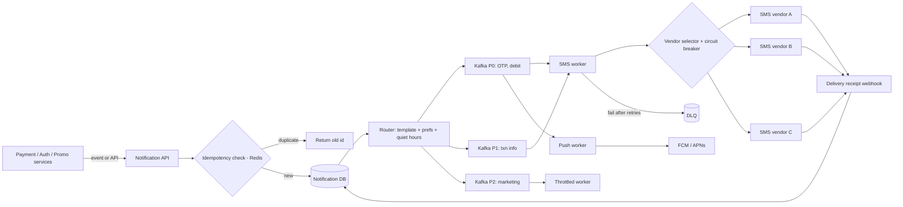
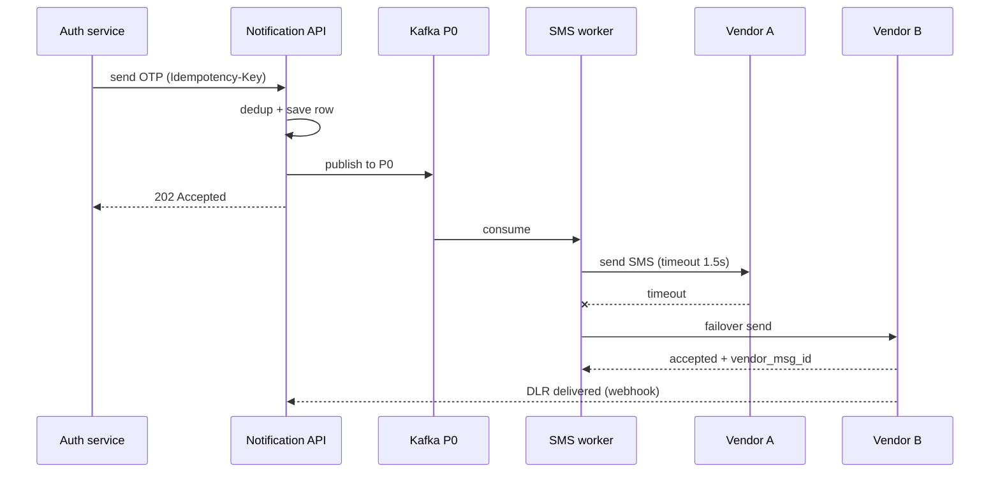

# C8 · Notification service

Oct 16, 2026 · @saurav chaurasiya

**Is doc me:** Payments company ka notification platform: debit alert SMS, OTP, push, email, WhatsApp, TRAI DLT templates, vendor failover, dedup, quiet hours, retries aur DLQ.

**Padhne ka tareeka** — Pehle Sawaal pe 15 min khud socho, phir Sahi design padho. Deep Dive tab kholo jab time ho.

---

## C8 — Notification service

Notification service ek central platform hai jo baaki saare services ke events (payment hua, OTP chahiye, offer aaya) ko user tak SMS, push, email ya WhatsApp ke through pahunchata hai. Ye generic [Q9 · Notification system](https://claude.ai/code/artifact/bfecee08-f812-4c61-9f8a-c042ee6feb05) ka payments wala twin hai: yahan OTP ki latency, DLT compliance aur "debit alert kabhi miss nahi hona chahiye" jaisi strict rules zyada important hain.

### Ye cheez hai kya

- Category: platform / shared infrastructure service (har team iska client hai).
- Problem: har team apna SMS vendor, apna retry, apna template likhe to duplicate kaam, inconsistent delivery aur TRAI ke fines. Ek jagah solve karna hai.
- Is lesson ke baad tum kar paoge: priority tiers wala pipeline design, DLT template registry, multi-vendor failover, dedup/idempotency, quiet hours aur DLQ explain karna.
- Analogy: Post office ka sorting centre. Registered post (OTP) alag counter pe jaata hai, pamphlets (marketing) alag bori me. Agar ek courier company hadtal pe hai to dusri se bhej dete ho.

### Sawaal

Tum Paytm ke notification platform ke lead ho. Roz 10 crore (100M) notifications nikalte hain: 3 crore transaction alerts (debit/credit SMS), 2 crore OTP, 5 crore marketing/offers. Peak pe (IPL ya salary day, 1st tarikh) 30,000 notifications/sec. OTP ka p99 latency (99% requests isse kam time me) 5 sec se kam chahiye. Debit alert kabhi lose nahi hona chahiye. Marketing raat 9 baje ke baad aur subah 9 se pehle nahi jaana chahiye. India me SMS ke liye TRAI ka DLT (Distributed Ledger Technology based registry) rule hai: bina registered template ke SMS block ho jaata hai. SMS vendors (e.g. 3 alag) kabhi bhi down ho sakte hain.

> Pehle khud socho — 15 min. Hints: (1) Marketing ka spike OTP ko slow na kare, ye kaise karoge? (2) Vendor A down ho jaaye to kitni jaldi vendor B pe switch karoge, aur kaise detect karoge? (3) Same event do baar aaye (Kafka redelivery) to user ko do SMS na jaaye, kaise?

### Problem kyun aata hai

- Alag-alag priority ka traffic ek hi queue me mix hota hai to marketing blast OTP ko peeche kar deta hai.
- SMS vendors (telecom aggregators) ki apni downtime, throttling aur operator-level (Jio, Airtel) failures hoti hain.
- TRAI DLT: sender ID (header) aur content template pehle register hona chahiye, warna operator SMS reject kar deta hai. Galat template = OTP gaya hi nahi.
- At-least-once delivery (Kafka se message kam-se-kam ek baar milta hai, kabhi do baar bhi) se duplicate alerts ban jaate hain.
- User ne preference ya DND (Do Not Disturb — telecom ki opt-out list) set kiya ho, to marketing bhejna illegal ho sakta hai.
- Delivery ka koi proof nahi hota jab tak vendor se receipt (DLR, delivery report) wapas na aaye.

### Naive approach

- Har service seedha SMS vendor ka API call kare: `POST vendor/send` synchronously, ek retry loop ke saath.
- Kahan tootta hai:
  - Vendor 10 sec slow ho jaaye to payment service ke threads atak jaate hain; 30K/sec pe thread pool kuch second me khatam. Payment hi slow ho jaata hai.
  - Marketing 5 crore ek saath chale to vendor ka rate limit (maan lo 5,000 SMS/sec per account) chhoo lete ho, OTP bhi reject hone lagta hai.
  - Retry loop me timeout ke baad retry karne se user ko 2-3 duplicate SMS jaate hain (vendor ne pehla actually bhej diya tha).
  - Template mismatch ka pata sirf production me chalta hai.
  - Vendor-switch ka code har team me copy hai; ek vendor badalna = 40 repos change.

### Sahi design

#### Requirements

- Functional:
  - Event ya direct API se notification request lena (user, template, channel, priority, variables).
  - Channel select: SMS, push (FCM/APNs), email, WhatsApp, with fallback order.
  - Template registry (DLT ID mapped) aur localisation (Hindi/English).
  - User preferences, DND aur quiet hours enforce karna.
  - Delivery status track karna aur callers ko dikhana.
- Non-functional:
  - OTP: end-to-end p99 under 5 sec. Transaction alert: under 30 sec. Marketing: best-effort.
  - Transaction aur OTP notification durable: crash pe bhi lose nahi.
  - Availability 99.95% for P0 tier; vendor failure se user ko farak na pade.
  - Idempotent: same request do baar aaye to ek hi notification.
  - Scale: 30K/sec peak, horizontally scalable.

#### Back-of-envelope estimates

- 100M/day / 86,400 = \~1,160/sec average. Peak 30K/sec (25x average, kyunki salary day aur IPL burst).
- Storage: har notification ka record \~500 bytes (id, user, template, status, timestamps). 100M x 500 B = 50 GB/day. 90 din = 4.5 TB. Hot store me 7 din (350 GB), baaki cold (S3/archival).
- Kafka: 30K/sec x 1 KB = 30 MB/sec ingress, aaram se ek chhota cluster. Partitions: P0 topic ke liye 24, marketing ke liye 48 (consumer parallelism ke liye).
- SMS cost: 8 crore SMS/day x approx 0.15 INR = \~1.2 crore INR/day. Isliye push first, SMS fallback ek real cost optimisation hai (illustrative numbers).
- Vendor throughput: har vendor 5K-10K SMS/sec; peak 30K ke liye 3-4 vendors/accounts parallel.

#### API design

Ye internal API hai jo baaki services call karti hain. `Idempotency-Key` header zaroori hai.

```json
POST /v1/notifications
Idempotency-Key: txn_9f31-debit-alert
{
  "user_id": "u_88123",
  "template_id": "TXN_DEBIT_V3",
  "priority": "P0",
  "channels": ["PUSH", "SMS"],
  "vars": { "amount": "499.00", "merchant": "Swiggy", "bal": "12,310.50" },
  "ttl_sec": 300
}
--> 202 Accepted { "notification_id": "n_7c2e...", "status": "QUEUED" }

GET /v1/notifications/n_7c2e...
--> { "status": "DELIVERED", "channel": "SMS", "vendor": "vendorB", "attempts": 2 }
```

#### Data model

- `template(template_id, channel, locale, body, dlt_template_id, dlt_header, category, version)`
- `notification(notification_id PK, idem_key UNIQUE, user_id, template_id, priority, status, created_at, ttl)`
- `attempt(notification_id, attempt_no, channel, vendor, vendor_msg_id, status, error_code, ts)`
- `user_pref(user_id, channel, category, opted_in, quiet_start, quiet_end, tz)`
- `vendor_health(vendor, success_rate_1m, p99_ms, circuit_state)`
- Store: MySQL/Postgres sharded by `user_id` (ya Cassandra) notification aur attempt ke liye; Redis dedup aur rate-limit ke liye.

#### High-level architecture

Ye diagram dikhata hai ki request kaise API se priority queue, preference check, channel worker, vendor failover aur receipt tak jaati hai.



#### Request ka flow (OTP)

Ye sequence diagram OTP ke critical path ko dikhata hai, vendor failover ke saath.



#### Step by step

1. **Accept + dedup:** API `Idempotency-Key` ko Redis `SETNX` (set only if not exists, TTL 24h) se check karta hai, aur DB me UNIQUE constraint backup hai. Duplicate pe purana `notification_id` return. Ye [2A · Idempotency Island](https://claude.ai/code/artifact/c269ac61-440b-4525-bd04-31baf708dece) ka seedha use hai.
2. **Durable write pehle:** row DB me `QUEUED` status se likho, phir Kafka pe publish. Dono ko ek saath atomic banane ke liye outbox pattern (DB me event row, alag relay Kafka bhejta hai) lagao, jaisa [1E · Kafka River](https://claude.ai/code/artifact/eeb39ee8-3f52-4c04-b57b-68213f02c429) me hai.
3. **Priority tiers = alag topics aur alag worker pools:** P0 (OTP, debit/credit alert), P1 (txn info, statement), P2 (marketing). P2 ka lag kabhi P0 ko nahi chhoota kyunki consumers alag hain. P0 pe over-provisioned workers rakho.
4. **Router:** template fetch karo, variables render karo, user preferences check karo. Marketing ke liye DND aur quiet hours (e.g. 9 PM se 9 AM IST) check; quiet hours me hai to `scheduled_at` set karke delay queue me daalo. Transactional/OTP pe quiet hours lagu nahi.
5. **DLT mapping:** SMS ke liye har template ka `dlt_template_id` aur approved header (sender ID, jaise PAYTMB) registry me hota hai. Send se pehle validate: template register nahi to publish hi nahi, deploy time pe fail karo.
6. **Channel strategy:** debit alert: push pehle (sasta, fast), 10 sec me delivery receipt nahi aaya to SMS fallback. OTP: SMS aur push parallel bhi bhej sakte ho.
7. **Vendor selector + circuit breaker:** har vendor ka rolling success rate aur p99 track karo. Success rate threshold (e.g. 90%) se neeche gaya to circuit open: traffic dusre vendor pe. Weights se load split (e.g. 50/30/20). Detail [2E · Resilience Ridge](https://claude.ai/code/artifact/4769dea3-018e-41e1-ae18-253fa36a6d21) me.
8. **Retry with backoff + jitter:** transient errors (timeout, 5xx) pe exponential backoff (1s, 2s, 4s) aur random jitter. Permanent errors (invalid number, template rejected) pe retry nahi, seedha `FAILED`.
9. **DLQ (Dead Letter Queue — jo message baar-baar fail ho, use alag queue me rakhna taaki baaki flow na ruke):** max attempts ke baad P0 message DLQ me jaata hai, alert fire hota hai, ops replay kar sakte hain.
10. **Delivery receipts:** vendor webhook DLR bhejta hai (`DELIVERED`, `FAILED`, `EXPIRED`). Status `SENT -> DELIVERED` update. DLR late ya duplicate aa sakta hai, isliye status machine forward-only rakho (DELIVERED ke baad SENT overwrite nahi).
11. **TTL / expiry:** OTP 5 min ke baad useless hai. Worker consume pe `now > created_at + ttl` ho to drop kare, retry me bhi.

### Kya choose karein aur kyun

| Option | Kab use karo | Kab mat karo |
| --- | --- | --- |
| Single SMS vendor | Prototype, kam volume | Production payments: vendor outage = OTP band |
| Multi-vendor active-active (weighted) | Zyada volume, cost aur reliability dono chahiye | Chhota team jo vendor integrations maintain nahi kar sakti |
| Primary + standby vendor failover | Simple ops, ek vendor sasta/best | Standby ka path kabhi test nahi hota to failover ke time fail ho sakta hai |
| Ek shared queue | Bahut chhota system | Marketing aur OTP mix honge, head-of-line blocking |
| Priority-wise separate topics | Production, SLA alag-alag | Zero-traffic app jaha overhead bekaar hai |
| Push first, SMS fallback | Cost bachani ho, app-installed users | User ka app uninstall ho ya OTP (SMS hi reliable path) |
| Sync send in API | Kabhi nahi payments me | Hamesha async queue use karo |

### India me kaise hota hai

- TRAI ke TCCCPR rules (Telecom Commercial Communications Customer Preference Regulations) me sender ko Principal Entity register karna, header aur content template DLT platform pe approve karwana padta hai; telcos scrubbing karte hain aur unregistered SMS block ho jaata hai. Overview: [TRAI DLT Regulations (WebEngage docs)](https://docs.webengage.com/docs/trai-sms-dlt-regulations-india) aur [India SMS Compliance guide (Telerivet)](https://www.telerivet.com/blog/india-sms-compliance-trai-dlt-registration-and-tcccpr-guide).
- Step-by-step DLT: entity ID, header, template, aur API me template ID bhejna: [DLT Registration guide](https://www.smsgatewaycenter.com/blog/dlt-registration-step-by-step-guide-india/).
- Bade payments players (Paytm, PhonePe, Razorpay) ke multiple SMS aggregators aur WhatsApp Business API use karne ka pattern common hai; exact vendor names public nahi hote, isliye interview me "N vendors with weighted routing" bolo, naam mat guess karo.
- Payments me transaction SMS regulatory expectation bhi hai (RBI ke alert norms), isliye debit alert ko P0 treat karte hain.

### Interview follow-ups

- **Marketing blast OTP ko kaise slow nahi karega?** — Alag Kafka topics, alag consumer groups, alag vendor accounts/rate limits. P2 pe bhi throttle (token bucket, [2E](https://claude.ai/code/artifact/4769dea3-018e-41e1-ae18-253fa36a6d21)) taaki vendor limit na tootey.
- **Exactly-once SMS possible hai?** — Nahi. Hum at-least-once + idempotency key + vendor ka client reference ID use karte hain, to practical effect "effectively once" milta hai. Rare duplicate OTP acceptable hai, lost OTP nahi.
- **Timeout aaya, vendor ne SMS bheja ya nahi pata nahi. Retry karein?** — Ambiguous result. OTP me retry safe hai (naya OTP bhi valid ho sakta hai); debit alert me vendor ko same `client_ref` bhejo taaki wo dedup kare, aur DLR se confirm karo.
- **Vendor down hai ye kaise pata chale?** — Rolling window success rate aur p99, plus active health-probe messages. Circuit breaker half-open state me thoda traffic bhej ke recovery check karta hai.
- **User ne marketing band kiya hai par OTP chahiye?** — Category-based preference: `TRANSACTIONAL` aur `OTP` opt-out nahi hote (legal aur security), `PROMOTIONAL` opt-out hote hain.
- **Kafka partition hot ho gaya (ek bade merchant ke notifications)?** — Partition key `user_id` hash rakho, merchant\_id nahi; ya merchant bulk ko salt karke split karo. Ordering sirf per-user chahiye.

### Self-check

1. P0, P1, P2 ko alag topics me kyun rakhte hain? Ek queue me kya galat hota hai?
2. DLT me kaun si teen cheezein register karni padti hain, aur bina template ke kya hota hai?
3. Idempotency key Redis aur DB dono me kyun? Kisko kya bachata hai?
4. Vendor A timeout kare to failover ka flow bolo, aur duplicate SMS ka risk kaise kam karoge?
5. DLR late aaye ya out-of-order aaye to status machine kaise handle karegi?

### Notebook

P0 OTP/debit, P2 marketing: alag topics aur workers · DLT = entity + header + template, bina iske SMS block · Idempotency-Key + outbox = no lost, no duplicate · Vendor circuit breaker + weighted routing · Retry sirf transient errors pe, backoff + jitter, phir DLQ · Quiet hours sirf promotional pe · DLR forward-only status machine, TTL se stale OTP drop

### Padhne ke liye

- [TRAI DLT Regulations (WebEngage)](https://docs.webengage.com/docs/trai-sms-dlt-regulations-india)
- [India SMS Compliance: TRAI DLT and TCCCPR (Telerivet)](https://www.telerivet.com/blog/india-sms-compliance-trai-dlt-registration-and-tcccpr-guide)
- [Designing a Notification System: Queues, Retries, Rate Limiting and Scale](https://dev.to/mangeshmandlik/designing-a-notification-system-queues-retries-rate-limiting-scale-4bg1)
- [Notification System Design: Push, SMS, Email at Scale](https://singhajit.com/notification-system-design/)

### Deep Dive (SDE-2) — jab time ho

#### Backpressure aur load shedding

- Backpressure (consumer slow ho to producer ko rokna ya slow karna) ke bina P2 backlog crore messages tak badh sakta hai. P2 pe TTL aur drop-oldest policy rakho; P0 kabhi drop nahi.
- Campaign ko pehle se rate-limit karo (e.g. 2K/sec) aur batches me chalao; vendor ko pre-warn karo bade campaigns ke liye.

#### Vendor routing intelligence

- Operator-wise routing: Jio ke numbers vendor A se behtar jaate hain, Airtel vendor B se. Success rate per (vendor, operator, circle) track karo aur routing table dynamic update karo.
- Cost-aware routing: P2 sasta vendor, P0 sabse reliable vendor. Fallback chain P0 ke liye pehle se tested honi chahiye (regular chaos test).

#### Preferences aur quiet hours ka data path

- Preferences ko Redis me cache karo (read-heavy, [1B · Cache Caves](https://claude.ai/code/artifact/32bb1c8e-3433-417c-a3f4-3a34babed6bf)); update pe invalidate. Cache miss pe DB, aur default "opt-in transactional, opt-out promo until consent".
- Quiet hours user ke timezone me; India me ek hi IST hai par NRI users ke liye tz field rakho. Delayed messages ke liye delay queue ya scheduler (time-bucketed table) use karo.

#### Receipts, reconciliation aur multi-region

- Kai vendors DLR nahi dete ya late dete hain; `SENT` me atke messages ka reaper job rakho jo 60 sec baad push/SMS fallback trigger kare.
- Daily reconciliation: apna sent count vs vendor invoice count. Mismatch = billing dispute ya silent drop.
- Multi-region: notification DB aur Kafka dono region me active-passive; region fail hone pe idempotency key replicate hona zaroori hai warna failover pe duplicates aate hain.

---

## Aage kya

- Pichhla: [C7 · Fraud detection engine](https://claude.ai/code/artifact/fb52d447-8183-4e92-94e4-e704674416b9)
- Agla: [C9 · Merchant settlement](https://claude.ai/code/artifact/e627a8b4-90e3-47e2-a4a4-0043ee7c4032)
- Related: [1E · Kafka River](https://claude.ai/code/artifact/eeb39ee8-3f52-4c04-b57b-68213f02c429), [2A · Idempotency Island](https://claude.ai/code/artifact/c269ac61-440b-4525-bd04-31baf708dece), [2E · Resilience Ridge](https://claude.ai/code/artifact/4769dea3-018e-41e1-ae18-253fa36a6d21), generic twin [Q9 · Notification system](https://claude.ai/code/artifact/bfecee08-f812-4c61-9f8a-c042ee6feb05)
