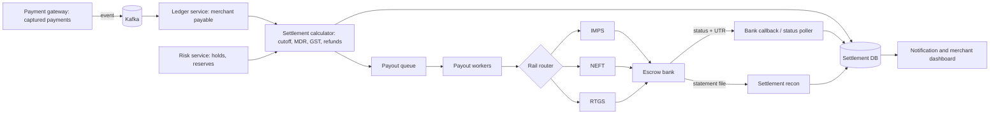
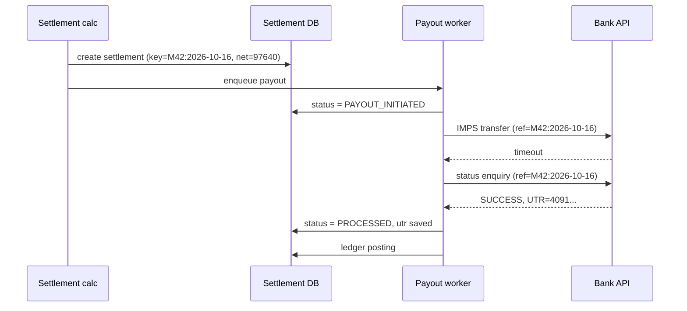

# C9 · Merchant settlement

Oct 16, 2026 · @saurav chaurasiya

**Is doc me:** Customer ka paisa collect hone ke baad merchant ke bank account tak kaise pahunchta hai: settlement cycle, MDR + GST, escrow, holds, payout retries, recon.

**Padhne ka tareeka** — Pehle Sawaal pe 15 min khud design karo, phir Sahi design se match karo. Deep Dive baad me.

---

## C9 — Merchant settlement

Merchant settlement wo system hai jo customers se collect hui rakam me se fees (MDR) aur tax (GST) kaat kar, bacha hua paisa merchant ke bank account me bhejta hai. Ye payment gateway ka "paisa wapas dene wala" half hai: collect karna aasaan hai, sahi amount sahi din sahi account me pahunchana asli kaam hai.

### Ye cheez hai kya

- Category: HLD boss, payments back-office (batch + money movement + reconciliation)
- Problem: Gateway ke paas lakhon merchants ka paisa ek pooled account me padha hai. Har merchant ko uska hissa, fees kaat ke, time pe, bina galti ke dena hai.
- Is lesson ke baad tum kar paoge: T+1/T+0/instant settlement design, MDR (Merchant Discount Rate — merchant se li jaane wali fee) aur GST math, escrow rules samajhna, holds/reserves, failed payout retry, UTR (Unique Transaction Reference — bank transfer ka reference number) se recon.
- Analogy: Mandi ka aadhti (commission agent). Kisan ka maal bikta hai, aadhti commission kaat ke baaki paisa kisan ko deta hai. Agar kisan pe shak ho to aadhti thoda paisa rok leta hai.

### Sawaal

Tum Razorpay/Paytm jaise PA (Payment Aggregator — wo company jo merchants ki taraf se customers se paisa leti hai) ke settlement team me ho. 10 lakh active merchants hain, roz 2 crore successful payments, daily GMV (Gross Merchandise Value — total sale ka paisa) Rs 3,000 crore.

- Default settlement T+1 (transaction ke ek working day baad). Premium merchants ko T+0 aur on-demand instant settlement chahiye (24x7, 30 sec ke andar).
- Har merchant ka MDR alag, GST 18% MDR pe.
- Risky merchants ka paisa hold ho sakta hai. Refund aur chargeback settlement se minus honge.
- Ek paisa bhi double pay ya miss nahi hona chahiye. Bank API fail ho sakti hai.

> Pehle khud socho — 15 min. Hints: (1) Settlement ek "batch" hai ya "stream"? Cut-off time kaise decide hoga? (2) Payout fail ho jaye to dobara bhejne se double payment kaise rokoge? (3) Merchant ka balance kahan se aayega: transactions table ya ledger?

### Problem kyun aata hai

- Customer ne paisa gateway ke escrow account me diya, merchant ke account me nahi. Beech ka "kis merchant ka kitna" hisaab gateway ko rakhna padta hai.
- Fees, tax, refund, chargeback, reserve sab minus hote hain. Net amount nikalna ek hi jagah pe hona chahiye.
- Bank transfer (IMPS/NEFT/RTGS) async aur unreliable hai: timeout aaye to pata nahi paisa gaya ya nahi.
- RBI PA guidelines settlement timeline aur escrow ke rules lagate hain. Galti = compliance issue.
- Risky merchant (fraud, high chargeback) ko seedha paisa de diya aur wo bhaag gaya to loss gateway ka.

### Naive approach

- Har successful payment pe turant merchant ko bank transfer maar do. Ya raat ko ek cron: `SELECT * FROM payments WHERE settled = false`, loop me har merchant ko transfer.
- Kahan tootta hai:
  - 2 crore payments = 2 crore bank calls. Bank API limit kuch hazaar TPS (transactions per second — ek second me kitne requests) hoti hai, aur har transfer pe Rs 2–5 bank charge. Rs 100 ke payment pe Rs 3 kharcha.
  - Cron beech me crash ho to pata nahi kaun settle hua kaun nahi. Restart pe double payment.
  - `settled = false` flag aur bank call ek transaction me nahi ho sakte. Bank ne bheja par flag update nahi hua, to dobara bhej diya.
  - Refund aur chargeback ka hisaab nahi: merchant ka balance negative ho to?
  - Merchant ka paisa amount-wise ek single float me: rounding errors (Rs 976.4 vs 976.40).

### Sahi design

#### Requirements

- Functional: settlement schedule per merchant (T+1, T+0, instant), MDR + GST calculation, holds/reserves, refund aur chargeback adjustment, payout via IMPS/NEFT/RTGS, retries, settlement report, UTR mapping.
- Non-functional:
  - Correctness: exactly-once payout effect, ek rupaya bhi upar neeche nahi.
  - Auditability: har paisa ledger me traceable (double-entry, [2B · Ledger Library](https://claude.ai/code/artifact/a7c567e0-66cb-46fe-b7c9-9c20739857eb)).
  - Availability: instant settlement 99.9%, batch settlement cut-off miss nahi hona chahiye.
  - Scale: 10 lakh merchants, 2 crore payments/day.

#### Back-of-envelope estimates

- 2 crore payments/day, avg ticket Rs 1,500 = Rs 3,000 crore GMV/day.
- Har payment ke 2–3 ledger entries: 2 cr x 3 = 6 crore rows/day, \~70 per second avg, peak 5x = \~350 per second. Aasaan.
- Active merchants \~10 lakh, settle roz hone wale \~4 lakh. 4 lakh payouts/day, batch 4 AM–10 AM me spread: 4 lakh / 6 hr = \~19 per second. Chhota number, asli dikkat correctness hai, throughput nahi.
- Storage: ledger row \~300 bytes x 6 cr = \~1.8 GB/day, \~650 GB/year. Archive karo.
- Instant settlement: peak 100 per second, har ek bank API call. Isme p99 (99% requests is time se tez) latency target 10 sec.

#### MDR aur GST math

- MDR = payment amount ka percentage (card 1.5–2%, UPI P2M pe policy ke hisaab se zero). GST = MDR pe 18%, amount pe nahi.
- Example: Rs 1,000 payment, MDR 2%.
  - MDR = 1000 x 0.02 = Rs 20.00
  - GST = 20 x 0.18 = Rs 3.60
  - Net settlement = 1000 - 20 - 3.60 = Rs 976.40
- Hamesha paise (integer) me store karo: 100000 paise, fee 2000, gst 360, net 97640. Float kabhi nahi.

#### API design

- `GET /v1/settlements?from=&to=&status=` — merchant ki settlements list.
- `GET /v1/settlements/{id}` — ek settlement ka breakup (payments, fees, tax, refunds, UTR).
- `POST /v1/settlements/instant` body `{amount_paise, idempotency_key}` — on-demand payout. Header `Idempotency-Key` zaroori ([2A · Idempotency Island](https://claude.ai/code/artifact/c269ac61-440b-4525-bd04-31baf708dece)).
- `POST /internal/holds` body `{merchant_id, reason, amount_paise|all}` — risk team hold lagaye.
- Webhook `settlement.processed` / `settlement.failed` merchant ko, retries ke saath.

#### Data model

- `merchant_settlement_config`: merchant\_id, cycle (T1/T0/INSTANT), mdr\_bps (basis points — 1 bps = 0.01%), bank\_account\_id, reserve\_percent, status.
- `settlement_batch`: batch\_id, cycle\_date, cutoff\_ts, status (OPEN/CALCULATING/READY/PAYING/DONE).
- `settlement`: settlement\_id, batch\_id, merchant\_id, gross\_paise, mdr\_paise, gst\_paise, refunds\_paise, reserve\_paise, net\_paise, status (CREATED/HELD/PAYOUT\_INITIATED/PROCESSED/FAILED), payout\_idempotency\_key (unique), utr, failure\_reason.
- `settlement_item`: settlement\_id, payment\_id (unique — ek payment ek hi settlement me), amount\_paise, mdr\_paise, gst\_paise.
- `payout_attempt`: attempt\_id, settlement\_id, rail (IMPS/NEFT/RTGS), bank\_ref, utr, status, request/response.
- Ledger: merchant\_payable account, escrow account, fee income, GST payable (C4 · Ledger service ka concept: [C4](https://claude.ai/code/artifact/820a1941-be5c-4b54-8a42-0a9fad2a8704)).

#### High-level architecture

#### Flow step by step

1. Payment capture hota hai. Ledger me entry: escrow DEBIT, merchant\_payable CREDIT (gross). Alag se fee aur GST ki entries.
2. Cut-off (jaise raat 12:00): settlement calculator us din ke eligible payments ko merchant-wise group karta hai. Eligible = captured + settlement date aa gayi + hold nahi.
3. Net = gross - MDR - GST - refunds - chargebacks - reserve. Agar net <= 0 to settlement skip, balance agle cycle me carry forward.
4. `settlement` row banti hai unique `payout_idempotency_key = merchant_id + cycle_date` ke saath. Dobara run karo to duplicate nahi banega.
5. Payout queue me message. Worker status `PAYOUT_INITIATED` karke bank ko call karta hai, wahi idempotency key bank ko reference me bhejta hai.
6. Bank se success aaya to UTR save, status `PROCESSED`, ledger me merchant\_payable DEBIT, escrow CREDIT. Fail to `FAILED` aur retry policy.
7. Next din bank statement aata hai. Recon har UTR ko settlement se match karta hai ([C5 · Reconciliation system](https://claude.ai/code/artifact/eaf670e9-264a-4515-9040-708f2a52badd)).

### Kya choose karein aur kyun

Payout rail ka comparison:

| Option | Kab use karo | Kab mat karo |
| --- | --- | --- |
| IMPS (Immediate Payment Service — 24x7 instant transfer) | Instant settlement, chhote amounts (limit aam taur pe Rs 5 lakh) | Bahut bade amounts, ya jab bank ka IMPS charge zyada pad raha ho |
| NEFT (National Electronic Funds Transfer — batch-wise transfer, ab 24x7) | Daily T+1 bulk payouts, sasta | Jab merchant ko turant paisa chahiye |
| RTGS (Real Time Gross Settlement — bade amounts ka real-time transfer, minimum Rs 2 lakh) | Bade merchants, crores ke payouts | Chhota amount, kyunki minimum limit hai |
| UPI payout | Chhote merchants, VPA pe instant | Bade amounts, ya jahan bank account verify karna zaroori ho |

Settlement speed ka comparison:

| Option | Kab use karo | Kab mat karo |
| --- | --- | --- |
| T+1 batch | Default, sasta, risk check ka time milta hai | Merchant ko working capital chahiye |
| T+0 (same-day, 1–2 cycles) | Trusted merchants, mid-size | Naye ya risky merchants |
| Instant (on-demand) | Verified merchants, fee lekar (extra 0.25–1% type) | Jab escrow me balance ya bank rail down ho |

Settlement engine ka style:

| Option | Kab use karo | Kab mat karo |
| --- | --- | --- |
| Batch (cut-off based) | Daily T+1, predictable, recon aasaan | Instant settlement |
| Per-transaction stream | Instant, marketplace split | Bank charge zyada, recon mushkil |
| Hybrid (batch + on-demand) | Real systems (Razorpay, Paytm) | Chhota startup jahan sirf T+1 chahiye |

### India me kaise hota hai

- RBI ke Payment Aggregator rules: non-bank PA ko scheduled commercial bank me escrow account rakhna padta hai, customer ka sara paisa wahin jata hai. Final settlement merchant ko general rule me Ts+1 (shipment date ke ek din baad); jahan PA delivery ka zimmedar hai Td+1, jahan merchant zimmedar hai Tr+1. Escrow me sirf permitted debits: merchant payments, refunds, commission, cashback. Details: [VJM Global summary of RBI PA settlement and escrow guidelines](https://www.vjmglobal.com/blog/payment-aggregators-and-payment-gateways-guidelines-on-settlement-and-escrow-account-management-and-other-instructions) aur [Vinod Kothari: PA Directions 2025 highlights](https://vinodkothari.com/wp-content/uploads/2025/09/Key-Highlights-of-PA-2025-2.pdf).
- Razorpay: captured payments automatically merchant ke bank account me settle hote hain, fees minus karke. Agar settlement amount live balance se zyada ho (jaise refund ke baad), sirf utne transactions settle hote hain jitna balance allow kare, baaki agle slot me. Fail hone ke reasons: inactive/frozen account, galat bank details, bank rejection. [Razorpay: About Settlements](https://razorpay.com/docs/payments/settlements/?preferred-country=IN) aur [Instant Settlements](https://razorpay.com/docs/payments/settlements/instant/?preferred-country=IN).
- Paytm Payment Gateway bhi settlement APIs deta hai (date-wise settlements, settlement ke andar ke orders) jisse merchant apna recon khud kar sake.
- Industry me common: risk-based settlement cycle. Naye merchant ko T+3 ya T+7, trusted ko T+1 ya instant.

### Interview follow-ups

- **Payout timeout ho gaya, dobara bhejein?** — Nahi. Pehle bank se status enquiry karo (same reference pe). Success mila to mark PROCESSED, nahi mila aur bank bole "not found" tabhi retry. Ye idempotency ka asli use hai ([2A](https://claude.ai/code/artifact/c269ac61-440b-4525-bd04-31baf708dece)).
- **Settlement DB aur bank call ek transaction me kyun nahi?** — Bank external system hai, 2PC (two-phase commit — do step wala distributed commit) nahi hota. State machine + outbox + retry use karo: pehle `PAYOUT_INITIATED` DB me, phir bank call, phir result.
- **Merchant ka balance negative ho jaye (refund > sales)?** — Settlement skip, negative balance carry forward. Agle cycles se recover. Dair tak negative raha to merchant ko pre-fund karne ya reserve se kaatne ko bolo.
- **Risky merchant ke saath kya karein?** — Rolling reserve (X% paisa N din ke liye rokna), delayed cycle, ya full hold. Risk engine signals deta hai ([2G · Security Vault, fraud/risk](https://claude.ai/code/artifact/f0f0e8e4-dde8-492e-9a80-08a35792d4e7)).
- **Cut-off ke baad aaya payment kis batch me jayega?** — Agli batch me. Cut-off ek fixed timestamp (UTC me store) hota hai aur payment ka `captured_at` us se compare hota hai. Boundary pe clock skew ke liye DB timestamp use karo.
- **Bank holiday / Sunday pe T+1 kaise?** — Business-day calendar rakho. T+1 = agla working day. NEFT/IMPS ab 24x7 hain, par RBI ke rules ke hisaab se policy "working day" me hi count karti hai.
- **Do bar same batch run ho gaya?** — Unique constraint on `(merchant_id, cycle_date)` aur `payment_id` in settlement\_item; dusra run no-op.

### Self-check

1. T+0, T+1 aur instant settlement me kya fark hai, aur har ek kab use hoga?
2. Rs 5,000 payment pe MDR 1.8% aur GST 18% ho to merchant ko kitna milega?
3. Escrow account me kaunse debits RBI allow karta hai?
4. Payout timeout pe double payment kaise rokoge?
5. UTR se recon kaise hota hai aur mismatch aaye to kya karoge?

### Notebook

Settlement = collect hua paisa - MDR - GST(18% on MDR) - refunds - reserve · Paise integer me store karo, float nahi · Escrow se sirf merchant payout, refund, commission, cashback nikal sakte hain · Payout state machine: CREATED, HELD, PAYOUT\_INITIATED, PROCESSED, FAILED · Timeout pe retry se pehle status enquiry · UTR = bank transfer ka unique reference, recon ki chaabi · Risky merchant: rolling reserve ya hold

### Padhne ke liye

- [Razorpay: About Settlements](https://razorpay.com/docs/payments/settlements/?preferred-country=IN)
- [Razorpay: Instant Settlements](https://razorpay.com/docs/payments/settlements/instant/?preferred-country=IN)
- [Razorpay blog: Why are payment gateway settlements not instant?](https://razorpay.com/blog/pg-payment-settlement-process/)
- [RBI PA guidelines on settlement and escrow (VJM Global)](https://www.vjmglobal.com/blog/payment-aggregators-and-payment-gateways-guidelines-on-settlement-and-escrow-account-management-and-other-instructions)

### Deep Dive (SDE-2) — jab time ho

#### Holds aur rolling reserve

- Hold types: full hold (sara paisa ruka), partial hold (specific amount), rolling reserve (har settlement ka 5–10% N din tak rukta hai, phir release).
- Hold ek flag nahi, ek row hai: `hold_id, merchant_id, amount, reason, created_by, release_at`. Audit ke liye zaroori.
- Release job `release_at` pe chalta hai. Hold paisa ledger me alag account `merchant_reserve` me jata hai, taaki `merchant_payable` se clean separation rahe.
- Chargeback aaye to reserve se pehle kaato, merchant ko surprise negative na mile.

#### Failed payouts aur retry

- Failure types: (1) hard — account closed, IFSC galat, beneficiary name mismatch; retry bekaar, merchant ko notify karo, settlement `FAILED` me hold. (2) soft — bank down, timeout; exponential backoff + jitter se retry ([retries](https://claude.ai/code/artifact/c269ac61-440b-4525-bd04-31baf708dece)).
- Rail fallback: IMPS fail ho to NEFT. Par fallback se pehle confirm karo ki pehla transfer sach me fail hua, warna dono rails se paisa chala jayega.
- Bank se aaya "returned" (paisa bhejne ke baad beneficiary bank ne wapas kiya) T+1/T+2 pe aa sakta hai. Ye ek naya event hai: ledger me reverse entry, settlement `RETURNED`.
- DLQ (dead letter queue — jo message baar baar fail ho uska parking area) me daalo aur ops dashboard pe dikhao.

#### Settlement recon aur UTR mapping

- Teen sources match karo: apna settlement DB, bank statement (escrow account ki debit entries), aur payout API ke responses.
- Key = UTR (ya bank reference jo humne bheja). Bank statement me amount + UTR + date; humare yahan `net_paise` + `utr`.
- Mismatch types: amount alag (fee kata bank ne), UTR missing (bank ne kiya hamare record me nahi), duplicate debit. Har ek ka ek ops queue.
- Escrow balance = sum(merchant\_payable) + reserves + fee not yet swept. Ye equation roz check karo; ye RBI audit ka bhi base hai. Zyada detail: [C5 · Reconciliation system](https://claude.ai/code/artifact/eaf670e9-264a-4515-9040-708f2a52badd) aur [2F · Recon Ruins](https://claude.ai/code/artifact/93d00bdd-f45f-441f-946c-c84355b5c05e).

#### Scale aur sharding

- Settlement calculator ko merchant\_id pe partition karo; ek merchant ka kaam ek worker. Mega merchants (Swiggy, IRCTC jaise) ke liye hot key problem (ek key pe saara load): unke payments ko sub-batches me tod ke parallel sum karo, phir merge.
- Batch ko chhote chunks (1,000 merchants) me tod do, har chunk independently retry ho sake.
- Read-heavy dashboard ke liye replica ya CQRS read model ([2B](https://claude.ai/code/artifact/a7c567e0-66cb-46fe-b7c9-9c20739857eb)). Settlement truth hamesha primary ledger se.

#### Instant settlement ka risk

- Instant ka matlab hai bank se pehle paisa nikalna jabki customer ka debit abhi reverse ho sakta hai (chargeback). Isliye eligibility rules: merchant vintage, chargeback ratio, limit per day.
- Pricing me risk premium. Limit exhaust ho to fallback T+1.
- Escrow me kam balance ho to instant payout rok do (circuit breaker, [2E](https://claude.ai/code/artifact/4769dea3-018e-41e1-ae18-253fa36a6d21)).

---

## Aage kya

- Pichhla: [C8 · Notification service](https://claude.ai/code/artifact/729bdcdf-fa6a-4de0-852e-a88e13273429)
- Agla: [C10 · Split bill / P2P](https://claude.ai/code/artifact/a730d383-1377-4435-82b0-21322fc79d1f)
- Related: [2B · Ledger Library](https://claude.ai/code/artifact/a7c567e0-66cb-46fe-b7c9-9c20739857eb), [2F · Recon Ruins](https://claude.ai/code/artifact/93d00bdd-f45f-441f-946c-c84355b5c05e), [C5 · Reconciliation system](https://claude.ai/code/artifact/eaf670e9-264a-4515-9040-708f2a52badd), [C2 · Payment gateway](https://claude.ai/code/artifact/789bc35f-d2eb-42fd-8b80-804af8af526b)
