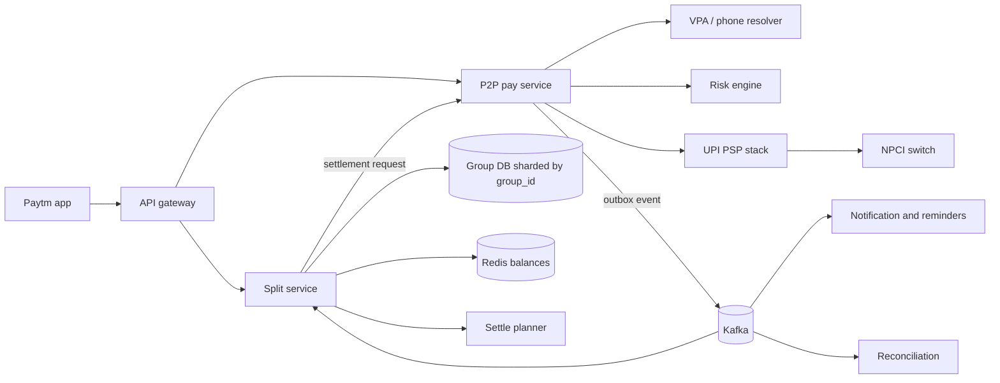
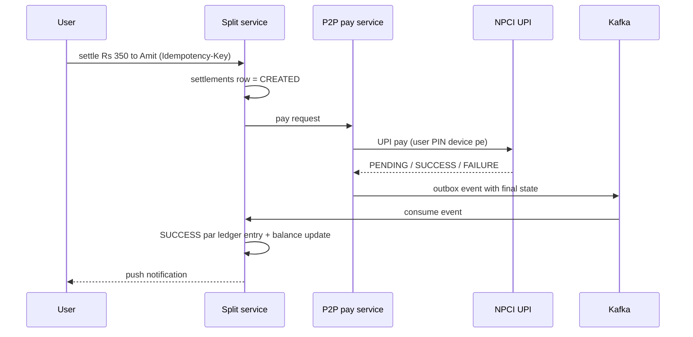

# C10 · Split bill / P2P

Oct 16, 2026 · @saurav chaurasiya

**Is doc me:** UPI P2P (person-to-person) payments aur group split-bill ledger ka poora HLD boss case study.

**Padhne ka tareeka** — Pehle Sawaal pe 15 min khud socho, phir Sahi design padho; Deep Dive tab kholo jab time ho.

---

## C10 — Split bill / P2P

Split bill / P2P ek payments-app feature hai jisme dost ek dusre ko seedhe paise bhejte hain (P2P, person-to-person) aur group ke shared kharche ka hisaab ek ledger me rakhte hain, phir UPI se settle karte hain.

### Ye cheez hai kya

- Category: payments app ka consumer feature, jisme ek money-movement system aur ek group-expense ledger saath chalte hain
- Problem: "Goa trip ka hisaab kaun kisko kitna dega" aur "dost ko VPA (Virtual Payment Address — UPI ID jaise `amit@paytm`) ya phone number se turant paise bhejna"
- Is lesson ke baad tum kar paoge: collect/pay request flow, group ledger schema, debt simplification algorithm, settle-up ko UPI se jodna, aur fraud + scale pe baat
- Analogy: group ka ek common "udhaar ka register" jisme har entry likhi jaati hai, aur mahine ke end me munim-ji sabka net nikaal ke kam se kam payment karwate hain

### Sawaal

Tumhe Paytm ke andar "Split bill" feature banana hai. 20 crore registered users, 2 crore monthly active, roz 50 lakh expenses add hote hain aur 30 lakh P2P payments hote hain. Ek group me max 50 log. Expense add hone ka p99 (99% requests is time ke neeche complete — worst-case jaisa latency) 200 ms, balance dikhne ka p99 150 ms. Settle-up payment UPI pe jayegi, aur ledger me kabhi paisa "gayab" ya double count nahi hona chahiye.

> Pehle khud socho — 15 min. Hints: (1) Ledger me kya store karoge: har expense ya sirf net balance? (2) Debt simplification ka minimum transactions wala problem kitna mushkil hai? (3) Settle payment UPI pe fail ya pending ho jaye to ledger kaise sahi rahe?

### Problem kyun aata hai

- Group me kharche kai log karte hain, aur har kharche me split alag hota hai (equal, exact amount, percentage, shares)
- 10 log ke group me naive tareeke se 45 tak pair-wise udhaar ho sakte hain; sabko yaad rakhna impossible
- Actual payment UPI (NPCI ka rail) pe hoti hai jo hamare control me nahi; ledger aur UPI ke beech inconsistency ka darr rehta hai
- "Collect request" (kisi se paise maangna) fraud ka bada raasta hai: scammer "paise lene ke liye PIN daalo" bolke ulta paise kaat leta hai
- Reminders ka spam user ko app se door karta hai, lekin reminder na ho to paise wapas nahi aate

### Naive approach

- Har expense ke liye har pair ka alag "A owes B" row; settle karne par sab pairs alag-alag payment
- 10 log, har expense me 9 rows; 50 lakh expenses roz = 4.5 crore rows roz sirf pair-rows ke
- 4 dost trip me chaaron ek dusre ko pay karein to 6 payments tak; net me sirf 3 chahiye. Fee-free UPI hai par har payment ek PIN entry aur ek failure chance
- Ledger aur UPI result alag-alag update kiye (dual write): payment success par ledger update fail hua to user ko lagta hai udhaar abhi baaki hai, wo dobara pay kar deta hai (double payment)
- Floating point (`double`) me paise rakhne se 100 / 3 jaise splits me paise ghat-badh jaate hain

### Sahi design

#### Requirements

- Functional: group banana/member add, expense add (equal/exact/percent/shares), edit/delete expense, balances dekhna, simplified settle plan, UPI se settle, pay-to-contact (VPA ya phone se), reminders, activity feed
- Non-functional: ledger me strong consistency (har group ke andar), money paise me integer, idempotent (ek hi request do baar chale to asar ek baar — jaise lift ka button do baar dabane se bhi lift ek hi baar aati hai) payments, 99.95% availability, fraud control, audit trail

#### Back-of-envelope estimates

- 50 lakh expenses/day = 50,00,000 / 86,400 s = \~58 QPS (queries per second — ek second me kitne requests) average; peak 10x (weekend, trip season) = \~600 QPS
- Har expense me avg 4 participants = 4 split rows; 50 lakh x 4 x 100 bytes = \~2 GB/day, \~730 GB/saal (ek tarah ka append-only data)
- 30 lakh P2P payments/day = \~35 QPS avg, peak \~350 QPS; UPI side latency 1-3 s p99 hai, to payment ko async treat karna padega
- Balance read: ek group ka balance cache me \~1 KB; 2 crore MAU x 3 groups = 6 crore keys x 1 KB = \~60 GB, Redis cluster me aaram se

#### API design

- `POST /v1/groups` — group banao, body me members
- `POST /v1/groups/{gid}/expenses` — header `Idempotency-Key`, body: `payer`, `amount_paise`, `split_type`, `splits[]`
- `GET /v1/groups/{gid}/balances` — net balance per member
- `GET /v1/groups/{gid}/settle-plan` — simplified transfers list
- `POST /v1/settlements` — header `Idempotency-Key`, body: `group_id`, `from`, `to`, `amount_paise`, `mode=UPI`
- `POST /v1/p2p/resolve` — phone ya VPA do, masked name + VPA lo (payee ka naam dikhao, galat bande ko paisa jaane se bachne ke liye)
- `POST /v1/pay-requests` — "mujhe pay karo" request (collect ka safe version, neeche dekho)

#### Data model

- `groups(id, name, created_by, currency)` aur `group_members(group_id, user_id, role)`
- `expenses(id, group_id, payer_id, amount_paise, split_type, created_at, version, status)` — soft delete, edit par naya version
- `expense_splits(expense_id, user_id, owed_paise)` — ek expense ke saare splits ka sum = amount (invariant)
- `ledger_entries(id, group_id, user_id, delta_paise, ref_type, ref_id)` — append-only; expense aur settlement dono yahin entry banate hain (double-entry idea, dekho [2B · Ledger Library](https://claude.ai/code/artifact/a7c567e0-66cb-46fe-b7c9-9c20739857eb))
- `group_balances(group_id, user_id, net_paise)` — materialized view/cache, ledger se banta hai
- `settlements(id, group_id, from, to, amount_paise, upi_txn_id, state, idem_key)` — state machine: CREATED, PENDING, SUCCESS, FAILED, UNKNOWN
- Sharding key: `group_id` — ek group ke saare rows ek shard pe, to group ke andar transaction aasan (sharding = data ko kai machines me baantna)

#### High-level architecture

Ye diagram dikhata hai ki split service aur P2P payment service alag hain, aur ledger se settlement events Kafka se jaate hain:



#### Settle-up ka sequence

Ye sequence dikhata hai ki settle payment pending ho to ledger kab update hota hai:



- Ledger me entry sirf SUCCESS (ya recon se confirm) par likho; PENDING me balance "settling" dikhao
- Status unknown ho to Check-Status API aur reconciliation pakadte hain ([2F · Recon Ruins](https://claude.ai/code/artifact/93d00bdd-f45f-441f-946c-c84355b5c05e))

#### Debt simplification (minimize transactions)

- Pehle har member ka net balance nikalo: paid - owed. Sum hamesha 0 hota hai
- Creditors (net > 0) aur debtors (net < 0) ki do heaps (priority queue — sabse bada element turant milta hai) banao
- Greedy: sabse bada debtor sabse bade creditor ko pay kare; kam wala poora clear, doosre ka bacha hua wapas heap me
- Ye ek baar me kam se kam ek bande ko zero karta hai, to max N-1 transactions
- Exact minimum nikalna NP-complete hai (subset-sum se judta hai); Splitwise bhi practically greedy/near-optimal use karta hai, 50 log tak ka cap iski wajah se bhi hai

Ye Java code net balances se greedy settle plan banata hai (paise me integer, double nahi):

```java
import java.util.*;

public class Demo {
    record Transfer(String from, String to, long paise) {}

    // Greedy: sabse bada debtor sabse bade creditor ko pay kare
    static List<Transfer> simplify(Map<String, Long> net) {
        PriorityQueue<Map.Entry<String, Long>> debtors = new PriorityQueue<>((a, b) -> Long.compare(a.getValue(), b.getValue()));
        PriorityQueue<Map.Entry<String, Long>> creditors = new PriorityQueue<>((a, b) -> Long.compare(b.getValue(), a.getValue()));
        for (var e : net.entrySet()) {
            var copy = new AbstractMap.SimpleEntry<>(e.getKey(), e.getValue());
            if (e.getValue() < 0) debtors.add(copy);
            else if (e.getValue() > 0) creditors.add(copy);
        }
        List<Transfer> out = new ArrayList<>();
        while (!debtors.isEmpty() && !creditors.isEmpty()) {
            var d = debtors.poll();
            var c = creditors.poll();
            long amt = Math.min(-d.getValue(), c.getValue());
            out.add(new Transfer(d.getKey(), c.getKey(), amt));
            d.setValue(d.getValue() + amt);
            c.setValue(c.getValue() - amt);
            if (d.getValue() < 0) debtors.add(d);
            if (c.getValue() > 0) creditors.add(c);
        }
        return out;
    }

    public static void main(String[] args) {
        String[][] people = {{"Amit", "Bhavna", "Chirag", "Divya"}};
        Map<String, Long> net = new TreeMap<>();
        for (String p : people[0]) net.put(p, 0L);
        addExpense(net, "Amit", 120000, people[0]);                         // hotel
        addExpense(net, "Bhavna", 40000, new String[]{"Bhavna", "Chirag"}); // cab
        addExpense(net, "Chirag", 20000, people[0]);                        // dinner
        System.out.println("Net balances (paise): " + net);
        long sum = net.values().stream().mapToLong(Long::longValue).sum();
        System.out.println("Sum = " + sum + " (hamesha 0 hona chahiye)");
        for (Transfer t : simplify(net))
            System.out.println(t.from() + " -> " + t.to() + " : Rs " + t.paise() / 100.0);
    }

    static void addExpense(Map<String, Long> net, String payer, long total, String[] among) {
        long share = total / among.length;
        long rem = total - share * among.length; // paise ka bacha hua hissa pehle bande pe
        for (int i = 0; i < among.length; i++) {
            long s = share + (i < rem ? 1 : 0);
            net.merge(among[i], -s, Long::sum);
        }
        net.merge(payer, total, Long::sum);
    }
}
```

Isko chalane pe bilkul ye output aata hai:

```text
Net balances (paise): {Amit=85000, Bhavna=-15000, Chirag=-35000, Divya=-35000}
Sum = 0 (hamesha 0 hona chahiye)
Chirag -> Amit : Rs 350.0
Divya -> Amit : Rs 350.0
Bhavna -> Amit : Rs 150.0
```

- 4 log, 3 expenses ke baad sirf 3 payments bache (N-1), pair-wise me 6 tak ho sakte the
- Ye Strategy pattern ka jagah hai: `SettleStrategy` interface ke peeche greedy ya exact solver badla ja sakta hai

#### Pay-to-contact (VPA / phone lookup)

- Phone number se UPI: PSP (Payment Service Provider — jaise Paytm app) NPCI ke mapper se number ko VPA se map karwata hai
- Resolve ke baad payee ka verified naam dikhao aur user confirm kare, tabhi payment
- Contacts sync user ki permission se hi; contact list ko hash karke match karo, raw numbers server pe store mat karo
- Naya payee pehli baar ho to limit aur cool-off lagao (risk engine)

#### Collect request aur fraud

- Collect request = "mujhe Rs X bhejo" ka request jo payer ke phone pe aata hai, payer approve karke PIN daalta hai
- Fraud: scammer "refund aayega" bolke collect bhejta hai, victim ise "receive" samajh ke PIN daal deta hai
- NPCI ne P2P collect ko band karne ka circular nikala (reports ke hisaab se 1 October 2025 se), isliye safe design me "pay request" ko ek notification-link banao jisme payer khud amount aur payee dekhke naya pay-flow shuru kare, "PIN daalo to paise milenge" jaisa koi flow nahi
- Controls: unknown sender ke request par warning, per-sender daily request cap, expiry, aur block/report button
- Risk scoring ke liye [2G · Security Vault](https://claude.ai/code/artifact/f0f0e8e4-dde8-492e-9a80-08a35792d4e7) aur [C7 · Fraud detection engine](https://claude.ai/code/artifact/fb52d447-8183-4e92-94e4-e704674416b9) dekho

### Kya choose karein aur kyun

| Option | Kab use karo | Kab mat karo |
| --- | --- | --- |
| Net balance only (sirf per-user net) | Chhote groups, simple UI | Audit/edit chahiye ho to expense history chahiye |
| Event-sourced ledger (har expense/settlement entry) + balance view | Production: edit, delete, audit sab chahiye | Prototype jahan history ki zarurat nahi |
| Greedy simplification | Real-time UI, N <= 50 | Jab provable minimum zaroori ho |
| Exact (bitmask DP / subset partition) | N <= 15 jaise chhote groups, offline | Bade groups, exponential time |
| Sync UPI call in request | Kabhi nahi, UPI slow hai | Hamesha async + state machine rakho |
| Async with outbox + Kafka | Settlement ledger consistency | Jab sirf fire-and-forget notification ho |
| Pull (collect) | Verified merchant (P2M) flows | Unknown person se P2P, fraud risk |
| Push (pay request link) | P2P me paise maangna | Jab payer ko seedha pay karna ho, direct pay |

### India me kaise hota hai

- UPI me P2P NPCI ke rail pe chalta hai; PSP app sirf front-end + risk layer hai, jaise [C1 · UPI PSP app](https://claude.ai/code/artifact/b1a2731a-8cb5-4fa6-9e4b-307bdb7ec1aa) me dekha
- NPCI ne fraud kam karne ke liye P2P collect requests band karne ka kadam uthaya; coverage: [Medianama](https://www.medianama.com/2025/08/223-npci-p2p-collect-payments-oct-1-what-it-means/), [Outlook Money](https://www.outlookmoney.com/banking/npci-to-end-upi-p2p-collect-requests-from-october-1-to-reduce-fraud)
- Paytm, PhonePe, Google Pay sab "Split bill" ya group payment dete hain; UPI settle ke liye wahi pay flow reuse hota hai
- Splitwise ka debt simplification greedy cash-flow minimization pe based hai: [Algorithm behind Splitwise's debt simplification](https://medium.com/@mithunmk93/algorithm-behind-splitwises-debt-simplification-feature-8ac485e97688); NP-complete hone ki baat: [Splitwise is NP-Complete](https://www.alexirpan.com/2016/05/10/may-10.html)

### Interview follow-ups

- **Debt simplification ka minimum exact kyun nahi nikalte?** — Minimum transactions problem NP-complete hai (groups ko zero-sum subsets me todna). Greedy N-1 transactions guarantee karta hai, jo practically kaafi hai.
- **Settle payment pending ho to ledger kya karega?** — Settlement state PENDING rakhega, balance "settling" dikhega; UPI final status (callback ya check-status) aane par hi ledger entry post hogi.
- **Same settle request do baar aaye to?** — Idempotency key (ek hi key = ek hi asar) pe unique constraint; doosri call purana result return karti hai. Dekho [2A · Idempotency Island](https://claude.ai/code/artifact/c269ac61-440b-4525-bd04-31baf708dece).
- **Expense edit hone par purane balances kaise sahi rahein?** — Ledger append-only: purani entry ko reverse karne wali compensating entry (ulta entry jo purane asar ko cancel kare) likho, phir nayi entry.
- **Collect request fraud kaise rokoge?** — P2P pull band/restrict, unknown sender warning, daily cap, expiry, risk score, aur UI me "PIN sirf paise bhejne ke liye hai" likha hona.
- **Ek viral group (10,000 expenses) hot shard ban jaye to?** — Group size cap, ledger ko time-bucket me archive karna, balance view cache; ek hot key (ek hi key pe bahut traffic) ko Redis me serve karo aur writes ko queue karo.

### Self-check

1. Ledger me net balance aur expense history dono kyun chahiye?
2. Greedy simplification max kitne transactions deta hai aur kyun?
3. Settle pending ho to double payment kaise rokoge?
4. Paise `double` me kyun nahi, aur 100 ko 3 me kaise baantoge?
5. P2P collect request fraud ka raasta kaise banta hai?

### Notebook

Sharding key group\_id · Paise integer me, rounding ka bacha hua paisa kisi ek ko do · Ledger append-only, edit = reverse + new · Settlement state machine: CREATED, PENDING, SUCCESS, FAILED, UNKNOWN · Greedy debt simplification max N-1 transfers, exact NP-complete · UPI call async, final state outbox + Kafka se · Pull request fraud-prone, push/pay-request safer

### Padhne ke liye

- [Algorithm Behind Splitwise's Debt Simplification](https://medium.com/@mithunmk93/algorithm-behind-splitwises-debt-simplification-feature-8ac485e97688)
- [Splitwise is NP-Complete](https://www.alexirpan.com/2016/05/10/may-10.html)
- [NPCI to end UPI P2P collect requests (Medianama)](https://www.medianama.com/2025/08/223-npci-p2p-collect-payments-oct-1-what-it-means/)
- LLD twin: [D3 Splitwise](https://claude.ai/code/artifact/ea3677ad-81fd-4911-b64a-341b000d17ea)

### Deep Dive (SDE-2) — jab time ho

#### Ledger aur UPI ke beech consistency

- Dual write mat karo: settlement row aur outbox event ek hi DB transaction me ([1E · Kafka River](https://claude.ai/code/artifact/eeb39ee8-3f52-4c04-b57b-68213f02c429) ka outbox pattern)
- Consumer idempotent ho: `ref_id = upi_txn_id` pe unique key, to event dobara aaye to ledger do baar post nahi hoga
- Daily recon: UPI settlement file vs `settlements` table; mismatch ko manual queue me bhejo
- UNKNOWN state (timeout) me kabhi dobara pay mat bhejo, pehle status check

#### Concurrency aur ordering

- Ek group ke concurrent expenses: per-group ordering ke liye Kafka partition key = group\_id ya DB row lock ([2D · Lock Fort](https://claude.ai/code/artifact/97588686-7110-4318-8124-3a8727c7604e))
- Optimistic locking: `group_version` column; stale write par retry
- Balance view eventual consistency (thodi der baad sahi, last tak sab nodes same) chalega, par settle-plan se pehle fresh read lo

#### Reminders aur notification

- Reminder schedule: 3 din, 7 din, 14 din; user mute kar sake; per-user daily cap
- Delivery push/SMS/WhatsApp ke through [C8 · Notification service](https://claude.ai/code/artifact/729bdcdf-fa6a-4de0-852e-a88e13273429)
- Reminder me payment deep link do, to ek tap me settle ho jaye

#### Multi-currency aur rounding

- Trip abroad: har expense apni currency me, group base currency me FX rate snapshot ke saath store
- Rounding: total / N ka bacha hua paisa deterministic tareeke se (jaise sorted user id) baanto, taaki sum hamesha exact rahe

#### Scale aur privacy

- Group\_id sharding, read replicas balance reads ke liye, Redis cache balances ke liye
- Phone numbers aur VPA masked dikhao, logs me raw VPA mat likho
- Data retention: purane settled groups archive tier me

---

## Aage kya

- Pichhla: [C9 · Merchant settlement](https://claude.ai/code/artifact/e627a8b4-90e3-47e2-a4a4-0043ee7c4032)
- Agla: [C11 · AutoPay / mandates](https://claude.ai/code/artifact/f0d10078-c3ef-4d10-88b9-c152d6616a94)
- Related: [C1 · UPI PSP app](https://claude.ai/code/artifact/b1a2731a-8cb5-4fa6-9e4b-307bdb7ec1aa), LLD twin [D3 Splitwise](https://claude.ai/code/artifact/ea3677ad-81fd-4911-b64a-341b000d17ea), [2B · Ledger Library](https://claude.ai/code/artifact/a7c567e0-66cb-46fe-b7c9-9c20739857eb), [2F · Recon Ruins](https://claude.ai/code/artifact/93d00bdd-f45f-441f-946c-c84355b5c05e)
