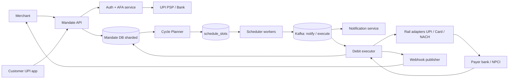
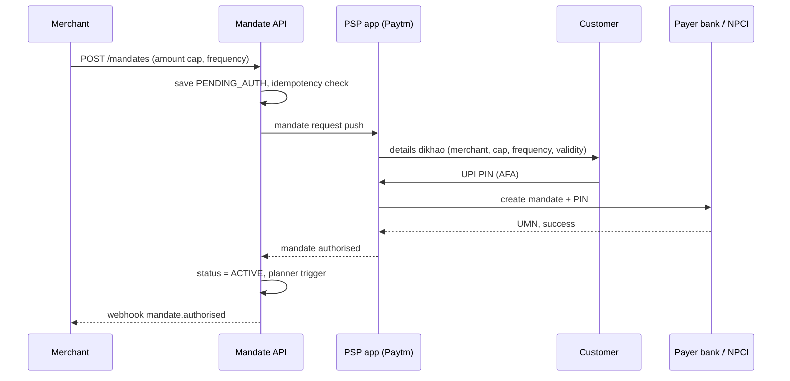
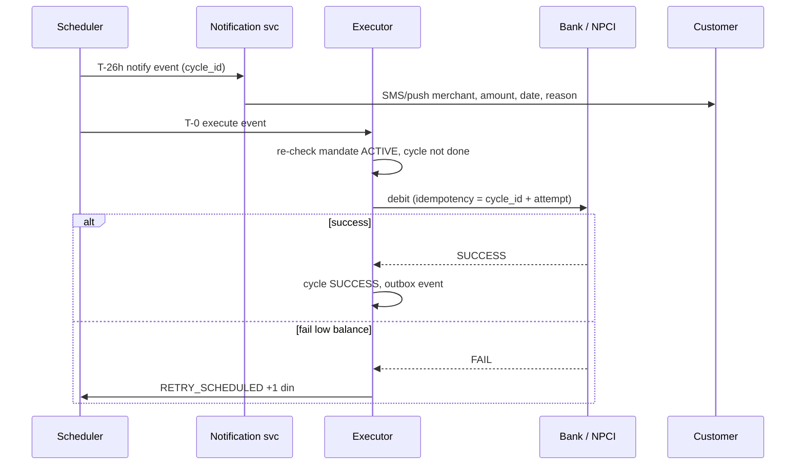

# C11 · AutoPay / mandates

Oct 16, 2026 · @saurav chaurasiya

**Is doc me:** UPI AutoPay aur e-mandate system ka poora HLD — mandate banana, pre-debit notification, scheduler, retries, pause/revoke, aur 1st of the month ka crores-of-debits wala load.

**Padhne ka tareeka** — Pehle Sawaal pe 15 min khud socho, phir Sahi design padho. Deep Dive tab karo jab basics pakke ho jayein.

---

## C11 — AutoPay / mandates

**Mandate** (customer ki ek baar di hui standing permission — "is merchant ko is limit tak, is frequency pe mere account se paisa kaatne do") ke upar bana recurring payment system hi AutoPay hai. Netflix, SIP, EMI, insurance premium, electricity bill — sab isi se chalte hain. Boss level pe tumhe mandate lifecycle, scheduler aur RBI compliance teeno ek saath design karne hain.

### Ye cheez hai kya

- Category: payments-domain HLD boss — scheduler + state machine + compliance engine ka mix.
- Problem: customer ko har mahine manually pay nahi karna, aur merchant ko har baar customer ka PIN nahi chahiye, phir bhi RBI ke rules (pre-debit notification, AFA limits) follow hone chahiye.
- Is lesson ke baad tum kar paoge: mandate create/authorise flow draw karna, debit scheduler ko crores of mandates ke liye scale karna, retries aur pause/revoke ko safely handle karna, aur NACH vs UPI AutoPay vs card e-mandate compare karna.
- Analogy: ye bank me "standing instruction" jaisa hai — tum ek baar form bharte ho ki "har 1 tareekh ko 500 rupaye LIC ko do", aur bank khud karta hai. Bas ab ye form digital hai aur RBI ne kaha hai ki bank debit se ek din pehle tumhe SMS karega.

**AFA** (Additional Factor Authentication — password/card ke upar ek aur proof, jaise UPI PIN ya OTP) aur **idempotent** (same request do baar aaye to bhi effect ek hi baar ho) — ye dono shabd is poore doc me baar-baar aayenge.

### Sawaal

Tumhe Paytm ke liye AutoPay platform design karna hai. 10 crore active mandates hain (OTT, SIP, insurance, loan EMI, utility bills). Roz \~30 lakh debits chalte hain, lekin **1st of the month** ko \~3 crore debits ek din me due hote hain, zyada tar subah 6 se 10 baje ke beech. Har debit se 24 ghante pehle customer ko notification jana zaroori hai. Mandate creation 2 second ke andar UPI app me complete hona chahiye. Ek bhi customer ko double debit nahi hona chahiye, aur revoke ke baad ek paisa bhi nahi katna chahiye.

> Pehle khud socho — 15 min. Hints: (1) 3 crore debits ko ek din me kaise spread karoge bina bank/NPCI ko flood kiye? (2) Notification D-1 pe bhej diya, par customer ne D-0 subah revoke kar diya — kya hoga? (3) Debit fail hua (insufficient balance), kab aur kitni baar retry karoge?

### Problem kyun aata hai

- **Scale ka spike:** 10 crore mandates me se ek hi tareekh pe 30% due — scheduler ko ek din ka load chhote window me jhelna hai.
- **Compliance:** RBI e-mandate framework ke mutabiq pre-debit notification kam se kam 24 ghante pehle zaroori hai, aur mandate register/modify/revoke pe AFA lagta hai.
- **Money safety:** retry ya duplicate worker ki wajah se double debit ho sakta hai.
- **Bank dependency:** debit tumhare control me nahi — payer bank (jiske account se paisa kat raha hai) down ho sakta hai ya slow ho sakta hai.
- **Customer control:** customer kabhi bhi pause ya revoke kar sakta hai, aur system ko turant maanna hai.

### Naive approach

- Ek cron job jo roz subah 6 baje `SELECT * FROM mandates WHERE next_debit_date = today` chalata hai, aur ek loop me har mandate pe bank API call karta hai.
- Notification bhi isi cron me debit ke saath bhej dete hain.
- Kahan toot-ta hai:
  - 3 crore rows ek query me = DB pe massive scan, memory blow-up. Single thread se 3 crore calls @ 50 ms = 15 crore ms = \~42 ghante. Window 4 ghante ka hai.
  - Cron do instance pe chale (HA ke liye) to har mandate do baar debit hoga.
  - Notification debit ke saath bheja to RBI rule (24 ghante pehle) toot gaya — compliance violation.
  - Crash ke baad restart karo to pata nahi kaun se mandates ho chuke hain.
  - Fail hone pe turant retry loop = bank ko hammer karna, aur customer ko bar-bar failed SMS.

### Sahi design

#### Requirements

- **Functional:**
  - Mandate create (merchant request -> customer authorise), view, pause, resume, revoke, modify.
  - Recurring debit schedule karna, pre-debit notification bhejna, debit execute karna.
  - Failure pe retry policy, aur final status merchant ko webhook se batana.
  - Rails: UPI AutoPay, card e-mandate, NACH (bank-to-bank mandate system).
- **Non-functional:**
  - **Throughput** (kitna kaam ek second me) — peak \~50K debit attempts/sec ko absorb karna.
  - Exactly-once effect: kisi bhi mandate cycle ka debit ek hi baar. [2A · Idempotency Island](https://claude.ai/code/artifact/c269ac61-440b-4525-bd04-31baf708dece) pe depend karta hai.
  - Notification SLA: debit se >= 24 ghante pehle (hum 26 ghante target karenge buffer ke saath).
  - Availability 99.95%, audit trail har state change ka (RBI audit ke liye).
  - Revoke ka effect ek second ke andar — "revoke ke baad debit nahi".

#### Back-of-envelope estimates

- Active mandates: 10 crore. Row size \~1 KB -> 100 GB mandate table. Shard karna padega.
- Peak day: 3 crore debits in 4 ghante (14,400 s) = \~2,100 debits/sec average. Par bank cutoffs pe bunching hoti hai, to peak 10x = \~20K-50K/sec design karte hain.
- Pre-debit notifications: D-1 pe 3 crore SMS/push. 3 crore ko 12 ghante me spread = \~700/sec — [C8 · Notification service](https://claude.ai/code/artifact/729bdcdf-fa6a-4de0-852e-a88e13273429) isko handle karti hai.
- Debit attempts table growth: 3 crore/din x 5 attempt-logs x 200 B = \~30 GB/din hot peak, baaki din kam. Monthly partition karenge.
- Retry traffic: \~8% fail (low balance) -> 24 lakh retries, spread over 3 din.

#### API design

- Merchant-facing, har POST pe `Idempotency-Key` header.

```text
POST /v1/mandates                     -> mandate_id, status=PENDING_AUTH, auth_link / UPI collect
GET  /v1/mandates/{id}                -> status, limits, next_debit_at
POST /v1/mandates/{id}/pause          -> status=PAUSED   (customer / merchant)
POST /v1/mandates/{id}/revoke         -> status=REVOKED  (AFA required for customer)
POST /v1/mandates/{id}/debits         -> debit_id (merchant-initiated charge for a cycle)
GET  /v1/debits/{debit_id}            -> status, attempts, failure_reason
Webhook: mandate.authorised | debit.notified | debit.success | debit.failed | mandate.revoked
```

#### Data model

| Table | Key fields | Note |
| --- | --- | --- |
| mandates | mandate\_id (PK), customer\_id, merchant\_id, rail (UPI/CARD/NACH), max\_amount, frequency, start/end date, status, umn (unique mandate number — bank/NPCI ka reference), next\_debit\_at | shard by mandate\_id |
| debit\_cycles | cycle\_id = mandate\_id + cycle\_date (unique), amount, status, notify\_at, execute\_at, attempt\_count | unique key hi idempotency hai |
| debit\_attempts | attempt\_id, cycle\_id, rail\_ref, result, bank\_code, ts | append-only log |
| schedule\_slots | slot\_time (minute bucket), shard, cycle\_id | scheduler isko scan karta hai |
| outbox | event\_id, payload, published | [1E · Kafka River](https://claude.ai/code/artifact/eeb39ee8-3f52-4c04-b57b-68213f02c429) ka outbox pattern |

- Mandate state machine: `PENDING_AUTH -> ACTIVE -> PAUSED -> ACTIVE ... -> REVOKED / EXPIRED`. Illegal transition reject. State machine ke liye [2C · Saga Sea](https://claude.ai/code/artifact/429b3ea6-a261-431d-a384-a0c6eb68a9f6) dekho.
- Debit cycle state: `SCHEDULED -> NOTIFIED -> EXECUTING -> SUCCESS / FAILED -> RETRY_SCHEDULED`.

#### High-level architecture



- Planner: har mandate ke agle cycle ka row `debit_cycles` me pehle se bana deta hai (T-3 din) — isse 1st ko koi heavy query nahi chalti.
- Scheduler: slot table ko minute-bucket se padhta hai, Kafka me events daalta hai.
- Executor: stateless workers, rail adapter ke through bank ko call.

#### Mandate creation aur authorisation



- Creation pe AFA lagta hai, aur pehla debit bhi AFA ke saath combine ho sakta hai.
- Customer cap approve karta hai — merchant us cap se zyada kabhi nahi kaat sakta.

#### Debit cycle: notify, execute, retry



#### Scheduler at scale (1st of the month)

1. **Pre-compute:** T-3 din pe planner cycles bana ke `schedule_slots` me daalta hai, `execute_at` ko jitter ke saath minute buckets me spread karke (6:00 se 10:00 ke beech, mandate\_id hash se).
2. **Slot-per-shard:** har DB shard ka apna scheduler worker, aur slot ko lease se claim karta hai (`UPDATE ... SET owner=me WHERE owner IS NULL`) — do worker same slot nahi uthayenge. Job scheduler ki detail ke liye [Q18 · Job scheduler](https://claude.ai/code/artifact/f34c8263-0b8d-42e6-80ea-90a73678be35).
3. **Kafka partition by mandate\_id:** ek mandate ke events ek hi partition me, order maintained.
4. **Executor idempotency:** `cycle_id` unique + bank call me same `cycle_id` as reference, to retry ya duplicate worker pe bhi ek hi debit.
5. **Rate limit per bank:** har payer bank ke liye token bucket (HDFC ke liye alag, SBI ke liye alag) — [2E · Resilience Ridge](https://claude.ai/code/artifact/4769dea3-018e-41e1-ae18-253fa36a6d21) ka rate limiting + circuit breaker. Bank slow ho to uski queue pause, baaki banks chalte rahein.
6. **Revoke check at execute time:** executor debit se pehle mandate status DB/cache se dobara dekhta hai. REVOKED/PAUSED ho to cycle SKIPPED.
7. **Backpressure** (downstream slow ho to upstream ko dheema karna): Kafka lag dekh ke scheduler slot release rate kam karta hai.

#### Retry policy

- Sirf **soft failures** pe retry (insufficient funds, bank timeout, technical decline). **Hard failures** (mandate revoked, account closed) pe nahi.
- Schedule: +4 ghante, +1 din, +2 din, phir stop — total 3 retries, merchant ke grace-period ke andar.
- Har retry se pehle bhi customer ko notification zaroori hai kyunki ye naya debit attempt hai (compliance team se confirm karo). Neeche follow-ups me detail.
- Timeout pe "unknown" status: pehle status enquiry call, blind retry nahi — double debit ka sabse bada risk yahi hai. [2F · Recon Ruins](https://claude.ai/code/artifact/93d00bdd-f45f-441f-946c-c84355b5c05e) ka reconciliation.

### Kya choose karein aur kyun

| Option | Kab use karo | Kab mat karo |
| --- | --- | --- |
| UPI AutoPay | Instant setup, retail subscriptions (OTT, SIP, bills), UPI PIN se AFA | Bohot bada ticket size jaha limit exceed ho, ya customer ke paas UPI-linked account nahi |
| Card e-mandate | Customer card pe subscription chahta hai, global merchants, card tokenised ho | Customer ka card issuer e-mandate support nahi karta, ya debit card pe low success rate |
| NACH (National Automated Clearing House — bank-to-bank bulk debit system) | Loan EMI, high value, long tenure, bulk batch debits | Instant onboarding chahiye (registration me kuch din lagte hain) |
| Scheduler: cron + DB scan | Chhota scale, lakh se kam mandates | 1st-of-month crores wala spike |
| Scheduler: pre-computed slots + Kafka | Crores of mandates, retry aur rate-limit control chahiye | Prototype ya MVP |

### India me kaise hota hai

- **RBI e-mandate framework:** recurring card/UPI/wallet debits pe pre-debit notification kam se kam 24 ghante pehle, aur AFA ke bina limit Rs 15,000 per transaction tak (insurance premium, mutual fund aur credit card bill pe Rs 1,00,000 tak). Mandate register, modify aur withdraw pe AFA lagta hai. Details: [RBI consolidated directions summary (TaxGuru)](https://taxguru.in/rbi/rbi-issues-consolidated-directions-digital-payments-e-mandate-framework-2026.html), [Zoho Payments — UPI mandate lifecycle](https://www.zoho.com/payments/academy/payment-processing/upi-autopay-mandates-and-recurring-debits.html).
- **NPCI UPI AutoPay:** customer UPI app me merchant, cap, frequency, validity dekh ke UPI PIN daalta hai. Customer baad me apne UPI app se pause ya revoke kar sakta hai.
- **Exemptions:** FASTag aur NCMC (National Common Mobility Card) balance auto-replenishment pe pre-debit notification ki zarurat nahi.
- **Paytm Payment Gateway:** merchants ke liye subscriptions API hai, aur status fetch karne ka tool bhi (subscription status). Paytm ke apne docs ke hisab se hi flow match karna, ye doc generic HLD hai.

### Interview follow-ups

- **Pre-debit notification D-1 gaya, customer ne D-0 subah revoke kiya. Debit ho jayega?** — Nahi. Executor har debit se pehle mandate status dobara check karta hai (cache me revoke event pe turant invalidate). Revoke pe cycle SKIPPED aur merchant ko webhook.
- **Scheduler ke do instance same cycle utha lein to?** — `debit_cycles` ka unique key (mandate\_id + cycle\_date) aur slot lease. Phir bhi agar do executor chal gaye to bank call me same reference hone se bank duplicate reject karta hai. Ye [2A · Idempotency Island](https://claude.ai/code/artifact/c269ac61-440b-4525-bd04-31baf708dece) ka seedha use hai.
- **Bank ne timeout diya, debit hua ya nahi pata nahi. Kya karoge?** — Status UNKNOWN, blind retry nahi. Status enquiry API, phir bhi pata na chale to reconciliation file ka wait. Tab tak merchant ko "pending" dikhao.
- **Amount badal gaya (plan upgrade) aur cap se zyada hai?** — Naya mandate ya modify, dono me AFA chahiye. Cap silently badha nahi sakte.
- **Ek hi din 3 crore notifications kaise bhejoge?** — Notification T-26h slot pe, 12 ghante me spread karke bhejte hain; [C8 · Notification service](https://claude.ai/code/artifact/729bdcdf-fa6a-4de0-852e-a88e13273429) me priority queue aur channel fallback (push, phir SMS).
- **Merchant ko 1st ko hi paisa chahiye, hum 10 baje tak spread karte hain. Conflict?** — Merchant ke SLA me "debit window" likho (e.g. due date + 2 din). Time-critical merchants (EMI) ko priority lane do.

### Self-check

1. Mandate kya hai aur AFA kab lagta hai aur kab nahi?
2. Pre-debit notification kitne ghante pehle chahiye, aur kaunse cases exempt hain?
3. 1st of the month ka spike scheduler me kaise handle karoge (pre-compute, jitter, slot lease)?
4. Timeout aane pe blind retry kyun nahi karte?
5. NACH, UPI AutoPay aur card e-mandate me se loan EMI ke liye kya aur kyun?

### Notebook

Mandate = customer ki capped standing permission · Notification >= 24h pehle, executor pe revoke dobara check · Unique key (mandate\_id + cycle\_date) = idempotency · Pre-compute slots T-3 din, jitter se spread · Per-bank token bucket + circuit breaker · Timeout = UNKNOWN, pehle status enquiry · Rs 15,000 no-AFA limit, Rs 1,00,000 insurance/MF/CC bill.

### Padhne ke liye

- [RBI e-mandate directions — summary (TaxGuru)](https://taxguru.in/rbi/rbi-issues-consolidated-directions-digital-payments-e-mandate-framework-2026.html)
- [How a UPI mandate works for recurring debits (Zoho)](https://www.zoho.com/payments/academy/payment-processing/upi-autopay-mandates-and-recurring-debits.html)
- [UPI AutoPay compliance checklist (AMLegals)](https://amlegals.com/upi-autopay-and-recurring-payments-compliance-checklist-under-rbis-e-mandate-framework-2026/)

### Deep Dive (SDE-2) — jab time ho

#### Scheduler internals

- Hierarchical timing wheel ya DB-backed minute buckets — dono me tradeoff: wheel in-memory fast par crash pe rebuild; DB buckets durable par polling load.
- Slot claim ke liye lease with expiry (heartbeat); worker mar jaye to lease expire hoke dusra utha le.
- Jitter deterministic rakho (hash of mandate\_id) taaki replay pe wahi slot mile.

#### Exactly-once effect

- Bank API at-least-once hai, to hum "idempotent consumer" banate hain: `cycle_id + attempt_no` ko bank reference banao.
- Outbox pattern: DB update aur webhook event ek transaction me, phir relay Kafka me. Dual write mat karo.
- Reconciliation T+1 file se match; mismatch pe auto-refund ya re-mark SUCCESS.

#### Revoke vs in-flight debit race

- Revoke aur execute ek hi mandate pe concurrent aa sakte hain. Mandate row pe version (optimistic lock) rakho; executor `status=ACTIVE AND version=v` pe cycle ko EXECUTING mark kare.
- Agar debit bank ko ja chuka aur revoke baad me aaya, debit valid hai (notification already gayi thi); revoke sirf aage ke cycles rokta hai.

#### Compliance aur audit

- Har notification ka proof (sent time, channel, delivery receipt) store karo — audit me dikhana padta hai.
- Mandate modify/revoke ke AFA tokens ka log, PII masked.
- Failed-debit ke liye customer ko clear reason aur "mandate manage karo" deep link.

---

## Aage kya

- Pichhla: [C10 · Split bill / P2P](https://claude.ai/code/artifact/a730d383-1377-4435-82b0-21322fc79d1f)
- Agla: [C12 · QR + Soundbox](https://claude.ai/code/artifact/0de0a37f-1405-49f3-8379-19e1155584a9)
- Related: [Q18 · Job scheduler](https://claude.ai/code/artifact/f34c8263-0b8d-42e6-80ea-90a73678be35), [C8 · Notification service](https://claude.ai/code/artifact/729bdcdf-fa6a-4de0-852e-a88e13273429), [2A · Idempotency Island](https://claude.ai/code/artifact/c269ac61-440b-4525-bd04-31baf708dece)
