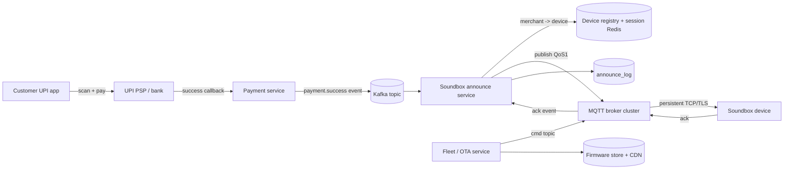
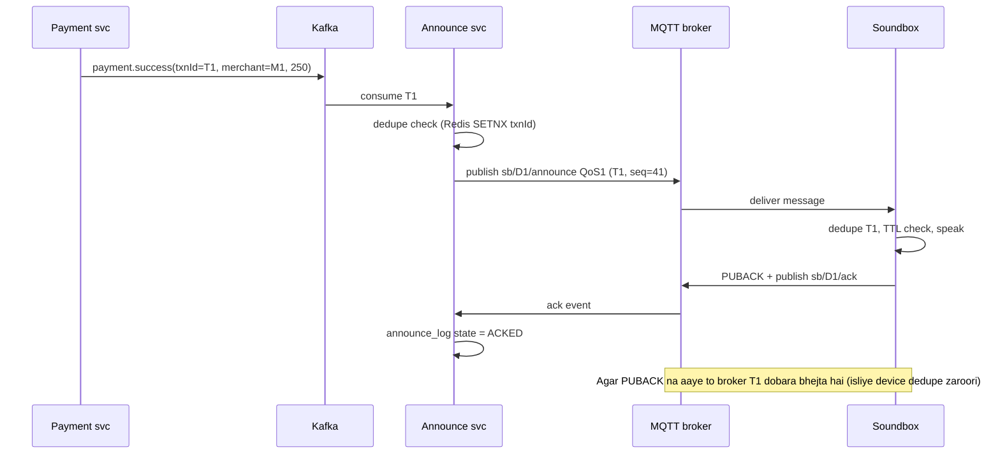

# C12 · QR + Soundbox

Oct 16, 2026 · @saurav chaurasiya

**Is doc me:** Paytm QR (static vs dynamic) aur Soundbox ka poora HLD boss — payment success hote hi dukaan ke speaker pe 2 second ke andar "Paytm se 250 rupaye mile" kaise bajta hai, crores of devices MQTT pe kaise connected rehte hain, OTA firmware update, offline buffering aur duplicate announcement prevention.

**Padhne ka tareeka** — Pehle "Ye cheez hai kya" se "Sahi design" tak padho aur diagrams khud redraw karo. Interview ke baad "Interview follow-ups" aur "Self-check" se test karo. "Deep Dive" tab padho jab SDE-2 level ka time ho.

---

## C12 — QR + Soundbox

**Soundbox** ek chhota internet-connected speaker hai jo dukaan pe rakha jaata hai. Customer QR scan karke pay kare, aur payment success hote hi ye speaker bolta hai "Paytm pe 250 rupaye prapt hue". **QR (Quick Response code)** wo chhota black-white square hai jisme merchant ki payment details encoded hoti hain.

### Ye cheez hai kya

- Category: IoT (Internet of Things — internet se jude chhote hardware devices) + payments ka real-time notification system.
- Problem: Dukaandar phone me SMS dekhne ke liye rukta nahi, aur customer bolta hai "pay kar diya". Dukaandar ko turant, bharosemand confirmation chahiye bina phone dekhe.
- Is lesson ke baad tum kar paoge: static vs dynamic QR ka fark samjha sakoge, payment event se speaker tak ka pura path (Kafka se MQTT tak) design kar sakoge, aur offline, duplicate, OTA, scale jaise follow-ups handle kar sakoge.
- Analogy: Cricket stadium ka announcer — jaise hi boundary lagti hai, turant mic pe bolta hai. Agar announcer 30 second late bole to koi nahi sunega; aur agar wahi boundary do baar announce kare to confusion. Soundbox bhi wahi announcer hai.

### Sawaal

Paytm jaisa platform design karo jahan **3 crore (30 million) merchants** ke paas QR hai aur unme se **1 crore+ ke paas Soundbox** lagi hai. Peak time (festive season, shaam 6-9 baje) pe **\~15,000 successful QR payments per second** aate hain, jinme se \~40% Soundbox merchants ke hain.

Target: payment success hone se speaker bolne tak **p99 (99% requests is time ke andar complete) latency < 2 second**. Devices zyadatar **2G/4G SIM** pe hain, signal kamzor hota hai, dukaan ki bijli kat sakti hai. Ek payment ka announcement **na do baar** bajna chahiye, **na miss** hona chahiye.

> Pehle khud socho — 15 min. Hints: (1) Server se device ko push kaise karoge — device baar baar poll kare ya persistent connection rahe? (2) Agar device 5 minute offline raha to jo payments hue, unka kya karoge? (3) Ek hi message do baar aa gaya to speaker ko kaise pata chalega ki repeat hai?

### Problem kyun aata hai

- Payment ka confirmation customer ke phone pe turant aata hai, par **merchant ko** nahi — merchant ko alag se pata chalna chahiye.
- SMS late aata hai (kabhi 30 second, kabhi gayab). Rush hour me merchant har SMS nahi padh sakta.
- Fraud: customer fake "payment successful" screenshot dikha deta hai. Speaker trusted channel hai kyunki wo bank-confirmed event pe bolta hai.
- Device ek **constrained device** hai (kam RAM, kam CPU, sasta 2G modem). Normal web server jaisa HTTP polling chalane se battery, data aur server sab pe load padta hai.
- Static QR pe amount kisi ko pata nahi hota, isliye "kis payment ka kaunsa announcement" match karna tricky hai.

### Naive approach

- Pehla idea: **Device har 2 second me server se poll kare**: `GET /payments?since=...`. Server DB me query kare aur nayi payments return kare.
- Kahan toot-ta hai:
  - 1 crore devices x 0.5 request/sec = **50 lakh (5 million) requests per second** sirf poll ke liye, jabki real payments sirf \~6,000 per second hain. 99.9% polls khali jaate hain.
  - Latency average 1 second (poll interval ka aadha), worst case 2+ second — 2 second SLA (service level agreement — latency ka vaada) toot jaata hai.
  - 2G pe har HTTPS request me TLS handshake (secure connection setup) ka bhaari data/battery cost aata hai; SIM data plan ka bill alag.
  - DB pe 50 lakh read QPS — poora system sirf polling me busy.
- Doosra idea: **SMS ya push notification (FCM)** device ko bhejo. Soundbox ke paas Android jaisa FCM nahi hota, aur SMS delivery guaranteed nahi hai, na hi fast.
- Teesra idea: **Har payment pe seedha HTTP call device ke IP pe** — device ka public IP nahi hota (NAT ke peeche, mobile network), to server pahunch hi nahi sakta.

### Sahi design

Idea ye hai: **device khud server se ek lambe time tak chalne wala connection (persistent connection) khol ke rakhta hai** aur server us connection pe message **push** karta hai. Protocol hai **MQTT (Message Queuing Telemetry Transport — IoT ke liye bana halka pub-sub protocol)**.

#### Requirements

- Functional:
  - Merchant ko static QR (fixed, har payment ke liye wahi) aur dynamic QR (har order ke liye naya, amount ke saath) milna chahiye.
  - Payment success pe us merchant ki Soundbox pe amount ke saath audio announcement.
  - Device activate/deactivate, language change (Hindi, Tamil, etc.), volume, battery status report.
  - Remote firmware update (OTA — Over The Air, bina device haath me liye).
- Non-functional:
  - p99 end-to-end < 2 sec, normal case me p50 < 1 sec.
  - Availability 99.95%+; message **at-least-once delivery** (kam se kam ek baar zaroor) + device side dedupe = user ko **effectively exactly-once** announcement.
  - Crores of concurrent connections.
  - Low data usage (har device ka mahine ka data \~ 100 MB se kam).
  - Security: device authentication, encrypted channel, fake announcement na ho sake.

#### Back-of-envelope estimates

- Devices: 1 crore (10 million) Soundbox, peak concurrently connected \~ 80% = **80 lakh connections**.
- Payments: peak 15,000 QR payments/sec, Soundbox wale \~40% = **6,000 announcements/sec**. Average din me \~1,500/sec.
- Ek MQTT broker node \~ 1-2 lakh connections handle kar leta hai (kernel tuning ke baad). 80 lakh / 1 lakh = **\~80-100 broker nodes** (buffer ke saath \~150).
- Keepalive (device zinda hai ya nahi batane ke liye chhota ping): har 60 sec me ek ping = 80 lakh / 60 = **\~1.3 lakh pings/sec** — broker ke liye halka, par HTTP polling se 40 guna kam.
- Message size: \~200 bytes (txn id, amount, language, seq). Peak 6,000 x 200 B = **1.2 MB/sec** — bahut chhota. Challenge bandwidth nahi, **connections ki ginti** hai.
- Data per device per din: 500 payments x 200 B = 100 KB + keepalive \~ 1.5 MB/din. Mahine me \~ 50 MB. 2G/4G SIM plan ke andar.
- Device registry: 1 crore rows x 1 KB = **10 GB** — ek sharded DB ke liye aasaan.

#### API design

- Merchant/ops side (REST):
  - `POST /v1/qr/dynamic` body: `{merchantId, amount, orderId, expiryMins}` -> `{qrString, qrId}`
  - `GET /v1/qr/static/{merchantId}` -> merchant ka permanent QR
  - `POST /v1/soundbox/activate` body: `{merchantId, deviceSerial}` -> `{deviceId}`
  - `PATCH /v1/soundbox/{deviceId}/settings` body: `{language, volume}`
  - `POST /v1/fleet/rollouts` body: `{firmwareVersion, cohort, percent}` (OTA rollout shuru karna)
- Device side (MQTT topics, kyunki device HTTP nahi bolta):
  - Subscribe: `sb/{deviceId}/announce` — server yahan payment announcement bhejta hai (QoS 1).
  - Subscribe: `sb/{deviceId}/cmd` — settings, OTA command.
  - Publish: `sb/{deviceId}/ack` — "mene txn T1 bol diya".
  - Publish: `sb/{deviceId}/status` — battery, signal, firmware version, heartbeat.
- Announcement payload: `{txnId, seq, amount, lang, ts}`.

#### Data model

| Table / Store | Key fields | Kahan rakhein |
| --- | --- | --- |
| merchant | merchantId, name, vpa (UPI ID), status | SQL (MySQL), merchantId se shard |
| qr\_code | qrId, merchantId, type (STATIC/DYNAMIC), amount, orderId, expiresAt | SQL + cache (Redis) |
| device | deviceId, serial, merchantId, fwVersion, lang, lastSeenAt, status | SQL sharded by deviceId |
| device\_session | deviceId -> brokerNodeId, connectedAt | Redis (fast lookup, TTL) |
| announce\_log | txnId, deviceId, seq, state (SENT/ACKED/EXPIRED), sentAt | NoSQL (Cassandra / DynamoDB), TTL 7 din |
| fw\_release | version, binaryUrl, checksum, rolloutPercent | SQL + object storage (S3) |

#### Static vs dynamic QR

- **Static QR**: merchant ka UPI ID (VPA — Virtual Payment Address, jaise `shop@paytm`) QR me hamesha ke liye encode hota hai. Customer amount khud type karta hai. Ek sticker, saalon tak.
- **Dynamic QR**: har order ke liye naya QR, amount + orderId + expiry encode hoti hai. Billing counter / POS (Point of Sale) machine pe use hota hai. Amount galat type hone ka chance nahi.
- Dono ka UPI string format: `upi://pay?pa=shop@paytm&pn=Sharma%20Store&am=250&tr=ORD123&cu=INR`.
- Soundbox ke liye farak kya padta hai: dynamic QR me `orderId` hota hai to announcement ko seedha order se match kar sakte ho; static me sirf merchant + amount milta hai.

#### Architecture diagram

Payment ka event Kafka pe aata hai (dekho [1E · Kafka River](https://claude.ai/code/artifact/eeb39ee8-3f52-4c04-b57b-68213f02c429)), Soundbox service use consume karta hai, device registry se broker dhoondhta hai aur MQTT pe push karta hai.



Ab ek payment ka sequence dekho, jisme retry aur ack dono dikhte hain.



#### Step by step flow

1. Customer QR scan karke UPI PIN daalta hai. Bank/PSP (Payment Service Provider) payment confirm karta hai. Dekho [C1 · UPI PSP app](https://claude.ai/code/artifact/b1a2731a-8cb5-4fa6-9e4b-307bdb7ec1aa).
2. Payment service DB me txn ko SUCCESS mark karta hai aur **outbox pattern** se `payment.success` event Kafka pe daalta hai (taaki DB commit aur event ek saath bane).
3. Announce service event consume karta hai. `SETNX txnId` (Redis ka "agar key nahi hai to hi set karo" command) se server-side dedupe karta hai.
4. Merchant ID se device ID nikalta hai, aur `device_session` se pata karta hai ki device kis broker pe connected hai.
5. MQTT broker ko `sb/{deviceId}/announce` pe QoS 1 message publish karta hai. Message ke saath per-device **sequence number** aur **timestamp** hota hai.
6. Device message receive karke dedupe + TTL check karta hai, audio bajata hai, aur ack publish karta hai.
7. Ack na aaye to retry (3 baar, exponential backoff). Phir bhi na aaye to message offline queue me jaata hai (neeche Deep Dive).

#### Device side logic ka chhota Java demo

Ye demo firmware ka dedupe + TTL + ordering logic dikhata hai. Real firmware C/C++ me hota hai, par logic wahi hai. Pattern: **Idempotent receiver** (ek hi message baar baar aaye to bhi asar ek hi baar).

```java
import java.util.*;

public class Demo {
    // Server se device ko jane wala ek announcement message
    record Msg(String txnId, long seq, String text, long createdAtMs) {}

    // Device ka firmware logic: dedupe + ordering + TTL (stale message skip)
    static class Device {
        final Set<String> seenTxn = new HashSet<>();   // chhota ring buffer jaisa set (last N txn)
        long lastSeq = 0;
        final List<String> spoken = new ArrayList<>();
        static final long TTL_MS = 60_000;             // 60 sec se purana message bolna bekaar

        void onMessage(Msg m, long nowMs) {
            // MQTT QoS1 = at-least-once, matlab duplicate aa sakta hai. Txn id se dedupe.
            if (!seenTxn.add(m.txnId())) { spoken.add("SKIP duplicate " + m.txnId()); return; }
            if (nowMs - m.createdAtMs() > TTL_MS) { spoken.add("SKIP stale " + m.txnId()); return; }
            if (m.seq() <= lastSeq) { spoken.add("SKIP old-seq " + m.txnId()); return; }
            lastSeq = m.seq();
            spoken.add("SPEAK " + m.text());
        }
    }

    public static void main(String[] args) {
        Device d = new Device();
        long now = 1_000_000L;
        d.onMessage(new Msg("T1", 1, "Rupay 250 mile", now - 800), now);
        d.onMessage(new Msg("T1", 1, "Rupay 250 mile", now - 800), now + 50);  // broker ne dobara bheja (retry)
        d.onMessage(new Msg("T2", 2, "Rupay 90 mile", now - 300), now + 100);
        // network 2G pe atka tha, reconnect hone par bahut purana message aaya
        d.onMessage(new Msg("T0", 3, "Rupay 40 mile", now - 300_000), now + 200);
        d.onMessage(new Msg("T3", 4, "Rupay 500 mile", now), now + 300);
        d.spoken.forEach(System.out::println);
    }
}
```

Isko chalane pe bilkul ye output aata hai:

```text
SPEAK Rupay 250 mile
SKIP duplicate T1
SPEAK Rupay 90 mile
SKIP stale T0
SPEAK Rupay 500 mile
```

- T1 dobara aaya to skip hua (duplicate prevention).
- T0 ka message 5 minute purana tha, isliye bola nahi gaya (TTL). Wo merchant ko app / history me dikhega, par speaker pe nahi.

### Kya choose karein aur kyun

Device ko message kaise pahunchaye, iske options:

| Option | Kab use karo | Kab mat karo |
| --- | --- | --- |
| HTTP polling | Prototype, bahut kam devices, real-time zaroori nahi | Crores of devices ya < 2 sec SLA — empty polls aur data cost maar dete hain |
| Long polling / WebSocket | Browser ya phone app jahan HTTP stack already hai | Constrained device pe, jahan reconnect aur keepalive ka overhead zyada ho |
| MQTT (QoS 1) | IoT devices, kharab network, push chahiye, kam bytes | Jab payload bada ho ya request-response style API chahiye |
| SMS / FCM push | Phone app notification | Dedicated speaker hardware jisme FCM ya reliable SMS nahi |

Static vs dynamic QR:

| Option | Kab use karo | Kab mat karo |
| --- | --- | --- |
| Static QR | Chhoti dukaan, chai-sabzi wala, amount har baar alag | Jab order-level reconciliation chahiye (kaunsa order paid hua) |
| Dynamic QR | Billing counter, e-commerce, POS, fixed amount | Jahan billing system hi nahi hai |
| Dynamic QR + Soundbox | Restaurant, retail chain | Bahut kam volume wale merchant (device ka kharcha nahi nikalta) |

MQTT QoS (Quality of Service) levels:

| Option | Kab use karo | Kab mat karo |
| --- | --- | --- |
| QoS 0 (at-most-once) | Heartbeat, telemetry jahan ek-aadh miss chalega | Payment announcement — miss ho sakta hai |
| QoS 1 (at-least-once) | Announcement — miss nahi hona chahiye, duplicate device dedupe karega | Jab duplicate bardasht na ho aur device dedupe na kar sake |
| QoS 2 (exactly-once) | Rare cases, sab kuch reliable network pe | 2G pe — 4-step handshake bahut slow aur costly |

### India me kaise hota hai

- Paytm Soundbox customer ke QR payment ke turant baad success announce karta hai; Paytm ke support page pe batata hai ki device internet (SIM/WiFi) se jude rehkar kaam karta hai: [How does the SoundBox work? — Paytm for Business](https://business.paytm.com/support/how-does-the-soundbox-work).
- Device ka andar ka hardware (modem, MCU, speaker, battery) ek teardown me dikhaya gaya hai: [PayTM SoundBox Teardown](https://pallavaggarwal.in/2022/11/30/teardown-paytm-sound-box/). Isse samajh aata hai ki device chhota, sasta, kam-RAM wala hai — isliye MQTT jaisa halka protocol sahi baithta hai.
- PhonePe SmartSpeaker aur BharatPe jaise players bhi isi model pe chalte hain: QR + speaker + SIM, server se push. Is system me common pattern hai: MQTT-jaisa pub-sub broker + device registry + OTA service.
- Sab UPI payments NPCI (National Payments Corporation of India) ke rails pe chalte hain; merchant QR ka format NPCI ke UPI linking spec pe based hai. Dekho [C1 · UPI PSP app](https://claude.ai/code/artifact/b1a2731a-8cb5-4fa6-9e4b-307bdb7ec1aa).
- IoT fleet ke generic patterns (device shadow, jobs, OTA) ke liye AWS ke docs achhe reference hain: [AWS IoT Device Shadow service](https://docs.aws.amazon.com/iot/latest/developerguide/iot-device-shadows.html), [Firmware updates — IoT Lens](https://docs.aws.amazon.com/wellarchitected/latest/iot-lens/firmware-updates.html). Paytm ka internal stack public nahi hai, isliye ye ek reference architecture hai, Paytm ka claim nahi.

### Interview follow-ups

- **Device offline ho gaya aur 10 payments miss ho gaye, ab kya?** — Server announce\_log me pending rakhta hai. Reconnect pe device apna last `seq` bhejta hai; server missed messages dobara bhejta hai, par sirf TTL ke andar wale (jaise 60 sec). Purane payments speaker pe nahi bajte, app/history me dikhte hain.
- **Duplicate announcement kaise rokoge?** — Teen layer: (1) server pe `SETNX txnId` Redis dedupe, (2) MQTT QoS 1 ke duplicates device `txnId` set se rokta hai, (3) per-device `seq` strictly badhta hai. Ye [L2.1 — Idempotency keys](https://claude.ai/code/artifact/c269ac61-440b-4525-bd04-31baf708dece) wali soch hai (idempotent = ek hi kaam baar baar karo to bhi asar ek hi baar).
- **2 second SLA kahan khota hai?** — Budget: payment confirm -> Kafka (\~100 ms), consume + lookup (\~50 ms), broker publish (\~50 ms), 4G network (\~200-500 ms; 2G me 1 sec tak), audio start (\~200 ms). Slowest hissa hamesha network hai, isliye keepalive tune aur regional brokers zaroori hain.
- **Broker node mar gaya to?** — Us node ke \~1 lakh devices reconnect karte hain. Reconnect storm (sab ek saath connect) rokne ke liye device exponential backoff + random jitter (thoda random delay) use karta hai. Device registry me session update ho jaata hai, aur Kafka consumer retry karta hai. Dekho [L2.17a backpressure](https://claude.ai/code/artifact/4769dea3-018e-41e1-ae18-253fa36a6d21).
- **Faulty firmware crores of devices pe push ho gaya to?** — Isliye staged rollout (1% -> 10% -> 50% -> 100%), har stage pe health metrics, A/B partition (do firmware slot, purana wapas aa sake), aur auto-halt rule. Deep Dive me detail hai.
- **Fake announcement ko kaise rokein (attacker apne laptop se message bheje)?** — Har device ka unique certificate / secret (mutual TLS), topic ACL (device sirf apne `sb/{deviceId}/...` topic pe subscribe kar sake), aur message signature. Announcement sirf bank-confirmed event se bane, merchant app ke "mark paid" se nahi.
- **Static QR pe kaise pata chale ki ye amount ye payment hai?** — Announcement `txnId` aur amount payment success event se aata hai, QR se nahi. Isliye static QR pe bhi announcement sahi bajta hai.

### Self-check

1. Soundbox ke liye HTTP polling kyun kharab hai? 1 crore devices ke saath numbers me samjhao.
2. MQTT QoS 0, 1, 2 me kya fark hai, aur Soundbox ke liye QoS 1 kyun?
3. Duplicate announcement rokne ki teen layers kaunsi hain?
4. Device offline se wapas aaye to purane payments ka kya karoge, aur TTL kyun zaroori hai?
5. Static aur dynamic QR me kya farak hai, aur Soundbox pe iska kya asar padta hai?

### Notebook

Soundbox = SIM wala speaker, MQTT persistent connection pe push · QoS 1 = at-least-once, isliye device-side dedupe zaroori · 1 crore devices, \~80 lakh concurrent connections, \~100-150 broker nodes · Peak \~6,000 announcements/sec, payload \~200 B, bottleneck connections hain, bandwidth nahi · Static QR = fixed VPA, dynamic QR = per-order amount + orderId + expiry · TTL (60 sec) + per-device seq + txnId dedupe = no stale, no duplicate · OTA = staged rollout + A/B partition + rollback · Reconnect storm ke liye backoff + jitter

### Padhne ke liye

- [How does the SoundBox work? — Paytm for Business](https://business.paytm.com/support/how-does-the-soundbox-work)
- [PayTM SoundBox Teardown: Inside And Out](https://pallavaggarwal.in/2022/11/30/teardown-paytm-sound-box/)
- [AWS IoT Device Shadow service](https://docs.aws.amazon.com/iot/latest/developerguide/iot-device-shadows.html)
- [Firmware updates — AWS IoT Lens](https://docs.aws.amazon.com/wellarchitected/latest/iot-lens/firmware-updates.html)

### Deep Dive (SDE-2) — jab time ho

#### MQTT at scale: broker cluster aur routing

- Ek broker pe lakhs connections ke liye epoll/async I/O (Java me Netty) aur kernel tuning (file descriptor limit, TCP buffer) chahiye.
- Device kisi bhi broker se connect ho sakta hai, isliye `deviceId -> brokerNode` mapping Redis me rakhte hain. Announce service seedha sahi broker ko publish karta hai, ya cluster broker khud route karta hai (shared subscription / clustered topic tree).
- Persistent session (`cleanSession=false`): device disconnect ho to bhi broker QoS 1 messages kuch time ke liye queue me rakhta hai. Par queue limit rakho, varna memory bhar jaayegi.
- Keepalive tuning: 2G/NAT timeout 30-60 sec me connection tod dete hain, to keepalive \~45-60 sec rakho. Bahut chhota rakha to battery aur data bhi jaate hain.
- LWT (Last Will and Testament — device achanak mare to broker ek pre-set message publish karta hai) se "device offline" detect hota hai.

#### Offline buffering aur replay

- Server side: har device ke liye `announce_log` me state SENT / ACKED / EXPIRED. Ack na aaye aur TTL nikal jaaye to EXPIRED mark hota hai.
- Device reconnect pe `lastSeq` bhejta hai; server `seq > lastSeq` AUR `now - createdAt < TTL` wale messages hi replay karta hai, order me.
- Agar 20 payments ek saath replay hon to ek-ek announcement bolne me 3 sec lagenge = 1 minute. Isliye batch summary: "Pichhle 5 minute me 20 payments, total 4,300 rupaye".
- Device side bhi ek chhota flash buffer rakhta hai (last N txnId) taaki power cycle ke baad dedupe bana rahe.
- Backpressure: broker queue ya Kafka lag badhe to low-priority messages (telemetry) pehle drop karo, payment announcements nahi.

#### OTA firmware updates aur fleet management

- Fleet service har device ka `fwVersion`, hardware revision, region, signal quality registry me rakhta hai. Rollout cohort (jaise "v2.3, region=north, 1%") is data se banta hai.
- Device ko firmware ka **URL + SHA-256 checksum + digital signature** milta hai, binary khud nahi. Binary CDN / S3 se HTTPS pe aata hai, resume support ke saath (2G pe download tootta rehta hai). Ye MQTT-vs-HTTP choice [yahan discuss hui hai](https://repost.aws/articles/AR2zEdivvfS1e-3mTRM3VFGg/mqtt-versus-http-for-file-transfer-with-aws-iot-over-the-air-ota-updates).
- **A/B partition**: flash me do firmware slot. Naya firmware slot B me likho, checksum verify karo, reboot karo. Boot fail ya health check fail to bootloader slot A pe wapas aa jaata hai.
- Staged rollout: 1% -> 10% -> 50% -> 100%. Har stage pe crash rate, reconnect rate, announcement success rate dekho. Metric bigde to rollout auto-pause.
- Update sirf tab jab device idle ho, battery > 50% ho, aur payment announcement na chal raha ho; raat ke off-peak window me.
- Device shadow concept: server "desired state" (fw=2.3) likhta hai, device "reported state" (fw=2.2) likhta hai, delta ka kaam device offline hone pe bhi pending rehta hai. Dekho [AWS IoT Device Shadow](https://docs.aws.amazon.com/iot/latest/developerguide/iot-device-shadows.html).

#### Security aur fraud

- Har device factory me unique key / certificate leta hai (secure element ya provisioned secret). Mutual TLS (client aur server dono ek-doosre ko certificate se verify karte hain) se connect hota hai.
- Topic ACL: device `sb/D1/announce` pe subscribe kar sakta hai, `sb/D2/announce` pe nahi. Warna ek chori hui device doosre merchant ke payments sun legi.
- Device ek merchant se bind hota hai; merchant badla ya device band hua to server revoke kar deta hai, aur certificate blocklist me jaata hai.
- Replay attack: purana valid message dobara bhejna. Rokne ke liye `seq` + `ts` + signature, aur device clock sync (NTP ya server time se).

#### Multi-region, observability aur cost

- Regional broker clusters (Mumbai, Hyderabad) rakho taaki latency kam rahe; device DNS se nearest region milta hai. Dekho [L2.20 multi-region](https://claude.ai/code/artifact/4769dea3-018e-41e1-ae18-253fa36a6d21).
- Metrics: end-to-end announce latency p50/p99 (payment success se ack tak), ack rate, connected device count, reconnect rate, duplicate-skip rate. Alert: ack rate < 99% ya p99 > 2 sec. Dekho [1F · Ops Tower](https://claude.ai/code/artifact/6a87e8d2-04fb-418e-b433-e5a88508f83e).
- Cost: SIM data (50 MB/mahina/device x 1 crore = 5 lakh GB), broker nodes, aur device ka hardware. Isliye message chhota, keepalive tuned, aur firmware delta updates (poora binary nahi, sirf difference) use hote hain.
- Notification fallback: agar device 5 minute se offline hai to merchant ke Paytm for Business app pe push bhejo (dekho [C8 · Notification service](https://claude.ai/code/artifact/729bdcdf-fa6a-4de0-852e-a88e13273429)), taaki merchant ko pata rahe.

---

## Aage kya

- Pichhla: [C11 · AutoPay / mandates](https://claude.ai/code/artifact/f0d10078-c3ef-4d10-88b9-c152d6616a94)
- Agla: [C13 · Loyalty / cashback](https://claude.ai/code/artifact/715332b6-bf8c-47e8-a4f6-38cdf31f111d)
- Related: [C8 · Notification service](https://claude.ai/code/artifact/729bdcdf-fa6a-4de0-852e-a88e13273429), [1E · Kafka River](https://claude.ai/code/artifact/eeb39ee8-3f52-4c04-b57b-68213f02c429), [C1 · UPI PSP app](https://claude.ai/code/artifact/b1a2731a-8cb5-4fa6-9e4b-307bdb7ec1aa), [2A · Idempotency Island](https://claude.ai/code/artifact/c269ac61-440b-4525-bd04-31baf708dece)
