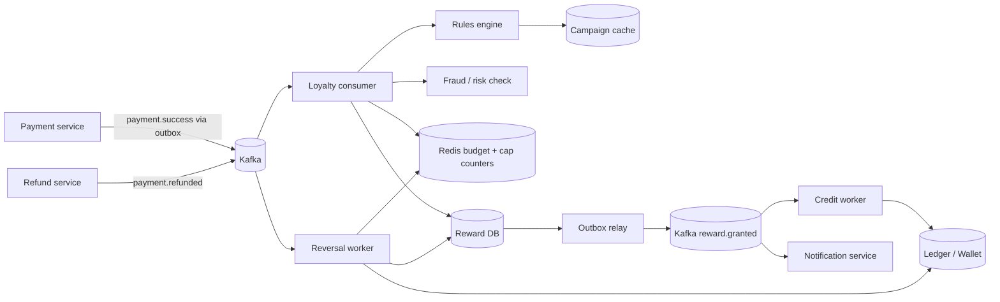
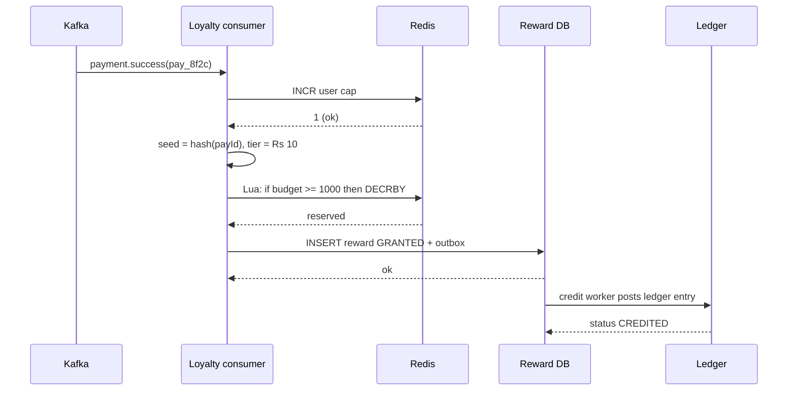

# C13 · Loyalty / cashback

Oct 16, 2026 · @saurav chaurasiya

**Is doc me:** Paytm/PhonePe-style cashback aur scratch card system ka poora HLD: campaign rules engine, budget exhaustion under concurrency, probabilistic rewards, multi-accounting fraud, wallet credit via ledger, aur refund pe reversal.

**Padhne ka tareeka** — Pehle Sawaal pe 15 min khud socho, phir Sahi design padho. Deep Dive tab kholo jab SDE-2 level ka depth chahiye.

---

## C13 — Loyalty / cashback

Loyalty / cashback system ek rules engine hai jo har successful payment ke baad decide karta hai ki user ko reward milega ya nahi, kitna milega, aur kab milega. Reward ka paisa company ke marketing budget se jaata hai, isliye isme "paisa kabhi budget se zyada na nikle" aur "fraud se bachao" dono guarantee chahiye.

### Ye cheez hai kya

- Category: event-driven rules engine + reward ledger. Payment system ke upar ek downstream consumer.
- Problem: user ko payment karne ke liye incentivize karna (cashback, scratch card, gold coins), bina marketing budget overspend kiye aur bina fraudsters ko loot karne diye.
- Is lesson ke baad tum kar paoge: campaign model design, budget reserve ka atomic logic, probabilistic reward ka fair aur replay-safe design, aur refund pe claw-back (reversal) ka flow explain karna.
- Analogy: ye ek mela ke lucky-draw counter jaisa hai. Counter pe fixed inaam ka stock hai (budget), har aadmi ko limited parchi milti hai (cap), aur ek aadmi 10 naam se parchi lene aaye to counter wala pakad leta hai (fraud).

### Sawaal

Tum Paytm me ek Diwali campaign ka backend design kar rahe ho. Rule: Rs 50 se upar ke har UPI payment pe scratch card milega. Card me 80% chance Rs 5, 18% chance Rs 10, 2% chance Rs 50 ka cashback. Per user per day max 2 cards, campaign ka total budget Rs 50 lakh.

- Peak load: 50 million payments per day, peak pe 20,000 payment events per second (TPS = transactions per second — ek second me kitne requests).
- Reward decision latency (p99 — 100 me se 99 requests isko se tez hote hain) 200 ms ke andar, scratch card payment screen pe turant dikhna chahiye.
- Budget kisi bhi haal me exceed nahi hona chahiye. Rs 50 lakh ka matlab 50 lakh rupaye, ek paisa upar nahi.
- Wallet credit exactly once hona chahiye, aur payment refund hone pe reward wapas lena hai.

> Pehle khud socho — 15 min. Hints: (1) Budget ka counter 20k TPS pe kahan rakhoge, aur do threads ek saath last Rs 10 maangein to kya hoga? (2) Random reward kaise doge ki retry pe user ko dobara roll karne ka mauka na mile? (3) Ek banda 500 SIM se 500 accounts banaye to kaise pakdoge?

### Problem kyun aata hai

- Cashback ek real paisa hai. Kisi bhi bug ka matlab seedha financial loss hai, jaise ek bug se Rs 1 crore ka extra cashback ud gaya.
- Payment events Kafka (distributed message log) se at-least-once aate hain, yaani same event do baar aa sakta hai. Bina idempotency ke double reward milega.
- Budget ek hot key (ek hi row/key jis pe saari traffic toot padti hai) ban jaata hai. Sab requests ek hi counter ko decrement karna chahti hain.
- Fraudsters ka incentive bahut zyada hai: fake accounts, self-payments (apne hi doosre account ko Rs 50 bhejna), referral farming. Ek bhi loophole milte hi lakhon accounts toot padte hain.
- Refund aur chargeback: user payment karke cashback leta hai aur phir payment refund kara leta hai. Reward wapas na liya to free paisa.
- Marketing team baar-baar naye rules chahti hai. Har campaign ke liye code deploy karna scale nahi karta, to rules data me hone chahiye.

### Naive approach

- Payment service ke andar hi `if (amount > 50) wallet.credit(user, random(5,10,50))` likh do.
- Budget ke liye ek DB row `campaign.budget_left` rakho, aur `SELECT budget_left` karke check karo, phir `UPDATE budget_left = budget_left - reward`.

Ye kahan tootta hai:

- Read-then-write race: 20,000 TPS pe 100 threads ek saath budget\_left = Rs 10 padhte hain, sabko "budget hai" dikhta hai, aur sab Rs 10 de dete hain. Rs 10 ka budget Rs 1,000 me nikal gaya (overspend).
- Single DB row pe 20k TPS update ka matlab row lock contention. Lock queue lambi hoti hai, latency seconds me chali jaati hai, aur payment ka success path hi slow ho jaata hai.
- Payment service me reward logic ka matlab reward service down hui to payment bhi fail. Cashback ki wajah se payment nahi rukna chahiye.
- `random()` har retry pe naya roll deta hai. User app force-close karke retry kare to naya scratch card mil jaata hai, ya bad luck pe dobara roll.
- Refund ka koi flow nahi: reward wapas nahi aata.
- Fraud check nahi: 1 banda 100 accounts se budget saaf kar sakta hai.

### Sahi design

#### Requirements

Functional:

1. Campaign create/pause/edit: eligibility rules (min amount, merchant category, new user, payment mode), reward policy, budget, per-user caps, start/end time.
2. Payment success event pe real-time evaluation: eligible campaigns dhundho, reward decide karo.
3. Reward types: instant cashback, scratch card (user baad me scratch karke kholta hai), gold coins, voucher.
4. Wallet credit via ledger, exactly once.
5. Payment refund hone pe reward reversal.
6. Abuse/fraud control: multi-accounting, velocity, self-payment detection.

Non-functional:

- Budget overspend: zero tolerance (strict). Eligibility ke baad budget reserve atomic hona chahiye.
- Latency: decision p99 under 200 ms; reward credit eventual hai (kuch seconds me bhi chalega).
- Availability: payment path ko isolate rakho. Loyalty service down ho to payment chalta rahe, event baad me replay ho.
- Durability: reward ek baar grant ho gaya to ledger me hamesha record rahe.
- Auditability: har reward ka reason, rule version, aur random seed trace ho sake.

#### Back-of-envelope estimates

- 50M payments/day / 86,400 sec = \~580 TPS average. Peak 30-40x (festival evening) = \~20,000 TPS.
- Eligible fraction maybe 40%: \~8,000 reward evaluations per second at peak.
- Reward amount ka average: 0.8 x Rs 5 + 0.18 x Rs 10 + 0.02 x Rs 50 = Rs 4 + Rs 1.8 + Rs 1 = Rs 6.8 per card. Rs 50 lakh budget / Rs 6.8 = \~7.35 lakh cards hi nikal sakte hain. Matlab budget sirf kuch minute ya ghante me khatam ho sakta hai.
- Isliye budget counter ek hot key hai: 8,000 decrements per second ek hi counter pe. Redis ek key pe lakhon ops/sec jhel leta hai, par DB row nahi.
- Storage: reward record \~200 bytes x 20M rewards/day = \~4 GB/day. 1 saal me \~1.5 TB, partition by month.

#### API design

```text
POST /v1/loyalty/events/payment-success      (internal, Kafka consumer bhi use karta hai)
  { "eventId": "pay_8f2c", "userId": "u123", "amountPaise": 12000,
    "merchantCategory": "FOOD", "mode": "UPI", "ts": 1760600000 }
  -> 202 Accepted

GET  /v1/loyalty/rewards?userId=u123&status=UNSCRATCHED
  -> [{ "rewardId": "rw_1", "type": "SCRATCH_CARD", "expiresAt": "..." }]

POST /v1/loyalty/rewards/{rewardId}/scratch    (idempotent)
  -> { "amountPaise": 500, "status": "CREDITED" }

POST /v1/loyalty/events/payment-refunded
  { "eventId": "ref_91ab", "originalPaymentId": "pay_8f2c" }
  -> 202 Accepted

POST /v1/admin/campaigns      { rules json, budgetPaise, perUserDayCap, ... }
PATCH /v1/admin/campaigns/{id}   { "status": "PAUSED" }
```

#### Data model

```text
campaign(id, name, status, start_ts, end_ts, budget_total_paise, rules_json,
         reward_policy_json, per_user_day_cap, per_user_total_cap, version)

reward(id, campaign_id, user_id, payment_id UNIQUE(campaign_id, payment_id),
       amount_paise, status {RESERVED, GRANTED, SCRATCHED, CREDITED, REVERSED, EXPIRED},
       seed, rule_version, created_at)

budget_counter (Redis): budget:{campaignId}  -> remaining paise
user_cap (Redis):       cap:{campaignId}:{userId}:{yyyymmdd} -> count  (TTL 2 din)
ledger entry (2B Ledger): DEBIT marketing_budget_account, CREDIT user_wallet
```

- `UNIQUE(campaign_id, payment_id)` idempotency ka asli guard hai. Same payment pe dobara insert fail hoga.
- `seed` store karte hain taaki audit me dikha sako ki ye random result kaise aaya.

#### High-level architecture

- Payment service apna kaam karke `payment.success` event Kafka pe daalta hai (outbox pattern se — [1E · Kafka River](https://claude.ai/code/artifact/eeb39ee8-3f52-4c04-b57b-68213f02c429)).
- Loyalty consumer event uthata hai, rules engine se eligible campaigns nikalta hai, fraud score leta hai, budget reserve karta hai, reward row likhta hai.
- Reward ka wallet credit ledger ke through hota hai ([2B · Ledger Library](https://claude.ai/code/artifact/a7c567e0-66cb-46fe-b7c9-9c20739857eb)).



#### Evaluation flow (step by step)

1. Event aaya: `eventId` se dedupe (Redis `SETNX` ya reward table ka UNIQUE key). Duplicate ho to drop.
2. Campaign cache (in-memory, har minute refresh) se active campaigns lo, rules filter karo: min amount, category, new-user flag, time window.
3. User cap check: Redis `INCR cap:{campaign}:{user}:{day}`. Cap se upar gaya to `DECR` karke reject.
4. Fraud check: device/account graph, velocity, self-payment. Block ho to reward skip (silently, user ko reason mat batao).
5. Reward amount decide karo: seed = hash(paymentId + campaignId). Weighted tier pick karo. Seed deterministic hai to retry pe same result.
6. Budget reserve: Redis Lua script ya `DECRBY` with floor check. Remaining kam ho to reject (`BUDGET_OVER`) aur cap counter wapas.
7. Reward row `GRANTED` state me DB me likho, outbox event ke saath, ek hi transaction me.
8. Credit worker ledger me double-entry post karta hai: marketing budget account debit, user wallet credit. Idempotency key = rewardId.
9. Scratch card model me: step 7 pe sirf card issue hota hai (amount pehle se seed se decide hai par reveal nahi). User scratch kare tab credit hota hai.



Neeche Java demo me wahi core logic hai: idempotency, user cap, atomic budget reserve (CAS loop), deterministic weighted reward, fraud block, aur refund pe reversal. Pattern: **Strategy** (RewardPolicy alag-alag reward tarike ke liye) aur concurrency ke liye **compare-and-set loop**.

```java
import java.util.*;
import java.util.concurrent.*;
import java.util.concurrent.atomic.*;

public class Demo {
    // Payment success event (Kafka se aata hai)
    record PaymentEvent(String paymentId, String userId, long amountPaise) {}
    record Reward(String paymentId, String userId, long paise, String campaignId) {}

    // Strategy pattern: reward kitna dena hai, ye alag-alag policy decide karti hai
    interface RewardPolicy { long pick(PaymentEvent e); }

    // Weighted random: (paise, weight) tiers. Seed = paymentId hash, taaki retry pe same result mile
    static class WeightedPolicy implements RewardPolicy {
        final long[] paise; final int[] weight; final int total;
        WeightedPolicy(long[] paise, int[] weight) {
            this.paise = paise; this.weight = weight; this.total = Arrays.stream(weight).sum();
        }
        public long pick(PaymentEvent e) {
            Random r = new Random(e.paymentId().hashCode()); // deterministic per payment
            int x = r.nextInt(total);
            for (int i = 0; i < paise.length; i++) { if (x < weight[i]) return paise[i]; x -= weight[i]; }
            return 0;
        }
    }

    static class Campaign {
        final String id; final long minAmount; final int perUserDayCap; final RewardPolicy policy;
        final AtomicLong budgetLeft; // paise me
        Campaign(String id, long budget, long minAmount, int cap, RewardPolicy p) {
            this.id = id; this.budgetLeft = new AtomicLong(budget);
            this.minAmount = minAmount; this.perUserDayCap = cap; this.policy = p;
        }
        // CAS loop: budget kabhi negative nahi jaata, chahe 1000 threads ek saath aayein
        boolean reserve(long paise) {
            while (true) {
                long cur = budgetLeft.get();
                if (cur < paise) return false;
                if (budgetLeft.compareAndSet(cur, cur - paise)) return true;
            }
        }
        void release(long paise) { budgetLeft.addAndGet(paise); }
    }

    static class Engine {
        final Campaign campaign;
        final ConcurrentHashMap<String, Reward> processed = new ConcurrentHashMap<>(); // idempotency
        final ConcurrentHashMap<String, AtomicInteger> userDayCount = new ConcurrentHashMap<>();
        final ConcurrentHashMap<String, AtomicLong> wallet = new ConcurrentHashMap<>(); // ledger ka simple stand-in
        final Set<String> blockedUsers = ConcurrentHashMap.newKeySet(); // fraud engine ka verdict
        Engine(Campaign c) { this.campaign = c; }

        String onPaymentSuccess(PaymentEvent e) {
            if (processed.containsKey(e.paymentId())) return "DUPLICATE";
            if (e.amountPaise() < campaign.minAmount) return "NOT_ELIGIBLE";
            if (blockedUsers.contains(e.userId())) return "FRAUD_BLOCKED";
            // user/day cap: counter pehle badhao, cap cross ho to wapas ghatao
            AtomicInteger cnt = userDayCount.computeIfAbsent(e.userId(), k -> new AtomicInteger());
            if (cnt.incrementAndGet() > campaign.perUserDayCap) { cnt.decrementAndGet(); return "USER_CAP"; }
            long paise = campaign.policy.pick(e);
            if (!campaign.reserve(paise)) { cnt.decrementAndGet(); return "BUDGET_OVER"; }
            Reward r = new Reward(e.paymentId(), e.userId(), paise, campaign.id);
            if (processed.putIfAbsent(e.paymentId(), r) != null) { // race me duplicate nikla
                campaign.release(paise); cnt.decrementAndGet(); return "DUPLICATE";
            }
            wallet.computeIfAbsent(e.userId(), k -> new AtomicLong()).addAndGet(paise); // ledger credit
            return "REWARDED " + paise;
        }

        // Original payment refund hua to reward claw-back (compensating transaction)
        String onRefund(String paymentId) {
            Reward r = processed.remove(paymentId);
            if (r == null) return "NO_REWARD";
            wallet.get(r.userId()).addAndGet(-r.paise()); // ledger debit
            campaign.release(r.paise());
            userDayCount.get(r.userId()).decrementAndGet();
            return "REVERSED " + r.paise();
        }
    }

    public static void main(String[] args) throws Exception {
        RewardPolicy policy = new WeightedPolicy(new long[]{500, 1000, 5000}, new int[]{80, 18, 2});
        // Budget Rs 200 = 20000 paise, min payment Rs 50, user/day cap 2
        Campaign c = new Campaign("DIWALI", 20000, 5000, 2, policy);
        Engine eng = new Engine(c);

        System.out.println("1) " + eng.onPaymentSuccess(new PaymentEvent("p1", "u1", 10000)));
        System.out.println("2) retry same event: " + eng.onPaymentSuccess(new PaymentEvent("p1", "u1", 10000)));
        System.out.println("3) chhota payment: " + eng.onPaymentSuccess(new PaymentEvent("p2", "u1", 1000)));
        System.out.println("4) " + eng.onPaymentSuccess(new PaymentEvent("p3", "u1", 10000)));
        System.out.println("5) teesra payment, cap 2: " + eng.onPaymentSuccess(new PaymentEvent("p4", "u1", 10000)));
        eng.blockedUsers.add("u9");
        System.out.println("6) fraud user: " + eng.onPaymentSuccess(new PaymentEvent("p5", "u9", 10000)));
        System.out.println("7) refund p1: " + eng.onRefund("p1"));
        System.out.println("   u1 wallet=" + eng.wallet.get("u1") + " budgetLeft=" + c.budgetLeft);

        // Concurrency test: 2000 alag users, 16 threads, budget sirf 20000 paise
        Campaign c2 = new Campaign("FLASH", 20000, 5000, 2, policy);
        Engine e2 = new Engine(c2);
        ExecutorService pool = Executors.newFixedThreadPool(16);
        List<Future<String>> fs = new ArrayList<>();
        for (int i = 0; i < 2000; i++) {
            final int n = i;
            fs.add(pool.submit(() -> e2.onPaymentSuccess(new PaymentEvent("q" + n, "user" + n, 10000))));
        }
        int rewarded = 0, over = 0;
        for (Future<String> f : fs) { String s = f.get(); if (s.startsWith("REWARDED")) rewarded++; else if (s.equals("BUDGET_OVER")) over++; }
        pool.shutdown();
        long paid = e2.wallet.values().stream().mapToLong(AtomicLong::get).sum();
        System.out.println("8) rewarded>0: " + (rewarded > 0) + ", budget over events>0: " + (over > 0));
        System.out.println("   paid <= budget: " + (paid <= 20000) + ", paid + left == budget: " + (paid + c2.budgetLeft.get() == 20000));
    }
}
```

Isko chalane pe bilkul ye output aata hai:

```text
1) REWARDED 500
2) retry same event: DUPLICATE
3) chhota payment: NOT_ELIGIBLE
4) REWARDED 1000
5) teesra payment, cap 2: USER_CAP
6) fraud user: FRAUD_BLOCKED
7) refund p1: REVERSED 500
   u1 wallet=1000 budgetLeft=19000
8) rewarded>0: true, budget over events>0: true
   paid <= budget: true, paid + left == budget: true
```

- Line 2: same `paymentId` dobara aaya to reward nahi mila (idempotency).
- Line 7: refund pe Rs 5 wapas budget me gaya, wallet se kata. Wallet 1000 paise bacha (sirf p3 ka reward).
- Line 8: 2000 payments Rs 200 ke budget pe lage, kuch ko `BUDGET_OVER` mila, aur total paid kabhi budget se upar nahi gaya. Yahi "no overspend" guarantee hai.

Production me ye CAS loop Redis Lua script ban jaata hai, aur `processed` map reward table ka UNIQUE constraint ban jaata hai.

### Kya choose karein aur kyun

Budget enforce karne ke options:

| Option | Kab use karo | Kab mat karo |
| --- | --- | --- |
| DB row + SELECT FOR UPDATE (pessimistic lock — pehle lock, phir update) | Chhota campaign, low TPS, strict audit chahiye | 20k TPS pe, row lock queue latency ud jaati hai |
| Redis atomic counter (DECRBY / Lua) | High TPS, hot key, fast reject | Redis crash pe counter lost hone ka risk; DB se reconcile zaroori |
| Budget sharding (budget ko N chunks me baanto, har consumer apna chunk) | Bahut bada TPS, ek key bhi bottleneck | Chhote budget me, kyunki chunk khatam hone pe leftover paisa phans jaata hai |
| Optimistic lock (version column + retry) | Medium contention | Hot campaign me retry storm |

Reward ka timing:

| Option | Kab use karo | Kab mat karo |
| --- | --- | --- |
| Instant cashback | Simple UX, trust building | Fraud risk zyada, refund window ke pehle credit hota hai |
| Scratch card (deferred reveal) | Engagement, delay se fraud check ka time milta hai | Agar user ko turant paisa chahiye |
| Pending then confirm (T+N din baad credit) | High-value reward, refund window cover karna hai | Chhote rewards, UX kharab lagta hai |

### India me kaise hota hai

- Paytm aur PhonePe scratch card dete hain, jisme reward ka amount random hota hai aur kai baar "Better luck next time" aata hai. Ye company ke liye cost-controlled marketing hai: [Why Paytm, PhonePe give free scratch cards after UPI payments, how they don't lose money (Free Press Journal)](https://www.freepressjournal.in/business/why-paytm-phonepe-give-free-scratch-cards-after-upi-payments-how-they-dont-lose-money).
- Paytm ke official rules me scratch card ka expiry, eligibility aur wallet/bank me credit ke terms likhe hain: [What is a Paytm Scratch Card? (Paytm support)](https://paytm.com/support/rewards-cashback/what-is-a-paytm-scratch-card).
- PhonePe business ke UPI cashback ke tareeke: [UPI Cashback: how to earn rewards on every transaction (PhonePe Business)](https://business.phonepe.com/articles/upi-cashback-how-to-earn-rewards-on-every-transaction-you-make).
- Regulatory side: sarkar ne UPI transactions pe incentive limit kiya tha, isliye P2P UPI pe cashback restricted ho gaya aur merchant payments pe focus hua: [Govt limits incentives for UPI transactions (Business Standard)](https://www.pressreader.com/india/business-standard/20180713/281724090319160).
- Practical pattern: reward ka amount pehle hi budget ke hisaab se "expected cost" pe tune hota hai (jaise upar ka Rs 6.8 average), phir fraud engine aur caps se tail risk kaata jaata hai.

### Interview follow-ups

- **Budget ko 20k TPS pe overspend se kaise bachaoge?** — Atomic reserve: Redis Lua script me "if remaining >= x then DECRBY" ek hi atomic step me. Reserve fail to reject. Backup me DB pe periodic reconcile, aur hard stop jab remaining zero ho.
- **Same payment event do baar aaye to?** — Idempotency: reward table pe `UNIQUE(campaign_id, payment_id)`. Dusra insert fail hota hai aur reserve kiya hua budget release kar dete hain ([2A · Idempotency Island](https://claude.ai/code/artifact/c269ac61-440b-4525-bd04-31baf708dece)).
- **Random reward replay-safe kaise banaoge?** — Seed = hash(paymentId, campaignId). Retry pe same seed to same tier. Seed DB me store, audit ke liye.
- **Reserve ho gaya par DB insert fail hua to budget leak?** — Reserve ko TTL ke saath lease banao, ya compensating release karo. Roz reconcile: Redis counter vs sum(reward amounts) from DB.
- **Multi-accounting kaise pakdoge?** — Device ID, SIM, bank account ya VPA graph clustering, same device pe N accounts, self-payment loop detection. Score high to reward hold ya skip ([C7 · Fraud detection engine](https://claude.ai/code/artifact/fb52d447-8183-4e92-94e4-e704674416b9)).
- **Payment refund ho gaya to reward ka kya?** — `payment.refunded` event pe reversal worker reward ko REVERSED mark karta hai, ledger me opposite entry, budget wapas. Wallet me paisa kam pada to negative balance ya future cashback se adjust ([C6 · Refund system](https://claude.ai/code/artifact/0938c098-ccc8-4c99-9412-35f2d202ffaa)).
- **Loyalty service down ho to payment rukta hai?** — Nahi. Payment sirf event publish karta hai (outbox). Loyalty baad me consume karke catch up karta hai.

### Self-check

1. Read-then-write budget check overspend kyun karta hai, aur CAS ya Lua isko kaise rokta hai?
2. Idempotent probabilistic reward ke liye seed kyun deterministic hona chahiye?
3. User cap counter pehle INCR karke baad me check kyun karte hain, aur reject pe kya karna padta hai?
4. Refund pe reward reverse karne ke 3 steps kya hain (reward state, ledger, budget)?
5. Instant cashback vs scratch card vs pending credit me fraud ke hisaab se kya fark hai?

### Notebook

Reward = event consumer, payment path se decoupled · Budget reserve atomic (Lua/CAS), kabhi read-then-write nahi · Idempotency = UNIQUE(campaign, payment) · Random ka seed = hash(paymentId), replay-safe · Cap counter INCR then DECR on reject · Ledger double-entry: marketing budget debit, wallet credit · Refund = compensating reversal: reward REVERSED, ledger opposite entry, budget release.

### Padhne ke liye

- [What is a Paytm Scratch Card?](https://paytm.com/support/rewards-cashback/what-is-a-paytm-scratch-card)
- [Why Paytm, PhonePe give free scratch cards after UPI payments](https://www.freepressjournal.in/business/why-paytm-phonepe-give-free-scratch-cards-after-upi-payments-how-they-dont-lose-money)
- [UPI Cashback: how to earn rewards (PhonePe Business)](https://business.phonepe.com/articles/upi-cashback-how-to-earn-rewards-on-every-transaction-you-make)
- [Govt limits incentives for UPI transactions (Business Standard)](https://www.pressreader.com/india/business-standard/20180713/281724090319160)

### Deep Dive (SDE-2) — jab time ho

#### Rules engine design

- Rules JSON/DSL me store: `{ "all": [ {"field":"amount","op":">=","value":5000}, {"field":"category","op":"in","value":["FOOD"]} ] }`. Versioned, taaki audit me pata rahe kaunsa rule version chala.
- Campaign cache memory me, pub-sub se invalidate. Har event pe DB hit nahi.
- Priority aur stacking: ek payment pe kai campaigns eligible hon to "best one" ya "max N" rule rakho, warna cashback stack hoke budget jalaata hai.
- Dry-run mode: naya campaign pehle shadow me chalao, bina credit kiye, expected cost nikalo.

#### Budget under concurrency, aur failure modes

- Redis Lua: `local r = redis.call('GET', KEYS[1]); if tonumber(r) >= tonumber(ARGV[1]) then return redis.call('DECRBY', KEYS[1], ARGV[1]) else return -1 end`. Lua script Redis me atomic chalti hai.
- Reservation vs confirm: reserve (RESERVED) -> DB commit (GRANTED). Crash beech me ho to TTL lease ya reconcile job leak wapas laata hai.
- Redis failover me counter peeche ja sakta hai (async replication), to overspend ka chhota risk. Mitigation: periodic hard reset from DB truth, aur budget ka 2-3% safety buffer ([2F · Recon Ruins](https://claude.ai/code/artifact/93d00bdd-f45f-441f-946c-c84355b5c05e)).
- Hot key fix: budget ko N shards (budget:{id}:{0..N-1}) me baanto, random shard pe try karo, khali ho to doosre pe. Trade-off: last-mile leftover.
- Distributed lock ki zarurat nahi, atomic counter kaafi hai. Locks ke trade-offs ke liye [2D · Lock Fort](https://claude.ai/code/artifact/97588686-7110-4318-8124-3a8727c7604e).

#### Probabilistic rewards aur fairness

- Weighted tiers ka expected cost fixed hai: sum(prob x amount). Isse budget forecast hota hai.
- Budget-aware adjustment: jab budget kam bache to bade tiers disable karo, warna last users ko hamesha Rs 5 milega ya jackpot pehle hi chala jaayega.
- Regulatory aur trust: sach me random hona chahiye, "pehle wale ko jackpot" jaisa fixed pattern lagne par user trust gir sakta hai. Seed-based audit se prove kar sakte ho.
- Variance control: per-hour jackpot cap, taaki ek hi ghante me saare Rs 50 na nikal jaayein.

#### Fraud aur abuse

- Signals: same device pe multiple accounts, same bank account / VPA ke links, new account ka turant high-velocity use, self-payment cycle (A to B to A), geo mismatch.
- Graph-based detection: account-device-VPA graph me connected components. Ek component me bahut accounts ho to flag.
- Actions: reward skip, hold (pending), ya post-facto claw-back. Real-time check light rakho (feature store lookup), heavy graph analysis batch me.
- Deterrence: per-device cap, cooling period for new accounts, KYC-verified users ko higher caps.
- Detail ke liye [C7 · Fraud detection engine](https://claude.ai/code/artifact/fb52d447-8183-4e92-94e4-e704674416b9) aur [2G · Security Vault](https://claude.ai/code/artifact/f0f0e8e4-dde8-492e-9a80-08a35792d4e7).

#### Ledger aur reversal

- Reward credit ek normal ledger transaction hai: DEBIT `marketing_budget`, CREDIT `user_wallet`. Idempotency key = rewardId ([2B · Ledger Library](https://claude.ai/code/artifact/a7c567e0-66cb-46fe-b7c9-9c20739857eb)).
- Reversal ledger me delete nahi, naya opposite entry (append-only). Original entry hamesha rahegi.
- Edge case: user ne reward kharch kar diya, phir refund aaya. Options: wallet negative allow, ya future credits se recover, ya reward ko sirf "locked" rakho jab tak refund window khatam na ho.
- Multi-step flow (reserve, grant, credit, reverse) saga hai ([2C · Saga Sea](https://claude.ai/code/artifact/429b3ea6-a261-431d-a384-a0c6eb68a9f6)), har step ka compensating action defined ho.

#### Reliability aur scale

- Kafka partition key = userId, taaki ek user ke events order me aayein aur user cap check race na kare.
- Consumer lag monitor karo ([1F · Ops Tower](https://claude.ai/code/artifact/6a87e8d2-04fb-418e-b433-e5a88508f83e)). Festival peak me autoscale, backpressure (consumer overload pe upstream ko slow karna) ke liye rate limit ([2E · Resilience Ridge](https://claude.ai/code/artifact/4769dea3-018e-41e1-ae18-253fa36a6d21)).
- Failed events ko DLQ (dead letter queue — baar-baar fail hone wale messages ki alag queue) me bhejo aur replay tool rakho.
- Metrics: budget burn rate, reward cost per payment, fraud block rate, reversal rate, credit lag p99.

---

## Aage kya

- Pichhla: [C12 · QR + Soundbox](https://claude.ai/code/artifact/0de0a37f-1405-49f3-8379-19e1155584a9)
- Agla: [C14 · Txn history at scale](https://claude.ai/code/artifact/82e1ca11-050a-4cdd-bb7d-c1925ab3677f)
- Related: [C7 · Fraud detection engine](https://claude.ai/code/artifact/fb52d447-8183-4e92-94e4-e704674416b9), [2B · Ledger Library](https://claude.ai/code/artifact/a7c567e0-66cb-46fe-b7c9-9c20739857eb), [2D · Lock Fort](https://claude.ai/code/artifact/97588686-7110-4318-8124-3a8727c7604e), LLD twin [D24 · Coupon / cashback engine](https://claude.ai/code/artifact/ff0a7aed-8545-4bf4-b0d5-a6456aabc343)
