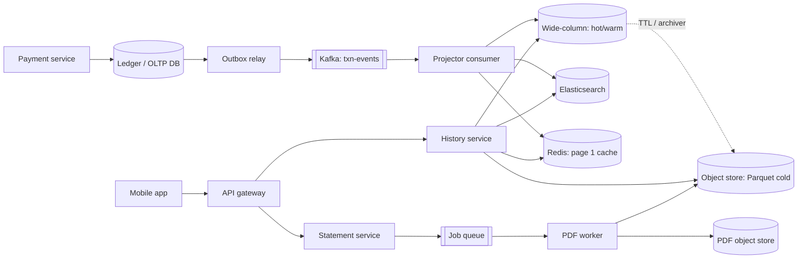
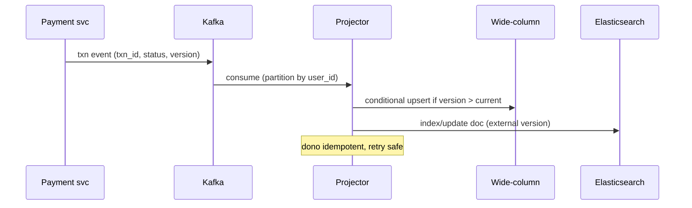

# C14 · Txn history at scale

Oct 16, 2026 · @saurav chaurasiya

**Is doc me:** Paytm/PhonePe jaisi app ka passbook (transaction history) 30+ crore users ke liye kaise banate hain: CQRS read model, wide-row storage, keyset pagination, search, hot/cold tiering, out-of-order status updates, statement PDF.

**Padhne ka tareeka** — Pehle Sawaal pe 15 min khud socho, phir Sahi design padho. Deep Dive tab ke liye hai jab time ho.

---

## C14 — Txn history at scale

Txn history (passbook) wo screen hai jahan user apne purane payments ki list dekhta hai. Ye ek **read-heavy, append-mostly** system hai: payment ek baar likhi jaati hai, par har din lakhon baar padhi jaati hai.

### Ye cheez hai kya

- Category: HLD boss, read-optimised data system (CQRS + wide-column store + search index).
- Problem: 30 crore users ke saalon ke transactions ko fast list, filter, search aur export karna, bina payment path ko slow kiye.
- Is lesson ke baad tum kar paoge: storage choose karna, partition key design karna, keyset pagination samjhana, aur out-of-order events handle karna.
- Analogy: bank ki purani passbook. Har page pe entries time ke order me, aur "page 40 kholo" ke liye tumhe pehle 39 page gin ne nahi padte, bas bookmark se kholte ho.

### Sawaal

Tum Paytm ki "Passbook" team me ho. 30 crore registered users, 5 crore DAU (daily active users — roz app kholne wale). Roz 8 crore payments, peak pe \~3,000 writes/sec. Passbook open hone pe p99 (99% requests is time ke andar — worst 1% ko chhod ke) latency 200 ms se kam chahiye. User 7 saal purani history dekh sakta hai, merchant name ya amount se search kar sakta hai, aur GST/ITR ke liye 1 saal ka statement PDF mangta hai.

> Pehle khud socho — 15 min. Hints: (1) Payment DB (OLTP — live transactions wala DB) pe hi history query chalaoge to kya hoga? (2) Page 500 pe `OFFSET 10000` kyun marta hai? (3) Status PENDING se SUCCESS badalta hai to history me kaise dikhega, aur agar events ulte order me aaye?

### Problem kyun aata hai

- Payment path ko latency chahiye (p99 under 300 ms), history reads ko volume chahiye. Dono ek DB pe aaye to dono marte hain.
- Data sirf badhta hai: 8 crore/din x 365 x 7 saal = \~20,000 crore (200 billion) rows. Single-node SQL ke bas ke bahar.
- Access pattern fixed hai: "mera user\_id, latest first". Ye wide-row store ke liye perfect hai, par SQL joins ke liye bhaari.
- Search aur filter (merchant, amount range, status) ka pattern alag hai, primary store pe index lagana mehnga padta hai.
- Status events out of order aate hain (Kafka partitions, retries), to naive overwrite galat final status de sakta hai.
- Purana data (3+ saal) kam padha jaata hai par delete nahi kar sakte (RBI retention rules), to cost ka sawaal aata hai.

### Naive approach

- Payments table me `SELECT * FROM txns WHERE user_id=? ORDER BY created_at DESC LIMIT 20 OFFSET ?` chalao.
- Break point 1: 3,000 writes/sec + 5 crore DAU x \~4 passbook opens = \~20 crore reads/din, \~2,300 reads/sec avg, peak \~10,000/sec. Primary DB ke row locks aur buffer pool pe seedhi maar.
- Break point 2: `OFFSET 10000` ka matlab DB 10,000 rows padh ke phenk deta hai. Page 500 pe latency seconds me jaati hai.
- Break point 3: `LIKE '%swiggy%'` search full scan hai, index kaam nahi aata.
- Break point 4: Ek table me 7 saal ka data: index size RAM se bada, vacuum/backup ghanton ke.
- Break point 5: Status update `UPDATE ... SET status=?` blindly lagao to late PENDING event SUCCESS ko overwrite kar deta hai.

### Sahi design

1. **Requirements.**
   - Functional: list history (latest first), filter by status/type/date, search by merchant/amount/txn id, txn detail, statement PDF export.
   - Non-functional: p99 list under 200 ms, search p99 under 500 ms, durability 7+ saal, eventual consistency theek (event ke 1-2 sec me history me dikhe), 99.95% availability.
2. **Estimates.**
   - Writes: 8 crore/din = \~925/sec avg, \~3,000 peak. Har payment ke 2-4 events (INITIATED, PENDING, SUCCESS), to \~10,000 event writes/sec peak.
   - Row size \~1 KB. Din ka data = 80 GB, saal ka \~30 TB, 7 saal \~200 TB raw, replication factor 3 ke saath \~600 TB. Isliye wide-column cluster chahiye aur tiering.
   - Reads: peak \~10,000 list reads/sec, har ek 20 rows = \~20 KB. \~200 MB/sec egress. Cache se half kam ho sakta hai.
3. **Architecture: CQRS (Command Query Responsibility Segregation — write ka model aur read ka model alag).** Payment service apna ledger/OLTP DB likhta hai aur outbox ke through event Kafka pe daalta hai. Ek consumer us event se **read model** banata hai. Detail ke liye [L2.8 — CQRS (2B Ledger Library)](https://claude.ai/code/artifact/a7c567e0-66cb-46fe-b7c9-9c20739857eb) aur [L1.10b — Read vs write path (1C DB Dungeon)](https://claude.ai/code/artifact/99909fe9-731e-4e31-9e7d-36e0c5aed845) dekho.
4. **Storage: wide-column (Cassandra/HBase style).** Partition key = `(user_id, month_bucket)`, clustering key = `(ts DESC, txn_id DESC)`. Ek user ki ek mahine ki entries ek jagah, sorted, to list ek sequential read hai. Month bucket isliye ki ek heavy user (merchant, 50 lakh txns) ka partition unbounded na ho.
5. **Pagination: keyset (seek) pagination.** Cursor = last row ka `(ts, txn_id)`. Agla page = "isse chhote keys". OFFSET nahi, to page 500 bhi page 1 jitna fast.
6. **Search: Elasticsearch.** Alag index jo sirf search fields rakhe (merchant, amount, status, date, txn\_id) aur txn\_id wapas de. Detail wide-column se fetch hoti hai. ES source of truth nahi hai.
7. **Out-of-order status:** har event ke saath monotonically badhta `version`. Write conditional: sirf tab apply jab naya version bada ho.
8. **Tiering:** hot (0-90 din, SSD cluster + cache), warm (90 din se 2 saal, HDD/dense nodes), cold (2-7 saal, object storage jaise S3 me Parquet files). Cold ke liye query on-demand, slow (seconds) theek.
9. **Statement PDF:** async job. User request kare, job queue me jaye, worker date range stream kare, PDF banaye, object storage pe daale, link notify kare. Sync nahi.

Neeche architecture diagram:



Write path ka sequence:



**API design.**

- `GET /v1/history?limit=20&cursor=<opaque>&status=SUCCESS&from=2026-01-01&to=2026-03-31` — response me `items[]` aur `next_cursor`.
- `GET /v1/history/search?q=swiggy&min=100&max=500&cursor=` — ES backed.
- `GET /v1/txns/{txn_id}` — detail.
- `POST /v1/statements` body `{from, to, format:"pdf"}` — returns `202` aur `statement_id`; `GET /v1/statements/{id}` status + download URL.
- Cursor opaque base64 hota hai taaki server baad me format badal sake.

**Data model (CQL jaisa).**

```sql
-- hot history table: ek user + month ek partition
CREATE TABLE txn_history (
  user_id    bigint,
  month      int,          -- 202610 jaisa bucket
  ts         timestamp,
  txn_id     text,
  counterparty text,
  amount_paise bigint,
  type       text,         -- DEBIT / CREDIT
  status     text,
  version    int,
  PRIMARY KEY ((user_id, month), ts, txn_id)
) WITH CLUSTERING ORDER BY (ts DESC, txn_id DESC);
```

Ab ek chhota Java demo jo do cheezein dikhata hai: version-based out-of-order update, aur keyset pagination (cursor ke baad ke rows). Ye **Strategy-jaisa conditional upsert** hai: apply ya ignore ka rule ek jagah.

```java
import java.util.*;

public class Demo {
    // ek history row: status ke saath version (event ka sequence number)
    record Row(String txnId, long ts, String status, int version) {}

    // partition = user; clustering = ts DESC, txnId DESC (TreeMap se simulate)
    static final Comparator<String> KEY_DESC = Comparator.reverseOrder();
    static final TreeMap<String, Row> partition = new TreeMap<>(KEY_DESC);

    static String key(long ts, String txnId) { return String.format("%013d|%s", ts, txnId); }

    // out-of-order event: purana version aaye to ignore (last-writer-by-version wins)
    static void apply(Row r) {
        String k = key(r.ts(), r.txnId());
        Row cur = partition.get(k);
        if (cur == null || r.version() > cur.version()) {
            partition.put(k, r);
            System.out.println("applied  " + r.txnId() + " -> " + r.status() + " v" + r.version());
        } else {
            System.out.println("ignored  " + r.txnId() + " -> " + r.status() + " v" + r.version() + " (cur v" + cur.version() + ")");
        }
    }

    // keyset page: cursor ke STRICTLY baad ke rows, OFFSET nahi
    static List<Row> page(String cursor, int limit) {
        NavigableMap<String, Row> tail = cursor == null ? partition : partition.tailMap(cursor, false);
        List<Row> out = new ArrayList<>();
        for (Row r : tail.values()) { if (out.size() == limit) break; out.add(r); }
        return out;
    }

    public static void main(String[] args) {
        apply(new Row("T1", 1000, "INITIATED", 1));
        apply(new Row("T1", 1000, "SUCCESS", 3));   // v3 pehle aa gaya
        apply(new Row("T1", 1000, "PENDING", 2));   // v2 late aaya, ignore hona chahiye
        for (int i = 2; i <= 6; i++) apply(new Row("T" + i, 1000L + i * 10, "SUCCESS", 1));

        String cursor = null;
        int pageNo = 1;
        while (true) {
            List<Row> p = page(cursor, 3);
            if (p.isEmpty()) break;
            StringBuilder sb = new StringBuilder("page " + pageNo++ + ":");
            for (Row r : p) sb.append(' ').append(r.txnId()).append('/').append(r.status());
            System.out.println(sb);
            Row last = p.get(p.size() - 1);
            cursor = key(last.ts(), last.txnId());
        }
    }
}
```

Isko chalane pe bilkul ye output aata hai:

```text
applied  T1 -> INITIATED v1
applied  T1 -> SUCCESS v3
ignored  T1 -> PENDING v2 (cur v3)
applied  T2 -> SUCCESS v1
applied  T3 -> SUCCESS v1
applied  T4 -> SUCCESS v1
applied  T5 -> SUCCESS v1
applied  T6 -> SUCCESS v1
page 1: T6/SUCCESS T5/SUCCESS T4/SUCCESS
page 2: T3/SUCCESS T2/SUCCESS T1/SUCCESS
```

- Output se dekho: late PENDING (v2) ignore hua, T1 SUCCESS (v3) pe hi raha. Pages latest-first hain aur koi row repeat ya miss nahi hui.

### Kya choose karein aur kyun

Storage ke options:

| Option | Kab use karo | Kab mat karo |
| --- | --- | --- |
| Sharded MySQL/Postgres | Chhota scale (kuch crore rows), joins aur strong consistency chahiye | 200 TB+ append-only history, resharding ka dard |
| Cassandra | Write-heavy, `(user, time)` access, multi-DC, tunable consistency | Ad-hoc filters, secondary-index pe heavy queries |
| HBase | Hadoop ecosystem ke saath, strong consistency per row, range scans | Chhoti team jo ZooKeeper/HDFS operate nahi kar sakti |
| DynamoDB-style managed KV | Ops kam chahiye, cloud-native | On-prem/data-residency constraints, cost at 200 TB |
| Elasticsearch (primary) | Kabhi nahi primary ke roop me | Source of truth ban jaye to data-loss aur reindex risk |

Pagination ke options:

| Option | Kab use karo | Kab mat karo |
| --- | --- | --- |
| OFFSET/LIMIT | Admin screen, kuch hazaar rows | Deep pages, live inserts (rows shift hote hain) |
| Keyset (cursor) | Infinite scroll passbook, stable order | "Page 37 pe jump" chahiye |
| Search-after (ES) | Search results ka deep paging | Jab from+size 10,000 ke andar ho aur simple chahiye |

Tiering ke options:

| Tier | Kab use karo | Kab mat karo |
| --- | --- | --- |
| Hot (SSD + cache) | Last 90 din, 95% reads yahin se | 7 saal sab SSD pe rakhna, bahut mehnga |
| Warm (dense HDD nodes) | 90 din se 2 saal, kabhi-kabhi dekhi jaati | Latency-critical first screen |
| Cold (object store, Parquet) | 2-7 saal, compliance aur statement | Interactive search, p99 200 ms |

### India me kaise hota hai

- PhonePe apni HBase journey likh chuka hai: [Scaling HBase at PhonePe](https://medium.com/@nitishgoyal13/scaling-hbase-at-phonepe-bae42e408667).
- PhonePe ka transaction store: [Demystifying TStore: The Backbone of Billions of Transactions at PhonePe](https://tech.phonepe.com/demystifying-tstore-the-backbone-of-billions-of-transactions-at-phonepe-chapter-2/).
- PhonePe me search/analytics ke liye Elasticsearch ka bada use hai: [Managing Elasticsearch at scale at PhonePe — Part 1](https://tech.phonepe.com/managing-elasticsearch-at-scale-at-phonepe-part-1).
- Paytm ke internal passbook design ke exact numbers public nahi hain. Upar ka design in public patterns pe based ek reasonable reference hai, kisi company ka official claim nahi.
- Regulatory side: RBI/NPCI ke retention rules ki wajah se history delete nahi hoti, archive hoti hai.

### Interview follow-ups

- **OFFSET kyun nahi, keyset kyun?** — OFFSET N rows padh ke phenkta hai (O(N)), keyset index seek hai (O(log N)). Live inserts pe OFFSET me rows repeat ya miss hoti hain, cursor me nahi.
- **Status late aaya ya duplicate aaya to?** — Har event pe version/sequence, conditional write (`IF version < ?`). Duplicate event same version hoga to no-op, to idempotent ([L2.1 — Idempotency keys](https://claude.ai/code/artifact/c269ac61-440b-4525-bd04-31baf708dece)).
- **Read model peeche reh gaya (lag) to user ko kya dikhaye?** — Payment success screen pe response se hi row local cache me daalo (read-your-writes), aur lag metric pe alert lagao.
- **Heavy merchant ka partition bada ho gaya?** — Bucket chhota karo (day ya hour) ya `(merchant_id, day, shard_n)`. Hot partition ke liye [hot key](https://claude.ai/code/artifact/cfe905e6-6370-43e0-a337-764eeb9ddf1e) idea: ek key pe bahut traffic.
- **Cold data me search kaise?** — Cold me sirf date-range + txn\_id lookups. Free-text search ke liye ES me 2 saal tak hi rakho, uske baad user ko date range select karwao.
- **Elasticsearch aur wide-column me data mismatch ho jaye?** — Wide-column source of truth hai. Periodic reconcile job ES ko rebuild kare ([L2.21 — Reconciliation](https://claude.ai/code/artifact/93d00bdd-f45f-441f-946c-c84355b5c05e)).

### Self-check

1. CQRS me write model aur read model alag kyun rakhte hain? Txn history me kya fayda hua?
2. Partition key `(user_id, month)` kyun, sirf `user_id` kyun nahi?
3. Keyset pagination ka cursor kis cheez se banta hai, aur page 500 fast kyun rehta hai?
4. Version 3 ke baad version 2 aaye to kya hota hai, aur kyun?
5. Statement PDF sync kyun nahi banate? Flow batao.

### Notebook

History = CQRS read model, event se banta hai · Wide-row key `(user, month)` + clustering `ts DESC` · Keyset cursor `(ts, txn_id)`, OFFSET kabhi nahi · ES sirf search index, source of truth nahi · Version-based conditional upsert se out-of-order safe · Hot 90 din SSD, warm 2 saal, cold Parquet object store · PDF = async job + signed URL · Scale: \~10K reads/sec peak, \~200 TB raw for 7 saal

### Padhne ke liye

- [Cassandra Time Series Data Modeling For Massive Scale (The Last Pickle)](https://thelastpickle.com/blog/2017/08/02/time-series-data-modeling-massive-scale.html)
- [Advanced Time Series with Cassandra (DataStax)](https://www.datastax.com/blog/advanced-time-series-cassandra)
- [Best practices for data modeling in Cassandra-based databases](https://docs.datastax.com/en/cql/hcd/data-modeling/best-practices.html)
- [Scaling HBase at PhonePe](https://medium.com/@nitishgoyal13/scaling-hbase-at-phonepe-bae42e408667)

### Deep Dive (SDE-2) — jab time ho

#### Cassandra partition sizing aur tombstones

- Rule of thumb: partition 100 MB ke andar, ya \~1 lakh rows ke andar rakho. Bade partition pe compaction aur repair slow.
- Month bucket kaafi hai normal user ke liye. Merchants ke liye day/hour bucket aur bucket-list table (`merchant_id -> buckets`) rakho.
- Delete mat karo, TTL use karo (cold tier me move hone ke baad). Bahut tombstones (delete markers) reads ko slow karte hain.
- Compaction: time-series ke liye TWCS (Time Window Compaction Strategy) jisme ek time window ki SSTables saath compact hoti hain.

#### Out-of-order aur consistency

- Kafka partition key = `user_id`, to ek user ke events same partition me, order mostly safe. Phir bhi retries aur multi-source (bank callback, PSP) se order tootta hai.
- Conditional write ke liye Cassandra LWT (lightweight transaction, `IF version < ?`) mehnga hai (Paxos). Alternative: version ko clustering/timestamp bana ke last-write-wins, ya status ko "max rank" lattice maano: INITIATED < PENDING < SUCCESS/FAILED.
- Consistency level: writes `LOCAL_QUORUM`, reads `LOCAL_ONE` history ke liye theek; quorum yaani majority replicas (3 me se 2). Detail: [L1.16a — Consistency models](https://claude.ai/code/artifact/cfe905e6-6370-43e0-a337-764eeb9ddf1e).
- Dead letter queue: jo event apply na ho sake use DLQ me bhejo ([L2.5 — DLQ](https://claude.ai/code/artifact/c269ac61-440b-4525-bd04-31baf708dece)).

#### Search index aur filters

- ES index per month (time-based indices) + ILM (Index Lifecycle Management) se hot, warm, delete. Purane indices read-only aur force-merge.
- Routing by `user_id` rakho to ek user ka search ek shard pe jaye, scatter-gather nahi.
- Sirf searchable fields index karo, `_source` chhota rakho; full row wide-column se laao. Disk reduction ke liye [ES Disk Analysis and Storage Reduction at PhonePe](https://vashu-sharma.medium.com/es-disk-analysis-and-storage-reduction-at-phonepe-3bff56c9fb58) padho.
- Deep paging ke liye `search_after`, `from+size` nahi.

#### Statement PDF pipeline

- Flow: request -> queue -> worker keyset se date range stream karta hai -> chunk me PDF render -> object store -> signed URL (expiry 24 ghante) -> push notification.
- Idempotency: same user + range + format ke liye same `statement_id`, duplicate job nahi.
- Rate limit: user per din N statements ([L2.18 — Rate limiting](https://claude.ai/code/artifact/4769dea3-018e-41e1-ae18-253fa36a6d21)). Bade ranges ke liye cold Parquet se Spark job.
- PII: PDF password-protected (e.g. PAN/DOB based) aur URL short-lived.

#### Tiering aur backfill

- Archiver job: 90 din se purani partitions Parquet me export, checksum verify, phir hi TTL se delete.
- Cold read path: manifest (user, month -> file offset) se sirf zaroori file padho. Athena/Trino jaisa engine ya custom reader.
- Naya projector schema badle to Kafka replay se read model dobara banao (rebuild). Isi liye events ko pehle se durable rakhte hain.
- Related sharding ideas: [L2.22 — Sharding transactions](https://claude.ai/code/artifact/93d00bdd-f45f-441f-946c-c84355b5c05e).

---

## Aage kya

- Pichhla: [C13 · Loyalty / cashback](https://claude.ai/code/artifact/715332b6-bf8c-47e8-a4f6-38cdf31f111d)
- Agla: [Q1 · URL shortener](https://claude.ai/code/artifact/ed04745d-aeae-48b3-9cd7-691047f8f08c) — classic Q series yahin se shuru.
- Related: [2B · Ledger Library (CQRS)](https://claude.ai/code/artifact/a7c567e0-66cb-46fe-b7c9-9c20739857eb), [1C · DB Dungeon (L1.10b)](https://claude.ai/code/artifact/99909fe9-731e-4e31-9e7d-36e0c5aed845), [2F · Recon Ruins (L2.22, L2.23)](https://claude.ai/code/artifact/93d00bdd-f45f-441f-946c-c84355b5c05e)
