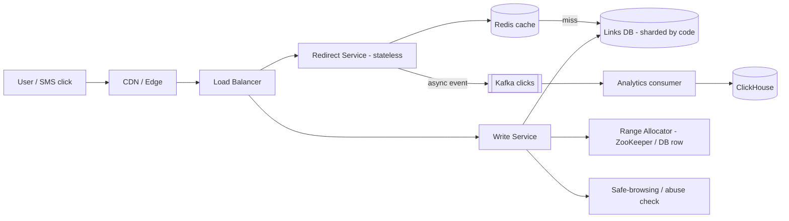
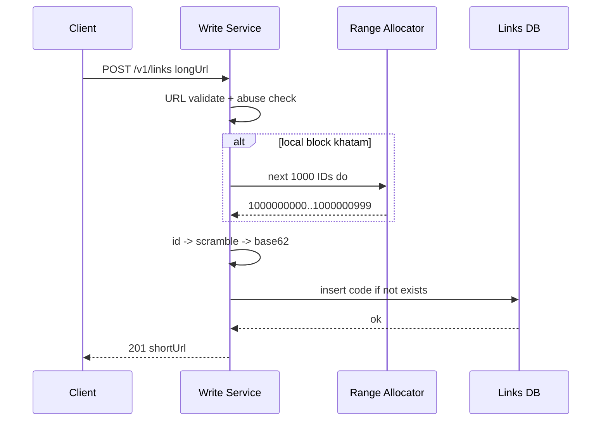
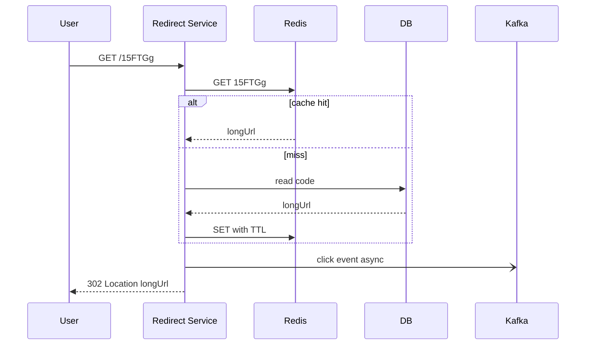

# Q1 · URL shortener

Oct 16, 2026 · @saurav chaurasiya

**Is doc me:** URL shortener ka poora HLD boss — ID generation (base62 vs hash vs counter-range), caching, 301 vs 302, analytics, custom alias, expiry, abuse, estimates.

**Padhne ka tareeka** — Pehle Sawaal pe 15 min khud socho, phir Sahi design padho. Deep Dive tab kholo jab SDE-2 level ki depth chahiye.

---

## Q1 — URL shortener

URL shortener ek service hai jo lamba URL leke chhota code deta hai (jaise `pay.me/15FTGg`), aur jab koi us chhote link pe aaye to use asli URL pe redirect (bhej) kar deta hai.

### Ye cheez hai kya

- Category: read-heavy HLD case study (likhna kam, padhna bahut zyada)
- Problem: SMS me 160 characters ki limit hai aur lamba payment link jagah kha jata hai; chhota link share karna, track karna aur baad me disable karna aasaan hota hai
- Is lesson ke baad tum kar paoge: ID generation ke 3 tarike compare karna, cache-first read path banana, 301 vs 302 ka trade-off samjhana, aur numbers ke saath estimates dena
- Analogy: ye ek **locker ki chabi** jaisa hai — chabi (short code) chhoti hai, par locker (asli URL) bada hai. Chabi dikhao, locker khul jata hai.

### Sawaal

Tum Paytm ke payment-link team me ho. Har din \~20M SMS jate hain jisme payment link hota hai (maan lo ye numbers hypothetical hain, interview ke liye). Lamba link `https://paytm.com/pay?order=...&merchant=...&sig=...` lagbhag 250 characters ka hai, SMS me 160 char me nahi aata.

- Naye short links: 100M per month
- Read (redirect) : write ratio = 100 : 1
- Redirect latency target: p99 (99% requests is time se tez) 50 ms se kam
- Availability 99.99%, link 5 saal tak chal sakta hai (ya expiry ke saath)
- Campaign burst: 1M SMS 5 minute me, aur turant click spike

> Pehle khud socho — 15 min. Hints: (1) 7 character ka code kitne unique links de sakta hai? (2) 2 servers ek hi ID dono ko de dein to kya hoga? (3) 4,000 redirects/sec me se kitne DB tak jaane chahiye?

### Problem kyun aata hai

- Code chhota bhi ho aur kabhi repeat bhi na ho — ye dono ek saath chahiye
- Redirect user-facing hai: har ms pe click-through girta hai
- Ek hi viral link pe lakhon clicks (hot key — ek hi key pe bahut zyada traffic) aa sakte hain
- Spammer short link ko phishing chhupane ke liye use karte hain, domain reputation kharab ho sakti hai
- Link expire, disable ya edit bhi hona chahiye

### Naive approach

- Ek table `urls(id AUTO_INCREMENT, long_url)`; code = `id` ko number ki tarah dikha do; har redirect pe DB query
- Kahan toot-ta hai:
  - Single DB write master SPOF (single point of failure — jiske girte hi sab band) hai
  - Peak 12,000 reads/sec seedha DB pe, jabki ek MySQL box comfortably \~5k-10k simple reads karta hai
  - Sequential IDs predictable hain: `1001, 1002, 1003` — koi bhi doosron ke payment link guess karke scrape kar sakta hai
  - Sharding ke baad auto-increment har shard me alag chalega, duplicate ho jayega

### Sahi design

#### 1. Requirements

- Functional:
  - Long URL do, short URL milega
  - Short URL kholo, redirect ho
  - Optional custom alias (jaise `pay.me/diwali`)
  - Optional expiry (TTL — time to live, kitne time baad link khatam)
  - Click analytics (kitne click, kab, kahan se)
- Non-functional:
  - Redirect p99 < 50 ms, availability 99.99%
  - Code unpredictable ho (scrape na ho sake) aur kabhi repeat na ho
  - Read-heavy: cache first
  - Analytics redirect ko slow na kare (async)

#### 2. Back-of-envelope estimates

- Writes: 100M / (30 x 86,400 sec) = lagbhag **40 writes/sec**
- Reads: 40 x 100 = **4,000 reads/sec** average, peak 3x = **12,000/sec**
- 5 saal ke URLs: 100M x 12 x 5 = **6B** links
- Storage: 6B x \~500 bytes = **3 TB** (sharding zaroori nahi pehle din, par replica chahiye)
- Code length: 62^6 = 56.8B, 62^7 = **3.5 trillion** — 6B ke liye 7 char kaafi aur bahut room
- Cache: roz \~345M reads; top 20% unique links \~ 70M x 500 B = **\~35 GB**, ek Redis cluster me aa jata hai
- Bandwidth: 12,000 x \~500 B = **6 MB/s**, bahut kam; bottleneck QPS hai, bytes nahi

#### 3. API design

| Endpoint | Request | Response |
| --- | --- | --- |
| `POST /v1/links` | `{longUrl, alias?, expiresAt?}` + `Idempotency-Key` header | `201 {code, shortUrl}` ya `409` agar alias le liya gaya |
| `GET /{code}` | none | `302` + `Location: longUrl`, ya `404` / `410 Gone` (expired) |
| `DELETE /v1/links/{code}` | auth token | `204` |
| `GET /v1/links/{code}/stats` | auth token | click counts by day, country, device |

- Idempotency key ka matlab: client retry kare to naya link na bane. Detail: [2A · Idempotency Island](https://claude.ai/code/artifact/c269ac61-440b-4525-bd04-31baf708dece)

#### 4. Data model

- Main table `links` (NoSQL ya sharded SQL, key = `code`):
  - `code` (PK), `long_url`, `owner_id`, `created_at`, `expires_at`, `status` (ACTIVE / DISABLED / BLOCKED)
- Access pattern sirf ek hai: **code se long\_url**. Isliye key-value store (DynamoDB / Cassandra) ya code pe sharded MySQL fit hai. Dekho [1C · DB Dungeon](https://claude.ai/code/artifact/99909fe9-731e-4e31-9e7d-36e0c5aed845) aur [1D · Shard Mountains](https://claude.ai/code/artifact/cfe905e6-6370-43e0-a337-764eeb9ddf1e).
- Click events alag: Kafka -> ClickHouse / warehouse table `clicks(code, ts, country, device, referrer)`

#### 5. ID generation — 3 tarike

| Tarika | Kaise kaam karta hai | Fayda | Nuksaan |
| --- | --- | --- | --- |
| Hash (MD5/SHA, pehle 7 char) | long URL ka hash lo, base62 me truncate karo | Same URL = same code, koi central state nahi | Collision (do alag URL ka same code): check + retry chahiye, har write pe DB read |
| Random 7 char | random base62 string, DB me unique check | Unpredictable | Table bharne ke saath collision badhta hai, retry |
| Counter + base62 | ek global counter, number ko base62 me badlo | Collision zero, code chhota | Predictable; counter SPOF; bottleneck |
| **Counter-range** (recommended) | Central service har app server ko 1000 IDs ka block deti hai, server local me bantta hai | Central ko kam hit, collision zero, fast | Server crash pe block ke unused IDs waste (koi dikkat nahi, 3.5T room hai) |

- Predictability fix: counter ko bit-shuffle ya Feistel cipher (reversible scramble) se guzaro, phir base62 karo. Ya counter ke upar random salt.
- Base62 ka matlab: 0-9, a-z, A-Z — 62 characters ka alphabet. Number ko base 62 me likhna jaise decimal ko binary me likhna.

#### 6. High-level architecture



- Redirect path aur write path alag services hain, kyunki unka load 100:1 hai aur scale alag chahiye
- Redirect service stateless hai — jitne chahe utne add karo ([1A · Scaling Valley](https://claude.ai/code/artifact/7ddee338-4d3e-45ec-b8a6-405a5af727a5))
- Analytics ka event Kafka me fire-and-forget; redirect uska intezar nahi karta

Create flow ka sequence:



Redirect flow ka sequence:



#### 7. Working Java demo

Neeche ka program base62 encode, counter-range allocator (2 servers, 4 threads), custom alias ka collision aur LRU cache-aside ko dikhata hai. Pattern: **Strategy-jaisa split** (ID source alag, storage alag) aur **cache-aside** read pattern. Concurrency point: `synchronized nextId()` local block pe, aur `putIfAbsent` DB me atomic uniqueness ke liye.

```java
import java.util.*;
import java.util.concurrent.*;
import java.util.concurrent.atomic.*;

public class Demo {
    static final String ALPHA = "0123456789abcdefghijklmnopqrstuvwxyzABCDEFGHIJKLMNOPQRSTUVWXYZ";

    // number ko base62 string me badalta hai
    static String encode(long n) {
        if (n == 0) return "0";
        StringBuilder sb = new StringBuilder();
        while (n > 0) { sb.append(ALPHA.charAt((int) (n % 62))); n /= 62; }
        return sb.reverse().toString();
    }

    // Counter-range allocator: ek shared AtomicLong, har app server ko 1000 ids ka block deta hai
    static class RangeAllocator {
        private final AtomicLong next = new AtomicLong(1_000_000_000L);
        final int size;
        RangeAllocator(int size) { this.size = size; }
        long[] lease() { long s = next.getAndAdd(size); return new long[]{s, s + size}; }
    }

    // Har app server apna local block use karta hai, block khatam hone pe hi central ko hit karta hai
    static class IdSource {
        private final RangeAllocator alloc; private long cur, end; int leases = 0;
        IdSource(RangeAllocator a) { alloc = a; }
        synchronized long nextId() {
            if (cur >= end) { long[] r = alloc.lease(); cur = r[0]; end = r[1]; leases++; }
            return cur++;
        }
    }

    static class Shortener {
        final Map<String, String> db = new ConcurrentHashMap<>();
        // access-order LinkedHashMap = chhota LRU cache (size 2)
        final Map<String, String> cache = Collections.synchronizedMap(new LinkedHashMap<>(16, 0.75f, true) {
            protected boolean removeEldestEntry(Map.Entry<String, String> e) { return size() > 2; }
        });
        final IdSource ids; int dbReads = 0;
        Shortener(IdSource ids) { this.ids = ids; }

        String shorten(String url, String alias) {
            String code = (alias != null) ? alias : encode(ids.nextId());
            // putIfAbsent atomic hai: alias pehle se liya ho to fail
            if (db.putIfAbsent(code, url) != null) throw new IllegalStateException("alias taken: " + code);
            return code;
        }
        // cache-aside read: pehle cache, miss pe db, phir cache me daalo
        String resolve(String code) {
            String u = cache.get(code);
            if (u != null) return u;
            dbReads++;
            u = db.get(code);
            if (u != null) cache.put(code, u);
            return u;
        }
    }

    public static void main(String[] args) throws Exception {
        System.out.println("encode(0)=" + encode(0) + " encode(61)=" + encode(61) + " encode(62)=" + encode(62));
        System.out.println("62^7 = " + (long) Math.pow(62, 7));

        RangeAllocator alloc = new RangeAllocator(1000);
        IdSource serverA = new IdSource(alloc), serverB = new IdSource(alloc);
        Shortener s = new Shortener(serverA);
        System.out.println("A: " + s.shorten("https://paytm.com/pay/1", null));
        System.out.println("A: " + s.shorten("https://paytm.com/pay/2", null));
        Shortener sb = new Shortener(serverB);
        System.out.println("B: " + sb.shorten("https://paytm.com/pay/3", null));

        // 2 server, 4 thread, 5000 id: koi duplicate nahi hona chahiye
        Set<Long> seen = ConcurrentHashMap.newKeySet();
        ExecutorService ex = Executors.newFixedThreadPool(4);
        List<Future<?>> fs = new ArrayList<>();
        for (int t = 0; t < 4; t++) {
            final IdSource src = (t % 2 == 0) ? serverA : serverB;
            fs.add(ex.submit(() -> { for (int i = 0; i < 1250; i++) seen.add(src.nextId()); }));
        }
        for (Future<?> f : fs) f.get();
        ex.shutdown();
        System.out.println("unique ids = " + seen.size() + " (5000 expected)");
        System.out.println("central lease calls: A=" + serverA.leases + " B=" + serverB.leases);

        s.shorten("https://paytm.com/pay/vip", "diwali");
        try { s.shorten("https://other.com", "diwali"); } catch (IllegalStateException e) { System.out.println(e.getMessage()); }

        s.resolve("diwali"); s.resolve("diwali"); s.resolve("diwali");
        System.out.println("3 resolve ke baad dbReads = " + s.dbReads);
    }
}
```

Isko chalane pe bilkul ye output aata hai:

```text
encode(0)=0 encode(61)=Z encode(62)=10
62^7 = 3521614606208
A: 15FTGg
A: 15FTGh
B: 15FTWo
unique ids = 5000 (5000 expected)
central lease calls: A=3 B=3
alias taken: diwali
3 resolve ke baad dbReads = 1
```

- Dhyan do: A ke codes `...Gg, ...Gh` sequential hain (production me scramble karo); B ka block alag range se aaya isliye `...Wo`
- 2500 IDs per server aur block 1000 ka = sirf 3 central calls per server
- 3 resolve me DB sirf 1 baar gaya, baaki 2 cache se

### Kya choose karein aur kyun

| Option | Kab use karo | Kab mat karo |
| --- | --- | --- |
| Counter-range + base62 (scrambled) | Default choice; high write rate, zero collision chahiye | Jab same long URL ko hamesha same code dena ho (dedupe) |
| Hash + collision retry | Dedupe chahiye, ya central allocator nahi rakhna | Bahut zyada links ho jayein (collision rate badhta hai) |
| Random 7 char + unique check | Chhota system, unpredictable code zaroori | Table bahut bhar gaya ho |
| 301 Moved Permanently | Link kabhi change/track nahi hoga, server load bachana hai | Analytics chahiye, link edit/expire hota hai (browser cache karke tumhe bypass karega) |
| 302 Found (temporary) | Analytics, expiry, edit, abuse takedown sab chahiye (payment link ke liye yehi) | Jab har redirect ka server cost bachana ho aur tracking ki zaroorat na ho |
| Cache-aside Redis | Read-heavy, ek key pe baar baar access | Jab data har second badalta ho |

- **301 vs 302** ka core: 301 me browser aage se seedha asli URL pe jata hai, tumhe click dikhta hi nahi. Payment link me tumhe expiry aur click count chahiye, to **302** lo.
- Dedupe chahiye ho to alag `long_url_hash -> code` index rakho; poora hash-based ID zaroori nahi.

### India me kaise hota hai

- SMS me link bhejna India me regulated hai: TRAI ke rules ke baad SMS me aane wale URLs/call-to-action pehle whitelist karwane padte hain, warna message block ho sakta hai. Isliye companies apna **branded domain** (jaise `pay.me`-type) register karwati hain, random public shortener nahi use karti. Padho: [TRAI CTA whitelisting guide (Tinycc)](https://tinycc.com/tiny/cta-whitelisting) aur [Zoho: SMS me URL whitelist karna](https://www.zoho.com/in/books/kb/sms-notifications/whitelist-url.html).
- Payment-link products (jaise Paytm payment links) me link ki expiry aur status (paid/expired) check hota hai; isliye redirect ke baad bhi order state backend se aati hai. Ye wahi 302 + expiry idea hai. Payments side ke liye dekho [C2 · Payment gateway](https://claude.ai/code/artifact/789bc35f-d2eb-42fd-8b80-804af8af526b).
- Festival campaigns (Diwali, IPL) me burst aate hain: SMS ek saath nikalte hain aur 1-2 minute me click spike aata hai. Isliye pre-warmed cache aur CDN edge pe redirect rakhte hain ([1A · Scaling Valley](https://claude.ai/code/artifact/7ddee338-4d3e-45ec-b8a6-405a5af727a5)).
- Design reference ke liye generic walkthroughs: [Exponent: URL shortener](https://www.tryexponent.com/courses/system-design-interviews/url-shortener), [Linkly: URL shortener system design](https://linklyhq.com/blog/url-shortener-system-design).

### Interview follow-ups

- **Hash vs counter, kaunsa?** — Counter-range: collision zero, write path me DB read nahi. Hash me collision check har write pe chahiye. Predictability ke liye counter ko scramble karo.
- **Allocator (central service) mar gaya to?** — App servers ke paas abhi ka local block hai, wo chalte rehte hain. Allocator ko 3 nodes pe replicate karo (ZooKeeper ya DB row with optimistic lock). Unused IDs waste hone se farak nahi padta.
- **301 ya 302?** — 302, kyunki analytics, expiry aur takedown tabhi kaam karte hain jab har click server tak aaye. 301 sirf permanent, untracked links ke liye.
- **Ek viral link pe 1M clicks/sec aaye (hot key)?** — CDN pe cache, Redis ke saamne in-process local cache (Caffeine) thodi der ke liye, aur replica reads. Dekho [1B · Cache Caves](https://claude.ai/code/artifact/32bb1c8e-3433-417c-a3f4-3a34babed6bf).
- **Custom alias ka race (do log ek hi alias maangein)?** — DB me `code` unique key; `INSERT ... IF NOT EXISTS` ya conditional put. Jo haare use 409 do. Application-level check-then-insert mat karo, race hoga.
- **Expiry kaise lagayein?** — `expires_at` column + redirect pe check (expired = 410 Gone). Cache TTL bhi `min(default, expires_at - now)`. Purani rows ko background job ya DB TTL (DynamoDB TTL) se hatao.
- **Abuse/phishing kaise roke?** — Create time pe Safe Browsing/blocklist check, per-user rate limit ([Q2 · Rate limiter](https://claude.ai/code/artifact/f8e2c88d-e59a-4db7-b9af-3692025c48c5) jaisa), reported links ka status BLOCKED, aur redirect pe interstitial warning page.

### Self-check

1. 62^7 kitna hota hai aur 6B links ke liye 7 char kaafi kyun hain?
2. Counter-range allocation me 2 servers ko same ID kyun nahi milti? Server crash ho to kya hota hai?
3. Payment-link ke liye 301 galat kyun hai?
4. 4,000 reads/sec me se DB tak kitne jaane chahiye, aur cache-aside me miss pe kya hota hai?
5. Do users ek hi alias ek saath maangein to kaise handle karoge?

### Notebook

Base62 = 0-9a-zA-Z · 7 char = 3.5T codes · 100M/month = \~40 writes/sec, 4k reads/sec avg · Counter-range: block of 1000 per server, zero collision · Scramble karo warna code predictable · 302 for analytics + expiry, 301 for permanent · Redirect cache-first, click event Kafka me async · Alias = DB unique key, 409 on conflict

### Padhne ke liye

- [Exponent — URL shortener walkthrough](https://www.tryexponent.com/courses/system-design-interviews/url-shortener)
- [Linkly — URL shortener system design under the hood](https://linklyhq.com/blog/url-shortener-system-design)
- [Tautik — bit.ly system design](https://tautik.bearblog.dev/url-shortener/)
- [Designing a TinyURL approach (Codemia)](https://codemia.io/system-design/designing-a-simple-url-shortening-service-a-tinyURL-approach/solutions/td8qr1/My-Solution-for-Designing-a-Simple-URL-Shortening-Service-A-TinyURL-Approach)

### Deep Dive (SDE-2) — jab time ho

#### Counter-range allocator ko reliable kaise banayein

- Ek DB row `next_id` rakho; allocate = `UPDATE ... SET next_id = next_id + 1000 WHERE next_id = :old` (optimistic lock, [2D · Lock Fort](https://claude.ai/code/artifact/97588686-7110-4318-8124-3a8727c7604e))
- Ya ZooKeeper sequential node / etcd; ya multi-region ke liye har region ko alag prefix range (region A: 0-1T, B: 1T-2T)
- Block size ka trade-off: bada block = kam central calls par crash pe zyada waste

#### Analytics pipeline aur sampling

- Redirect service click event Kafka pe daalti hai ([1E · Kafka River](https://claude.ai/code/artifact/eeb39ee8-3f52-4c04-b57b-68213f02c429)); consumer batch me ClickHouse me likhta hai
- Real-time counter ke liye Redis `INCR` ya HyperLogLog (approx unique visitors, bahut kam memory)
- Kafka down ho to redirect ko fail mat karo: event local buffer/drop karo (analytics best-effort, redirect critical hai)

#### Sharding aur cache invalidation

- Shard key = `code` (hash-based), kyunki lookup sirf code se hota hai; consistent hashing se resharding sasti ([1D · Shard Mountains](https://claude.ai/code/artifact/cfe905e6-6370-43e0-a337-764eeb9ddf1e))
- Link disable/edit pe cache invalidate karo (delete key) aur CDN purge; isliye CDN TTL chhota rakho (60 sec)
- Negative caching: 404 codes ko bhi thodi der cache karo taaki scanners DB ko na maarein

#### Multi-region aur availability

- Reads har region me replica + cache se; writes ek home region ya per-region ID range se
- Redirect read path ko DB outage me bhi cache se serve karna (stale-while-error), kyunki availability 99.99% target hai

---

## Aage kya

- Pichhla: [C14 · Txn history at scale](https://claude.ai/code/artifact/82e1ca11-050a-4cdd-bb7d-c1925ab3677f)
- Agla: [Q2 · Rate limiter](https://claude.ai/code/artifact/f8e2c88d-e59a-4db7-b9af-3692025c48c5)
- Related: [1B · Cache Caves](https://claude.ai/code/artifact/32bb1c8e-3433-417c-a3f4-3a34babed6bf), [1D · Shard Mountains](https://claude.ai/code/artifact/cfe905e6-6370-43e0-a337-764eeb9ddf1e)
