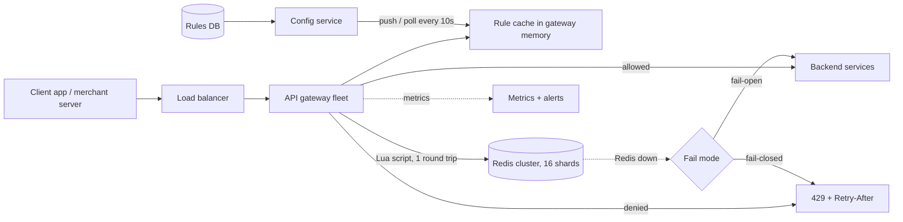
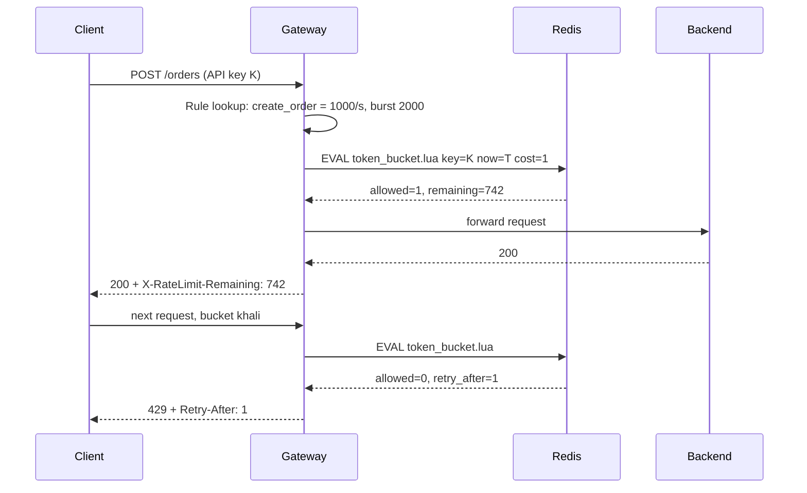

# Q2 · Rate limiter

Oct 16, 2026 · @saurav chaurasiya

**Is doc me:** distributed rate limiter ko ek shared service ki tarah design karna: algorithms (token bucket se sliding window counter tak), Redis + Lua atomicity, gateway placement, 429 headers, multi-region aur failure modes.

**Padhne ka tareeka** — pehle Sawaal pe 15 min khud socho, phir Sahi design padho; Deep Dive tab kholo jab SDE-2 level ka time ho.

---

## Q2 — Rate limiter

Rate limiter ek guard hai jo har client ko ek time window me sirf fixed number of requests karne deta hai, aur baaki ko 429 (Too Many Requests) ke saath wapas bhej deta hai. Ye abuse, bugs aur traffic spikes se backend ko bachata hai.

### Ye cheez hai kya

- Category: HLD case study (boss level) — shared infrastructure service, jo API gateway ke saath baithti hai.
- Problem: ek buggy client ya attacker ya flash sale poore system ko gira sakta hai; limiter ye load shed karta hai (extra load ko pehle hi gate pe fenk deta hai).
- Is lesson ke baad tum kar paoge: 5 algorithms compare karna, Redis Lua script likhna, per-user/per-merchant/per-API rules design karna, aur fail-open vs fail-closed ka decision justify karna.

Analogy: metro station ka turnstile — ek time pe limited log andar jaate hain, baaki line me rukte hain, aur gate khud kabhi crowd ki wajah se band nahi hona chahiye.

### Sawaal

Tum Paytm ke API platform team me ho. Platform pe 3 tarah ke callers hain: 40 million app users (mobile), 2 million merchants (server-to-server API, jaise Razorpay/Paytm Payment Gateway ke merchants), aur internal services.

- Peak traffic: 150,000 requests/sec (RPS) gateway pe, festive sale (Big Billion Days / Diwali) me 3x tak.
- Rules alag-alag: user login OTP 5 per 10 min, merchant create-order 1000 per sec, UPI status-check 3 per txn.
- Limiter ka apna overhead p99 (99% requests is se tez — worst 1% ke alawa sab) latency 2 ms se kam hona chahiye.
- Limiter ka outage payments ko down nahi karna chahiye.

> Pehle khud socho — 15 min. Hints: (1) Counter kahan rakhoge — gateway ki local memory me ya shared Redis me, aur dono ke trade-off kya hain? (2) Do requests ek saath aayein to read-then-write race kaise rokoge? (3) Redis mar jaye to allow karoge ya block?

### Problem kyun aata hai

- Ek merchant ka buggy retry loop 50,000 RPS bhej de to baaki 2 million merchants ka latency badh jata hai (noisy neighbour — ek tenant doosron ke resources kha jata hai).
- OTP/login endpoints pe brute force aur SMS bombing se paisa aur reputation dono jaate hain.
- Downstream (bank, NPCI, DB) ki apni capacity hai; gateway ne sab aage dhakel diya to wo gir jayenge.
- Cost fairness: free tier vs paid tier ko alag quota dena padta hai.
- Har team apna limiter likhe to 40 alag implementations, 40 alag bugs — isliye ek central service chahiye.

### Naive approach

- Har gateway server apni memory me ek `HashMap<userId, count>` rakhe aur har minute reset kare.
- Ya Redis me `GET count` -> `if count < limit` -> `INCR count`, teen alag commands me.

Ye kahan toot-ta hai:

- 20 gateway servers hain aur limit 100/min hai: load balancer requests baant deta hai, to ek user effectively 20 x 100 = 2000/min kar sakta hai. Local counter limit ko multiply kar deta hai.
- Read-then-write race: count = 99 hai, 10 requests ek saath GET karti hain, sabko 99 dikhta hai, sab pass ho jati hain. Limit 100 thi, 109 gayi.
- Fixed window ka boundary burst: 12:00:59 pe 100 aur 12:01:00 pe 100 — 2 second me 200 requests, jabki limit 100/min thi.
- Reset-at-minute-start se sab clients ek saath retry karte hain (thundering herd — ek saath sab ka tooth-pad ke aana).

### Sahi design

#### Requirements

- Functional:
  1. Rule ke hisaab se allow/deny decision: key = user, merchant, API key, IP, ya API endpoint, ya in sab ka combination.
  2. Deny pe HTTP 429 aur `Retry-After` header.
  3. Rules runtime pe change ho sakein (deploy ke bina), tier-wise (free/paid).
  4. Burst allow karna (e.g. 1000 per sec average, par 2000 ka short burst).
- Non-functional:
  1. Low latency: decision p99 < 2 ms.
  2. High availability: limiter fail ho to business chalta rahe (fail-open default, par security endpoints pe fail-closed).
  3. Accuracy: limit se bahut zyada requests na nikalein (approx 1-5% error theek hai).
  4. Scale: 150k RPS (peak 450k), multi-region.
  5. Observable: kitne allowed, kitne throttled, kis rule se.

#### Back-of-envelope estimates

- Peak 450,000 RPS, har request pe 1 Redis call (Lua script) = 450,000 ops/sec. Ek Redis node comfortable 80k-100k ops/sec deta hai, to \~8-10 shards (partition — data ko hisson me baantna) chahiye; 16 rakhenge headroom ke liye.
- Active keys: 10 million users x 2 rules + 2 million merchants x 3 rules = \~26 million keys.
- Memory, token bucket: har key me 2 fields (tokens, last\_refill) \~ 100 bytes = 2.6 GB total. Chhota hai.
- Memory, sliding window log (har request ka timestamp): 100 req/min wala user = 100 x 16 B = 1.6 KB per key, 10M users = 16 GB. 6x se zyada, isliye log sirf low-limit sensitive endpoints (OTP) pe.
- Network: decision request \~200 bytes, 450k x 200 B = 90 MB/s, fine.

#### Algorithms ka comparison

| Algorithm | Kaise kaam karta hai | Memory | Burst | Accuracy |
| --- | --- | --- | --- | --- |
| Token bucket | Bucket me max N tokens; r tokens/sec refill; request 1 token leti hai | O(1) per key | Haan, bucket size tak | Achhi |
| Leaky bucket | Requests queue me jaati hain, fixed rate se nikalti hain | O(queue) | Nahi, output smooth | Achhi |
| Fixed window counter | Har minute ka counter, minute badalte hi reset | O(1) | Boundary pe 2x burst | Kharab at edges |
| Sliding window log | Har request ka timestamp store, purane hata do | O(limit) per key | Nahi | Exact |
| Sliding window counter | Pichhli + current window ke counters ka weighted average | O(1) | Thoda | \~99% (Cloudflare ne measure kiya) |

- Token bucket (token = ek request ki permission): default choice. Stripe jaisi companies isi ko use karti hain. Burst + average rate dono control hote hain.
- Leaky bucket: jab downstream ko smooth, constant rate chahiye (jaise bank ko calls) — traffic shaping.
- Sliding window counter formula: `count = current + previous * (1 - elapsed_fraction)`. Example: limit 100/min, pichhle minute 84, abhi 36 sec pe current 36 -> 36 + 84 x 0.4 = 69.6 -> allow.

#### API design

- Internal check API (gateway ye call karta hai, ya library ke through):
  - `POST /v1/ratelimit/check` body: `{ "key": "merchant:M123", "rule": "create_order", "cost": 1 }`
  - Response: `{ "allowed": true, "limit": 1000, "remaining": 742, "reset_ms": 380 }`
- Admin API: `PUT /v1/rules/{ruleId}` — limit, window, algorithm, tier, fail mode.
- Client ko jo response milta hai:
  - Allowed: `200` + `X-RateLimit-Limit`, `X-RateLimit-Remaining`, `X-RateLimit-Reset`.
  - Denied: `429 Too Many Requests` + `Retry-After: 3` (seconds me) + same X-RateLimit headers + body me error code.

#### Data model

- Rules store (config DB, e.g. Postgres/etcd, gateway ke memory me cached):
  - `rule_id, match (user|merchant|api|ip), endpoint_pattern, algorithm, limit, window_sec, burst, tier, fail_mode`
- Redis counters (hot state):
  - Token bucket: key `rl:{merchant:M123}:create_order` -> hash `{tokens, ts}` with TTL.
  - Sliding window counter: keys `rl:{user:U1}:otp:<window_start>` -> integer, TTL = 2 x window.
  - Sliding window log: sorted set (ZSET), score = timestamp.
- `{...}` hash tag ka matlab: Redis Cluster me same tag wali keys same shard pe jaati hain.

#### High-level architecture

Neeche diagram me gateway har request pe local rule cache dekhta hai, phir Redis cluster se atomic decision leta hai, aur Redis down ho to rule ke fail mode ke hisaab se behave karta hai.



Request flow ka sequence:



Sahi design ke steps:

1. Rate limiter gateway pe lagao (edge pe), taaki bekaar request backend tak pahunchne se pehle hi kat jaye. Alternative: sidecar ya separate service (neeche table me).
2. Rules gateway ki memory me cache karo; config service har 10 sec me refresh kare. Rule match karo: pehle most specific (merchant + endpoint), phir general.
3. Decision ek Redis Lua script se lo — script Redis me atomically chalti hai, to read-modify-write race khatam.
4. Token bucket me refill lazily hota hai: background timer nahi, har request pe `elapsed x rate` tokens add karo (cap = burst).
5. Redis ko `{hash tag}` ke saath shard karo taaki ek key ke saare fields ek node pe rahein.
6. Denied pe 429 + `Retry-After` do; allowed pe bhi `X-RateLimit-*` headers do taaki well-behaved client khud slow ho jaye.
7. Redis timeout (e.g. 5 ms) set karo; fail hone pe rule ke `fail_mode` se decide karo.

Atomic token bucket ki Redis Lua script — ye script bucket ko refill karti hai, token kaat-ti hai, aur allowed/remaining/retry\_after wapas deti hai (ek hi atomic step me):

```lua
-- KEYS[1] = bucket key; ARGV = rate_per_sec, burst, now_ms, cost
local rate  = tonumber(ARGV[1])
local burst = tonumber(ARGV[2])
local now   = tonumber(ARGV[3])
local cost  = tonumber(ARGV[4])

local data   = redis.call('HMGET', KEYS[1], 'tokens', 'ts')
local tokens = tonumber(data[1])
local ts     = tonumber(data[2])

-- pehli baar: bucket poora bhara hua
if tokens == nil then
  tokens = burst
  ts = now
end

-- lazy refill: jitna time guzra, utne tokens add (burst se zyada nahi)
local elapsed = math.max(0, now - ts)
tokens = math.min(burst, tokens + (elapsed / 1000.0) * rate)

local allowed = 0
local retry_ms = 0
if tokens >= cost then
  tokens = tokens - cost
  allowed = 1
else
  -- kitni der baad itne tokens ban jayenge
  retry_ms = math.ceil(((cost - tokens) / rate) * 1000)
end

redis.call('HSET', KEYS[1], 'tokens', tokens, 'ts', now)
-- idle bucket khud expire ho jaye (bharne me jitna time lagta)
redis.call('PEXPIRE', KEYS[1], math.ceil((burst / rate) * 1000) + 1000)

return {allowed, math.floor(tokens), retry_ms}
```

Note: `now` ko gateway se bhejne ki jagah Redis `TIME` se lena safer hai (clock skew — alag machines ki ghadi ka farq — se bachata hai). Redis 5+ me script replication effects-based hoti hai, to `TIME` use karna theek hai.

### Kya choose karein aur kyun

Pehli table limiter ko kahan lagana hai uska comparison hai:

| Option | Kab use karo | Kab mat karo |
| --- | --- | --- |
| Gateway-level (edge) limiter + shared Redis | Default. Saare APIs ke liye ek jagah rule, bekaar traffic backend tak nahi jata | Jab rule ko business data chahiye jo gateway ke paas nahi (e.g. user ka account balance) |
| Library/middleware har service me | Service-specific rule, jaise per-DB-table write limit | Jab 40 services hon — versions drift karte hain, bug 40 jagah fix |
| Separate rate-limit service (gRPC) | Language-agnostic, Envoy ratelimit jaisa; central control | Extra network hop (\~1 ms) aur ek aur SPOF (single point of failure — jiske girne se sab ruk jaye) |
| Client-side throttle | Cooperative clients (apna SDK) ko pehle hi slow karne ke liye | Security ke liye — attacker client code control karta hai |

Doosri table algorithm choose karne ke liye:

| Algorithm | Kab use karo | Kab mat karo |
| --- | --- | --- |
| Token bucket | General API limits jahan burst theek hai (merchant create-order) | Jab strictly smooth output chahiye |
| Leaky bucket | Downstream ko constant rate chahiye (bank/NPCI ko outbound calls) | Interactive API jahan queue ka wait user ko bura lage |
| Fixed window | Sabse sasta, internal/rough quota, daily caps | Boundary burst jahan 2x load nuksan kare |
| Sliding window log | Chhoti exact limits: OTP 5 per 10 min, login attempts | Lakhon keys pe badi limits — memory O(limit) |
| Sliding window counter | Bade scale pe accuracy + O(1) memory ka balance | Jab 100% exactness chahiye (billing) |

Fail-open vs fail-closed:

| Option | Kab use karo | Kab mat karo |
| --- | --- | --- |
| Fail-open (Redis down to allow) | Payments, order create, search — availability pehle; limiter ka kaam protect karna hai, business rokna nahi | Expensive/abusable endpoints, jaise SMS-OTP (SMS bombing se bill) |
| Fail-closed (Redis down to deny) | OTP, login, password reset, admin APIs — security pehle | Core payment flow — limiter ka bug poora outage ban jayega |
| Local fallback (Redis down to gateway ka local approximate limiter) | Best of both: limit/N per node, kuch protection bhi, availability bhi | Jab nodes ki sankhya bahut dynamic ho (autoscale) to approx kharab |

### India me kaise hota hai

- NPCI UPI ke API usage rules (1 August 2025 se): PSP apps (payment service provider app, jaise PhonePe/Paytm) pe balance check 50 per day per app, linked accounts dekhna 25 per day per app, aur transaction status check max 3 attempts, har ek ke beech 90 sec ka gap. AutoPay ke liye peak hours (10 AM se 1 PM, 5 PM se 9:30 PM) me execution block hai. Ye wahi cheez hai: system ke andar load bachane ke liye per-app, per-API quotas. Source: [UPI changes starting August 1 (SCC Online)](https://www.scconline.com/blog/post/2025/07/30/upi-changes-starting-august-1-ncpi-guidelines-upi-api-usage-2025/).
- Ye rules UPI outage ke baad aaye jab status-check API ki overuse core network pe load bana rahi thi: [UPI Outage: NPCI Directs Banks To Limit Check Transaction API Usage (Inc42)](https://inc42.com/?p=511758).
- Razorpay: limit cross hone pe error `BAD_REQUEST_ERROR` with description "Too many requests". Advice: exponential backoff + retry, polling kam karo aur webhooks use karo, limit badhwani ho to support se case-by-case approval. Source: [Razorpay Common Errors](https://razorpay.com/docs/errors/common/).
- Global reference: Stripe live mode me 100 req/sec global, 25 req/sec per endpoint, 50 concurrent requests, aur `429` ke saath `Stripe-Rate-Limited-Reason` header; client ko token bucket lagane ki salah. Source: [Stripe Rate limits](https://docs.stripe.com/rate-limits).
- Takeaway: payments me limiter sirf abuse nahi rokta, wo ek reliability tool hai — NPCI jaise central rail ko apne PSPs pe quota lagana padta hai.

### Interview follow-ups

- **Distributed setting me race condition kaise rokoge?** — Read-modify-write ko Redis Lua script me daalo; Redis single-threaded hai, script atomically chalti hai. `INCR` + `EXPIRE` alag mat karo, ya to Lua ya `SET NX EX` + `INCR`.
- **Redis ka single key hot ho jaye (ek mega merchant 100k RPS)?** — Hot key (ek key pe saara traffic) ko split karo: key ko K sub-buckets me baanto (limit/K har ek), ya gateway pe local token batch lo (har node Redis se 100 token ek saath le). Accuracy thodi ghategi, throughput bahut badhega.
- **Multi-region me limit kaise lagayein?** — Option 1: region-wise quota (limit ka hissa har region ko), sabse sasta. Option 2: global counter ek home region me, par cross-region latency 50-100 ms. Option 3: regions async sync (eventual consistency — sab replicas thodi der me same value pe aate hain) se; thoda over-admit hoga. Default: local quota + periodic rebalance.
- **Fail-open ya fail-closed?** — Endpoint ke hisaab se: payments fail-open, OTP/login fail-closed. Rule me `fail_mode` field rakho, aur Redis ke liye 5 ms timeout + circuit breaker lagao.
- **Retry-After kyun zaruri hai?** — Bina iske client turant retry karta hai aur load double ho jata hai. `Retry-After` seconds batata hai; client ko jitter (random delay) ke saath backoff karna chahiye taaki sab ek saath na tootein.
- **Fixed window ki boundary burst ka fix?** — Sliding window counter (weighted average) ya token bucket. Dono O(1) memory.
- **Rules badalne pe kya hota hai?** — Config DB se gateway cache ko push/poll, version number ke saath; naya limit agle refill pe apply. Counter reset nahi karte.

### Self-check

1. Token bucket me burst aur average rate alag-alag kaise control hote hain?
2. `GET` phir `INCR` wala approach galat kyun hai, aur Lua script ye kaise theek karti hai?
3. Sliding window counter ka formula kya hai, aur 84 pichhle + 36 current (40% elapsed) pe kya count aata hai?
4. 429 response me kaun se headers bhejoge, aur kyun?
5. Kaun se endpoints fail-open aur kaun se fail-closed rakhoge, aur ek line me wajah?

### Notebook

Token bucket = default (burst + average rate, O(1)) · Sliding window log = exact par O(limit) memory, sirf chhoti limits ke liye · Sliding window counter = weighted `cur + prev x (1 - frac)` · Atomicity ke liye Redis Lua script, `{hash tag}` se same shard · 429 + Retry-After + X-RateLimit-Limit/Remaining/Reset · Fail-open for payments, fail-closed for OTP/login · Multi-region: local quota + periodic rebalance · NPCI: 50 balance checks/day, 3 status checks with 90s gap

### Padhne ke liye

- [Stripe: Rate limits](https://docs.stripe.com/rate-limits)
- [Razorpay: Common errors (Too many requests)](https://razorpay.com/docs/errors/common/)
- [UPI API usage changes from August 1 (SCC Online)](https://www.scconline.com/blog/post/2025/07/30/upi-changes-starting-august-1-ncpi-guidelines-upi-api-usage-2025/)
- [Token bucket (Wikipedia)](https://en.wikipedia.org/wiki/Token_bucket)

### Deep Dive (SDE-2) — jab time ho

#### Redis Cluster aur Lua ki gotchas

- Lua script ke saare keys same hash slot me hone chahiye, warna `CROSSSLOT` error aata hai. Isliye `{merchant:M123}` hash tag.
- Script ke andar lambi loop mat likho — Redis single-threaded hai, ek slow script poore shard ko block karti hai.
- `EVALSHA` use karo (script ka hash bhejo, poora text nahi) — network bytes bachte hain. `NOSCRIPT` aaye to ek baar `SCRIPT LOAD` karo.
- Failover pe async replication ki wajah se kuch updates kho sakte hain — limiter ke liye ye tolerable hai (thoda over-admit), isliye `WAIT` ki zarurat nahi.

#### Multi-region aur hot-key tactics

- Region-wise quota: global 1000 RPS, 3 regions -> 400/300/300 traffic share ke hisaab se; har 10-30 sec me usage dekhkar rebalance.
- Local batching: gateway Redis se 50 tokens ek saath leta hai aur locally kharch karta hai. Redis calls 50x kam, par burst error 50 tokens tak.
- Unfairness: ek region ki quota khatam, doosre ki bachi hui — isiliye rebalance loop chahiye (ya borrowing).
- Cloudflare-style sliding window counter ya GCRA (Generic Cell Rate Algorithm — token bucket ka ek variant jo sirf ek timestamp store karta hai) memory aur compute dono bachata hai.

#### Failure modes, observability aur layered limits

- Layers: L1 edge/WAF pe IP-level (DDoS), L2 gateway pe per-API-key, L3 service pe per-endpoint concurrency (bulkhead — jahaz ke alag compartment ki tarah resource pools alag karna). Dekho [2E · Resilience Ridge](https://claude.ai/code/artifact/4769dea3-018e-41e1-ae18-253fa36a6d21).
- Load shedding (overload me kam important requests ko drop karna): critical traffic (payments) ko priority, reports/list APIs pehle drop.
- Metrics: `allowed`, `throttled` by rule, Redis latency p99, fail-open count. Alert: fail-open rate > 0 for 1 min.
- Dry-run mode: naya rule pehle sirf log kare (shadow), enforce baad me — galat rule se production block hone se bachata hai.
- Clock: `Retry-After` hamesha server-calculated rakho; client ki clock pe bharosa mat karo.

---

## Aage kya

- Pichhla: [Q1 · URL shortener](https://claude.ai/code/artifact/ed04745d-aeae-48b3-9cd7-691047f8f08c)
- Agla: [Q3 · WhatsApp](https://claude.ai/code/artifact/afdc46d5-c1c6-4389-a859-90728ddd8c7b)
- Related: [2E · Resilience Ridge](https://claude.ai/code/artifact/4769dea3-018e-41e1-ae18-253fa36a6d21) (timeouts, circuit breaker, backpressure, rate limiting, bulkhead), aur LLD twin [D9 Rate limiter](https://claude.ai/code/artifact/1a82c7a8-3aa0-49a2-b8d8-bb9398c1d502)
