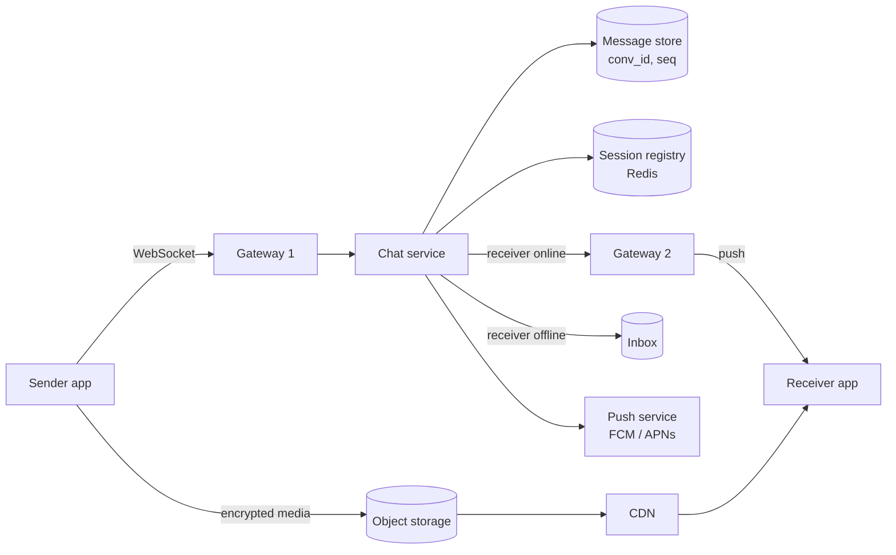
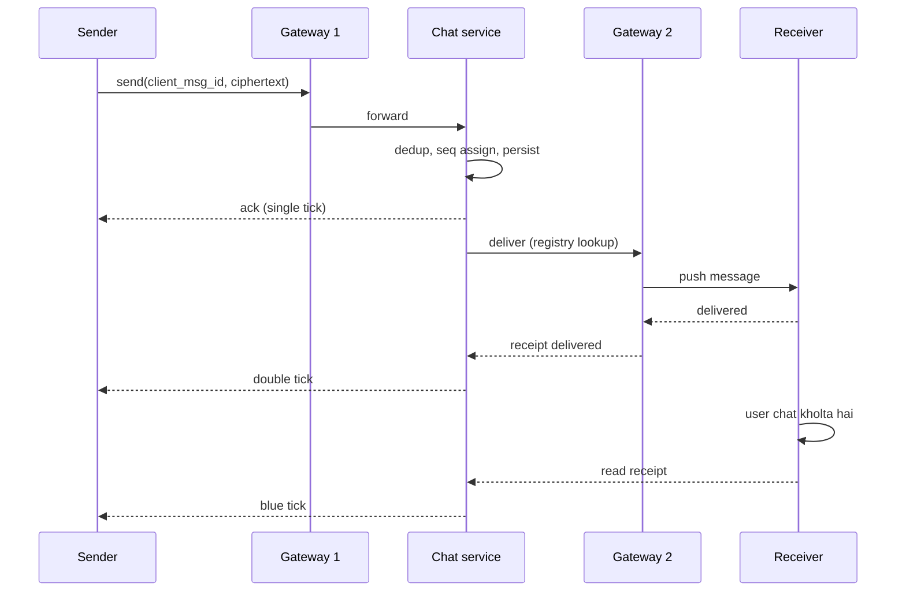

# Q3 · WhatsApp

Oct 16, 2026 · @saurav chaurasiya

**Is doc me:** WhatsApp jaisa chat system design karna: WebSocket gateway, presence, 1:1 aur group messaging, ordering, tick receipts, offline sync, E2E encryption, media aur India-scale estimates.

**Padhne ka tareeka** — pehle Sawaal pe 15 min khud socho, phir Naive approach dekho ki kahan toot-ta hai, phir Sahi design. Deep Dive tab padho jab time ho.

---

## Q3 — WhatsApp

Chat system ek aisa service hai jo ek user ka message dusre user (ya group) tak real time me pahunchata hai, aur agar receiver offline hai to message tab tak safe rakhta hai jab tak wo wapas aa jaye.

### Ye cheez hai kya

- Category: real-time messaging system (persistent connections + store-and-forward queue).
- Problem: server ko client ko **push** karna hai bina client ke poll kiye, millions of connections ek saath khule rakhkar, aur koi message khoye bina, sahi order me.
- Is lesson ke baad tum kar paoge: 1:1 aur group chat ka poora HLD banana, ordering aur tick receipts explain karna, offline sync design karna, aur E2E encryption ka high-level flow batana.
- Analogy: chat system ek **post office + courier** jaisa hai. Gateway courier ka khula darwaza hai, message queue post office ka sorting room hai, aur offline user ka mailbox tab tak chitthi sambhal ke rakhta hai jab tak wo ghar na aaye.

### Sawaal

Tumhe India ke liye WhatsApp jaisa chat app design karna hai. Numbers:

- 500M DAU (daily active users — ek din me jitne alag users app kholte hain), roz average 40 messages bhejte hain.
- 1:1 chat aur groups (max 1024 members). Text, image, video, voice note.
- Message delivery latency: p99 (99% requests isse tez) online receiver ke liye 500 ms se kam.
- Message kabhi lose nahi hona chahiye. Server pe plaintext nahi dikhna chahiye (E2E encrypted).
- Single, double aur blue tick chahiye. Phone 3 din offline ho to bhi wapas aate hi sab messages mile.

> Pehle khud socho — 15 min. Hints: (1) HTTP polling se kya dikkat hai, persistent connection kaise rakhoge? (2) Receiver kis server pe connected hai, ye kaise pata chalega? (3) Offline user ke messages kahan rakhoge aur kab delete karoge?

### Problem kyun aata hai

- HTTP request-response model me server khud se client ko kuch nahi bhej sakta. Chat me server ko push karna padta hai.
- Ek user ek hi gateway server se connected hai, lekin sender kisi dusre server pe. Dono ko jodna padta hai.
- Network unreliable hai: phone lift me, train me, ya 2G pe. Message beech me kho sakta hai ya duplicate ho sakta hai.
- Do log ek saath message bhejein to dono ko same order dikhna chahiye, warna conversation ka matlab badal jata hai.
- Group me 1 message ka 1000 copies me fan-out (ek message ko bahut receivers tak phailana) hota hai. Write amplification (ek write se kai writes) bahut badh jata hai.

### Naive approach

- Client har 1 sec me `GET /messages?since=...` poll kare. Server DB se check kare aur return kare.
- Tootna: 200M concurrent users x 1 poll/sec = **200M QPS** (queries per second — ek second me kitne requests), jisme 99% khali reply hote hain. Battery bhi khatam, aur latency 0 se 1 sec tak random.
- Dusra naive tareeka: ek hi server pe sab WebSocket connections. Ek server \~ lakhon connections hi sambhal sakta hai, to 200M ke liye bahut servers lagenge aur wo aapas me baat nahi kar paayenge. Server crash pe uske sab users ka data aur delivery state gayab.
- Teesra: global ek DB table `messages` me sab kuch, `ORDER BY time`. 700K writes/sec peak pe ek DB nahi jhelega, aur clock se order lena bhi galat hai (clocks alag machines pe alag chalte hain, dekho [1D · Shard Mountains](https://claude.ai/code/artifact/cfe905e6-6370-43e0-a337-764eeb9ddf1e) ka L1.16b).

### Sahi design

#### Requirements

- Functional: 1:1 chat, group chat (1024 tak), sent/delivered/read receipts, presence (online / last seen), media share, offline sync, multi-device.
- Non-functional: low latency (p99 < 500 ms online), **at-least-once delivery + client dedup** (message kam se kam ek baar pahunche, duplicates client hata de), per-conversation ordering, high availability, E2E encryption, server pe minimal storage.

#### Back-of-envelope estimates

1. Messages: 500M x 40 = **20B messages/day**. 20B / 86,400 = \~230K msg/sec average. Peak 3x = **\~700K msg/sec**.
2. Concurrent connections: maan lo 40% DAU ek time pe online = **200M connections**. Ek gateway node 250K connections jhele (kernel tuning ke saath) to 200M / 250K = **\~800 gateway nodes**. Redundancy ke saath \~1000.
3. Message size: encrypted text \~ 200 bytes with metadata. Server me sirf tab tak rakhna jab tak deliver na ho. Worst case 30 din retention: 20B x 200 B = 4 TB/day, x 30 = **\~120 TB**. Practically bahut kam, kyunki 95% se zyada messages sec me deliver ho jaate hain aur delete.
4. Media: 10% messages me media, avg 200 KB: 2B x 200 KB = **\~400 TB/day** object storage me. Isliye media ko chat path se alag rakhte hain.
5. Bandwidth: 700K msg/s x 200 B = \~140 MB/s text. Media CDN pe jaata hai, to chat servers pe nahi aata.
6. Receipts: har message ke 2 receipts (delivered, read) = 3x events. Receipts bhi chhote messages hain, to total event rate \~2M/s peak.

Estimation ka framework [Part 0 · Base Camp](https://claude.ai/code/artifact/873676ef-93d2-45e6-a1bc-079a3fa419b3) (L0.2) me hai.

#### API design

Chat real time me **WebSocket** pe chalta hai. WebSocket ek persistent two-way TCP connection hai jo HTTP upgrade se bante hai. Networking basics L0.3 me hain: [Part 0 · Base Camp](https://claude.ai/code/artifact/873676ef-93d2-45e6-a1bc-079a3fa419b3).

| Kaam | Channel | Call |
| --- | --- | --- |
| Message bhejna | WebSocket | `send {client_msg_id, conv_id, to, ciphertext, type}` |
| Ack (server ne le liya) | WebSocket | `ack {client_msg_id, server_msg_id, seq}` |
| Message receive | WebSocket push | `deliver {server_msg_id, conv_id, seq, from, ciphertext}` |
| Receipt | WebSocket | `receipt {server_msg_id, status: delivered or read}` |
| Presence | WebSocket | `presence {user_id, online, last_seen}` |
| Media upload URL | HTTPS | `POST /media/upload-url` -> pre-signed URL |
| Offline sync | WebSocket on connect | `sync {conv_id, last_seq}` |

`client_msg_id` client banata hai (UUID). Retry pe wahi ID jaati hai, isse server duplicate pehchanta hai. Ye wahi idea hai jo [2A · Idempotency Island](https://claude.ai/code/artifact/c269ac61-440b-4525-bd04-31baf708dece) me hai.

#### Data model

- `users(user_id, phone, public_identity_key, devices[])` — profile aur encryption keys ke public hisse.
- `conversations(conv_id, type: 1to1 or group, members[])` — group members alag table `group_members(group_id, user_id, role)`.
- `messages(conv_id, seq, server_msg_id, sender_id, ciphertext, ts)` — partition key `conv_id`, clustering key `seq`. Wide-column store (Cassandra / HBase type) me rakho kyunki write heavy aur range read (`seq > last_seq`) hai.
- `inbox(user_id, device_id, server_msg_id, ...)` — har user ka undelivered queue. Deliver + ack ke baad delete.
- `session_registry` (Redis): `user_id:device_id -> gateway_node_id`. Ye batata hai kaun user kis gateway pe hai. TTL ke saath heartbeat se refresh hota hai.
- `media(media_id, object_key, size, enc_key_hash)` — blob khud object storage me.

Data modeling ka reasoning [1C · DB Dungeon](https://claude.ai/code/artifact/99909fe9-731e-4e31-9e7d-36e0c5aed845) (L1.10a) me hai.

#### High-level architecture

1. Client app **WebSocket** se nearest edge ke through ek **gateway** se jud'ta hai (L4 load balancer se).
2. Gateway sirf connection sambhalta hai: auth, heartbeat, frames parse. Business logic nahi. Connect hone pe `session_registry` me entry.
3. Sender ka message gateway se **chat service** (stateless) tak jaata hai. Chat service: validate, dedup (`client_msg_id`), conversation ka `seq` assign, message store me persist, phir sender ko ack (single tick).
4. Chat service `session_registry` se receiver ka gateway dhundhta hai. Online hai to us gateway ko forward karta hai (internal RPC ya pub/sub), gateway receiver ko push karta hai.
5. Receiver ka client ack deta hai (delivered, double tick). Ye receipt wapas sender tak usi raste se jaata hai.
6. Receiver offline hai to message `inbox` me rehta hai aur **push notification** (FCM / APNs) jaati hai. Client wapas connect kare to `sync` se pending messages mil jaate hain.
7. Media: client pehle media ko **E2E encrypt** karke pre-signed URL se object storage me upload karta hai. Chat message me sirf media ka link + decryption key jaati hai. Download CDN se.

#### Message flow aur tick receipts

- **Single tick**: server ne message persist kar liya.
- **Double tick**: receiver ke device ne message receive kiya.
- **Blue tick**: receiver ne chat khol ke padha.

#### Ordering

- Pure duniya me global order chahiye hi nahi. Sirf **per conversation** order chahiye.
- Har `conv_id` ka ek owner shard hota hai. Wahi shard monotonic `seq` (1, 2, 3, ...) assign karta hai. Client `seq` se sort karta hai, timestamp se nahi.
- 1:1 me aur chhote groups me ye ek counter increment hai. Isse clock skew ka masla hi nahi aata. Clocks aur ordering ki theory [1D · Shard Mountains](https://claude.ai/code/artifact/cfe905e6-6370-43e0-a337-764eeb9ddf1e) me hai.
- Kafka use karo to `conv_id` ko partition key banao: ek partition me order guarantee hota hai. Dekho [1E · Kafka River](https://claude.ai/code/artifact/eeb39ee8-3f52-4c04-b57b-68213f02c429).

#### Group fan-out

- Group message ek baar store hota hai, phir har member ke liye delivery hoti hai.
- Chhote group (<= 1024): chat service members list nikalta hai, har member ko registry se dhundh ke push, offline ko inbox pointer.
- **Fan-out on write**: har member ke inbox me entry likho (1 message x 1000 members = 1000 writes). Seedha aur read tez, lekin write amplification.
- Group me message ek hi copy (`messages` table) me, inbox me sirf pointer (`server_msg_id`) rakho. Isse storage kam.
- E2E me sender har member ke liye alag encrypt nahi karta; WhatsApp **sender keys** use karta hai (neeche Deep Dive me).

#### Presence

- Online/offline gateway ke connection se pata chalta hai. Heartbeat (har \~30 sec) se registry TTL refresh.
- `last_seen` sirf tab likho jab user offline ho. Har heartbeat pe DB write mat karo.
- Presence ka fan-out sirf un logon ko jinhone tumhari chat khol rakhi hai. Sab contacts ko bhejoge to storm aa jayega.

#### Offline storage aur sync

- Offline user ke messages `inbox` me. Retention limit (jaise 30 din), uske baad delete.
- Client wapas aaye to `sync(last_seq per conversation)` bhejta hai. Server `seq > last_seq` wale messages stream karta hai.
- Client delivered ack deta hai, tab server inbox se entry hataata hai. Isliye server pe long-term chat history nahi hoti; history phone pe (aur user ke encrypted backup me) rehti hai.

#### Delivery guarantee

- Network me message **at-least-once** jaata hai: ack na mile to sender retry karta hai. Duplicates ko `client_msg_id` se server dedup karta hai, aur receiver `server_msg_id` se.
- Dekho [2A · Idempotency Island](https://claude.ai/code/artifact/c269ac61-440b-4525-bd04-31baf708dece) aur delivery semantics [1E · Kafka River](https://claude.ai/code/artifact/eeb39ee8-3f52-4c04-b57b-68213f02c429).

### Kya choose karein aur kyun

| Option | Kab use karo | Kab mat karo |
| --- | --- | --- |
| Short polling | Prototype, bahut kam users | Real chat: 200M users pe QPS aur battery dono barbaad |
| Long polling | WebSocket block ho (purane proxies) fallback ke taur pe | Primary transport: har response ke baad naya request, overhead zyada |
| WebSocket | Two-way, low latency, mobile chat | Bahut simple one-way feed jahan SSE kaafi ho |
| SSE (server-sent events — server se client ko one-way stream) | Notifications, live scores | Client bhi bahut bhejta ho (chat) |
| MQTT / custom binary protocol over TCP | Battery aur bandwidth bahut tight (WhatsApp ka XMPP-derived custom protocol) | Quick prototype, tooling kam |
| Fan-out on write (group) | Groups chhote, reads zyada | Bahut bade groups / channels (lakhon members) |
| Fan-out on read (pull) | Celebrity / broadcast channels | Chhote groups jahan push seedha aur sasta hai |

### India me kaise hota hai

- WhatsApp ke India me 500M se zyada users hain; ye uska sabse bada market hai. Kai Indian products (Jio, Paytm, banks) WhatsApp Business API se notifications bhejte hain.
- WhatsApp ne bahut kam engineers ke saath Erlang pe 2M+ connections per server tak scale kiya. High Scalability ka article: [How WhatsApp Grew to Nearly 500 Million Users, 11,000 cores, and 70 Million Messages a Second](https://highscalability.com/how-whatsapp-grew-to-nearly-500-million-users-11000-cores-an/).
- Architecture ka accha overview: [How WhatsApp Works - Architecture Deep Dive](https://getstream.io/blog/whatsapp-works/).
- E2E encryption Signal Protocol pe based hai: [WhatsApp Encryption Overview (white paper)](https://www.bitsoffreedom.nl/wp-content/uploads/WhatsApp-Security-Whitepaper.pdf).
- India me 2G/3G aur flaky networks zyada hain, isliye reconnect, resume aur compact binary protocol bahut zaroori hain. Phone storage kam hone ki wajah se media auto-download aur compression bhi design ka hissa hai.

### Interview follow-ups

- **Receiver kaun se gateway pe hai ye kaise pata chalega?** — Session registry (Redis) me `user_id:device_id -> gateway`. Connect pe set, heartbeat se TTL refresh, disconnect pe delete. Gateway crash pe TTL expire hone se entry apne aap saaf.
- **Gateway crash ho jaye to messages khote hain?** — Nahi. Message pehle persist hota hai, phir deliver. Client reconnect karke `sync` karta hai aur `last_seq` se jo bacha wo milta hai.
- **Do users ek saath message bhejein to order kaise tay hoga?** — Conversation ka owner shard `seq` assign karta hai. Jiska message pehle shard tak pahuncha uska seq chhota. Dono clients isi `seq` se sort karte hain.
- **Bahut bade group (1 lakh members) ho to?** — Push-on-write ka cost bahut ho jata hai. Hybrid: members ko lightweight "naya message hai" signal bhejo aur wo pull karein. Telegram channels aise hi kaam karte hain.
- **E2E encryption ke saath server search ya spam filter kaise kare?** — Server ciphertext dekhta hai, to content search nahi kar sakta. Search client pe hota hai. Spam ke liye metadata, reports aur client-side signals use hote hain.
- **Multi-device (phone + laptop) kaise?** — Har device ki apni identity key aur alag inbox. Sender har device ke liye alag encrypt karke bhejta hai (fan-out per device).
- **Duplicate message kaise rokte ho?** — Client ki `client_msg_id` pe server dedup (idempotency), aur receiver `server_msg_id` pe.

### Self-check

1. Chat me polling ki jagah WebSocket kyun, aur 200M connections ke liye kitne gateway nodes chahiye (estimate kaise)?
2. Receiver ko message push karne ke liye sender ka server receiver ka gateway kaise dhundhta hai?
3. Single, double aur blue tick har ek kab aata hai?
4. Ordering global kyun nahi, per-conversation kyun, aur `seq` kaun assign karta hai?
5. Receiver 3 din offline raha: wapas aane pe kya hota hai step by step?

### Notebook

Chat = WebSocket gateway (connection only) + stateless chat service + session registry (user -> gateway) · Order per `conv_id` ek `seq` counter se, timestamp se nahi · At-least-once + dedup via `client_msg_id` · 1 tick = server persisted, 2 tick = device received, blue = read · Offline: inbox + push notification + `sync(last_seq)` · 500M DAU x 40 msg = 20B/day = \~230K/s avg, \~700K/s peak · Media object storage + CDN, chat me sirf link + key · E2E: server sirf ciphertext dekhta hai.

### Padhne ke liye

- [How WhatsApp Grew to Nearly 500 Million Users, 11,000 cores, and 70 Million Messages a Second](https://highscalability.com/how-whatsapp-grew-to-nearly-500-million-users-11000-cores-an/)
- [How WhatsApp Works - Architecture Deep Dive on 100 Billion Messages](https://getstream.io/blog/whatsapp-works/)
- [WhatsApp Encryption Overview (technical white paper)](https://www.bitsoffreedom.nl/wp-content/uploads/WhatsApp-Security-Whitepaper.pdf)

### Deep Dive (SDE-2) — jab time ho

#### E2E encryption high level (Signal Protocol)

- Har device registration pe keys banata hai: ek long-term **identity key**, ek **signed prekey**, aur kuch **one-time prekeys**. Public hisse server pe jaate hain, private device pe hi rehte hain.
- Sender pehli baar message bhejne se pehle receiver ke prekeys server se leta hai, aur **X3DH** (Extended Triple Diffie-Hellman — ek key agreement handshake) se shared secret banata hai, receiver offline ho tab bhi.
- Uske baad **Double Ratchet** har message ke saath key badalta hai. Ek key leak ho to purane (forward secrecy) aur aage ke messages (post-compromise security) safe rehte hain.
- Server sirf ciphertext route karta hai. Server ko keys nahi milti, isliye wo content padh nahi sakta.
- Trade-off: server-side search, spam filter aur multi-device sync mushkil. Backup alag se user-key se encrypt karna padta hai.

#### Group E2E aur sender keys

- Har member ke liye alag encrypt karna 1000 members me 1000 encryptions hai. Isliye **sender key**: sender ek chain key banata hai aur use pairwise secure channel se har member ko ek baar deta hai.
- Uske baad ek message ek hi baar encrypt hota hai aur server sabko wahi ciphertext bhejta hai.
- Member group chhode ya nikala jaye to sender keys rotate karni padti hain, warna wo purani key se aage ke messages padh lega.

#### Gateway scaling aur connection draining

- Ek node pe lakhon connections ke liye file descriptors, kernel buffers aur epoll tune karne padte hain. Erlang jaise lightweight process model me har connection ek chhota process hota hai.
- Deploy ke time gateway ko ek saath restart mat karo: warna sab clients ek saath reconnect karenge (**thundering herd** — ek saath bahut saare requests ka toofan). Connections dheere dheere drain karo aur reconnect pe jittered exponential backoff lagao.
- Backpressure (jab downstream dheema ho to upstream ko rokna) zaroori hai: slow receiver ka per-connection buffer bounded rakho, warna gateway ki memory bhar jati hai. Dekho [2E · Resilience Ridge](https://claude.ai/code/artifact/4769dea3-018e-41e1-ae18-253fa36a6d21).

#### Multi-region aur data placement

- Users ko nearest region ke gateway se jodo (geo DNS / anycast). Conversation ka owner shard ek region me hota hai; cross-region messages inter-region link se jaate hain.
- Region failure pe registry rebuild hoti hai kyunki clients reconnect karte hain. Message store replicated hai. Dekho multi-region in [2E · Resilience Ridge](https://claude.ai/code/artifact/4769dea3-018e-41e1-ae18-253fa36a6d21).

#### Media pipeline

- Client media ko random key se encrypt karta hai, thumbnail alag se. Pre-signed URL se seedha object storage me upload, chat server ko bytes nahi dikhte.
- Message me media URL, key aur hash. Receiver CDN se download karke decrypt karta hai. CDN basics [1A · Scaling Valley](https://claude.ai/code/artifact/7ddee338-4d3e-45ec-b8a6-405a5af727a5) (L1.5).
- Same media bahut logon ko forward ho to hash se dedup hota hai, taaki storage aur upload bandwidth bache. Purani media TTL ke baad delete.

---

## Aage kya

- Pichhla: [Q2 · Rate limiter](https://claude.ai/code/artifact/f8e2c88d-e59a-4db7-b9af-3692025c48c5)
- Agla: [Q4 · News feed](https://claude.ai/code/artifact/c5d0201a-ebbf-45de-a0f2-cbed51153ed8)
- Related: [1E · Kafka River](https://claude.ai/code/artifact/eeb39ee8-3f52-4c04-b57b-68213f02c429) (queues, delivery semantics), [1D · Shard Mountains](https://claude.ai/code/artifact/cfe905e6-6370-43e0-a337-764eeb9ddf1e) (L1.16b clocks aur ordering), [Part 0 · Base Camp](https://claude.ai/code/artifact/873676ef-93d2-45e6-a1bc-079a3fa419b3) (L0.3 networking)
