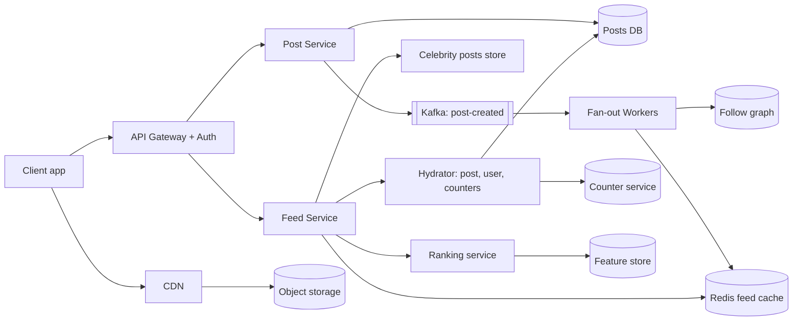

# Q4 · News feed

Oct 16, 2026 · @saurav chaurasiya

**Is doc me:** News feed (Instagram / ShareChat / Moj jaisa) ka poora HLD — fan-out on write vs read vs hybrid, Redis feed cache, ranking pipeline, cursor pagination, media CDN aur likes counters at scale.

**Padhne ka tareeka** — Pehle Sawaal ko khud solve karne ki koshish karo (15 min), phir Sahi design padho. Deep Dive tab ke liye hai jab SDE-2 level ki taiyari karni ho.

---

## Q4 — News feed

News feed woh scrollable list hai jisme user ko un logon ki posts dikhti hain jinhe woh follow karta hai (ya jo platform recommend karta hai), sahi order me. Asli challenge ye hai ki ek post ek se lekar crore followers tak pahunchni chahiye, aur feed khulte hi 200 ms ke andar dikhna chahiye.

### Ye cheez hai kya

- Category: HLD case study (boss level) — read-heavy social system
- Problem: Lakhon posts me se har user ke liye abhi ki best posts ka list kam latency me banana, jab koi celebrity crore followers ke saath ek post kare
- Is lesson ke baad tum ye kar paoge: fan-out strategy choose karna aur justify karna, Redis me feed cache design karna, ranking pipeline samjhana, cursor pagination aur likes counter ka scale-safe design batana
- Analogy: Akhbaar ki agency. Fan-out on write matlab har subscriber ke ghar subah akhbaar pahle se pahunchana (padhna fast, chhapna mehenga). Fan-out on read matlab subscriber khud stall pe jaakar sab akhbaar uthaye (chhapna sasta, padhna slow). Hybrid matlab regular readers ko ghar delivery, aur sirf famous magazine stall pe rakhi jaaye.

### Sawaal

ShareChat / Moj jaisa app design karo. 20 crore (200M) monthly users, 5 crore (50M) daily active users (DAU — roz app kholne wale). Har DAU roz average 8 baar feed kholta hai aur har baar 20 posts load karta hai. Roz 1 crore (10M) nayi posts aati hain (photo, video, text). Average user 200 logon ko follow karta hai, lekin kuch creators ke 2 crore (20M) tak followers hain. Target: feed API ka p99 latency (99% requests is time ke andar — worst-case ke kareeb ka number) 300 ms se kam, aur post karne ke baad followers ko 5 second ke andar dikhna chahiye.

> Pehle khud socho — 15 min. Hints: (1) Celebrity ne post ki to 2 crore feeds me likhna padega — kya ye sahi hai? (2) Feed ko har baar DB join se banayein ya pehle se bana ke rakhein? (3) "Next 20 posts" kaise maangoge jab beech me nayi posts aa rahi hon?

### Problem kyun aata hai

- Read:write ratio bahut zyada hota hai (kareeb 100:1) — log post kam karte hain, scroll bahut karte hain
- Feed ek jagah ka data nahi hai: 200 alag authors ki posts ko merge + rank karna padta hai
- Celebrity problem: ek post = lakhon feeds ka update. Isse **hot key** (ek hi key pe bahut zyada traffic) aur write storm banta hai
- Feed me ranking chahiye (sirf time order nahi), ranking ke liye ML features chahiye, jo latency badhate hain
- Likes / views jaise counters pe ek viral post ko second me lakhon updates milte hain
- Media (video/image) bahut bhaari hota hai — origin server se serve karna impossible hai

### Naive approach

- Pehla khayal: feed ke time pe query karo `SELECT * FROM posts WHERE author_id IN (my 200 followees) ORDER BY created_at DESC LIMIT 20` (ye fan-out on read hai)
- Kahan toot-ta hai:
  - Peak pe 5 crore DAU x 8 opens = 40 crore feed loads/day = average 4,600 QPS (QPS — queries per second), peak \~15,000 QPS. Har query 200 authors ko scan karti hai, yaani \~30 lakh author-lookups/sec
  - 200 shards pe scatter-gather (ek query ko kai shards pe bhej ke jawab jodna) matlab sabse slow shard ka latency milta hai — p99 kharab
  - Pagination `OFFSET 20, 40...` pe DB har baar purane rows skip karta hai, aur nayi post aane se duplicates dikhte hain
  - Alternative naive: sirf fan-out on write — celebrity ki post pe 2 crore Redis writes. 10,000 writes/sec per worker bhi maane to 2,000 second (kareeb 33 min) lagenge. 5 second ka SLA toot gaya

### Sahi design

#### Requirements

- Functional:
  - Post create karna (text, image, video)
  - Follow / unfollow
  - Home feed dekhna (ranked, paginated, infinite scroll)
  - Like, comment, share; like count dikhna
  - Nayi post ka notification / feed me aana (near real-time)
- Non-functional:
  - Feed p99 < 300 ms; post-to-feed delay < 5 sec (normal users), celebrity ke liye 30 sec tak chalega
  - High availability: feed down hone se zyada bura stale feed dikhana kam bura hai, isliye availability > strict consistency (eventual consistency — thodi der me sabko same data dikhe, turant nahi)
  - Scalable to 5 crore DAU, celebrity-safe, media cost-efficient
  - Feed me deleted / blocked content na dikhe (privacy safe)

#### Back-of-envelope estimates

- Feed reads: 5 crore DAU x 8 = 40 crore/day. 40 crore / 86,400 = \~4,600 QPS average, peak 3x = \~15,000 QPS
- Posts: 1 crore/day = \~115 writes/sec average, peak \~400/sec
- Fan-out on write ka load: average 200 followers x 115 = \~23,000 feed-writes/sec average. Celebrity bina hybrid ke: 1 post x 2 crore = 2 crore writes
- Feed cache size: har user ke liye 500 post IDs x 8 bytes = 4 KB. 5 crore active users x 4 KB = 200 GB. Replica ke saath \~600 GB, Redis cluster me aaram se aata hai
- Media: 1 crore posts x 60% media x avg 2 MB (video compress ke baad, multiple resolutions milake) = \~12 TB/day, yaani \~4.4 PB/year. Isliye object storage (S3 jaisa) + CDN zaruri hai
- Likes: maan lo roz 50 crore likes = \~6,000 writes/sec average, viral post pe ek hi key pe 50,000/sec tak

#### API design

- Cursor pagination use hota hai (offset nahi). Base API ke rules ke liye [L0.4 — API design](https://claude.ai/code/artifact/873676ef-93d2-45e6-a1bc-079a3fa419b3) dekho
- Endpoints:
  - `POST /v1/posts` body: text, media\_ids\[\] — returns post\_id
  - `GET /v1/feed?limit=20&cursor=<opaque>` — returns posts\[\], next\_cursor
  - `POST /v1/posts/{id}/like` aur `DELETE /v1/posts/{id}/like` — idempotent (dobara like karne pe count nahi badhta)
  - `POST /v1/users/{id}/follow`
  - `POST /v1/media/upload-url` — client ko signed URL milta hai, media seedha object storage pe jaata hai (app server se nahi)

#### Data model

- Alag-alag store alag kaam ke liye (polyglot persistence — har kaam ke liye sahi database):

| Data | Store | Key / Schema | Kyun |
| --- | --- | --- | --- |
| Posts | Cassandra / DynamoDB jaisa wide-column NoSQL | post\_id (Snowflake ID, time-sortable) -> author\_id, text, media\_urls, created\_at | Simple key lookup, high write rate, easy sharding |
| Follow graph | Sharded MySQL ya graph-ish store | (follower\_id, followee\_id), dono directions ka index | "Mere followees" aur "mere followers" dono query chahiye |
| Feed cache | Redis sorted set | key `feed:{user_id}`, member = post\_id, score = time (ya rank score) | O(log N) insert, range read fast |
| Counters | Redis + periodic DB flush | `likes:{post_id}` | High write rate |
| Like records | Cassandra | (post\_id, user\_id) | Dedup + "kisne like kiya" list |
| Media | Object storage + CDN | `media/{id}/{resolution}` | Bhaari files, cheap storage |

- Redis sorted set ka seedha idea: `ZADD feed:42 <score> <post_id>` se post add, `ZREVRANGEBYSCORE feed:42 <cursor> -inf LIMIT 0 20` se next page, aur `ZREMRANGEBYRANK feed:42 0 -501` se sirf latest 500 rakhna

#### High-level architecture

Neeche diagram me write path (post -> fan-out) aur read path (feed -> rank -> response) dono dikhaye hain.

Write path ke steps:

1. Client media pehle signed URL se object storage me upload karta hai, transcoding job alag chalti hai (multiple resolutions banti hain)
2. Client `POST /posts` bhejta hai; Post Service post DB me likhta hai aur Kafka topic `post-created` pe event daalta hai (Kafka ke liye [1E · Kafka River](https://claude.ai/code/artifact/eeb39ee8-3f52-4c04-b57b-68213f02c429) dekho)
3. Fan-out worker follower list padhta hai. Agar author **normal** hai (followers < \~10,000), to har follower ke `feed:{id}` sorted set me post\_id ZADD karta hai
4. Agar author **celebrity** hai, to fan-out skip hota hai; post sirf celebrity-posts store me rehti hai

Read path ke steps:

1. Feed Service Redis se user ka precomputed feed (post IDs) padhta hai
2. User ke followed celebrities ki latest posts celebrity store se nikalta hai aur merge karta hai (ye hi hybrid hai)
3. Candidates (\~200-500 IDs) Ranking service ko jaate hain, jo model se score karke top 20 chunta hai
4. Hydrator post content, author profile, like counts parallel me laata hai; deleted / blocked filter hota hai
5. Response me `next_cursor` jaata hai; media URLs CDN ke hote hain

### Kya choose karein aur kyun

Fan-out strategy ka comparison:

| Option | Kab use karo | Kab mat karo |
| --- | --- | --- |
| Fan-out on write (push) | Zyadatar users ke followers kam hon, feed read bahut fast chahiye | Celebrity accounts, inactive users ki bhi feed banana waste hai |
| Fan-out on read (pull) | Followers bahut zyada hon, ya user bahut kam active ho | Har read pe 200 authors merge — latency aur DB load zyada |
| Hybrid (push + pull for celebrities) | Real product: normal authors push, celebrity pull-at-read | Chhota app jahan sab users ke followers kam hon (extra complexity ka fayda nahi) |

Pagination ka comparison:

| Option | Kab use karo | Kab mat karo |
| --- | --- | --- |
| Offset / page number | Static, chhoti lists (admin tables) | Feed — nayi posts aane se duplicates, aur deep offset slow |
| Cursor (last seen score/ID) | Infinite scroll feed, stable results | Jab user ko "page 50 pe jao" chahiye |
| Snapshot token (feed ka frozen copy) | Ranked feed jahan order bar-bar badal sakta hai | Storage bachana ho to; snapshot ka TTL (time to live — kitni der baad expire) rakhna padta hai |

Likes counter ka comparison:

| Option | Kab use karo | Kab mat karo |
| --- | --- | --- |
| DB row pe `UPDATE count = count + 1` | Chhota traffic | Viral post — ek row pe lock contention |
| Redis INCR + async flush to DB | Zyadatar apps; fast, approximate chalta hai | Jab exact audit-grade count chahiye (payments jaisa) |
| Sharded counters (ek post ke N sub-counters) | Ek post pe 50k+ writes/sec | Chhote posts — read pe sum karna extra kaam hai |

### India me kaise hota hai

- ShareChat / Moj ne apna ML feature store (ranking ke liye user/post features ka store) ScyllaDB pe banaya, aur bataya ki kaise 1000x scale kiya bina database scale kiye: [How ShareChat Scaled their ML Feature Store 1000X without Scaling the Database](https://scylladb.medium.com/how-sharechat-scaled-their-ml-feature-store-1000x-without-scaling-the-database-68a32ac0d144)
- Real-time feature platform banane ki mushkilein (ShareChat ka InfoQ talk): [The Harsh Reality of Building a Real-Time ML Feature Platform](https://www.infoq.com/presentations/sharechat/)
- ShareChat ka infrastructure ka safar (monolith se microservices tak): [ShareChat Infrastructure: Past, Present & Future](https://sharechat.com/blogs/engineering/sharechat-infrastructure-past-present-and-future)
- Moj ko sirf 30 ghante me launch kiya gaya tha (TikTok ban ke baad), isse dikhta hai ki short-video feed ko jaldi scale karna pada: [30 Hours - The launch of Moj](https://sharechat.com/blogs/product/30-hours-the-launch-of-moj)
- Bharat ke context me khaas baatein: kam bandwidth wale phones, isliye video ko multiple low bitrates me transcode karna, aur regional language ke hisaab se ranking (Hindi, Tamil, Bhojpuri etc.)

### Interview follow-ups

- **Celebrity ki post pe kya karoge?** — Fan-out skip karo. Followers ke feed read ke time pe celebrity store se uski latest posts merge karo (hybrid). Threshold followers count se rakho, jaise 10,000.
- **Cursor kaisa banaoge?** — Opaque token jisme last item ka (score, post\_id) ho, base64 me. Server next query me "score se chhota" maangta hai. Isse nayi posts aane se duplicates nahi aate. Offset nahi use karte.
- **User ne unfollow ya delete kiya to feed me purani post dikhegi?** — Read time pe filter karo: hydrator har post ka status (deleted, blocked, privacy) check karta hai. Cache se turant hatana zaruri nahi, lazy cleanup chalta hai.
- **Likes counter exact hona chahiye?** — Nahi, eventual chalega. Redis INCR se turant dikhao, Kafka ke through DB me batch flush karo. Dedup ke liye (post\_id, user\_id) record alag rakho taaki double-like na ho.
- **Redis crash ho gaya to feed kaise banegi?** — Cache miss pe fallback: followees ki recent posts DB se pull karke feed rebuild karo (cold-start), aur rebuild ko rate limit karo taaki thundering herd (ek saath bahut saare requests DB pe) na ho.
- **Inactive user ka feed pre-compute karna waste hai, kya karein?** — Sirf active users (pichle 7 din me aaye) ki feed cache me push karo. Inactive user lautta hai to pehli baar pull se banao.
- **New post kitni jaldi dikhegi?** — Normal user ki post Kafka -> worker -> Redis me 1-2 second me. Celebrity ki post read-time merge ki wajah se turant dikhti hai, bas feed refresh karna padta hai.

### Self-check

1. Fan-out on write aur fan-out on read me kya fark hai, aur dono ka ek-ek nuksan batao.
2. Hybrid approach me celebrity ki post follower tak kaise pahunchti hai?
3. Feed ko Redis sorted set me kyun rakhte hain, aur score kya hota hai?
4. Offset pagination feed me kyun galat hai, cursor kya fix karta hai?
5. Viral post pe likes counter ek DB row pe kyun fail hota hai aur uska fix kya hai?

### Notebook

Read:write \~ 100:1 · Fan-out on write = fast read, celebrity pe write storm · Hybrid: normal push, celebrity pull-at-read (threshold \~10k followers) · Feed cache = Redis ZSET, latest \~500 post IDs per active user · Cursor = (score, post\_id), offset nahi · Likes = Redis INCR + async flush, sharded counters for viral posts · Media = signed URL upload + transcoding + CDN

### Padhne ke liye

- [Scaling the Instagram Explore recommendations system - Engineering at Meta](https://engineering.fb.com/2023/08/09/ml-applications/scaling-instagram-explore-recommendations-system/)
- [How ShareChat Scaled their ML Feature Store 1000X without Scaling the Database](https://scylladb.medium.com/how-sharechat-scaled-their-ml-feature-store-1000x-without-scaling-the-database-68a32ac0d144)
- [Instagram System Design: architecture for two billion users](https://grokkingthesystemdesign.com/guides/instagram-system-design/)
- [The Engineering behind Instagram's Recommendation Algorithm (Quastor)](https://blog.quastor.org/p/engineering-behind-instagrams-recommendation-algorithm-dc9c)

### Deep Dive (SDE-2) — jab time ho

#### Ranking pipeline (high level)

- Do-teen stages: candidate generation (hazaaron posts se \~500 chuno: followees ki posts, trending, recommended), light ranking (sasta model, 500 se 100), heavy ranking (bada ML model, 100 se top 20)
- Model predict karta hai: like, comment, share, watch-time ki probability; final score in sabka weighted combination hota hai
- Features do tarah ke: offline (user ki purani aadatein, batch me banti hain) aur real-time (abhi ke session ke clicks). Dono feature store se aate hain (ShareChat me ScyllaDB)
- Re-ranking: diversity (ek hi author ki 5 posts lagatar nahi), freshness boost, aur policy filters (abuse, NSFW)
- Latency budget: ranking ko \~100 ms ke andar rakhna padta hai, isliye model ko cache / pre-computed embeddings pe chalate hain

#### Cursor pagination aur feed stability

- Ranked feed me score badalta rehta hai, isliye cursor me sirf score kaafi nahi; "feed session id" + position ya snapshot token use hota hai
- Page 1 ke baad ke items ko session ke dauran seen-set (Bloom filter ya Redis set) me rakho taaki dobara na dikhein
- Base concept: [L0.4 — API pagination](https://claude.ai/code/artifact/873676ef-93d2-45e6-a1bc-079a3fa419b3)

#### Counters at scale

- Sharded counter: `likes:{post}:{0..N-1}`, write random shard pe, read pe sum. Hot key problem Redis ke ek node pe nahi padti
- Write batching: app server memory me 1 sec ke increments jod ke ek baar Redis ko bhejta hai
- Durable truth Cassandra ke like records me; Redis counter ko periodically reconcile karo taaki drift na rahe
- Cache patterns aur eviction ke liye [1B · Cache Caves](https://claude.ai/code/artifact/32bb1c8e-3433-417c-a3f4-3a34babed6bf) dekho

#### Media pipeline aur CDN

- Upload -> object storage -> Kafka event -> transcoder (240p / 480p / 720p, HLS segments) -> thumbnails -> CDN
- CDN (Content Delivery Network — user ke paas ke edge server se content dena) hot videos cache karta hai; long tail purane videos origin se aate hain
- Adaptive bitrate: network slow ho to player apne aap low quality pe chala jaata hai, Bharat ke 4G / 2G users ke liye zaruri
- Cost control: purani, kam dekhi gayi media ko cold storage tier me daalo

#### Failure modes

- Fan-out worker lag: Kafka consumer lag pe alert, aur autoscale. Lag me bhi feed purani chalti rahe (availability)
- Celebrity read-merge slow ho to usko timeout karke baaki feed dikhao (graceful degradation)
- Redis node fail: replica promote, aur cache miss pe rate-limited rebuild

---

## Aage kya

- Pichhla: [Q3 · WhatsApp](https://claude.ai/code/artifact/afdc46d5-c1c6-4389-a859-90728ddd8c7b)
- Agla: [Q5 · Uber / Ola](https://claude.ai/code/artifact/1ec4db1c-b889-4ec9-8236-dcf6379db14b)
- Related: [1B · Cache Caves](https://claude.ai/code/artifact/32bb1c8e-3433-417c-a3f4-3a34babed6bf) (Redis, cache patterns), [1E · Kafka River](https://claude.ai/code/artifact/eeb39ee8-3f52-4c04-b57b-68213f02c429) (fan-out events), [Part 0 · Base Camp](https://claude.ai/code/artifact/873676ef-93d2-45e6-a1bc-079a3fa419b3) (L0.4 API pagination)
