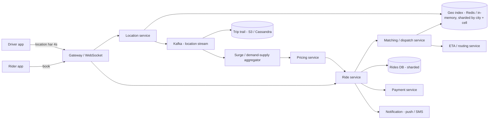
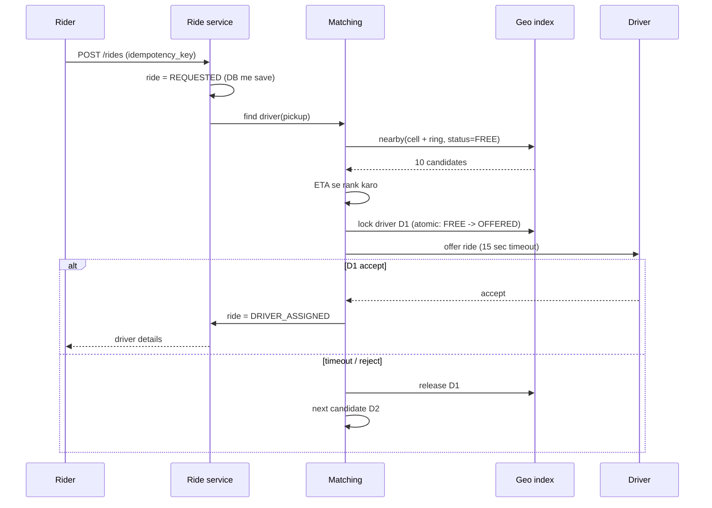
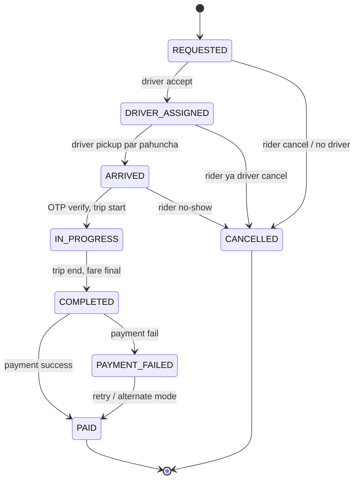

# Q5 · Uber / Ola

Oct 16, 2026 · @saurav chaurasiya

**Is doc me:** ride-hailing system (Uber / Ola) ka poora HLD — driver location updates, geospatial index, nearby driver search, matching, ride state machine, surge, ETA, payment.

**Padhne ka tareeka** — pehle Sawaal ko 15 min khud solve karo, phir Sahi design dekho. Deep Dive tab padho jab basics pakke ho jayein.

---

## Q5 — Uber / Ola

Ride-hailing system ek marketplace hai jo riders ko nearby drivers se match karta hai. Iska core challenge hai lakhon moving drivers ki location ko real time me store karna aur "mere paas kaun hai" query ko milliseconds me answer karna.

### Ye cheez hai kya

- Category: real-time geospatial marketplace (location-heavy, write-heavy system)
- Problem: rider ko 2-3 second me sabse sahi nearby driver dena, jab driver har 4 second me hil raha ho
- Is lesson ke baad tum: geohash / H3 / quadtree me se index choose kar paoge, location write volume estimate kar paoge, matching + ride state machine + surge ka high-level design bana paoge
- Analogy: ye ek bade railway station ke announcement board jaisa hai. Har coolie (driver) apni jagah batata rehta hai, aur jab yatri (rider) aata hai to board dekhkar sabse paas wala coolie bheja jata hai. Board hamesha taaza rehna chahiye, purani jagah wala coolie bhejna galat hai.

### Sawaal

Ola jaisi app design karo jo India ke 100+ cities me chalti hai. Peak par Bengaluru me 1 lakh drivers online hain aur poore India me 5 lakh. Har driver app har 4 second me GPS location bhejta hai. Peak par poore India me 150 ride requests per second aate hain. Rider "Book" dabaye to 3 second ke andar driver assign hona chahiye. Rider ko map par driver ki live location dikhni chahiye. Trip ke end par fare calculate hoke UPI / wallet / cash se payment hoti hai.

> Pehle khud socho — 15 min. Hints: (1) 5 lakh drivers x har 4 sec = kitni writes per second, aur kya ye disk pe likhni zaroori hain? (2) "10 km ke andar ke drivers" ko har baar poori table scan kiye bina kaise dhundhoge? (3) do riders ko ek hi driver mil gaya to kya hoga?

### Problem kyun aata hai

- Location data bahut tezi se purana hota hai. 10 second purani location ka matlab driver 100 meter aage ja chuka hai.
- Write volume bahut zyada hai, lekin read query (nearby search) bhi latency-sensitive hai.
- Normal B-tree index latitude aur longitude ki 2D range query ke liye acha nahi hai. Ek column par sort karte hain to dusra column scatter ho jata hai.
- Matching me race condition hai: ek driver ko do riders ek saath request kar sakte hain.
- Sheher ka demand uneven hai: shaam 6 baje Connaught Place ya Koramangala me demand 10x ho jata hai (hot spot).
- Trip ek multi-step process hai (request, accept, arrive, start, end, pay). Beech me app crash ho sakti hai, to state durable chahiye.

### Naive approach

- Ek `drivers(id, lat, lng, status)` SQL table. Har 4 sec me `UPDATE drivers SET lat=?, lng=?`. Nearby search: `WHERE lat BETWEEN ? AND ? AND lng BETWEEN ? AND ?`.
- Kahan toot-ta hai:
  - 5 lakh drivers / 4 sec = **125,000 writes/sec**. Ek MySQL / Postgres node lagbhag 5-10K writes/sec par ruk jata hai, aur har UPDATE WAL (write-ahead log — crash recovery ke liye likha jane wala log) aur index dono ko dirty karta hai.
  - Lat/lng par do alag B-tree index ek 2D box query ke liye achhe nahi hain. Latitude range me hazaron rows aati hain, phir longitude se filter hoti hain. Query 100 ms se upar chali jati hai.
  - Location history ki jarurat nahi hoti live search ke liye, par naive design har update disk par permanent likhta hai. Storage aur I/O waste.
  - Matching me `SELECT ... WHERE status='free' LIMIT 1` ke baad `UPDATE status='busy'` do alag steps hain. Do requests ek hi driver ko utha lenge (double assignment).

### Sahi design

#### Requirements

- **Functional:**
  - Driver online / offline ho sake aur location bheje.
  - Rider pickup + drop daale, fare estimate dekhe, ride book kare.
  - Nearby available drivers ka match ho, driver accept / reject kare.
  - Rider live driver location dekhe.
  - Trip start / end, fare calculate, payment.
  - Surge pricing demand ke hisaab se.
- **Non-functional:**
  - Match latency p99 (99% requests is time ke andar) < 3 sec.
  - Location update ingest 125K/sec sustain kare.
  - High availability: dispatch down ho to company ka revenue ruk jata hai.
  - Ek driver ek time par ek hi ride par (strong consistency matching ke liye).
  - Location eventually consistent chalegi (eventual consistency — thodi der me sabko same value dikhegi). 4-5 sec purani location acceptable hai.

#### Back-of-envelope estimates

- Drivers online peak: 5 lakh (India), Bengaluru 1 lakh.
- Location writes: 500,000 / 4 = **125,000 writes/sec** (QPS — queries per second).
- Payload: driver\_id (8 B) + lat/lng (16 B) + timestamp + status + heading \~ 50-100 B. 125K x 100 B = **12.5 MB/sec** ingest. Ye network ke liye chhota hai.
- Live index memory: 5 lakh x 100 B = **50 MB**. Poora India ka live index ek machine ki RAM me aa jata hai. Hum sharding (data ko alag machines me baantna) throughput aur availability ke liye karte hain, size ke liye nahi.
- Ride requests: 150/sec peak. Har request par nearby search \~ 1 geo query + 3-10 candidate evaluation = \~ 1500 reads/sec. Ye location writes se bahut kam hai.
- Rides per day: \~ 30 lakh. Har ride ka record \~ 2 KB = 6 GB/day. Trip history ke liye durable DB chahiye.
- Trip ke dauran GPS trail (route) store: 4 sec x 20 min = 300 points x 50 B = 15 KB per ride. 30 lakh rides = \~ 45 GB/day. Ye cold storage (S3 / object store) me jata hai.
- Rider ko live driver dikhana: 2 lakh active trips x har 4 sec push = 50K pushes/sec WebSocket par.

#### API design

```text
POST /v1/drivers/me/location        { lat, lng, heading, speed, ts }     -> 204   (driver app, har 4 sec)
POST /v1/drivers/me/status          { status: ONLINE | OFFLINE }
GET  /v1/fare/estimate?pickup=..&drop=..                                  -> { fare, surge_multiplier, eta }
POST /v1/rides                      { pickup, drop, vehicle_type, idempotency_key } -> { ride_id, state: REQUESTED }
POST /v1/rides/{id}/accept          (driver)    -> 200 / 409 (kisi aur ne le liya)
POST /v1/rides/{id}/start | /end    (driver, OTP start par)
GET  /v1/rides/{id}                 -> state + driver location
WS   /v1/rides/{id}/stream          live driver location push
```

- `idempotency_key` ([2A · Idempotency Island](https://claude.ai/code/artifact/c269ac61-440b-4525-bd04-31baf708dece) dekho): rider ka phone retry kare to do rides na bane.

#### Data model

| Store | Data | Kyun |
| --- | --- | --- |
| In-memory geo index (Redis / custom service) | driver\_id, cell\_id, lat, lng, status, ts | Tez write, tez nearby query, TTL se purane drivers khud hat jate hain |
| Rides DB (MySQL / Postgres, shard by city or ride\_id) | ride\_id, rider\_id, driver\_id, state, pickup, drop, fare, timestamps | Durable, transactional state |
| Trip location trail (Kafka then S3 / Cassandra) | ride\_id, \[(lat, lng, ts)\] | Dispute, fare audit, ML. Append-only |
| Payments / ledger | trip\_id, amount, mode, status | [2B · Ledger Library](https://claude.ai/code/artifact/a7c567e0-66cb-46fe-b7c9-9c20739857eb) wala double-entry |

#### Geospatial index: cell me baanto

Idea: duniya ko chhote cells me baanto. Har driver ek cell me hota hai. "Nearby" ka matlab rider ke cell + padosi cells.

| Option | Kya hai | Kab use karo | Kab mat karo |
| --- | --- | --- | --- |
| Geohash | Lat/lng ko base32 string me badalta hai. Lambi common prefix = paas ke log. Redis GEO bhi iska 52-bit variant use karta hai | Simple, Redis ke saath turant chalta hai, interview ke liye easy | Cell ke edge par do paas ke points ke prefix alag ho sakte hain, to padosi cells bhi dekhne padte hain. Cells rectangle hain, distance non-uniform |
| H3 (Uber ka hexagon grid) | Duniya hexagons me, 16 resolutions. Har hexagon ke 6 barabar-doori wale padosi | Uber khud use karta hai. Surge zones aur nearby ring search (`gridDisk`) dono acche | Library chahiye, geohash jitna "string prefix" wala trick nahi |
| S2 (Google) | Sphere ko cube ke faces par, Hilbert curve se 64-bit cell id | Range scan DB me, bahut precise, Google Maps ecosystem | Concept samajhna thoda bhari, hexagon jaisa uniform neighbor nahi |
| Quadtree | Jis area me zyada drivers, wahan cell ko 4 me todte jao | Density adaptive. Bangalore centre me chhote cells, highway par bade | Tree ko live update (har 4 sec) karna mehnga, rebalancing complex. Static data ke liye behtar, moving data ke liye kam |

- Practical jawab: **H3 ya geohash, resolution aise ki cell \~ 1 km ho**. Interview me bol do ki Redis GEO se shuru karenge, scale par H3 par jayenge.
- Update flow: driver ka naya `cell_id` nikalo. Purana cell se hata, naye cell me daalo. Agar cell wahi hai to sirf timestamp update.
- Query flow: rider ka cell + `k=1` ring (6 padosi) = 7 cells. Un cells ke drivers lo. Kam mile to ring `k=2` badhao. Phir exact distance se sort karo.

#### High-level architecture



#### Matching / dispatch flow



Steps:

1. Ride request aate hi DB me `REQUESTED` state ke saath save hoti hai (durable).
2. Matching service pickup ke 7 cells se `FREE` drivers lati hai, ETA (road distance se, seedhi line se nahi) se rank karti hai.
3. Top driver ko **atomic** `FREE -> OFFERED` karo. Redis me Lua script ya `SET driver:D1 offered NX` jaisa compare-and-set. Isse double assignment nahi hota ([2D · Lock Fort](https://claude.ai/code/artifact/97588686-7110-4318-8124-3a8727c7604e) ka pattern).
4. Driver ko 10-15 sec offer. Reject / timeout par driver wapas `FREE` aur agla candidate.
5. Accept par ride `DRIVER_ASSIGNED`. Rider ko push + live location stream shuru.
6. 2-3 retries ke baad radius badhao. Fir bhi nahi mila to "no drivers" batao.

#### Ride state machine



- Har transition DB me **conditional update** se hoti hai: `UPDATE rides SET state='ARRIVED' WHERE id=? AND state='DRIVER_ASSIGNED'`. Affected rows 0 hon to illegal transition. Details: [2C · Saga Sea](https://claude.ai/code/artifact/429b3ea6-a261-431d-a384-a0c6eb68a9f6) (state machines).
- Har transition par event Kafka me jata hai (outbox pattern — DB write aur event ek saath reliable). Notification, analytics, payment isko sunte hain.
- Illegal transitions (`COMPLETED -> IN_PROGRESS`) allowed nahi.

#### Surge pricing (high level)

- Har H3 cell (ya cell group) me har 1-2 min me **demand** (ride requests + app opens) aur **supply** (free drivers) gino.
- Ratio `demand / supply` ko ek multiplier me map karo (1.0x, 1.2x, 1.5x ... cap 2-3x). Jhatke se bachne ke liye smoothing (moving average) lagao.
- Fare estimate dikhate time multiplier ko **lock** kar do ride ke liye, warna rider ko book dabate hi price badal sakta hai.
- Surge ek stream-processing job hai (Kafka se Flink / Spark Streaming), result Redis me cell -> multiplier.
- India me regulation ka dhyan: kai states surge cap lagate hain (base fare ka limit). Cap config se rakho, hardcode nahi.

#### ETA

- Seedhi line distance galat hai. Road graph par shortest path (Dijkstra / A\* with contraction hierarchies) + live traffic speeds.
- Matching ke liye pehle seedhi distance se top 10 shortlist, phir sirf unke liye road ETA nikalo. Sab drivers par routing engine chalana mehnga hai.
- ETA ek alag service hai, cache karo (cell-to-cell ETA, 1-2 min TTL).
- Fare estimate = base + per km x distance + per min x ETA, surge multiplier ke saath.

#### Payment at trip end

- `COMPLETED` par final fare = actual distance + time + tolls + surge (jo lock tha). Payment service ko event jata hai.
- Rider ka default mode (UPI / wallet / card / cash) par charge. **Idempotency key = ride\_id** taaki retry par double charge na ho ([2A · Idempotency Island](https://claude.ai/code/artifact/c269ac61-440b-4525-bd04-31baf708dece)).
- Fail hone par `PAYMENT_FAILED`, rider ko dusra mode try karne do, next ride block kar do jab tak due clear na ho.
- Driver ka payout ledger me credit hota hai, platform commission kat kar ([2B · Ledger Library](https://claude.ai/code/artifact/a7c567e0-66cb-46fe-b7c9-9c20739857eb)). Settlement T+1 batch me.

### Kya choose karein aur kyun

| Option | Kab use karo | Kab mat karo |
| --- | --- | --- |
| Redis GEO / sorted set (geohash) | Shuruaat, ek city ya kam traffic, jaldi ship karna hai | Jab custom filtering (vehicle type, rating) aur multi-key atomic ops bahut ho jayein |
| H3 cells + Redis sets (cell -> drivers) | Scale par, surge zones bhi usi grid par chahiye | Jab team ko hexagon library ka experience na ho aur deadline tight ho |
| In-memory custom service (ringpop jaisa, city se shard) | Bahut high write rate, DB round trip bachana hai | Chhoti team, operations ka bojh na utha sako |
| Quadtree | Static ya kam badalne wale points (restaurants, ATMs) | Har 4 sec me hilte drivers |
| SQL + PostGIS | Historical queries, analytics, kam QPS | Live nearby search 125K writes/sec par |

### India me kaise hota hai

- **Uber** apna grid H3 open-source kar chuka hai aur demand / supply ke liye use karta hai. Dispatch (DISCO) location ko memory me rakhta hai aur sheher / region ke hisaab se shard karta hai. Padho: [H3 blog](https://www.uber.com/us/en/blog/h3/) aur [How Uber scales their real-time market platform](https://highscalability.com/how-uber-scales-their-real-time-market-platform/).
- **Ola, Rapido, Namma Yatri** ke exact internals public nahi hain. Jo cheezein India ke liye alag hain: auto-rickshaw aur bike taxi (kam fare, zyada volume), cash payment ka bada hissa, 2G / 3G patchy network (isliye location update batch + retry), aur UPI payment at drop.
- Namma Yatri open-network (ONDC / Beckn protocol) par chalta hai, jahan matching network ke alag participants karte hain. Interview me ye bata do ki "ek hi company marketplace" ke alawa open-network model bhi hai.
- Driver ki battery aur data cost: har 4 sec update bhejna mehnga hai. Practical me jab driver idle ho to 10 sec, trip me 3-4 sec adaptive rakhte hain.

### Interview follow-ups

- **Geohash ke edge par problem kaise handle karoge?** — Rider ke cell ke saath uske 8 padosi cells bhi query karo. H3 me `gridDisk(k=1)` ye khud deta hai.
- **Ek hi driver do riders ko mil gaya to?** — Matching me `FREE -> OFFERED` atomic compare-and-set (Redis Lua / DB conditional update). Jo jeeta usko driver, doosre ko next candidate. Lock par TTL rakho taaki crash par driver atka na rahe.
- **Hot area (stadium ke bahar match ke baad) ka kya?** — Cell shard ho jata hai. Ek city ke andar ek hi cell par bahut load aaye to us cell ko finer resolution me todo ya cell -> multiple shard (sub-cells) me baanto. Hot key ka matlab: ek hi key par bahut zyada traffic.
- **Driver ka phone offline ho gaya to?** — Index me har entry ka TTL (\~ 15-20 sec). Update na aaye to entry khud expire, driver matching se hat jata hai.
- **Location DB me kyun nahi likhte?** — Live position sirf current value hai, purani value bekaar. Memory me overwrite. History sirf trip ke dauran Kafka -> object store me.
- **Surge me fairness / sudden jump kaise rokoge?** — Smoothing, multiplier cap, aur price lock estimate ke waqt. Regulatory cap config me.
- **Region down ho jaye?** — Rides DB replicated hai, geo index ephemeral hai aur 20 sec me drivers ke updates se khud rebuild ho jata hai. Isliye index ke liye sync replication ki zarurat nahi.

### Self-check

1. 5 lakh drivers har 4 sec update bhejein to writes per second kitni? Live index kitni memory leta hai?
2. Geohash aur H3 me do farq batao. Quadtree moving drivers ke liye kyun kam suit karta hai?
3. Double assignment kaise rokte ho? Kaunsa lock lagaoge aur uska TTL kyun zaroori hai?
4. Ride state machine ke 6 states likho aur ek illegal transition batao.
5. Payment retry par double charge kaise rokoge?

### Notebook

125K location writes/sec (5 lakh drivers / 4 sec) · live index sirf \~ 50 MB, RAM me · cell \~ 1 km, rider ke cell + ring se nearby · FREE -> OFFERED atomic compare-and-set se double assignment roko · ride state DB me conditional update, location Redis me TTL ke saath · surge = demand / supply per cell, smoothing + cap + price lock · payment idempotency key = ride\_id

### Padhne ke liye

- [H3: Uber's Hexagonal Hierarchical Spatial Index](https://www.uber.com/us/en/blog/h3/)
- [How Uber Scales Their Real-time Market Platform (High Scalability)](https://highscalability.com/how-uber-scales-their-real-time-market-platform/)
- [Ride-Hailing Dispatch Algorithm: Uber DISCO and Grab DispatchGym (DEV)](https://dev.to/vesviet/system-design-ride-hailing-dispatch-algorithm-how-uber-disco-grab-dispatchgym-match-drivers-pp4)

### Deep Dive (SDE-2) — jab time ho

#### Matching: greedy vs batch

- Greedy: har request par turant sabse paas wala driver. Simple, lekin globally suboptimal. Ek rider ko paas wala mila to doosre rider ko door wala milega.
- Batch matching: 2-5 sec ki window me saare requests aur free drivers ikatthe karo, bipartite matching (Hungarian algorithm ya heuristic) se total pickup time minimum karo. Thoda wait, par overall behtar.
- Interview me bolo: pehle greedy, phir "batch window se improve kar sakte hain".

#### Sharding the geo index

- City se shard (Bengaluru ek shard group). Ek city bahut bada ho to cell ke H3 parent id se consistent hashing ([1D · Shard Mountains](https://claude.ai/code/artifact/cfe905e6-6370-43e0-a337-764eeb9ddf1e)).
- Border cells par dikkat: rider shard A me, driver shard B me. Query dono shards me bhejo (scatter-gather) sirf border cells ke liye.
- Stateless matching nodes + stateful index nodes alag rakho taaki matching scale ho sake bina index move kiye.

#### Location ingestion pipeline

- Driver app WebSocket / MQTT par update bhejti hai, gateway batch karke Kafka partition (driver\_id se hash) me daalta hai.
- Ek consumer group index update karta hai (latest wins, purane timestamp ignore), doosra trip trail likhta hai. Ordering per driver ek partition me hi chahiye.
- Backpressure (consumer slow ho to producer ko dheema karna): index updates drop kiye ja sakte hain (latest value hi kaam ki), trail ke liye Kafka buffer karta hai.

#### Failure aur fraud

- GPS spoofing: impossible speed (200 km/h shehar me) ya jump detect karo, flag karo.
- Matching service crash: `OFFERED` entries TTL se free ho jati hain. Ride DB me `REQUESTED` rides ek sweeper job dobara dispatch karta hai.
- Payment ledger me trip ka final amount aur driver payout ka reconciliation ([2F · Recon Ruins](https://claude.ai/code/artifact/93d00bdd-f45f-441f-946c-c84355b5c05e)).
- LLD ke liye is design ka object model: [D21 · Cab booking](https://claude.ai/code/artifact/9852f8a2-78bb-4da6-9b22-e1c8c4d8ac99).

---

## Aage kya

- Pichhla: [Q4 · News feed](https://claude.ai/code/artifact/c5d0201a-ebbf-45de-a0f2-cbed51153ed8)
- Agla: [Q6 · Swiggy / Blinkit](https://claude.ai/code/artifact/c2b42992-bec2-42ee-a468-476a1f8a3173) (usme bhi nearby delivery partner matching hai, yahi geo index kaam aayega)
- Related: [1D · Shard Mountains](https://claude.ai/code/artifact/cfe905e6-6370-43e0-a337-764eeb9ddf1e) (geo shards), [2C · Saga Sea](https://claude.ai/code/artifact/429b3ea6-a261-431d-a384-a0c6eb68a9f6) (ride state machine), [2D · Lock Fort](https://claude.ai/code/artifact/97588686-7110-4318-8124-3a8727c7604e) (driver double-assignment)
- LLD twin: [D21 · Cab booking](https://claude.ai/code/artifact/9852f8a2-78bb-4da6-9b22-e1c8c4d8ac99)
