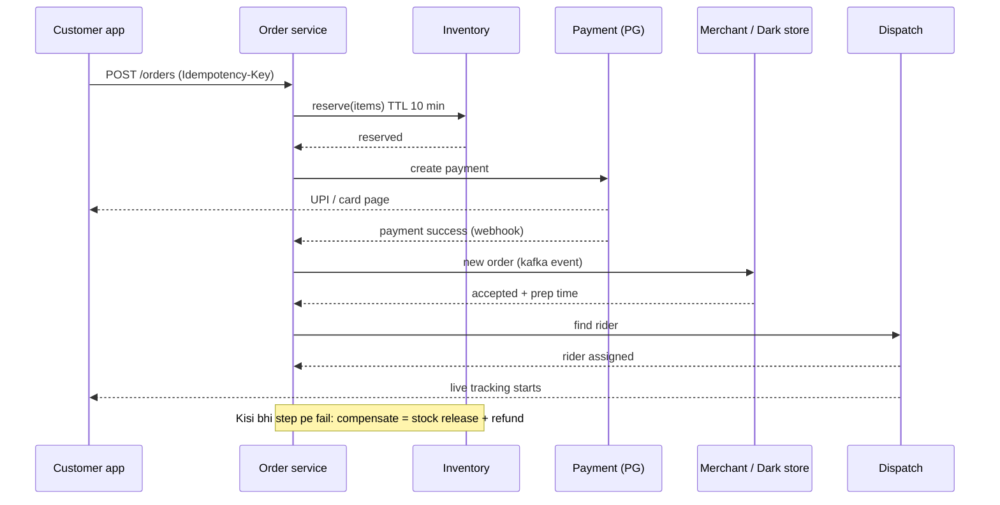
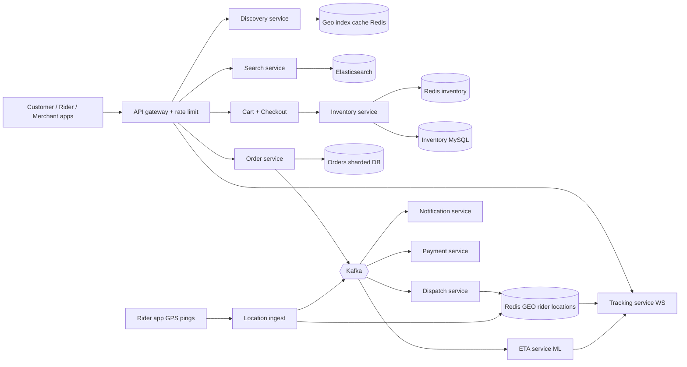

# Q6 · Swiggy / Blinkit

Oct 16, 2026 · @saurav chaurasiya

**Is doc me:** food delivery + 10-minute quick commerce ka poora HLD — location discovery, menu/catalog search, dark store inventory (overselling prevention), order orchestration, rider assignment, live tracking, ETA, peak load aur payments.

**Padhne ka tareeka** — pehle Sawaal pe 15 min khud socho, phir Sahi design padho. Deep Dive tab kholo jab basics pakke ho jayein.

---

## Q6 — Swiggy / Blinkit

Swiggy (food) aur Blinkit (quick commerce — 10 minute me grocery) ek **three-sided marketplace** hai: customer, merchant (restaurant ya dark store) aur delivery partner (rider). Dark store matlab ek chhota warehouse jo sirf online orders ke liye hota hai, kisi mohalle ke andar. System ka kaam hai teeno ko real time me match karna, jahan ek galat step (stock khatam, rider nahi mila) seedha customer ka bharosa tod deta hai.

### Ye cheez hai kya

- Category: geo-spatial (location based) + inventory + marketplace matching ka combined HLD problem.
- Kis problem ke liye: "mere paas ke open restaurants/stores dikhao, jo cheez dikhao wo sach me available ho, order lo, rider bhejo, live track karo, 10-30 min me deliver karo."
- Is lesson ke baad tum kar paoge: location se store discovery design karna, dark store me overselling rokna, order ko saga se orchestrate karna, rider assignment aur live tracking ka pipeline banana, aur IPL final night ka spike handle karna.
- Analogy: tiffin service jaisa socho — customer order deta hai, rasoi (restaurant/dark store) khana tayar karti hai, delivery wala dabba uthata hai. Bas ye sab lakhon tiffins ek saath, ek ghante ke andar.

### Sawaal

Tum Swiggy + Instamart / Blinkit ka backend design kar rahe ho. Numbers:

- 3 crore monthly active users, daily 20 lakh+ orders average, IPL final night pe 3x spike (peak \~ 1,500 orders per second at checkout).
- 2 lakh restaurants, 1,500 dark stores, har dark store me \~ 8,000 SKU (stock keeping unit — ek unique product variant, jaise "Amul Milk 500ml").
- 3 lakh active riders, har rider ka GPS ping 5 second me ek baar.
- Home screen load p99 (99% requests is time ke andar) < 300 ms. Search < 200 ms. Order place hone ke baad rider assign 30 second ke andar.
- Quick commerce promise: 10 minute delivery, to stock galat dikhana = promise tutna.

> Pehle khud socho — 15 min. Hints: (1) "mere paas ke stores" kaise nikalenge bina saare stores scan kiye? (2) 5 log ek saath last 1 packet bread order karein to kaun jeetega? (3) 3 lakh riders ke GPS pings (60,000 writes/sec) kahan jayenge?

### Problem kyun aata hai

- Sab kuch location pe depend karta hai: jo store 8 km door hai wo 10-minute promise nahi nibha sakta, to discovery me distance filter hard constraint hai.
- Inventory chhoti aur tezi se badalti hai: dark store me 3 packet bachay hain aur 20 log ek saath dekh rahe hain.
- Teen parties (customer, merchant, rider) ka state alag services me hai, to ek order ko end to end consistent rakhna distributed transaction ka problem hai.
- Demand bursty hai: IPL final ke toss ke baad 2 minute me orders 3x. Merchant aur riders ki supply fixed rehti hai.
- Rider ka location har 5 sec me aata hai, ye write-heavy firehose hai.

### Naive approach

- Ek monolith + ek MySQL. `SELECT * FROM stores WHERE distance(lat, lng, ?, ?) < 3` har home screen pe. Stock ek `quantity` column me, checkout pe `quantity = quantity - 1`.
- Kahan tutta hai:
  - Distance query har store ke liye haversine (earth pe do points ke beech ki doori ka formula) compute karti hai: 2 lakh rows x 50,000 home loads per second = full table scan ka mela, DB ghutne tek dega.
  - Agar tum pehle `SELECT quantity` karo, phir `UPDATE`, to race condition: dono ne 1 dekha, dono ne becha, stock -1. Overselling.
  - Rider GPS seedha MySQL me: 60,000 writes/sec ek B-tree index pe, DB der se pehle mar jayega.
  - Payment, restaurant accept aur rider assign ek hi DB transaction me rakhoge to teeno external systems ka failure poore order ko latka dega.

### Sahi design

#### 1. Requirements

Functional:

- Location (lat, lng) se serviceable restaurants / dark stores dikhana, menu / catalog search.
- Cart, checkout, payment, order placement.
- Dark store me real time inventory, overselling nahi.
- Merchant ko order bhejna aur accept/reject, rider assign karna.
- Live tracking aur ETA (estimated time of arrival), order status notifications.

Non-functional:

- Availability high (order place hone wala path 99.95%), discovery me thoda stale data chalega (eventual consistency — data kuch der baad sab jagah match ho jata hai), lekin stock aur payment strongly consistent.
- Latency: home p99 < 300 ms, search < 200 ms, rider assign < 30 s.
- Scale: peak 1,500 orders/sec checkout, 60K GPS writes/sec.
- Idempotent (same request dobara aaye to ek hi baar asar) order placement.

#### 2. Back-of-envelope estimates

- Orders: 20 lakh/day = \~ 23/sec average. Peak 3x aur dinner window concentrate -> \~ 1,500/sec (burst) planning ke liye.
- Home / browse reads: ek order ke peeche \~ 50 browse requests -> 20 lakh x 50 = 10 crore/day = \~ 1,200/sec avg, peak \~ 50,000/sec. Isliye cache zaroori.
- GPS: 3 lakh riders / 5 s = 60,000 writes/sec. Per ping \~ 50 bytes -> 3 MB/sec = \~ 250 GB/day raw. Current location ko hot store me rakhte hain, history ko Kafka -> cold storage.
- Catalog: 2 lakh restaurants x 100 items = 2 crore items; 1,500 stores x 8,000 SKU = 1.2 crore inventory rows. Total chhota, memory me fit ho jata hai (\~ 10 GB).
- Order storage: 20 lakh/day x 2 KB = 4 GB/day, \~ 1.5 TB/year.

#### 3. API design

```text
GET  /v1/discover?lat=28.61&lng=77.23&mode=food|quick   -> serviceable stores + ETA
GET  /v1/stores/{storeId}/catalog?cursor=..             -> menu/items + live availability flag
GET  /v1/search?q=amul+milk&lat=..&lng=..               -> items across serviceable stores
POST /v1/cart/{cartId}/checkout   (header: Idempotency-Key)
POST /v1/orders                   (header: Idempotency-Key) -> orderId, status=PAYMENT_PENDING
GET  /v1/orders/{orderId}                               -> status + rider + ETA
WS   /v1/orders/{orderId}/track                         -> live rider location stream
POST /v1/merchant/orders/{orderId}/accept|reject
POST /v1/rider/location          (batch of pings)
```

#### 4. Data model

| Table / Store | Key | Fields | Store |
| --- | --- | --- | --- |
| stores | storeId | lat, lng, geoCell, type, open\_hours, prep\_time | MySQL / Postgres + cache |
| catalog\_item | storeId + itemId | name, price, tags | MySQL + Elasticsearch |
| inventory | storeId + skuId | available, reserved, version | Redis (hot) + MySQL (truth) |
| orders | orderId | userId, storeId, status, items, amount, idemKey | sharded MySQL (by userId) |
| order\_events | orderId + seq | from\_state, to\_state, ts | Kafka + DB (audit) |
| rider\_location | riderId | lat, lng, ts, status | Redis GEO (current) |
| rider\_assignment | orderId | riderId, state, offered\_at | MySQL |

#### 5. Location se discovery: geospatial index

- Poori duniya ko chhote cells me baant do: **geohash** ya **H3** (Uber ka hexagon grid) — ek (lat, lng) ek cell id ban jata hai, nearby points ka prefix / neighbor cells same hote hain.
- Har store apne cell id ke saath index hota hai. Query: user ke cell + 6 neighbor cells -> unme ke stores -> distance + "is store currently open + serviceable" filter.
- Isse 2 lakh rows scan ke bajaye \~ 50 rows lookup. Ye cell->stores map Redis me cache hota hai (store ki location kam badalti hai).
- Quick commerce me ek user ko ek hi **serving dark store** milta hai (sabse paas ka jo 10 min promise nibha sake), isliye catalog us ek store ka dikhta hai. Food me bahut saare restaurants dikhte hain.
- Search ke liye Elasticsearch / OpenSearch: item name + store ke geoCell pe filter. Autocomplete ka design [Q10 · Search autocomplete](https://claude.ai/code/artifact/7cf22445-3c24-458c-8a0d-2a6eabf61c6c) me detail me aayega.

#### 6. Inventory aur overselling prevention

Inventory do layers me rakho:

- **Browse layer** (approximate): catalog page pe "In stock / Only 2 left / Out of stock" cached flag. Thoda stale chal sakta hai.
- **Reserve layer** (exact): checkout shuru hote hi atomic reserve. Yehi overselling rokta hai.

Reserve ka flow:

1. Cart se checkout pe har SKU ke liye `available -= qty, reserved += qty` atomic operation Redis Lua script se (Lua script Redis me ek unit ki tarah chalti hai, beech me koi aur command nahi aati).
2. Reserve ke saath TTL (time to live) hold: 5-10 min. Payment fail / user bhaag gaya to hold expire hoke stock wapas.
3. Payment success pe reserve "committed" hota hai aur DB (source of truth) me async write hota hai.
4. Dark store picker (jo item rack se uthata hai) jab item physically nahi mila (damaged, miscount) to order me item remove + refund. Isliye system inventory aur physical stock ka reconciliation chalta rehta hai.

Redis Lua script jo atomic reserve karti hai:

```lua
-- KEYS[1] = "inv:{storeId}:{skuId}" (hash: available, reserved)
-- ARGV[1] = qty maange gaye
local avail = tonumber(redis.call('HGET', KEYS[1], 'available'))
if avail == nil or avail < tonumber(ARGV[1]) then
  return 0   -- stock kam hai, reserve fail
end
redis.call('HINCRBY', KEYS[1], 'available', -tonumber(ARGV[1]))
redis.call('HINCRBY', KEYS[1], 'reserved',   tonumber(ARGV[1]))
return 1     -- reserve ho gaya
```

- Alternative DB-only: `UPDATE inventory SET available = available - ? WHERE sku = ? AND available >= ?` — row count 0 aaye to fail. Kam traffic pe sahi; hot SKU (jaise IPL night pe chips, cold drink) pe row lock contention aati hai, to Redis.
- Hot SKU pe ek hi Redis key bottleneck ban sakti hai (hot key — ek key pe sabka load). Per-store keys hone se load already dark store ke hisaab se baant jaata hai.

#### 7. Order orchestration (saga)

Order place karna 5-6 services ka kaam hai, ek DB transaction me nahi ho sakta. Isliye **saga** (chhote local transactions ki chain, har step ke saath uska undo / compensating transaction — galti hone par ulta kaam jo pichla step wapas kare) use karte hain. Detail [2C · Saga Sea](https://claude.ai/code/artifact/429b3ea6-a261-431d-a384-a0c6eb68a9f6) me hai.

Order state machine:

```text
CREATED -> STOCK_RESERVED -> PAYMENT_PENDING -> PAID -> MERCHANT_ACCEPTED
        -> PREPARING -> READY -> RIDER_ASSIGNED -> PICKED_UP -> DELIVERED
Failure paths: PAYMENT_FAILED / MERCHANT_REJECTED / NO_RIDER -> CANCELLED (+ stock release + refund)
```



#### 8. High-level architecture



#### 9. Delivery partner (rider) assignment

- Rider app har 5 sec me location bhejta hai -> Location ingest service -> **Redis GEO** (`GEOADD`, sorted set me location store; `GEOSEARCH` se radius ke andar riders milte hain). Sirf latest location rakhte hain, purani Kafka ke raste cold storage me.
- Dispatch order **READY hone se pehle** shuru hota hai: prep time (restaurant \~ 15 min, dark store \~ 2 min) minus rider ko store pahunchne ka time. Rider tab pahunche jab khana ready ho, warna rider idle ya khana thanda.
- Matching steps:
  1. Store ke cell + neighbor cells ke free riders nikalo (radius 2-3 km).
  2. Score = pickup ETA, rider ka current load (batching — ek rider do paas ke orders), rating, fairness.
  3. Top rider ko offer bhejo, 15 sec me accept na kiya to agle ko (cascade).
  4. Ek rider ko ek time pe sirf ek offer: Redis me `SET rider:lock NX EX 15` (NX = sirf tab set ho jab key na ho). Distributed lock ka detail [2D · Lock Fort](https://claude.ai/code/artifact/97588686-7110-4318-8124-3a8727c7604e) me.
- Bahut orders + kam riders ho to greedy ke bajaye batch matching: har 2-5 sec me sab pending orders aur free riders ko ek saath assign karte hain (assignment problem, global best match). Surge pe incentive dekar riders ko hotspot me bulate hain.

#### 10. Live tracking

- Customer ka app order screen pe **WebSocket** (ek persistent connection jahan server khud data push karta hai) ya SSE kholta hai. Tracking service Redis GEO se rider ki location padhta hai aur har 3-5 sec me push karta hai.
- Bhaari optimization: sirf active orders ke liye push. Delivered order pe connection band.
- Map pe rider ka marker smooth chale iske liye client interpolation (do points ke beech ka rasta khud animate) karta hai.
- Location 5 sec stale chalti hai, to strong consistency ki zaroorat nahi; availability preferred.

#### 11. ETA

- ETA = restaurant prep time + rider se store tak travel + store se customer tak travel + buffer.
- Prep time ML model se (restaurant ki history, abhi kitne orders queue me, time of day). Travel time road graph + live traffic + rider speed history.
- Cricket scoreboard ki tarah: ETA ek projected score hai, har naye ball (event) pe update hota hai. Rider late hua to ETA Kafka event se re-compute.
- Galat ETA se zyada burra hai ETA ka baar-baar badalna; isliye chhote changes ko smooth karke dikhate hain.

#### 12. Payments

- Payment gateway (Razorpay / Paytm / PhonePe) ke saath integrate: UPI, cards, wallet, COD (cash on delivery).
- Order service ka `PAYMENT_PENDING` state, gateway ka webhook order ko `PAID` banata hai. Webhook duplicate aa sakta hai, isliye idempotent handle: [L2.1 — Idempotency keys](https://claude.ai/code/artifact/c269ac61-440b-4525-bd04-31baf708dece) pe depend karta hai.
- Payment fail ya timeout pe reserved stock release, pending payment ko reconcile karna: [2F · Recon Ruins](https://claude.ai/code/artifact/93d00bdd-f45f-441f-946c-c84355b5c05e).
- Cancel / item missing pe refund original source me. Gateway design ke liye [C2 · Payment gateway](https://claude.ai/code/artifact/789bc35f-d2eb-42fd-8b80-804af8af526b) dekho.

#### 13. Peak load: IPL final night / festive sale

- **Pre-scale**: match schedule pata hai, to autoscale ka wait mat karo; pehle se pods aur Redis capacity badhao.
- **Cache heavy reads**: home, catalog aur geo cell->stores CDN / Redis me. 50K reads/sec DB tak nahi pahunchte.
- **Backpressure** (system ka overload hote hi naye requests ko dheere / reject karna taaki wo girne se bache): order service ke aage rate limiter aur queue; [L2.17a Backpressure](https://claude.ai/code/artifact/4769dea3-018e-41e1-ae18-253fa36a6d21) aur rate limiting dekho.
- **Load shedding by priority**: pehle recommendations aur images band, search degrade, checkout aur payment last tak bachao.
- **Store throttling**: dark store ya restaurant overload ho to "high demand" dikhao, naye orders ka accept limit set karo, prep time badhake ETA honestly dikhao.
- **Kafka** order events ko buffer karta hai taaki dispatch aur notification peak ke baad catch-up karein.
- **Surge fee / rider incentive** se supply demand match.
- Failure isolation: recommendation service gir jaye to checkout na ruke ([2E · Resilience Ridge](https://claude.ai/code/artifact/4769dea3-018e-41e1-ae18-253fa36a6d21): circuit breaker, bulkhead).

### Kya choose karein aur kyun

| Option | Kab use karo | Kab mat karo |
| --- | --- | --- |
| Geohash | Simple prefix lookup, Redis / SQL me aasani se | Cell ke edge pe neighbors miss ho sakte hain, neighbor cells check karni padti hain |
| H3 hexagon grid | Uniform distance neighbors, surge zones, dispatch | Extra library, learning curve |
| Redis GEO for riders | Latest location, radius search, high write | Poori history ya durable store ke liye |
| Inventory in Redis (Lua) | Hot SKU, high QPS reserve | Akela source of truth mat banao, MySQL se reconcile karo |
| Inventory in DB conditional UPDATE | Kam traffic, simple, strong guarantee | Hot row pe lock contention |
| Saga orchestration | Multi-service order flow, clear state machine | Jab sab ek hi DB me ho sakta ho |
| 2PC (two-phase commit) | Chhote internal systems | Payment gateway jaisi external services pe nahi chalta |
| WebSocket tracking | Frequent push, active order | Bahut kam updates ke liye polling kaafi hai |
| Greedy rider assign | Kam load, low latency | Peak me globally suboptimal; batch matching behtar |

### India me kaise hota hai

- Swiggy ne apni engineering blog (Swiggy Bytes) me ETA / "order kab aayega" ke ML models likhe hain: [Where is my order? — Part I](https://medium.com/swiggy-bytes/how-ml-powers-when-is-my-order-coming-part-i-4ef24eae70da).
- Swiggy Instamart ka dark store aur inventory-led model: [Inventory-Led Model Inevitable For Instamart: Swiggy CEO](https://inc42.com/buzz/inventory-led-model-inevitable-for-instamart-swiggy-ceo/) aur [Inside Swiggy Instamart's Mega Dark Store plan](https://inc42.com/features/swiggy-instamart-mega-dark-store-plan-ipo/).
- Instamart ke design ka overview: [Designing Swiggy Instamart](https://thehardcopy.co/designing-swiggy-instamart-the-inside-story/).
- Interview-style breakdown (live tracking): [Swiggy System Design Interview: Live Order Tracking](https://www.systemdesign.academy/interview/design-swiggy).
- Note: upar ki sab internals (Lua, H3 etc.) interview ke liye reasonable design hai, Swiggy ya Blinkit ka confirmed internal implementation nahi; blogs se dishaa leni hai.

### Interview follow-ups

- **Stock sirf 1 bacha aur 5 log checkout kar rahe hain, kaun jeetega?** — Atomic reserve (Lua ya conditional UPDATE) jo pehle pahunche use mile; baaki ko "out of stock" turant. TTL hold se payment fail pe wapas.
- **Payment ke baad restaurant ne reject kar diya?** — Saga compensation: order CANCELLED, stock release, auto refund, user ko notification.
- **Rider kisi ko nahi mila?** — Radius badhao, incentive do, retry; threshold ke baad order cancel + refund ya "slot busy" batao. Order accept karne se pehle hi supply check bhi ek option.
- **Redis crash ho gaya to inventory kaise recover?** — MySQL source of truth se rebuild; replica + AOF persistence; reserve ke events Kafka me log hote hain jinse state replay hoti hai.
- **Duplicate order click ya double webhook?** — Idempotency key per request; unique constraint `(userId, idemKey)`; state machine me galat transition reject.
- **IPL night pe sab kuch kaise girne se bachaya?** — Pre-scale, cache, rate limit, priority load shedding, store throttling, circuit breaker.
- **ETA kaise improve karein?** — Real prep time feedback (merchant ne "ready" kab dabaya), live traffic, per-rider speed, aur error ko continuously model me wapas feed karo.

### Self-check

1. Geohash / H3 se "paas ke stores" ka lookup kaise tez hota hai aur haversine scan kyun nahi?
2. Overselling kaise hoti hai aur atomic reserve + TTL hold ise kaise rokta hai?
3. Order saga me payment fail hone par kaun se compensating steps chalte hain?
4. Rider assignment me greedy aur batch matching ka fark kya hai?
5. 60,000 GPS writes/sec ke liye MySQL ke bajaye Redis GEO + Kafka kyun?

### Notebook

Discovery = geo cell + neighbors, haversine scan nahi · Inventory = browse (approx cache) + reserve (atomic Lua/conditional UPDATE) + TTL hold · Order = saga + state machine + idempotency key · Riders = Redis GEO latest location, history Kafka me · Tracking = WebSocket push har 3-5 sec · Peak = pre-scale, cache, backpressure, priority load shedding · Payment webhook idempotent, reconcile pending.

### Padhne ke liye

- [Where is my order? — Part I (Swiggy Bytes)](https://medium.com/swiggy-bytes/how-ml-powers-when-is-my-order-coming-part-i-4ef24eae70da)
- [Designing Swiggy Instamart](https://thehardcopy.co/designing-swiggy-instamart-the-inside-story/)
- [Swiggy System Design Interview: Live Order Tracking](https://www.systemdesign.academy/interview/design-swiggy)
- [Why Your Swiggy ETA Jumps Mid-Order](https://www.bhupeshkumar.blog/blogs/why-your-swiggy-eta-jumps-mid-order)

### Deep Dive (SDE-2) — jab time ho

#### Inventory ka consistency model

- Redis aur MySQL ke beech dual write ka risk hai (Redis me reserve hua, DB update fail). Fix: outbox pattern — reserve event pehle local table me, phir Kafka ke zariye DB apply ([1E · Kafka River](https://claude.ai/code/artifact/eeb39ee8-3f52-4c04-b57b-68213f02c429)).
- Periodic reconciliation: physical cycle count (dark store ke staff ki ginti) vs system count; mismatch pe safety buffer (stock - 1 dikhana) high-risk SKUs pe.
- Reserve idempotent: `reservationId` se, retry pe double deduct nahi.

#### Geo-sharding aur multi-city

- Data city / zone ke hisaab se shard: Delhi ka load Bangalore ko affect nahi karega. Cross-city query rare hai.
- Hot cell (stadium ke paas orders) ke liye cell ko sub-divide (H3 resolution badhana) aur us zone ke riders ko pre-position.
- Ek city ke region fail hone pe failover plan: [2E · Resilience Ridge](https://claude.ai/code/artifact/4769dea3-018e-41e1-ae18-253fa36a6d21) multi-region.

#### Dispatch optimization

- Batching: ek rider do orders jab pickup / drop route overlap kare aur promise na toote.
- Global matching min-cost (Hungarian algorithm style) ya heuristic, har 2-5 sec window.
- Predict supply-demand 15-30 min aage (forecast) aur riders ko pehle se hotspot me bhejna.

#### Observability aur SLO

- SLI (service level indicator): order-to-assign time, stock mismatch rate, ETA error (predicted vs actual), cancellation rate.
- Dashboards city / store level, alerts jab dark store ka reject ya late rate badhe. Detail [1F · Ops Tower](https://claude.ai/code/artifact/6a87e8d2-04fb-418e-b433-e5a88508f83e).

---

## Aage kya

- Pichhla: [Q5 · Uber / Ola](https://claude.ai/code/artifact/1ec4db1c-b889-4ec9-8236-dcf6379db14b)
- Agla: [Q7 · BookMyShow](https://claude.ai/code/artifact/341a1548-32bc-40ec-9c14-f23018f65c9c)
- LLD twin: [D16 · Food delivery](https://claude.ai/code/artifact/cd1fbbdc-bb85-4bb6-a1d0-821491e4730d)
- Related: [2D · Lock Fort](https://claude.ai/code/artifact/97588686-7110-4318-8124-3a8727c7604e), [2C · Saga Sea](https://claude.ai/code/artifact/429b3ea6-a261-431d-a384-a0c6eb68a9f6)
