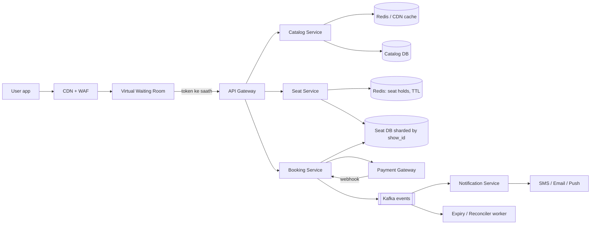
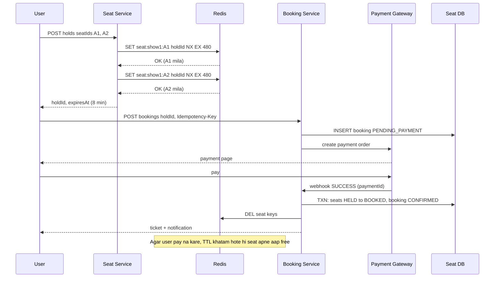

# Q7 · BookMyShow

Oct 16, 2026 · @saurav chaurasiya

**Is doc me:** BookMyShow jaisa ticket booking system HLD (high level design) ke roop me: show catalog, seat map, Redis seat hold with TTL, double booking rokna, flash-sale waiting room, payment timeout, idempotent confirmation aur notifications.

**Padhne ka tareeka** — pehle Sawaal pe 15 min khud socho, phir Sahi design ke diagrams dekho. Deep Dive tab padho jab interview ke liye extra depth chahiye.

---

## Q7 — BookMyShow

BookMyShow jaisa system ek **ticket booking platform** hai jo limited inventory (seats) ko bahut saare users ko bechta hai, bina ek seat do logon ko diye. Asli challenge normal traffic nahi, **flash sale** ka spike hai jab ek hi show ki seats ke liye lakhs log ek saath tootte hain.

### Ye cheez hai kya

- Category: transactional booking system with scarce inventory (read-heavy browsing + write-critical booking)
- Problem: har seat ek baar hi bikni chahiye (no double booking), seat select karne aur pay karne ke beech seat temporarily hold ho, aur big release pe system gire nahi
- Is lesson ke baad tum kar paoge: seat hold with TTL (time to live — key kitni der baad apne aap expire ho jaye) design karna, DB constraint vs lock ka trade-off samjhana, virtual waiting room explain karna, aur payment timeout/idempotent confirmation ka flow banana
- Analogy: train ki reservation counter ki line. Clerk jab tak tumhara form process karta hai, wo berth tumhare naam "hold" hoti hai. Time khatam, to berth wapas pool me. Aur bahar bheed bahut ho to guard token deta hai, ek ek karke andar bhejta hai (waiting room).

### Sawaal

Tumhe BookMyShow design karna hai. India ke 600+ cities, 5000+ theatres, roz \~50,000 shows. Normal din pe 2M DAU (daily active users — ek din me aane wale unique users). Ek big release (jaise ek superstar ki film ya Coldplay jaisa concert) ke ticket sale open hone pe 1M+ users ek saath 12:00 baje aate hain, 50,000 seats ke liye, aur pehle 2 minute me 5M requests aati hain.

- Browsing (movie list, show timings, seat map) fast hona chahiye: p99 (99% requests is time ke andar complete) latency under 300 ms
- Seat map real-time dikhna chahiye: kaun si seat booked, held ya free
- Ek seat kabhi bhi do logon ko confirm nahi honi chahiye
- Seat select karne ke baad user ko 5-8 minute milte hain payment ke liye; nahi kiya to seat wapas free

> Pehle khud socho — 15 min. Hints: (1) seat "hold" aur seat "booked" alag states kyun hone chahiye? (2) 1M users ek hi 50,000 rows pe aayenge to DB ka kya hoga, aur kya sabko andar aane dena zaroori hai? (3) payment success aaya lekin tab tak hold expire ho chuka ho to?

### Problem kyun aata hai

- **Scarce inventory**: seats limited hain, aur demand supply se 20x tak ho sakti hai
- **Hot rows**: ek show ki 300 seats pe saare users ek saath aate hain, to DB me row-level contention (ek hi row pe lock ke liye line) hoti hai
- **Multi-step flow**: seat select, hold, payment, confirm. Beech me user drop kar sakta hai, payment fail ho sakti hai, ya network retry kar sakta hai
- **Read vs write asymmetry**: seat map dekhne wale 100x zyada hain booking karne walon se
- **Payment external hai**: gateway ka response late ya duplicate ho sakta hai (webhook dubara aa sakta hai)
- **Bots aur scalpers**: unfair advantage lete hain, queue bypass karte hain

### Naive approach

- Seats table me `status` column rakho. User seat click kare to `SELECT status`, free ho to `UPDATE status = 'BOOKED'`. Payment baad me.
- Breaks (race condition — do requests ek saath same row padh ke dono ko free dikhe): 2 users ek saath SELECT karte hain, dono ko "free" dikhta hai, dono UPDATE karte hain. Ek seat do logon ko mil gayi.
- Agar `status = 'BOOKED'` payment se pehle set kar do aur user chhod de, to seat hamesha ke liye block. Hold ka concept hi nahi.
- Agar `SELECT ... FOR UPDATE` (pessimistic lock — row pe lock leke padho) lagao aur lock payment tak rakho: 8 minute tak DB connection fansa rehta hai. 1M users me se bas 10,000 connections pool me, baaki sab timeout.
- Har seat map refresh pe DB hit: 1M users x 1 refresh/5 sec = 200K QPS (queries per second) sirf reads. Single DB 5-10K QPS pe hi hans uthega.
- Flash sale pe sabko seedha system me aane dena: 5M requests/2 min = \~40K RPS booking API pe, hot rows pe lock storm, aur poora site down.

### Sahi design

#### 1. Requirements

**Functional**

- City ke hisab se movies, theatres aur shows search/browse karna
- Show ka seat map dekhna (free / held / booked)
- Seats select karke temporary hold karna (TTL ke saath)
- Payment karna aur booking confirm karna
- Booking cancel karna, refund
- Confirmation notification (SMS, email, push) aur e-ticket (QR code)

**Non-functional**

- **Strong consistency** seat booking pe: double booking zero. Browsing pe eventual consistency (kuch second purana data chalega)
- High availability: browsing kabhi down nahi hona chahiye, flash sale me bhi
- Latency: seat map p99 under 300 ms, hold under 200 ms
- Scalability: 1M concurrent users flash sale me, graceful degradation
- Fairness: first come first serve, bots control me

#### 2. Back-of-envelope estimates

| Cheez | Calculation | Number |
| --- | --- | --- |
| DAU | given | 2M |
| Normal browse QPS | 2M x 20 requests / 86400 | \~460 avg, peak \~3K |
| Bookings per day | 2M x 2% conversion x 2.5 seats | \~100K bookings, 250K seats |
| Booking QPS (normal) | 100K / 86400 | \~1-2 avg, peak \~50 |
| Flash sale peak | 5M requests in 120 sec | \~40K RPS |
| Seat inventory (rows) | 50K shows x 300 seats | 15M rows per day window |
| Seat row size | \~100 bytes | 1.5 GB hot data, RAM me aa jata hai |
| Booking record | \~1 KB x 100K/day x 365 | \~36 GB per year |

- Matlab: booking write load kam hai, asli dikkat **spike** aur **contention** hai, volume nahi
- Hot inventory (aaj ke aur agle 7 din ke shows) Redis me rakh sakte hain

#### 3. API design

- `GET /v1/cities/{city}/movies` — movies ki list (cacheable)
- `GET /v1/movies/{movieId}/shows?city=&date=` — shows aur theatres
- `GET /v1/shows/{showId}/seats` — seat map with status per seat
- `POST /v1/shows/{showId}/holds` — body: `{seatIds: [...]}`, header `Idempotency-Key`. Response: `holdId`, `expiresAt`
- `POST /v1/bookings` — body: `{holdId, paymentMethod}`, header `Idempotency-Key`. Response: `bookingId`, status `PENDING_PAYMENT`
- `POST /v1/webhooks/payment` — gateway se payment result aata hai
- `GET /v1/bookings/{bookingId}` — status aur ticket
- `DELETE /v1/holds/{holdId}` — user khud release kar de
- Idempotency key kya hai: ek unique token jo client har request ke saath bhejta hai, taaki retry pe server wahi result de, naya kaam na kare. Detail: [2A · Idempotency Island](https://claude.ai/code/artifact/c269ac61-440b-4525-bd04-31baf708dece)

#### 4. Data model

Source of truth SQL (MySQL/Postgres) me, kyunki ACID (Atomicity Consistency Isolation Durability — transaction ya poora hota hai ya bilkul nahi, aur committed data safe rehta hai) chahiye.

```sql
-- Ek show ki har seat ek row. Yahi double booking rokne ka asli hathiyaar hai.
CREATE TABLE show_seats (
  show_id      BIGINT,
  seat_id      INT,
  price        INT,
  status       VARCHAR(10) DEFAULT 'FREE',   -- FREE, HELD, BOOKED
  booking_id   BIGINT NULL,
  version      INT DEFAULT 0,                -- optimistic locking ke liye
  PRIMARY KEY (show_id, seat_id)
);

-- Booking ek state machine hai.
CREATE TABLE bookings (
  booking_id   BIGINT PRIMARY KEY,
  user_id      BIGINT,
  show_id      BIGINT,
  status       VARCHAR(20),   -- PENDING_PAYMENT, CONFIRMED, FAILED, EXPIRED, CANCELLED
  amount       INT,
  idem_key     VARCHAR(64),
  created_at   TIMESTAMP,
  UNIQUE (user_id, idem_key)  -- duplicate request ek hi booking banaye
);

-- Booking ke seats; unique constraint last safety net.
CREATE TABLE booking_seats (
  booking_id   BIGINT,
  show_id      BIGINT,
  seat_id      INT,
  UNIQUE (show_id, seat_id)   -- ek seat do bookings me nahi ja sakti
);

-- Payment webhook dedupe ke liye.
CREATE TABLE payments (
  payment_id   VARCHAR(64) PRIMARY KEY,   -- gateway ka id
  booking_id   BIGINT,
  status       VARCHAR(15),
  amount       INT
);
```

- Movies, theatres, screens, shows alag catalog tables me (kam change hote hain, heavily cached)
- Sharding key: `show_id` (ek show ke saare seats ek shard pe, taaki transaction local rahe). Sharding matlab data ko alag machines pe baantna, detail [1D · Shard Mountains](https://claude.ai/code/artifact/cfe905e6-6370-43e0-a337-764eeb9ddf1e) me

#### 5. High level architecture

Is diagram me flash sale ka waiting room, seat hold Redis me, aur confirmation DB me dikh raha hai.



Seat hold se confirm tak ka flow, happy path aur timeout dono ke saath.



#### 6. Step by step design

1. **Catalog (browse) path**: movies, theatres, shows kam badalte hain. CDN + Redis cache me rakho, TTL 1-5 min. Read replicas pe DB. Ye 95% traffic hai aur eventual consistency chalti hai.
2. **Seat map**: DB seat status + Redis ke active holds ko merge karke dikhao. Seat map JSON ko 1-2 sec ke liye cache karo, ya WebSocket/SSE (server-sent events — server se client ko push) se updates bhejo. Ye "display" hai, final truth nahi.
3. **Seat hold**: Redis me `SET key value NX EX 480`. NX matlab "sirf tab set karo jab key exist na kare" (atomic — beech me koi aur ghus nahi sakta), EX matlab 480 sec baad key khud delete. Multi-seat ke liye Lua script (Redis ke andar atomic script) se saari seats ya to sab hold ya koi nahi.
4. **Booking create**: hold valid hai check karo, booking row `PENDING_PAYMENT` me banao (idempotency key ke saath), payment order banao.
5. **Payment result**: webhook aaye to ek DB transaction me seats `BOOKED` karo. `UPDATE show_seats SET status='BOOKED' WHERE show_id=? AND seat_id=? AND (status='HELD' OR status='FREE')` aur affected rows check karo. Plus `booking_seats` ka UNIQUE constraint last safety net hai.
6. **Expiry**: Redis key TTL se khud free. DB me HELD rows ke liye ek reconciler worker `expires_at` check karke FREE karta hai (Redis crash ho jaye to bhi).
7. **Flash sale**: virtual waiting room. Sabko seedha andar nahi, ek controlled rate se token dekar bhejo (neeche Deep Dive me detail).
8. **Notifications**: booking confirm hote hi Kafka event `BookingConfirmed`. Notification service SMS/email/push bhejti hai, async, retry ke saath. Booking path ko slow nahi karti.

### Kya choose karein aur kyun

Double booking rokne ke options ka comparison:

| Option | Kab use karo | Kab mat karo |
| --- | --- | --- |
| DB unique constraint / conditional UPDATE | Final safety net, hamesha lagao. Correctness ki guarantee deta hai | Akela hold ke liye nahi: TTL nahi hota, aur hot rows pe contention |
| Pessimistic lock (`SELECT FOR UPDATE`) | Chhota critical section (milliseconds), low concurrency | Payment tak lock rakhna. Connections fans jaate hain |
| Optimistic lock (version column) | Contention kam ho, retry sasta ho | Flash sale ki hot seats: bahut retries, wasted work |
| Redis `SET NX EX` hold | Seat hold with TTL, high QPS, auto expiry | Akela source of truth nahi. Redis crash/failover pe hold kho sakta hai |
| Redlock / multi-node distributed lock | Jab ek Redis failure bhi hold na kho paye | Zyada latency aur complexity; DB constraint wala net ho to zaroorat kam |
| Virtual waiting room | Predictable mega spike (big release, concert) | Normal din ki traffic ke liye overkill |

- Recommended combo: **Redis hold (fast, TTL) + DB conditional update/unique constraint (correctness) + waiting room (spike control)**
- Locks detail: [2D · Lock Fort](https://claude.ai/code/artifact/97588686-7110-4318-8124-3a8727c7604e) (distributed locks, Redlock, optimistic/pessimistic locking)
- Spike aur overload handling: [2E · Resilience Ridge](https://claude.ai/code/artifact/4769dea3-018e-41e1-ae18-253fa36a6d21) (rate limiting, backpressure — consumer producer se slow ho to upstream ko dheema karna, bulkhead)

### India me kaise hota hai

- BookMyShow ek hi release pe lakhs tickets ek ghante me bechta hai. Public engineering write-ups me bataya jata hai ki seat selection ke time distributed locks aur payment saga (multi-step transaction jisme har step ka undo step ho) use hote hain: [BookMyShow Seat Selection Architecture](https://developersvoice.com/blog/practical-design/scalable-net-ticketing-architecture-distributed-locks/)
- Double booking prevention ka ek detailed walkthrough: [How BookMyShow Prevents Double-Booking](https://medium.com/@officialchiragp1605/how-bookmyshow-prevents-double-booking-a-deep-dive-into-distributed-systems-23fe251adfbb)
- Flash sale pe 1 ghante me 1 lakh se zyada tickets wala scaling case: [How to Build a Scalable Ticketing System like BookMyShow](https://blog.stackademic.com/dhurandhar-2-sold-1-09-000-tickets-in-one-hour-heres-the-system-that-made-it-possible-389497e58a5c)
- Waiting room global practice me Ticketmaster (Smart Queue) aur Queue-it jaise products se hota hai: [Ticketmaster Smart Queue](https://business.ticketmaster.com/smart-queue/), [Queue-it virtual waiting room](https://queue-it.com/virtual-waiting-room/)
- India me concert sales (jaise Coldplay) pe BookMyShow ne bhi queue/waiting-room style flow use kiya, jisme user ko line me number dikhta hai. Ye baat public tor pe dekhi gayi hai, internal design confirm nahi, isliye interview me "aise kuch" bolo, exact claim mat karo.
- Payment side pe UPI collect/intent ka timeout alag hota hai (aksar 5 min ke aas paas), to hold TTL payment window se thoda zyada rakhte hain. Payment gateway ka flow: [C2 · Payment gateway (Razorpay)](https://claude.ai/code/artifact/789bc35f-d2eb-42fd-8b80-804af8af526b)

### Interview follow-ups

- **Hold ke dauran Redis crash ho jaye to?** — Redis replica failover me hold kho sakta hai. Isliye final confirm DB ke conditional update se hota hai; do users ko hold mil bhi gaya to sirf ek DB me BOOKED ho paayega, dusre ko "seat gone" aur refund/retry flow.
- **User ne pay kar diya par tab tak hold expire ho gaya aur seat kisi aur ne le li?** — Webhook pe DB update fail hoga (seat ab dusre ki). Booking `FAILED`, auto refund trigger. Isliye TTL payment window se thoda lamba rakhte hain, aur payment start hone par TTL extend karte hain.
- **Webhook do baar aaye to?** — Idempotent handling: `payments.payment_id` primary key hai, dusri baar insert fail, to no-op. Booking status already CONFIRMED hai to wahi response.
- **Pessimistic vs optimistic lock kab?** — Contention zyada aur critical section chhota ho to pessimistic; kam contention to optimistic. Flash sale me hum lock ko DB tak laate hi nahi, Redis hold + waiting room se contention kam karte hain.
- **Ek hi user multiple tabs se seats hold karke block kare (seat hoarding)?** — Per-user hold limit (max 6 seats), ek user ka ek active hold per show, TTL chhota, bot detection aur CAPTCHA.
- **Best seats pe sabko ek saath click karne se bachne ke liye?** — Waiting room se arrival rate control, seat map pe "auto-assign best available" option, aur hot show ko dedicated shard/Redis pe rakhna.
- **Seat map real-time kaise dikhaye 1M users ko?** — Har user ke liye DB poll mat karo. Seat map snapshot ko 1-2 sec cache karo, ya SSE/WebSocket se delta bhejo; final truth hold/confirm pe check hota hai.

### Self-check

1. Seat ke teen states kya hain aur HELD state kyun zaroori hai?
2. `SET key value NX EX 480` ka har part kya karta hai, aur ye `SELECT` + `UPDATE` se kyun behtar hai?
3. Redis hold ke hote hue bhi DB constraint kyun chahiye?
4. Flash sale me virtual waiting room kaise 1M users ko 40K RPS se bachata hai?
5. Payment success aur hold expiry ka race ho to kya hota hai, aur webhook duplicate kaise handle hota hai?

### Notebook

Seat states: FREE, HELD, BOOKED · Hold = Redis `SET NX EX`, correctness = DB conditional UPDATE + UNIQUE constraint · Pessimistic lock payment tak mat rakho, connections fans jaate hain · Spike ke liye virtual waiting room: token, admit rate, bots filter · Booking = state machine PENDING\_PAYMENT, CONFIRMED, FAILED, EXPIRED · Idempotency key + unique payment\_id se duplicate request/webhook safe · Browsing eventual consistency, booking strong consistency

### Padhne ke liye

- [Design BookMyShow - GeeksforGeeks](https://www.geeksforgeeks.org/system-design/design-bookmyshow-a-system-design-interview-question/)
- [Design Ticketmaster/BookMyShow Ticket Booking System - VamsiLabs](https://vamsilabs.netlify.app/systemdesign/case-studies/ticket-booking/)
- [Virtual Waiting Rooms: Everything You Need to Know - Queue-it](https://queue-it.com/blog/virtual-waiting-room/)
- [Virtual Queues: 13 Best Practices - NN/G](https://www.nngroup.com/articles/virtual-queue-best-practices/)

### Deep Dive (SDE-2) — jab time ho

#### Virtual waiting room ka design

- Flow: user sale page pe aata hai, edge (CDN/Lambda@Edge ya gateway) check karta hai ki valid "admit token" hai ya nahi. Nahi hai to waiting page pe bhejo (static, CDN se serve, backend pe load zero)
- Queue position: arrival ke time pe random ya timestamp-based number do. "Fair" ke liye pre-sale window me aaye sabko random shuffle (lottery) bhi kar sakte ho
- Admit rate: backend ki capacity se nikalo (jaise 2,000 users/sec). Redis sorted set me queue rakho (score = position), ek controller har second top N ko admit karke signed token (JWT with expiry) deta hai
- Client page har 5-10 sec poll karta hai ya SSE pe sunta hai ki "meri baari aayi?". Poll interval randomize karo (jitter) taaki sab ek saath na maarein
- Token booking APIs pe verify hota hai; ek token = ek user, expiry 10-15 min, reuse limited
- Bots: CAPTCHA before queue, device fingerprint, per-account ek hi queue entry, rate limit per IP
- Degrade: agar backend slow ho, admit rate apne aap kam karo (feedback loop, backpressure)

#### Hold TTL aur Redis detail

- Single seat hold: `SET seat:{show}:{seat} {holdId} NX EX 480`. Release karte time sirf apna holdId match hone par delete karo (Lua script), warna expire hone ke baad kisi aur ka hold delete ho sakta hai
- Multi-seat atomic hold ka Lua script (Redis me script ek unit me chalti hai, beech me koi command nahi):

```lua
-- Saari seats free ho to hi hold karo, warna kuch nahi (all or nothing).
-- KEYS = seat keys, ARGV[1] = holdId, ARGV[2] = ttl seconds
for i, k in ipairs(KEYS) do
  if redis.call('EXISTS', k) == 1 then
    return 0   -- koi seat pehle se hold hai, sab cancel
  end
end
for i, k in ipairs(KEYS) do
  redis.call('SET', k, ARGV[1], 'EX', ARGV[2])
end
return 1
```

- Redis Cluster me multi-key script ke liye saari keys ek hi slot me honi chahiye. Hash tag use karo: `seat:{show1}:A1` (curly braces me sirf show id, to ek show ki saari seats ek slot pe)
- Persistence: Redis ko hold ke liye cache maano. Failure pe DB ka HELD+expires\_at reconciliation backup hai
- Redlock debate (Martin Kleppmann vs antirez) aur fencing token ki detail [2D · Lock Fort](https://claude.ai/code/artifact/97588686-7110-4318-8124-3a8727c7604e) me

#### DB constraint vs lock: final correctness

- Conditional UPDATE (compare-and-set): `UPDATE show_seats SET status='BOOKED', booking_id=? WHERE show_id=? AND seat_id=? AND status IN ('FREE','HELD')`. Rows affected = 0 ka matlab seat nikal gayi
- Multi-seat booking ek DB transaction me; ek bhi seat fail to rollback
- `booking_seats` pe UNIQUE (show\_id, seat\_id) hai to bug hone par bhi duplicate insert fail hoga. "Defence in depth": Redis (fast reject) + conditional update + unique constraint
- Isolation level: READ COMMITTED + conditional update kaafi hai. SERIALIZABLE ki zaroorat nahi, wo throughput maarta hai. Detail [1C · DB Dungeon](https://claude.ai/code/artifact/99909fe9-731e-4e31-9e7d-36e0c5aed845) (ACID aur isolation)
- Shard by `show_id`: ek show ki saari seats ek shard pe, to multi-seat transaction local rahta hai, cross-shard 2PC (two-phase commit) nahi lagta

#### Payment timeout, saga aur idempotent confirmation

- Booking ek state machine hai: `PENDING_PAYMENT -> CONFIRMED | FAILED | EXPIRED | CANCELLED`. Har transition conditional update se, taaki galat order me state na badle. Detail [2C · Saga Sea](https://claude.ai/code/artifact/429b3ea6-a261-431d-a384-a0c6eb68a9f6)
- Hold TTL (8 min) > payment window (5-6 min) + buffer. Payment start hone par TTL extend karo (heartbeat), taaki payment ke beech seat na chhute
- Late success: gateway ne paisa le liya par hold expire. Do raste: (a) seat abhi bhi free hai to confirm kar do, (b) kisi aur ke paas gayi to automatic refund (compensating transaction — pehle ka kaam undo karne wala naya step)
- Reconciler worker: `PENDING_PAYMENT` bookings jo 10 min se purani hain, unke liye gateway se status poochho (polling) kyunki webhook kho bhi sakta hai. Detail [2F · Recon Ruins](https://claude.ai/code/artifact/93d00bdd-f45f-441f-946c-c84355b5c05e)
- Idempotent confirm: `UNIQUE(user_id, idem_key)` booking pe, `payments.payment_id` PK webhook pe. Duplicate request/webhook purana result return karta hai

#### Notifications aur outbox

- Booking confirm DB transaction ke saath hi `outbox` table me event likho, alag relay Kafka pe bheje (transactional outbox — DB write aur event publish ka atomic pattern). Detail [1E · Kafka River](https://claude.ai/code/artifact/eeb39ee8-3f52-4c04-b57b-68213f02c429)
- Notification service consumer hai: SMS, email, push alag channels, retry with backoff, DLQ (dead letter queue — baar baar fail hone wale messages ki alag line)
- Ticket QR code signed payload hota hai (bookingId + signature) taaki theatre pe offline verify ho sake
- Notification fail hone se booking fail nahi hoti; user "My Bookings" me ticket hamesha dekh sakta hai

#### Scaling aur failure modes

- Catalog read-heavy: CDN + Redis + read replicas. Search ke liye Elasticsearch (movie/theatre/city filters)
- Hot show isolation: big release ka show dedicated Redis aur DB shard pe, taaki baaki shows affect na ho (bulkhead)
- Rate limit per user/IP/device, plus global load shedding (overload pe naye requests 429 se mana karo)
- Multi-region: catalog read local, seat booking ek home region me (strong consistency). Detail [2E · Resilience Ridge](https://claude.ai/code/artifact/4769dea3-018e-41e1-ae18-253fa36a6d21)
- Observability: hold success rate, hold-to-confirm conversion, expired holds, payment webhook lag, double-booking alarm (should be 0). Detail [1F · Ops Tower](https://claude.ai/code/artifact/6a87e8d2-04fb-418e-b433-e5a88508f83e)
- LLD me isi problem ka class design dekhne ke liye [D6 · BookMyShow](https://claude.ai/code/artifact/f3d169f5-f1c9-4a30-8a6e-6c8de8e5296b)

---

## Aage kya

- Pichhla: [Q6 · Swiggy / Blinkit](https://claude.ai/code/artifact/c2b42992-bec2-42ee-a468-476a1f8a3173)
- Agla: [Q8 · Distributed cache](https://claude.ai/code/artifact/eb966902-a403-49af-815d-36346f1f5e3f)
- LLD twin: [D6 · BookMyShow](https://claude.ai/code/artifact/f3d169f5-f1c9-4a30-8a6e-6c8de8e5296b)
- Related: [2D · Lock Fort](https://claude.ai/code/artifact/97588686-7110-4318-8124-3a8727c7604e), [2E · Resilience Ridge](https://claude.ai/code/artifact/4769dea3-018e-41e1-ae18-253fa36a6d21)
