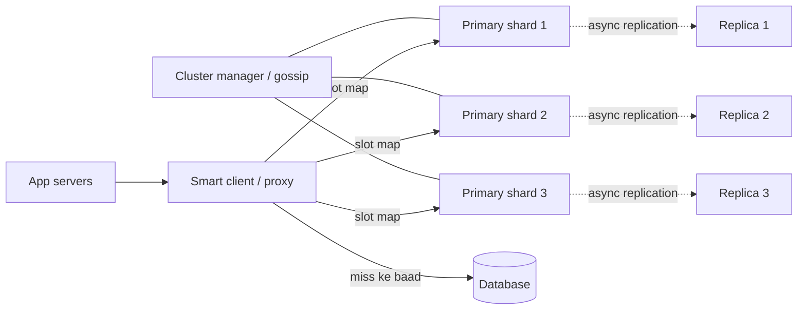
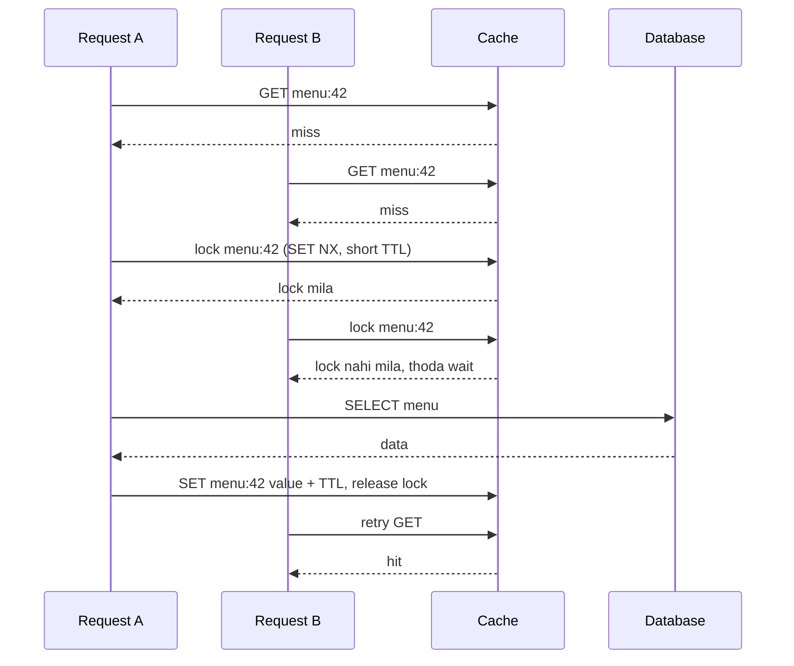

# Q8 · Distributed cache

Oct 16, 2026 · @saurav chaurasiya

**Is doc me:** Redis / Memcached jaisa distributed cache design karna: consistent hashing, replication aur failover, eviction, TTL, hot keys, stampede protection, routing, persistence aur cluster resizing.

**Padhne ka tareeka** — Pehle "Sawaal" ko khud solve karne ki koshish karo (15 min), phir "Sahi design" padho, Java demo chalao, aur last me follow-ups se self-test karo.

---

## Q8 — Distributed cache

Distributed cache ek aisa in-memory key-value store hai jo kai machines pe phaila hota hai, taaki database tak pahunchne se pehle hi zyada tar reads RAM se mil jaayein. Ye single Redis ki limit (ek machine ki RAM aur CPU) ko todta hai.

### Ye cheez hai kya

- Category: infrastructure component (in-memory key-value store, cluster form me).
- Problem: ek machine ki RAM (maan lo 64 GB) aur ek machine ka throughput (lakhon ops/sec) kam pad jaata hai, aur wo machine **SPOF (single point of failure — jiske marne se poora system ruk jaaye)** bhi hai.
- Is lesson ke baad tum kar paoge: cache cluster ka poora design (sharding + replication + eviction + stampede handling) whiteboard pe explain karna, aur har trade-off justify karna.
- Analogy: ek bade mall ki parking. Ek hi gate (single node) pe line lag jaati hai. Kai gates (nodes) banao, har gate ko gaadi ke number se assign karo (hashing), aur har gate pe ek backup guard (replica) rakho.

### Sawaal

Swiggy jaisi food-delivery app ko design karo jiska **restaurant menu + user session + cart cache** layer chahiye.

- 20 million DAU (daily active users), peak pe 400,000 reads/sec aur 40,000 writes/sec.
- Working set (jo data actually baar baar chhua jaata hai) lagbhag 600 GB, average value 2 KB.
- Target: p99 latency (99% requests isse tez — worst-case ke kareeb ka number) 5 ms se kam, availability 99.99%.
- Ek ghante ki flash sale me ek hi popular restaurant ka menu key 50,000 reads/sec le sakta hai.
- Cache node fail ho to user ko error nahi dikhna chahiye, aur node add/remove karte waqt cache hit ratio crash nahi hona chahiye.

> Pehle khud socho — 15 min. Hints: (1) 600 GB ek machine me kyun nahi aa sakta, aur keys ko nodes me kaise baantoge jab nodes badalte rehte hain? (2) Ek key pe 50K reads/sec ek node ko kaise maarega? (3) Popular key expire ho jaaye aur 10,000 requests ek saath DB pe jaayein to kya hoga?

### Problem kyun aata hai

- Single node ki RAM limited hai; 600 GB working set ke liye kai machines chahiye (sharding — data ko kai machines me baantna).
- Machine marti hai (hardware, deploy, GC pause). Bina replica ke us shard ka poora data gaayab, aur saara load DB pe girta hai.
- Keys ka access uniform nahi hota. Kuch **hot keys (bahut zyada access hone wali keys)** ek hi node ko saturate kar deti hain, chahe cluster me baaki nodes khaali hon.
- Cache hamesha full rehta hai, to kuch na kuch nikalna padta hai (eviction — purani/kam kaam ki entries hataana).
- Popular key ki TTL (time to live — entry kitni der valid hai) khatam hote hi **cache stampede (ek saath bahut saare requests DB pe tut padna)** ho sakta hai.
- Nodes add/remove karne pe galat hashing se lagbhag saari keys ghoom jaati hain aur hit ratio zero ho jaata hai.

### Naive approach

- Pehla idea: `node = hash(key) % N`, N = nodes ki count. Simple, fast, kaam karta dikhta hai.
- Kahan tootta hai:
  - N = 3 se 4 karte hi lagbhag **75%** keys ka node badal jaata hai (neeche demo me 10,000 me se 7,556 move hui). Cache lagbhag khaali ho jaata hai, aur 400K reads/sec seedhe DB pe gir jaati hain. DB 400K QPS nahi jhel sakta.
  - Replica nahi hai, to ek node marne se uske shard ki saari keys miss.
  - Eviction na ho to RAM full hoke node OOM (out of memory) ho jaata hai.
  - Har key ki TTL ek hi (jaise 10 min) rakhne se saari keys ek saath expire hoti hain: synchronized stampede.
  - Hot key ke liye koi plan nahi: ek node 50K reads/sec pe CPU saturate kar deta hai.

### Sahi design

#### Requirements

- Functional: `GET`, `SET` with TTL, `DEL`, `INCR` jaise atomic ops, per-key TTL, eviction jab memory full ho.
- Non-functional: p99 < 5 ms, 99.99% availability, horizontal scale (nodes add karke capacity badhe), cluster resize pe hit ratio ka bada drop nahi, fault tolerance.
- Consistency: cache **eventual consistency (thodi der baad sab copies same ho jaati hain)** pe chalta hai. Source of truth DB hi hai.

#### Back-of-envelope estimates

- Data: 600 GB working set. Ek node \~50 GB usable RAM (64 GB me se OS aur overhead hataake) to 12 primary shards. Replication factor 2 (1 primary + 1 replica) ke saath 24 nodes. Headroom ke liye \~16 primaries rakhte hain.
- Throughput: 440K ops/sec total. 16 primaries pe \~27K ops/sec har ek. Ek Redis node 100K+ simple ops/sec deta hai, to aaram se chal jaata hai. Replicas pe reads bhejne se aur halka.
- Network: 400K reads x 2 KB = 800 MB/sec = \~6.4 Gbps total, har node pe \~400 Mbps. 10 Gbps NIC kaafi hai.
- Hot key: 50K reads/sec x 2 KB = 100 MB/sec ek hi node pe. Ye node ke liye khatarnaak hai, isliye hot key handling alag se chahiye.

#### API design

```text
GET    /cache/{key}                    -> value ya miss (404)
SET    /cache/{key}  {value, ttl_ms}   -> OK
DEL    /cache/{key}                    -> 1 ya 0
INCR   /cache/{key}                    -> atomic counter
```

Asli system me ye HTTP nahi hota. Redis ka **RESP (REdis Serialization Protocol — simple text-based wire format)** ya Memcached ka binary protocol TCP connection pe chalta hai, taaki overhead kam rahe.

#### Data model (ek node ke andar)

- Hash table: `key -> (value, expiresAt, lastAccessTime / frequencyCounter)`.
- Eviction ke liye ek aur structure: LRU ke liye doubly linked list ya approximate sampling (Redis exact LRU nahi chalata, random sample leke best pick karta hai).
- Cluster metadata: `slot -> primary node, replica nodes` ka map (ya hash ring), jo har client/proxy ke paas hota hai.

#### High-level architecture

Client library (smart client) slot map se seedha sahi node pe jaata hai. Har shard me ek primary aur ek ya do replicas hote hain.



#### Step by step

1. **Partitioning:** keys ko **consistent hashing (hash ring jisme node add/remove karne pe sirf paas wali keys move hoti hain)** se baanto. Har physical node ko ring pe 100-200 **virtual nodes (ek node ke kai chhote tukde ring pe)** do, taaki load barabar rahe aur ek node jaane pe uska load kai nodes me bikhre. Redis Cluster isi ka variant use karta hai: 16384 fixed **hash slots** (`CRC16(key) mod 16384`), har slot ek node ka.
2. **Routing:** smart client slot map cache karta hai. Galat node pe request jaaye to node `MOVED` redirect deta hai aur client map update kar leta hai. Alternate: proxy (twemproxy, Envoy) jo client ke liye routing chhupa deta hai.
3. **Replication:** har primary ke 1-2 replicas, async replication se. Failover: primary ko majority nodes "down" maane to uska replica primary ban jaata hai (Redis me replica election ek epoch number ke saath hota hai).
4. **Eviction:** `maxmemory` set karo. LRU (least recently used — sabse der se use nahi hua) ya LFU (least frequently used — sabse kam baar use hua) policy.
5. **TTL expiry:** lazy (access pe check) + active (background me random sample scan). Dono milake memory bhi bachti hai aur CPU bhi.
6. **TTL jitter:** TTL me random +-10-20% jodo taaki saari keys ek saath expire na hon.
7. **Stampede protection:** miss pe sirf ek request DB jaaye (lock ya single-flight), baaki wait karein ya thodi puraani value len.
8. **Hot keys:** detect karo (sampling counters), phir client-side local cache ya key ko `key#1..key#N` copies me replicate karke reads bikhero.
9. **Persistence:** optional. Pure cache ke liye zaroorat nahi; Redis me RDB snapshot ya AOF log tab on karo jab restart pe warm start chahiye.
10. **Resize:** naya node add karo, ring pe uski vnodes dalo, sirf \~1/N keys migrate hoti hain, aur migration ke dauran purane node se serve karte raho.

Ye diagram stampede protection ka flow dikhata hai:



Neeche ka Java demo teen cheezein dikhata hai: virtual nodes wali consistent hash ring, LRU eviction + lazy TTL (Strategy pattern se eviction policy plug-in), aur single-flight stampede protection. Ye ring me ek naya node add karne pe kitni keys move hoti hain, wo bhi napta hai.

```java
import java.util.*;
import java.util.concurrent.*;
import java.util.concurrent.atomic.*;

public class Demo {
    // Consistent hash ring: virtual nodes ke saath
    static class Ring {
        private final TreeMap<Long, String> ring = new TreeMap<>();
        private final int vnodes;
        Ring(int vnodes) { this.vnodes = vnodes; }
        static long hash(String s) {
            try { // MD5 ke pehle 8 bytes -> achha spread
                byte[] d = java.security.MessageDigest.getInstance("MD5").digest(s.getBytes());
                long h = 0;
                for (int i = 0; i < 8; i++) h = (h << 8) | (d[i] & 0xff);
                return h;
            } catch (Exception e) { throw new RuntimeException(e); }
        }
        void addNode(String n) { for (int i = 0; i < vnodes; i++) ring.put(hash(n + "#" + i), n); }
        void removeNode(String n) { for (int i = 0; i < vnodes; i++) ring.remove(hash(n + "#" + i)); }
        String route(String key) {
            Map.Entry<Long, String> e = ring.ceilingEntry(hash(key));
            return (e != null ? e : ring.firstEntry()).getValue(); // ring ghoom ke wapas shuru
        }
    }

    // Eviction Strategy: LRU ya kuch aur plug kar sakte ho
    interface Eviction { void touch(String k); String victim(); void remove(String k); }
    static class Lru implements Eviction {
        private final LinkedHashSet<String> order = new LinkedHashSet<>();
        public void touch(String k) { order.remove(k); order.add(k); }
        public String victim() { return order.isEmpty() ? null : order.iterator().next(); }
        public void remove(String k) { order.remove(k); }
    }

    // Ek cache node: capacity + TTL (lazy expiry) + eviction
    static class CacheNode {
        record Entry(String val, long expiresAt) {}
        final Map<String, Entry> data = new HashMap<>();
        final Eviction ev = new Lru();
        final int capacity;
        CacheNode(int capacity) { this.capacity = capacity; }
        synchronized String get(String k, long now) {
            Entry e = data.get(k);
            if (e == null) return null;
            if (e.expiresAt() <= now) { data.remove(k); ev.remove(k); return null; } // lazy expire
            ev.touch(k);
            return e.val();
        }
        synchronized void put(String k, String v, long ttl, long now) {
            if (!data.containsKey(k) && data.size() >= capacity) {
                String vic = ev.victim(); data.remove(vic); ev.remove(vic);
                System.out.println("  evict " + vic);
            }
            data.put(k, new Entry(v, now + ttl)); ev.touch(k);
        }
    }

    // Stampede protection: ek key ke liye sirf ek loader DB jaye (single-flight)
    static final ConcurrentHashMap<String, CompletableFuture<String>> inflight = new ConcurrentHashMap<>();
    static final AtomicInteger dbCalls = new AtomicInteger();
    static String loadSingleFlight(String key) throws Exception {
        CompletableFuture<String> mine = new CompletableFuture<>();
        CompletableFuture<String> f = inflight.putIfAbsent(key, mine);
        if (f != null) return f.get(); // dusra thread already load kar raha hai, wait karo
        try {
            dbCalls.incrementAndGet(); Thread.sleep(100); // slow DB
            mine.complete("value-of-" + key);
        } finally { inflight.remove(key); }
        return mine.get();
    }

    public static void main(String[] args) throws Exception {
        Ring ring = new Ring(100);
        for (String n : List.of("A", "B", "C")) ring.addNode(n);
        int total = 10000;
        Map<String, Integer> cnt = new TreeMap<>();
        Map<String, String> before = new HashMap<>();
        for (int i = 0; i < total; i++) { String k = "user:" + i; String n = ring.route(k); before.put(k, n); cnt.merge(n, 1, Integer::sum); }
        System.out.println("3 node distribution (100 vnodes): " + cnt);
        ring.addNode("D");
        int moved = 0;
        for (var e : before.entrySet()) if (!ring.route(e.getKey()).equals(e.getValue())) moved++;
        System.out.println("D add kiya, moved keys: " + moved + " / " + total + " (ideal ~25%)");
        int modMoved = 0;
        for (int i = 0; i < total; i++) if (Math.floorMod(Ring.hash("user:" + i), 3) != Math.floorMod(Ring.hash("user:" + i), 4)) modMoved++;
        System.out.println("hash % N se 3 -> 4 nodes: moved " + modMoved + " / " + total);

        CacheNode node = new CacheNode(2);
        node.put("a", "1", 1000, 0); node.put("b", "2", 1000, 0);
        node.get("a", 10);            // a recently used
        node.put("c", "3", 1000, 20); // b evict hona chahiye
        System.out.println("get b = " + node.get("b", 30) + ", get a = " + node.get("a", 30));
        System.out.println("get a after TTL = " + node.get("a", 5000));

        ExecutorService ex = Executors.newFixedThreadPool(50);
        List<Future<String>> fs = new ArrayList<>();
        for (int i = 0; i < 50; i++) fs.add(ex.submit(() -> loadSingleFlight("hot:product:1")));
        for (var f : fs) f.get();
        ex.shutdown();
        System.out.println("50 concurrent misses, DB calls = " + dbCalls.get());
    }
}
```

Isko chalane pe bilkul ye output aata hai:

```text
3 node distribution (100 vnodes): {A=3232, B=3370, C=3398}
D add kiya, moved keys: 2448 / 10000 (ideal ~25%)
hash % N se 3 -> 4 nodes: moved 7556 / 10000
  evict b
get b = null, get a = 1
get a after TTL = null
50 concurrent misses, DB calls = 1
```

- Ring pe 100 vnodes se teen nodes me load lagbhag barabar (3232 / 3370 / 3398).
- Naya node D aane pe sirf 24.5% keys move hui, jabki `hash % N` me 75.6% move hui.
- `a` ko `get` karke recently used bana diya, isliye `b` evict hui (LRU).
- TTL khatam hone ke baad `get a` null deta hai (lazy expiry).
- 50 threads ek hi key pe aaye, DB sirf 1 baar gaya (single-flight).

### Kya choose karein aur kyun

#### Partitioning

| Option | Kab use karo | Kab mat karo |
| --- | --- | --- |
| `hash(key) % N` | Nodes fixed hain aur kabhi resize nahi hota (toy / test setup) | Production me, kyunki resize pe \~75% keys move hoti hain |
| Consistent hashing + vnodes | Nodes badalte rehte hain, client-side ya proxy routing chahiye (Memcached clients, Dynamo-style) | Jab chhote fixed cluster me simplicity chahiye |
| Fixed hash slots (Redis Cluster, 16384) | Resize ke liye slot-by-slot migration chahiye, aur server khud slot map manage kare | Multi-key ops jo alag slots me padein (hash tags `{user1}` use karne padte hain) |

#### Eviction policy

| Option | Kab use karo | Kab mat karo |
| --- | --- | --- |
| LRU | Recent access hi future access ka predictor hai (menus, sessions) | Ek baar ka bada scan (report) cache ko pollute kar de |
| LFU | Kuch keys hamesha popular hain (top restaurants, trending items) | Popularity tezi se badalti hai, purani counts hatane me der lagti hai |
| TTL-only / random | Data apne aap expire hota hai, simple chahiye | Memory pressure me important keys bhi nikal sakti hain |

#### Routing

| Option | Kab use karo | Kab mat karo |
| --- | --- | --- |
| Smart client (client-side) | Low latency chahiye, ek hop kam; Java/Go services (Lettuce, Jedis cluster) | Bahut sari languages ho aur har ek me routing logic maintain karna dard ho |
| Proxy (Envoy, twemproxy) | Client simple rakhna hai, connection pooling central ho | Extra hop latency (\~0.2-0.5 ms) aur proxy khud SPOF na ban jaaye, iske liye proxies ka fleet chahiye |
| Server-side redirect (`MOVED`) | Redis Cluster ka default; client kabhi bhi galat node pe aaye to sahi pata chal jaata hai | Bahut zyada resharding ke dauran redirects ki bhid |

#### Replication / failover

| Option | Kab use karo | Kab mat karo |
| --- | --- | --- |
| Async replica | Cache hai, thodi data loss chalti hai, latency kam chahiye | Jab write loss bilkul manjoor nahi (to cache nahi, DB use karo) |
| Sync / quorum writes | Strong consistency chahiye (rare, jaise config store) | Cache ke liye, kyunki latency badhti hai |
| No replica (Memcached style) | Cache bahut sasta hai, miss pe DB se rebuild ho sakta hai | DB peak load nahi jhel sakta; failure pe cold cache |

#### Persistence

| Option | Kab use karo | Kab mat karo |
| --- | --- | --- |
| None | Pure cache; restart pe DB se warm ho jaaye | Cold start DB ko maar de |
| RDB snapshot (periodic dump) | Fast restart, thodi data loss chalti hai | Last snapshot ke baad ka data zaroori ho |
| AOF (append-only file — har write ka log) | Kam data loss, `fsync` every second | Disk I/O badhta hai; file badi ho jaati hai, rewrite chahiye |

### India me kaise hota hai

- Redis Cluster ka official design (16384 slots, gossip, `MOVED` redirect, replica promotion) yahan padho: [Redis cluster specification](https://redis.io/docs/latest/operate/oss_and_stack/reference/cluster-spec/). India ki kai companies managed Redis (jaise AWS ElastiCache) isi model pe chalati hain.
- Resharding aur slots ki practical baatein: [Scale with Redis Cluster](https://redis.io/docs/latest/operate/oss_and_stack/management/scaling/).
- Facebook ke Memcache ka paper stampede ko **leases** se aur thundering herd ko rokne ke liye mashhoor hai. Ye asli duniya ka best reference hai: [Scaling Memcache at Facebook (notes)](https://www.micahlerner.com/2021/05/31/scaling-memcache-at-facebook.html).
- Hotstar ne apne ek use case me Redis aur Elasticsearch ko ScyllaDB se replace kiya predictable latency ke liye. Yaad rakho ki cache hamesha sahi answer nahi hota: [Why Disney+ Hotstar replaced Redis and Elasticsearch with ScyllaDB](https://www.scylladb.com/2022/06/28/why-disney-hotstar-replaced-redis-and-elasticsearch-with-scylladb-cloud/).
- Flipkart ne bade QPS ke liye Aerospike (SSD-based key-value store) use kiya: [Inside Flipkart's journey to 90 million QPS](https://aerospike.com/blog/flipkart-journey-90-million-qps/).
- Interview me kisi specific Indian company ka internal setup tab mat batao jab tak tumne uska public blog na padha ho.

### Interview follow-ups

- **Consistent hashing me virtual nodes kyun?** — Bina vnodes ke ring pe nodes ke beech ka gap unequal hota hai, to load unequal. 100-200 vnodes per node load barabar karte hain, aur node marne pe uski keys kai nodes me bikhar jaati hain (ek hi neighbour pe nahi girti).
- **Primary mar gaya, tab kya hota hai?** — Replicas ya sentinel/cluster nodes majority se failure detect karte hain, sabse updated replica ko primary banate hain, aur clients ko naya slot map milta hai. Async replication ki wajah se last kuch writes lost ho sakte hain.
- **Hot key kaise handle karoge?** — Pehle detect karo (sampling). Phir (a) client ya app server pe chhota local cache (1-5 sec TTL), (b) key ki N copies `key#0..N-1` pe replicate karke random read, (c) replicas se reads. Write pe saari copies invalidate karni padti hain, ye trade-off hai.
- **Cache stampede kaise rokoge?** — Lock / single-flight (ek hi request DB jaaye), TTL jitter, probabilistic early refresh (TTL khatam hone se pehle chance se refresh), aur stale-while-revalidate (puraani value dikhao, background me refresh).
- **LRU vs LFU?** — LRU recency dekhta hai, LFU frequency. Scan wale workload me LRU bigadta hai, popularity shift wale me LFU. Redis approximate LRU/LFU use karta hai (sample leke), exact list maintain karne ka overhead bachane ke liye.
- **Cluster resize live kaise karoge?** — Naya node ring/slot map me jodo, slot-by-slot keys migrate karo, migrating slot pe `ASK` redirect do, aur migrate ke dauran purane node se serve karte raho. Ek saath ek hi slot move karo taaki load na bade.
- **Cache aur DB inconsistent ho jaaye to?** — Write pe DB update karke cache key delete karo (cache-aside), short TTL rakho, aur critical data (balance jaisa) cache me kabhi source of truth mat banao. Details [1B · Cache Caves](https://claude.ai/code/artifact/32bb1c8e-3433-417c-a3f4-3a34babed6bf) me hain.

### Self-check

1. `hash % N` se N badalne pe kya hota hai, aur consistent hashing isse kaise bachata hai?
2. Virtual nodes ka kaam kya hai? 3 physical nodes ke liye 100 vnodes lene ka fayda batao.
3. Lazy aur active TTL expiry me kya farak hai, aur dono ek saath kyun chahiye?
4. Cache stampede ke 3 tareeke se bachav batao.
5. Hot key ko detect karne ke baad uske load ko kaise bikhero?

### Notebook

Distributed cache = shards + replicas + eviction + TTL · Partitioning: consistent hashing + vnodes ya Redis Cluster ke 16384 slots · `hash % N` resize pe \~75% keys move karta hai, ring me \~1/N · Replication async hoti hai, failover me thodi write loss possible · Eviction: LRU recency, LFU frequency (Redis approximate) · Stampede: single-flight, TTL jitter, early refresh, stale-while-revalidate · Hot key: local cache ya key#N copies · Persistence cache ke liye optional (RDB snapshot / AOF log)

### Padhne ke liye

- [Redis cluster specification](https://redis.io/docs/latest/operate/oss_and_stack/reference/cluster-spec/)
- [Scale with Redis Cluster](https://redis.io/docs/latest/operate/oss_and_stack/management/scaling/)
- [Scaling Memcache at Facebook (paper notes)](https://www.micahlerner.com/2021/05/31/scaling-memcache-at-facebook.html)
- [MIT 6.824 Lecture 16: Scaling Memcache at Facebook](http://nil.lcs.mit.edu/6.824/2020/notes/l-memcached.txt)

### Deep Dive (SDE-2) — jab time ho

#### Redis Cluster internals

- 16384 slots; har node ek slot range ka owner. Nodes **gossip protocol (aapas me baat karke state phailana)** se ek dusre ki health sunte hain.
- Failure detection do stage me: ek node ko "PFAIL" (probably failed) lagta hai, majority agree kare to "FAIL" ho jaata hai.
- Replica election me epoch number use hota hai, taaki do replicas dono primary na ban jaayein.
- Multi-key commands sirf same slot me chalti hain. Hash tags `{user42}:cart` aur `{user42}:profile` same slot me daalte hain.

#### Memcached vs Redis

- Memcached: multi-threaded, sirf string values, replication / persistence built-in nahi, client-side consistent hashing.
- Redis: mostly single-threaded command execution (I/O threads optional), rich data structures (list, hash, sorted set), replication, persistence, cluster mode.
- Facebook ne Memcache ke upar leases, mcrouter (proxy) aur regional pools banaye. Paper padho.

#### Leases aur stale sets

- Race: reader A miss paata hai, DB se purani value padhta hai, tab tak writer ne DB update karke key delete kar di, phir A purani value cache me set kar deta hai. Cache stale ho gaya.
- Lease token: miss pe cache ek token deta hai; delete pe token invalid ho jaata hai; token invalid hone par `SET` reject. Isse stale set aur thundering herd dono kam hote hain.

#### Eviction internals

- Redis approximate LRU: `maxmemory-samples` (default 5) random keys leke sabse purani nikalta hai. Exact LRU list ka memory overhead bachta hai.
- LFU me counter logarithmic hota hai (8 bit) aur time ke saath decay hota hai, taaki purani popular keys hamesha na tikein.
- Modern caches (jaise TinyLFU / W-TinyLFU in Caffeine) admission policy bhi lagate hain: nayi key tabhi andar aaye jab wo victim se zyada popular lagti ho.

#### Cluster resizing aur rebalancing

- Redis: slot-by-slot migration (`MIGRATE` keys), source pe `MIGRATING`, destination pe `IMPORTING` state; client ko `ASK` redirect milta hai.
- Consistent hash ring: naya node sirf apni vnodes ke neighbours se keys leta hai. Warm-up ke liye pehle copy karo, phir ring me jodo, nahi to naye node pe sab miss.
- Multi-AZ (availability zone — alag data centre building) me replica hamesha alag AZ me rakho.

#### Network partition aur split brain

- Partition me primary minority side me phans jaaye to wo likhta rahe, jabki majority side me replica primary ban jaaye. Dono ke writes alag.
- Fix: primary ko majority se contact na ho to wo `node-timeout` ke baad writes reject kare. Isse bachi hui writes lost hoti hain, par split brain nahi.
- Ye CAP trade-off hai (partition me availability ya consistency me se ek). Details: [1D · Shard Mountains](https://claude.ai/code/artifact/cfe905e6-6370-43e0-a337-764eeb9ddf1e).

---

## Aage kya

- Pichhla: [Q7 · BookMyShow](https://claude.ai/code/artifact/341a1548-32bc-40ec-9c14-f23018f65c9c)
- Agla: [Q9 · Notification system](https://claude.ai/code/artifact/bfecee08-f812-4c61-9f8a-c042ee6feb05)
- Related: [1B · Cache Caves](https://claude.ai/code/artifact/32bb1c8e-3433-417c-a3f4-3a34babed6bf), [1D · Shard Mountains](https://claude.ai/code/artifact/cfe905e6-6370-43e0-a337-764eeb9ddf1e), LLD twin [D10 LRU / LFU cache](https://claude.ai/code/artifact/5c863943-6249-4b4b-8943-003de1517344)
