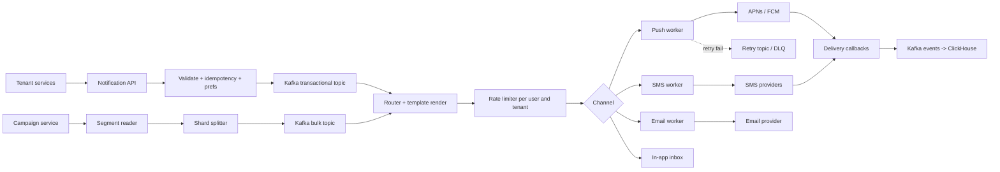

# Q9 · Notification system

Oct 16, 2026 · @saurav chaurasiya

**Is doc me:** ek multi-tenant notification platform ka poora HLD: push (APNs/FCM), SMS, email, in-app, templates, scheduling, per-user rate limit, millions tak broadcast fan-out aur open/click analytics.

**Padhne ka tareeka** — pehle Sawaal pe 15 min khud socho, phir Sahi design padho. Ye generic version hai; payments-specific version [C8 · Notification service](https://claude.ai/code/artifact/729bdcdf-fa6a-4de0-852e-a88e13273429) me hai, yahan focus broadcast fan-out aur multi-tenancy pe hai.

---

## Q9 — Notification system

Notification system ek aisa platform hai jo kisi bhi product ki taraf se aaye event ya campaign ko sahi user tak sahi channel (push, SMS, email, in-app) se, sahi time pe, bina duplicate aur bina spam kiye pahunchata hai.

### Ye cheez hai kya

- Category: HLD boss, async messaging platform (queue + workers + third-party gateways).
- Problem: har product team khud APNs/FCM/SMS integrate kare to duplicate kaam, spam aur inconsistent delivery hoti hai. Ek shared platform sab tenants (alag-alag product/team) ke liye ye solve karta hai.
- Is lesson ke baad tum kar paoge: transactional vs broadcast path alag karna, 10M users tak fan-out design karna, per-user aur per-tenant rate limit lagana, aur open/click analytics pipeline banana.
- Analogy: ye ek bade post office ki tarah hai. Alag-alag companies (tenants) chitthiyan deti hain, post office template se chitthi banata hai, pata dekhta hai, sahi delivery boy (channel) ko deta hai, aur ek ghar me roz 50 chitthiyan nahi daalta.

### Sawaal

Tum ek multi-tenant notification platform design kar rahe ho jise Swiggy, Zomato-type 200 internal products use karte hain. Total 50M registered devices, 20M DAU (daily active users). Roz 300M notifications jaate hain. Order-status jaise transactional messages ka p99 latency (99 percent requests isse tez) 2 second se kam chahiye. Diwali campaign me marketing ko 10M users ko 15 minute ke andar push bhejna hai. Ek user ko din me marketing ke 3 se zyada push nahi jaane chahiye, aur ek tenant doosre ke traffic se slow nahi hona chahiye.

> Pehle khud socho — 15 min. Hints: (1) transactional aur campaign traffic ko ek hi queue me rakhoge to kya hoga? (2) 10M users ka fan-out ek request me kaise todoge? (3) retry karte waqt duplicate notification kaise rokoge?

### Problem kyun aata hai

- Third-party gateways (APNs, FCM, SMS provider) ki apni rate limits aur outages hoti hain; hamare control me nahi.
- Ek bada campaign OTP jaise zaroori message ko pichhe dhakel sakta hai (noisy neighbour problem).
- Retry se duplicate: user ko ek hi offer 3 baar mil jaata hai.
- Spam: har team apna notification bhejti hai, user ko din me 40 push mil jaate hain, user app uninstall kar deta hai.
- Device token stale ho jaate hain (app uninstall), bekaar bheje gaye push cost aur reputation kharab karte hain.

### Naive approach

- Product service seedha FCM/SMS API ko synchronous call karti hai, aur campaign ke liye ek loop `for user in 10M users`.
- Kahan tootta hai:
  - 10M push, ek worker 500 push/sec bheje to 20,000 second (lagbhag 5.5 ghante). 15 minute ka target miss.
  - Loop beech me crash ho gaya to pata nahi kahan tak bheja; restart pe sabko dobara bhejega (duplicate).
  - FCM slow hua to product service ke threads atak jaate hain aur order API bhi slow ho jaati hai.
  - Per-user cap ka koi central jagah nahi, to cap enforce hi nahi hota.

### Sahi design

#### Requirements

- Functional:
  - Tenant API se notification bhej sake (single, batch, ya audience-based campaign).
  - Channels: push (APNs/FCM), SMS, email, in-app inbox.
  - Templates with variables aur locale (Hindi/English).
  - Scheduling: abhi, baad me, ya user ke local time pe.
  - User preferences aur opt-out (channel-wise, category-wise).
  - Open/click/delivery analytics.
- Non-functional:
  - Transactional p99 under 2 s; campaign 10M in 15 min.
  - At-least-once delivery with dedupe (effectively once from user ki nazar me).
  - Tenant isolation: ek tenant ka spike doosre ko na rokay.
  - High availability, gateway outage me graceful degrade (fallback channel).

#### Back-of-envelope estimates

- 300M notifications/day / 86,400 = lagbhag 3,500 per second average. Peak 5x maan lo: 17,500 per second.
- Campaign: 10M / 900 s = lagbhag 11,000 per second sustained sirf campaign ke liye.
- Total peak: lagbhag 30,000 per second. Kafka (distributed log queue) ke liye aaram se.
- Storage: ek notification record 500 bytes x 300M = 150 GB/day. 30 din hot rakho to 4.5 TB; usse purana cold storage me.
- Device tokens: 50M x 200 bytes = 10 GB, ek Redis/DB cluster me aa jaata hai.

#### API design

- `POST /v1/notifications` — body: `tenantId`, `userId`, `templateId`, `params`, `channels`, `priority` (TRANSACTIONAL ya PROMOTIONAL), `idempotencyKey`, `sendAt`. Response `202 Accepted` + `notificationId`.
- `POST /v1/campaigns` — body: `audienceQuery` ya `segmentId`, `templateId`, `schedule`, `throttlePerSec`. Response `202` + `campaignId`.
- `GET /v1/notifications/{id}` — status (QUEUED, SENT, DELIVERED, OPENED, FAILED).
- `PUT /v1/users/{id}/preferences` — channel aur category opt-in/out.
- `POST /v1/events/open` aur `GET /r/{token}` — open pixel aur click redirect (analytics ke liye).

#### Data model

| Table / Store | Key fields | Store |
| --- | --- | --- |
| notification | id, tenant\_id, user\_id, template\_id, channel, status, dedupe\_key, created\_at | Cassandra / sharded MySQL, partition by user\_id |
| template | tenant\_id, template\_id, version, locale, body | MySQL + cache |
| device\_token | user\_id, platform, token, last\_seen | Redis + DB |
| preference | user\_id, channel, category, enabled | Redis + DB |
| campaign | id, tenant\_id, audience, status, cursor | MySQL |
| events (open/click) | notification\_id, type, ts | Kafka -> ClickHouse |

#### High-level architecture

Ye diagram dikhata hai ki transactional aur campaign dono alag priority queues se guzarte hain, aur workers per-channel gateway tak pahunchte hain.



#### Steps

1. API request validate hoti hai, `idempotencyKey` Redis me check hoti hai (duplicate ho to purana response wapas).
2. User preference aur quiet hours check hote hain; opt-out ho to record SUPPRESSED mark ho jaata hai.
3. Message priority ke hisaab se alag Kafka topic me jaata hai: transactional topic chhota aur fast, bulk topic bada. Isse campaign OTP ko block nahi karta.
4. Router template render karta hai (locale ke saath) aur channel select karta hai.
5. Rate limiter per-user (din me 3 promo) aur per-tenant (QPS quota) check karta hai.
6. Channel worker gateway ko call karta hai. Failure pe exponential backoff ke saath retry topic; baar-baar fail ho to DLQ (dead letter queue — jo message process na ho sake uska parking lot).
7. Gateway ke callbacks aur client ke open/click events Kafka se ClickHouse (analytics database) me jaate hain.

#### Broadcast fan-out (campaign ka core)

- Campaign service audience ko shards me todta hai: 10M users / 1,000 shards = 10,000 users per shard.
- Har shard ek chhota job hai (`campaignId`, `shardId`, `cursor`) jo bulk topic me jaata hai. Worker job uthakar 10,000 users ko page-by-page padhta hai aur cursor save karta hai.
- Crash hone par job dobara chalta hai cursor se; `dedupe_key = tenant:campaign:user:channel` duplicate rokti hai.
- Push ke liye FCM batch API ya topic send use hota hai, jisse ek call me 500 tokens tak jaate hain.
- `throttlePerSec` se campaign apni speed tay karta hai taaki gateway aur downstream services na girein.

#### Per-user rate limit aur dedupe ka chhota demo

Ye Java demo token bucket (tokens ka balti jo dheere-dheere bharti hai), dedupe key aur channel Strategy dikhata hai. Time manual hai taaki output fixed rahe.

```java
import java.util.*;

public class Demo {
    // Strategy: har channel ka apna sender
    interface Channel { String name(); boolean send(String user, String msg); }
    static class Push implements Channel {
        public String name() { return "PUSH"; }
        public boolean send(String u, String m) { return true; }
    }
    static class Sms implements Channel {
        public String name() { return "SMS"; }
        public boolean send(String u, String m) { return true; }
    }

    // Token bucket: tenant+user ke liye alag bucket, time manual (demo deterministic rahe)
    static class Bucket {
        double tokens; long last; final double cap, ratePerSec;
        Bucket(double cap, double rate, long now) { this.cap = cap; this.ratePerSec = rate; this.tokens = cap; this.last = now; }
        boolean take(long now) {
            tokens = Math.min(cap, tokens + (now - last) / 1000.0 * ratePerSec);
            last = now;
            if (tokens >= 1) { tokens -= 1; return true; }
            return false;
        }
    }

    static Map<String, Bucket> buckets = new HashMap<>();
    static Set<String> seen = new HashSet<>();   // idempotency: dedupe key

    static String dispatch(String tenant, String user, String campaign, Channel ch, long now) {
        String dedupeKey = tenant + ":" + campaign + ":" + user + ":" + ch.name();
        if (!seen.add(dedupeKey)) return "DUPLICATE_SKIPPED";
        Bucket b = buckets.computeIfAbsent(tenant + ":" + user, k -> new Bucket(2, 0.1, now));
        if (!b.take(now)) { seen.remove(dedupeKey); return "RATE_LIMITED"; }
        return ch.send(user, "hello") ? "SENT" : "FAILED";
    }

    public static void main(String[] args) {
        Channel push = new Push(), sms = new Sms();
        long t = 0;
        System.out.println("1) " + dispatch("swiggy", "u1", "diwali", push, t));
        System.out.println("2) " + dispatch("swiggy", "u1", "diwali", push, t));   // same campaign dobara
        System.out.println("3) " + dispatch("swiggy", "u1", "sale2", sms, t));
        System.out.println("4) " + dispatch("swiggy", "u1", "sale3", push, t));    // bucket khali
        System.out.println("5) " + dispatch("zomato", "u1", "sale3", push, t));    // dusra tenant, alag bucket
        System.out.println("6) " + dispatch("swiggy", "u1", "sale3", push, t + 20000)); // 20s baad refill
        int shards = 8;
        for (String u : new String[]{"u1", "u2", "u3"})
            System.out.println("shard(" + u + ") = " + Math.floorMod(u.hashCode(), shards));
    }
}
```

Isko chalane pe bilkul ye output aata hai:

```text
1) SENT
2) DUPLICATE_SKIPPED
3) SENT
4) RATE_LIMITED
5) SENT
6) SENT
shard(u1) = 4
shard(u2) = 5
shard(u3) = 6
```

- Line 2: same campaign dobara aaya to dedupe key ne rok diya.
- Line 4: swiggy ke u1 ke 2 tokens line 1 aur 3 me khatam ho gaye, isliye rate limited.
- Line 5: zomato tenant ka bucket alag hai, isliye wahi user ID SENT hua (multi-tenancy ka isolation).
- Line 6: 20 second me 0.1 x 20 = 2 token wapas aaye, to SENT.
- Pattern: channel ke liye Strategy; naya channel (WhatsApp) sirf ek nayi class se judta hai.

#### Multi-tenancy kaise handle hota hai

- Har tenant ka apna quota (QPS, daily cap) config me hota hai; API gateway pe enforce hota hai.
- Kafka me partition key `tenantId + userId` rakhte hain; bade tenants ke liye alag dedicated topic/partitions, taaki ek tenant ka lag doosre tak na jaaye.
- Per-tenant sender identity: apna SMS sender ID, email domain (SPF/DKIM — email ki "ye sach me isi domain se aaya" proof), push credentials.
- Templates tenant-scoped aur versioned hote hain; galat edit se purana version rollback ho sakta hai.
- Data isolation: har row pe `tenant_id`, aur query layer me mandatory filter.

#### Scheduling

- `sendAt` wale messages ek scheduler store me jaate hain (time-bucketed: har minute ka bucket). Ek poller due bucket ko Kafka me daalta hai.
- "User ke local time pe 10 AM" ke liye campaign ko timezone-wise shards me tod do.

#### Analytics (opens aur clicks)

- Push open: app SDK event bhejta hai. Email open: 1x1 tracking pixel. Click: `GET /r/{token}` redirect jo event log karke asli URL pe bhej deta hai.
- Events Kafka -> ClickHouse; dashboards campaign-wise delivered/open/click rate dikhate hain.

### Kya choose karein aur kyun

| Option | Kab use karo | Kab mat karo |
| --- | --- | --- |
| Ek shared queue sab ke liye | Chhota system, kam traffic | Campaign aur OTP mix ho jaayein to latency kharab |
| Priority-wise alag topics (transactional / bulk) | Production default | Bahut chhota startup jise overhead nahi chahiye |
| Per-tenant dedicated topics | Bade ya noisy tenants | Saare 200 tenants ke liye (partition explosion) |
| Fan-out on write (har user ke liye message pehle se banao) | Chhoti audience, personalised content | 10M broadcast (storage aur time dono bhaari) |
| Fan-out on read / topic send | Same content sabko (breaking news) | Jab har user ka content alag ho |
| Push-first, SMS fallback | Cost bachani ho | Jab delivery guarantee zaroori ho (OTP me SMS direct) |

### India me kaise hota hai

- India ke bade apps (Swiggy, Zomato, Flipkart, Ola) aksar MoEngage jaise customer-engagement platforms ya in-house systems se push/SMS campaigns chalate hain; is topic pe ye [podcast conversation](https://neon.fund/podcasts/the-800m-software-behind-notifications-of-ola-flipkart-swiggy-raviteja-dodda-moengage/) context deta hai.
- Marketing push strategy ka teardown: [Zomato and Swiggy push notifications](https://pushpilot.ai/blog/zomato-swiggy-push-notification-teardown).
- SMS ke liye India me TRAI ki DLT registration (sender ID aur template pehle se register karna zaroori) lagti hai, isliye platform template ID ko first-class field banata hai. Ye mera design-level observation hai, exact rules provider docs se verify karna.
- Push delivery ki bunyaad: [FCM topic messaging](https://firebase.google.com/docs/cloud-messaging/topic-messaging) aur [FCM delivery samajhna](https://firebase.google.com/docs/cloud-messaging/understand-delivery).

### Interview follow-ups

- **Duplicate notification kaise rokoge?** — `dedupe_key = tenant:campaign:user:channel` ko atomic set-if-absent (Redis `SETNX`) ya DB unique constraint se check karo; worker retry safe ban jaata hai.
- **FCM/APNs down ho jaaye to?** — Retry topic with exponential backoff aur jitter; limit ke baad fallback channel (SMS/in-app), aur circuit breaker taaki gateway pe hammering na ho.
- **Ek tenant ka campaign OTP ko kaise na roke?** — Alag priority topics aur alag consumer groups; bulk workers ko throttle karo, transactional ko reserved capacity do.
- **Stale device tokens ka kya?** — FCM/APNs "unregistered" error deta hai; us token ko turant delete karo, warna cost aur reputation dono girte hain.
- **User ko din me max 3 promo kaise guarantee karoge?** — Redis counter (`user:date:promo`) ya token bucket, router ke baad aur gateway se pehle check hota hai; transactional messages is cap se alag hote hain.
- **Exactly once milega?** — Practically nahi; at-least-once delivery + dedupe se user ko effectively-once experience milta hai. Gateway tak ka last hop network failure me ambiguous rehta hai.

### Self-check

1. Transactional aur promotional traffic ko alag topics me kyun rakhte hain?
2. 10M campaign ko shards me todne se crash recovery kaise aasan hoti hai?
3. Dedupe key me kaun-kaun si fields hoti hain aur kyun?
4. Multi-tenant system me noisy neighbour ko rokne ke do tareeke batao.
5. Open aur click tracking technically kaise hoti hai?

### Notebook

Transactional aur bulk traffic alag queues · Campaign = shards + cursor + dedupe key · At-least-once + dedupe = effectively once · Per-user cap aur per-tenant quota dono chahiye · Stale token turant hatao · Analytics events Kafka se ClickHouse · Gateway fail pe retry, backoff, fallback channel

### Padhne ke liye

- [Notification System Design: Architecture and Best Practices (MagicBell)](https://www.magicbell.com/blog/notification-system-design)
- [Notification System Design: Push, SMS, Email at Scale (Ajit Singh)](https://singhajit.com/notification-system-design/)
- [Notification System Architecture: Channels, Fan-Out, and Delivery at Scale (Codelit)](https://codelit.io/blog/notification-system-architecture)
- [Topic Messaging (Firebase Cloud Messaging)](https://firebase.google.com/docs/cloud-messaging/topic-messaging)

### Deep Dive (SDE-2) — jab time ho

#### Backpressure aur campaign throttling

- Backpressure (downstream slow ho to upstream ko dheema karna): bulk consumers lag dekhkar apni poll rate kam karte hain.
- Gateway ka 429 response milne par adaptive rate: AIMD (additive increase, multiplicative decrease) jaise TCP me hota hai.
- Queue patterns ke liye [1E · Kafka River](https://claude.ai/code/artifact/eeb39ee8-3f52-4c04-b57b-68213f02c429) aur rate limiting ke liye [2E · Resilience Ridge](https://claude.ai/code/artifact/4769dea3-018e-41e1-ae18-253fa36a6d21) dekho.

#### Hot partition aur ordering

- Ek bade tenant ka sab traffic ek partition me gaya to hot key ban jaata hai (ek hi key pe zyada load). Salting ya `userId` hash se failao.
- Ordering sirf per-user zaroori hai (jaise "order placed" se pehle "delivered" na aaye); isliye `userId` ko partition key rakho.

#### Smart delivery

- Send-time optimisation: user ke past open times se best slot chuno.
- Frequency capping across channels: aaj push mil gaya to wahi offer SMS se na bhejo.
- Collapse keys (APNs/FCM me purane pending notification ko naye se replace karna) taaki user ko 5 stale updates ek saath na milein.

#### Delivery guarantees aur reconciliation

- Gateway ack aur device ack alag cheezein hain; "SENT" ka matlab sirf gateway ne le liya, "DELIVERED" device callback se aata hai.
- Periodically sent vs delivered count reconcile karo; badi gap gateway issue ka signal hai.

---

## Aage kya

- Pichhla: [Q8 · Distributed cache](https://claude.ai/code/artifact/eb966902-a403-49af-815d-36346f1f5e3f)
- Agla: [Q10 · Search autocomplete](https://claude.ai/code/artifact/7cf22445-3c24-458c-8a0d-2a6eabf61c6c)
- Related: [C8 · Notification service](https://claude.ai/code/artifact/729bdcdf-fa6a-4de0-852e-a88e13273429), [D15 · Notification service](https://claude.ai/code/artifact/6f904711-e790-423b-bf3c-79b94a671bfa), [1E · Kafka River](https://claude.ai/code/artifact/eeb39ee8-3f52-4c04-b57b-68213f02c429)
