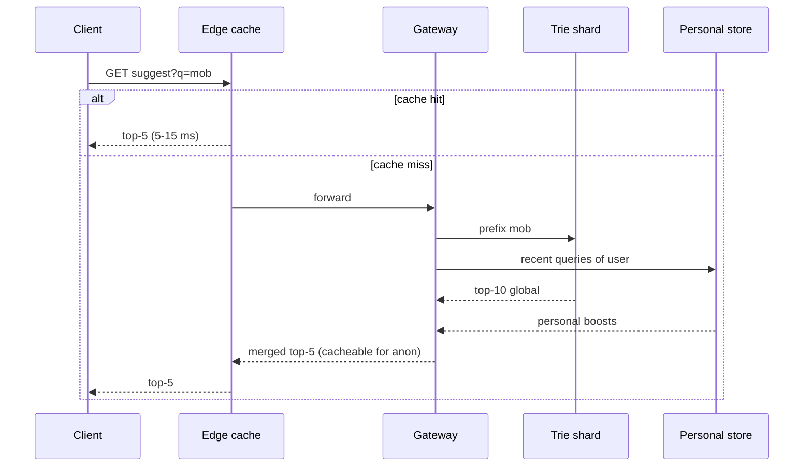

# Q10 · Search autocomplete

Oct 16, 2026 · @saurav chaurasiya

**Is doc me:** search box me type karte hi aane wali suggestions (typeahead) ka poora HLD — trie, top-k, offline build, sharding, edge caching, personalisation, trending, Hinglish queries aur offensive filtering.

**Padhne ka tareeka** — pehle Sawaal pe 15 min khud socho, phir Sahi design padho, aakhir me Self-check se khud ko test karo.

---

## Q10 — Search autocomplete

Search autocomplete (typeahead) wo feature hai jisme user ke type karte hi search box ke neeche top suggestions dikhte hain, jaise "mob" likhte hi "mobile cover", "mobile charger". Iska kaam hai user ke keystrokes bachana aur galat spelling se bachana, aur wo bhi 100 ms se kam me.

### Ye cheez hai kya

- Category: read-heavy, ultra low latency HLD problem (Q-series ka classic).
- Problem: user poori query type kare, usse pehle hi sahi query guess karke dikhana, taaki search ka funnel chhota ho jaaye.
- Is lesson ke baad tum kar paoge: trie with top-k per node design karna, offline build pipeline samjhana, trie ko prefix se shard karna, hot prefixes CDN/edge pe cache karna, aur Hinglish plus offensive filtering ka plan batana.
- Analogy: kirana dukaan wala jo tumhari pehli 2 shabd sunte hi bol deta hai "bhaiya, Maggi chahiye na?" — usne pehle se yaad rakha hai ki is mohalle me kya sabse zyada bikta hai.

### Sawaal

Tumhe Flipkart jaisi e-commerce app ka search autocomplete banana hai. 50 million DAU (daily active users — roz kitne alag log aate hain), har user din me \~10 searches, aur har search me \~5 keystrokes pe suggestion call jaati hai.

- Latency budget: end-to-end p99 (99% requests is time se tez) 100 ms se kam, server side 20 ms se kam.
- Catalogue me \~100M distinct historical queries. Naye trending queries (cricket match, sale, naya phone launch) 10 minute ke andar dikhne chahiye.
- Users "mobaile cover", "jute", "saree" aur "sari" sab type karte hain. Gaali ya offensive suggestion kabhi nahi dikhna chahiye.

> Pehle khud socho — 15 min. Hints: (1) Har keystroke pe DB query chalegi to kya hoga? (2) Prefix se top-5 kaise O(1) ke paas milega? (3) Trie ek machine me nahi samayega to kaise baantoge?

### Problem kyun aata hai

- Traffic keystroke-level hai, search-level nahi: ek search = 5-8 suggestion calls.
- Latency user ko seedha dikhti hai: 200 ms se upar typing "lag" karti hai.
- Popular prefixes (jaise "i", "iph", "sam") bahut hot hote hain — 1% prefixes pe 60%+ traffic.
- Suggestions ka data fresh bhi chahiye (trending) aur safe bhi (offensive nahi).
- Hinglish: ek hi cheez ki kai spellings, jaise "joote", "jute", "jooto".

### Naive approach

- Pehla idea: DB me `SELECT query FROM queries WHERE query LIKE 'mob%' ORDER BY count DESC LIMIT 5`.
- Tootna: 50M x 10 x 5 = 2.5 billion calls/din, yaani average \~29K QPS (queries per second) aur peak \~100K QPS. Har call me 100M rows ka prefix scan plus sort.
- `LIKE 'mob%'` index use kar bhi le, to bhi "m" jaisa chhota prefix lakhon rows match karta hai aur sort karna padta hai — p99 seconds me jaata hai.
- Har request user-visible hai, aur DB cache nahi hota is access pattern ke liye, to SPOF (single point of failure — ek cheez ruke to sab ruk jaaye) ban jaata hai.

### Sahi design

#### Requirements

- Functional: prefix do, top-5 suggestions lo. Trending, personalised aur Hinglish queries support. Offensive suggestions filter.
- Non-functional: p99 < 100 ms end-to-end, highly available, eventual consistency (thoda purana data chalega — naya data thodi der me sab jagah pahunch jaata hai) theek hai, 100K+ peak QPS.
- Out of scope: full search results, spell-correct ka ML model detail.

#### Back-of-envelope estimates

- Traffic: 50M DAU x 10 searches x 5 calls = 2.5B calls/din. Average \~29K QPS, peak 3x = \~90K QPS.
- Trie size: 100M queries x \~25 bytes avg = \~2.5 GB raw. Har node pe top-5 pointers/ids add karo to \~10-15 GB. Ek bade machine me aa sakta hai, par replicas aur growth ke liye shard karte hain.
- Cache: top 1M prefixes \~ 80-90% traffic cover karte hain. 1M x 500 bytes = 500 MB — edge cache ke liye bahut chhota.
- Logs: 2.5B calls ke baad bhi asli "submit hui queries" sirf 500M/din; 500M x 100 bytes = \~50 GB/din raw logs.

#### API design

- `GET /v1/suggest?q=mob&lang=hi-en&limit=5` — user ID token header me, response me `[{"text":"mobile cover","id":"q123"}]`.
- Response `Cache-Control: public, max-age=60` for anonymous, taaki CDN cache kare.
- Client debounce (typing rukne ka 100-150 ms wait) karta hai, taaki har keystroke pe call na jaaye.

#### Data model

| Store | Key | Value | Kyun |
| --- | --- | --- | --- |
| Query log (Kafka then object store) | timestamp | raw query, user, locale | Offline aggregation ke liye |
| Aggregated counts (warehouse) | query, window | count, CTR | Trie build input |
| Trie snapshot (file in blob store) | shard id, version | serialized trie | Servers isse load karte hain |
| Personal store (Redis) | user id | recent 20 queries | Per-user boost |
| Blocklist | term | reason | Offensive filter |

#### Trie with top-k per node

- Trie (prefix tree) me har character ek edge hota hai; "mob" tak pahunchne ke baad node pe us prefix wali sabse popular K queries pehle se stored hoti hain.
- Isse query time O(len(prefix)) hota hai — subtree DFS karke sort nahi karna padta.
- Trade-off: memory badhti hai (har node pe K pointers), par latency bahut girti hai.
- Radix/compressed trie use karo taaki single-child chains ek node ban jaayein.

Neeche ka Java demo ek chhota trie banata hai jisme top-3 per node hai, Hinglish normalisation, blocklist filter aur trending update hai. Ye Strategy-jaisa pluggable scoring ka base hai (score map badal do to ranking badal jaati hai).

```java
import java.util.*;

public class Demo {
    // Har trie node apne subtree ke top-K queries pehle se rakhta hai
    static class Node {
        Map<Character, Node> kids = new HashMap<>();
        List<String> top = new ArrayList<>();
    }

    static final int K = 3;
    static Node root = new Node();
    static Map<String, Long> score = new HashMap<>();
    static Set<String> blocked = Set.of("badword");

    // Hinglish normalisation: "mobaile" jaisi spelling ko canonical form me badlo
    static String normalize(String q) {
        return q.toLowerCase().trim().replace("mobaile", "mobile").replace("jooto", "joote");
    }

    // Offline build: (query, count) daalo, har node pe top-K update karo
    static void insert(String q, long count) {
        if (blocked.contains(q)) return;
        score.put(q, count);
        Node cur = root;
        for (char c : q.toCharArray()) {
            cur = cur.kids.computeIfAbsent(c, x -> new Node());
            if (!cur.top.contains(q)) cur.top.add(q);
            cur.top.sort((a, b) -> Long.compare(score.get(b), score.get(a)));
            if (cur.top.size() > K) cur.top.remove(K);
        }
    }

    // Query time: prefix tak chalo, node ki precomputed list return karo - O(len(prefix))
    static List<String> suggest(String prefix) {
        Node cur = root;
        for (char c : normalize(prefix).toCharArray()) {
            cur = cur.kids.get(c);
            if (cur == null) return List.of();
        }
        return cur.top;
    }

    public static void main(String[] args) {
        insert("mobile", 900); insert("mobile cover", 700); insert("mobile stand", 300);
        insert("mobile charger", 800); insert("mouse", 500); insert("joote", 400);
        insert("badword", 9999);
        System.out.println("mo      -> " + suggest("mo"));
        System.out.println("mobile  -> " + suggest("mobile"));
        System.out.println("mobaile -> " + suggest("mobaile"));
        System.out.println("joo     -> " + suggest("joo"));
        System.out.println("bad     -> " + suggest("bad"));
        // Trending: mobile stand achanak viral
        insert("mobile stand", 2000);
        System.out.println("mobile (trending ke baad) -> " + suggest("mobile"));
    }
}
```

Isko chalane pe bilkul ye output aata hai:

```text
mo      -> [mobile, mobile charger, mobile cover]
mobile  -> [mobile, mobile charger, mobile cover]
mobaile -> [mobile, mobile charger, mobile cover]
joo     -> [joote]
bad     -> []
mobile (trending ke baad) -> [mobile stand, mobile, mobile charger]
```

- "mo" pe "mouse" (500) top-3 se bahar hai kyunki mobile (900), charger (800), cover (700) bade hain.
- "badword" insert hi nahi hua, isliye "bad" ka result khaali hai — blocklist build time pe kaam kar rahi hai.
- Trending update ke baad "mobile stand" 2000 score ke saath upar aa gaya.

#### Offline build pipeline

1. Client/search service har submitted query ko Kafka pe log karta hai.
2. Spark/Flink job har ghante (aur trending ke liye har 5-10 min) counts aggregate karta hai, time decay ke saath (purani queries ka weight kam).
3. Blocklist aur quality filters lagte hain, phir trie ban kar serialized snapshot ke roop me blob store (S3) pe jaata hai, version number ke saath.
4. Suggestion servers naya snapshot load karte hain aur atomically pointer swap karte hain (blue-green) — purana trie tab tak serve karta rehta hai.
5. Failure hui to purana snapshot chalta rehta hai — suggestions thode stale, par down nahi.

#### Sharding the trie by prefix

- Pura trie ek machine me fit ho sakta hai, par QPS aur replicas ke liye shard karte hain.
- Prefix ke pehle 1-2 characters se shard: "a-c" shard 1, "d-f" shard 2 — par ye skew deta hai ("s", "m" bahut bhaari).
- Behtar: historical traffic ke histogram se range boundaries chuno taaki har shard ka load barabar ho; hot prefixes ko extra replicas do.
- Router prefix dekh ke shard chunta hai. Consistent hashing ([1D · Shard Mountains](https://claude.ai/code/artifact/cfe905e6-6370-43e0-a337-764eeb9ddf1e)) yaha kam kaam ki hai kyunki prefix queries range-friendly mapping maangti hain.

#### High-level architecture

```mermaid
flowchart LR
    U[User keystroke] --> D[Client debounce 120ms]
    D --> E[CDN / Edge cache]
    E -->|miss| G[API gateway]
    G --> R[Prefix router]
    R --> S1[Trie shard a-c replicas]
    R --> S2[Trie shard d-m replicas]
    R --> S3[Trie shard n-z replicas]
    G --> P[Personal store Redis]
    S1 --> F[Filter + merge + rerank]
    P --> F
    F --> E
    L[Search logs Kafka] --> A[Spark/Flink aggregation]
    A --> B[Trie builder + blocklist]
    B --> O[Snapshot in S3]
    O --> S1
    O --> S2
    O --> S3
```



Ek request ka flow:



#### Caching hot prefixes at CDN/edge

- Anonymous aur non-personalised responses ka `max-age` 30-60 sec rakho: 1M hot prefixes edge pe 80-90% traffic absorb kar lete hain.
- Browser cache bhi use karo: user "mob" ke baad backspace karke dubara "mob" type kare to network call hi nahi.
- Personalised blend edge pe nahi, gateway pe: edge global top-10 deta hai, client ya gateway personal items upar mila deta hai. ([1B · Cache Caves](https://claude.ai/code/artifact/32bb1c8e-3433-417c-a3f4-3a34babed6bf) cache patterns aur invalidation ke liye.)
- Latency budget: client debounce 120 ms alag, network \~30 ms, edge hit 5-15 ms, miss pe gateway + shard \~20 ms. Total p99 < 100 ms.

#### Personalisation and trending

- Personalisation: user ki recent 20 queries Redis me; final ranking = global score + boost for personal match. Sirf top-10 global candidates re-rank karo, poora trie nahi.
- Trending: alag chhota "fresh" trie ya counter (5-10 min window) banao, aur main trie ke result ke saath merge karo. Match ke din "ind vs" jaisi prefix turant upar aa jaati hai.
- Cold start: naye user ko location/language based global popular queries do.

#### Hinglish and transliteration

- Users Roman me Hindi likhte hain ("joote", "jute", "jooto"). Normalisation layer phonetic key banata hai (jaise Soundex/Metaphone jaisa Indian-phonetics variant) aur sab spellings ko ek canonical query se map karta hai.
- Devanagari script me likhi query ko Roman me transliterate karke same canonical key pe map karo, taaki dono scripts ek hi trie se serve hon.
- Typo tolerance: 1 edit distance tak fuzzy match, par sirf tab jab exact prefix ke results kam hon.

#### Filtering offensive suggestions

1. Build time pe blocklist + ML classifier se queries trie me jaane se pehle hata do.
2. Serve time pe bhi last-line filter lagao, kyunki blocklist update hoti rehti hai aur trie snapshot purana ho sakta hai.
3. Legal/brand-sensitive terms (naam, community targeting) ke liye manual review queue rakho.
4. Ek "kill switch" rakho jisse ek suggestion turant edge cache se purge ho jaaye.

### Kya choose karein aur kyun

| Option | Kab use karo | Kab mat karo |
| --- | --- | --- |
| DB LIKE query | Chhota catalogue, prototype | Production scale, p99 < 100 ms |
| In-memory trie with top-k | Bahut tez, predictable latency, apna control | Frequent real-time updates bina snapshot pipeline ke |
| Elasticsearch completion suggester | Pehle se ES stack hai, jaldi launch | Extreme QPS ya custom ranking/filter logic |
| Redis sorted set per prefix | Chhota prefix set, simple ops | Memory bahut badhti hai long prefixes ke saath |
| Edge cache only | Hot prefixes ke liye add-on | Long-tail prefixes ke liye akela kaafi nahi |

### India me kaise hota hai

- Flipkart ne public talks me context-aware autocomplete at scale par baat ki hai: [Context Aware Autocomplete at Scale at Flipkart](https://hasgeek.com/fifthelephant/2020/sub/context-aware-autocomplete-at-scale-at-flipkart-B4V51cLDHzpCaCYYBFQnVe).
- Flipkart Tech blog ne Indian phonetics (Hinglish spellings) ko search me handle karne ka approach likha hai: [Adapting Search to Indian Phonetics](https://blog.flipkart.tech/adapting-search-to-indian-phonetics-cdbe65259686).
- Swiggy/Zomato jaise apps me query aksar dish ya restaurant ka naam hota hai, jisme location (city, area) prefix ranking ka bada signal hai — wahi "context-aware" idea.
- General reference design: [Typeahead / Autocomplete System Design](https://systemdesignschool.io/problems/typeahead/solution).

### Interview follow-ups

- **Trie ek machine me na aaye to?** — Prefix range se shard karo, traffic histogram se boundaries chuno, hot shards ko extra replicas do.
- **Naya trending query kitni jaldi dikhe?** — Chhota fresh trie / counters 5-10 min window ke saath, main trie ke result se merge; full rebuild hourly.
- **Har keystroke pe call kyun na karein?** — Debounce 100-150 ms aur cache; isse QPS 3-5x kam hota hai.
- **Personalisation cache ko tod deti hai, kya karein?** — Global top-10 edge pe cache, personal re-rank gateway ya client pe.
- **Offensive suggestion live ho gayi to?** — Kill switch se edge cache purge + blocklist update; build aur serve dono pe filter.
- **Hinglish spelling variants kaise?** — Phonetic normalisation + transliteration, sab variants ek canonical query pe map.

### Self-check

1. Top-k per node trie se query time kaise O(len(prefix)) ho jaata hai?
2. Offline build pipeline ke 5 steps bolo, aur failure me kya hota hai?
3. Prefix-based sharding me skew kyun aata hai aur kaise sudhaarte hain?
4. Edge cache me personalised result kyun nahi rakhte?
5. Offensive filtering do jagah (build aur serve) kyun lagti hai?

### Notebook

Typeahead = read-heavy, p99 < 100 ms · trie me har node pe top-k precomputed · logs to Kafka to Spark/Flink to trie snapshot in S3 · prefix-range sharding with histogram-based boundaries · hot prefixes edge cache (30-60 s TTL) · personal rerank gateway pe, trending ke liye alag fresh trie · Hinglish ke liye phonetic normalisation · blocklist build aur serve dono pe.

### Padhne ke liye

- [Adapting Search to Indian Phonetics (Flipkart Tech)](https://blog.flipkart.tech/adapting-search-to-indian-phonetics-cdbe65259686)
- [Context Aware Autocomplete at Scale at Flipkart](https://hasgeek.com/fifthelephant/2020/sub/context-aware-autocomplete-at-scale-at-flipkart-B4V51cLDHzpCaCYYBFQnVe)
- [Typeahead / Autocomplete System Design](https://systemdesignschool.io/problems/typeahead/solution)
- [System Design: Search Autocomplete/Typeahead](https://www.techinterview.org/post/3233474192/system-design-search-autocomplete-typeahead-trie-elasticsearch-ranking-debouncing-personalization-trending-queries/)

### Deep Dive (SDE-2) — jab time ho

#### Memory-efficient trie

- Radix tree + top-k ko query IDs (4 bytes) ke roop me store karo, strings ke roop me nahi; string table alag rakho.
- Succinct/array-based tries (double-array) cache locality dete hain; pointer-chasing kam hota hai.

#### Ranking signals

- Score = decayed frequency x CTR (click-through rate — suggestion pe kitne % ne click kiya) x recency boost x personal boost.
- Position bias: upar wali suggestions zyada click hoti hain, isliye CTR ko position se normalise karo.

#### Zero-downtime snapshot swap

- Naya trie memory me load karo, health check pass hone par atomic pointer swap; purana trie grace period tak rakho.
- Replicas ek saath swap na karein (staggered), warna capacity dip aati hai.

#### Multi-region

- Har region apna snapshot load kare; trending local (city/state wise) ho sakta hai, jaise Mumbai me alag, Delhi me alag.
- Region fail ho to DNS/edge failover aur [2E · Resilience Ridge](https://claude.ai/code/artifact/4769dea3-018e-41e1-ae18-253fa36a6d21) ke patterns.

---

## Aage kya

- Pichhla: [Q9 · Notification system](https://claude.ai/code/artifact/bfecee08-f812-4c61-9f8a-c042ee6feb05)
- Agla: [Q11 · YouTube / Netflix](https://claude.ai/code/artifact/7ff0cd58-5f6f-423c-bb48-01d8697b7825)
- Related: [1B · Cache Caves](https://claude.ai/code/artifact/32bb1c8e-3433-417c-a3f4-3a34babed6bf), [1D · Shard Mountains](https://claude.ai/code/artifact/cfe905e6-6370-43e0-a337-764eeb9ddf1e), [Q8 · Distributed cache](https://claude.ai/code/artifact/eb966902-a403-49af-815d-36346f1f5e3f)
