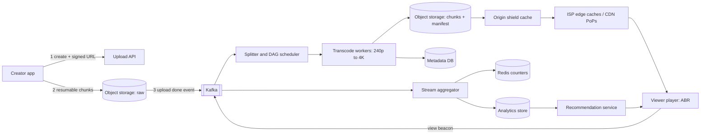
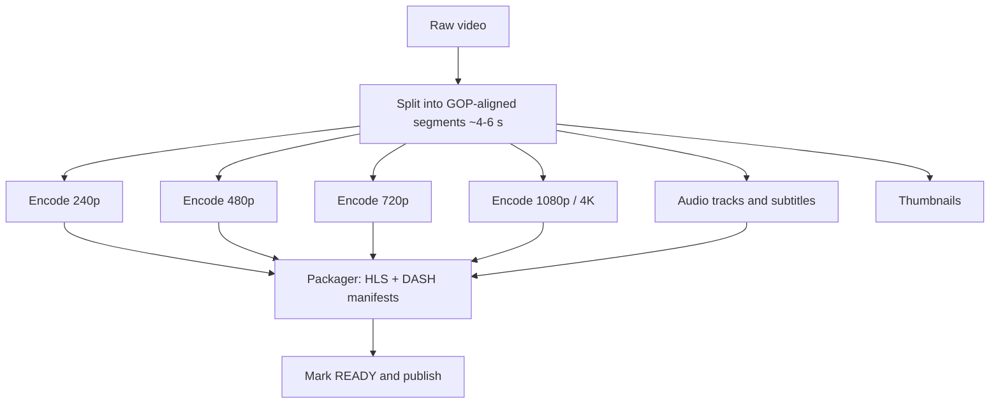
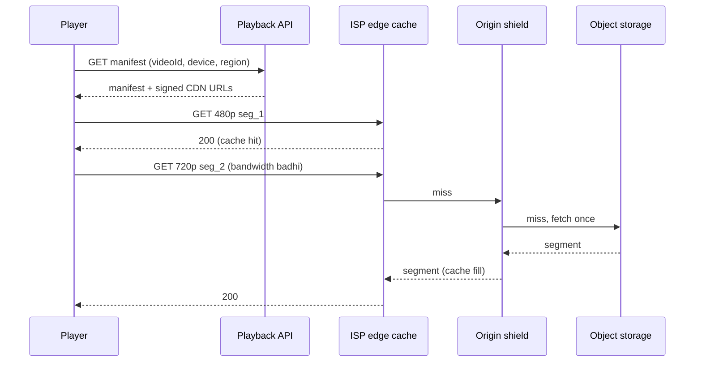

# Q11 · YouTube / Netflix

Oct 16, 2026 · @saurav chaurasiya

**Is doc me:** video platform ka poora HLD — upload, transcoding, chunked storage, adaptive streaming, CDN/ISP caches, live IPL spikes, view counts aur recommendations.

**Padhne ka tareeka** — pehle Sawaal pe 15 min khud socho, phir Sahi design padho; SDE-2 ho to Deep Dive bhi.

---

## Q11 — YouTube / Netflix

Video platform ek aisa system hai jo creator ki upload ki hui badi video file ko alag-alag quality ke chhote tukdon (chunks) me tod kar, duniya bhar ke viewers tak CDN ke through smoothly pahunchata hai. Asli kaam do hain: **write path** (upload + transcoding) aur **read path** (streaming), aur dono ki problems bilkul alag hain.

### Ye cheez hai kya

- Category: HLD boss / case study — media pipeline + content delivery
- Problem: ek 1 GB ki raw file ko 2G se 5G tak, mobile se 4K TV tak, har device pe bina buffering ke chalana
- Is lesson ke baad tum kar paoge: upload pipeline, transcoding DAG, ABR (adaptive bitrate), CDN/edge caching aur live spike handling interview me whiteboard pe design karna
- Analogy: tiffin service jaisa — ek hi kitchen (origin) se saare ghar nahi bhej sakte, isliye har mohalle me ek chhota centre (edge cache) rakhte hain, aur dabba (chunk) chhota rakhte hain taaki jaldi pahunche

### Sawaal

Tumhe ek Hotstar + YouTube jaisa platform banana hai.

- 30 crore monthly users, 5 crore daily active
- 1 lakh naye videos roz upload (average 10 min, source \~1 GB)
- VOD (video on demand — recorded video) plus live: IPL final pe 3-5 crore concurrent viewers (ek hi waqt pe dekhne wale)
- Playback start time p99 (99% requests is se tez) under 2 seconds, rebuffering ratio under 1%
- Network: 4G/5G ke saath kaafi users 2G-3G pe bhi, bandwidth har second badalti hai

> Pehle khud socho — 15 min. Hints: (1) Upload sync hai ya async? Transcoding kaun karega aur kab? (2) Ek hi file 3 Mbps ki connection pe bhi chalni chahiye aur 50 Mbps pe bhi — kaise? (3) 1 crore log ek saath 3 Mbps khinche to origin pe kitna load? Origin tak kitne requests pahunchne dene hain?

### Problem kyun aata hai

- Raw video bahut badi hoti hai: ek 10 min 1080p source \~1 GB; upload beech me toot sakta hai (mobile network)
- Har device ka codec (compression format), resolution aur bandwidth alag hai — ek file sabko fit nahi hoti
- Egress (data bahar jana) bandwidth sabse mehengi cheez hai; storage uske muqable sasta hai
- Live match me sab viewers ek hi chunk ek hi second me maangte hain — thundering herd (ek saath bheed)
- View count ek hot key (bahut zyada traffic wali single key) ban jaata hai: ek viral video pe lakhon increments per second

### Naive approach

- Creator ki file ek web server pe POST karo, wahi disk pe save karo, wahi se `<video src=...>` serve karo
- Kahan toot-ta hai:
  - Upload ek hi request me: 1 GB file 2 Mbps pe \~70 min leti hai, 99% pe net gaya to sab dubara
  - Ek hi quality: 1080p file (\~5 Mbps) 2 Mbps wale user pe har kuch second buffer karegi
  - Sab origin se: 1 crore viewers x 3 Mbps = **30 Tbps** (terabit per second) — kisi bhi data centre ke bas ke bahar
  - Transcoding upload request ke andar: 10 min video ko encode karne me kai minute CPU lagta hai, request timeout ho jaati hai
  - View count `UPDATE videos SET views = views + 1` — ek row pe row lock, viral video pe DB ruk jaata hai

### Sahi design

#### Requirements

- Functional:
  1. Creator video upload kare (resumable), title/thumbnail/metadata de
  2. Viewer video search/browse karke play kare, seek kare, quality auto-adjust ho
  3. Live streaming (low latency \~ 5-30 sec delay chalega)
  4. View count, like, watch history; home page recommendations
- Non-functional:
  1. Availability high (play kabhi na ruke), upload ke baad video 5-10 min me ready ho (eventual — baad me ho jaaye chalega)
  2. Startup latency p99 < 2 s, rebuffer < 1%
  3. Durability: uploaded video kabhi kho nahi sakti (11 nines object storage)
  4. Scale: read-heavy — watch:upload ratio 1000:1 se zyada
  5. Cost: egress bandwidth minimise karna sabse bada goal

#### Back-of-envelope estimates

- Upload: 1 lakh videos/day x 1 GB = **100 TB/day** raw. Transcoded ladder (6-8 renditions) lagbhag source ka \~1.5-2x ho jaata hai, to \~250-300 TB/day, yaani **\~100 PB/year**
- Upload QPS (queries per second): 1 lakh / 86400 = \~1.2 per second average — bahut kam, par har ek heavy hai
- Transcode compute: 10 min video ko chunks me tod kar parallel encode karo; 1 lakh x 10 min = 10 lakh min of video/day. Agar 1 CPU-core, 1 min video ko \~2 min me encode kare (har rendition ke liye) to roughly 20 lakh x renditions core-min/day — hazaron cores ka fleet, queue + autoscaling chahiye
- Playback egress: 1 crore concurrent x 3 Mbps = **30 Tbps**; IPL final 5 crore x 2.5 Mbps = **\~125 Tbps**
- View events: 100 crore/day / 86400 = \~11.5k per second average, peak \~35k per second — counters ko batch/aggregate karna padega
- Metadata: 100 crore videos x \~2 KB = \~2 TB — chhota hai, ek sharded DB aur cache me aa jaata hai. **Asli size video bytes me hai, metadata me nahi**

#### API design

- `POST /v1/videos` -> `{videoId, uploadUrl}` — metadata banao aur object storage ka pre-signed URL (time-limited signed link) do, taaki bytes API servers se na guzren
- `PUT <uploadUrl>` (multipart / resumable, har part 5-10 MB) — client seedha storage ko upload karta hai
- `POST /v1/videos/{id}/complete` — upload khatam, pipeline trigger karo
- `GET /v1/videos/{id}/manifest` -> HLS `.m3u8` ya DASH `.mpd` file ka URL (manifest = chunks ki list + quality options)
- `GET <cdn>/v/{id}/720p/seg_00042.ts` — actual chunk (CDN se)
- `POST /v1/videos/{id}/view` — view event (beacon), async
- `GET /v1/home?cursor=` — recommendations

#### Data model

| Store | Kya rakhta hai | Kyun |
| --- | --- | --- |
| Object storage (S3-jaisa) | raw uploads, transcoded chunks, thumbnails | sasta, durable, bahut bada |
| Metadata DB (sharded MySQL / Cassandra) | `videos(videoId, ownerId, title, status, createdAt, durationSec)`, `renditions(videoId, res, bitrate, manifestPath)` | videoId pe shard |
| Redis | hot metadata, approx view counters, session | low latency |
| Kafka | upload-done events, view events, transcode tasks | async decoupling |
| Analytics store (ClickHouse / BigQuery) | watch events, aggregates | recommendations aur reports |

#### High-level architecture

Ye diagram upload (write) path aur playback (read) path dono dikhata hai.

#### Upload pipeline (write path)

1. Client `POST /videos` karta hai, server `videoId` aur pre-signed URL deta hai (status = `UPLOADING`)
2. Client file ko 5-10 MB ke parts me tod kar resumable multipart upload karta hai. Net toota to sirf adhura part dubara bhejna hai
3. Poora hone pe storage event deta hai, Kafka me `video.uploaded` aata hai (status = `PROCESSING`)
4. Virus/policy check, duplicate (content hash) check, aur metadata extraction (duration, codec)

#### Transcoding pipeline

Transcoding = ek video ko dusre codec/resolution/bitrate me badalna. Ye CPU/GPU-heavy kaam hai, isliye worker fleet queue se kaam uthati hai.

- Video ko **GOP** (group of pictures — ek independent decodable frames ka group) boundary pe segments me todte hain, taaki har segment alag machine pe parallel encode ho
- Har segment x har rendition ek chhota task hai; ek DAG scheduler (directed acyclic graph — dependency order) tasks ko queue me daalta hai
- Worker fail ho to wahi task retry; task idempotent (dobara chalane pe same result) hota hai kyunki output path deterministic hota hai
- Pehle 240p/480p jaldi ready karke video "playable" mark kar sakte hain, 4K baad me — creator ko jaldi dikhta hai
- Per-title encoding: Netflix har title ke liye apna bitrate ladder nikaalta hai (simple animation kam bitrate me bhi saaf lagti hai)

#### Chunked storage aur adaptive bitrate streaming

- Har rendition ke segments chhote files hote hain (2-6 sec ke). Isse seek aur quality switch sasta ho jaata hai aur CDN har segment ko alag cache kar sakta hai
- **HLS** (HTTP Live Streaming — Apple ka protocol, `.m3u8` manifest + `.ts`/`.m4s` segments) aur **DASH** (Dynamic Adaptive Streaming over HTTP, `.mpd` manifest) — dono plain HTTP pe chalte hain, isliye normal CDN use ho jaata hai. Alag streaming server nahi chahiye
- **ABR** (adaptive bitrate): player har segment download hote waqt apni throughput naapta hai aur buffer dekhta hai. Buffer kam ho raha ho to agla segment kam quality ka maangta hai, achha ho to upar jaata hai
- Isliye logic **client me** hai, server stateless rehta hai — yehi scale ka raaz hai

Ye sequence dikhata hai ki play dabane se pehle chunk tak kya hota hai.

#### CDN aur edge caching

- **CDN** (content delivery network — duniya me failaye hue cache servers) video ko viewer ke paas se serve karta hai. Basics ke liye [1A · Scaling Valley (CDN)](https://claude.ai/code/artifact/7ddee338-4d3e-45ec-b8a6-405a5af727a5) dekho
- Tiers: **edge** (ISP ke andar) -> **regional/mid-tier** -> **origin shield** (origin ke saamne ek cache layer jo sab misses ko ek request me merge karti hai) -> **origin** (object storage)
- Netflix **Open Connect** me apne appliances (Open Connect Appliances, OCA) seedha ISP ke data centre me lagte hain, raat ko off-peak me popular content pre-fill hota hai (**pre-positioning** — peak se pehle content paas me rakh dena)
- Long-tail (kam dekhe jaane wale) videos edge pe nahi rakhte; pehli request pe origin shield se aate hain. Popular head (top 5-10% titles) lagbhag poora traffic deta hai
- Cache key = `videoId + rendition + segmentIndex`; chunks immutable (badalte nahi) hain, to TTL (time to live) lamba rakh sakte ho

#### Live streaming aur IPL spike

- Live me ingest: encoder se RTMP/SRT stream aati hai -> live transcoder har 2-4 sec ke chunk bana kar abhi-abhi manifest update karta hai. Player har kuch second me naya manifest refresh karta hai
- Live ka dard: **sab ek hi chunk, ek hi second me** maangte hain. Origin pe ek chunk ke liye 1 crore requests = thundering herd
- Solutions:
  1. **Request collapsing** — edge pe ek chunk ki 1000 simultaneous misses ek hi upstream request ban jaati hain
  2. Origin shield + multi-tier cache, taaki origin tak per chunk gini ki requests aayein
  3. **Pre-scaling** — match se pehle servers/PoPs/bandwidth reserve (scheduled event hai, surprise nahi). Auto-scaling bahut dheere hai, Dhoni ke out hone jaise achanak spike ke liye
  4. Graceful degradation — load badhe to top rendition (4K) band karke ladder chhoti kar do; ads/recommendations jaise non-critical features band
  5. Alag live aur VOD fleet, taaki ek doosre ko na girayein
- Hotstar ke public talks me 2019 ke baad ka target 25 million+ concurrent tha, aur baad ke saalon me JioHotstar ne 5 crore+ concurrent reportedly cross kiya (sources neeche)

#### View count aur recommendations

- View count ko DB row pe seedha `+1` nahi karte. Player view beacon bhejta hai -> Kafka -> stream aggregator (Flink/Spark Streaming) 1-5 sec ke window me count jodta hai -> Redis counter me `INCRBY n`, aur batch me durable store me likhta hai. Basics: [1E · Kafka River](https://claude.ai/code/artifact/eeb39ee8-3f52-4c04-b57b-68213f02c429)
- Hot key ke liye counter ko N shards me baanto (`views:{id}:{0..N-1}`), read pe sum karo
- Displayed count **eventually consistent** (thodi der baad sahi) hota hai — 1-2 minute purana chalega. Billing/creator payout ke liye alag, dedup + fraud-filtered pipeline chalti hai (bot views hatane ke liye)
- Recommendations (high level): do stage — **candidate generation** (lakhon me se \~hazaar relevant videos: watch history, collaborative filtering, embeddings) -> **ranking** (ML model score deta hai: click/watch-time ki probability). Features offline analytics store me banti hain, serving low-latency feature store se hoti hai
- Recommendations fail ho to fallback: trending / popular list. Home page kabhi khaali nahi dikhna chahiye

### Kya choose karein aur kyun

| Option | Kab use karo | Kab mat karo |
| --- | --- | --- |
| HLS | iOS/Safari, sabse wide support, simple | sirf DASH-specific features chahiye (kuch DRM flows) |
| DASH | Android/Web/smart TV, flexible codecs | Apple devices pe akele (HLS chahiye) |
| Single-file progressive MP4 | chhote clips, internal tools | long video, ABR chahiye ho |
| Public CDN (CloudFront/Akamai) | shuruwat, kam ya medium traffic | egress bill bahut bada ho (lakhon Tbps) |
| ISP-embedded caches (Open Connect style) | bahut bada, predictable catalog, ISP partnership possible | chhota startup, ya long-tail catalog (UGC) jo cache-hit nahi deta |
| Sync transcode in upload | kabhi nahi | production |
| Async DAG transcode via queue | hamesha | -- |
| Pre-scale live infra | scheduled events (IPL, World Cup) | unplanned flash crowd tak akele pe bharosa (auto-scale kaafi nahi) |

### India me kaise hota hai

- **Hotstar / JioHotstar**: IPL ke saath saal-dar-saal concurrency record badhta gaya. Public talks me Hotstar team ne bataya ki auto-scaling achanak spike ke liye kaafi nahi, isliye match se pehle infra pre-provision aur load testing hoti hai, aur graceful degradation (ads, features band karna) use hota hai. Dekho: [Scaling hotstar.com for 10 million concurrent viewers](https://www.slideshare.net/slideshow/scaling-hotstarcom-for-10-million-concurrent-viewers/118585819), [Hotstar IPL 2019: scaling to 25 million concurrent users](https://techlogstack.com/explore/hotstar-ipl-scaling-2019/), [Jio+ Hotstar IPL 2025 at scale on AWS](https://medium.com/@vaibhavparekh097/jio-hotstars-aws-powered-triumph-streaming-ipl-2025-at-scale-3e8e3af606e0)
- **Netflix**: Open Connect appliances ISP ke andar, off-peak me fill: [Netflix content distribution through Open Connect (APNIC)](https://blog.apnic.net/2018/06/20/netflix-content-distribution-through-open-connect/), [ByteByteGo: Netflix, what happens when you press play](https://blog.bytebytego.com/p/netflix-what-happens-when-you-press-288)
- **India ka network context**: bahut users mobile data pe hain, to low-bitrate rungs (144p-360p), data-saver mode aur Jio/Airtel jaise ISPs ke andar cache nodes zaruri hain. Ek overview: [Powering Cricket for a Billion: how Indian streamers scale live sports](https://www.thestreaminglab.com/p/powering-cricket-for-a-billion-how)
- Numbers aur claims alag-alag talks/blogs ke hain aur saal ke hisaab se badalte hain — interview me "order of magnitude" bolo, exact nahi

### Interview follow-ups

- **Upload beech me toot jaaye to?** — Resumable multipart upload: har part ka checksum aur partNumber; client `ListParts` se pata karke sirf missing parts bhejta hai.
- **Transcoding fail ya slow ho to?** — Segment-level tasks queue me, retry with backoff, aur poison task (baar-baar fail) DLQ (dead letter queue — fail messages ki alag queue) me. Pehle low-res publish, baaki baad me.
- **Popular video ek hi minute me viral ho gayi, edge pe cold hai?** — Request collapsing + origin shield, aur trending signal pe proactive pre-fill. Chunks immutable hain to cache safe hai.
- **Seek ya quality switch kaise kaam karta hai?** — Segments GOP-aligned hain, to player manifest se segment index nikaal kar seedha wahi se chunk maangta hai; koi server-side state nahi.
- **View count exact kaise rakhein?** — Real time me exact zaruri nahi: approximate Redis counter dikhao, background me deduped aur fraud-filtered pipeline se reconcile karo.
- **DRM aur piracy?** — Content ko encrypt (CENC/AES) karke segments bhejte hain, license server per-device keys deta hai, CDN URLs signed aur short-lived.
- **Latency kam karni ho (live)?** — Chhote chunks (LL-HLS / low latency DASH, 1-2 s), lekin cache efficiency aur rebuffer risk badhta hai — trade-off bolo.

### Self-check

1. Upload bytes API server se kyun nahi guzarte? Pre-signed URL kya hota hai?
2. HLS manifest me kya hota hai aur ABR logic server me hota hai ya client me, aur kyun?
3. Origin shield aur request collapsing kis problem ko solve karte hain?
4. 1 crore viewers x 3 Mbps kitna bandwidth hua, aur ISP caches isko kaise kam karte hain?
5. View count ko viral video pe kaise scale karoge (hot key ka solution)?

### Notebook

Write path async, read path stateless-HTTP · Upload = pre-signed + resumable multipart · Transcode = GOP segments x renditions, DAG + queue · ABR logic client me, server sirf chunk deta hai · Egress sabse mehenga: CDN + ISP caches + origin shield · Live spike = pre-scale + request collapsing + graceful degradation · View count = beacon -> Kafka -> aggregate -> sharded Redis counter, eventually consistent

### Padhne ke liye

- [Netflix content distribution through Open Connect (APNIC)](https://blog.apnic.net/2018/06/20/netflix-content-distribution-through-open-connect/)
- [ByteByteGo: Netflix, what happens when you press play](https://blog.bytebytego.com/p/netflix-what-happens-when-you-press-288)
- [Scaling hotstar.com for 10 million concurrent viewers](https://www.slideshare.net/slideshow/scaling-hotstarcom-for-10-million-concurrent-viewers/118585819)
- [Hotstar IPL 2019: scaling to 25 million concurrent users](https://techlogstack.com/explore/hotstar-ipl-scaling-2019/)

### Deep Dive (SDE-2) — jab time ho

#### Bitrate ladder aur codecs

- Ladder example: 240p \~0.3 Mbps, 480p \~1 Mbps, 720p \~2.5 Mbps, 1080p \~5 Mbps, 4K \~15 Mbps (roughly; per-title alag)
- Codec: H.264 (sab jagah chalta), H.265/HEVC aur AV1 (20-30% kam bitrate par encode zyada mehnga). Popular titles ko AV1 me encode karna worth hai kyunki ek baar encode, crore baar stream — egress savings encode cost se bahut zyada
- Per-title / per-shot encoding quality metric (VMAF) pe optimise karti hai

#### ABR algorithms

- Throughput-based: pichhle segments ki speed ka moving average
- Buffer-based (BBA): buffer level se rung chunna; throughput noisy ho to stable
- Hybrid (MPC): dono + future prediction. Aim: startup fast, rebuffer kam, quality switches kam

#### Cache hierarchy aur consistent hashing

- Ek PoP (point of presence) ke andar servers ke beech content ko consistent hashing se baanto, taaki ek chunk ek hi server pe rahe aur duplicate copies kam hon; [1D · Shard Mountains](https://claude.ai/code/artifact/cfe905e6-6370-43e0-a337-764eeb9ddf1e) me hashing padho
- Hot content ko multiple servers pe replicate karo (popularity ke hisaab se), warna ek server hot spot ban jaata hai
- Eviction: LRU kaafi nahi, kyunki one-time-watched long-tail popular content ko bahar dhakel deta hai; admission policy (second request pe hi cache karo) ya LFU-variants use karo

#### Live pipeline details

- Redundant ingest (do encoders, do regions), active-active; manifest pe wall-clock sync
- DVR window (pause/rewind): rolling window of segments storage me
- SSAI (server-side ad insertion): ads manifest me stitch hote hain; ad break pe sab ek saath nayi URL maangte hain — ek aur spike, isliye ad-decision aur ad-segment cache pehle se warm

#### Cost aur multi-region

- Egress cost > storage cost, to tiered storage: hot (SSD edge), warm (object storage), cold (archive) purane unwatched videos ke liye
- Multi-region active-active metadata; basics: [2E · Resilience Ridge](https://claude.ai/code/artifact/4769dea3-018e-41e1-ae18-253fa36a6d21)

---

## Aage kya

- Pichhla: [Q10 · Search autocomplete](https://claude.ai/code/artifact/7cf22445-3c24-458c-8a0d-2a6eabf61c6c)
- Agla: [Q12 · Google Drive](https://claude.ai/code/artifact/e5c57f7f-b1c2-49e5-a071-537ae64198e7)
- Related: [1A · Scaling Valley (CDN)](https://claude.ai/code/artifact/7ddee338-4d3e-45ec-b8a6-405a5af727a5), [1E · Kafka River](https://claude.ai/code/artifact/eeb39ee8-3f52-4c04-b57b-68213f02c429), [1B · Cache Caves](https://claude.ai/code/artifact/32bb1c8e-3433-417c-a3f4-3a34babed6bf)
