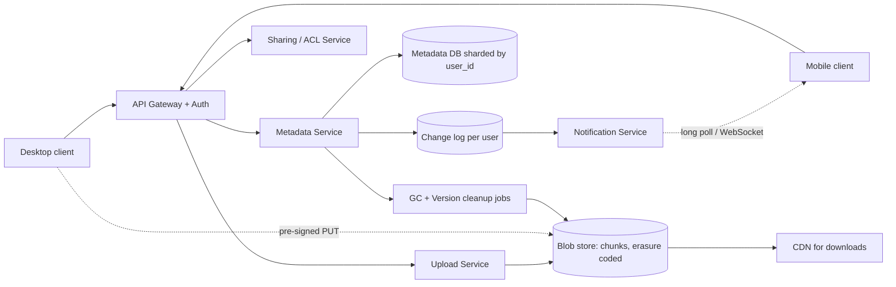
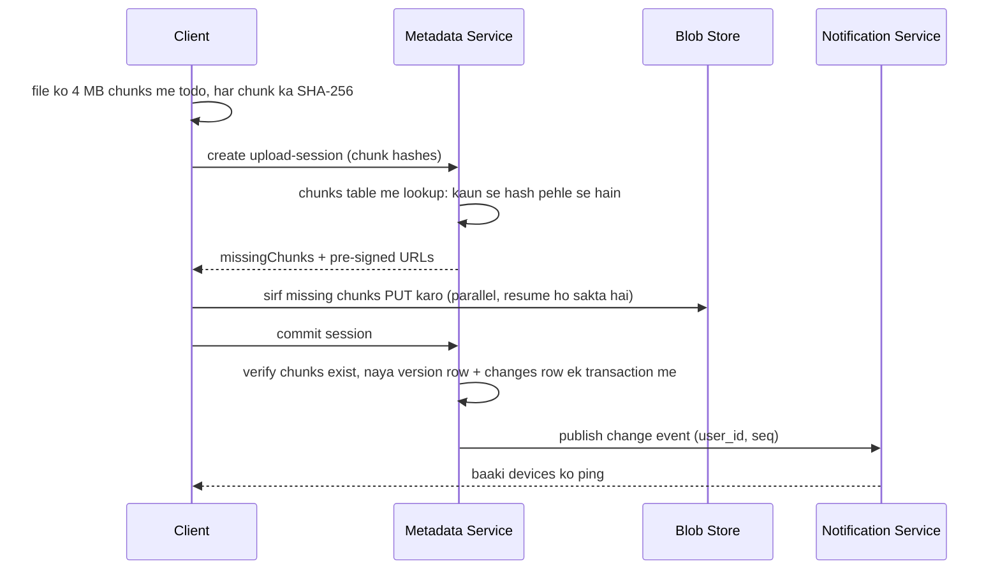

# Q12 · Google Drive

Oct 16, 2026 · @saurav chaurasiya

**Is doc me:** file storage aur sync system ka poora HLD (High Level Design) — chunking, content-addressed dedup, metadata DB vs blob store, resumable upload, change feed, conflict resolution, sharing, versioning, device notifications, aur DigiLocker ka Indian context.

**Padhne ka tareeka** — pehle "Sawaal" pe 15 min khud socho, phir "Sahi design" padho. SDE-1 ke liye Deep Dive se pehle ruk sakte ho; SDE-2 ke liye Deep Dive bhi karo.

---

## Q12 — Google Drive

Google Drive ek **cloud file storage aur sync service** hai: tum ek device pe file save karte ho, aur wahi file tumhare baaki devices pe, aur jinke saath share ki hai unke paas, automatically aa jaati hai. HLD ka asli sawaal ye hai ki petabytes (1 PB = 1000 TB) data ko sasta, safe aur sync me kaise rakhein.

### Ye cheez hai kya

- Category: storage + sync system (blob storage ke upar metadata service, aur ek sync protocol).
- Problem: ek user ki files kai devices pe consistent rakhni hain, bina har baar poori file dobara upload/download kiye, aur bina data khoye.
- Is lesson ke baad tum kar paoge: file ko chunks me todna, dedup karna, resumable upload design karna, change feed se sync chalana, conflicts handle karna, aur sharing/versioning ka data model banana.
- Analogy: Drive ek bade godown (blob store) jaisa hai, aur uske bahar ek munim ka register (metadata DB) hai. Register batata hai kaunsa maal kis shelf pe hai; maal khud godown me padha hai. Dono alag rakhne se godown sasta aur register tez rehta hai.

### Sawaal

Maan lo hume Drive jaisa product banana hai, India ke liye (jaise DigiLocker ya Paytm ka document vault, par general purpose):

- 100M (10 crore) registered users, 20M DAU (daily active users — roz aane wale users).
- Har DAU roz average 2 files upload karta hai, average file size 1 MB, lekin kuch files 5 GB tak (video, backup).
- Har user ke paas average 3 devices (phone, laptop, tablet), sab sync me.
- Sync latency target: ek device pe save ke 5 sec ke andar dusre online device pe change dikhe.
- Durability (data na khone ki guarantee) 11 nines (99.999999999%). Availability 99.9%.

> Pehle khud socho — 15 min. Hints: (1) 5 GB ki file 90% pe net kat jaye to kya karoge, phir se shuru? (2) 1 GB ki file me 1 MB badla to poori 1 GB kyun bhejein? (3) do devices ne ek hi file offline edit ki, to kaunsa jeetega?

### Problem kyun aata hai

- File bade hoti hain aur mobile network kamzor hota hai, isliye upload beech me toot-ta hai.
- Same file (jaise ek viral PDF ya OS installer) lakhon users upload karte hain; sabka copy alag rakhna paisa barbaad hai.
- Chhota edit karne pe poori file dobara bhejna bandwidth jalata hai.
- Metadata (naam, folder, permissions) ke queries bahut tez chahiye, par blob data sasta chahiye. Dono ki zarooratein ulti hain.
- Multi-device sync me kisi device ko pata kaise chale ki "kuch badla hai"? Har 1 sec poll karna server ko maar dega.
- Offline edits aur concurrent edits conflicts paida karte hain.

### Naive approach

- Pehla khayal: file ko ek hi blob ki tarah S3 jaisi jagah pe daalo, path = `/user/folder/file.txt`; client har 10 sec me poora folder list karke compare kare.
- Kahan toot-ta hai:
  - Upload fail hone pe restart: 5 GB file 90% pe fail, 4.5 GB dobara. 1M aise retries roz = bahut bandwidth.
  - 1 MB edit of 1 GB file = 1 GB re-upload. 1 lakh users roz yahi karein to 100 TB roz sirf waste.
  - Polling: 60M devices har 10 sec me list call karein = 6M QPS (queries per second — ek second me kitne requests) sirf "kuch badla?" puchne ke liye, jabki asli changes bahut kam hain.
  - Dedup nahi: 1 MB ki same file 10 lakh users ne rakhi = 1 TB, jabki asli unique data 1 MB hai.
  - Rename = poori file copy + delete (path hi identity hai), folder rename = lakhon objects ka move.
  - Conflict ka koi rule nahi: "last write wins" chupchap kisi ka kaam mita deta hai.

### Sahi design

#### Requirements

- Functional:
  1. File upload/download (bade files resumable).
  2. Multi-device sync (auto).
  3. Folders, rename, move, delete (trash).
  4. Sharing (user/group/link, viewer/editor).
  5. Version history aur restore.
  6. Offline edit aur conflict handling.
- Non-functional:
  1. Durability 11 nines (replication ya erasure coding).
  2. Sync latency kuch seconds, availability 99.9%.
  3. Bandwidth efficient (chunking, dedup, delta).
  4. Consistency: metadata pe strong (ek user ki files ka view sahi rahe), blob pe immutable (chunk badalta hi nahi).
  5. Scalable: 100M users, 200 PB data.

#### Back-of-envelope estimates

- Uploads: 20M DAU x 2 files = 40M files/day. 40M / 86,400 = \~460 files/sec avg. Peak 3x = \~1,400 files/sec.
- Daily new data: 40M x 1 MB = 40 TB/day (dedup ke pehle). Dedup/compress se \~30% bacha to \~28 TB/day.
- Total storage: 100M users x avg 2 GB used = 200 PB. 3x replication hota to 600 PB; erasure coding (jaise 6+3, matlab 6 data parts + 3 parity parts, 1.5x overhead) se \~300 PB.
- Chunk size 4 MB: 1 MB average file ek hi chunk; 5 GB file = 1,280 chunks.
- Metadata: har user \~500 files => 50B (50 billion) file records. Har record \~500 bytes => 25 TB. Isliye metadata DB shard karna padega (user\_id pe), par blob store se 10,000x chhota hai.
- Sync notifications: 60M devices, kaafi saare online. Ek long-lived connection \~10 KB memory => 10M online connections = \~100 GB RAM across notification servers. Ek server 100K connections to 100 servers.

#### API design

Ye file ko chunks me upload karne ka flow hai (resumable):

```text
POST /v1/files/upload-session
  body: { name, parentFolderId, size, chunkHashes: [sha256...] }
  -> 200 { sessionId, missingChunks: [2,5,6], chunkUploadUrls: {2: "...", 5: "...", 6: "..."} }

PUT  <chunkUploadUrl>        // seedha blob store ko (pre-signed URL)
  body: raw chunk bytes

POST /v1/files/upload-session/{sessionId}/commit
  -> 200 { fileId, version: 7 }

GET  /v1/files/{fileId}/download?version=7   -> chunk list + signed URLs
GET  /v1/changes?cursor=<c>                  -> { changes: [...], nextCursor }
POST /v1/files/{fileId}/share  { principal, role: "viewer|editor" }
```

- Pre-signed URL (ek time-limited URL jisme signature hota hai, taaki client seedha blob store ko bytes bheje, hamare app server se guzare bina) se app servers pe bandwidth ka load nahi aata.
- `missingChunks` wahi chunks hain jo server ke paas pehle se nahi hain; yahi dedup aur resume dono ka kaam karta hai.

#### Data model

Metadata DB (sharded by owner/user\_id, SQL ya Spanner jaisa; strong consistency chahiye):

```text
files(file_id PK, owner_id, parent_id, name, is_folder, current_version, deleted_at, updated_at)
versions(file_id, version_no, size, chunk_list [hash1, hash2, ...], created_by, created_at, base_version)
chunks(chunk_hash PK, size, storage_location, ref_count)
permissions(file_id, principal_id, principal_type user|group|link, role, inherited_from)
changes(user_id, seq BIGINT, file_id, change_type, version_no)    // per-user ordered log
devices(device_id, user_id, last_synced_seq)
```

- `chunk_hash` = SHA-256 of chunk bytes. Yeh content-addressed storage hai: chunk ka address uska apna content-hash hai, isliye same content ka address hamesha same hota hai.
- `changes` table per-user append-only log hai; `seq` har user ke liye badhta number hai.

#### High-level architecture



#### Upload flow (dedup + resume)



1. Client file ko fixed ya content-defined chunks me todta hai (4 MB ke aaspaas) aur har chunk ka SHA-256 nikalta hai.
2. Server batata hai kaun se chunks missing hain. Jo pehle se hain (kisi bhi user ke), unhe dobara nahi bheja jaata (cross-user dedup).
3. Client missing chunks parallel me pre-signed URL se blob store pe daalta hai. Net toot jaye to sirf adhoore chunks dobara jaate hain, poori file nahi.
4. Commit pe server check karta hai ki saare chunks ban chuke hain, phir ek DB transaction me naya `versions` row, `files.current_version` update aur `changes` row likhta hai.
5. Commit hone ke baad hi file "visible" hoti hai; uske pehle ke chunks anaath (orphan) maane jaate hain aur GC (garbage collection — bekar data ki safai) saaf karta hai.
6. Change event notification service ko jaata hai, jo baaki devices ko jagata hai; wo `GET /changes?cursor=` se naye changes kheench lete hain.

### Kya choose karein aur kyun

#### Chunking strategy

| Option | Kab use karo | Kab mat karo |
| --- | --- | --- |
| Poori file ek blob | Chhoti files (< 4 MB), simple system | Bade files; resume aur delta nahi milta |
| Fixed-size chunks (4 MB) | Default; simple, parallel upload | Beech me byte insert ho to aage ke sab chunks badal jaate hain, dedup toot-ta hai |
| Content-defined chunking (rolling hash se boundary) | Text/doc/backup jahan beech me edits hote hain | CPU zyada lagta hai; mobile pe battery heavy |

#### Metadata store

| Option | Kab use karo | Kab mat karo |
| --- | --- | --- |
| Sharded SQL (user\_id pe) | Folder tree, ACL, transactions chahiye; strong consistency | Cross-user queries (shared with me) me extra index/fan-out chahiye |
| Globally consistent DB (Spanner jaisa) | Multi-region, strong consistency, shared folders bahut | Costly, operational complexity |
| NoSQL (Dynamo/Cassandra) | Bahut high write, eventual consistency chalega | Folder move/rename jaise multi-row atomic ops chahiye to dard hota hai |

#### Sync notification

| Option | Kab use karo | Kab mat karo |
| --- | --- | --- |
| Polling har N sec | Chhota scale, prototype | 60M devices pe lakhon QPS waste |
| Long polling | Firewall-friendly, moderate scale | Har request ke baad reconnect overhead |
| WebSocket / push (FCM/APNs) | Low latency, bahut devices | Connection state manage karna padta hai; mobile background me push hi chalega |

### India me kaise hota hai

- **DigiLocker** (Government of India ka document vault): citizens apne Aadhaar, PAN, driving licence, marksheets "issued documents" ki tarah rakhte hain. Issuer (jaise CBSE, Transport dept) document ka URI push karta hai, copy nahi — isliye authenticity issuer se verify hoti hai. Yeh pure Drive jaisa blob-sync nahi, par "metadata + URI + access control" wala same pattern hai. Dekho: [DigiLocker - NeGD blog](https://negd.gov.in/blog/digilocker-the-digital-briefcase-for-indias-authentic-e-documents/), [DigiLocker security architecture](https://betadigi.dl6.in/web/security-architecture), [Wikipedia: DigiLocker](https://en.wikipedia.org/wiki/DigiLocker).
- Paytm/PhonePe jaise apps me KYC documents, invoices aur statements ke liye object storage + metadata DB wala wahi pattern chalta hai: file blob store me, metadata (user, type, expiry, access) DB me, signed URL se access.
- Global reference: Dropbox ne apna blob store khud banaya (Magic Pocket), kyunki exabyte scale pe cloud ka kharcha zyada tha. Block-level dedup aur sync engine ka vivaran [Inside the Magic Pocket](https://dropbox.tech/infrastructure/inside-the-magic-pocket) me hai.
- Data localisation: Indian users ka sensitive data (jaise payments ya government docs) India ke andar hi rakhne ki regulatory zarurat aati hai, isliye region-pinned buckets use hote hain.

### Interview follow-ups

- **Chunk size kaise decide karoge?** — Bahut chhota: metadata aur request overhead zyada. Bahut bada: resume aur dedup coarse. 4 MB common sweet spot hai; mobile pe chhote (1 MB), datacenter transfers me bade chunks bhi chalte hain.
- **Dedup me privacy ka risk hai kya?** — Haan: agar server batata hai "ye hash pehle se hai", attacker hash bhej ke jaan sakta hai ki kisi ne wo file rakhi hai. Mitigation: dedup sirf authenticated user ke andar ya hash proof-of-ownership (poora file dikhao) ke baad cross-user.
- **Do devices ne same file offline edit ki, to?** — Har edit ek naya version banata hai jiska `base_version` hota hai. Commit pe server dekhta hai ki base\_version ab current nahi hai. Tab ya to merge (text docs), ya conflicted copy ("file (Saurav's laptop conflicted copy)") banata hai. Data kabhi chupchap overwrite nahi hota.
- **Shared folder me sync kaise hota hai jab owner alag ho?** — Change log per-user hota hai; jab folder share hota hai to har member ke change log me events fan-out hote hain (ya member ek shared-folder log bhi follow karta hai). Bade groups me fan-out on read zyada sasta hai.
- **File delete ho to blob kab hatta hai?** — Delete pehle soft-delete (trash, 30 din) hota hai. Chunk ka `ref_count` zero hone aur retention khatam hone ke baad hi GC use hatata hai. Ref count race se bachne ke liye mark-and-sweep ya grace period use hota hai.
- **Notification server crash ho jaye to events miss ho jaayenge?** — Nahi, kyunki notification sirf "jaag jao" ka hint hai. Truth change log me hai; client reconnect pe apna last `cursor` bhejke missed changes kheench leta hai.

### Self-check

1. Metadata DB aur blob store ko alag kyun rakhte hain? Dono ki access pattern aur size me kya farak hai?
2. Content-addressed chunk ka matlab kya hai, aur isse dedup aur resumable upload dono kaise milte hain?
3. Fixed-size chunking aur content-defined chunking me kab kaunsa behtar hai?
4. Sync ke liye change feed me `cursor` kyun zaroori hai, aur notification miss hone pe kya bachata hai?
5. Conflict hone pe "last write wins" kyun khatarnak hai, aur Drive kya karta hai?

### Notebook

Chunk = 4 MB, SHA-256 content address · Metadata sharded SQL (25 TB), blobs erasure-coded (\~300 PB) · Pre-signed URL se client seedha blob store pe upload · Commit = ek transaction me version + changes row · Per-user ordered change log + cursor = sync ki asli truth · Notification sirf hint, chhootne pe cursor se catch-up · Delete = soft delete + ref\_count + GC · Conflict = base\_version mismatch, conflicted copy.

### Padhne ke liye

- [Inside the Magic Pocket (Dropbox)](https://dropbox.tech/infrastructure/inside-the-magic-pocket)
- [Everything in its write place: Object Store (Dropbox)](https://dropbox.tech/infrastructure/abstracting-cloud-storage-backends-with-object-store)
- [DigiLocker - NeGD](https://negd.gov.in/blog/digilocker-the-digital-briefcase-for-indias-authentic-e-documents/)
- [Design Dropbox: chunking, dedup, delta sync, conflict resolution](https://www.techinterview.org/post/3233474312/system-design-design-dropbox-file-storage-sync-chunking-deduplication-conflict-resolution-delta-sync-sharing-permissions/)

### Deep Dive (SDE-2) — jab time ho

#### Sync protocol aur change feed

- Har user ka ek ordered `changes` log hota hai, `seq` strictly badhta hai (user shard ke andar atomic counter).
- Client apna `cursor` (last seen seq) store karta hai. `GET /changes?cursor=1042` naye changes deta hai (file added, modified, moved, deleted) aur `nextCursor` bhi.
- Delta sync: client sirf naya chunk list bhejta hai; server compare karke sirf badle chunks ke URL deta hai. Isse 1 GB ki file me 1 MB edit = \~1-2 chunks upload.
- Reconcile loop: client apne local file system watcher (inotify/FSEvents) se local changes pakadta hai, aur server ke changes se merge karta hai. Dono taraf se same path pe change ho to conflict.
- Long gap ke baad (cursor bahut purana, log compact ho chuka) client full resync karta hai, snapshot se.
- Ye ek tarah ka event log hai; Kafka jaisa mental model [L1.18 Kafka](https://claude.ai/code/artifact/eeb39ee8-3f52-4c04-b57b-68213f02c429) me hai, par yahan per-user small logs DB me rakhna simple rehta hai.

#### Conflict resolution

- Optimistic concurrency: commit me `expected_base_version` bhejo; mismatch pe server reject karta hai (compare-and-set). Yeh [optimistic locking](https://claude.ai/code/artifact/97588686-7110-4318-8124-3a8727c7604e) ka hi roop hai.
- Binary files: merge nahi ho sakta, isliye "conflicted copy" banti hai aur user chunta hai.
- Text/doc collaboration (Google Docs): OT (operational transformation — concurrent edits ko transform karke merge karna) ya CRDT (conflict-free replicated data type — aisi structure jisme koi bhi order me edits apply karo to same result aata hai). Yeh Drive ke file sync se alag layer hai.
- Vector clock ya Lamport clock se causal order samajhne ke liye [1D · Shard Mountains (L1.16b clocks)](https://claude.ai/code/artifact/cfe905e6-6370-43e0-a337-764eeb9ddf1e) dekho. Wall-clock timestamps pe bharosa mat karo, kyunki devices ki clock galat ho sakti hai.

#### Sharing aur permissions

- Model: ACL (access control list — kiske paas kya access hai) per file/folder, aur inheritance: folder ka permission neeche ke files pe lagta hai jab tak override na ho.
- Principals: user, group, "anyone with link" (link token, optional expiry/password).
- Check on read: `can(user, file, action)` — file ke ancestors tak walk karke effective role nikalo. Ancestor chain cache karo (denormalised path ya closure table).
- Folder move bahut mehnga ho sakta hai agar har child me path stored ho; isliye parent pointer + cache use karte hain, subtree copy nahi.
- Revoke turant lagu hona chahiye: signed URL short-lived (kuch minutes) rakho, nahi to revoke ke baad bhi link chalega.

#### Versioning aur storage reclaim

- Har commit naya version row banata hai jo chunk list point karta hai; purane chunks immutable hain. Isliye 1 GB me 1 MB edit ka naya version sirf \~4 MB extra leta hai (baaki chunks shared).
- Retention policy: last N versions ya 30 din; usse purane versions ke chunks ka `ref_count` ghatao.
- GC: mark-and-sweep. Pehle sab live versions ke chunk hash "mark" karo, phir jo unmarked aur 24 ghante se purane hain wahi delete karo (grace period taaki naya upload kuch pal ke liye orphan dikhe to galat delete na ho).
- Durability: erasure coding (6+3) cross-AZ (availability zone — alag datacenter building). 3x replication se 1.5x storage me 11 nines tak.

#### Hot paths aur failure modes

- Hot shard: ek viral shared folder jisme 10 lakh log; uska change fan-out alag queue se karo, user shard pe load na daalo. Hot key ka matlab ek hi key pe bahut zyada traffic.
- Large upload retry storm: backpressure (system ki limit se upar ka load wapas dhakelna) ke liye upload service per-user rate limit lagati hai ([2E · Resilience Ridge](https://claude.ai/code/artifact/4769dea3-018e-41e1-ae18-253fa36a6d21)).
- Consistency: metadata ke liye strong, notifications ke liye eventual. Models ka tulna [1D · Shard Mountains (L1.16a consistency models)](https://claude.ai/code/artifact/cfe905e6-6370-43e0-a337-764eeb9ddf1e) me hai.
- DB aur sharding ki padhai ke liye [1C · DB Dungeon](https://claude.ai/code/artifact/99909fe9-731e-4e31-9e7d-36e0c5aed845) dekho.
- Security: chunks encrypt at rest (per-user ya per-file key), TLS in transit. Dedup aur per-user encryption ek doosre se takraate hain (same content, alag key = alag ciphertext), isliye tradeoff batao.

---

## Aage kya

- Pichhla: [Q11 · YouTube / Netflix](https://claude.ai/code/artifact/7ff0cd58-5f6f-423c-bb48-01d8697b7825)
- Agla: [Q13 · Web crawler](https://claude.ai/code/artifact/f9220fc4-5952-4d2d-909b-64efb05c875f)
- Related: [1C · DB Dungeon](https://claude.ai/code/artifact/99909fe9-731e-4e31-9e7d-36e0c5aed845), [1D · Shard Mountains (L1.16a consistency models)](https://claude.ai/code/artifact/cfe905e6-6370-43e0-a337-764eeb9ddf1e)
