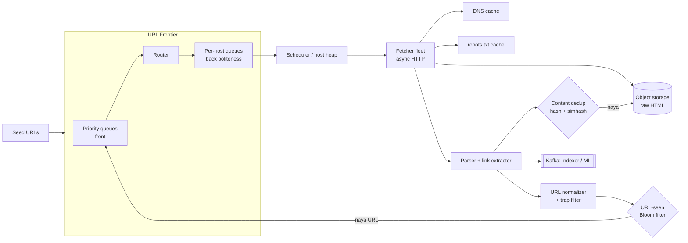
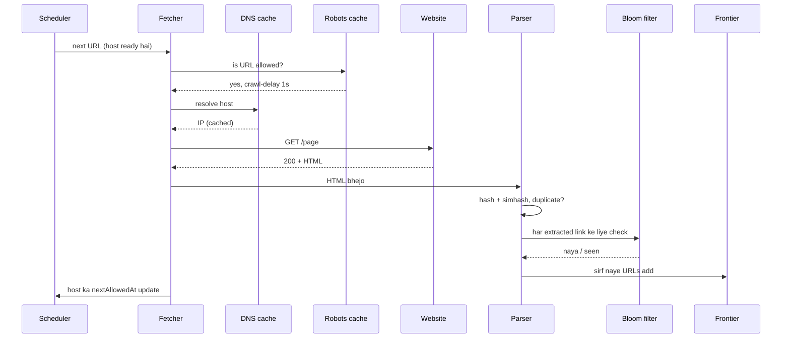

# Q13 · Web crawler

Oct 16, 2026 · @saurav chaurasiya

**Is doc me:** distributed web crawler ka poora HLD boss — URL frontier (priority + politeness), robots.txt, DNS cache, fetcher fleet, dedup (hash + simhash), Bloom filter, re-crawl, crawler traps, storage aur 1 billion pages ka estimate.

**Padhne ka tareeka** — pehle Sawaal pe 15 min khud design karo, phir Sahi design se match karo; Deep Dive tab padho jab time ho.

---

## Q13 — Web crawler

Web crawler ek aisa program hai jo seed URLs se shuru karke links follow karta hua internet ke pages download karta hai, taaki unhe search index, ML training ya archive ke liye store kiya ja sake. Googlebot isi kaam ka sabse famous example hai.

### Ye cheez hai kya

- Category: batch + streaming data pipeline, jisme ek bahut bada work-queue (URL frontier) beech me hai.
- Problem: internet ke arbo pages ko automatically, bina kisi website ko tang kiye, bina duplicate kaam ke, regularly download karna.
- Lesson ke baad: frontier, politeness, dedup aur Bloom filter ko justify karke 1B-page crawler ka design whiteboard pe bana paoge.
- Analogy: ek bade shehar me newspaper vendors ko daily har gali ke har ghar tak akhbaar pahunchana hai. Ek hi ghar pe 10 baar ghanti bajaoge to gussa hoga (politeness), aur ek ghar do baar pahunch gaye to kaam waste (dedup).

### Sawaal

Tum ek search engine team me ho (socho Paytm ka "Paytm Search for merchants/offers" ya Hotstar ka content-discovery search). Tumhe ek crawler banana hai jo **1 billion web pages** har mahine fetch kare aur fresh rakhe.

- Average page size 100 KB (HTML), 10 outgoing links per page.
- News sites jaise Times of India har kuch minute me badalte hain; purani blog posts saalon tak nahi badalti.
- Ek website (jaise ek chhota kirana-store ka Shopify site) ko hum 1 request/second se zyada se nahi maar sakte.
- Target: \~400 pages/second sustained, 99% pages me duplicate ya spam nahi.

> Pehle khud socho — 15 min. Hints: (1) Ek URL ek hi baar fetch ho — 10 billion links ka "seen" check kaise karoge bina 10 billion strings RAM me rakhe? (2) 400 fetchers ek hi website pe toot pade to kya hoga — frontier me host ke hisaab se kya structure chahiye? (3) `site.com/calendar?day=1`, `?day=2` ... infinite links — crawler kab ruke?

### Problem kyun aata hai

- Internet bahut bada hai: lagbhag arbo pages, aur roz naye bante hain.
- Bahut saare pages duplicate hain (mirror sites, same article alag URL pe, tracking parameters).
- Har website ka server limited hota hai; zyada traffic = DoS jaisa lagta hai, aur tum block ho jaoge.
- Kuch pages crawler ko jaan-boojhkar infinite loop me phansate hain (spider traps).
- Pages badalte rehte hain, to ek baar crawl karna kaafi nahi — re-crawl ka schedule chahiye.
- Network, DNS, slow servers, timeouts: fetch ka bada hissa wait karne me jaata hai, CPU me nahi.

### Naive approach

- Ek single machine pe loop: `queue.poll() -> HTTP GET -> parse links -> queue.add(link)`. `HashSet<String>` me seen URLs.
- Kahan toot-ta hai (numbers ke saath):
  - Ek fetch \~500 ms (DNS + TCP + TLS + download). Single thread = 2 pages/s. 1B pages = 500M seconds = \~16 saal.
  - 10B URLs x \~100 bytes = \~1 TB sirf `HashSet` ke liye — RAM me nahi aata.
  - Plain FIFO queue ek hi site ke 10,000 links ek ke baad ek utha lega — us site pe hammering, IP ban.
  - Koi robots.txt ya trap detection nahi: `?day=N` calendar pe crawler hamesha ke liye atak jayega.
  - Machine crash = poora state gaya.

### Sahi design

#### Requirements

- Functional:
  - Seed URLs se crawl shuru karo, links extract karke naye URLs add karo.
  - HTML (aur optionally images/PDF) download karke store karo.
  - robots.txt ka respect karo.
  - Duplicate URL aur duplicate content pehchano.
  - Pages ko unki importance/change-rate ke hisaab se re-crawl karo.
- Non-functional:
  - Scalable: 1B pages/month, baad me 10x tak badh sake.
  - Polite: ek host pe fixed rate se zyada nahi.
  - Robust: crashes, malformed HTML, traps, slow hosts se crawler na ruke.
  - Extensible: naya content type (PDF, video) plug-in ho sake.
  - Throughput (ek second me kitna kaam) pe focus; latency of a single page important nahi.

#### Back-of-envelope estimates

- Pages/second: 1B / (30 x 86,400 s) = 1B / 2.59M = \~386, roughly **400 pages/s**. Peak ke liye 2x = 800/s.
- Bandwidth: 400 x 100 KB = 40 MB/s = \~320 Mbps. Achhi, par manageable.
- Raw storage per crawl: 1B x 100 KB = **100 TB**; gzip se \~3x chhota, yani \~33 TB. 5 saal ka history = \~1.7 PB compressed.
- URLs discovered: 1B pages x 10 links = 10B URLs (unique kam honge, par check sabka karna padta hai).
- Bloom filter size: 1% false positive ke liye \~9.6 bits per element. 10B x 9.6 bits = \~96 Gbit = **\~12 GB**. Ye 3–4 machines ke RAM me sharded fit ho jata hai.
- Fetcher machines: ek async fetcher node \~100 concurrent connections, avg 500 ms per fetch = \~200 pages/s theory me. Real me DNS, parsing, slow hosts ki wajah se \~50 pages/s maan lo, to 400/s ke liye \~8 nodes; headroom ke saath \~20.
- Metadata: 1B URL rows x \~500 bytes = \~500 GB. Ek sharded KV store me aaram se.

#### API design

Crawler ka koi public user-facing API nahi hota; internal APIs hote hain.

- `POST /internal/seed` — body: `{"urls":["https://example.com"], "priority": 5}`. Operators naye seeds daalte hain.
- `GET /internal/frontier/next?workerId=f17&n=100` — fetcher ko URLs ka batch deta hai (ek lease ke saath, taaki crash pe wapas aa jaye).
- `POST /internal/fetched` — fetcher batata hai: `{url, status, contentHash, storageKey, links[]}`.
- `GET /internal/page?url=...` — downstream indexer ke liye stored page.

#### Data model

- `url_meta` (KV / Cassandra, key = `urlHash`): `url`, `host`, `lastFetchedAt`, `nextFetchAt`, `changeRate`, `contentHash`, `simhash`, `status`, `depth`, `priority`.
- `host_meta` (key = `host`): `robotsTxt`, `robotsFetchedAt`, `crawlDelayMs`, `nextAllowedAt`, `errorCount`.
- `content_store` (object storage, key = `contentHash`): compressed raw HTML. Same content = same key, to duplicate store hi nahi hota.
- `dns_cache` (in-memory + short TTL): `host -> IP`.

#### High-level architecture

Poora flow ek loop hai: frontier se URL nikalo, fetch karo, parse karo, dedup karo, store karo, naye links wapas frontier me bhejo.



Ek single page ki life, sequence me:



##### Step by step

1. **Seed + normalize**: seeds frontier me jaate hain. Har URL normalize hota hai: lowercase host, fragment (`#...`) hatao, default port hatao, tracking params (`utm_*`) hatao, query params sort karo. Isse `A.com/x?b=1&a=2` aur `a.com/x?a=2&b=1` ek ho jaate hain.
2. **URL frontier (do layers)**:
   - **Front queues (priority)**: F alag queues, har ek ek priority level (1 = news homepage, 10 = purana forum page). Priority page importance (PageRank-jaisa score), change-rate aur depth se nikalti hai.
   - **Back queues (politeness)**: B queues, **har host ke liye ek queue**. Ek hi host ka URL ek hi back queue me, aur ek time pe ek hi fetcher us queue ko serve karta hai.
   - Ek min-heap `nextAllowedAt` ke hisaab se hosts ko rakhta hai; fetcher heap ka top lekar dekhta hai ki time ho gaya ya nahi (ye Mercator crawler ka design hai).
3. **robots.txt**: host ka pehla fetch `/robots.txt` hota hai. Isme `Disallow` rules aur `Crawl-delay` hote hain. Isse cache karo (24 ghante TTL), aur fetch se pehle har URL ko check karo.
4. **DNS cache**: DNS lookup 20–200 ms ka hota hai, aur synchronous resolvers bottleneck bante hain. Apna local caching resolver (ya in-process cache) rakho, TTL respect karke.
5. **Fetcher fleet**: async non-blocking HTTP clients (Netty / epoll). Timeouts: connect 5 s, total 30 s, max page size 5 MB. Redirect chain limit 5. Fetcher stateless hain — crash hua to lease expire hogi aur URL wapas aa jayega.
6. **Parse + extract**: HTML se text aur `<a href>` links nikalo, relative URLs ko absolute banao.
7. **Content dedup**: pehle exact duplicate (SHA-256 / MD5 of normalized body), phir near-duplicate (simhash). Duplicate content store nahi hota aur uske links bhi aage nahi badhaye jaate.
8. **URL-seen check**: har extracted link pe Bloom filter. "Shayad seen" = skip, "pakka naya" = frontier me daalo. False positive ka matlab 1% naye URLs miss honge — crawler ke liye acceptable.
9. **Storage**: raw HTML object storage (S3-jaisa) me, `contentHash` key pe; metadata KV store me; naye pages ka event Kafka pe jaata hai taaki indexer pipeline unhe uthaye. Kafka ke liye dekho [1E · Kafka River](https://claude.ai/code/artifact/eeb39ee8-3f52-4c04-b57b-68213f02c429).
10. **Re-crawl**: har URL ka `nextFetchAt` hota hai; change hone pe interval chhota, na hone pe double. Details Deep Dive me.

Chhota Java demo jo teen core idea dikhata hai: Bloom filter, simhash aur per-host politeness. Ye single-JVM illustration hai, production nahi.

```java
import java.util.*;

public class Demo {
    // Bloom filter: URL pehle dekha ya nahi (false positive possible, false negative nahi)
    static class Bloom {
        final BitSet bits; final int m, k;
        Bloom(int m, int k) { this.m = m; this.k = k; bits = new BitSet(m); }
        int h(String s, int seed) { return Math.floorMod(s.hashCode() * 31 + seed * 0x9E3779B1 + seed * seed * 7919, m); }
        boolean addIfNew(String s) {
            boolean seen = true;
            for (int i = 1; i <= k; i++) { int p = h(s, i); if (!bits.get(p)) { seen = false; bits.set(p); } }
            return !seen;
        }
    }

    // SimHash: 64-bit fingerprint, milte-julte text ke fingerprint me kam bits alag hote hain
    static long simhash(String text) {
        int[] v = new int[64];
        for (String w : text.toLowerCase().split("\\s+")) {
            long x = w.hashCode() * 0x9E3779B97F4A7C15L;
            x ^= (x >>> 29); x *= 0xBF58476D1CE4E5B9L; x ^= (x >>> 32);
            for (int i = 0; i < 64; i++) v[i] += ((x >>> i) & 1L) == 1L ? 1 : -1;
        }
        long f = 0;
        for (int i = 0; i < 64; i++) if (v[i] > 0) f |= 1L << i;
        return f;
    }

    // Politeness: har host ka next allowed time, ek host pe ek time me ek hi fetch
    static class Frontier {
        final Map<String, Deque<String>> hostQ = new LinkedHashMap<>();
        final Map<String, Long> nextAllowed = new HashMap<>();
        final long delayMs;
        Frontier(long d) { delayMs = d; }
        void add(String host, String url) { hostQ.computeIfAbsent(host, h -> new ArrayDeque<>()).add(url); }
        String poll(long now) {
            for (var e : hostQ.entrySet()) {
                if (e.getValue().isEmpty()) continue;
                if (nextAllowed.getOrDefault(e.getKey(), 0L) <= now) {
                    nextAllowed.put(e.getKey(), now + delayMs);
                    return e.getValue().poll();
                }
            }
            return null;
        }
    }

    public static void main(String[] args) {
        Bloom bloom = new Bloom(1 << 16, 3);
        String[] urls = {"a.com/1", "a.com/2", "a.com/1", "b.com/x", "a.com/2"};
        for (String u : urls) System.out.println("URL " + u + " -> " + (bloom.addIfNew(u) ? "naya, frontier me daalo" : "seen, skip"));

        String p1 = "paytm ne nayi upi feature launch kiya hai jisme users ko cashback milta hai har payment par";
        String p2 = "paytm ne nayi upi feature launch kiya hai jisme users ko cashback milta hai har payment pe";
        String p3 = "swiggy delivery partners ke liye naya insurance plan shuru hua hai poore india me";
        long f1 = simhash(p1), f2 = simhash(p2), f3 = simhash(p3);
        System.out.println("hamming(p1,p2) = " + Long.bitCount(f1 ^ f2));
        System.out.println("hamming(p1,p3) = " + Long.bitCount(f1 ^ f3));

        Frontier fr = new Frontier(1000);
        fr.add("a.com", "a.com/1"); fr.add("a.com", "a.com/2"); fr.add("b.com", "b.com/x");
        for (long t = 0; t <= 2000; t += 500) {
            String u = fr.poll(t);
            System.out.println("t=" + t + "ms fetch: " + (u == null ? "(koi host ready nahi)" : u));
        }
    }
}
```

Isko chalane pe bilkul ye output aata hai:

```text
URL a.com/1 -> naya, frontier me daalo
URL a.com/2 -> naya, frontier me daalo
URL a.com/1 -> seen, skip
URL b.com/x -> naya, frontier me daalo
URL a.com/2 -> seen, skip
hamming(p1,p2) = 5
hamming(p1,p3) = 30
t=0ms fetch: a.com/1
t=500ms fetch: b.com/x
t=1000ms fetch: a.com/2
t=1500ms fetch: (koi host ready nahi)
t=2000ms fetch: (koi host ready nahi)
```

- Bloom: repeat URLs (`a.com/1`, `a.com/2`) "seen" nikle, naye "naya".
- Simhash: milte-julte paytm pages me sirf 5 bits ka fark (Hamming distance 5), alag topic (swiggy) me 30 bits — demo ke vaakya chhote hain, isliye ek shabd badalne se bhi 5 bits palat gaye. Lambe real pages me distance aur chhota aata hai; Google ke paper me 64-bit fingerprint pe 3 bits tak ka fark near-duplicate maana gaya.
- Politeness: `a.com/2` t=500 pe nahi gaya (delay 1000 ms abhi baaki tha), `b.com/x` gaya; `a.com/2` t=1000 pe gaya.

### Kya choose karein aur kyun

| Option | Kab use karo | Kab mat karo |
| --- | --- | --- |
| Single FIFO queue frontier | Prototype, ek-do sites ka crawl | Kai hosts ho; politeness aur priority dono toot jaate hain |
| Mercator-style (front priority + back per-host queues) | Production crawler, politeness aur importance dono chahiye | Chhota crawl jahan complexity ka fayda nahi |
| Hash-set / DB lookup for URL-seen | Chhoti scale (crore se kam URLs), exact answer chahiye | 10B URLs; RAM aur lookup latency dono maar khate hain |
| Bloom filter for URL-seen | Bahut bada scale, kuch false positive chalte hain | Jab ek bhi URL miss nahi hona chahiye (to Bloom + disk-backed exact store) |
| Exact hash (SHA-256) content dedup | Byte-by-byte same pages pakadna | Near-duplicate (ads/timestamp alag) pakadne ke liye bekaar |
| Simhash content dedup | Near-duplicate pakadna, 64 bit per page | Bahut chhote pages (text kam) — fingerprint noisy hota hai |
| BFS crawl order | Broad coverage, simple | Spam-heavy deep sites; importance-aware nahi |
| Priority / PageRank-guided order | Achhe pages pehle, limited budget | Jab importance score ka data hi nahi |

### India me kaise hota hai

- Googlebot India samet poori duniya crawl karta hai; Google ka [Crawl Budget Management](https://developers.google.com/crawling/docs/crawl-budget) doc batata hai ki crawl rate site ki server health ke hisaab se adjust hota hai aur kitne URLs fetch honge uska ek budget hota hai. Indian ecommerce aur news sites (Flipkart, Times of India jaisi badi sites) isi budget ko robots.txt aur sitemap se manage karti hain.
- [Common Crawl](https://www.searchengineworld.com/who-what-where-is-common-crawl-and-why-should-site-owners-care) ek open nonprofit crawl hai jiska data ML/NLP teams (Indian startups bhi) use karti hain; ye real-world billion-page scale ka achha reference hai.
- Mercator (AltaVista ka crawler) ne front-queue/back-queue frontier design diya, jiska breakdown [yahan](https://medium.com/@kslohith1729/mercator-a-masterclass-in-system-design-for-a-web-crawler-30e690a9103b) hai; aaj ke zyadatar crawlers isi pe based hain.
- Paytm/Swiggy jaisi companies me crawling aam taur par competitor price monitoring ya content discovery ke liye internal scale pe hoti hai; unke internal design public nahi hain, to interview me isi general pattern ko apply karo.

### Interview follow-ups

- **Politeness kaise ensure karoge?** — Har host ki apni back queue aur ek `nextAllowedAt` timestamp; ek host ko ek hi worker serve karta hai, aur gap `Crawl-delay` ya default 1 second se kam nahi hota.
- **Bloom filter me false positive aaya to?** — Ek naya URL galti se "seen" maana jayega aur miss ho jayega. 1% FP pe ye crawl coverage me bahut chhota nuksan hai; important URLs ke liye backup exact store (disk KV) rakh sakte ho.
- **Crawler trap kaise pakdoge?** — URL length limit (\~2000 chars), path depth limit, per-host URL cap, repeating path-segment detection, aur content-hash se detect karna ki naye URLs ka content wahi ka wahi hai.
- **Re-crawl kitni baar?** — Change-rate ke hisaab se adaptive: jis page ne pichhli baar badla, uska interval aadha; jis ne nahi badla, double. News homepage minutes me, purana blog mahino me.
- **Fetcher crash ho jaye to?** — Frontier URL ko lease pe deta hai (visibility timeout); fetch ka ack na aaye to lease expire hoke URL wapas queue me. Fetcher stateless hai.
- **Frontier ko multiple machines pe kaise shard karoge?** — `hash(host) % N`: ek host hamesha ek hi frontier node pe, to politeness bina cross-node coordination ke ho jati hai. Hot host ya node failure pe consistent hashing use karo.
- **Duplicate content ka kya karoge?** — Exact: content hash. Near: simhash + Hamming distance <= 3. Duplicate store nahi hota aur uske outgoing links bhi aage nahi badhaye jaate.

### Self-check

1. Frontier me front queues aur back queues ka alag-alag kaam kya hai?
2. 10B URLs ke liye Bloom filter \~12 GB kaise nikla? Formula (bits per element, FP rate) batao.
3. Exact hash aur simhash me kab kaunsa use hota hai, aur simhash ke do pages "near-duplicate" kab maane jaate hain?
4. Spider trap kya hai aur teen tarike batao jinse crawler usse bachta hai.
5. Fetcher fleet ko async kyun banate hain, aur 400 pages/s ke liye lagbhag kitne nodes chahiye?

### Notebook

400 pages/s = 1B pages / 30 din · Bloom filter \~9.6 bits per element = 1% false positive, 10B URLs = \~12 GB · Frontier = priority front queues + per-host back queues (Mercator) · robots.txt aur DNS dono cache karo · Exact dup = SHA hash, near-dup = 64-bit simhash, Hamming <= 3 · Trap se bachne ke liye URL length, depth aur per-host cap · Shard frontier by `hash(host)` taaki politeness local rahe.

### Padhne ke liye

- [Detecting Near-Duplicates for Web Crawling (Manku et al., Google)](https://research.google.com/pubs/archive/33026.pdf)
- [Mercator, A masterclass in system design for a web crawler](https://medium.com/@kslohith1729/mercator-a-masterclass-in-system-design-for-a-web-crawler-30e690a9103b)
- [URL frontier design: from Mercator to modern priority-queue crawlers](https://blog.crawlex.net/blog/url-frontier-design/)
- [Designing a distributed crawler: frontier, dedup, politeness, and backpressure](https://blog.crawlex.net/blog/designing-a-distributed-crawler/)

### Deep Dive (SDE-2) — jab time ho

#### Frontier internals aur crash recovery

- Front queues me URL ko priority bucket me daalne wala "prioritizer" hota hai; back queue selector random/weighted tareeke se bucket chunta hai taaki high priority ko zyada, par low priority ko bhi mauka mile (starvation na ho).
- Back queue khali ho jaye to us host ki queue hat jati hai aur frontier se naye host ka URL le aata hai; isse back queues ki sankhya (roughly 3x fetcher threads) fixed rehti hai.
- Frontier disk pe persist hota hai (RocksDB / Kafka compacted topic), RAM me sirf heap aur chhote buffers; restart pe state wapas load.
- Batch lease: fetcher 100 URLs ek saath leta hai; ack na aaye to timeout pe re-queue. Isse at-least-once milta hai, to fetch idempotent (same URL do baar fetch hua to koi nuksan nahi, hash se duplicate) hona chahiye. Idempotent ka matlab: same kaam dobara karne pe result wahi rahe, jaisa [2A · Idempotency Island](https://claude.ai/code/artifact/c269ac61-440b-4525-bd04-31baf708dece) me padha.

#### Bloom filter ka math aur sharding

- Formula: `m = -n ln(p) / (ln 2)^2` bits, `k = (m/n) ln 2` hash functions. n = 10B, p = 1% ke liye m/n \~ 9.6, k \~ 7.
- Bloom filter me delete nahi hota; URL ko kabhi "unseen" nahi karna, isliye crawler ke liye theek hai. Re-crawl ke liye alag `nextFetchAt` store (Bloom nahi) chalta hai.
- Shard: `hash(url) % S` se S filters. Har shard \~3–4 GB. Filter periodically disk pe snapshot hota hai; crash pe snapshot + Kafka replay se rebuild.
- Bloom bharne par FP rate badhta jata hai; capacity cross hone se pehle naya filter banao (scalable/ layered Bloom).

#### Simhash aur near-duplicate search

- Simhash: page ke har word/shingle ka hash lo, bit-wise +1/-1 jodo, phir sign se 64-bit fingerprint. Milte-julte pages ke fingerprints ke bahut kam bits alag hote hain.
- Sawaal: 8B existing fingerprints me se Hamming distance <= 3 wala kaise dhundo? Linear scan bahut mehnga. Manku ke paper ka trick: 64 bits ko 4 blocks me todo, fingerprints ki kai permuted tables rakho; kisi na kisi table me 16 bits ka exact match milta hai, phir wahin se candidates verify karo.
- Boilerplate (header, footer, ads) hatake sirf main content ka simhash lo, warna sab pages ek jaise dikhenge.

#### Crawler traps

- Calendar widget, session IDs in URL, infinite redirect, relative-link loops (`/a/b/../a/b/...`), soft-404 pages jo har URL pe 200 dete hain.
- Defenses: max URL length, max path depth, max URLs per host/day, repeated path segment detection (`/a/a/a/a`), query-param whitelist, aur dedup by content (naye URL, par content-hash same).
- Honeypot links (CSS se hidden) bhi hote hain jinhe sirf bots follow karte hain; robots.txt disallow wale paths ko respect karne se ye aksar bach jata hai.

#### Re-crawl scheduling

- Har URL ka `changeRate` estimate: pichhli fetches me content hash badla ya nahi. Badla to interval = interval/2, nahi badla to interval x 2 (min 5 min, max 90 din).
- Importance (PageRank/inlinks) se priority badhao: ek important page jo kam badalta hai use bhi regular check karo.
- Conditional GET: `If-Modified-Since` / `ETag` bhejo; server `304 Not Modified` de to body download bachti hai (bandwidth ka bada bachat).
- Sitemap (`sitemap.xml`) me `lastmod` hota hai; use hint ki tarah lo, bharosa mat karo.

#### DNS, JavaScript pages aur storage

- DNS: bulk lookups ke liye apna resolver cluster + local cache; 400 pages/s pe bina cache ke DNS hi bottleneck ban jata hai. DNS ka basic [Part 0 · Base Camp (L0.3 networking)](https://claude.ai/code/artifact/873676ef-93d2-45e6-a1bc-079a3fa419b3) me hai.
- JavaScript-heavy pages (SPA): plain HTTP fetch khali shell deta hai. Headless browser (Chromium) se render karna 10–50x mehnga hai, to sirf selected domains/pages ke liye karo.
- Storage: WARC jaise container format me kai pages ek bade compressed file me; chhoti-chhoti files object storage ko slow karti hain. Hot metadata KV store me, cold HTML object storage me.
- Backpressure (jab downstream indexer dheema ho to upstream ko slow karna): Kafka consumer lag dekhkar fetch rate throttle karo.

---

## Aage kya

- Pichhla: [Q12 · Google Drive](https://claude.ai/code/artifact/e5c57f7f-b1c2-49e5-a071-537ae64198e7)
- Agla: [Q14 · Snowflake ID generator](https://claude.ai/code/artifact/18205ae1-8400-438c-8a6b-32f43b0ccaa0)
- Related: [1E · Kafka River](https://claude.ai/code/artifact/eeb39ee8-3f52-4c04-b57b-68213f02c429) (frontier/indexer ke beech queue), [Part 0 · Base Camp](https://claude.ai/code/artifact/873676ef-93d2-45e6-a1bc-079a3fa419b3) (L0.3 networking: DNS)
