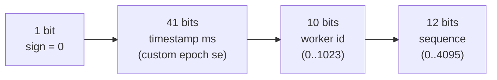
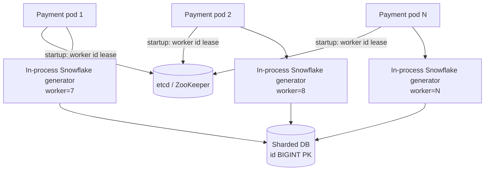
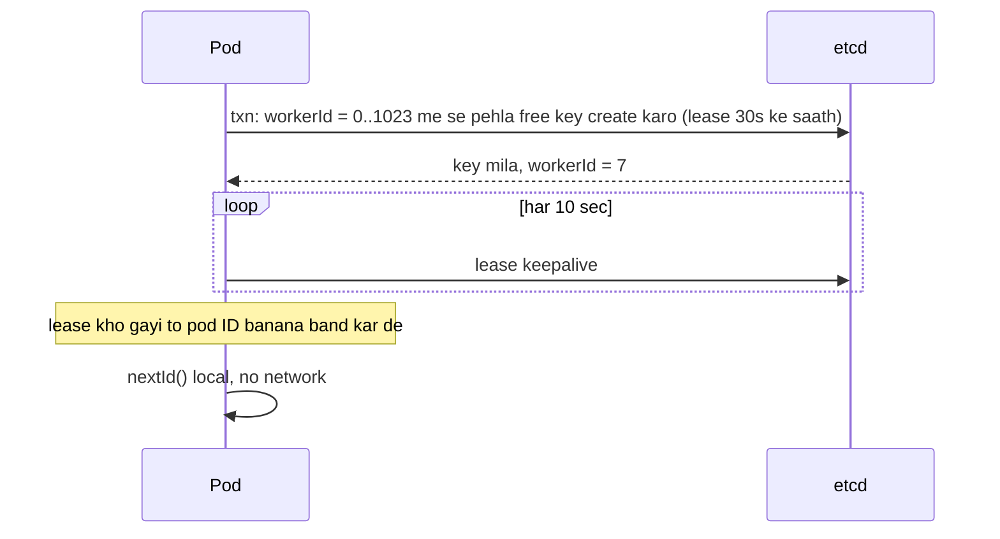

# Q14 · Snowflake ID generator

Oct 16, 2026 · @saurav chaurasiya

**Is doc me:** distributed system me unique, time-sortable 64-bit ID kaise banate hain: UUID v4/v7, DB auto-increment, ticket server, Snowflake bit layout, clock backwards problem, worker ID assignment (ZooKeeper/etcd), aur payments me txn ID / RRN-style ID.

**Padhne ka tareeka** — pehle Sawaal pe 15 min khud socho, phir Sahi design ka Java code compile karke chalao. Deep Dive baad me.

---

## Q14 — Snowflake ID generator

Snowflake ID ek 64-bit number hota hai jisme timestamp, machine ka number aur ek counter packed hota hai. Isse har machine bina kisi doosri machine se poochhe unique aur time ke hisaab se sorted ID bana leti hai.

### Ye cheez hai kya

- **Category:** distributed ID generation (system design building block). Q1 jaise sawaalon me bhi ye chhupa hota hai.
- **Problem:** hazaaron servers ko roz bahut saari unique IDs chahiye (order, txn, tweet), aur central DB har insert pe bottleneck ban jaata hai.
- **Is lesson ke baad:** tum UUID v4, UUID v7, auto-increment, ticket server aur Snowflake ka tradeoff bata paoge, bit layout draw kar paoge, clock backwards case handle karoge, aur ek chalta hua Java generator likh paoge.
- **Analogy:** cricket match ki ticket queue socho. Har counter (worker) ko apna number milta hai, aur ticket pe likha hota hai "kitne baje, kaun se counter se, us minute ki kaun si ticket". Do counter kabhi same ticket nahi chhapte, aur ticket number se hi pata chal jaata hai kaun pehle aaya.

### Sawaal

Ek payments app (Paytm jaisa) ke paas 300 backend pods hain. Peak pe 150,000 TPS (transactions per second — ek second me kitne transactions) aate hain, aur har transaction ko ek globally unique ID chahiye. Requirements:

- ID generate karne ka latency (request ko jawab dene me lagne wala time) p99 (99% requests is time ke andar) 1 ms se kam ho, ideally local call.
- IDs roughly time ke hisaab se sorted hon, taaki DB index me insert efficient ho aur "last 1 hour ke txns" range query chale.
- ID 64-bit me aaye (Java `long`), 128-bit nahi.
- Koi central SPOF (single point of failure — wo ek component jiske girne se poora system gir jaaye) nahi hona chahiye.
- Machine ki clock kabhi peeche jaa sakti hai (NTP — Network Time Protocol, clock sync karne wala service — sync ke baad), tab bhi duplicate ID nahi nikalni chahiye.

> Pehle khud socho — 15 min. Hints: (1) Agar har pod apna random number banaye to collision ka chance kitna hai, aur index pe kya asar padta hai? (2) Ek 64-bit number me timestamp, machine id aur counter kitne-kitne bits me fit karoge? (3) Agar clock peeche chali jaye to kya karoge — wait, error, ya kuch aur?

### Problem kyun aata hai

- Single DB me `AUTO_INCREMENT` aasan hai, par sharding (data ko multiple DB machines me baantna) ke baad har shard apna 1, 2, 3 banayega aur IDs takrayengi.
- Ek central ID server SPOF aur bottleneck ban jaata hai: 150K TPS pe har request ek network hop extra.
- Random UUID v4 unique to hai, par 128-bit hai aur random hone se B-tree index (DB ka sorted tree structure) me inserts poore tree me bikhar jaate hain. Isse page splits aur cache misses badhte hain.
- Time ke hisaab se sort nahi hota, to "latest 20 txns" ke liye alag `created_at` column + index lagana padta hai.
- Multiple machines ki clocks perfectly sync nahi hoti. Detail ke liye dekho [1D · Shard Mountains](https://claude.ai/code/artifact/cfe905e6-6370-43e0-a337-764eeb9ddf1e) ka L1.16b (clocks).

### Naive approach

- **Naive 1 — DB auto-increment ya ek central counter:** har ID ke liye ek DB call.
  - Ek MySQL primary pe realistically kuch hazaar writes/sec chalte hain. 150K ID/sec ke liye ek hi row pe lock contention hoga.
  - Wo DB SPOF hai. Girte hi poora payments flow ruk jaata hai.
- **Naive 2 — UUID v4 (random 128-bit):** koi coordination nahi.
  - 16 bytes per ID, aur 100 crore rows pe sirf primary key + secondary indexes ka size bhaari ho jaata hai.
  - Random insert order se InnoDB (MySQL ka storage engine) clustered index me page splits hote hain, write amplification badhta hai.
  - Sort karke "recent" nikalna possible nahi.
- **Naive 3 — `System.currentTimeMillis()` as ID:** ek millisecond me ek machine par 100 requests aayein to 100 same IDs. Do machines pe bhi same ms me collision.

### Sahi design

#### Requirements

- **Functional:** `nextId()` unique 64-bit `long` de. IDs time ke hisaab se roughly increasing hon. ID se timestamp nikal sako (debugging ke liye).
- **Non-functional:** 150K+ IDs/sec peak, p99 under 1 ms, no SPOF, har worker pe 4 million IDs/sec tak scale. Clock skew (do machines ki clock me antar) pe safe.

#### Back-of-envelope estimates

- **Layout:** 1 bit sign (0 rakhte hain, taaki `long` positive rahe) + 41 bits timestamp + 10 bits worker + 12 bits sequence = 64 bits.
- **Timestamp range:** 2^41 ms = 2,199,023,255,552 ms, yaani lagbhag 69.7 saal. Custom epoch (apna start date, jaise 2025-01-01) se ginte hain, to 2094 tak chalega.
- **Workers:** 2^10 = 1024 workers (ya 5 bit datacenter + 5 bit machine).
- **Per worker capacity:** 2^12 = 4096 IDs per millisecond = 4,096,000 IDs/sec.
- **Total capacity:** 1024 x 4.096M = lagbhag 4.2 billion IDs/sec. Humein sirf 150K chahiye, to 300 pods me har pod ko \~500 IDs/sec banane hain. Bahut bada headroom.
- **Storage:** 8 bytes per ID. 10 billion rows pe ID column = 80 GB, UUID (16 bytes) ke muqable aadha.

#### Bit layout

Ye diagram 64 bits ka batwara dikhata hai.



- **Sorting kaise hoti hai:** timestamp sabse upar (high bits) me hai, isliye bada timestamp matlab bada ID. Same ms me sequence se order banta hai.
- **Uniqueness kaise:** (timestamp, worker, sequence) ka combination alag hota hai. Worker alag, to ID alag. Worker same par ms alag, to ID alag. Dono same, to sequence alag.
- **Sequence khatam ho jaye:** ek ms me 4096 se zyada IDs maange gaye, to agli ms ka wait karo.

#### API design

- Zyaadatar library hoti hai (in-process call), network API nahi. Agar service chahiye:

```text
GET /v1/ids?count=100        -> 200 {"ids":[236935260464508928, ...]}
GET /v1/ids/{id}/decode      -> 200 {"timestampMs":..., "workerId":7, "sequence":0}
```

- Batch `count` isliye ki client network round trip bachaye.
- IDs ko JSON me string bhejo. JavaScript ke `Number` 2^53 ke baad precision kho deta hai, 64-bit ID corrupt ho jaati hai.

#### Data model

- Generator ke paas sirf in-memory state hai: `lastTs`, `seq`, `workerId`.
- Worker ID ka registry (etcd/ZooKeeper) me ek chhota record:

```text
/snowflake/workers/{podName}  ->  { workerId: 7, lease: 30s, lastSeenTs: ... }
```

- Consumer tables me `id BIGINT PRIMARY KEY` (Snowflake ID). Alag `created_at` column zaroori nahi, ID se mil jaata hai.

#### High-level architecture

Pod start hone pe worker ID registry se leta hai, phir sab ID local generate hoti hain. Ye diagram flow dikhata hai.



- Registry sirf startup (aur lease renew) pe use hoti hai. ID banate waqt koi network call nahi, isliye registry down ho to bhi chalte hue pods ID banate rehte hain.

#### Worker ID assignment sequence

Ye sequence diagram dikhata hai ki pod ko unique worker ID kaise milti hai.



#### Java implementation

Ye code ek Snowflake generator hai jisme fake clock inject ho sakta hai (Strategy pattern), aur 4 tests main me chalte hain: ordering, 8 threads ki uniqueness, do workers, aur clock backwards.

```java
import java.util.*;
import java.util.concurrent.*;
import java.util.concurrent.atomic.AtomicLong;

public class Demo {

    // Clock ko alag interface banaya taaki test me fake clock (backwards jump) inject kar sako - Strategy pattern
    interface Clock { long millis(); }

    static class SnowflakeGenerator {
        static final long CUSTOM_EPOCH = 1735689600000L; // 2025-01-01 00:00:00 UTC
        static final int WORKER_BITS = 10, SEQ_BITS = 12;
        static final long MAX_WORKER = (1L << WORKER_BITS) - 1;   // 1023
        static final long SEQ_MASK = (1L << SEQ_BITS) - 1;        // 4095
        static final long MAX_BACKWARD_WAIT_MS = 5;

        private final long workerId;
        private final Clock clock;
        private long lastTs = -1L;
        private long seq = 0L;

        SnowflakeGenerator(long workerId, Clock clock) {
            if (workerId < 0 || workerId > MAX_WORKER) throw new IllegalArgumentException("workerId 0.." + MAX_WORKER);
            this.workerId = workerId;
            this.clock = clock;
        }

        // synchronized: ek hi process me do thread same (ts, seq) na uthaayein
        synchronized long nextId() {
            long ts = clock.millis();
            if (ts < lastTs) {
                long drift = lastTs - ts;
                if (drift > MAX_BACKWARD_WAIT_MS)
                    throw new IllegalStateException("Clock " + drift + "ms peeche gaya, ID nahi de sakte");
                // chhota drift: lastTs tak wait karo
                while (ts < lastTs) ts = clock.millis();
            }
            if (ts == lastTs) {
                seq = (seq + 1) & SEQ_MASK;
                if (seq == 0) {                       // is millisecond ke 4096 IDs khatam
                    while (ts <= lastTs) ts = clock.millis(); // agli ms ka wait
                }
            } else {
                seq = 0;
            }
            lastTs = ts;
            return ((ts - CUSTOM_EPOCH) << (WORKER_BITS + SEQ_BITS)) | (workerId << SEQ_BITS) | seq;
        }

        static long tsOf(long id) { return (id >>> (WORKER_BITS + SEQ_BITS)) + CUSTOM_EPOCH; }
        static long workerOf(long id) { return (id >>> SEQ_BITS) & MAX_WORKER; }
        static long seqOf(long id) { return id & SEQ_MASK; }
    }

    public static void main(String[] args) throws Exception {
        Clock system = System::currentTimeMillis;

        System.out.println("--- 1) Ek worker, 5 IDs ---");
        SnowflakeGenerator g = new SnowflakeGenerator(7, system);
        long prev = -1;
        for (int i = 0; i < 5; i++) {
            long id = g.nextId();
            System.out.println(id + "  ts=" + SnowflakeGenerator.tsOf(id) + " worker=" + SnowflakeGenerator.workerOf(id)
                + " seq=" + SnowflakeGenerator.seqOf(id) + (id > prev ? "  (increasing)" : "  (GALAT)"));
            prev = id;
        }

        System.out.println("--- 2) 8 threads x 50000 IDs, ek hi generator ---");
        SnowflakeGenerator shared = new SnowflakeGenerator(3, system);
        Set<Long> all = ConcurrentHashMap.newKeySet();
        ExecutorService pool = Executors.newFixedThreadPool(8);
        List<Future<?>> fs = new ArrayList<>();
        for (int t = 0; t < 8; t++)
            fs.add(pool.submit(() -> { for (int i = 0; i < 50000; i++) all.add(shared.nextId()); }));
        for (Future<?> f : fs) f.get();
        pool.shutdown();
        System.out.println("generated=400000 unique=" + all.size());

        System.out.println("--- 3) Do alag workers, same time ---");
        SnowflakeGenerator w1 = new SnowflakeGenerator(1, system), w2 = new SnowflakeGenerator(2, system);
        Set<Long> both = new HashSet<>();
        for (int i = 0; i < 10000; i++) { both.add(w1.nextId()); both.add(w2.nextId()); }
        System.out.println("generated=20000 unique=" + both.size());

        System.out.println("--- 4) Clock peeche gaya (fake clock) ---");
        AtomicLong now = new AtomicLong(1_800_000_000_000L);
        SnowflakeGenerator fg = new SnowflakeGenerator(5, now::get);
        long a = fg.nextId();
        now.addAndGet(-2);  // 2ms peeche
        long b;
        // 2ms drift: wait karega, to fake clock ko kisi doosre thread se aage badhate hain
        Thread ticker = new Thread(() -> { try { Thread.sleep(20); } catch (Exception e) {} now.addAndGet(10); });
        ticker.start();
        b = fg.nextId();
        ticker.join();
        System.out.println("small drift: a=" + a + " b=" + b + " b>a=" + (b > a));
        now.addAndGet(-500);  // 500ms peeche
        try { fg.nextId(); } catch (IllegalStateException e) { System.out.println("big drift: " + e.getMessage()); }
    }
}
```

Isko chalane pe bilkul ye output aata hai (timestamps aur ID values har run me alag aayengi, baaki lines same):

```text
--- 1) Ek worker, 5 IDs ---
236935260464508928  ts=1792179368139 worker=7 seq=0  (increasing)
236935260581949440  ts=1792179368167 worker=7 seq=0  (increasing)
236935260581949441  ts=1792179368167 worker=7 seq=1  (increasing)
236935260581949442  ts=1792179368167 worker=7 seq=2  (increasing)
236935260581949443  ts=1792179368167 worker=7 seq=3  (increasing)
--- 2) 8 threads x 50000 IDs, ek hi generator ---
generated=400000 unique=400000
--- 3) Do alag workers, same time ---
generated=20000 unique=20000
--- 4) Clock peeche gaya (fake clock) ---
small drift: a=269737367961620480 b=269737367995174912 b>a=true
big drift: Clock 500ms peeche gaya, ID nahi de sakte
```

- **Output kya batata hai:** IDs strictly increasing hain. Same millisecond (ts=1792179368167) me sequence 0,1,2,3 badhta hai, aur ms badalte hi sequence 0 se restart. 4 lakh IDs 8 threads se bane aur sab unique. Chhota clock drift (2 ms) pe generator wait karke aage badhta hai, bada drift (500 ms) pe error deta hai.
- **Pattern:** Clock ek Strategy hai (real vs fake). Concurrency ke liye `synchronized` method, kyunki (lastTs, seq) ka read-modify-write atomic hona chahiye.

### Kya choose karein aur kyun

| Option | Kab use karo | Kab mat karo |
| --- | --- | --- |
| UUID v4 (random, 128-bit) | Chhota system, koi sorting nahi chahiye, external-facing token (unguessable) | Large DB primary key (index fragmentation), 64-bit chahiye |
| UUID v7 (time-ordered, 128-bit, [RFC 9562](https://www.rfc-editor.org/info/rfc9562/)) | Coordination-free chahiye par sortable bhi, standard format, DB native support | 64-bit `long` ki zaroorat, ya bahut tight storage |
| DB auto-increment | Single DB, chhota scale, simple | Sharded setup, multi-region, ID leak karta hai ki kitne orders hue |
| Ticket server (Flickr style: ek/do DB servers jo range baantte hain) | Medium scale, simple ops, odd/even do servers se HA | Bahut high QPS (har baar network call) ya multi-region |
| Snowflake (64-bit) | High TPS, 64-bit sortable, no per-ID network call | Worker ID assignment bhari lagti ho, ya clocks bahut unreliable hon |
| Segment/range allocation (service se 1000 IDs ka block lo, local use karo) | Strictly numeric, gap-tolerant, central DB hai hi | Strict time ordering chahiye, ya service restart pe gaps ka dar |

### India me kaise hota hai

- **Payments txn IDs:** bade payment systems me ek internal txn ID (jaise Snowflake-style) aur ek bahar dikhne wala reference alag hota hai. UPI me ye bahar wala reference RRN (retrieval reference number — 12 digit ka number jo bank/PSP aapas me txn match karne ke liye use karte hain) hota hai. RRN ke baare me [xflowpay ka explainer](https://www.xflowpay.com/blog/rrn-retrieval-reference-number) dekho.
- **RRN-style IDs ka seekh:** ye 12 digit ke hote hain, 64-bit binary nahi. Isliye ek chhote decimal space me uniqueness ke liye alag scheme (date + counter + node) chahiye hoti hai, aur Snowflake ID ko seedha RRN nahi bana sakte (19 digit lambi hoti hai). Internal ID Snowflake rakho, RRN alag generate karo.
- **Idempotency key bhi ID hai:** retry pe duplicate payment rokne ke liye client ek unique key bhejta hai. Dekho [2A · Idempotency Island](https://claude.ai/code/artifact/c269ac61-440b-4525-bd04-31baf708dece).
- **Industry reference:** Twitter ne Snowflake banaya, aur Instagram ne apna variant banaya jisme 41 bit time + 13 bit shard ID + 10 bit sequence (PostgreSQL ke andar generate). Padho: [Sharding & IDs at Instagram](https://instagram-engineering.com/sharding-ids-at-instagram-1cf5a71e5a5c).
- **Related system:** short URL ke liye bhi Snowflake ID ko base62 me convert karte hain. Dekho [Q1 · URL shortener](https://claude.ai/code/artifact/ed04745d-aeae-48b3-9cd7-691047f8f08c).

### Interview follow-ups

- **Clock peeche chali jaye to?** — Chhota drift (few ms): lastTs tak wait. Bada drift: error do ya ID service se is pod ko hata do. Kabhi bhi purana timestamp reuse mat karo, nahi to duplicate ban sakta hai. Persist karo `lastTs` taaki restart ke baad bhi check ho.
- **Do pods ko same worker ID mil gayi to?** — Same ms me same sequence pe duplicate ID banegi. Isliye worker ID lease-based honi chahiye (etcd/ZooKeeper), aur lease khatam hote hi pod ID banana band kare.
- **Worker ID kaise assign karein?** — ZooKeeper ke sequential ephemeral znode ya etcd lease + transaction se. Kubernetes StatefulSet me pod ordinal (0,1,2...) bhi use kar sakte ho. Hash(IP) risky hai, collision ho sakta hai.
- **Strict global ordering milti hai kya?** — Nahi. Ek worker ke andar ordered hai, par do workers me clock skew se ek ms ke andar ordering alag ho sakti hai. Isliye isko "roughly sortable" bolte hain.
- **UUID v7 hota to Snowflake kyun?** — v7 128-bit hai (16 bytes, index size double). Agar 64-bit chahiye ya `long` me fit karna hai to Snowflake. Agar standard format aur zero coordination chahiye to v7 theek hai.
- **ID se business info leak hoti hai?** — Haan, timestamp aur worker nikal sakte hain, aur do IDs se rate estimate ho sakta hai. Customer-facing token ke liye random ID alag rakho.

### Self-check

1. Snowflake ke 64 bits kaise baante jaate hain, aur 41 bit timestamp kitne saal chalta hai?
2. Ek worker ek second me maximum kitni IDs bana sakta hai, aur sequence overflow pe kya hota hai?
3. UUID v4 B-tree index ke liye kyun buri hai aur UUID v7 usse kaise behtar hai?
4. Clock backwards jaane pe duplicate kaise ban sakti hai, aur kya kya defence hain?
5. Worker ID collision ko etcd/ZooKeeper lease se kaise rokte hain?

### Notebook

Snowflake = 1 sign + 41 ms timestamp + 10 worker + 12 sequence · 41 bits ka matlab \~69.7 saal custom epoch se · 4096 IDs per ms per worker, yaani \~4.1M/sec · Strict global order nahi, sirf roughly sortable · Clock backwards = chhota drift wait, bada drift reject · Worker ID lease (etcd/ZK) se do, hash(IP) se nahi · JSON me ID string bhejo (JS 2^53 limit) · UUID v7 = 128-bit time-ordered standard alternative

### Padhne ke liye

- [Sharding & IDs at Instagram](https://instagram-engineering.com/sharding-ids-at-instagram-1cf5a71e5a5c)
- [RFC 9562 — UUIDs (v7 included)](https://www.rfc-editor.org/info/rfc9562/)
- [Decoding Twitter Snowflake (Medium)](https://medium.com/@navadeepnaidu7/decoding-twitter-snowflake-how-distributed-time-ordered-ids-power-a-global-system-92c75d150fa9)
- [Design a Unique ID Generator: Snowflake IDs Explained](https://copilotinterview.com/blog/design-a-unique-id-generator)

### Deep Dive (SDE-2) — jab time ho

#### Clock backwards ke strategies

- **Wait:** chhota drift (up to \~5 ms) pe spin ya sleep. Latency thodi badhti hai par safe.
- **Reject/alert:** bada drift pe exception, pod ko health check se out karo, NTP fix hone do.
- **Persist lastTs:** har kuch second me `lastTs` etcd/disk me likho. Restart ke baad startup pe check karo ki current time usse aage hai, nahi to wait karo.
- **Leap second / NTP slew:** NTP clock ko jhatke se peeche karne ke bajaye dheere slew kare, ye config karo. Detail: [1D · Shard Mountains](https://claude.ai/code/artifact/cfe905e6-6370-43e0-a337-764eeb9ddf1e) ka L1.16b.
- **Logical clock fallback:** timestamp ko monotonic rakho (`max(lastTs, now)`) aur sequence badhao, par 4096 ms se zyada drift pe ye bhi fail hoga.

#### Worker ID assignment ke tareeke

- **ZooKeeper:** ephemeral sequential znode (session mar gaya to node hat jaata hai). Counter se worker id nikalo, mod 1024.
- **etcd:** lease + `Txn(create if absent)` se key `/snowflake/workers/{id}`. Lease expire hone pe id wapas free.
- **Kubernetes StatefulSet:** pod name `payments-7` se ordinal 7 milta hai. Simple, par stateless Deployment me kaam nahi karta.
- **Chhoti fleet / dynamic fleet:** jahan 1024 se zyada pods ho sakte hain, wahan bits ka split badlo (jaise 12 worker bits, 10 sequence bits) ya per-datacenter alag epoch rakho.
- **Stateless variant:** network-derived identity (IP/MAC) se worker banane ka research approach hai: [Stateless Snowflake (arXiv)](https://arxiv.org/html/2512.11643v1).

#### Bit layout tuning aur UUID v7 se tulna

- **Sequence ke bits zyada:** agar ek node ko 4096/ms se zyada chahiye, to worker bits kam karke sequence bits badhao.
- **Timestamp granularity:** millisecond ke bajaye 10 ms ke ticks rakho to saal zyada milenge, par per-tick capacity badh jaati hai.
- **Datacenter bits:** 5+5 split, taaki region-wise debugging aur routing easy ho.
- **UUID v7:** 48 bit Unix ms timestamp + random bits ([RFC 9562](https://www.rfc-editor.org/info/rfc9562/)). Worker ID ki zaroorat nahi, par 16 bytes aur random part ki wajah se same-ms ordering guaranteed nahi (jab tak implementation counter na de).
- **Time-sorted IDs aur hot shard:** agar shard key ID ka prefix hai to saare naye writes ek hi shard pe jayenge. Hash-based shard routing use karo ya low bits se shard chuno.

---

## Aage kya

- Pichhla: [Q13 · Web crawler](https://claude.ai/code/artifact/f9220fc4-5952-4d2d-909b-64efb05c875f)
- Agla: [Q15 · Stock exchange](https://claude.ai/code/artifact/1cc64540-421c-436d-b45e-1714800c9805)
- Related: [1D · Shard Mountains](https://claude.ai/code/artifact/cfe905e6-6370-43e0-a337-764eeb9ddf1e) (L1.16b clocks), [Q1 · URL shortener](https://claude.ai/code/artifact/ed04745d-aeae-48b3-9cd7-691047f8f08c)
