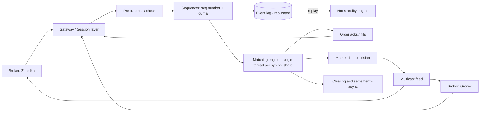
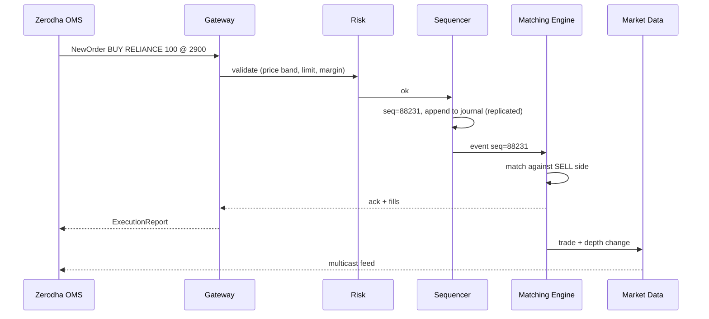

# Q15 · Stock exchange

Oct 16, 2026 · @saurav chaurasiya

**Is doc me:** NSE-style stock exchange ka HLD — order types, price-time priority order book, single-threaded sequencer, event sourcing + replay, market data feed, risk checks, aur NSE colocation controversy.

**Padhne ka tareeka** — pehle Sawaal pe 15 min khud socho, phir Sahi design padho. Java demo chala ke output match karo. Deep Dive tab padho jab time ho.

---

## Q15 — Stock exchange

Stock exchange ek aisa system hai jo buyers aur sellers ke orders ko price aur time ke rule se match karke trade banata hai. Iska dil **matching engine** hai: ek program jo order book ko dekh kar decide karta hai kaun kis se kis price pe trade karega.

### Ye cheez hai kya

- Category: ultra-low-latency, strictly-ordered, financial transaction system (HLD boss).
- Problem: lakhon orders har second aate hain, har ek ko fair order me match karna hai, microseconds me, aur crash ke baad bhi exact same state wapas aani chahiye.
- Is lesson ke baad tum kar paoge: order book design, matching rules (price-time priority) explain, single-threaded sequencer ka reason batana, event sourcing se recovery, aur market data fan-out design.
- Analogy: sabzi mandi ki nilaami. Jo sabse zyada daam bole (buyer) aur jo sabse kam daam maange (seller) wo pehle milte hain; barabar daam pe jo pehle bola uski baari pehle. Munshi (sequencer) ek-ek karke bolne wale ko register me likhta hai — register hi sach hai.

### Sawaal

NSE (National Stock Exchange of India) jaisa equity exchange design karo. Brokers (Zerodha, Groww, Upstox) apne clients ke orders exchange ko bhejte hain.

- Peak load: \~1 million orders/sec across all symbols (cash + F&O — Futures and Options derivatives).
- Matching latency target: p99 (99% requests is time ke andar) under 100 microseconds engine ke andar; order-to-ack under 1 ms.
- Ek stock (e.g. RELIANCE) pe hazaron orders/sec aa sakte hain, kuch symbols hot hote hain.
- Market data: har trade/order change sab brokers ko turant chahiye, \~lakhon messages/sec.
- Zero tolerance: ek trade double-execute nahi hona chahiye, order lost nahi hona chahiye, same input ka same output (deterministic).
- Fairness: same price pe jo pehle aaya wo pehle fill ho.

> Pehle khud socho — 15 min. Hints: (1) Agar 2 threads same order book pe match karein to kya bigdega? (2) Crash ke baad order book wapas kaise banega bina data khoye? (3) 5000 brokers ko market data kaise fair tareeke se bhejoge?

### Problem kyun aata hai

- **Ordering is the product.** Do orders ka sequence badla to alag log ko fill milega — paisa aur legal case dono.
- **Latency competition.** High-frequency traders (HFT — algorithms jo microseconds me trade karte hain) ek-ek microsecond ke liye lade hote hain.
- **Shared mutable state.** Order book ek hi hota hai per symbol; locks lagao to latency kharab, na lagao to race condition.
- **Durability vs speed.** Har order disk pe likhna slow hai, na likhna crash pe risky.
- **Fan-out fairness.** Market data sab ko same time pe milna chahiye, warna kisi ko unfair advantage.

### Naive approach

- Postgres/MySQL table `orders`, har incoming order pe transaction: `SELECT` matching orders `FOR UPDATE`, trade insert, update.
- App servers multiple, load balancer ke peeche, DB row locks se consistency.
- Kahan toot-ta hai:
  - Ek DB transaction \~ 1–5 ms (network round trip + fsync). 1M orders/sec ke liye 1000+ concurrent transactions, aur ek hot symbol pe sab same rows pe lock ke liye line me — throughput ek symbol pe \~ kuch sau/sec.
  - Latency millisecond me, target microsecond me. 1000x door.
  - Row-lock ordering non-deterministic: do orders same time pe aaye to kaun pehle — DB scheduler decide karta hai, exchange nahi. Fairness gayi.
  - Replay impossible: state sirf current rows me hai, history ka order nahi.

### Sahi design

#### Requirements

- Functional:
  1. Order place (LIMIT, MARKET), cancel, modify.
  2. Price-time priority matching, trades generate.
  3. Order acks aur fills brokers ko wapas.
  4. Market data feed (best bid/ask, depth, trades) sab participants ko.
  5. Pre-trade risk checks (price band, quantity limit, margin).
- Non-functional:
  1. Latency: engine microseconds, end-to-end under 1 ms.
  2. Throughput: \~1M orders/sec total, har symbol ke andar strictly sequential.
  3. Determinism: same input log => same trades, byte for byte.
  4. Durability: ack milne ke baad order kabhi lost nahi.
  5. Availability: failover seconds me (RTO — Recovery Time Objective, kitni jaldi wapas chalu), data loss zero (RPO — Recovery Point Objective — 0).

#### Back-of-envelope

- 1M orders/sec, har order \~ 100 bytes => 100 MB/sec inbound, \~ 8.6 TB/din raw (sirf log). Compress aur archive karo.
- Cancels \~ 90%+ orders hote hain (HFT quote karke cancel karte hain), actual trades \~ 5–10% => \~ 50–100K trades/sec peak.
- Order book memory: 5000 symbols x \~ 10K resting orders x 64 bytes \~ 3 GB — RAM me aaram se aata hai. Isliye DB ki zarurat hi nahi matching ke liye.
- Ek core pe ek symbol-group: single thread 1–6 million simple ops/sec kar sakta hai (LMAX ne ek thread pe \~ 6M orders/sec bataya hai) => 1M/sec ka load kuch cores pe split ho jaata hai.
- Market data: 1M events/sec x 50 bytes x 5000 subscribers => multicast zaruri, unicast se bandwidth phat jaayegi.

#### API design

Real exchanges FIX (Financial Information eXchange — text-based trading protocol) ya binary protocols use karte hain. Concept dikhane ke liye REST-style:

- `POST /v1/orders` body `{clientOrderId, symbol, side, type, price, qty}` => `{exchangeOrderId, seq, status}`
- `DELETE /v1/orders/{exchangeOrderId}` => cancel ack
- `PUT /v1/orders/{id}` => modify (price change = cancel + new, time priority khoti hai)
- Stream: `SUBSCRIBE md.RELIANCE` => `{type: "trade"|"depth", seq, px, qty}`
- `clientOrderId` idempotency key hai — retry pe duplicate order nahi banta. Dekho [2A · Idempotency Island](https://claude.ai/code/artifact/c269ac61-440b-4525-bd04-31baf708dece).

#### Data model

- **Order** (memory me): `id, symbol, side, type, price, qty, remainingQty, seq, brokerId, ts`.
- **Order book** per symbol: BUY side price descending, SELL side price ascending; har price level pe FIFO queue.
- **Event** (durable log, source of truth): `seq, type(NEW|CANCEL|MODIFY), payload`. Sirf append hota hai.
- **Trade**: `tradeId, symbol, px, qty, buyOrderId, sellOrderId, seq`.
- Reporting/clearing ke liye trades alag DB (SQL) me async jaate hain — matching path me DB nahi.

#### High-level architecture

- Gateways (brokers se connections) => Risk check => **Sequencer** (global order deta hai + log) => **Matching engine** (single thread per shard) => outputs: acks, trades, market data.
- Engine ka state sirf memory me; durable truth = event log. Standby engine same log replay karke hot-standby rehta hai.



Ek order ka lifecycle:



#### Matching rules: price-time priority

- Best price pehle: BUY me highest price, SELL me lowest price.
- Same price pe jo pehle aaya (chhota seq) wo pehle fill.
- Trade **resting order (maker)** ke price pe hota hai, aane wale (taker) ke nahi.
- LIMIT order: bacha hua qty book me baith jaata hai. MARKET order: jo mile utha lo, bacha cancel.
- Order types: LIMIT, MARKET, plus IOC (Immediate Or Cancel — turant jitna ho fill karo, baki cancel), FOK (Fill Or Kill — poora fill ya kuch nahi), stop-loss.

#### Java demo

Ye demo order book, sequencer, event journal aur crash-replay ek file me dikhata hai. Pattern: **Event Sourcing** (state = events ka replay) aur **Single-writer / Command pattern** (har event ek command hai jo engine apply karta hai).

```java
import java.util.*;

public class Demo {
    enum Side { BUY, SELL }
    enum Type { LIMIT, MARKET }

    // Order: exchange ke andar ek order ki poori state
    static final class Order {
        final long id; final Side side; final Type type; final long price; long qty; final long seq;
        Order(long id, Side side, Type type, long price, long qty, long seq) {
            this.id = id; this.side = side; this.type = type; this.price = price; this.qty = qty; this.seq = seq;
        }
    }

    // Input event: sequencer isko seq number deta hai, log me jaata hai
    record NewOrder(long seq, long id, Side side, Type type, long price, long qty) {}
    record Cancel(long seq, long id) {}

    // Matching engine: single thread, koi lock nahi, deterministic
    static final class Engine {
        // BUY side: high price pehle. SELL side: low price pehle. Same price pe seq (time) pehle.
        final TreeMap<Long, ArrayDeque<Order>> bids = new TreeMap<>(Comparator.reverseOrder());
        final TreeMap<Long, ArrayDeque<Order>> asks = new TreeMap<>();
        final Map<Long, Order> byId = new HashMap<>();
        final List<String> trades = new ArrayList<>();

        void onNew(NewOrder e) {
            Order o = new Order(e.id(), e.side(), e.type(), e.price(), e.qty(), e.seq());
            TreeMap<Long, ArrayDeque<Order>> opp = o.side == Side.BUY ? asks : bids;
            while (o.qty > 0 && !opp.isEmpty()) {
                Map.Entry<Long, ArrayDeque<Order>> best = opp.firstEntry();
                long bp = best.getKey();
                boolean crosses = o.type == Type.MARKET
                        || (o.side == Side.BUY ? o.price >= bp : o.price <= bp);
                if (!crosses) break;
                ArrayDeque<Order> q = best.getValue();
                Order rest = q.peekFirst();
                long fill = Math.min(o.qty, rest.qty);
                // trade hamesha resting order ke price pe hota hai
                trades.add("TRADE seq=" + e.seq() + " px=" + bp + " qty=" + fill
                        + " taker=" + o.id + " maker=" + rest.id);
                o.qty -= fill; rest.qty -= fill;
                if (rest.qty == 0) { q.pollFirst(); byId.remove(rest.id); }
                if (q.isEmpty()) opp.remove(bp);
            }
            // bacha hua LIMIT qty book me baithta hai; MARKET ka bacha hua cancel
            if (o.qty > 0 && o.type == Type.LIMIT) {
                (o.side == Side.BUY ? bids : asks).computeIfAbsent(o.price, k -> new ArrayDeque<>()).addLast(o);
                byId.put(o.id, o);
            }
        }

        void onCancel(Cancel c) {
            Order o = byId.remove(c.id());
            if (o == null) { trades.add("CANCEL-REJECT seq=" + c.seq() + " id=" + c.id()); return; }
            TreeMap<Long, ArrayDeque<Order>> side = o.side == Side.BUY ? bids : asks;
            ArrayDeque<Order> q = side.get(o.price);
            q.remove(o);
            if (q.isEmpty()) side.remove(o.price);
            trades.add("CANCELLED seq=" + c.seq() + " id=" + c.id() + " leftQty=" + o.qty);
        }

        String snapshot() {
            StringBuilder sb = new StringBuilder("BOOK ");
            sb.append("bids=");
            bids.forEach((p, q) -> sb.append(p).append("x").append(q.stream().mapToLong(x -> x.qty).sum()).append(' '));
            sb.append("asks=");
            asks.forEach((p, q) -> sb.append(p).append("x").append(q.stream().mapToLong(x -> x.qty).sum()).append(' '));
            return sb.toString().trim();
        }
    }

    // Sequencer: sab inputs ko ek line me lagata hai, seq deta hai, log me append karta hai
    static final class Sequencer {
        final List<Object> journal = new ArrayList<>();   // event log (asli system me disk/replicated)
        long next = 1;
        long nextSeq() { return next++; }
        void append(Object e) { journal.add(e); }
    }

    static void apply(Engine en, Object e) {
        if (e instanceof NewOrder n) en.onNew(n);
        else if (e instanceof Cancel c) en.onCancel(c);
    }

    public static void main(String[] args) {
        Sequencer sq = new Sequencer();
        Engine live = new Engine();
        List<Object> inputs = List.of(
            new NewOrder(0, 1, Side.SELL, Type.LIMIT, 101, 50),   // Zerodha client A sell
            new NewOrder(0, 2, Side.SELL, Type.LIMIT, 101, 30),   // same price, baad me aaya
            new NewOrder(0, 3, Side.SELL, Type.LIMIT, 102, 40),
            new NewOrder(0, 4, Side.BUY,  Type.LIMIT, 99, 20),
            new NewOrder(0, 5, Side.BUY,  Type.LIMIT, 101, 60),   // 50 @101 (order 1) + 10 @101 (order 2)
            new Cancel(0, 4),
            new NewOrder(0, 6, Side.BUY,  Type.MARKET, 0, 100)    // book me jo mile uthao
        );
        for (Object in : inputs) {
            Object stamped = in instanceof NewOrder n ? new NewOrder(sq.nextSeq(), n.id(), n.side(), n.type(), n.price(), n.qty())
                                                      : new Cancel(sq.nextSeq(), ((Cancel) in).id());
            sq.append(stamped);          // pehle log, phir match (write-ahead)
            apply(live, stamped);
        }
        live.trades.forEach(System.out::println);
        System.out.println(live.snapshot());

        // Crash recovery: naya engine, journal replay
        Engine recovered = new Engine();
        for (Object e : sq.journal) apply(recovered, e);
        System.out.println("replay same trades: " + live.trades.equals(recovered.trades));
        System.out.println("replay same book  : " + live.snapshot().equals(recovered.snapshot()));
    }
}
```

Isko chalane pe bilkul ye output aata hai:

```text
TRADE seq=5 px=101 qty=50 taker=5 maker=1
TRADE seq=5 px=101 qty=10 taker=5 maker=2
CANCELLED seq=6 id=4 leftQty=20
TRADE seq=7 px=101 qty=20 taker=6 maker=2
TRADE seq=7 px=102 qty=40 taker=6 maker=3
BOOK bids=asks=
replay same trades: true
replay same book  : true
```

- Order 5 (BUY 60 @101) ne pehle order 1 (50) ko fill kiya, phir order 2 (10): same price pe order 1 pehle aaya tha — time priority.
- Order 6 market BUY 100 tha, book me sirf 20 + 40 = 60 mila; bacha 40 cancel ho gaya.
- Journal replay se naye engine ne exactly same trades aur book banaya — yahi recovery ka base hai.

### Kya choose karein aur kyun

| Option | Kab use karo | Kab mat karo |
| --- | --- | --- |
| Single-threaded engine per symbol (shard by symbol) | Exchange matching: determinism + microsecond latency chahiye | Jab ek hi symbol ka load ek core se zyada ho (tab symbol ko aur todna possible nahi, optimize code karo) |
| Multi-threaded with locks on order book | Low-volume toy/retail simulators | Real exchange: lock contention aur non-deterministic ordering |
| DB-backed matching (SQL transactions) | Ek chhota broker ka internal order-state store | Matching path me kabhi nahi (ms latency) |
| Event sourcing + replay | Recovery, audit, standby chahiye | Jab history ki zarurat hi na ho aur state chhota ho |
| Multicast market data | Hazaron subscribers ko same time pe data | Cloud/WAN jahan multicast available nahi (tab Kafka/WebSocket fan-out) |

### India me kaise hota hai

- NSE aur BSE (Bombay Stock Exchange) dono low-latency matching engines chalate hain; brokers jaise Zerodha ka apna OMS (Order Management System) hota hai jo exchange ke gateway se connect hota hai.
- **Colocation:** NSE brokers/HFT ko apne data centre me rack lene deta hai taaki network latency kam ho. Isse fairness ka sawaal uthta hai — sabko same distance aur same cable length milni chahiye.
- **NSE co-location / tick-by-tick (TBT) controversy:** SEBI (Securities and Exchange Board of India) ke order ke mutabik kuch brokers ko colocation me secondary server se login karne ka faayda mila, jisse unhe market data thoda pehle mila — unfair advantage ke allegations. SEBI ne 2021 me NSE aur kuch ex-officials pe penalty lagayi: [Sebi imposes fines on NSE, Ramakrishna, Narain in co-location case](https://www.business-standard.com/amp/article/markets/sebi-imposes-fines-nse-ramakrishna-narain-in-co-location-case-121021001373_1.html). Case aage courts/settlement me gaya; latest status ke liye khabar dekho: [SC allows NSE-Sebi settlement](https://www.business-standard.com/india-news/sc-allows-nse-sebi-settlement-in-co-location-case-disposes-appeals-126091801184_1.html).
- Interview lesson: **fairness ek technical requirement hai** — equal-length cables, same multicast timing, aur access (login) rules ek hi pe poori tarah enforce hone chahiye.
- Zerodha jaisa broker client hai: wo client ka order lekar apne risk checks (margin) laga ke exchange ko bhejta hai; exchange khud bhi apne pre-trade checks (price band, quantity freeze) lagata hai.

### Interview follow-ups

- **Single thread kyun, multi-thread kyun nahi?** — Order book ek shared sequential structure hai. Locks latency badhate hain aur ordering non-deterministic karte hain. Ek thread RAM me bina lock ke millions ops/sec kar leta hai; scale shard-by-symbol se.
- **Crash ho jaye to?** — Event log durable hai. Standby engine same log live replay karta hai; primary fail pe standby promote, bacha log tail apply karke continue.
- **Sequencer SPOF (Single Point Of Failure) nahi hai?** — Hai, isliye sequencer replicated hota hai (primary + standby, log ko quorum — majority nodes ki agreement — se likhte hain) aur failover rehearse hota hai.
- **Ek hot symbol (e.g. RELIANCE) ka kya?** — Symbol ke andar hamesha sequential; us symbol ko dedicated core do, allocation-free code likho, aur bahar ka kaam (parsing, risk) alag threads pe karo.
- **Market data fairness kaise?** — Multicast, equal-length cables, same timestamping; slow consumers ko drop ya snapshot+gap-recovery, taaki engine kabhi block na ho (backpressure — consumer slow ho to producer ko rokna — yahan engine pe nahi lagana).
- **Order modify pe time priority?** — Price badla ya qty badhi to priority khoti hai (cancel+new). Qty ghatane pe priority bachi reh sakti hai.
- **Exactly-once kaise?** — `clientOrderId` se dedupe + sequencer ka seq number; replay deterministic hai isliye same event dobara apply bhi ho to same result (dedupe seq se). Dekho [2A · Idempotency Island](https://claude.ai/code/artifact/c269ac61-440b-4525-bd04-31baf708dece).

### Self-check

1. Price-time priority kya hai aur trade kis price pe hota hai, maker ke ya taker ke?
2. Matching engine single-threaded kyun hota hai? Scale kaise karte hain?
3. Event sourcing se crash recovery kaise hoti hai? Determinism kyun zaruri hai?
4. Naive DB-based approach kahan toot-ta hai (numbers ke saath)?
5. Colocation se fairness ka kya issue aata hai aur NSE case me kya hua tha?

### Notebook

Price-time priority: best price, phir earliest seq · Trade maker ke price pe · Single thread per symbol shard, lock-free, deterministic · Sequencer = global order + journal, event log hi source of truth · Cancels \~ 90% flow · Market data multicast, fairness ke liye equal latency · Order modify = priority loss.

### Padhne ke liye

- [The LMAX Architecture — Martin Fowler](https://www.martinfowler.com/articles/lmax.html)
- [exchange-core: Java matching engine on LMAX Disruptor](https://github.com/exchange-core/exchange-core)
- [LMAX Disruptor paper](https://lmax-exchange.github.io/disruptor/disruptor.html)
- [SEBI fines NSE in co-location case — Business Standard](https://www.business-standard.com/amp/article/markets/sebi-imposes-fines-nse-ramakrishna-narain-in-co-location-case-121021001373_1.html)

### Deep Dive (SDE-2) — jab time ho

#### Order book data structure

- Per side sorted map price => FIFO queue (demo me TreeMap + ArrayDeque, O(log P)).
- Production me price ticks bounded hote hain, isliye array indexed by tick (O(1)) + doubly linked list per level, aur `orderId => node` hash for O(1) cancel.
- Object allocation avoid: preallocated pools, GC pause (garbage collection) microsecond SLA ko tod deta hai.

#### Sequencer, journal aur recovery

- Sequencer har input ko monotonically increasing seq deta hai; journal me append **ack se pehle** (write-ahead).
- Journal ko replicate karo (quorum ya synchronous standby); disk pe batched fsync.
- Snapshot periodically (book ka dump + seq), recovery = last snapshot load + uske baad ka log replay.
- Determinism ke liye engine me wall-clock, random, ya unordered iteration nahi; time bhi event ke saath aata hai.

#### Mechanical sympathy aur LMAX Disruptor

- Ring buffer + single writer, cache-line padding, no false sharing, CPU pinning (thread ko ek core pe fix karna).
- Kernel bypass networking (user-space NIC access) latency aur jitter kam karta hai.
- Events ko batch process karna throughput badhata hai bina latency badhaye.

#### Market data feed

- Do channels: incremental (har change) + snapshot (periodic full book). Gap detect hone pe snapshot se catch up.
- UDP multicast, har message pe seq number; client gap dekhe to retransmit request ya snapshot.
- Tick-by-tick (TBT) feed = har order/trade event; conflated feed = snapshot interval pe summary. Alag tiers = alag fees.
- Slow consumer exchange ko slow nahi karna chahiye: feed alag process, engine ko sirf output queue me likhna hai.

#### Pre-trade risk aur circuit breakers

- Price band (circuit limit): last close se +/-X% bahar order reject.
- Quantity freeze, fat-finger check, per-broker exposure limit, margin check (broker side pe bhi).
- Market-wide circuit breaker: index bahut girne pe trading rok do; ye engine ko ek control event ke roop me sequencer se bheja jaata hai taaki replay me bhi same ho.
- Risk ko matching thread ke bahar rakho, par seq se pehle — rejected orders log me nahi jaate (ya REJECT event ke roop me jaate hain, audit ke liye).

#### Multi-region aur DR

- Primary site + DR (Disaster Recovery) site me log replication; failover drill regular. Dekho [2E · Resilience Ridge](https://claude.ai/code/artifact/4769dea3-018e-41e1-ae18-253fa36a6d21).
- Log ko Kafka jaisa system archive/analytics ke liye consume kare; matching path pe nahi. Dekho [1E · Kafka River](https://claude.ai/code/artifact/eeb39ee8-3f52-4c04-b57b-68213f02c429).
- Post-trade: clearing corporation trades ko settle karta hai (India me T+1 settlement); ye async hai, matching latency se alag.

---

## Aage kya

- Pichhla: [Q14 · Snowflake ID generator](https://claude.ai/code/artifact/18205ae1-8400-438c-8a6b-32f43b0ccaa0)
- Agla: [Q16 · IRCTC Tatkal](https://claude.ai/code/artifact/28fb55cf-5b39-4d94-be81-ca37f22957a0)
- Related: [1E · Kafka River](https://claude.ai/code/artifact/eeb39ee8-3f52-4c04-b57b-68213f02c429) · [2A · Idempotency Island](https://claude.ai/code/artifact/c269ac61-440b-4525-bd04-31baf708dece) · LLD twin: [D23 · Stock broker](https://claude.ai/code/artifact/ede5f910-7551-4d64-b195-e3e8ab965b89)
