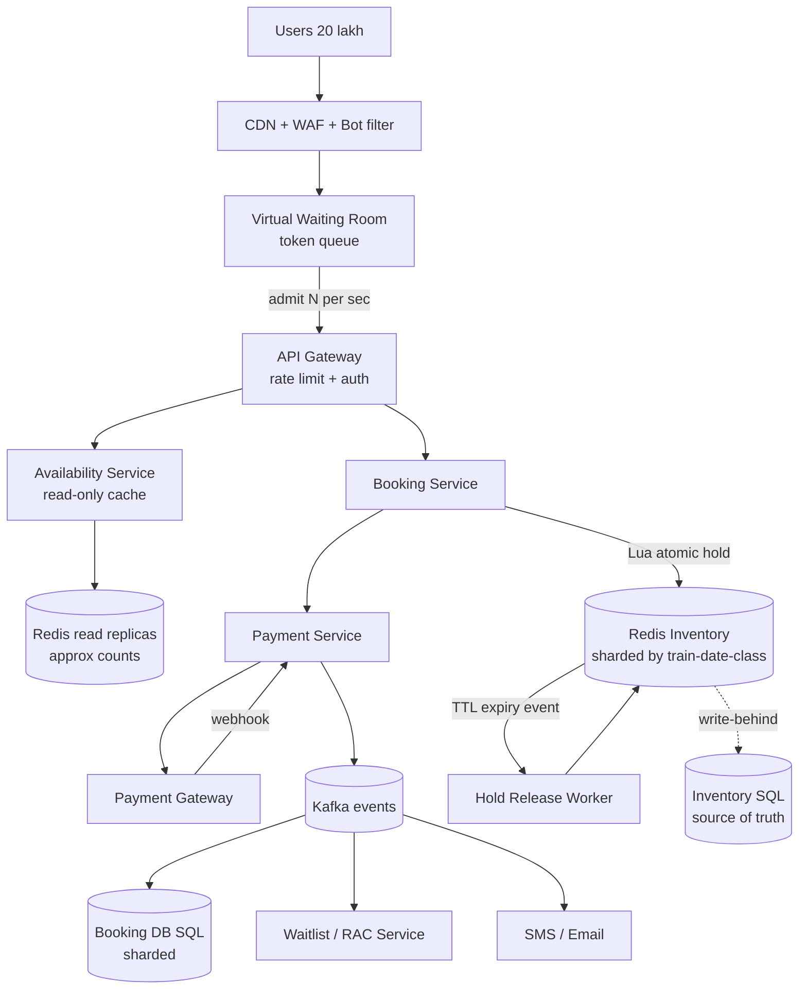
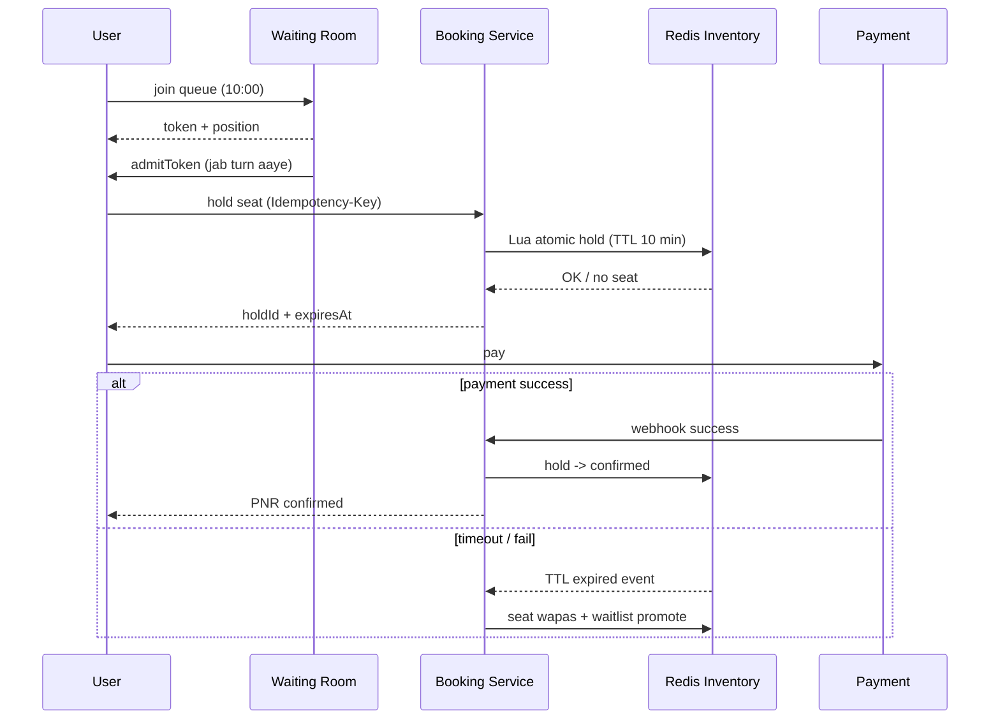

# Q16 · IRCTC Tatkal

Oct 16, 2026 · @saurav chaurasiya

**Is doc me:** IRCTC Tatkal booking ka poora HLD boss — 10:00 AM ka spike, virtual waiting room, seat inventory, atomic allocation, waitlist/RAC, bot prevention, payment timeout aur fairness.

**Padhne ka tareeka** — pehle Sawaal pe 15 min khud socho, phir Naive approach se dekho kahan toot-ta hai, phir Sahi design padho. Deep Dive tab padho jab time ho.

---

## Q16 — IRCTC Tatkal

Tatkal booking ek aisa system hai jisme lakhon log ek hi minute me limited seats ke liye toot padte hain. Yahan asli challenge hai: spike ko jhelna, seat ko kabhi do logon ko na dena, aur sabko fair mauka dena.

### Ye cheez hai kya

- Category: high-contention inventory booking system (flash-sale jaisa) with queue + atomic allocation.
- Problem: 10:00 AM pe ek hi waqt pe lakhon requests aati hain, seats sirf kuch sau hain. Server gire nahi, seat double-book na ho, bots jeet na jayein.
- Is lesson ke baad tum kar paoge: waiting room, seat inventory model, atomic allocation, payment-timeout release, waitlist/RAC aur bot defence ka poora design interview me bata paoge.
- Analogy: Tatkal counter ki subah ki line jaisa hai. Pehle gate pe token milta hai (waiting room), phir ek-ek karke khidki pe bulaya jata hai, aur khidki wala register me seat pe pen se likhta hai (atomic allocation) taaki do logon ko ek seat na mile.

### Sawaal

IRCTC pe Tatkal AC booking 10:00 AM pe khulti hai (Non-AC 11:00 AM), journey se ek din pehle. Ek popular train (jaise Delhi - Patna) me 3A class me Tatkal quota sirf lagbhag 100-150 seats ka hota hai. Lekin 10:00:00 pe 15-20 lakh concurrent users login karke try karte hain.

- Peak load: pehle 2-3 minute me \~5 lakh booking attempts per minute, search + availability + book mila ke \~100K-300K requests/sec (QPS = queries per second).
- Seats: \~500K train-class-date combos me total, par ek hot train ke liye \~120 Tatkal seats.
- Latency target: availability check p99 (99% requests is se tez) under 300 ms, book confirm under 2 s after queue turn.
- Correctness: ek seat kabhi 2 logon ko nahi, payment fail pe seat 10 min ke andar wapas.

> Pehle khud socho — 15 min. Hints: (1) 20 lakh log aur 120 seats — sabko seedha DB tak jaane doge to kya hoga? (2) Do users ek hi seat ek saath maangein to jeetne wala kaun decide karega, aur kahan? (3) User ne seat le li par payment nahi kiya — seat kab aur kaise wapas aayegi?

### Problem kyun aata hai

- Demand supply se 10000x zyada hai: 20 lakh log vs 120 seats. Har koi refresh-refresh karta hai, to load aur badhta hai.
- Spike predictable hai (exactly 10:00) lekin bahut chhota window (2-3 minute) hai. Auto-scaling ko warm hone ka time nahi milta.
- Ek hi row (ek train-class-date ka inventory) pe hazaron concurrent writes — hot key (ek hi key pe sara traffic) aur lock contention.
- Bots aur agents (scripts, multiple accounts) humans se tez hain, real users ko seat nahi milti.
- Payment gateway slow hai ya fail hota hai — tab tak seat hold rehti hai, wo bhi kisi aur ki ho sakti thi.
- Seat quotas hain (General, Tatkal, Ladies, Senior citizen) aur ek journey multi-station segment ki hoti hai (A se C jaate hue B pe seat khali).

### Naive approach

- Ek monolith + ek SQL DB. User "Book" dabaye to server DB me `SELECT` karke dekhe seat khali hai, phir `UPDATE` kar de. Payment page ke dauran seat lock rakhe.
- Kahan toot-ta hai (numbers ke saath):
  - 200K QPS ek DB pe: ek MySQL node \~5-10K write QPS leta hai, 20x gap hai. Connection pool khatam, p99 30 sec+, timeouts, retries se load aur badhta hai (retry storm).
  - `SELECT` phir `UPDATE` alag hone se race condition: 2 users dono ko "seat khali" dikhti hai, dono ko confirm ho jata hai — double booking.
  - Row lock payment ke dauran pakde rakhne se 120 seats ke liye lakhon transactions lock pe wait karte hain, DB thread starve ho jate hain.
  - Bot 50 requests/sec bhejta hai, human 1 per 5 sec — bots jeet jate hain.
  - Sab kuch ek hi place pe: ek component fail to puri booking band (SPOF = single point of failure — ek cheez girne se poora system ruk jaye).

### Sahi design

#### Requirements

- Functional:
  1. Train search, availability dikhana (class-wise, quota-wise).
  2. Tatkal window par seat book karna (passenger details + payment).
  3. Seat ya to CONFIRMED, RAC (Reservation Against Cancellation — aadhi berth, sharing), ya WAITLISTED milti hai.
  4. Payment fail/timeout pe seat release.
  5. Cancellation par waitlist -> RAC -> confirmed promotion.
- Non-functional:
  - Zero double-booking (strong consistency per seat inventory).
  - Spike survival: 10:00 pe system girna nahi chahiye, graceful degrade (queue, "please wait").
  - Fairness: roughly first-come-first-served, bots ka advantage nahi.
  - Availability search eventual consistent chalega, book strictly consistent.
  - Auditability: har booking ka trail (PNR = Passenger Name Record, ticket ka unique number).

#### Back-of-envelope estimates

- Users: peak 20 lakh concurrent at 10:00. Tatkal seat total (poore network) lagbhag kuch lakh/din.
- Peak QPS: 20 lakh users x average 5 requests in first minute / 60 = \~170K QPS. Reads (search, availability) 90%, writes 10%.
- Writes (seat attempts): \~20K QPS peak at gate. Queue iske baad asli allocator ko sirf \~2-3K/sec pass karega.
- Inventory size: \~13,000 trains x \~120 days advance x \~6 classes x \~(coaches x berths \~ 72-1000) — total rows \~ 100M segment-level seats, har seat \~50 bytes = \~5 GB. Poora RAM me aa jata hai (Redis cluster).
- Booking records: \~1.2M tickets/day x 2 KB = \~2.4 GB/day, \~900 GB/year.
- Waiting room tokens: 20 lakh x \~100 bytes = 200 MB — chhota.

#### API design

```text
POST /v1/queue/join            -> { "queueToken": "q_abc", "position": 183422, "etaSec": 240 }
GET  /v1/queue/status?token=q_abc   -> { "state": "WAITING|READY", "admitToken": "a_xyz" }
GET  /v1/trains/{trainNo}/availability?date=2026-10-17&class=3A&quota=TQ
POST /v1/bookings/hold         (header: Idempotency-Key, admitToken)
     body: { trainNo, date, class, quota, from, to, passengers: [...] }
     -> 201 { "holdId": "h_1", "expiresAt": "...+10min", "seats": ["B3-21"] }
POST /v1/bookings/{holdId}/pay -> { "paymentUrl": "..." }
GET  /v1/bookings/{pnr}
POST /v1/bookings/{pnr}/cancel
```

Idempotency-Key ka matlab: same request dobara aaye to dobara booking na bane (detail [2A · Idempotency Island](https://claude.ai/code/artifact/c269ac61-440b-4525-bd04-31baf708dece) me).

#### Data model

- Inventory (Redis hot copy + SQL source of truth), key = `train:date:class`:
  - Seat level: `seat(trainNo, date, class, coach, berth, quota, segmentBitmap)`. Segmentbitmap ek bit per station-segment hota hai (A-B, B-C, ...). Ek seat tab free hai jab journey ke saare segment bits 0 hain.
  - Quota counters: `avail:{train}:{date}:{class}:{quota}` = available count.
- Hold: `hold(holdId, seats[], userId, expiresAt, state)` — Redis key with TTL (TTL = time to live — key apne aap expire).
- Booking (SQL, sharded by PNR/train-date): `booking(pnr, userId, train, date, class, status, amount, createdAt)`, `passenger(pnr, name, age, seat/waitlistNo)`.
- Waitlist: per train-class-date sorted queue (`WL` number, FIFO by booking time).
- Status states: HELD -> PAYMENT\_PENDING -> CONFIRMED / RAC / WL / EXPIRED / CANCELLED (state machine, detail [2C · Saga Sea](https://claude.ai/code/artifact/429b3ea6-a261-431d-a384-a0c6eb68a9f6) me).

#### Architecture

Idea: spike ko do layer me todo. Edge pe CDN + WAF + bot filter, phir virtual waiting room jo traffic ko controlled rate pe admit kare, phir chhota allocator tier jo Redis me atomic allocation kare, aur payment async saga se.



#### Steps (Sahi design ka flow)

1. **Pre-queue:** 09:45 se hi users "waiting room" me aa sakte hain. 10:00 pe jo log pehle aaye, unko random + arrival-time mix se queue position milti hai (fairness). Waiting room ek static/CDN page hai jo kam server load leta hai.
2. **Admission control:** Queue service har second ek fixed number (jaise 3000/sec, backend ki capacity ke hisaab se) users ko `admitToken` deta hai. Baaki WAITING me rahte hain aur page sirf lightweight polling (ya SSE = server-sent events) karta hai.
3. **Bot filter:** Admit se pehle captcha + device fingerprint + per-account/IP rate limit. Detail Deep Dive me.
4. **Hold (atomic allocation):** Booking Service ek Redis Lua script chalata hai jo ek hi atomic step me seat check + quota counter decrement + hold key bana deta hai. Redis single-threaded hai to script beech me nahi katti.
5. **Hold ka TTL:** Hold 10 min ka (practically payment page ke liye \~5-7 min) hota hai. Expire hone pe seat wapas inventory me.
6. **Payment:** User payment karta hai. Webhook aane pe Payment Service confirm event Kafka pe daalta hai; booking DB me row CONFIRMED hoti hai aur PNR milta hai.
7. **Fail/timeout:** Payment fail ya TTL expire -> release worker seat wapas karta hai aur waitlist ko promote karta hai (compensating transaction — pehle ka kaam undo karne wala step).
8. **Quota full:** Agar quota khatam, to booking WAITLISTED ya RAC me jati hai (rules Deep Dive me).

Atomic hold ka Lua script (Redis ke andar ek poora step chalta hai). Ye script quota counter check karke ghata deta hai aur hold bana deta hai:

```text
-- KEYS[1] = avail:{train}:{date}:{class}:TQ   (quota counter)
-- KEYS[2] = hold:{holdId}                      (hold key)
-- ARGV[1] = seats maange, ARGV[2] = TTL seconds, ARGV[3] = userId
local avail = tonumber(redis.call('GET', KEYS[1]) or '0')
if avail < tonumber(ARGV[1]) then
  return 0                       -- seat nahi hai, caller waitlist logic chalaye
end
redis.call('DECRBY', KEYS[1], ARGV[1])        -- counter ghatao
redis.call('SET', KEYS[2], ARGV[3], 'EX', ARGV[2])  -- hold, TTL ke saath
return 1                         -- hold mil gaya
```

Pura flow ek sequence me (happy path aur timeout dono):



### Kya choose karein aur kyun

Seat allocation ke liye 3 options hain:

| Option | Kab use karo | Kab mat karo |
| --- | --- | --- |
| SQL row lock (`SELECT ... FOR UPDATE`) | Kam traffic, simple, strong ACID (Atomicity, Consistency, Isolation, Durability) chahiye | 10:00 ka spike — lock contention se DB behta hai |
| Optimistic locking (version column) | Conflict kam hota hai | Tatkal me conflict almost har request pe — retry storm |
| Redis Lua atomic + SQL async | Hot inventory, bahut high QPS, short hold | Redis loss ka dar — isliye AOF (Append Only File) + SQL source of truth + reconcile chahiye |

Spike handle karne ke liye 3 options:

| Option | Kab use karo | Kab mat karo |
| --- | --- | --- |
| Sirf auto-scaling | Gradual growth | Exactly 10:00 pe 100x jump — scale hone se pehle gir jata hai |
| Hard rate limit / 429 | Simple protection | Users ko bas error milta hai, unfair (jo refresh kare wahi jeete) |
| Virtual waiting room | Predictable flash spike, fairness chahiye | Ek chhota extra component aur queue state maintain karni padti hai |

Inventory sharding ke liye:

| Option | Kab use karo | Kab mat karo |
| --- | --- | --- |
| Shard by train-date-class | Har key ek hi shard pe, atomicity easy | Ek super-popular train ek shard pe garam ho sakti hai (hot key) |
| Shard by seat-id | Load evenly | Quota counter cross-shard — atomic allocation hard |
| Single Redis | Prototype | SPOF aur throughput ceiling |

Ye design [2D · Lock Fort](https://claude.ai/code/artifact/97588686-7110-4318-8124-3a8727c7604e) ke locking ideas aur [2E · Resilience Ridge](https://claude.ai/code/artifact/4769dea3-018e-41e1-ae18-253fa36a6d21) ke backpressure/rate-limit pe depend karta hai. Seat-booking ka similar case [Q7 · BookMyShow](https://claude.ai/code/artifact/341a1548-32bc-40ec-9c14-f23018f65c9c) me bhi hai, farak ye hai ki yahan spike aur quota/waitlist zyada hard hain.

### India me kaise hota hai

- IRCTC (Indian Railway Catering and Tourism Corporation) ka backend Centre for Railway Information Systems (CRIS) ke Passenger Reservation System (PRS) pe chalta hai. Tatkal window 10:00 AM (AC) aur 11:00 AM (Non-AC) pe khulti hai, journey se ek din pehle. Overview: [Wikipedia — IRCTC](https://en.wikipedia.org/wiki/Indian_Railway_Catering_and_Tourism_Corporation).
- IRCTC ne captcha, login-based booking aur Tatkal ke time pe limits lagayi hain taaki bots kam ho. Public discussion ke liye: [Why IRCTC Goes Down During Tatkal](https://thecybersecguru.com/glossary/why-irctc-crashes-during-tatkal/).
- Interview-style walkthroughs jahan virtual queue, atomic Redis reservation aur saga ka use hota hai: [IRCTC Tatkal — High-Level System Design (Medium)](https://shubhamshrii.medium.com/irctc-tatkal-ticket-booking-high-level-system-design-9a78eb4b0afd) aur [Designing a Resilient Ticket Booking App (Tatkal/IRCTC)](https://medium.com/@nikhillad01/designing-a-resilient-ticket-booking-app-tatkal-irctc-use-case-d39b64765c6c).
- Note: IRCTC ka actual internal architecture publicly poora documented nahi hai. Upar ke links design patterns dikhate hain, exact production internals nahi.

### Interview follow-ups

- **Do users same seat maangein to kaun jeetega?** — Jo Redis Lua script pehle execute hoti hai. Redis single-threaded hai, to scripts serial chalti hain; doosre ko "no seat" milta hai aur wo waitlist logic me jata hai.
- **Redis crash ho gaya to hold/inventory ka kya?** — AOF + replica failover. Source of truth SQL me hai. Restart ke baad SQL se inventory rebuild karke active holds reconcile karte hain (confirmed bookings count minus). Detail [2F · Recon Ruins](https://claude.ai/code/artifact/93d00bdd-f45f-441f-946c-c84355b5c05e).
- **Payment success hua par seat hold expire ho chuka tha, to?** — Late webhook aaye to pehle seat available hai ya nahi dekho. Mil jaye to confirm; nahi to automatic refund (compensating transaction) aur user ko message.
- **Queue me fairness kaise rakhoge?** — Pre-queue window me aane walon ko random order milta hai (sirf millisecond race nahi), uske baad FIFO. Ek user ka ek hi active queue token (per account/device).
- **Bots ko kaise roko?** — Captcha at admission, per-account/IP/device rate limit ([Q2 · Rate limiter](https://claude.ai/code/artifact/f8e2c88d-e59a-4db7-b9af-3692025c48c5)), behavioural signals, aur ek account se max passengers/tickets cap.
- **Hot train ek shard garam kar de to?** — Us train-date-class ke liye alag dedicated Redis node aur queue admit rate low. Availability reads read-replica/cache se, sirf holds primary pe.
- **Waitlist aur RAC kaise promote hote hain?** — Cancellation par freed seat pehle RAC ko, phir WL ko FIFO order me. Ye ek Kafka event se async chalta hai.

### Self-check

1. Tatkal me DB seedha expose karne se kya fail hota hai? Do numbers ke saath reasons do.
2. Virtual waiting room kya karta hai aur wo sirf rate limit se kyun behtar hai?
3. Lua script se double booking kaise rukti hai?
4. Hold ka TTL kyun zaroori hai aur payment late aaye to kya karoge?
5. RAC aur Waitlist me kya fark hai?

### Notebook

Spike ko queue se flatten karo, direct DB mat chhuo · Waiting room = fairness + protection · Seat allocation Redis Lua me atomic, SQL async source of truth · Hold = TTL (10 min) ke saath, expire pe release · Payment saga: fail/timeout pe compensating release · Bot defence: captcha + per-user/IP/device limits · Shard by train-date-class, hot train ko dedicated node.

### Padhne ke liye

- [IRCTC Tatkal Ticket Booking — High-Level System Design](https://shubhamshrii.medium.com/irctc-tatkal-ticket-booking-high-level-system-design-9a78eb4b0afd)
- [Designing a Resilient Ticket Booking App (Tatkal/IRCTC Use Case)](https://medium.com/@nikhillad01/designing-a-resilient-ticket-booking-app-tatkal-irctc-use-case-d39b64765c6c)
- [System Design: Flash Sale / Ticketing (virtual waiting room + Redis Lua)](https://github.com/Rumman90/system-design-flash-sale-ticketing)
- [Flash Sale System Design: Architecture, Scale, and Oversell](https://singhajit.com/flash-sale-system-design/)

### Deep Dive (SDE-2) — jab time ho

#### Virtual waiting room ka internal design

- Queue position ek Redis sorted set (`ZADD queue score=joinOrder userToken`) me. Position = `ZRANK`.
- Admit rate = backend capacity / avg time per booking. Agar allocator 3000 holds/sec le sakta hai aur har user ko \~30 sec chahiye, to \~90K users ek saath active reh sakte hain; usse zyada ko queue me rokte hain (Little's law: L = lambda x W — active users = arrival rate x time spent).
- Admit token signed (JWT = JSON Web Token) hota hai: userId, train, expiry. Backend token verify karta hai, queue bypass nahi ho sakta.
- Polling ya SSE ka load: 20 lakh clients x har 5 sec = 400K QPS. Isko CDN ke edge ya cheap stateless service pe rakho, adaptive polling interval (position door hai to zyada gap).
- Pre-queue random: 09:45-10:00 me jo join karein unko shuffle karo, warna "milliseconds ka race" bots jeet jate hain.

#### Seat model: segments, quotas, RAC aur waitlist

- Train multi-station hoti hai: ek berth A-B pe free aur B-C pe booked ho sakti hai. Isliye segment bitmap: journey ke saare segments free hon tabhi allot.
- Quota: General, Tatkal, Premium Tatkal, Ladies, Senior citizen, etc. alag counters. Quota khatam ho jaye par general bachi ho to rules ke hisaab se allot (business rule configurable).
- Status order: CONFIRMED (berth mili) -> RAC (Reservation Against Cancellation: ek berth do log share karte hain, chart tak confirm milne ka chance) -> WL (waiting list, number se). Chart prepare hone par RAC/WL final.
- Cancellation event: freed segment ko RAC -> WL order me FIFO promote karo. Promotion ek single-writer worker per train-date-class kare (partition key = train-date-class) taaki do promotions ek hi seat na lein.
- Combined/partial (A-C waitlist ko B-D free seat se match) ek NP-hard-jaisa matching problem hai; practically greedy FIFO + segment fit chalta hai.

#### Atomic allocation aur consistency

- Redis primary pe Lua = atomic, par primary failover pe thoda write loss ho sakta hai (async replication). Isliye har CONFIRMED event Kafka -> SQL me durable hota hai, aur reconcile job nightly + hourly Redis counters ko SQL se match karti hai.
- Over-allot rokne ka last line of defence: SQL me unique constraint `(train, date, class, coach, berth, segment)` — duplicate insert fail ho jata hai, Redis galti kare tab bhi double-booking nahi.
- Exactly-once feel: Idempotency-Key + booking state machine ([2A](https://claude.ai/code/artifact/c269ac61-440b-4525-bd04-31baf708dece), [2C](https://claude.ai/code/artifact/429b3ea6-a261-431d-a384-a0c6eb68a9f6)).
- TTL expiry notification ke liye Redis keyspace events ya delay queue; dono best-effort hote hain, to ek periodic sweeper bhi chalao jo expired holds ko pakad le.

#### Payment timeouts, bot prevention aur graceful degrade

- Payment gateway sluggish ho to hold ka TTL extend mat karo bina limit ke; max extension ek baar ya fixed. Warna seats pakde rahenge.
- Pending payment ka status unknown ho to gateway status API se poll karke resolve karo, tab tak seat hold rakho (limit ke andar).
- Bot layers: (1) edge WAF + IP reputation, (2) captcha at queue admission, (3) per-account ek active queue token, (4) per-device/ASN rate limit, (5) booking pe passenger/ticket per-user per-day cap, (6) behaviour model (mouse/typing speed). Sab bot rok nahi sakte, isliye fairness queue aur caps zaroori hain.
- Degrade plan: search/availability cache TTL 2-5 sec ya static snapshot, recommendation/ads band, payment ke alawa sab non-critical features off (load shedding). Detail [2E · Resilience Ridge](https://claude.ai/code/artifact/4769dea3-018e-41e1-ae18-253fa36a6d21).

---

## Aage kya

- Pichhla: [Q15 · Stock exchange](https://claude.ai/code/artifact/1cc64540-421c-436d-b45e-1714800c9805)
- Agla: [Q17 · Leaderboard](https://claude.ai/code/artifact/7e580e00-6c01-4b73-9481-f720752fb8d3)
- Related: [Q7 · BookMyShow](https://claude.ai/code/artifact/341a1548-32bc-40ec-9c14-f23018f65c9c), [2D · Lock Fort](https://claude.ai/code/artifact/97588686-7110-4318-8124-3a8727c7604e), [2E · Resilience Ridge](https://claude.ai/code/artifact/4769dea3-018e-41e1-ae18-253fa36a6d21), [Q2 · Rate limiter](https://claude.ai/code/artifact/f8e2c88d-e59a-4db7-b9af-3692025c48c5)
