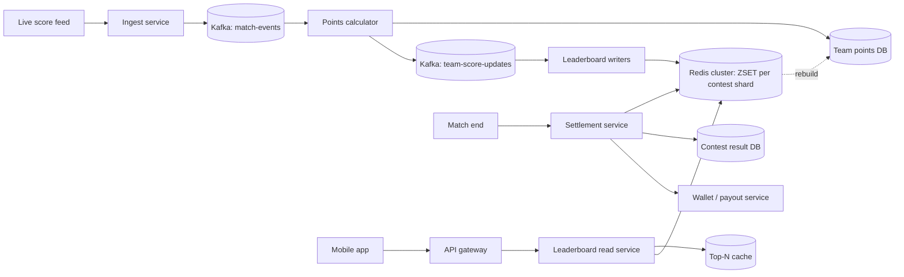
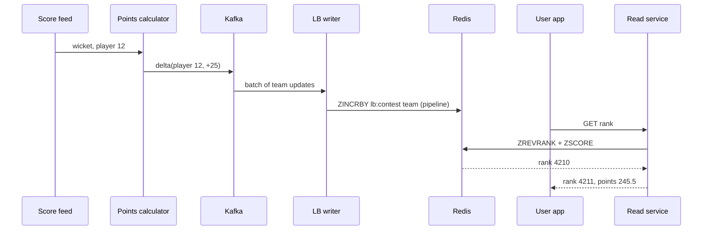

# Q17 · Leaderboard

Oct 16, 2026 · @saurav chaurasiya

**Is doc me:** Dream11-style live contest leaderboard ka poora HLD: Redis sorted set, big contest sharding, exact vs approximate rank, tie-breaking aur final settlement.

**Padhne ka tareeka** — pehle Sawaal pe 15 min khud socho, phir Sahi design padho, aakhir me Self-check karo.

---

## Q17 — Leaderboard

Leaderboard ek aisa system hai jo bahut saare users ko unke score ke hisaab se rank karke dikhata hai, aur score badalte hi rank bhi badal deta hai. Is lesson me hum Dream11 jaise fantasy contest ka live leaderboard design karenge.

### Ye cheez hai kya

- Category: read-heavy + write-heavy real-time ranking system (HLD boss).
- Problem: IPL match ke dauran ek player ne six maara to us player ko chunne wale lakhs users ke fantasy points ek saath badalte hain, aur sabko apna naya rank chahiye.
- Is lesson ke baad tum kar paoge: Redis sorted set se top-N aur "my rank" queries, 1 crore user wale contest ko shard karna, exact aur approximate rank ka trade-off, tie-break rule, aur final winnings settlement design karna.
- Analogy: cricket ka scoreboard jo har ball ke baad update hota hai, bas yahan 1 crore teams ke apne-apne scoreboard hain jo ek hi ball se badal jaate hain.

### Sawaal

Dream11 jaisa app: ek IPL match, jisme 1 crore se zyada users ne teams banayi hain aur 2 lakh se zyada contests chal rahe hain. Sabse bada mega contest me 50 lakh users hain; chhote H2H (head-to-head, 2 users ka) contests lakhon me hain.

- Match 3.5 ghante ka hai. Har ball pe (\~240 balls) player points badalte hain.
- Ek user ki team me 11 players hain, aur ek user 20 tak contests me ho sakta hai.
- Requirement: score change hone ke 5 second ke andar leaderboard fresh dikhe; "mera rank" query p99 latency (99% requests isse tez — worst-case ke kareeb) 50 ms se kam; peak par 10 lakh concurrent users leaderboard dekh rahe hon.

> Pehle khud socho — 15 min. Hints: (1) ek ball ke baad kitne (user, contest) rows ka score badalta hai? (2) 50 lakh entries me rank nikalna O(N) hai ya O(log N)? (3) jab do users ka score same ho to kaun upar?

### Problem kyun aata hai

- **Fan-out (ek event se bahut saare updates)**: ek player ka score badla, to usse chune wale lakhon users ke points badalte hain.
- Har user ke har contest me alag rank hai, to ek score change = (users x contests) ranking updates.
- Reads bhi bahut hain: har user baar-baar refresh karta hai, aur sabko "mera rank" chahiye.
- Hot key (ek hi key pe bahut zyada traffic): mega contest ka ek sorted set sab updates aur reads ek hi Redis node pe bhejta hai.
- Tie: same points wale users ka order deterministic hona chahiye, warna refresh pe rank upar-neeche hota rahega aur paise ka matter hai.
- Final settlement me rank galat hua to real money ghalat bant jaata hai.

### Naive approach

- Sab kuch SQL table `contest_entries(contest_id, user_id, points)` me rakho. Rank nikalne ke liye `SELECT COUNT(*) FROM contest_entries WHERE contest_id = ? AND points > ?`, top-N ke liye `ORDER BY points DESC LIMIT 100`.
- Kahan tootta hai:
  - Mega contest me 50 lakh rows hain. Har "my rank" query 50 lakh rows ko count karti hai. Index ho tab bhi range count O(N) ke kareeb hai; 10 lakh users x 1 refresh/10 sec = 1 lakh queries/sec, DB mar jaata hai.
  - Ek ball ke baad \~2 crore row updates (1 crore users x \~2 contests average) in sab ek saath. Single-node DB \~10-20k writes/sec deta hai, yani 2 crore updates me 1000+ second lagenge, jab ki ball 25-30 second ke gap me aati hai. Leaderboard hamesha peeche rahega.
  - Row-level locks aur index maintenance se writes aur dheere.

### Sahi design

#### Requirements

- Functional:
  1. Match events (runs, wicket, catch) aate hain; fantasy points calculate hon.
  2. Har contest ke liye top-N (jaise top 100) leaderboard.
  3. "Mera rank" aur mere aas-paas ke users (rank +/- 5).
  4. Match khatam hone par final rank freeze karke winnings credit karna.
- Non-functional:
  - Freshness: score change ke 5 sec ke andar rank update.
  - Read p99 < 50 ms, 10 lakh concurrent readers.
  - Rank deterministic (tie-break fixed), final settlement exact aur auditable.
  - Availability: match ke dauran leaderboard down nahi hona chahiye; thoda stale chalega, galat nahi.

#### Back-of-envelope estimates

- Teams: 1 crore users x \~3 teams x \~3 contests = \~9 crore (user, contest) entries active ek big match me. Chhote-bade sab milake.
- Ek sorted set entry \~ 50-80 bytes (member id + score + skiplist overhead). 9 crore x 80 B = \~7 GB. Redis cluster me aaram se aata hai; replicas ke saath \~15-20 GB.
- Score change events: \~240 balls, har ball pe kuch players ka points-delta. Ek player ko \~30% teams chunti hain (\~30 lakh teams); ek ball me 2-3 players ka delta = \~1 crore entry updates per ball.
- Ball ke beech \~25 sec ka gap hai, to \~4 lakh updates/sec burst chahiye (1 crore / 25 sec). Batch karke 5 sec me kar sakte hain: \~20 lakh updates/sec cluster-wide, yani 50 Redis shards pe \~40k/sec per shard. Redis ek shard pe 1 lakh+ simple ops/sec deta hai, to sambhav hai.
- Reads: 10 lakh concurrent x 1 request/10 sec = 1 lakh reads/sec, mostly cached top-N.

#### API design

```text
GET  /v1/contests/{contestId}/leaderboard?limit=100&cursor=...   -> top-N page
GET  /v1/contests/{contestId}/rank?teamId=...                    -> {rank, points, percentile}
GET  /v1/contests/{contestId}/rank/neighbours?teamId=...&k=5     -> aas-paas ke 2k+1 teams
POST /internal/events/match/{matchId}                            -> score event (internal, Kafka se)
POST /internal/contests/{contestId}/settle                       -> final freeze + payout trigger
```

- Public APIs read-only hain; score sirf internal pipeline likhta hai.
- Pagination cursor-based (rank/offset ke bajaye score+id) rakhte hain taaki live badalte list me duplicates na aayein.

#### Data model

- Source of truth (durable): `team_points(match_id, team_id, points, updated_at)` aur `contest_entries(contest_id, team_id, user_id)` SQL/NoSQL me. Isse Redis dobara rebuild hota hai.
- Redis sorted set (ZSET — member + score, score ke order me sorted rakhta hai, skiplist se insert/rank O(log N)): key `lb:{contestId}`, member = `teamId`, score = composite score (neeche tie-break).
- Redis hash `team:{teamId}` me display name, avatar (leaderboard render ke liye).
- Settlement table: `contest_result(contest_id, team_id, final_rank, prize_amount, status)` jisme unique key (contest\_id, team\_id) hai.

#### Core Redis commands

Neeche ke commands ek contest ka leaderboard chalate hain.

```text
# score set ya update karo (O(log N))
ZADD lb:9001 245.5 team:77
# score me delta add karo (points badh gaye)
ZINCRBY lb:9001 6 team:77
# mera rank (0-based, bade score ka rank 0) — O(log N)
ZREVRANK lb:9001 team:77
# top 100 withscores
ZREVRANGE lb:9001 0 99 WITHSCORES
# mere aas-paas: rank 4 se 14 tak
ZREVRANGE lb:9001 4 14 WITHSCORES
```

- ZADD/ZINCRBY aur ZREVRANK dono O(log N) hain, isliye 50 lakh entries me bhi microseconds se milliseconds me jawab milta hai.
- ZREVRANK 0-based hota hai, to user ko dikhane ke liye +1 karo.

#### Tie-break

- Same points pe order fix karna zaroori hai. Common rule: pehle jisne team banayi/lock ki (earlier timestamp) upar.
- Redis score ek double hai (\~15-16 digits). Composite score banate hain: `score = points * 10^k + (MAX_TS - lockTimeSec)`. Points ko 2 decimals tak fixed-point (x100) karke integer banao, phir tie-break digits chipkao.
- Example: points 245.50 -> 24550, lockTime se bana tie value 0 to 9,999,999. Score = 24550 \* 10^7 + tie = \~2.4e11, double me exact fit hota hai (2^53 \~ 9e15 tak integer exact).
- Ya alternative: sirf points score rakho aur same-score members ko Redis lexicographic order me chhodo (member string se). Par business rule alag ho sakta hai, to composite behtar hai.

#### High-level architecture

Ye diagram match event se leaderboard tak ka poora raasta dikhata hai.



#### Request flow: ek ball ke baad

Ye sequence diagram dikhata hai ki ek wicket ke baad rank kaise badalta hai aur user ko kaise dikhta hai.



#### Mega contest ko shard kaise karein

- Problem: 50 lakh members ka ek ZSET ek node pe hot key ban jaata hai (CPU aur memory dono). Iska solution hai sharding (data ko multiple machines me baantna).
- Approach 1: **Score-range sharding**. Shards = points ke buckets (0-100, 100-200, ...). Rank = (upar ke saare buckets ke sizes ka sum) + bucket ke andar ka rank. Bucket sizes ek chhote "counts" hash me rakho. Problem: score badalne par team ek bucket se doosre me jaati hai.
- Approach 2: **Hash sharding + merge**. Team ko `hash(teamId) % S` se S shards me daalo. Top-N = har shard ka top-N lo, phir merge karo (k-way merge). Exact rank = har shard me "mere score se bade kitne" (ZCOUNT) sum karo, S queries parallel me.
- Approach 3: **Two-level (top tier + bulk)**. Top \~10,000 ka ek chhota exact ZSET, baaki users ka approximate rank (neeche).
- Practice me: bade contests ke liye hash shards + ZCOUNT sum, aur chhote contests ek hi ZSET me.

#### Exact vs approximate rank

- Top \~10,000 ya paisa jeetne wale ranks: **exact** chahiye, kyunki prize inpe depend karta hai.
- Neeche ke ranks (jaise rank 31,48,201): user ko exact zaroorat nahi, "\~31.5 lakh" ya "top 63%" kaafi hai.
- Approximate ke tareeke: score-bucket histogram (har 0.5 point ka count), uska cumulative sum se rank estimate; ya sampling. Isse har write ki jagah sirf counter badhta hai, bahut sasta.
- Read path: top 10K -> exact ZREVRANK; bahut neeche -> histogram se estimate. Final settlement me hamesha exact.

#### Incremental update vs periodic recompute

- Incremental: har score delta pe ZINCRBY. Fresh rehta hai, par event duplicate aaya to double count ho sakta hai.
- Periodic recompute: har 5-10 sec pe DB se sab teams ka points padhke naya ZSET banao. Simple aur self-healing, par 9 crore rows baar-baar padhna mehnga hai.
- Hybrid (jo hum chunte hain): normal time pe incremental, saath me idempotent (same request dobara aaye to asar ek hi baar) updates. Har 5 min ya drift mile to ek background reconciliation job DB se compare karke sudhaar de. Match end pe ek final full recompute.
- Idempotency ke liye ZADD (absolute score set) use karo, ZINCRBY (delta) nahi; ya event ke saath version number rakho. Dekho [2A · Idempotency Island](https://claude.ai/code/artifact/c269ac61-440b-4525-bd04-31baf708dece).

#### Final settlement

1. Match khatam hone par scoring freeze karo (stat corrections ke window ke baad, jaise ICC/official correction aate hain).
2. Har contest ka ZSET se final exact ranks nikalo aur DB table `contest_result` me likho (bulk, batch me).
3. Prize table (rank 1 = X, rank 2-10 = Y, ...) apply karo. Tie hone par rules (tie-break ya prize split) lagao.
4. Wallet ko credit karne ke liye har result ke liye ek idempotency key (`contestId:teamId`) ke saath payout request bhejo. Dekho [2B · Ledger Library](https://claude.ai/code/artifact/a7c567e0-66cb-46fe-b7c9-9c20739857eb).
5. Payout ke baad reconcile karo: total prize pool = total paid. Dekho [2F · Recon Ruins](https://claude.ai/code/artifact/93d00bdd-f45f-441f-946c-c84355b5c05e).

- Settlement ka source of truth Redis nahi, DB snapshot hai; Redis cache hai.

### Kya choose karein aur kyun

| Option | Kab use karo | Kab mat karo |
| --- | --- | --- |
| SQL COUNT / ORDER BY | Chhota leaderboard (< 1 lakh rows), kam traffic | Live, lakhon updates/sec ya 50 lakh rows |
| Redis ZSET (ek key) | Contest me \~10-20 lakh tak members, exact rank chahiye | Mega contest jahan ek node hot key ban jaaye |
| Hash-sharded ZSETs + merge | 50 lakh+ members, exact rank aur top-N dono | Chhote contests (overhead bekaar) |
| Score-bucket histogram | Neeche ke ranks ka approximate rank, sasta | Prize wale top ranks, settlement |
| Periodic recompute | Drift theek karna, final snapshot | Har ball pe fresh rank dene ke liye akela |
| Incremental ZINCRBY | Normal live updates | Jab events duplicate ho sakte hain aur idempotency nahi hai |

### India me kaise hota hai

- Dream11 ne apni engineering blog me leaderboard ke baare me likha hai ki real-time ranking ko kaise scale kiya; dekho [Leaderboard @Dream11](https://cassandra.link/post/leaderboard-dream11).
- Dream11 real-time gaming ke liye Apache Kafka use karta hai: [Powering Fantasy Sports at Scale: How Dream11 Uses Apache Kafka](https://www.kai-waehner.de/blog/2025/05/19/powering-fantasy-sports-at-scale-how-dream11-uses-apache-kafka-for-real-time-gaming/).
- Dream11 ka Aerospike pe talk bhi hai: [Dream11 architecting scale with Aerospike](https://aerospike.com/resources/videos/dream11-architecting-scale-with-aerospike/).
- Redis ka official leaderboard pattern: [Leaderboard Patterns](https://redis.antirez.com/community/leaderboards.html).
- Note: upar ke links publicly milne wale blogs/talks hain; internal numbers (jaise kitne shards) company-specific hain aur yahan estimates hain.

### Interview follow-ups

- **Ek ZSET me kitne members tak theek hai?** — Memory aur single-thread CPU limit hai; \~ek-do crore members tak possible, par hot key aur failover time ki wajah se 10-20 lakh ke baad shard karna safe hai.
- **Rank exact kaise nikaalein shards me?** — Har shard me ZCOUNT(score > mera score) parallel me chalao aur sum karo, plus apne shard me tie-break wale members ginke.
- **Same score pe kaun upar?** — Composite score me earlier lock time ya fixed rule; deterministic hona chahiye taaki refresh pe rank na hile.
- **Redis crash ho gaya to?** — Source of truth DB hai; ZSET ko DB se rebuild karo. Replica aur AOF/RDB persistence se failover; rebuild ke dauran last known cached top-N dikhao.
- **Hot player pe update storm kaise sambhalein?** — Kafka partitions + batching + Redis pipeline; ek ball ke deltas ko combine karke team-wise ek hi update bhejo.
- **Settlement me double payout kaise roke?** — Payout idempotency key `contestId:teamId`, result table me unique constraint, aur wallet side par ledger entry dedupe.

### Self-check

1. SQL ke COUNT se rank nikalna 50 lakh rows pe kyun fail hota hai, aur ZREVRANK kyun nahi?
2. ZADD aur ZINCRBY me kaun idempotent hai, aur duplicate event pe kya hoga?
3. Composite score se tie-break kaise karte hain, aur double precision ki kya limit hai?
4. 50 lakh member wale contest ka exact rank sharded ZSETs me kaise nikaloge?
5. Settlement ko Redis se kyun nahi, DB snapshot se karna chahiye?

### Notebook

ZSET = skiplist + hash, rank O(log N) · ZREVRANK 0-based, bade score ka rank 0 · tie-break ko score me hi encode karo (points x 10^k + time) · mega contest = hash shards, rank = sum of ZCOUNTs · neeche ke ranks approximate, top aur settlement exact · incremental + periodic reconcile hybrid · payout idempotency key `contestId:teamId`.

### Padhne ke liye

- [Leaderboard Patterns (Redis)](https://redis.antirez.com/community/leaderboards.html)
- [Redis sorted sets](https://redis.antirez.com/commands/content/develop/data-types/sorted-sets.md)
- [Leaderboard @Dream11](https://cassandra.link/post/leaderboard-dream11)
- [How Dream11 uses Apache Kafka](https://www.kai-waehner.de/blog/2025/05/19/powering-fantasy-sports-at-scale-how-dream11-uses-apache-kafka-for-real-time-gaming/)

### Deep Dive (SDE-2) — jab time ho

#### Skiplist kaise rank O(log N) deta hai

- ZSET andar se skiplist (multi-level linked list) aur hash table dono rakhta hai. Hash se member ka score O(1), skiplist se sorted order.
- Har skiplist link ke saath "span" (is link ne kitne elements skip kiye) store hota hai; rank = path ke spans ka sum. Isi se ZREVRANK O(log N) hai.
- Chhote ZSETs listpack (compact array) me rehte hain, bade hone par skiplist me convert hote hain.

#### Hot shard aur rebalancing

- Contest id se shard choose karne par ek mega contest ek node pe aa jaata hai; isliye ek contest ko khud S sub-shards me todte hain.
- Match ke beech me shard add karna risky hai; resharding match se pehle karo ya consistent hashing use karo (dekho [1D · Shard Mountains](https://claude.ai/code/artifact/cfe905e6-6370-43e0-a337-764eeb9ddf1e)).
- Read replicas se top-N reads bahar nikalo; par replica lag (replica thoda peeche rehta hai) ki wajah se rank thoda stale ho sakta hai, jo live view ke liye theek hai.

#### Caching top-N

- Top-100 sabhi readers ke liye same hai; ise 1-2 sec ke TTL pe cache (aur CDN/edge) karo, to 10 lakh readers ke liye Redis pe ek hi read jaata hai. Cache patterns ke liye dekho [1B · Cache Caves](https://claude.ai/code/artifact/32bb1c8e-3433-417c-a3f4-3a34babed6bf).
- "My rank" user-specific hai, ise cache nahi kar sakte; ye seedha ZREVRANK se aata hai (sasta, O(log N)).
- Push vs pull: har 5 sec pe app poll kare ya WebSocket/SSE se server push kare; push me connection count bada kharch hai, to poll with jitter simple hai.

#### Corrections aur out-of-order events

- Cricket me stat correction aati hai (jaise run ya catch badal gaya). Isliye events ko version/sequence number dete hain aur points ko event log se recompute kar sakne layak rakhte hain.
- Late event pe delta ke bajaye team ka absolute points dobara nikaalke ZADD karo, to order ka fark nahi padta.
- Settlement se pehle ek hold window rakho jisme corrections aa sakein, phir hi lock.

---

## Aage kya

- Pichhla: [Q16 · IRCTC Tatkal](https://claude.ai/code/artifact/28fb55cf-5b39-4d94-be81-ca37f22957a0)
- Agla: [Q18 · Job scheduler](https://claude.ai/code/artifact/f34c8263-0b8d-42e6-80ea-90a73678be35)
- Related: [1B · Cache Caves](https://claude.ai/code/artifact/32bb1c8e-3433-417c-a3f4-3a34babed6bf), [1D · Shard Mountains](https://claude.ai/code/artifact/cfe905e6-6370-43e0-a337-764eeb9ddf1e)
