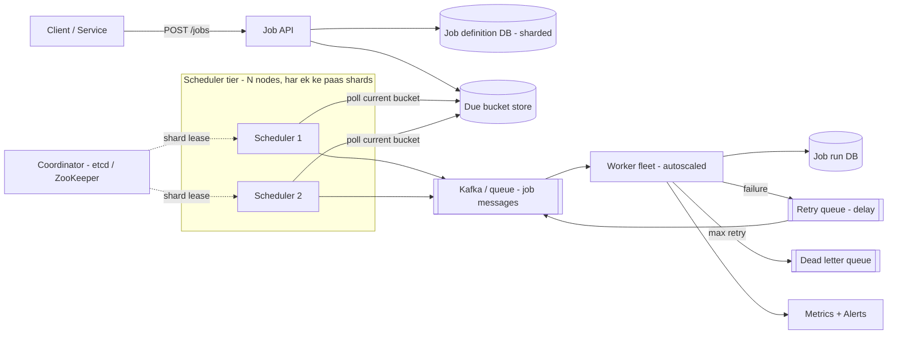

# Q18 · Job scheduler

Oct 16, 2026 · @saurav chaurasiya

**Is doc me:** Distributed job scheduler (cron at scale) ka poora HLD — job definitions, due jobs ka time-bucketed storage, har job sirf ek baar fire kaise ho, retries, DAG dependencies, monitoring.

**Padhne ka tareeka** — pehle Sawaal pe 15 min khud socho, phir Sahi design padho; Deep Dive tab karo jab basics pakke ho jayein.

---

## Q18 — Job scheduler

Job scheduler ek aisa system hai jo "kaam" (job) ko future ke kisi time pe, ya baar-baar (recurring), automatically chalata hai. Linux ka `cron` ek machine pe ye karta hai; distributed job scheduler ye kaam millions of jobs ke liye, kai machines pe, bina koi job miss kiye ya double chalaye karta hai.

### Ye cheez hai kya

- Category: infrastructure / platform system (har badi company ke andar ek hota hai).
- Problem: "kal subah 9 baje is user ko EMI reminder bhejo" jaise millions of time-based kaam, jahan ek bhi missed ya duplicate job paisa ya trust kharab kar sakta hai.
- Is lesson ke baad tum kar paoge: scheduler ka storage design (time buckets), single-fire guarantee (leader election / partitioning), retries + backoff, aur DAG dependencies samjha paoge.
- Analogy: **tiffin service** — har tiffin ka delivery time fixed hai. Ek dispatcher (scheduler) subah list dekhta hai, jis time ki tiffin due hai wo delivery boys (workers) ko deta hai. Agar do dispatcher ek hi tiffin do boys ko de dein, customer ko double khana milta hai.

### Sawaal

Paytm pe 8 crore (80M) active schedules hain: EMI reminders, AutoPay/mandate debits, bill-due alerts, cashback expiry, settlement jobs. Har mahine ki **1st tareekh subah 6 se 9 baje** ke beech lagbhag 2 crore (20M) AutoPay debits fire hone hain — yaani 3 ghante me \~1,850 jobs/sec average, aur 9:00:00 jaise "round" timestamps pe peak \~15,000 jobs/sec.

Requirements: har job apne scheduled time ke 1 second ke andar start ho (p99 — 99% jobs ke liye — lag < 1s), koi job miss na ho, aur kisi bhi worker ya scheduler node ke crash hone par job duplicate-effect (double debit) na kare.

> Pehle khud socho — 15 min. Hints: (1) 8 crore jobs me se "abhi kaun due hai" ye har second kaise nikaloge bina poori table scan kiye? (2) 5 scheduler nodes hain — ek job ko sirf ek hi node kaise uthaye? (3) Worker job beech me crash ho jaye to job dobara chale ya nahi, aur double debit kaise roko?

### Problem kyun aata hai

- Time ek natural "hot spot" hai: 1st tareekh, 9:00 AM, Diwali sale start — lakhs jobs ek hi second me due ho jate hain.
- Machines crash hoti hain: scheduler ya worker kabhi bhi mar sakta hai, job beech me atak sakta hai.
- Network me exactly-once nahi milta (dekho [2A · Idempotency Island](https://claude.ai/code/artifact/c269ac61-440b-4525-bd04-31baf708dece)); sirf at-least-once milta hai, to jobs idempotent (idempotent — same job ko 2 baar chalao to bhi asar 1 baar jaisa hi) hone chahiye.
- Clock drift (alag machines ke clocks thode alag chalte hain) se do nodes ko lag sakta hai ki job unki zimmedari hai.

### Naive approach

- Ek table `jobs(id, run_at, status)`. Har node har second `SELECT * FROM jobs WHERE run_at <= now() AND status='PENDING'` chalaye, aur jobs execute kare.
- **Break 1 — scan cost:** 8 crore rows pe, index hone ke baad bhi, 15,000 due rows/sec ko lock-contention ke saath uthana DB ko maar deta hai; index `(status, run_at)` pe write-heavy churn.
- **Break 2 — duplicate fire:** 5 nodes same query chalate hain, same 15,000 rows sabko dikhte hain; har job 5 baar chalta hai. 2 crore debits x 5 = 10 crore debits attempt.
- **Break 3 — single leader SPOF (single point of failure — ek jagah fail hua to poora system band):** "sirf ek node chalayega" kaho to wo node mara aur 1st tareekh ko sab jobs ruk gaye.
- **Break 4 — crash mid-job:** status `RUNNING` set karke node mara, job hamesha RUNNING me atka rehta hai, kisi ko pata nahi.

### Sahi design

#### Requirements

- Functional: job create / update / cancel / pause; one-time + recurring (cron expression, e.g. `0 6 1 * *`); retry policy; optional dependencies (DAG — directed acyclic graph, yaani job B tabhi chale jab A khatam ho); run history dekhna.
- Non-functional: durable (job kabhi lose na ho), scheduling lag p99 < 1s, at-least-once execution, horizontally scalable, highly available (koi SPOF nahi), observable.
- Non-goals: job ke andar ka business logic — scheduler sirf "kab" aur "kaun chalaye" decide karta hai; "kya" karna hai wo worker/handler ka kaam.

#### Back-of-envelope estimates

- Schedules: 80M. Fire rate normal din \~500/sec, 1st tareekh peak \~15,000/sec.
- Ek job row \~500 bytes (id, payload ref, cron, next\_run, retry policy) => 80M x 500B = 40 GB. Runs history: 20M runs/din x 200B = 4 GB/din, 30 din rakho => 120 GB.
- Peak 15,000 jobs/sec, har worker \~50 jobs/sec (network call wale jobs) => 300 workers peak. Autoscale karo.
- Storage chhota hai; asli challenge **read pattern** (due jobs jaldi dhundna) aur **correctness** (single fire) hai.

#### API design

- `POST /v1/jobs` — body: `{name, handler, payload, schedule: {type: "cron"|"once", expr|run_at}, retry: {max: 5, backoff: "exponential"}, idempotency_key}` => `201 {job_id}`.
- `GET /v1/jobs/{id}` — definition + next\_run\_at. `PATCH /v1/jobs/{id}` — pause / resume / change cron. `DELETE /v1/jobs/{id}` — cancel.
- `GET /v1/jobs/{id}/runs?limit=50` — run history (status, attempt, started\_at, error).
- `POST /v1/workflows` — DAG ka definition: nodes + edges.
- Create API pe `idempotency_key` zaroori hai, taaki client retry se same EMI reminder do baar schedule na ho.

#### Data model

- `job_definition(job_id PK, owner, handler, payload, cron_expr, retry_policy, status, next_run_at)` — source of truth, user-id/job-id se sharded.
- `job_run(run_id PK, job_id, scheduled_for, attempt, status, worker_id, lease_expiry, started_at, finished_at, error)` — har fire ek row; unique key `(job_id, scheduled_for)` — yahi duplicate fire ko DB level pe rokta hai.
- `due_bucket` (time-bucketed index): partition key = `(shard_id, bucket_minute)`, clustering = `run_at`. Matlab jobs ko "minute ki balti" (bucket) me rakho; scheduler sirf current + next bucket padhta hai, 8 crore rows nahi.
- Store: sharded SQL (MySQL/Postgres) ya Cassandra-style wide-column store; ye choice niche table me hai.

```sql
-- Ye query ek shard ki current minute ki due jobs uthati hai, row-lock ke saath, bina doosre scheduler ko block kiye.
SELECT job_id, run_at FROM due_bucket
WHERE shard_id = :shard AND bucket_minute = :minute AND run_at <= now() AND state = 'PENDING'
ORDER BY run_at
LIMIT 500
FOR UPDATE SKIP LOCKED;  -- jo rows koi aur node ne utha li, unhe skip karo
```

#### High-level architecture



#### Sahi design — steps

1. **Create:** API job definition DB me likhta hai, aur `next_run_at` nikaal kar `due_bucket` me entry daalta hai (minute bucket + exact run\_at).
2. **Shard ownership:** poori job-space N shards (jaise 256) me bantti hai. Har scheduler node coordinator (etcd / ZooKeeper) se **lease** leta hai: "shard 17-32 mere". Lease ek TTL wala lock hai; node mara to TTL ke baad doosra le leta hai. Isse ek shard ka ek hi owner hota hai (partitioned schedulers, SPOF nahi).
3. **Poll:** owner node har 500ms current minute ke bucket se due jobs padhta hai (upar wali query). Sirf do bucket (abhi + agla) memory me warm rehte hain.
4. **Claim + enqueue:** job ko `job_run(job_id, scheduled_for)` unique insert se claim karo. Insert fail = kisi aur ne claim kar liya, skip. Phir message queue (Kafka) pe daalo; message key = job\_id.
5. **Execute:** worker message uthata hai, `lease_expiry = now + timeout` set karta hai, handler chalata hai, heartbeat bhejta hai. Handler idempotency key `job_id + scheduled_for` use karta hai (e.g. AutoPay debit ka mandate execution id).
6. **Result:** success => run `SUCCESS`, recurring job ka agla `next_run_at` calculate karke naya bucket entry. Failure => retry queue (backoff ke saath), max attempts ke baad DLQ (dead letter queue — jo message baar-baar fail ho, use alag queue me park karo).
7. **Zombie recovery:** ek reaper process `lease_expiry` nikal chuke `RUNNING` runs ko `PENDING` karke dobara enqueue karta hai (at-least-once, isliye handler idempotent).
8. **Monitoring:** scheduling lag = `started_at - scheduled_for` har run pe measure, p99 pe alert.

#### Single-fire ke teen layers

- **Layer 1 — shard lease:** ek shard ka ek hi scheduler owner (kam duplicates).
- **Layer 2 — DB unique `(job_id, scheduled_for)`:** lease overlap ho jaye (GC pause, clock drift) tab bhi DB duplicate claim reject karta hai. Isse `fencing token` (har lease ke saath badhta number, purana owner reject) ke saath jodo, jaisa [2D · Lock Fort](https://claude.ai/code/artifact/97588686-7110-4318-8124-3a8727c7604e) me padha.
- **Layer 3 — idempotent handler:** worker crash ya retry se job 2 baar chal bhi jaye, asar ek hi baar ho. Ye sabse zaroori layer hai, kyunki pehli do layers ke baad bhi exactly-once guaranteed nahi.

### Kya choose karein aur kyun

Due jobs kahan rakhein / kaise dhundein:

| Option | Kab use karo | Kab mat karo |
| --- | --- | --- |
| SQL table + index `(state, run_at)` + `SKIP LOCKED` | Chhota-medium scale (< 2k jobs/sec), strong consistency chahiye, team ko SQL aata hai | Peak 10k+/sec; ek hi index pe heavy write churn |
| Time-bucketed table (minute buckets, sharded) | Millions of jobs, predictable range reads; Paytm jaisa 1st-tareekh peak | Jobs ka run\_at second-level precise chahiye aur bucket boundary pe skew ho to extra tuning |
| Redis sorted set (score = run\_at) | Bahut low latency, short delay jobs (retries, timeouts) | Durability critical ho (AOF/replica lag me job lose ho sakta hai); primary store mat banao |
| Delay queue (SQS delay / Kafka + timer wheel) | Delay chhota (15 min tak SQS) ya timer wheel memory me | Din/mahine door ke jobs; wahan DB bucket + chhota in-memory timer wheel combine karo |

Single-fire kaise ensure karein:

| Option | Kab use karo | Kab mat karo |
| --- | --- | --- |
| Ek leader (etcd/ZooKeeper election) | Chhota scale, simple, failover 10-30 sec chalega | Leader bottleneck ban jata hai; failover me jobs late |
| Partitioned schedulers (shard lease) | Large scale, har node apna hissa chalata hai | Zyada moving parts (rebalancing on node add/remove) |
| Sab nodes poll karein + DB claim (`SKIP LOCKED` / unique insert) | Sabse simple HA, coordinator nahi chahiye | DB pe contention; bahut zyada nodes ho to wasted polls |

Dependencies ke liye: chhote workflows => scheduler me hi DAG state table; bade, complex => Airflow / Temporal jaisa dedicated workflow engine.

### India me kaise hota hai

- Indian fintech me 1st aur 5th tareekh EMI / AutoPay / SIP ka peak hota hai; NPCI ke mandate rules ke hisab se debit date se pehle pre-debit notification bhejna padta hai, isliye reminders aur debits dono scheduled jobs hain. Detail ke liye [C11 · AutoPay / mandates](https://claude.ai/code/artifact/f0d10078-c3ef-4d10-88b9-c152d6616a94) dekho.
- Industry me common tools: Quartz (Java library, clustered mode me DB lock), Apache Airflow (data pipelines), Temporal / Cadence (durable workflows), aur in-house time-bucketed schedulers. Airflow ka scheduler HA kaise karta hai ye [Airflow scheduler docs](https://airflow.apache.org/docs/apache-airflow/stable/administration-and-deployment/scheduler.html) me hai (multiple schedulers DB row-level locks se coordinate karte hain).
- Distributed scheduler ke design ke generic patterns ke liye [System Design School — Job scheduler](https://systemdesignschool.io/problems/job-scheduler/solution) aur [Educative blog](https://www.educative.io/blog/distributed-job-scheduler-system-design) achche references hain.
- Note: Paytm/PhonePe ke internal scheduler ka public design doc mujhe nahi mila, isliye upar ke Indian examples workload ke hisab se hain, kisi company ki confirmed architecture nahi.

### Interview follow-ups

- **Scheduler leader mar gaya to kya hoga?** — Lease TTL (jaise 10s) khatam hone par doosra node shard ka lease leta hai; beech ke 10s ke jobs late chalenge, miss nahi, kyunki due\_bucket me wo abhi bhi `PENDING` hain.
- **Do nodes ko ek hi job dikh jaye (GC pause) to?** — `job_run` pe unique `(job_id, scheduled_for)` aur fencing token; doosra insert fail ho jata hai. Phir bhi handler idempotent rakho.
- **Exactly-once kyun nahi?** — Worker ne payment kiya par ack se pehle crash hua; scheduler ko pata nahi kiya ya nahi, to retry karega. Isliye at-least-once + idempotency key (downstream ko `job_id+scheduled_for` bhejo).
- **Retry/backoff kaise?** — Exponential backoff with jitter (jitter — random thoda delay, taaki sab retries ek saath na aayein): 1s, 2s, 4s ... cap 5 min, max 5-8 attempts, phir DLQ + alert. Permanent error (invalid mandate) pe retry mat karo.
- **1st tareekh 9:00:00 pe 20 lakh jobs ek saath?** — Jobs ko pehle se spread karo (jitter window, jaise 9:00-9:15 me random), bucket ko second-level sub-buckets me todo, workers pre-scale, aur downstream (bank) ke liye rate limit / backpressure (backpressure — zyada load aaye to upar wale ko dheema karwana) rakho.
- **DAG kaise?** — Har node ke liye pending-dependency count rakho; parent success pe child ka count ghatao; 0 hone par child enqueue. Cycle create time pe topological sort se reject.
- **Long-running jobs?** — Heartbeat + lease extension; heartbeat band to reaper job ko re-enqueue kare; job ko checkpoint karne do.

### Self-check

1. 8 crore jobs me se "abhi due" jobs bina full scan ke kaise milte hain? (time bucket)
2. Single-fire ke teen layers kaun se hain?
3. At-least-once ka matlab kya, aur handler ko idempotent kaise banate ho?
4. Worker beech me crash ho to job kaise recover hota hai? (lease\_expiry + reaper)
5. Exponential backoff with jitter kyun, sirf exponential kyun nahi?

### Notebook

Scheduler = "kab" decide karta hai, worker = "kya" karta hai · due jobs ko time bucket me rakho, poori table scan mat karo · shard lease se har shard ka ek owner · DB unique `(job_id, scheduled_for)` + fencing token = duplicate claim reject · delivery at-least-once, effect idempotent handler se · retry: exponential + jitter, phir DLQ · lag = started\_at minus scheduled\_for, p99 pe alert.

### Padhne ke liye

- [Distributed Job Scheduler System Design — System Design School](https://systemdesignschool.io/problems/job-scheduler/solution)
- [Distributed Job Scheduler System Design — Educative](https://www.educative.io/blog/distributed-job-scheduler-system-design)
- [Scheduler — Apache Airflow docs](https://airflow.apache.org/docs/apache-airflow/stable/administration-and-deployment/scheduler.html)

### Deep Dive (SDE-2) — jab time ho

#### Time wheel aur short delays

- Hierarchical timing wheel (ghadi ki tarah slots: seconds, minutes, hours wheel) se millions of timers O(1) me insert hote hain; Kafka khud delayed operations ke liye ye use karta hai.
- Pattern: DB bucket se agle 1-2 minute ke jobs memory timer wheel me load karo, wheel exact second pe fire kare.

#### Misfire policy

- Agar scheduler 10 min down raha, to missed runs ka kya? Teen policy: fire-once-now (ek baar abhi chalao), fire-all (saare missed chalao), skip (chhod do). EMI reminder => fire-once; AutoPay debit => business rule/validity window dekho.
- Policy job definition me store karo, hardcode mat karo.

#### Rebalancing aur hot shard

- Node add/remove par shards ka reassignment consistent hashing (see [1D · Shard Mountains](https://claude.ai/code/artifact/cfe905e6-6370-43e0-a337-764eeb9ddf1e)) se karo taaki kam shards hilein.
- Hot shard: koi ek tenant 50 lakh jobs ek second pe de to shard\_id = hash(job\_id) se spread karo, tenant ke hisaab se nahi; per-tenant quota lagao.

#### Multi-region aur timezones

- Cron expressions timezone ke saath store karo (`Asia/Kolkata`); UTC me next\_run\_at nikalo. India me DST nahi, par global customers ke liye DST skip/duplicate hour handle karna padta hai.
- Multi-region: har job ka ek home region; region fail hone par failover region lease leta hai; see [2E · Resilience Ridge](https://claude.ai/code/artifact/4769dea3-018e-41e1-ae18-253fa36a6d21).

#### Workflow state aur sagas

- DAG run ki state machine (PENDING, RUNNING, SUCCESS, FAILED, SKIPPED) DB me durable rakho; failure par downstream nodes SKIPPED.
- Multi-step business flows me compensating transaction (pichhla step undo karne wala naya kaam) chahiye, dekho [2C · Saga Sea](https://claude.ai/code/artifact/429b3ea6-a261-431d-a384-a0c6eb68a9f6).

---

## Aage kya

- Pichhla: [Q17 · Leaderboard](https://claude.ai/code/artifact/7e580e00-6c01-4b73-9481-f720752fb8d3)
- Agla: [Q19 · Metrics system](https://claude.ai/code/artifact/8ba63266-b9ec-4b3f-b667-089589775200)
- Related: [C11 · AutoPay / mandates](https://claude.ai/code/artifact/f0d10078-c3ef-4d10-88b9-c152d6616a94), [D20 · Task scheduler](https://claude.ai/code/artifact/ef4e9ef2-1aa2-4124-87c5-8d43dd317d05) (LLD twin), [2D · Lock Fort](https://claude.ai/code/artifact/97588686-7110-4318-8124-3a8727c7604e), [2A · Idempotency Island](https://claude.ai/code/artifact/c269ac61-440b-4525-bd04-31baf708dece)
