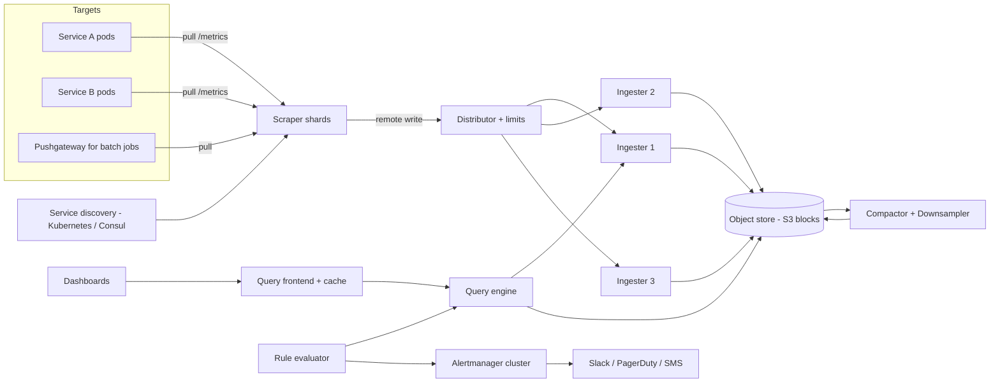

# Q19 · Metrics system

Oct 16, 2026 · @saurav chaurasiya

**Is doc me:** Prometheus / Datadog jaisa metrics aur alerting system, end-to-end (collection, compression, storage, query, alerts) ek payments company ke liye.

**Padhne ka tareeka** — Pehle Sawaal pe 15 min khud socho, phir Sahi design padho. Deep Dive tab padho jab time ho.

---

## Q19 — Metrics system

Metrics system wo platform hai jo har service ke numbers (requests/sec, error rate, latency) time ke saath store karta hai, unpe graph dikhata hai aur kuch bigad jaye to alert bhejta hai. Time-series database (TSDB — time ke hisaab se indexed numbers ka database) iska dil hai.

### Ye cheez hai kya

- Category: observability platform (infra + data-intensive HLD).
- Problem: thousands of services ka health real-time dekhna, bina database ya network ko bhaari padde.
- Is lesson ke baad tum: push vs pull choose kar paoge, Gorilla compression samjha paoge, cardinality explosion rok paoge, aur alert dedup ka design bata paoge.
- Analogy: ye hospital ke ICU monitor jaisa hai. Har patient (service) ki heartbeat har kuch second me record hoti hai, graph banta hai, aur heartbeat gadbad ho to nurse (on-call engineer) ko beep jaata hai.

Ye [1F · Ops Tower](https://claude.ai/code/artifact/6a87e8d2-04fb-418e-b433-e5a88508f83e) ke observability aur SLO lessons pe depend karta hai. Wahan "kya measure karein" tha, yahan "measurement system khud kaise banayein" hai.

### Sawaal

Paytm jaisi company me 5,000 microservices hain, har ek ke \~20 instances. Har instance \~500 metrics series export karta hai (http\_requests\_total, latency histogram buckets, JVM heap, DB pool, etc.). Scrape interval 15 sec. Requirements:

- Dashboard query p95 latency (95% requests is time se tez the) sub-second me aaye, last 6 hours ke liye.
- Payment success rate drop ho to alert 1 minute ke andar on-call ko jaye.
- 15 din ka raw data, 1 saal ka downsampled data.
- Ek galat label (jaise `user_id`) poore system ko gira na sake.
- System khud kabhi down nahi hona chahiye jab baaki sab down ho (monitoring ka SPOF — single point of failure, jiske girne se sab ruk jaye — nahi chalega).

> Pehle khud socho — 15 min. Hints: (1) Pull vs push: kaun kis se data maangta hai, aur service discovery kaise hoga? (2) Ek sample 16 bytes lagega to 3 million samples/sec kitna disk khayega? Isse chhota kaise karein? (3) Agar kisi developer ne `user_id` ko label bana diya to kya hoga?

### Problem kyun aata hai

- Volume bahut hai: crores of series, millions of samples per second, aur write ek taraf (append-only) hi hota hai.
- Query pattern alag hai: "last 6 hours, 1 metric, 100 series" jaise range reads, random lookups nahi.
- Cardinality (kitni unique label combinations = kitni unique series) achanak explode ho sakti hai.
- Monitoring ko production se zyada reliable hona padta hai, warna outage me aankhein band ho jaati hain.
- Alerts noisy hote hain: ek DB girne pe 200 services ke alerts aate hain, on-call pagal ho jaata hai.

### Naive approach

- Har sample ko ek SQL row banao: `(metric_name, labels_json, ts, value)` aur MySQL/Postgres me daalo. Dashboards `SELECT ... WHERE ts BETWEEN` se chalao.
- Kahan tootta hai:
  - 3.3 million inserts/sec. Ek MySQL primary lagbhag 10-50k writes/sec sambhalta hai. 100x gap hai.
  - Har row \~100+ bytes (labels repeat hote hain). Ek din = 3.3M x 86,400 = 288 billion rows = \~30 TB/day.
  - B-Tree index random writes pe bana hai, jabki yahan append-only workload hai.
  - Retention ke liye `DELETE` chalana table ko lock/bloat karta hai.
  - Alert evaluation har minute poore table pe aggregate query maarta hai.

### Sahi design

#### Requirements

- Functional:
  1. Services metrics expose / push kar sakein (counter, gauge, histogram).
  2. Labels ke basis pe query: `rate(http_requests_total{service="upi-pay", status="500"}[5m])`.
  3. Dashboards (Grafana jaisa) range queries dikhayein.
  4. Alert rules: condition + `for` duration + routing (Slack / PagerDuty).
  5. Retention aur downsampling.
- Non-functional:
  1. Ingest 3-4 million samples/sec, horizontally scalable.
  2. Dashboard query p99 (99% requests is time se tez) < 1 sec for recent data.
  3. Alert latency < 1 min end-to-end.
  4. Monitoring plane ki availability app se zyada (99.99%+); thoda data loss (ek-do sample) chalta hai, kyunki ye eventual consistency (replicas kuch der me same ho jaate hain) wala data hai.
  5. Cardinality limits taaki ek team poora system na girne de.

#### Back-of-envelope estimates

- Targets: 5,000 services x 20 = 100,000 instances.
- Active series: 100,000 x 500 = 50 million series.
- Ingest: 50M / 15 sec = \~3.3 million samples/sec.
- Raw size: 3.3M x 16 bytes (8 byte ts + 8 byte value) = \~53 MB/s = \~4.6 TB/day.
- Gorilla compression ke baad: \~1.37 bytes/sample (Facebook paper ka average) = \~390 GB/day. 15 din = \~6 TB, 3 replicas = \~18 TB. Ye manageable hai.
- Downsample 5 min resolution pe 1 saal: har series ke 105,000 points x \~2 bytes x 50M = \~10 TB. Sab series ko itna lamba rakhna zaroori nahi, sirf important ko.
- Query side: \~2,000 dashboards, har ek 10-20 panels, auto-refresh 30s = \~1,000 queries/sec. Alert rules \~20,000, har minute evaluate = \~330 queries/sec.

#### API design

Collection (pull model me service sirf ek endpoint expose karti hai):

```text
GET /metrics   (service pe)
# TYPE http_requests_total counter
http_requests_total{service="upi-pay",status="200"} 1027384
http_requests_total{service="upi-pay",status="500"} 412
```

Push / remote-write ke liye (short-lived jobs, batch jobs):

```text
POST /api/v1/write
Body: protobuf+snappy [ {labels:{...}, samples:[{ts, value}, ...]} ]
Response: 204 No Content (bad labels pe 400, limit cross pe 429)
```

Query:

```text
GET /api/v1/query_range?query=<PromQL>&start=<ts>&end=<ts>&step=15s
GET /api/v1/query?query=<PromQL>&time=<ts>
```

Alert rule (YAML):

```text
- alert: UPISuccessRateLow
  expr: sum(rate(upi_txn_total{status="success"}[5m])) / sum(rate(upi_txn_total[5m])) < 0.97
  for: 2m
  labels: { severity: page, team: upi }
```

#### Data model

- Series identity = metric name + sorted label set. Ek unique combination = ek series, usko ek `series_id` milta hai.
- Teen cheezein store hoti hain:
  1. Inverted index (label -> list of series\_id), jaise search engine me word -> docs. `service="upi-pay"` aur `status="500"` ki lists ka intersection milta hai series.
  2. Chunks: har series ka ek 2-hour block, Gorilla-compressed.
  3. WAL (write-ahead log — pehle disk pe likh lo, crash se bachne ke liye) taaki memory ka data na khoye.
- Metric types:
  - Counter: sirf badhta hai (requests total). Query me `rate()` lagate hain.
  - Gauge: upar-neeche (heap used).
  - Histogram: latency buckets (`le="0.1"`, `le="0.5"`) ka counter, jisse p95 nikalte hain.

#### High-level architecture



Flow ek line me:

1. Service discovery batata hai kaun kaun se pods abhi zinda hain.
2. Scraper shard apne hisse ke targets ko har 15s pe `/metrics` pull karta hai.
3. Distributor labels validate karta hai, cardinality limit check karta hai, series ko hash karke 3 ingesters ko bhejta hai (replication).
4. Ingester memory me chunk banata hai (Gorilla compression), WAL me likhta hai, har 2 ghante me block object store me flush karta hai.
5. Compactor chhote blocks ko merge karta hai aur purane data ko downsample karta hai.
6. Query frontend long range query ko chhote time slices me todta hai, cache check karta hai, query engine ko bhejta hai.
7. Ruler alert rules ko query engine se evaluate karta hai; firing alerts Alertmanager ko jaate hain, jo dedup/group karke notify karta hai.

#### Push vs pull

| Pehlu | Pull (Prometheus) | Push (Datadog agent, StatsD) |
| --- | --- | --- |
| Kaun shuru karta hai | Scraper service se maangta hai | Service khud bhejti hai |
| Target down pata chalna | Scrape fail = `up == 0` turant dikhta hai | Silence ho jaata hai; "data nahi aaya" detect karna padta hai |
| Short-lived jobs | Mushkil (job scrape se pehle mar jaata hai) | Natural fit |
| Firewall / NAT | Scraper ko network access chahiye | Outbound-only, aasaan |
| Overload control | Scraper rate control karta hai | Ek buggy service flood kar sakti hai |
| Debugging | `curl /metrics` se seedha dekho | Agent / network ke beech dhundna padta hai |

Practical jawab: default pull rakho, batch jobs ke liye Pushgateway ya remote-write push, aur dono ko ek hi distributor se guzaro.

#### Gorilla compression (storage ka main trick)

Observation: scrape har 15s pe hota hai, to timestamps lagbhag arithmetic progression me hote hain. Aur value agle sample se bahut kam badalti hai.

- Timestamp: delta-of-delta. Delta = do timestamps ka gap; delta-of-delta = do gaps ka difference. Zyada tar 0 aata hai.
- Value: pichhli value ke saath XOR. Agar value same hai to XOR sab zero hai; sirf badle hue bits store hote hain.

Ek chhota example:

```text
Timestamps : 1000, 1015, 1030, 1045, 1061
Delta      :       15,   15,   15,   16
Delta-of-D :              0,    0,    1
Storage    : pehla ts poora (64 bit), phir 1 bit ('0') jab delta-of-delta = 0,
             chhota sa window jab thoda sa badle (jaise '10' + 7 bits)
```

- Gorilla paper ke hisaab se \~96% timestamps sirf 1 bit lete hain. Average 16 byte ka sample \~1.37 byte me aa jaata hai, yaani \~12x chhota.
- Isi wajah se pichhle 26 ghante ka data poora RAM me rakhna possible hota hai.

#### Alerting pipeline

1. Ruler har rule ko interval (jaise 1 min) pe evaluate karta hai.
2. Condition true hone pe alert `pending` state me jaata hai. `for: 2m` tak true rahe tabhi `firing` hota hai (flapping rokne ke liye, kyunki ek spike pe page nahi karna).
3. Firing alerts Alertmanager cluster ko jaate hain (3 nodes, gossip se state share).
4. Alertmanager: group (same `alertname` + `cluster` ek message me), dedup (same alert baar baar aaye to ek), inhibit (DB down hai to us par depend 50 services ke alerts chup), silence (maintenance window), route (label `team=upi` -> UPI team ka channel).

### Kya choose karein aur kyun

| Option | Kab use karo | Kab mat karo |
| --- | --- | --- |
| Prometheus (single server) + federation | Chhota/medium scale, ek team, < 10M series | 50M series ya multi-year retention chahiye |
| Thanos / Cortex / Mimir (Prometheus + object store) | Bahut zyada series, long retention, multi-tenant, global view | Team chhoti hai aur ops bandwidth kam hai |
| VictoriaMetrics | Kam hardware me zyada ingest, simple ops | Bahut custom ecosystem integrations chahiye |
| Datadog / New Relic (SaaS) | Ops team nahi chahiye, jaldi shuru karna hai | Data residency / RBI compliance, aur cost per-host / per-metric bahut badh jaata hai |
| InfluxDB / TimescaleDB | Events + metrics dono, SQL-style analysis chahiye | Prometheus ecosystem (PromQL, exporters) pe depend karte ho |

### India me kaise hota hai

- Zyada tar bade Indian engineering orgs Prometheus + Grafana + Thanos / Mimir / VictoriaMetrics ka combo chalate hain, aur apne tech blogs me ye likhte bhi hain. Payments me alert noise aur data residency (RBI ka data local rakhne ka rule) ki wajah se self-hosted ya VPC me deploy hone wala setup common hai.
- Gorilla paper (Facebook) ke ideas hi Prometheus, VictoriaMetrics aur Thanos ki compression ke peeche hain. Original paper: [Gorilla: A Fast, Scalable, In-Memory Time Series Database](https://www.vldb.org/pvldb/vol8/p1816-teller.pdf).
- Payments companies ke liye business metrics (success rate, bank-wise failure) ko infra metrics ke saath hi rakhte hain, taaki "HDFC ka success rate gira" jaisa alert seedha label (`bank="hdfc"`) pe fire ho. Bank label ki cardinality limited hoti hai (kuch sau), isliye ye safe hai. `txn_id` ya `vpa` kabhi label nahi banta.
- Note: kisi specific Indian company ka exact internal architecture public confirm nahi hai, isliye yahan generic industry pattern bataya gaya hai.

### Interview follow-ups

- **Cardinality explosion kya hai aur kaise roke?** — Label combination ki product series ki count hoti hai. `user_id` jaise unbounded label se crores series ban jaati hain, RAM aur index phat jaate hain. Rokne ke liye: per-metric aur per-tenant series limit, distributor pe label allow-list, CI me metric review, aur `topk` cardinality dashboards. User-level debugging ke liye logs / traces use karo, metrics nahi.
- **Pull model me service discovery kaise?** — Kubernetes API ya Consul se pods ki list sunte hain. Scrapers targets ko hash karke shard karte hain (consistent hashing, jisme node add/remove par kam data hilta hai), taaki ek scraper girne pe sirf uska hissa dusre ko mile.
- **Delta-of-delta Gorilla me kyun kaam karta hai?** — Scrape interval fixed hai to timestamp gap lagbhag constant hota hai, delta-of-delta 0 aata hai aur 1 bit me store ho jaata hai. Values XOR se encode hoti hain, same value pe 1 bit.
- **Downsampling kaise karte hain aur kya kho jaata hai?** — Purane data ko 5m / 1h buckets me aggregate karte hain, aur har bucket ke liye min, max, sum, count store karte hain (sirf avg nahi, warna max / percentile galat aate hain). Per-second detail aur spike ka exact shape kho jaata hai.
- **Alert storm kaise rokein?** — Group by, inhibition rules, `for` duration, aur severity routing (page vs ticket). Dependency alert (DB down) ko dependent services ke alerts inhibit karne dete hain.
- **Monitoring system khud down ho jaye to?** — Dead man's switch: ek always-firing "Watchdog" alert ek external service (alag region / SaaS) ko jaata hai; wo band hua to bahar se page jaata hai. Plus Prometheus replicas ki HA pair.
- **Percentile (p99) kaise aata hai?** — Histogram buckets ka counter store hota hai, aur `histogram_quantile()` unse estimate nikalta hai. Percentiles ko average nahi kar sakte; pehle bucket counters sum karo, phir quantile lo.

### Self-check

1. Push aur pull model me ek-ek bada fayda aur nuksan batao.
2. 50M series, 15s interval pe samples/sec aur compressed daily size nikalo.
3. Delta-of-delta aur XOR encoding kya karti hai? Ek chhota example do.
4. Cardinality explosion ka ek example do aur 3 guardrails batao.
5. Alertmanager me grouping, dedup aur inhibition ka farq kya hai?

### Notebook

Pull model default, batch jobs ke liye push · 50M series x 15s = 3.3M samples/sec · Gorilla: delta-of-delta timestamps + XOR values = \~1.37 bytes/sample · Series = metric + labels; labels me unbounded value (user\_id) kabhi nahi · Downsample me min/max/sum/count rakho, sirf avg nahi · Alert: for-duration + group + dedup + inhibit · Watchdog alert se monitoring ki monitoring

### Padhne ke liye

- [Gorilla: A Fast, Scalable, In-Memory Time Series Database (VLDB paper)](https://www.vldb.org/pvldb/vol8/p1816-teller.pdf)
- [The Morning Paper: Gorilla summary](https://blog.acolyer.org/2016/05/03/gorilla-a-fast-scalable-in-memory-time-series-database/)
- [Prometheus storage: technical terms for humans](https://valyala.medium.com/prometheus-storage-technical-terms-for-humans-4ab4de6c3d48)
- [Prometheus Scalability: High Cardinality and How to Fix It](https://alexandre-vazquez.com/prometheus-scalability/)

### Deep Dive (SDE-2) — jab time ho

#### Query engine internals

- Query parse hoti hai AST (abstract syntax tree — query ka tree form) me. Label matchers se inverted index se series\_id nikalte hain.
- Posting lists (sorted series\_id lists) ka intersection hota hai; sorted hone se merge-style fast intersection milta hai.
- Chunks decode hote hain, `rate()` jaise functions step-by-step window pe chalte hain.
- Long range queries ko time slices me todkar parallel chalate hain aur results cache karte hain; sirf latest slice dobara compute hota hai.

#### Storage layout aur retention

- Head block RAM me (last \~2 ghante), WAL se backed. Phir immutable block bante hain (index + chunks + meta).
- Compaction chhote blocks ko bade me merge karta hai (2h -> 6h -> 24h), taaki query ko kam files kholni padein.
- Retention = purane blocks ko seedha delete karna. Row-wise `DELETE` nahi, isliye sasta hai.
- Tiering: 15 din raw (SSD), 90 din 1-min, 1 saal 5-min (object store, sasta).

#### Sharding, replication aur HA

- Series hash karke ingester ring pe jaati hai; replication factor 3, write quorum 2 (quorum — majority ack, taaki ek node girne par bhi write safe rahe).
- Ingester girne pe WAL replay aur baaki replicas se read.
- Query layer replicas ka data merge karke duplicates hataata hai (deduplication on read).
- Multi-tenant limits: har team ke liye max series, max samples/sec, max query range, warna noisy neighbour sab ko daba deta hai.

#### Cardinality control

- Ingest time pe: label count limit, label value length limit, deny-list (`user_id`, `txn_id`, `vpa`).
- Ek top-N cardinality report har din team ko jaati hai, "tumhari metric X ne 4M series banayi."
- Per-metric limit cross hone par naye series drop hote hain (purani chalti rehti hain) aur 429 aur alert jaata hai.
- Exemplars (metric sample ke saath trace\_id link) se high-cardinality debug ka kaam traces par shift hota hai.

#### Alerting aur SLO burn rate

- Raw threshold ke bajaye SLO (service level objective — target, jaise 99.9% success) based multi-window burn-rate alerts: 5m aur 1h dono window me error budget tezi se jal raha ho tabhi page.
- Ye noisy "CPU > 80%" alerts se bahut kam false positives deta hai. [1F · Ops Tower](https://claude.ai/code/artifact/6a87e8d2-04fb-418e-b433-e5a88508f83e) me SLO ka base hai.

---

## Aage kya

- Pichhla: [Q18 · Job scheduler](https://claude.ai/code/artifact/f34c8263-0b8d-42e6-80ea-90a73678be35)
- Agla: ye last HLD boss hai. Ab revision karo: C1 se Q19 tak ke diagrams dobara khud banao. Phir LLD case studies pe jao, jaise [D9 Rate limiter](https://claude.ai/code/artifact/1a82c7a8-3aa0-49a2-b8d8-bb9398c1d502) aur [D10 LRU / LFU cache](https://claude.ai/code/artifact/5c863943-6249-4b4b-8943-003de1517344).
- Related: [1F · Ops Tower](https://claude.ai/code/artifact/6a87e8d2-04fb-418e-b433-e5a88508f83e) (observability, SLOs), [1E · Kafka River](https://claude.ai/code/artifact/eeb39ee8-3f52-4c04-b57b-68213f02c429) (agar ingest ke aage Kafka buffer lagao), [2E · Resilience Ridge](https://claude.ai/code/artifact/4769dea3-018e-41e1-ae18-253fa36a6d21) (backpressure, rate limiting)
