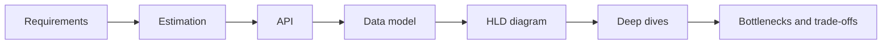
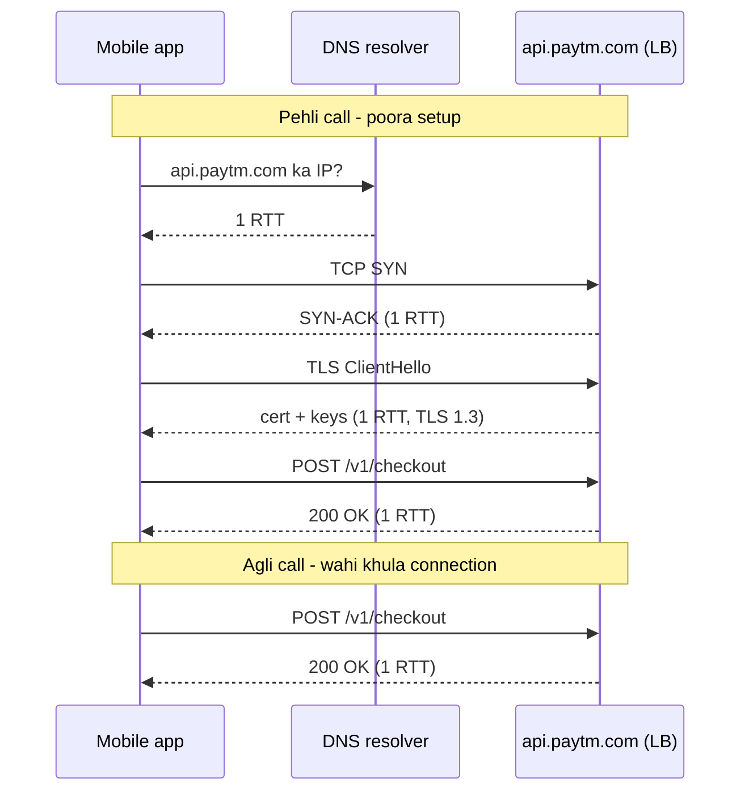
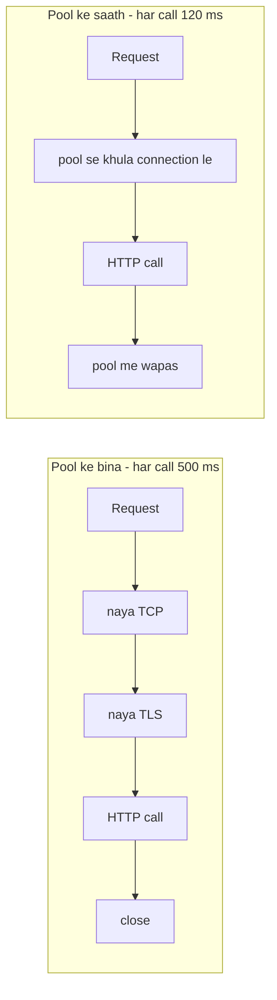
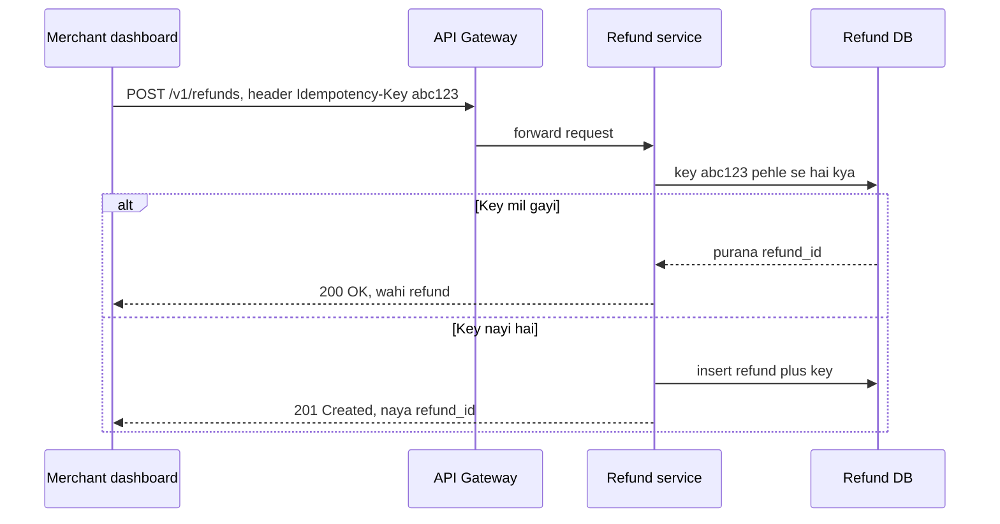
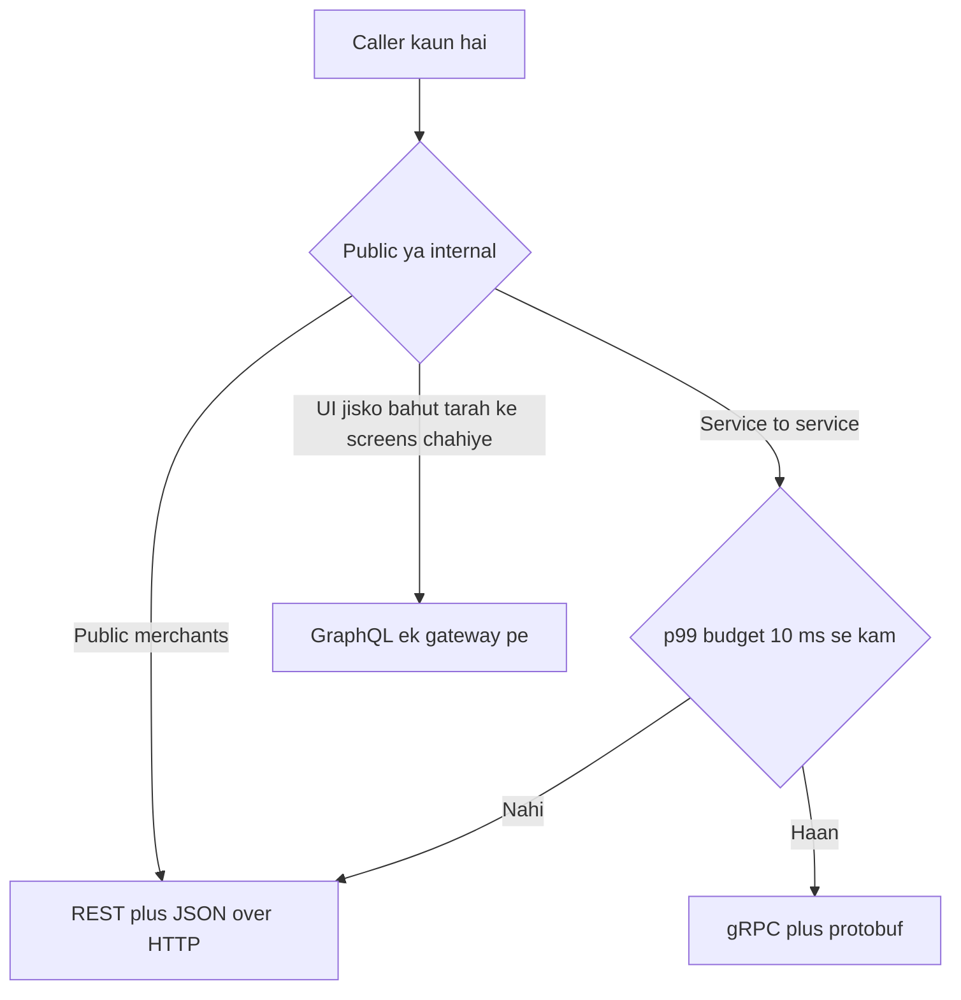

# HLD Part 0 — Base Camp

Sep 27, 2026 · @saurav chaurasiya

**Is doc me 4 levels hain: L0.1 (interview framework), L0.2 (estimation), L0.3 (networking basics — DNS, TCP, TLS, HTTP) aur L0.4 (API design — REST, gRPC, GraphQL).** Game me tile click karoge toh seedha yahin aaoge — search karne ki zaroorat nahi.

---

## L0.1 — Kisi bhi HLD interview ko kaise approach karein

### Sawaal

Interviewer bolta hai "Design PhonePe." Tum seedha Kafka aur Redis ke boxes banana shuru kar dete ho. 20 min baad woh poochta hai "Peak TPS kitna hai? Collect flow support hai?" — aur tumhara design galat nikalta hai. Kya galti hui?

> **Pehle khud socho — 5 min.** Hints: (1) Bina requirement ke design = bina map ke drive. (2) Numbers design badalte hain — 100 TPS aur 1 lakh TPS alag systems hain. (3) Interviewer ko tumhara *thought process* chahiye, final diagram nahi.

### Problem kyun aata hai

HLD open-ended hai. Scope clear na ho toh tum galat problem solve karte ho, aur time khatam ho jata hai deep dive se pehle — jahan asli marks hain.

### Naive approach

"Microservices + Kafka + Redis + Cassandra" wala generic diagram. Problem: har component ka *kyun* missing hai, consistency requirements (paise!) ignore ho jaati hain, aur koi bottleneck discussion nahi hota.

### Sahi design

1. **Requirements (5 min)** — Functional: kya features (P2P pay, collect, history). Non-functional: latency (p99 < 2s), availability (99.99%), consistency (paisa = strong), durability, compliance (RBI data localisation, PCI).
2. **Estimation (5 min)** — DAU, TPS (avg + peak = 3–5x), storage/day, read:write ratio, bandwidth.
3. **API design (5 min)** — `POST /v1/payments` (Idempotency-Key header), `GET /v1/payments/{id}`, webhooks.
4. **Data model (5 min)** — entities, primary keys, access patterns → isse DB choice nikalti hai.
5. **High-level diagram (10 min)** — client → LB/gateway → services → DB/cache/queue.
6. **Deep dives (10–12 min)** — interviewer jo chune: idempotency, ledger, sharding, failure handling.
7. **Bottlenecks + trade-offs (3 min)** — SPOF, hot keys, 10x traffic, multi-region, monitoring.

### Kya choose karein aur kyun

Framework me tech choice step 4–5 me aati hai, *access pattern ke baad*. Rule: pehle bolo "mujhe ACID + multi-row transaction chahiye" → phir "isliye Postgres/MySQL". Kabhi ulta mat karo.

### India me kaise hota hai

Razorpay/PhonePe interviews me bar yahi test hota hai ki tum failure modes (bank timeout, duplicate callback) khud raise karo — dekho [Razorpay system design bar](https://spacecomplexity.ai/blog/razorpay-system-design-interview).

### Interview follow-ups

- *"Kitne clarifying questions poochein?"* → 4–6 sharp ones; baaki assumptions bol ke aage badho ("main maan raha hoon 50M DAU").
- *"Functional vs non-functional me pehle kya?"* → Functional list, phir NFR; payments me NFR (consistency, idempotency) hi design drive karta hai.
- *"Agar interviewer beech me deep dive maange?"* → Turant switch karo; unka interest = marking rubric.
- *"Agar kuch nahi pata?"* → "Mujhe iska exact internal nahi pata, par main aise approach karunga…" — bluff se hamesha better.

### Self-check

(1) 7 steps order me bolo. (2) Payments system ke 5 NFR kaunse hain? (3) Tech choice kis step ke baad justify hoti hai?

### Notebook

7 steps = Req → Estimate → API → Data model → HLD → Deep dive → Bottleneck · Time: 5/5/5/5/10/12/3 min · Payments NFR: consistency, idempotency, availability 99.99, latency, compliance · Tech choice hamesha access pattern ke BAAD · Har choice ke saath trade-off bolo.

---

## L0.2 — Back-of-envelope estimation

### Sawaal

UPI \~700M transactions/day karta hai (2025 average). Ek PSP app ke paas \~45% share hai. Peak TPS kitna hoga, aur 5 saal ka transaction storage kitna?

> **Pehle khud socho — 5 min.** Hints: (1) 1 din ≈ 10^5 seconds (86,400). (2) Peak ≈ 3–5x average (festival sale / salary day). (3) Ek txn row ≈ 1 KB with indexes.

### Problem kyun aata hai

Bina numbers ke tum nahi bata sakte ki single Postgres chalega ya sharding chahiye, cache zaroori hai ya nahi.

### Naive approach

Exact calculator-wala math. Interview me waqt barbaad; order-of-magnitude kaafi hai.

### Sahi design

- PSP ka share: 700M × 0.45 ≈ 315M txn/day ≈ 3.15 × 10^8 / 10^5 ≈ **\~3,600 TPS avg**, peak ×4 ≈ **\~15k TPS**.
- Storage: 315M × 1 KB ≈ 315 GB/day ≈ \~115 TB/year ≈ **\~575 TB / 5 saal** (replication 3x → \~1.7 PB) → single DB impossible → sharding + hot/cold tiering.
- Reads: history screen, status polls → read:write ≈ 10:1 → cache/replicas.

| Number yaad rakho | Value |
| --- | --- |
| L1 cache / RAM access | \~1 ns / \~100 ns |
| SSD random read | \~100 µs |
| Same-DC round trip | \~0.5 ms |
| Mumbai ↔ Singapore RTT | \~60–70 ms |
| Redis single node | \~1 lakh ops/sec |
| Postgres/MySQL single primary (simple writes) | \~5k–10k writes/sec |
| Kafka partition | \~10 MB/s+ writes |
| 1 day | \~10^5 s; 1 month \~2.5 × 10^6 s |

### Kya choose karein aur kyun

15k TPS writes > ek MySQL primary ki comfortable limit → isliye *sharded* MySQL/Postgres (ya TiDB/Vitess jaisa distributed SQL). Cache (Redis) status polls ke liye kyunki 10:1 read ratio.

### India me kaise hota hai

UPI ne 2025 me \~698M txn/day average aur 20B+/month cross kiya ([IndiNXT](https://www.indinxt.com/blog/2026/03/12/what-is-a-upi-switch/)). PhonePe 100M+ daily txns ke liye Aerospike clusters chalata hai ([Aerospike case study](https://aerospike.com/resources/customer-stories/phonepe/)).

### Interview follow-ups

- *"Peak factor 4 kyun?"* → Diwali sale, salary day (1st), IPL; historical data dekh ke bolte hain; design peak ke liye, cost avg ke liye (autoscale).
- *"Storage ko kaise kam karoge?"* → 90 din hot (SSD DB), baaki cold (S3/HDFS Parquet) + compression.
- *"Bandwidth?"* → 15k TPS × \~2 KB req/resp ≈ 30 MB/s — manageable.

### Self-check

(1) 1 crore requests/day = kitna TPS? (\~115). (2) Redis single node ops/sec? (3) Kyun peak ke liye design karte hain?

### Notebook

1 din ≈ 10^5 s · TPS = daily/10^5, peak = 3–5x · Row ≈ 1 KB → storage/day = txns × 1 KB · Redis \~1L ops/s, MySQL primary \~5–10k writes/s · > \~10k writes/s ⇒ shard · Hot 90 din SSD, baaki S3 cold.

---

## L0.3 — Networking basics (DNS, TCP, TLS, HTTP)

Jab tumhara phone `api.paytm.com` ko call karta hai, request pahunchne se pehle chaar alag kaam hote hain: naam se IP nikalna (DNS), connection banana (TCP), use encrypt karna (TLS), aur phir asli message bhejna (HTTP). Ye lesson un chaaron ko order me kholta hai, aur batata hai ki har step kitna time khaata hai.

### Ye cheez hai kya

- Ye koi ek technology nahi — ye un 4 protocols ki ek layer-cake hai jis par har API call khadi hai
- Kis problem ke liye: do machines ko internet ke upar, bharose ke saath, naam se dhoondh kar baat karwana
- Is lesson ke baad tum "URL type karne pe kya hota hai" poora bol paoge, aur bata paoge ki pehli request 900 ms aur agli 120 ms kyun lagti hai

Do shabd pehle, kyunki aage har jagah aayenge:

- **Latency** (ek request ka jawab aane me laga total time) aur **throughput** (ek second me kitni requests nikal rahi hain) do alag cheezein hain — ek request slow ho sakti hai jabki system throughput high ho
- **RTT** (round-trip time — ek packet ke jaane aur jawab aane ka time) handshake ka unit hai. Mumbai se Mumbai \~2-5 ms, Mumbai se Singapore \~40 ms, Mumbai se US East \~220 ms
- **p99 latency** (100 requests ko slow se fast sort karo — 99th wali request ka time) — average chhupa deta hai, p99 batata hai ki sabse unlucky user ko kya mila

### Sawaal

Paytm checkout page par user "Pay" dabata hai. Tumhari team ne naya payments API endpoint `api.paytm.com/v1/checkout` banaya. Monitoring me ye dikha:

- App khulne ke baad ki **pehli** call: \~900 ms
- Usi session ki **agli** calls: \~120 ms
- Aur ek alag service, jo server-se-server har call par naya connection banati hai: har call \~500 ms, p99 1.8 s

Business ne poochha: "900 ms kahan ja raha hai, aur usko 120 ms kaise banayein?"

> Pehle khud socho — 5 min. Hints: (1) pehli call me kitne round-trips hote hain, aur kiske? (2) agli call me unme se kya skip ho jaata hai? (3) server-se-server wali service har baar kya dobara kar rahi hai?

### Problem kyun aata hai

- Request bhejne se pehle **teen** handshake-type kaam hote hain — DNS lookup, TCP connect, TLS negotiate — aur har ek me ek ya do RTT lagte hain. Ye setup cost hai, data transfer cost nahi
- 220 ms RTT par: DNS 1 RTT + TCP 1 RTT + TLS 1.3 me 1 RTT = 3 RTT = \~660 ms, aur asli HTTP request-response 1 RTT = 220 ms. Total \~880 ms — wahi 900 ms jo dashboard me dikha
- Jo service har call par naya TCP + TLS banati hai, woh ye setup cost **har** request par dobara deti hai
- Ye kisi ek service ka bug nahi hai — ye network ka physics hai. Light ko fiber me Mumbai se US jaane me time lagta hai, aur koi code use kam nahi kar sakta. Sirf **round trips kam** kiye ja sakte hain

### Naive approach

- Pehla obvious solution: "HTTP client bana ke call kar dete hain, library handle kar legi"
- Problem: default me kai HTTP clients (ya galat tarah se banaya gaya client) har request par naya connection kholte hain, aur har request par naya TLS handshake karte hain
- Aur jahan ek hi `HttpClient` object ko reuse karna chahiye tha, wahan log usko loop ke andar `new` kar dete hain — connection pool ban hi nahi paata
- Ye exactly kahan tootta hai: load badhne par server par **TIME\_WAIT** sockets bhar jaate hain (close hone ke baad bhi socket thodi der reserved rehta hai), aur naye connection fail hone lagte hain — jabki CPU aur memory dono khali pade hain

### Sahi design

1. **DNS**: naam se IP nikalo. Resolver ke paas cached ho to \~0 ms; na ho to root → TLD (`.com`) → authoritative nameserver ki chain chalti hai. Record par ek **TTL** (time-to-live — kitni der cache me rakhna hai) hota hai
2. **TCP connect**: 3-way handshake — client `SYN`, server `SYN-ACK`, client `ACK`. 1 RTT. Iske baad connection bana
3. **TLS handshake**: client-server mil kar encryption key tay karte hain aur server ka certificate verify hota hai. TLS 1.3 me 1 RTT, TLS 1.2 me 2 RTT
4. **HTTP request-response**: 1 RTT. Yahan asli kaam hota hai
5. **Keep-alive** (connection ko response ke baad band na karna, agli request ke liye khula rakhna): steps 1-3 agli requests par skip ho jaate hain — isliye 900 ms se 120 ms
6. **Connection pooling** (ready-made khule connections ka ek chhota collection, jisme se har request ek uthati hai aur wapas rakh deti hai): server-se-server calls ke liye yahi asli fix hai. Ek shared client object, process ke lifetime bhar
7. **HTTP/2**: ek hi TCP connection par kai requests saath-saath (multiplexing), aur headers compress ho ke jaate hain

Neeche pehli call aur usi connection par agli call ka farak:

Aur connection pool ke bina vs saath, server-se-server:

### Kya choose karein aur kyun

| Option | Kab use karo | Kab mat karo |
| --- | --- | --- |
| HTTP/1.1 + keep-alive | Simple internal service-to-service calls; debugging aasaan (plain text, `curl`, tcpdump) | Jab ek page 50-100 chhoti requests karta hai — ek connection par ek-ek karke jaayengi (head-of-line blocking) |
| HTTP/2 | Mobile app se API, aur browser se page — ek connection par kai parallel requests, headers compressed | Jab network me packet loss zyada hai: ek packet gum hone par us TCP connection ki saari streams ruk jaati hain |
| HTTP/3 (QUIC par) | Mobile network, jahan user lift me jaata hai, 4G se WiFi switch karta hai — connection migrate ho jaata hai aur ek stream ka loss baaki streams ko nahi rokta | Jab tumhara infra UDP block karta hai, ya observability tooling HTTP/3 nahi samajhti |
| Naya connection har request par | Kabhi nahi, production path me | Hamesha — setup cost har call par lagti hai aur TIME\_WAIT sockets bhar jaate hain |

TLS version ka faisla:

| Option | Kab use karo | Kab mat karo |
| --- | --- | --- |
| TLS 1.3 | Default — handshake 1 RTT, purane kamzor cipher hata diye gaye | Jab koi purana bank partner sirf TLS 1.2 bolta hai |
| TLS 1.2 | Legacy bank ya NPCI switch integration jo 1.3 support nahi karta | Naye internal services me — bina wajah ek extra RTT de rahe ho |
| mTLS (dono taraf certificate) | Service-to-service, jahan server ko bhi client ki pehchaan chahiye — payments me common | Public mobile clients ke liye — certificate ko phone me safe rakhna practical nahi |

### India me kaise hota hai

UPI me end-to-end budget bahut tight hota hai — ek payment me PSP app, PSP backend, NPCI switch, remitter bank aur beneficiary bank sab ek chain me baat karte hain, aur har hop par TCP + TLS khada rehna chahiye, warna timeout. Isi wajah se PSP aur bank ke beech **persistent connections** aur mTLS pehle se banaye jaate hain, request aane par nahi. NPCI har month UPI ka volume publish karta hai, jisse ye scale samajh aata hai ([NPCI UPI product statistics](https://www.npci.org.in/what-we-do/upi/product-statistics)).

India me latency ka bada hissa geography hai: agar API Mumbai me host hai aur user Guwahati me, to RTT hi 40-60 ms ho jaata hai. Isi liye payments aur commerce apps CDN aur edge TLS termination use karte hain — TLS handshake user ke paas wale edge par khatam hota hai, aur edge se origin tak connection pehle se khula rehta hai.

### Interview follow-ups

- **"URL type karne pe kya hota hai?"** DNS resolve → TCP 3-way handshake → TLS handshake → HTTP request → server processing → response → (keep-alive to connection khula rehta hai). Har handshake ka RTT count karke bolo — yahi answer ko senior banata hai.
- **DNS TTL chhota rakhein ya bada?** Chhota TTL = failover fast (IP badla to clients jaldi pick karte hain), par DNS par load aur ek extra lookup. Bada TTL = fast lookups, par deploy ke time purana IP der tak cached.
- **TCP aur UDP me kab kya?** TCP jab ordering aur reliability chahiye (har payments API). UDP jab loss acceptable hai aur speed matter karti hai (video, metrics, DNS) — aur HTTP/3 UDP ke upar reliability khud banata hai.
- **TLS 1.3 ne kya bachaya?** Handshake 2 RTT se 1 RTT, aur session resumption se repeat connection par 0 RTT tak.
- **Connection pool ka size kaise choose karein?** Little's Law se: `connections = arrival rate × average latency`. 200 requests/sec × 50 ms = 10 concurrent — pool 10 se thoda bada, bahut bada nahi (har connection downstream par ek socket hai).
- **Load balancer HTTP/2 ko kaise handle karta hai?** Aksar client-to-LB HTTP/2 hota hai aur LB-to-backend HTTP/1.1 — isliye ek HTTP/2 connection ki 100 streams backend par 100 alag requests ban sakti hain.

### Self-check

1. 220 ms RTT par, TLS 1.3 aur cold DNS ke saath pehli HTTPS request kitne RTT legi? Aur usi connection par doosri?
2. Keep-alive aur connection pooling me farak kya hai — kaunsa client-side concept hai aur kaunsa connection ka property?
3. HTTP/2 ne HTTP/1.1 ka head-of-line blocking hata diya, par HTTP/3 ki zaroorat phir bhi kyun padi?
4. 500 requests/sec aur 40 ms average latency par pool me kam se kam kitne connections chahiye?

### Notebook

Pehli HTTPS call = DNS 1 RTT + TCP 1 RTT + TLS 1.3 1 RTT + HTTP 1 RTT ≈ 4 RTT · Keep-alive se agli calls sirf 1 RTT · Server-se-server ka asli fix = ek shared client ka **connection pool**, size ≈ rate × latency · TLS 1.3 = 1 RTT, 1.2 = 2 RTT, resumption se 0 RTT · HTTP/2 = ek connection par multiplexing, par TCP-level loss sab streams rokta hai; HTTP/3 (QUIC/UDP) wahi theek karta hai · DNS TTL = failover speed vs lookup load ka trade-off · RTT physics hai — code sirf round trips kam kar sakta hai

### Padhne ke liye

- [Cloudflare: What is DNS?](https://www.cloudflare.com/learning/dns/what-is-dns/) — resolver, root, TLD, authoritative chain aur TTL caching
- [Cloudflare: What happens in a TLS handshake?](https://cloudflare.com/learning/ssl/what-happens-in-a-tls-handshake) — handshake ke steps aur TLS 1.3 ka 1-RTT
- [web.dev: Introduction to HTTP/2](https://web.dev/articles/performance-http2) — binary framing, multiplexing, HPACK header compression
- [RFC 9114: HTTP/3](https://datatracker.ietf.org/doc/html/rfc9114) — QUIC par stream multiplexing aur low-latency connection setup

### Deep Dive (SDE-2) — jab time ho

#### DNS, thoda gehra

- Lookup ka order: browser cache → OS cache → configured resolver (ISP ya 1.1.1.1) → root nameserver → TLD nameserver (`.com`) → authoritative nameserver
- Har record par TTL hota hai. Deploy ke waqt IP badalna hai to pehle TTL ghataao, phir IP badlo — warna clients purane IP par der tak atke rehte hain
- **Anycast**: ek hi IP duniya ke kai data centers se advertise hoti hai, aur network user ko sabse paas wale par le jaata hai — isi se DNS resolution fast hoti hai
- DNS ek chhupa **SPOF** (single point of failure — ek cheez jo gir jaaye to poora system gir jaaye) hai: DNS provider down to healthy servers bhi reachable nahi rahenge. Isliye do independent DNS providers rakhe jaate hain
- Service-to-service me DNS ko kabhi hot path par poore bharose na rakho — client library me DNS caching aur stale-while-revalidate behaviour samajh ke set karo

#### TCP ka vyavhaar

- 3-way handshake: `SYN` → `SYN-ACK` → `ACK`. Iske baad data. Connection band karne me `FIN` ka apna exchange hota hai
- **Slow start**: TCP shuru me thoda hi data bhejta hai aur dheere-dheere window badhata hai. Iska matlab — naya connection na sirf handshake kharch karta hai, pehle kuch KB bhi dheere jaate hain. Khula connection reuse karna isliye dohra fayda hai
- **TIME\_WAIT**: connection close karne wala side socket ko \~1-4 min reserved rakhta hai. Har request par naya connection = hazaaron TIME\_WAIT sockets = `connect()` fail, chahe server khali ho
- **Nagle's algorithm** chhote packets ko jod kar bhejta hai — throughput ke liye accha, latency ke liye bura. Low-latency RPC me `TCP_NODELAY` on kiya jaata hai
- Timeouts teen alag hone chahiye: connect timeout (connection banne ka), read timeout (jawab aane ka), aur total request timeout. Sirf ek rakhna classic production bug hai

#### TLS ke numbers

- TLS 1.2: 2 RTT handshake. TLS 1.3: 1 RTT, kyunki client pehle message me hi apna key share bhej deta hai
- **Session resumption**: pichhle handshake ka ticket rakh lo, agli baar 0 RTT tak ja sakte ho. Lekin 0-RTT data replay ho sakta hai — isliye usme sirf idempotent requests (jinhe dobara chalane se result na badle) bheji jaati hain, payment karne wali nahi
- Certificate verify karna client ka kaam hai: chain root CA tak jaani chahiye, expiry aur hostname match hona chahiye. Expired certificate production me sabse aam avoidable outage hai — expiry par alert lagao
- **mTLS** me server bhi client ka certificate maangta hai. Payments me partner integrations yahi use karte hain, aur rotation ko automate karna padta hai warna renew ke din sab gir jaata hai
- TLS termination kahan ho: edge/CDN par (fast handshake, par edge se origin ka hop bhi encrypt karna padega) ya origin par (end-to-end, par handshake user se door)

#### HTTP/2 vs HTTP/3, aur head-of-line blocking

- HTTP/1.1: ek connection par ek request at a time. Browser 6 parallel connections kholta hai — har ek apna TCP + TLS cost deta hai
- HTTP/2: ek connection, kai streams interleaved, aur HPACK header compression (repeated headers ka index banta hai). Application-level head-of-line blocking khatam
- Par TCP khud ordered delivery deta hai: ek packet gum hua to us connection ki **saari** streams uske retransmit ka intezaar karti hain — ye transport-level head-of-line blocking hai
- HTTP/3 QUIC par chalta hai, jo UDP ke upar apna reliability aur per-stream flow control banata hai — ek stream ka loss baaki streams ko nahi rokta, aur connection id se network badalne par connection migrate ho jaata hai
- Interview me ye farak saaf bolna: HTTP/2 ne **application** layer ka HOL blocking hataaya, HTTP/3 ne **transport** layer ka

#### Pool sizing aur failure modes

- Little's Law: `L = λ × W` — concurrent connections = requests/sec × average latency in seconds. 500/sec × 0.04 s = 20
- Pool chhota = requests queue me baithengi aur latency badhegi; pool bahut bada = downstream service par itne connections ki woh khud gir jaayegi
- Pool par bhi timeout hona chahiye: "pool se connection milne ka wait" ek alag timeout hai, aur usko unbounded chhodna cascading failure ka raasta hai (ye L2.17a Backpressure me detail me aayega)
- Health check connections ko bhi count karo — 100 pods × 20 connections = 2000 sockets downstream par, aur usko uska `max_connections` sehna chahiye
- Monitoring: pool utilisation, wait time, aur "connection create rate" dekho. Create rate high hona matlab pool kaam nahi kar raha — kahin client object loop me `new` ho raha hai

---

## L0.4 — API design (REST, gRPC, GraphQL)

API (Application Programming Interface — do programs ke beech ka contract) design ka matlab hai: tumhari service bahar wale clients ko kaun se endpoints degi, un endpoints ke naam kya honge, request aur response ka exact shape kya hoga, error kaise bataya jayega, aur kal jab contract badalna pade tab purane clients kaise zinda rahenge. Pipe ka plumbing L0.3 me tha; ye lesson us pipe ke upar chalne wale contract ka hai.

### Ye cheez hai kya

- Kis category ki cheez hai — ek design skill, koi tool nahi. REST, gRPC aur GraphQL teen alag styles hain API likhne ke, aur teeno HTTP ke upar chalte hain.
- Kis problem ke liye banayi gayi — do teams ya do services ko ek doosre se baat karni hai bina ek doosre ka code padhe. Contract hi documentation hai.
- Is lesson ke baad tum kya kar paoge — ek payments API ka resource naming, versioning, pagination aur error contract khud design kar paoge, aur bata paoge kahan gRPC REST se behtar hai.

Teen naam pehle saaf kar lete hain:

- REST (Representational State Transfer — cheezon ko resource maano, unhe URL se address karo, aur HTTP methods se unpe kaam karo). Example: `POST /v1/refunds`.
- gRPC (Google Remote Procedure Call — network call jo local function call jaisa likha jata hai; data binary protobuf format me jata hai, JSON me nahi). Example: `RefundService.CreateRefund(request)`.
- GraphQL (ek query language jisme client batata hai usko kaunse fields chahiye, server poora object nahi thopta). Ek hi endpoint hota hai, `/graphql`.

### Sawaal

Paytm pe merchant dashboard chahiye jisme merchant (a) kisi order ka refund shuru kare, (b) ek refund ka status dekhe, (c) pichhle 6 mahine ke refunds list kare — ek page pe 50. Wahi teen cheezein mobile app ko bhi chahiye, slow 3G pe. Aur andar, risk-service se har refund pe 2 ms ke andar poochhna hai ki ye user fraud hai ya nahi.

Tum API design karo: endpoints, HTTP methods, pagination, error contract, aur kahan REST aur kahan gRPC.

> Pehle khud socho — 5 min. Hints: (1) refund ek resource hai ya ek action? (2) network flaky hai, merchant refund button do baar daba dega — tab kya hoga? (3) 6 mahine ke refunds me page 200 pe offset query ka kya haal hoga?

### Problem kyun aata hai

- Client aur server alag-alag din release hote hain. Tum aaj ek field ka naam badloge, merchant ka purana app kal tootega — aur merchant kabhi upgrade nahi karega.
- Network pe har call fail ho sakta hai. Timeout ke baad client ko pata hi nahi chalta ki kaam hua ya nahi, aur wo retry karega.
- Ek hi API do bilkul alag consumers ko serve karti hai: bahar ka merchant (slow, unknown, tumhare control me nahi) aur andar ki service (fast, tumhare control me).
- Galat method chun liya toh retry hi bug ban jata hai. Idempotent (same request dobara bhejne se final result nahi badalta) methods pe retry safe hai, non-idempotent pe nahi.
- Ek screen ko 6 endpoints call karne pade toh mobile pe 6 round-trips lagte hain, aur 3G pe ek round-trip 300 ms ka ho sakta hai.

### Naive approach

- Sab kuch ek endpoint pe: `POST /api` aur body me `{action: refund}`. Phir koi response cache nahi kar sakta, gateway method dekh ke rate-limit nahi laga sakta, aur URL se kuch pata nahi chalta.
- Verb wale URLs: `POST /createRefund`, `POST /getRefundStatus`, `POST /cancelRefund`. 40 endpoints ke baad do developers do naming styles likh rahe honge.
- Version hi nahi: `POST /refunds`. Jis din `amount` ka unit paise se rupees me badla, saare purane clients 100 guna galat amount bhejne lagenge.
- Offset pagination: `GET /refunds?offset=10000&limit=50`. DB ko 10050 rows padh ke 10000 phenkne padte hain, isliye page 200 pe query seconds leti hai. Aur beech me nayi row aa gayi toh ek refund do pages pe dikh jata hai.
- Error me sirf HTTP 500 aur ek English sentence. Client program hi nahi kar sakta ki kis error pe retry kare aur kis pe na kare.

### Sahi design

1. Resource pehchano, verb HTTP se aayega. Refund ek resource hai: `/v1/refunds`. Banana — `POST /v1/refunds`. Ek padhna — `GET /v1/refunds/{refund_id}`. List — `GET /v1/refunds`.
2. Nesting sirf tab jab child apne parent ke bina matlab nahi rakhta: `GET /v1/orders/{order_id}/refunds` theek hai, par refund ka top-level path bhi do, kyunki refund\_id se seedha lookup bahut hota hai.
3. Version URL me pehle din se: `/v1/`. v1 ko tod ke kabhi mat badlo — naya optional field add karna safe hai, field hatana ya uska meaning badalna nahi. Breaking change chahiye toh `/v2/` kholo aur v1 ko kuch mahine zinda rakho.
4. Create ko idempotent banao: client ek `Idempotency-Key` header bhejta hai (ek unique string jo wo khud banata hai), server us key ko response ke saath store karta hai. Wahi key dobara aayi toh naya refund nahi banta — purana response wapas jata hai. Poora mechanism [L2.1 — Idempotency keys](https://claude.ai/code/artifact/c269ac61-440b-4525-bd04-31baf708dece) me hai.
5. Pagination keyset se karo, offset se nahi: `GET /v1/refunds?limit=50&starting_after={last_refund_id}`, aur response me `next_cursor` bhejo. DB index pe seek karta hai, rows phenkta nahi.
6. Error contract fix karo: HTTP status + ek machine-readable `code` + human `message` + `request_id`. Client `code` pe switch karega, message pe nahi — message kal badal sakta hai.
7. Internal risk call gRPC pe rakho: `RiskService.Evaluate(user_id, amount)`. Binary protobuf JSON se chhota hai, ek hi HTTP/2 connection pe multiplex hota hai, aur generated stubs se field ka type mismatch compile time pe pakda jata hai.

Neeche idempotent create ka flow — wahi key dobara aane pe naya refund nahi banta:

Aur style chunne ka faisla ek hi sawaal se shuru hota hai — call kaun kar raha hai:

### Kya choose karein aur kyun

| Option | Kab use karo | Kab mat karo |
| --- | --- | --- |
| REST plus JSON | Public API, bahar ke merchants, browser se seedha call, HTTP caching chahiye | Jab ek screen ke liye 6 endpoints call karne pad rahe hain |
| gRPC plus protobuf | Internal service-to-service, tight latency budget, streaming chahiye, strict typed contract | Browser se seedha call, ya jab consumer ko curl se debug karna hai |
| GraphQL | Mobile ya web UI jiske 20 tarah ke screens hain aur har screen ko alag fields chahiye | Payments ke write APIs, jahan per-endpoint audit, rate-limit aur caching chahiye |

Method chunne se pehle ye yaad rakho — RFC 9110 ke hisaab se kaun method naturally idempotent hai:

| Method | Idempotent (dobara bhejne se final result nahi badalta) | Payments me kahan |
| --- | --- | --- |
| GET | Haan | refund ka status padhna |
| PUT | Haan | poora object replace karna |
| DELETE | Haan | mandate cancel karna |
| POST | Nahi | naya refund banana — isliye `Idempotency-Key` header chahiye |
| PATCH | Nahi | partial update, jaise sirf `notes` badalna |

### India me kaise hota hai

Paytm ka Payment Gateway bahar ke merchants ko REST plus JSON deta hai: transaction `POST` se shuru hota hai, path me version aata hai (`/api/v1/`), aur request me merchant ka apna `orderId` jata hai — wahi `orderId` dedupe ka kaam karta hai, kyunki ek `orderId` pe ek hi transaction banta hai ([Paytm — Initiate Transaction API](https://paytmpayments.com/docs/initiate-transaction-api/)).

UPI (Unified Payments Interface — NPCI ka real-time payment network) ke andar banks aur apps ke beech ka traffic normal public REST jaisa nahi hai: wo NPCI ke define kiye message formats me chalta hai, persistent connections aur mutual TLS ke saath ([NPCI UPI product overview](https://www.npci.org.in/what-we-do/upi/product-overview)). Matlab ek hi company me do layers hote hain — bahar REST, andar strict typed contracts.

### Interview follow-ups

- **POST ko idempotent kaise banate ho jab HTTP kehta hai POST idempotent nahi hai?** — HTTP spec sirf method ke default behaviour ki baat karta hai. Tum apne server me dedupe add karte ho: client-supplied `Idempotency-Key` ko ek unique index wale table me likho; duplicate key pe stored response return karo.
- **v1 me ek field ka naam galat hai. Kya karoge?** — Naam nahi badloge. Naya field add karoge, dono ko same value se bharoge, docs me purane ko deprecated likhoge, aur v2 me purana hata doge.
- **GraphQL payments writes ke liye kyun nahi?** — Ek endpoint pe sab kuch aata hai, isliye per-operation rate-limit, caching aur audit lagana mushkil ho jata hai, aur ek bada query backend pe N queries bana sakta hai.
- **Keyset pagination me user page 50 pe jump karna chahe toh?** — Keyset me direct jump nahi hota. Payments me ye theek hai, kyunki log date filter karte hain, page number nahi. Chahiye toh date range filter do.
- **gRPC browser se kyun nahi chalta seedha?** — Browser raw HTTP/2 frames pe wo control nahi deta jo gRPC maangta hai; isliye gRPC-Web aur ek proxy lagta hai.

### Self-check

1. REST me refund banane, padhne aur list karne ke exact 3 paths aur methods likho.
2. PUT aur PATCH me se kaun idempotent hai, aur kyun.
3. Offset pagination page 200 pe kyun slow hoti hai, ek line me.
4. Error response me kam se kam kaunse 4 fields hone chahiye.
5. Internal service-to-service call ke liye gRPC ke 2 concrete faayde batao.

### Notebook

Resource ka naam noun, verb HTTP se · version pehle din se `/v1/`, breaking change pe `/v2/`, field hatana breaking hai · GET PUT DELETE idempotent, POST PATCH nahi — isliye POST pe `Idempotency-Key` · pagination keyset (`starting_after` plus `next_cursor`), offset sirf chhote tables pe · error = status plus `code` plus `message` plus `request_id`, client `code` pe branch kare · bahar REST plus JSON, andar gRPC plus protobuf, UI-heavy app pe GraphQL gateway.

### Padhne ke liye

- [RFC 9110 — HTTP Semantics](https://www.rfc-editor.org/rfc/rfc9110.html) — methods, status codes, idempotency ki asli definition
- [gRPC — Core concepts, architecture and lifecycle](https://grpc.io/docs/what-is-grpc/core-concepts/) — chaar call types aur RPC lifecycle
- [AIP-158 — Pagination](https://google.aip.dev/158) — Google ka pagination standard, `page_size` aur `page_token`
- [Paytm — Initiate Transaction API](https://paytmpayments.com/docs/initiate-transaction-api/) — ek real payments REST contract

### Deep Dive (SDE-2) — jab time ho

#### Pagination — keyset vs offset

- Offset: `LIMIT 50 OFFSET 10000`. DB 10050 rows scan karta hai aur 10000 discard. Cost page number ke saath badhta jata hai.
- Keyset (cursor): `WHERE (created_at, id) < (:last_created_at, :last_id) ORDER BY created_at DESC, id DESC LIMIT 50`. Index pe ek seek, cost constant.
- Tie-breaker zaroori hai. Sirf `created_at` pe sort karoge aur do rows ka timestamp same hoga toh ek row skip ho jayegi — isliye `(created_at, id)` jaisa composite key use karo.
- Cursor ko opaque rakho: internal values ko base64 me encode karke `next_cursor` bhejo, taaki kal shape badal sako.
- Stability: offset me beech me insert hone se rows do pages pe dikh sakti hain; keyset me nahi, kyunki anchor ek actual row hai.

#### Error contract — kaise likhte hain

- Shape: `{ error: { code, message, request_id, retryable } }`. `code` ek chhota stable string (`insufficient_balance`), `message` insaan ke liye, `request_id` support ticket ke liye.
- Status mapping: 400 client ki galti, 401 auth nahi, 403 auth hai par allowed nahi, 404 resource nahi, 409 conflict (jaise duplicate), 422 validation fail, 429 rate limit, 5xx server ki galti.
- Retry rule client ko spec me likh ke do: 429 aur 5xx pe exponential backoff ke saath retry; 4xx (429 chhod ke) pe kabhi retry nahi.
- 429 ke saath `Retry-After` header do, warna sab clients ek hi second me wapas aa jayenge.
- Payments me ek teesri haalat hoti hai — `pending`. Usko error nahi, ek valid status banao, warna client fail maan ke dobara paisa kaat dega.

#### Versioning — kab v2 kholte hain

- Non-breaking (v1 me kar sakte ho): naya optional request field, naya response field, naya endpoint, naya enum value jab client unknown values ko ignore karta ho.
- Breaking (v2 chahiye): field hatana ya rename, type badalna, required field add karna, unit badalna, default behaviour badalna.
- Do versions ko ek hi code se chalao: internal model ek rakho aur edges pe v1 aur v2 ke translators lagao, warna do code paths drift kar jayenge.
- Deprecation ka process: docs me mark karo, response me `Deprecation` ya `Sunset` header bhejo, usage metrics per-client dekho, top callers ko batao, phir hatao.
- Sabse sasta tareeka ye hai ki pehle din se tumhare response me sirf wahi fields hon jinhe tum support karne ke liye taiyar ho — kam fields, kam promises.

#### gRPC ke chaar call types

- Unary: ek request, ek response. 95 percent internal calls yahi hote hain, jaise `Evaluate(user_id, amount)`.
- Server streaming: ek request, response ka stream. Jaise ek bade settlement file ke rows push karna.
- Client streaming: request ka stream, ek response. Jaise bulk upload karke aakhir me summary lena.
- Bidirectional streaming: dono taraf independent streams. Jaise live reconciliation feed.
- Deadline har call pe set karo (gRPC me ye built-in hai). Deadline ke bina ek slow downstream tumhare saare threads kha jata hai — yahi L2.17a Backpressure wali kahani ka shuruaat hai; wo level abhi banna baaki hai.

---

## Aage kya

Agla HLD zone: [1A · Scaling Valley — L1.1–L1.5](https://claude.ai/code/artifact/7ddee338-4d3e-45ec-b8a6-405a5af727a5) — game me us zone pe click karo. Har zone ka apna doc hai; links game se hi khulte hain.

LLD track ka base: [LLD Part 0 · Base Camp — A0](https://claude.ai/code/artifact/1068ad91-026e-4eae-965e-3dabebf25471)
