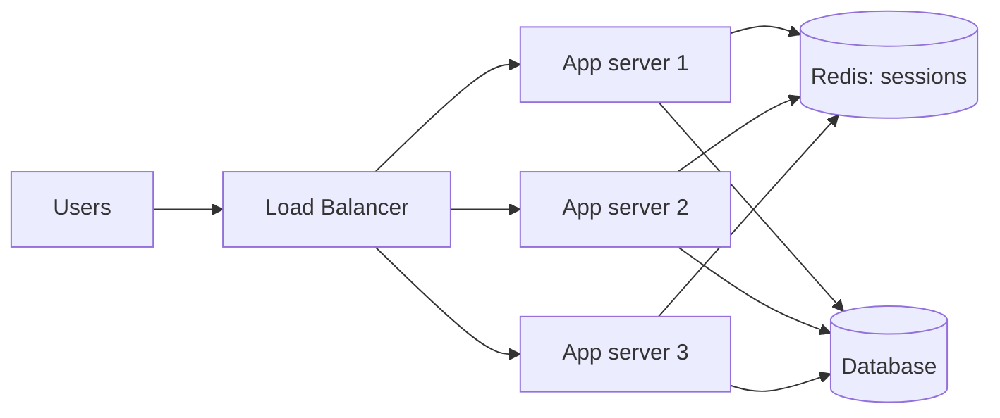
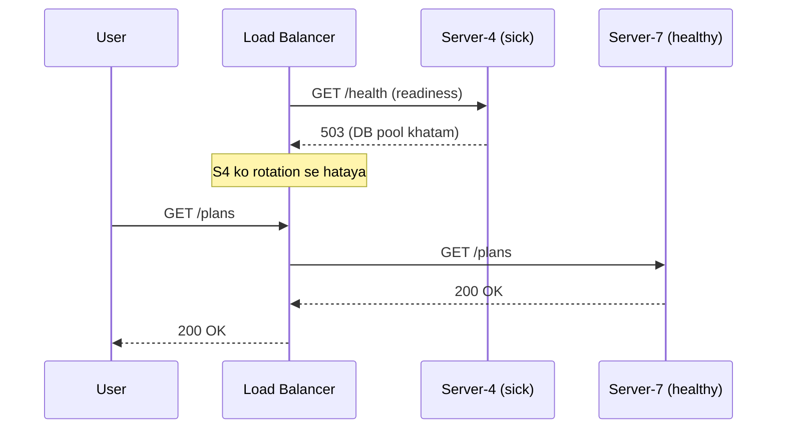
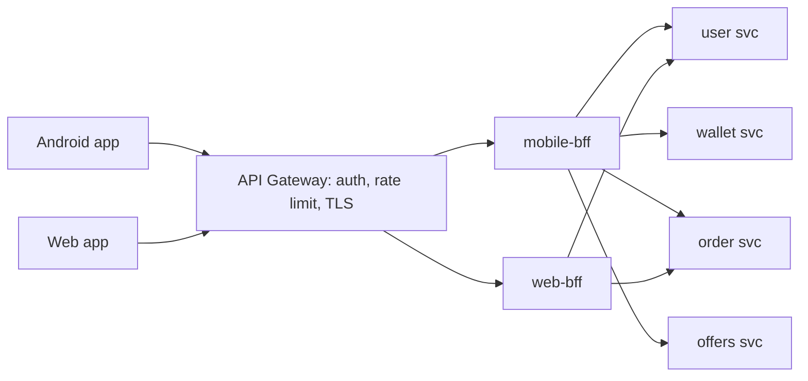
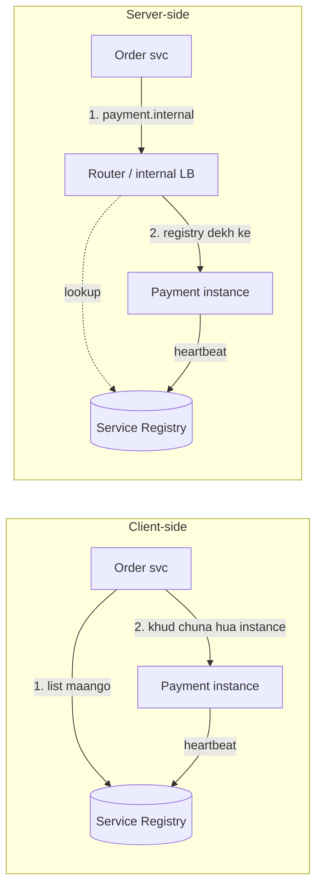
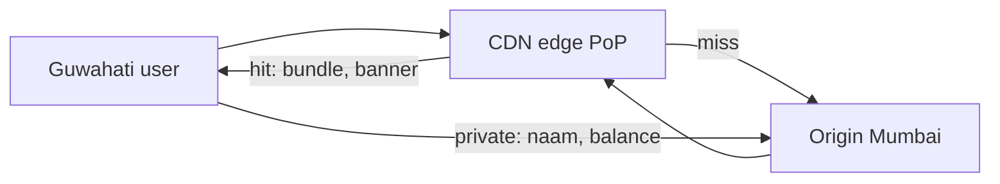

# 1A · Scaling Valley

Sep 29, 2026 · @saurav chaurasiya

**Is doc me 5 lessons:** L1.1 Vertical vs Horizontal scaling · L1.2 Load balancing · L1.3 API Gateway aur BFF · L1.4 Service discovery · L1.5 CDN aur edge.

**Padhne ka tareeka — zaroori:** har lesson do hisso me hai. **Core** (\~20 min) woh hai jo pakka aana chahiye. Uske neeche **Deep Dive** hai — woh SDE-2 ke HLD round ke liye hai, pehli baar me chhod sakte ho. Roz ka target: **2 lessons ka Core**, ya **1 lesson Core + Deep Dive**. Dono ek din me mat karo.

---

## L1.1 — Vertical vs Horizontal scaling

**Core · \~20 min** — SDE-1: must-know · SDE-2: must-know. Ye poore HLD ka pehla sawaal hai.

### Ye cheez hai kya

- **Scaling** = jab traffic badhe toh system ko usko sambhalne layak banana. Do hi tareeke hain, aur bas.
- **Vertical scaling (scale up)** = *ek hi machine ko bada karo* — zyada CPU, zyada RAM, tez disk.
- **Horizontal scaling (scale out)** = *zyada machines lagao* aur kaam unme baant do.
- Ek teesri cheez jo saath me aati hai: **stateless** — yaani server apne andar kuch yaad na rakhe, har request apne aap me poori ho. Ye horizontal scaling ki **shart** hai, aur is lesson ka asli sabak yahi hai.
- Is lesson ke baad tum bata paoge ki kaunsa scaling kab, aur ek service ko "scale karne layak" banane me kya badalna padta hai.

> **Analogy:** bank me ek hi counter pe bheed hai. **Vertical** = usi cashier ko tez bana do (better training, ginne wali machine). Ek hadd ke baad woh aur tez nahi ho sakta. **Horizontal** = 5 counter khol do. Par tab ek shart aa jaati hai — customer ki file kisi ek cashier ki daraaz me nahi, beech wale common record room me honi chahiye. Wahi **stateless** hai.

### Sawaal

Ek recharge service ek hi server pe chal rahi hai: 4 CPU, 8 GB RAM, \~800 RPS (**requests per second** — ek second me kitni requests) sambhal leti hai. Diwali aa rahi hai aur marketing keh rahi hai traffic 10x hoga — \~8000 RPS.

Service me ek cheez hai: user ka login session server ki memory me ek `HashMap` me pada hai.

Kya karoge? Aur kya-kya badalna padega?

> **Pehle khud socho — 5 min.** Hints: (1) 4 CPU ko 40 CPU kar dena kitna possible hai, aur kitna mehnga? (2) agar woh ek server gir jaye toh kitne % users ko service milegi? (3) memory wale `HashMap` ka kya hoga jab 10 servers ho jaayenge?

### Problem kyun aata hai

1. **Vertical scaling ki ek hard limit hai.** Duniya me sabse badi machine bhi finite hai. Aur cost linear nahi badhti — 2x machine aksar 3-4x paisa leti hai, kyunki bade servers niche (rare) hardware hote hain.
2. **Ek machine = SPOF.** **SPOF (Single Point Of Failure)** = ek aisi cheez jo akeli gir jaye toh poora system baith jaaye. Ek server pe 100% traffic hai, toh uska reboot bhi 100% outage hai.
3. **Vertical scaling me downtime lagta hai.** RAM badhane ke liye machine band karni padti hai (cloud me resize = restart).
4. **Memory me state rakhna horizontal scaling ko rok deta hai.** 10 servers ho gaye, user ki pehli request server-3 pe gayi (session bana), doosri request server-7 pe gayi — wahan session nahi hai → user logout. Yahi asli blocker hai, machines nahi.

### Naive approach

**Naive:** "server bada kar do, 4 CPU se 32 CPU" — aur session `HashMap` waise hi chhod do.

```java
// BURA CODE - state server ki memory me
public class SessionStore {
    // ye Map SIRF is server ki RAM me hai
    private static final Map<String, User> SESSIONS = new ConcurrentHashMap<>();
    public static void put(String token, User u) { SESSIONS.put(token, u); }
    public static User get(String token) { return SESSIONS.get(token); }
}
```

Kahan tootta hai:

1. 32 CPU se \~6000 RPS aa jaayega, par 8000 nahi — aur aage koi option nahi bacha.
2. Woh ek machine ab bhi SPOF hai. Diwali ki raat gir gayi toh sab band.
3. **Aur asli problem:** kal jab tum majboori me doosra server lagaoge, ye `HashMap` turant bug ban jaayega — users random logout hone lagenge. Yaani vertical scaling ne problem solve nahi ki, **taal di**.

### Sahi design

Pehle service ko **stateless** banao, phir horizontal scale karo. Order ulta nahi ho sakta.

1. **State ko server se bahar nikaalo.** Session `HashMap` se hatake ek shared store me daal do — Redis (dekho [L1.6 — Cache patterns](https://claude.ai/code/artifact/32bb1c8e-3433-417c-a3f4-3a34babed6bf)), ya ek signed token (JWT) jo client khud carry kare. Ab server ke andar kuch "yaad" nahi hai.
2. **Har cheez jo request ke beech zinda rehni chahiye, usko bahar rakho** — session, uploaded files (S3 jaisi object store me), scheduled job ka state (DB me), in-memory counters (Redis me).
3. **Kai identical servers chalao** (3, 5, 10 — jitna chahiye).
4. **Aage ek load balancer lagao** jo requests baant de (agla lesson, L1.2).
5. **Health check jodo** — ek chhota `/health` endpoint jo batata hai ki ye server theek hai. Load balancer isi se pata karta hai kis server ko traffic dena band karna hai.
6. **Ab scaling ek knob ban gayi** — traffic badha, do server aur chadha do; ghata, hata do. Isko **auto-scaling** kehte hain.



**Ek zaroori honest baat:** horizontal scaling app layer pe aasan hai, **database pe nahi**. DB apne aap me state hai — usko baantna ek alag aur mushkil kaam hai (read replicas, phir sharding). Isliye aksar asli bottleneck app server nahi, DB hota hai. Ye 1C · DB Dungeon aur 1D · Shard Mountains me aayega (abhi banna baaki).

**Interview me bolne wali line:** *"Pehle main service ko stateless karunga, tab hi horizontal scaling ka matlab banta hai"* — ye ek line bahut acchi impression deti hai, kyunki log seedha "load balancer laga denge" bol dete hain.

### Notebook

Vertical = ek machine badi (limit hai, downtime, cost non-linear, SPOF) · Horizontal = zyada machines (limit nahi, par distributed complexity) · **Horizontal ki shart = stateless** — session/files/counters server ki RAM se bahar (Redis, S3, DB, ya signed token) · SPOF = akele girne wali cheez jo poora system le doobe · Health check endpoint compulsory — LB usi se decide karta hai · App layer horizontal aasan, **DB nahi** — asli bottleneck aksar DB · Sticky session ek crutch hai, fix nahi

### Padhne ke liye

- [Scalability — Wikipedia](https://en.wikipedia.org/wiki/Scalability) — vertical vs horizontal ki definition aur trade-offs. **Ek hi cheez padhni ho toh ye.**
- [Stateless protocol — Wikipedia](https://en.wikipedia.org/wiki/Stateless_protocol) — stateless ka asli matlab, aur HTTP kyun stateless design hua. Chhota article.
- [Computer cluster — Wikipedia](https://en.wikipedia.org/wiki/Computer_cluster) — kai machines ko ek system ki tarah chalane ka general idea.
- [Session management — Wikipedia](https://en.wikipedia.org/wiki/Session_management) — server-side vs client-side session, jo step 1 ka faisla samjhata hai.

### Deep Dive (SDE-2) — jab time ho

#### Kya choose karein aur kyun

| Option | Kab use karo | Kab mat karo |
| --- | --- | --- |
| **Vertical** | Database (single-writer), legacy app jo stateless nahi hai, ya jab traffic thoda hi badha ho — sabse sasta aur turant | Jab pehle se hi bade instance pe ho, ya SPOF hatana ho |
| **Horizontal** | Stateless app/API layer, jahan traffic ka peak-trough bada ho | Jab app state memory me rakhta ho — pehle usko theek karo |
| **Sticky session (session affinity)** | Majboori me, legacy app ke liye — LB ek user ko hamesha usi server pe bhejta hai | Naye design me. Server gira toh un users ka session gaya, aur load unequal ho jaata hai |
| **Auto-scaling** | Predictable daily peak ya sale spike | Jab warm-up time bada ho (JVM) — tab pre-scale karo, warna spike aa chuka hoga jab tak server ready ho |

#### Interview follow-ups

1. *"Horizontal scaling ka nuksaan kya hai?"* — Distributed system ke saare problems mil jaate hain: network failure, partial failure, data consistency, deployment ki complexity, aur debugging mushkil (ek request kaunse server pe gayi).
2. *"Servers double kar do toh capacity double ho jaayegi?"* — Nahi. Koi na koi shared hissa hoga (DB, lock, cache) jo scale nahi hua — wahi nayi bottleneck ban jaayega. **Amdahl's law** ka practical roop yahi hai: jo hissa serial hai woh speedup ki limit tay karta hai.
3. *"Stateless ka matlab koi state hi nahi?"* — Nahi. State hoti hai, par **server ke bahar** (Redis, DB, object store). Server sirf compute karta hai.
4. *"JWT rakh lein toh Redis ki zaroorat nahi?"* — Fayda: koi lookup nahi. Nuksaan: token ko **revoke** karna mushkil hai (logout, chori hua token) — uske liye phir ek blocklist chahiye, aur woh Redis me hi jaayega.
5. *"Kitne servers chahiye — calculate karke batao."* — Ek server 800 RPS, target 8000 RPS → 10 servers, par headroom ke saath **13-14** (peak ke waqt 70% se zyada utilisation pe latency badhne lagti hai, aur ek-do server maintenance/failure me nikal sakte hain). Interview me ye headroom wali baat bolna zaroori hai.

#### India me kaise hota hai

festival spike Indian payment apps ki sabse badi engineering event hoti hai — app layer pehle se pre-scaled hoti hai (auto-scaling ka wait nahi karte, kyunki spike seconds me aata hai), aur session/token store alag Redis cluster pe hota hai. Paytm ne apne Redis clusters ki scaling par likha hai: [How Paytm Redis Clusters is Managing High Workloads](https://paytm.com/blog/engineering/how-paytm-redis-clusters-is-managing-high-workloads-with-growing-customer-base/)

#### Self-check

(1) Horizontal scaling ki ek shart batao aur kyun. (2) SPOF ek line me. (3) 800 RPS wale server pe 8000 RPS chahiye — kitne server, aur 10 se zyada kyun?

---

## L1.2 — Load balancing

**Core · \~20 min** — SDE-1: must-know · SDE-2: must-know

### Ye cheez hai kya

- **Load balancer (LB)** ek aisi cheez hai jo saamne baithti hai, requests leti hai, aur unhe peeche ke kai servers me baant deti hai. Peeche wale servers ko **backends** ya **upstreams** kehte hain.
- Ye do kaam karta hai, aur dono equally important hain: (1) **load baantna**, (2) **gire hue server ko traffic dena band karna**.
- LB do layer pe kaam kar sakta hai: **L4** (transport layer — sirf IP aur port dekhta hai, TCP connection forward karta hai) aur **L7** (application layer — HTTP request khol ke URL, header, cookie dekh sakta hai).
- Is lesson ke baad tum L4 vs L7 chun paoge, algorithm chun paoge, aur health check ka design bata paoge.

> **Analogy:** mall ke bahar **parking attendant**. Woh dekhta hai kaunsi lane khaali hai aur gaadi wahan bhej deta hai. Aur agar ek lane band ho gayi (paani bhar gaya), toh wahan gaadi bhejna band kar deta hai — yahi health check hai.

### Sawaal

Tumhare 10 app servers hain aur ek LB. Do problem aa rahi hain:

1. **Server-4 half-dead hai** — process chal raha hai, TCP port khula hai, par DB connection pool khatam ho gaya hai toh woh har request pe 500 error de raha hai. LB usko traffic bhej hi raha hai.
2. **Load unequal hai** — 2 servers 90% CPU pe hain, 8 servers 30% pe. Algorithm round-robin hai.

Donon ka kya karoge?

> **Pehle khud socho — 5 min.** Hints: (1) LB kaise pata karega ki server-4 kaam ka nahi? Port khula hai, toh TCP check pass ho jaayega. (2) round-robin me har server ko barabar requests jaati hain — par kya har request ka kaam barabar hota hai? (3) kya kuch requests bahut lambi chalti hain?

### Problem kyun aata hai

1. **"Zinda hai" aur "kaam karne layak hai" do alag baatein hain.** TCP port khula hona ka matlab process zinda hai — par uska DB, cache ya downstream dependency toota ho sakta hai. Isko **shallow health check** ki galti kehte hain.
2. **Round-robin request ginta hai, kaam nahi.** Ek request 5 ms ki hai, doosri 2 second ki (report banana). Barabar requests baantne se barabar load nahi banta.
3. **Long-lived connections load ko chipka dete hain.** WebSocket ya HTTP keep-alive me ek connection ghanton chalti hai — toh naye servers chadhane pe bhi purane connections wahin ke wahin rehte hain.

### Naive approach

**Naive:** default config — round-robin + TCP port check pe health.

```
# BURA CONFIG (nginx-jaisa)
upstream app {
    server 10.0.0.1:8080;      # round-robin (default)
    server 10.0.0.2:8080;
}
# health check = TCP connect ho gaya? theek hai.
```

1. Server-4 ka port khula hai → health check **pass** → LB usko 1/10 traffic bhejta rehta hai → **10% users ko error milta rahega**, aur dashboard pe "all healthy" dikhega.
2. Round-robin heavy aur light requests ka farq nahi jaanta → kuch servers dab jaate hain.
3. Ek retry config nahi hai → server-4 ka error seedha user tak jaata hai, jabki doosra server usi request ko serve kar sakta tha.

### Sahi design

1. **Health check ko deep banao.** `/health` endpoint aisa banao jo apni asli dependencies check kare — DB se ek halki query, cache ka ping — aur fail hone pe non-200 de. Aur do endpoint rakho:
   - **liveness** — "process zinda hai?" (fail → restart karo)
   - **readiness** — "ye server abhi traffic le sakta hai?" (fail → LB traffic hata de, par restart mat karo) Server-4 ka readiness fail hoga, LB usko rotation se nikaal dega, aur users ko error nahi milega.
2. **Algorithm badlo: `least_connections`.** Ye us server ko request deta hai jiske paas abhi sabse kam active connections hain — yaani jo sabse khaali hai. Heavy/light requests mix hone pe round-robin se kaafi behtar.
3. **Retry idempotent requests pe lagao.** Ek backend ne connection refuse kiya ya 5xx diya → LB doosre backend pe ek baar retry kare. **Sirf GET aur idempotent calls pe** (idempotent = ek hi kaam 10 baar karo, result wahi) — payment ke POST pe blind retry double payment bana deta hai.
4. **Timeout set karo.** Connect timeout chhota (1 sec), read timeout request ke hisaab se. Bina timeout ke ek slow backend poore LB ke connections kha jaata hai.
5. **Slow start rakho.** Naya server aate hi poora traffic na le — JVM warm-up ke bina woh slow rehta hai aur latency spike aata hai.



**L4 ya L7 — ek line ka faisla:** agar tumhe URL/header/cookie dekh kar routing karni hai, TLS terminate karna hai, ya retry chahiye — **L7**. Agar sirf bahut tez, bahut saara TCP traffic baantna hai (millions of connections, non-HTTP protocol) — **L4**.

### Notebook

LB ke do kaam: load baantna **aur** gire hue backend ko nikaalna · **L4** = IP+port, tez, protocol-agnostic; **L7** = HTTP dekh sakta hai → path routing, TLS termination, retry · Algorithms: round-robin (ginta hai), **least-connections** (khaali server ko deta hai — mixed workload me best), weighted (alag-alag size ke servers), IP-hash / consistent hashing (same user usi server pe) · **Shallow health check sabse common bug** — liveness (restart) aur readiness (traffic hatao) alag rakho · Retry sirf idempotent pe · Timeout aur slow-start compulsory · LB khud SPOF na bane — pair me chalao

### Padhne ke liye

- [Load balancing (computing) — Wikipedia](<https://en.wikipedia.org/wiki/Load_balancing_(computing)>) — algorithms, static vs dynamic, aur health check. **Best single source.**
- [Round-robin DNS — Wikipedia](https://en.wikipedia.org/wiki/Round-robin_DNS) — sabse sasta "load balancing", aur woh kyun kaafi nahi hai (DNS caching ki wajah se failover slow).
- [Consistent hashing — Wikipedia](https://en.wikipedia.org/wiki/Consistent_hashing) — jab ek user/key ko hamesha usi server pe bhejna ho, aur server add/remove pe sab kuch na hil jaye. Ye L1.14 (sharding) me dobara aayega.
- [Weighted round robin — Wikipedia](https://en.wikipedia.org/wiki/Weighted_round_robin) — chhota, jab servers ki capacity alag ho.

### Deep Dive (SDE-2) — jab time ho

#### Kya choose karein aur kyun

| Algorithm | Kab use karo | Kab mat karo |
| --- | --- | --- |
| **Round-robin** | Requests ka kaam lagbhag barabar ho, servers same size ke ho | Mixed workload (kuch requests 5 ms, kuch 2 sec) |
| **Least connections** | Mixed ya variable-duration requests — default choice | Bahut short-lived connections jahan count meaningful na ho |
| **Weighted (round-robin/least-conn)** | Servers ki capacity alag ho (purane + naye instances) | Jab sab identical ho — bewajah config |
| **IP hash / consistent hashing** | Same user ya key hamesha usi server pe chahiye (local cache hit, sticky-ish behaviour) | Jab equal load zaroori ho — hashing se hot server ban sakta hai |
| **Least response time** | Latency-sensitive APIs, backends ki speed alag ho | Jab measurement noisy ho — flapping ho sakta hai |

#### Interview follow-ups

1. *"LB khud SPOF nahi hai?"* — Hai, isliye LB **pair** me chalta hai (active-passive ya active-active) ek floating IP ke saath, ya cloud ka managed LB use karte ho jo andar se already redundant hai. DNS level pe bhi do LB ke IP diye jaate hain.
2. *"L4 vs L7 me performance ka farq?"* — L4 sasta hai (packet forward, payload nahi padhta) aur non-HTTP bhi chalata hai; L7 mehnga hai par usi ki wajah se path-based routing, header-based canary, TLS termination aur retry mumkin hain.
3. *"Health check ka interval kitna?"* — Trade-off hai: chhota interval = jaldi detect, par backends pe extra load aur **flapping** ka risk (server baar-baar in/out hota rahe). Aam taur pe 5-10 sec interval, aur 2-3 consecutive failure pe hi bahar nikaalo, 2-3 success pe hi wapas lo.
4. *"Saare backends unhealthy ho gaye toh?"* — Achhe LB me **"fail open"** ka option hota hai — sab fail hone pe sabko traffic bhejo, kyunki tumhara health check hi galat ho sakta hai. Warna 100% outage ho jaata hai jabki backends thode-thode kaam kar rahe the.
5. *"Client-side load balancing kya hai?"* — LB ke bajaye **client** khud saare backends ki list rakhta hai aur seedha ek chun leta hai. Ek network hop bach jaata hai, par client library me logic aa jaata hai. Ye agla lesson (L1.4) hai.

#### India me kaise hota hai

payment gateways ke saamne aksar do layer hoti hain — pehle ek L4 LB (bahut zyada TCP connections sambhalne ke liye) aur uske peeche L7 (path routing, TLS, canary deploy). Aur sabse common production incident wahi hai jo sawaal me tha: shallow health check ki wajah se ek half-dead server traffic leta raha.

#### Self-check

(1) Liveness aur readiness me farq ek line me. (2) Round-robin kab galat ho jaata hai? (3) Payment ke POST pe LB retry kyun khatarnak hai?

---

## L1.3 — API Gateway aur BFF

**Core · \~20 min** — SDE-1: naam aur kaam jaano · SDE-2: must-know (microservices wale sawaal me aata hai)

### Ye cheez hai kya

- **API Gateway** ek single darwaza hai jiske peeche tumhare saare backend services chhupe hote hain. Bahar ki duniya (mobile app, website) sirf gateway se baat karti hai.
- Ye sirf load balancer nahi hai. LB *traffic baantta* hai; gateway *cross-cutting kaam* karta hai — authentication, rate limiting, request routing, logging, response shaping.
- **BFF (Backend For Frontend)** ek alag idea hai: **har client type ka apna gateway**. Android app ka apna, web ka apna, partner API ka apna — kyunki teenon ko data ki alag shakl chahiye.
- Is lesson ke baad tum bata paoge ki gateway me kya rakhna hai, kya nahi, aur BFF kab chahiye.

> **Analogy:** office ka **reception**. Bahar se aaya banda seedha kisi bhi floor pe nahi jaa sakta — pehle reception pe ID dikhata hai (auth), visitor register me entry hoti hai (logging), aur reception batata hai kis floor pe jaana hai (routing). **BFF** matlab courier ke liye alag gate, employee ke liye alag, client ke liye alag — kyunki teenon ka kaam alag hai.

### Sawaal

Tumhare paas 8 microservices hain: user, wallet, order, payment, offers, notification, kyc, support.

Android app ka home screen kholne pe usko chahiye: user ka naam, wallet balance, last 3 orders, aur 2 active offers. Abhi app **4 alag services ko 4 API calls** karta hai.

Problems: (1) 2G/3G pe 4 round-trips bahut slow hain; (2) auth ka code chaar services me copy hai; (3) ek naya field jodne pe mobile app ki nayi release chahiye.

Kya design karoge?

> **Pehle khud socho — 5 min.** Hints: (1) 4 calls ko 1 kaise banaya jaa sakta hai? (2) auth check har service me hona chahiye ya ek jagah? (3) mobile ko jo shakl chahiye, woh kaun banayega — app, ya server?

### Problem kyun aata hai

1. **Client seedha services se baat kare toh coupling ho jaati hai.** App ko 8 services ke URL, version aur shape pata hain — service badli toh app tootega, aur app ki purani version mahino tak users ke phone pe rahegi.
2. **Cross-cutting logic duplicate hota hai.** Auth, rate limit, logging — ye har service me copy karne padte hain. Ek jagah bug fix karke baaki bhool jaana aam baat hai.
3. **Mobile network pe round-trip mehnga hai.** Har call me TCP + TLS handshake + latency. 4 sequential calls = 4x latency. **Latency** = ek request ka jawab aane me laga time.

### Naive approach

**Naive #1:** "Nginx laga do saamne, done." — Nginx path routing kar dega, par auth, rate limit per-user, aur **4 calls ko 1 me merge karna** woh nahi karega. Ye LB hai, gateway nahi.

**Naive #2:** "Ek hi gateway banao jo sab clients ke liye sab kuch kare." — Shuru me theek lagta hai. 6 mahine baad:

```
// BURA - ek hi endpoint, sab clients ke if-else se bhara
GET /home?client=android&version=8.2&lite=true&includeOffers=false...
```

1. Gateway me Android ke `if`, iOS ke `if`, web ke `if` — ek **god service** ban jaati hai.
2. Web team ko ek field chahiye toh Android team ka code bhi deploy hota hai — teams ek doosre ko block karti hain.
3. Gateway me business logic ghusne lagta hai ("agar wallet balance 0 hai toh offer mat dikhao") — aur wahi sabse badi galti hai, kyunki ab logic do jagah hai.

### Sahi design

1. **Ek API Gateway lagao** aur usme **sirf cross-cutting** cheezein rakho:
   - **Authentication** — token verify karo ek jagah, aur aage services ko ek bharosemand user-id header bhejo.
   - **Rate limiting** — per user/API key (Redis counters se).
   - **Routing** — `/wallet/*` → wallet service.
   - **Observability** — ek **correlation id** (har request ka unique id) generate karo aur aage bhejo, taaki logs jodna aasan ho.
   - **TLS termination**, request/response size limits, aur bad-input rejection.
2. **Aggregation ke liye BFF banao — per client type.** `mobile-bff` ka ek endpoint `GET /home` andar se 4 services ko **parallel** call karega aur ek response bana ke dega.
3. **Parallel calls, aur partial failure handle karo.** Offers service gir gayi? Toh `offers: []` bhej do aur baaki screen dikha do — poora home screen mat girao. Isko **graceful degradation** kehte hain.
4. **BFF ko client team own kare.** Jo team Android app banati hai wahi `mobile-bff` badalti hai — isse "nayi app release chahiye" wali problem khatam hoti hai, kyunki shape server pe banti hai.
5. **Business logic BFF me nahi.** BFF ka kaam: bulao, jodo, shakl do. Faisla lena services ka kaam hai.



**Nateeja:** 4 round-trips → 1. Auth 4 jagah se → 1 jagah. Naya field → BFF deploy, app release nahi.

### Notebook

API Gateway = single entry point, **cross-cutting only**: auth, rate limit, routing, correlation id, TLS termination, size limits · LB ≠ gateway (LB traffic baantta hai, gateway policy lagata hai) · **BFF = per client type ka gateway** (mobile/web/partner) — kaam: parallel calls + aggregate + client ki shakl me response · BFF client team own kare → app release ke bina field jod sako · **Business logic gateway/BFF me kabhi nahi** · Partial failure pe graceful degradation (offers khali, screen chale) · Gateway SPOF ban sakta hai → redundant + stateless rakho

### Padhne ke liye

- [Pattern: API Gateway / Backends for Frontends — microservices.io](https://microservices.io/patterns/apigateway.html) — Chris Richardson ka original pattern writeup, BFF ke saath. **Best single source, aur interview me isi ki wording chalti hai.**
- [A pattern language for microservices — microservices.io](https://microservices.io/patterns/index.html) — poora pattern map. Bookmark kar lo; aage ke zones ke patterns yahin milenge.
- [REST — Wikipedia](https://en.wikipedia.org/wiki/REST) — gateway ke peeche ka API style, aur statelessness ka constraint kyun hai.
- [Microservice Trade-Offs — Martin Fowler](https://martinfowler.com/articles/microservice-trade-offs.html) — microservices ke fayde aur asli keemat, dono. Interview me balanced jawab dene ke liye badhiya.

### Deep Dive (SDE-2) — jab time ho

#### Kya choose karein aur kyun

| Kaam | Kahan | Kyun |
| --- | --- | --- |
| TLS termination, IP allow-list, request size limit | **Gateway** | Edge pe hi rok lo, andar tak jaane hi na do |
| Auth token verify, user-id resolve | **Gateway** | Ek jagah, aur services ko verified header mile |
| Rate limit per user/key | **Gateway** | Client-level policy hai, service-level nahi |
| 4 services ko parallel bulakar ek response banana | **BFF** | Ye client-specific shape hai, generic policy nahi |
| "Balance kam hai toh debit mat karo" | **Service (wallet)** | Business rule — uska maalik wahi service hai |
| Retry aur circuit breaker | **BFF/gateway + service client** | Dono jagah zaroorat hai, par policy alag |

#### Interview follow-ups

1. *"Gateway aur BFF me farq ek line me?"* — Gateway ek hai aur **generic policy** lagata hai; BFF har client type ka apna hai aur **client-specific composition** karta hai.
2. *"BFF kab nahi chahiye?"* — Jab ek hi client ho, ya clients ko lagbhag same data chahiye ho. Do client aur 3 services pe BFF banana over-engineering hai.
3. *"Gateway SPOF nahi ban jaata?"* — Ban sakta hai, isliye woh **stateless** aur redundant (kai instances + LB) rakha jaata hai, aur usme bhaari logic nahi daalte.
4. *"BFF ki jagah GraphQL?"* — GraphQL wahi problem solve karta hai (client apni shape maangta hai) bina per-client BFF likhe. Kharcha: query complexity, N+1 calls, caching mushkil, aur authorization per-field karni padti hai.
5. *"Auth gateway pe kar liya, toh service ko dobara check karna chahiye?"* — Haan. Gateway network edge hai; agar koi andar se seedha service ko call kar de toh? Isliye service-to-service auth (mTLS ya signed internal token) bhi hota hai — isko **zero trust** kehte hain. Ye 2G · Security Vault me aayega (abhi banna baaki).

#### India me kaise hota hai

payment companies me gateway pe ek aur cheez hoti hai jo interview me achhi lagti hai — **idempotency key ka enforcement** aur request signing, taaki merchant ka duplicate POST andar do baar na pahunche. Ye 2A · Idempotency Island me detail me aayega (abhi banna baaki).

#### Self-check

(1) Gateway aur LB me farq. (2) BFF ka malik kaun hona chahiye aur kyun? (3) Ek cheez batao jo gateway me **nahi** honi chahiye.

---

## L1.4 — Service discovery

**Core · \~15 min** — SDE-1: idea samajh lo · SDE-2: must-know

### Ye cheez hai kya

- **Service discovery** = ek service ko ye pata karna ki doosri service ke instances **abhi kahan chal rahe hain** (kaunsa IP, kaunsa port).
- Ye sawaal tabhi paida hota hai jab instances **aate-jaate rehte hain** — auto-scaling, deploy, crash, container reschedule. Fixed IP list ka zamana khatam.
- Do main tareeke: **client-side discovery** (client khud list leta hai aur ek instance chunta hai) aur **server-side discovery** (client ek fixed pate pe bhejta hai, beech ka router chunta hai).
- Beech me ek cheez hoti hai: **service registry** — ek live directory jisme "kaun kahan hai" likha rehta hai.
- Is lesson ke baad tum bata paoge ki registry me entry kaun daalta hai, marti kab hai, aur dono patterns me se kaunsa kab.

> **Analogy:** naye sheher me plumber chahiye. **Client-side** = tum khud directory kholte ho, 5 naam dekhte ho, ek chun lete ho. **Server-side** = tum ek helpline pe call karte ho, woh khud kisi available plumber ko bhej deta hai. **Registry** = wahi directory, jisme plumber apna naam khud likhwata hai aur chhutti pe jaate waqt hata leta hai.

### Sawaal

Order service ko payment service call karni hai. Payment service ke 6 instances hain, auto-scaling pe — din me kai baar naye aate hain aur purane jaate hain.

Abhi order service ki config file me ye pada hai:

```
payment.service.urls = 10.0.2.11:8080, 10.0.2.12:8080, 10.0.2.13:8080
```

Raat ko auto-scaling ne teen naye instances banaye aur do purane maar diye. Kya hoga, aur theek kaise karoge?

> **Pehle khud socho — 5 min.** Hints: (1) config me likhe do IP ab exist nahi karte — order service ko kya milega? (2) teen naye instances ko traffic kaise milega? (3) ye list har deploy pe haath se update karna realistic hai kya?

### Problem kyun aata hai

1. **Cloud me IP ephemeral hai.** Container restart hua, naya IP. Auto-scaling ne instance banaya, naya IP. Koi bhi hardcoded list agle din galat ho jaati hai.
2. **Stale entry silent failure deti hai.** Mare hue IP pe call jaayegi aur *connection refused* ya, usse bura, **timeout** milega — aur timeout tumhare threads ko block karke poori service slow kar dega.
3. **Naye instances bekaar khade rehte hain.** Tumne 3 naye server ka paisa diya par unko traffic hi nahi mil raha, kyunki koi unke baare me nahi jaanta.
4. **Manual config deploy se bandh jaati hai.** IP badalne pe config change + redeploy — yaani scaling ab ek deployment event ban gaya, jo auto-scaling ka poora point khatam kar deta hai.

### Naive approach

**Naive #1 — hardcoded list (upar wala).** Har scaling event pe toot jaata hai.

**Naive #2 — "DNS name de do, `payment.internal`, aur DNS round-robin kar dega."** Ye kaafi behtar hai aur chhote setups me chalta bhi hai, par teen jagah tootta hai:

1. **DNS caching.** Client (aur JVM — uska apna DNS cache hota hai) purana IP mahino tak yaad rakh sakta hai. Instance mar gaya, par client usi IP pe bhejta rahega. TTL kam karne se load badhta hai aur guarantee bhi nahi milti.
2. **DNS ko health nahi pata.** Woh naam se IP deta hai, bas. Instance half-dead hai ya nahi, DNS ko farq nahi padta.
3. **DNS me port nahi hota** (A record me sirf IP hai), aur load ka koi hisaab nahi — sab clients ko lagbhag same order milta hai.

### Sahi design

Ek **service registry** rakho, aur instances ko usme khud register karwao.

1. **Instance start hote hi registry me apna naam, IP, port likh de** (self-registration). Isko *register* karna kehte hain.
2. **Instance har kuch second registry ko "main zinda hoon" bhejta rahe** — isko **heartbeat** kehte hain. Registry me entry ka ek TTL hota hai; heartbeat na aaye toh entry khud mar jaati hai. Isse crash hua instance apne aap list se nikal jaata hai, kisi ko manually hatana nahi padta.
3. **Instance band hone se pehle apna naam hata de** (deregister) — graceful shutdown me.
4. **Ab do me se ek pattern chuno:**
   - **Client-side discovery** — order service registry se payment ke instances ki list leti hai (aur cache karti hai), aur khud ek chunti hai (least-connections ya round-robin). Ek network hop bachta hai aur client smart load balancing kar sakta hai. Kharcha: ye logic har service ki library me chahiye — aur multi-language setup me har language ke liye.
   - **Server-side discovery** — order service seedha ek fixed pate (`payment.internal` ya ek internal LB) pe bhejti hai; woh router registry dekh ke aage bhej deta hai. Client ekdam simple ho jaata hai. Kharcha: ek extra hop, aur woh router redundant rakhna padta hai.
5. **Jo bhi chuno, timeout + retry + circuit breaker saath rakho.** Registry bhi purani ho sakti hai (heartbeat aur detection ke beech ka gap), toh ek mari hui entry mil sakti hai — client ko us se sambhalna aana chahiye.



**Practical sach:** aaj ke setups me ye tumhe khud banana nahi padta. Kubernetes me ye built-in hai — ek **Service** object hi registry + server-side discovery dono hai (`payment` naam se call karo, `kube-proxy` aage healthy pod pe bhej deta hai, aur readiness probe fail hone pe pod list se nikal jaata hai). Interview me ye bolna accha hai: *"pattern ye hai, aur K8s isko server-side discovery ki tarah implement karta hai."*

### Notebook

Service discovery = "doosri service ke instances abhi kahan hain" · Zaroorat kyun: cloud me IP ephemeral (autoscale, deploy, crash) · **Service registry** = live directory; instance khud register kare, **heartbeat** bheje, TTL khatam hone pe entry khud mare, shutdown pe deregister · **Client-side** = client list lekar khud chunta hai (ek hop kam, smart LB, par har language me library) · **Server-side** = fixed pata + router chunta hai (client simple, ek extra hop) · DNS alone kaafi nahi — **caching, no health, no port** · Stale entry hamesha mil sakti hai → timeout + retry + circuit breaker · Kubernetes Service = server-side discovery built-in

### Padhne ke liye

- [Pattern: Service registry — microservices.io](https://microservices.io/patterns/service-registry.html) — registry kya hai, kaun likhta hai, TTL/heartbeat. **Pehle ye padho.**
- [Pattern: Client-side service discovery — microservices.io](https://microservices.io/patterns/client-side-discovery.html) — pehla pattern, diagram ke saath.
- [Pattern: Server-side service discovery — microservices.io](https://microservices.io/patterns/server-side-discovery.html) — doosra pattern; dono ek saath padho, tab farq clear hota hai.
- [Round-robin DNS — Wikipedia](https://en.wikipedia.org/wiki/Round-robin_DNS) — DNS-only approach ki limitations, jo Naive #2 ka base hai.

### Deep Dive (SDE-2) — jab time ho

#### Kya choose karein aur kyun

| Approach | Kab use karo | Kab mat karo |
| --- | --- | --- |
| **Hardcoded list / config** | Do-teen fixed instances, koi autoscaling nahi, internal tool | Kisi bhi autoscaled ya containerised setup me |
| **DNS only** | Chhota setup, instances kam badalte ho, ek hi language | Jab fast failover chahiye — DNS/JVM caching maar degi |
| **Client-side discovery** | Ek hi language stack, aur tum smart load balancing (least-conn, zone-aware) chahte ho | Polyglot setup — har language me library maintain karni padegi |
| **Server-side discovery (K8s Service, internal LB)** | Default choice aaj ke din; polyglot setup | Jab extra hop ka latency budget na ho (bahut low-latency internal calls) |
| **Service mesh (sidecar)** | Bade setups jahan mTLS, retry, tracing sab uniformly chahiye | Chhoti team — mesh ka operational kharcha bada hai |

#### Interview follow-ups

1. *"Registry khud gir gayi toh?"* — Registry SPOF ban jaati hai, isliye woh cluster me chalti hai (Raft jaise consensus pe — etcd, Consul). Aur clients apni last-known list **cache** rakhte hain, taaki registry down hone pe bhi kaam chalta rahe. Isko *graceful degradation* kehte hain.
2. *"Heartbeat interval kitna?"* — Trade-off: chhota = jaldi detection, par registry pe load aur false negatives (network blip pe healthy instance nikal jaaye). Aam taur pe heartbeat 5-10 sec, TTL uska 2-3 guna.
3. *"Registry ki entry stale ho toh?"* — Hamesha ho sakti hai (heartbeat aur expiry ke beech ka window). Isliye client ko *connection refused* pe turant doosra instance try karna chahiye, aur us instance ko apni local list se hata dena chahiye.
4. *"Self-registration ka nuksaan?"* — App code ko registry ki jaankari ho jaati hai (coupling). Doosra tareeka **third-party registration** hai — ek alag "registrar" process instances ko dekhta hai aur register karta hai; K8s yahi karta hai, app ko kuch pata nahi hota.
5. *"Zone-aware routing kya hai?"* — Same availability zone ke instance ko prefer karna, taaki cross-zone latency aur cost bache. Ye client-side discovery ka ek bada fayda hai.

#### India me kaise hota hai

payments me ek extra requirement hoti hai — internal calls pe bhi identity chahiye (kaun call kar raha hai), toh discovery ke saath **mTLS** ya signed internal token chalta hai. Isliye bade payment stacks aksar service mesh ki taraf jaate hain, jahan discovery, mTLS, retry aur tracing ek hi sidecar se aate hain. Security ka ye hissa 2G · Security Vault me aayega (abhi banna baaki).

#### Self-check

(1) Registry se entry apne aap kaise hatti hai? (2) Client-side aur server-side discovery me ek-ek fayda batao. (3) DNS-only approach ki sabse badi kami kya hai?

---

## L1.5 — CDN aur edge

**Core · \~15 min** — SDE-1: idea aur kya cache hota hai, itna kaafi · SDE-2: must-know

### Ye cheez hai kya

- **CDN (Content Delivery Network)** = duniya bhar me faile hue servers ka network jo tumhare content ki **copy** user ke paas rakhta hai. User ka request tumhare origin server tak jaata hi nahi — uske sheher ke paas wale CDN server se jawab mil jaata hai.
- Us paas wale server ko **edge** ya **PoP (Point of Presence)** kehte hain. Tumhara asli server **origin** kehlata hai.
- Ye L1.6 ke cache se alag nahi hai — wahi idea hai, par cache **geography** me distribute hai. Faayda distance se aata hai.
- Is lesson ke baad tum bata paoge ki CDN pe kya rakhna hai, kya kabhi nahi, aur content update karne pe purani copy kaise hataate hain.

> **Analogy:** ek hi book ka warehouse Delhi me hai. Chennai ka customer order kare toh 3 din lagte hain. Solution: Chennai, Mumbai, Kolkata me **chhote local stores** khol do jahan popular books ki copy padi rahe. Ab 3 din ka kaam 3 ghante ka. Par **cheque book** (jo sirf tumhari hai) local store me nahi rakhi ja sakti.

### Sawaal

Tumhari app ka homepage Mumbai ke ek data centre se serve hota hai. Usme hai:

1. App ka JavaScript bundle (2 MB), CSS, aur \~40 icons/images — sab users ke liye same.
2. Ek offers banner image jo marketing din me 2-3 baar badalti hai.
3. User ka naam aur wallet balance.

Chennai aur Guwahati ke users keh rahe hain page 6-8 second leta hai. Mumbai me 1.2 second.

Kya karoge — aur teen cheezon me se kaunsi CDN pe jaayegi?

> **Pehle khud socho — 5 min.** Hints: (1) teenon me se kaunsi cheez **sab users ke liye same** hai? (2) banner badalne pe purani copy edge pe padi rahegi — usko kaise hataoge? (3) wallet balance edge pe rakhna theek hoga kya?

### Problem kyun aata hai

1. **Roshni ki speed ek hard limit hai.** Mumbai se Guwahati \~2000 km — fibre me round-trip hi \~40-60 ms. Ek page me 40 files hain, aur browser ek time pe 6 connections khol pata hai → kai round-trips → seconds me badal jaata hai.
2. **Har round-trip me TLS handshake ka kharcha hai.** Nayi connection = TCP handshake + TLS handshake, yaani 2-3 extra round-trips usi latency pe.
3. **Origin pe bekaar load padta hai.** Wahi 2 MB bundle lakhon baar bhejna — bandwidth aur CPU dono barbaad, jabki woh file kabhi badalti hi nahi.
4. **Mobile network me latency aur variance zyada hoti hai** — 4G pe base latency hi 50-100 ms ho sakti hai, toh round-trips ghatana sabse bada lever ban jaata hai.

### Naive approach

**Naive #1 — "Sab kuch CDN pe daal do, `Cache-Control: max-age=31536000` (1 saal) laga do."**

1. Bundle ke liye ye sahi hai. **Banner ke liye disaster** — marketing ne image badli, par edge pe purani copy ek saal tak padi rahegi. Users ko purana offer dikhega.
2. Aur agar galti se API response ya user-specific page bhi CDN pe chala gaya, toh **ek user ka data doosre ko dikh sakta hai** — ye asli security incident hai, aur CDN misconfiguration ki sabse mashhoor galti hai.

**Naive #2 — "Har badlav pe poora CDN purge kar do."** Purge propagate hone me waqt lagta hai, aur poora purge hone ke baad **saare users ek saath origin pe aayenge** — wahi cache stampede jo [L1.9](https://claude.ai/code/artifact/32bb1c8e-3433-417c-a3f4-3a34babed6bf) me padha.

### Sahi design

Content ko teen buckets me baanto, aur teenon ko alag treat karo:

1. **Immutable static assets** (JS bundle, CSS, icons) → CDN pe, **1 saal ka `max-age` + `immutable`**. Aur file ke naam me ek **content hash** daalo: `app.9f3a1c.js`. Badlav pe naam badal jaata hai, toh naya URL = naya cache entry. **Purge ki zaroorat hi nahi padti** — yahi sabse saaf pattern hai, isko *cache busting* kehte hain.
2. **Semi-static, sab users ke liye same** (offers banner, plans JSON) → CDN pe, par **chhota `max-age` (30-120 sec)** ya `s-maxage` + `stale-while-revalidate`. Marketing ka badlav 1-2 minute me dikh jaayega, aur origin pe ek hi refresh call jaayegi.
3. **User-specific ya paisa** (naam, wallet balance, order status) → **CDN pe kabhi nahi.** Response pe `Cache-Control: private, no-store` lagao, taaki koi beech ka cache ise galti se na rakhe.
4. **Page ka HTML shell CDN se, data API se.** Shell (khali dhancha) edge se turant aata hai, aur user ka data ek API call se bharta hai — toh user ko page **turant** dikhta hai.
5. **`Vary` header dhyan se lagao.** Agar response `Accept-Encoding` ya device type pe badalta hai toh `Vary` batao, warna CDN ek variant sabko de dega.



**Tumhare sawaal ka jawab:** (1) bundle/CSS/icons → CDN, hashed filename, 1 saal. (2) banner → CDN, 60 sec TTL (ya hashed naam ho toh usse bhi accha). (3) naam aur balance → CDN pe nahi, `private, no-store`. Guwahati ka page 6-8 sec se \~1.5-2 sec pe aa jaayega, kyunki 40 files ab 2000 km door se nahi aa rahi.

### Notebook

CDN = geographically distributed cache; **edge/PoP** = paas wala server, **origin** = tumhara asli server · Faayda distance + round-trips ghatane se, aur origin ka load bachta hai · **Teen buckets:** immutable assets (hashed filename + 1 saal `max-age, immutable` → purge ki zaroorat nahi) · semi-static same-for-all (30-120 sec TTL + stale-while-revalidate) · user-specific/paisa (`private, no-store` — **CDN pe kabhi nahi**) · Poora purge = stampede risk, hashed naam behtar · `Vary` galat lagana = ek variant sabko · HTML shell edge se, data API se

### Padhne ke liye

- [Content delivery network — Wikipedia](https://en.wikipedia.org/wiki/Content_delivery_network) — CDN kaam kaise karta hai, PoP, request routing. **Best single source.**
- [Anycast — Wikipedia](https://en.wikipedia.org/wiki/Anycast) — ek hi IP duniya me kai jagah kaise ho sakti hai; CDN isi se tumhe nearest PoP pe le jaata hai.
- [Edge computing — Wikipedia](https://en.wikipedia.org/wiki/Edge_computing) — "edge" ka bada matlab: sirf files nahi, code bhi edge pe chala sakte ho.
- [Cache Validity — AWS whitepaper](https://docs.aws.amazon.com/whitepapers/latest/database-caching-strategies-using-redis/cache-validity.html) — TTL aur invalidation ka soch, jo CDN pe bhi waisa hi lagta hai.

### Deep Dive (SDE-2) — jab time ho

#### Kya choose karein aur kyun

| Content | Kahan | Header |
| --- | --- | --- |
| JS/CSS/images, hashed filename | CDN | `max-age=31536000, immutable` |
| Offers banner, plans list (same for all) | CDN | `s-maxage=60, stale-while-revalidate=300` |
| HTML shell | CDN, chhota TTL | `s-maxage=30` |
| User ka naam, balance, orders | **CDN pe nahi** | `private, no-store` |
| Payment API POST | **CDN pe nahi** | `no-store` |
| Video/large downloads | CDN (yahi uska sabse bada use) | `max-age` bada + range requests |

#### Interview follow-ups

1. *"CDN sirf static ke liye hai?"* — Nahi. Aaj CDN **dynamic acceleration** bhi karta hai: TLS edge pe terminate karke origin tak ek warm, optimised connection rakhta hai — toh user ka handshake paas me hota hai aur latency phir bhi girti hai, chahe content cache na ho. Aur edge functions (edge pe chalne wala chhota code) se auth ya A/B routing edge pe ho sakti hai.
2. *"Purge aur cache-busting me kaunsa behtar?"* — **Cache-busting** (hashed filename) hamesha behtar, kyunki woh instant hai aur propagation ka intezaar nahi. Purge tab jab tum URL nahi badal sakte (jaise ek fixed `/banner.jpg`).
3. *"Ek CDN node pe cache miss hua toh origin pe stampede?"* — Ho sakta hai, isliye achhe CDN me **origin shielding** hota hai: ek beech ki layer jo saare PoP ke miss ko ek hi origin call me collapse kar deti hai. Ye single-flight ka CDN version hai.
4. *"CDN ki sabse khatarnak misconfiguration?"* — User-specific response cache ho jaana (`Cache-Control` bhool jaana, ya cache key me cookie/auth header shamil na karna) — phir ek user ka data doosre ko serve ho sakta hai.
5. *"India ke liye CDN chunte waqt kya dekhoge?"* — Kitne Indian PoP hain aur kahan (tier-2 cities me bhi?), ISP peering (Jio/Airtel ke saath), aur origin shielding ka support. Latency ka faisla PoP ki ginti se nahi, **users ke paas PoP hone** se hota hai.

#### India me kaise hota hai

payment apps me CDN ka istemaal saaf-saaf batwa hua hota hai — app assets, operator logos, offer banners, KYC ke instruction videos sab CDN se; aur balance, order status, checkout ka koi bhi response kabhi CDN se nahi. Kuch teams ne offers/plans JSON ko bhi CDN pe daal diya hai chhote TTL ke saath, kyunki woh sab users ke liye same hai — isse origin pe traffic dramatically girta hai, jaisa [L1.6](https://claude.ai/code/artifact/32bb1c8e-3433-417c-a3f4-3a34babed6bf) me dekha.

#### Self-check

(1) Hashed filename se purge ki zaroorat kyun nahi padti? (2) Wallet balance CDN pe kyun nahi — do wajah. (3) Origin shielding kya problem solve karta hai?

---

## Aage kya

- **Pichhla zone:** [Part 0 · Base Camp (L0.1–L0.2)](https://claude.ai/code/artifact/873676ef-93d2-45e6-a1bc-079a3fa419b3)
- **Agla zone:** [1B · Cache Caves (L1.6–L1.9)](https://claude.ai/code/artifact/32bb1c8e-3433-417c-a3f4-3a34babed6bf)
- **Aage jud'ne wale dhaage:** L1.1 ka "DB horizontal scale karna mushkil hai" → 1C · DB Dungeon aur 1D · Shard Mountains (abhi banna baaki) · L1.2 ka consistent hashing → 1D · Shard Mountains · L1.3 ka gateway pe idempotency → 2A · Idempotency Island · L1.4 ka mTLS → 2G · Security Vault.
