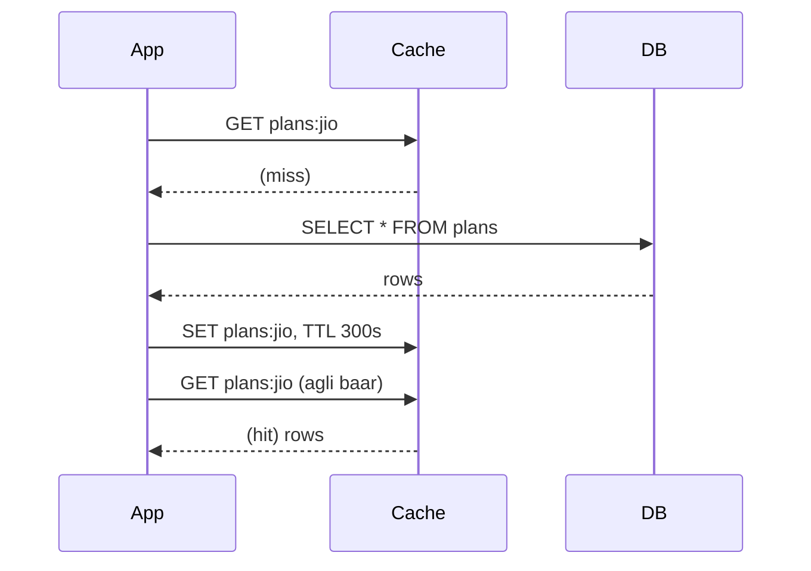
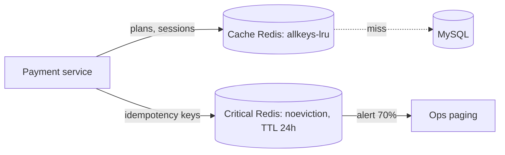
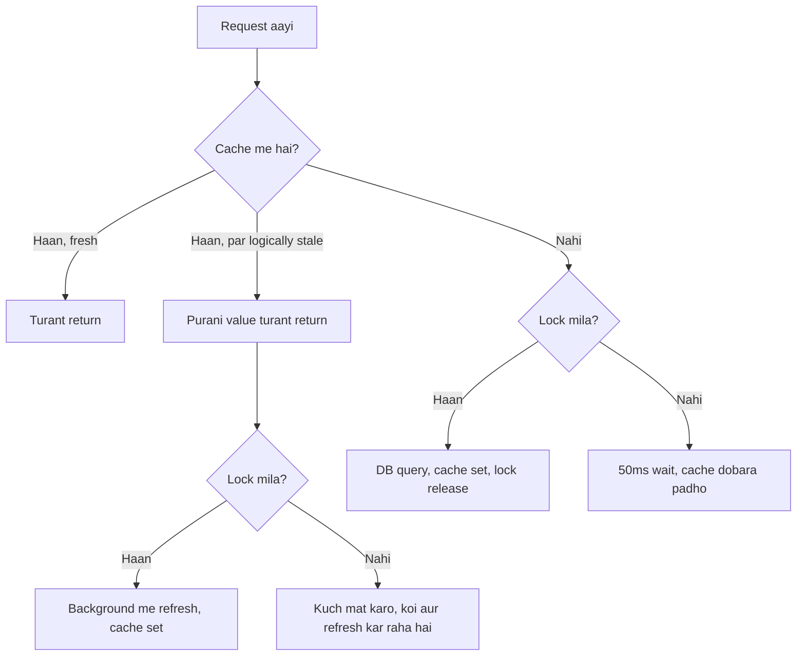

# 1B · Cache Caves

Sep 29, 2026 · @saurav chaurasiya

**Is doc me 4 lessons:** L1.6 cache patterns · L1.7 Redis structures + persistence · L1.8 eviction aur TTL · L1.9 stampede / penetration / avalanche.

**Padhne ka tareeka — zaroori:** har lesson do hisso me hai. **Core** (\~20 min) woh hai jo pakka aana chahiye. Uske neeche **Deep Dive** hai — woh SDE-2 ke HLD round ke liye hai, pehli baar me chhod sakte ho. Roz ka target: **2 lessons ka Core**, ya **1 lesson Core + Deep Dive**. Dono ek din me mat karo.

---

## L1.6 — Cache kyun, aur kaunsa pattern: cache-aside / read-through / write-through / write-back

**Core · \~20 min** — SDE-1: must-know · SDE-2: must-know

### Ye cheez hai kya

- **Cache** ek chhota par bahut tez storage hai (aam taur pe RAM me), jisme baar-baar maange jaane wale data ki **copy** rakhi jaati hai — taaki har request ke liye slow database tak na jaana pade.
- Cache me rakha data ka **asli ghar nahi** hai. Asli sach database me hota hai — usko **source of truth** kehte hain (jiski baat final maani jaati hai).
- **Cache pattern** = read aur write ka traffic cache aur DB ke beech **kis order me** chalega. Char patterns hain.
- Is lesson ke baad tum bata paoge: kaunsa pattern kab, aur usme data purana hone (**staleness**) ya kho jaane ka risk kitna.

> **Analogy:** rasoi me namak ka **chhota dabba** counter pe, 5 kg ka packet store room me. Chhota dabba = cache (haath ke paas, kam samata). Store room = DB (sab kuch hai, par jaana padta hai).

### Sawaal

Ek recharge page pe har user ko operator ke plans dikhte hain (maan lo 50 plans: price, validity, data). Plans **din me 1-2 baar** badalte hain, par page peak pe **40,000 RPS** (requests per second — ek second me kitni requests) leta hai. Abhi har request seedha MySQL pe ja rahi hai, DB ka CPU 95%.

Kaunsa pattern, kitna TTL, aur plan badalne pe kya karoge?

> **Pehle khud socho — 5 min.** Hints: (1) is data ka read:write ratio kitna hoga? (2) 2 minute purana plan dikhne se paisa galat katega, ya sirf display galat hoga? (3) cache me entry **kaun** daalega — tumhara code, ya cache library khud?

### Problem kyun aata hai

1. **Disk se padhna mehnga hai.** Ek row disk se \~1–10 ms, RAM se \~0.1 ms. RAM 10–100x tez.
2. **Har query ka fixed kharcha hai** — connection, SQL parse, index lookup. Chhoti query pe bhi lagta hai.
3. **Connections limited hain.** MySQL kuch sau connections sambhalta hai. 40,000 RPS pe requests line me lagengi (**queueing**), aur queue lagte hi **latency** (ek request ka jawab aane me laga time) badh jaati hai.

Asli observation: ye data **read-heavy** hai — lakhon baar padha, din me 1-2 baar likha. Jo bahut padha jaye aur kam likha jaye, wahi cache ke liye sahi candidate hai.

### Sahi design

**Cache-aside (lazy loading)** — 90% cases me yahi. Application khud cache manage karta hai:

1. Read aaya → pehle cache dekho.
2. Mila (**cache hit**) → return. Khatam.
3. Nahi mila (**cache miss**) → DB se padho.
4. Result cache me TTL ke saath daalo. (**TTL = Time To Live**, kitni der baad entry khud mar jaayegi.)
5. Return karo.
6. Write ke waqt: DB me likho, aur us key ko cache se **delete** karo — update nahi, delete. Agli read khud fresh value bhar degi.



**Delete kyun, update kyun nahi?** Do requests ek saath update karengi toh unka order ulat sakta hai aur galat value chipak jaayegi. Delete **idempotent** hai — *ek hi kaam 10 baar karo, result wahi*. Do delete = ek delete. Isliye safe.

Baaki teen patterns, ek-ek line:

- **Read-through** — app seedha cache se maangta hai; miss pe **cache khud** DB se laata hai. App ko DB dikhta hi nahi.
- **Write-through** — write cache pe, cache turant DB me bhi likhta hai; dono ho jaane pe OK. Cache aur DB hamesha match. Kharcha: har write slow.
- **Write-back (write-behind)** — write sirf cache me, user ko turant OK, DB me baad me batch me. Sabse tez writes, **sabse khatarnak**: cache node gira toh jo DB me nahi gaya woh data hamesha ke liye gaya.

**Tumhare sawaal ka jawab:** cache-aside + TTL \~5 minute. Plans read-heavy hain, 5 minute purana plan dikhne se paisa galat nahi katega (final price order banate waqt DB se validate hoga), aur plan update pe key delete kar denge.

**Ek line ka rule:** *paisa aur ledger kabhi write-back se nahi jaate; sirf display aur reference data cache hota hai.*

### Notebook

Cache = copy, source of truth nahi · Cache-aside: read→miss→DB→set TTL; write→DB→**delete** key (delete idempotent hai, update nahi) · Read-through = cache khud DB se laata hai · Write-through = cache+DB dono likhe tab OK, writes slow · Write-back = sirf cache, DB baad me — sabse tez, paise me kabhi nahi · Cache karo: read-heavy + staleness chalti ho · Target hit ratio 90%+

### Padhne ke liye

- [Cache (computing) — Wikipedia](https://en.wikipedia.org/wiki/Hardware_cache) — cache ka basic idea, hit/miss, locality. Ek baar shuru se padh lo.
- [Caching patterns — AWS whitepaper](https://docs.aws.amazon.com/whitepapers/latest/database-caching-strategies-using-redis/caching-patterns.html) — cache-aside, read-through, write-through, write-behind ka saaf comparison, diagrams ke saath. **Ye lesson ka best single source hai.**
- [Cache Validity — AWS whitepaper](https://docs.aws.amazon.com/whitepapers/latest/database-caching-strategies-using-redis/cache-validity.html) — TTL aur staleness ka angle.
- [Two Hard Things — Martin Fowler](https://www.martinfowler.com/bliki/TwoHardThings.html) — chhota mazaak, par cache invalidation kyun mushkil hai woh yaad rehta hai.

### Deep Dive (SDE-2) — jab time ho

#### Naive approach

1. *"Sab kuch cache kar do."* — Jo data har request pe badalta hai (wallet balance, order status) uska hit ratio \~0% hoga, aur upar se ek extra network hop. Fayda zero, complexity double.
2. *"TTL mat lagao."* — Entry hamesha padi rahegi. Price badla toh cache purana price **forever** dikhayega.
3. *"DB update karo, cache bhi update karo."* — Do jagah likhna kabhi **atomic** nahi hota (atomic = ya dono ho ya dono na ho). Beech me crash ya order ulat gaya toh galat value chipak jaati hai.

#### Kya choose karein aur kyun

| Pattern | Kab use karo | Kab mat karo |
| --- | --- | --- |
| **Cache-aside** | Read-heavy data, thodi staleness chalti ho (plans, catalog, config, profile) | Jab har miss pe DB pe spike aa jaye (L1.9 dekho) |
| **Read-through** | Same, par caching logic har service se hatana ho | Jab cache layer DB schema nahi jaanta |
| **Write-through** | Write ke turant baad wahi data pakka padha jaana ho, writes kam ho | Write-heavy path pe — har write pe DB ka latency bhugtoge |
| **Write-back** | Metrics, counters, analytics — thoda data kho jaye toh chalta hai | **Paise, ledger, order state — kabhi nahi** |

#### Interview follow-ups

1. *"Delete DB write se pehle ya baad me?"* — Baad me, aur behtar: **delete → DB write → thodi der baad dobara delete**. Isko *delayed double delete* kehte hain; ye us race ko pakadta hai jisme koi read purani value DB se laake beech me cache me bhar deti hai.
2. *"Hit ratio kitna acha hai?"* — Reference data pe 90%+. 50-60% pe key design ya TTL galat hai.
3. *"Cache aur DB 100% consistent ho sakte hain?"* — Nahi, jab tak har write pe distributed transaction na lo (bahut mehnga). Isliye design ka pehla sawaal hamesha "kitni der purana data chalega" hota hai.
4. *"Wallet balance cache karoge?"* — Nahi, ya sirf 1-2 sec TTL display ke liye; debit/credit ka faisla hamesha DB pe row lock ke saath.

#### India me kaise hota hai

payments me line saaf hai — catalog, operator plans, merchant config, rate cards cache hote hain (cache-aside); wallet balance aur order status har baar authoritative store se. Paytm ne apne Redis clusters ki scaling par likha hai: [How Paytm Redis Clusters is Managing High Workloads](https://paytm.com/blog/engineering/how-paytm-redis-clusters-is-managing-high-workloads-with-growing-customer-base/)

#### Self-check

(1) Cache-aside me entry daalta kaun hai? (2) Write-back ka ek sahi aur ek disaster use-case. (3) Update ke bajaye delete kyun — ek line.

---

## L1.7 — Redis data structures aur persistence

**Core · \~20 min** — SDE-1: data structures must-know, persistence padh lo · SDE-2: dono must-know

### Ye cheez hai kya

- **Redis** ek in-memory data store hai — data RAM me rakhta hai, isliye sub-millisecond tez hai.
- Ye sirf "key → string" wala dabba nahi. Redis ke paas **built-in data structures** hain: string, hash, list, set, sorted set aur kuch specialised. Matlab kuch logic Redis ke andar hi ho jaata hai, application me nahi.
- **Persistence** = RAM ka data disk pe bhi likhna, taaki restart pe sab udh na jaye. Do tareeke: **RDB** aur **AOF**.
- Is lesson ke baad tum sahi structure chun paoge, aur bata paoge kaunsa persistence mode kab chahiye.

> **Analogy:** Redis ek **cricket scoreboard operator** hai — score turant dikhata hai (RAM), par beech-beech me register me bhi likhta jaata hai (persistence) taaki dobara wahin se shuru ho.

### Sawaal

Ek merchant dashboard pe **"aaj ke top 100 merchants by transaction volume"** dikhana hai, jo har transaction pe update ho. Din bhar me \~5 crore transactions. Har transaction pe MySQL me `ORDER BY volume DESC LIMIT 100` chalana impossible hai.

Kaunsa Redis structure? Aur Redis restart ho gaya toh?

> **Pehle khud socho — 5 min.** Hints: (1) poori list chahiye ya sirf top 100? (2) koi aisa structure hai jo items ko score ke hisaab se **khud sorted** rakhe? (3) ye data khone se dashboard blank hoga, ledger nahi bigdega — toh persistence kitna strict chahiye?

### Problem kyun aata hai

1. **SQL me sorting har baar dobara hoti hai.** `ORDER BY` pe DB ko rows scan/sort karni padti hain — 5 crore rows pe seconds.
2. **Application me sorting rakhna = state.** Java me `TreeMap` rakh lo toh woh sirf **us ek server ki** memory me hai. 20 servers = 20 alag leaderboard, sab galat.
3. **RAM volatile hai.** Process gira ya machine reboot hui toh sab gaya — yahin se persistence ka sawaal aata hai.

### Sahi design

**Sorted Set (ZSET).** ZSET har member ke saath ek **score** (number) rakhta hai aur members ko hamesha score ke order me sorted rakhta hai — tum sort nahi karte, Redis karta hai.

1. Har transaction pe score badhao — ek atomic command:

   ```
   ZINCRBY leaderboard:2026-09-29 1250 merchant:M1042
   ```

   Ye "padho-badlo-likho" nahi, **ek hi atomic operation** hai. Do servers ek saath maarein tab bhi dono ka amount judega.
2. Top 100 nikalo — O(log N + 100), 5 crore entries pe bhi sub-millisecond:

   ```
   ZREVRANGE leaderboard:2026-09-29 0 99 WITHSCORES
   ```
3. Din khatam hone pe: `EXPIRE leaderboard:2026-09-29 172800` (2 din).

**Structures, ek-ek line:**

- **String** — ek value; counter ke liye `INCR` (atomic).
- **Hash** — ek key ke andar fields, jaise ek object. `HSET user:1042 name "Saurav" tier "gold"`. Poora object padhe bina ek field update ho jaata hai.
- **List** — ordered, dono taraf se push/pop. Simple queue.
- **Set** — unique items, order nahi.
- **Sorted Set (ZSET)** — score se sorted. Leaderboard, rate-limit window, delayed job queue.
- **HyperLogLog** — *approximate* unique count, \~12 KB me crores tak (\~0.81% error). Jab exact number nahi, bas paimana chahiye.

**Persistence ke do tareeke:**

1. **RDB (snapshot)** — har X minute pe poore dataset ka snapshot ek file me. Restore bahut tez. Kharcha: do snapshots ke beech ka data crash me kho jaata hai.
2. **AOF (Append Only File)** — har write command ek log me append hoti hai. Restore me poora log replay — slow, par data loss bahut kam. `appendfsync everysec` me zyada se zyada 1 second ka data jaata hai.
3. **Dono saath** — production me aksar yahi: AOF durability ke liye, RDB fast restart aur backup ke liye.

**Tumhare sawaal ka jawab:** ZSET + **RDB only**. Leaderboard dobara ban sakta hai (source transactions DB me hain), toh 10 minute ka loss theek hai aur RDB ka restart tez hai.

**Zaroori disclaimer:** *Redis ki persistence ka matlab "database jaisi durability" nahi hai.* Redis ke apne docs bhi kehte hain ki AOF `everysec` me ek second ka data ja sakta hai. Redis ko paise ka ledger mat banao.

### Notebook

Redis = in-memory, command execution single-threaded → har command atomic · String (INCR), Hash (object ka ek field), List (queue), Set (unique), **ZSET (score se sorted — leaderboard, rate-limit, delayed queue)**, HyperLogLog (approx unique, \~12KB, \~0.81% error) · `ZINCRBY` atomic → lost update nahi · RDB = snapshot, fast restore, X-minute loss · AOF = command log, everysec me ≤1s loss, slow restore · Production = AOF + RDB · `KEYS *` kabhi nahi, `SCAN` haan

### Padhne ke liye

- [Redis — Wikipedia](https://en.wikipedia.org/wiki/Redis) — Redis kya hai, kahan se aaya, kya deta hai. 10 minute ka overview.
- [Redis persistence — official docs](https://redis.io/docs/latest/operate/oss_and_stack/management/persistence/) — RDB vs AOF, `appendfsync` ke options, aur unki apni honest warnings.
- [Types of database caching — AWS whitepaper](https://docs.aws.amazon.com/whitepapers/latest/database-caching-strategies-using-redis/types-of-database-caching.html) — Redis vs Memcached vs integrated cache.

### Deep Dive (SDE-2) — jab time ho

#### Naive approach

leaderboard ko ek **string** me JSON bhar ke rakhna, aur har update pe poora blob padho → parse → sort → wapas likho. Teen jagah tootta hai: (1) 100 KB blob × 5 crore updates = network kharab; (2) do servers ne ek saath padha, dono ne apna likha — pehle wala **lost update**; (3) sorting ka kaam application kar raha hai jabki Redis ke paas ready structure hai.

#### Kya choose karein aur kyun

| Mode | Kab use karo | Kab mat karo |
| --- | --- | --- |
| **Koi nahi (pure cache)** | Data DB me pura maujood hai — restart pe dobara bhar jaayega | Jab Redis hi kisi cheez ka ekmatra ghar ho |
| **RDB only** | Fast restart + backup chahiye, 5-15 min loss chalega (analytics, leaderboard) | Jab ek bhi write kho nahi sakti |
| **AOF (everysec)** | Session store, rate-limit counters, dedup keys | Bahut write-heavy load pe — disk I/O bada jaata hai |
| **AOF + RDB** | Production default jab data important ho | Chhote pure-cache setups me |

#### Interview follow-ups

1. *"Redis single-threaded hai, phir tez kaise?"* — Command execution single-threaded hai, isliye har command atomic aur lock ka kharcha nahi. Kaam RAM me, network I/O alag threads. Bottleneck CPU nahi, network aur memory.
2. *"Nuksaan?"* — Ek slow command (bade dataset pe `KEYS *`) **sabko block** kar deti hai. `SCAN` use karo.
3. *"RDB snapshot ke waqt Redis rukta hai?"* — Nahi, `fork()` karta hai aur child likhta hai. Par fork pe memory copy-on-write hoti hai — write-heavy load pe RAM ka use achanak badh sakta hai.
4. *"Redis ko primary DB bana sakte ho?"* — Technically haan (AOF ke saath), par paise/ledger ke liye nahi — durability guarantee DB jitni strong nahi aur RAM ki cost per GB bahut zyada.

#### India me kaise hota hai

payments me sabse common Redis use-cases — **idempotency key store** (ek request do baar process na ho), **rate limiting** (ZSET ya INCR+EXPIRE), **OTP / session store**, aur **distributed lock**.

#### Self-check

(1) ZSET kyun, JSON string kyun nahi — do wajah. (2) RDB aur AOF me kaunsa fast restore, kaunsa kam loss? (3) `ZINCRBY` lost update se kaise bachata hai?

---

## L1.8 — Eviction aur TTL

**Core · \~15 min** — SDE-1: TTL ka idea kaafi · SDE-2: policies bhi must-know

### Ye cheez hai kya

- Cache ki memory **limited** hai. Ek din woh bhar jaayegi. Bhar jaane pe kya karna hai — yahi **eviction** hai.
- **Eviction** = memory banane ke liye cache ka khud koi purani entry nikaal dena. Ye Redis karta hai; tum sirf **policy** chunte ho.
- **TTL (Time To Live)** = entry pe lagayi gayi expiry — "itne second baad khud mar jaayegi". Ye **tum** lagate ho.
- Farq yaad rakho: **TTL tumhara faisla hai (staleness control ke liye); eviction Redis ki majboori hai (memory khatam hone pe).**

> **Analogy:** fridge chhota hai. **TTL** = dahi pe likhi "5 din me use karo" ki date. **Eviction** = fridge full hai aur nayi sabzi rakhni hai, toh jo cheez sabse purani ya sabse kam use hoti hai woh nikaal di — chahe uski date baaki thi.

### Sawaal

Tumhare service ka Redis 16 GB ka hai. Usme teen tarah ka data hai:

1. Session tokens (TTL 30 min) — khone pe user logout ho jaayega.
2. Operator plans cache (TTL 5 min) — khone pe ek extra DB call.
3. **Idempotency keys** (24 ghante) — *idempotent = ek hi request 10 baar aaye toh bhi paisa ek hi baar kate*; ye keys yaad rakhti hain ki request pehle process ho chuki hai. Khone ka matlab **double payment ka risk**.

Redis 15.8 GB pe pahunch gaya. `maxmemory-policy` kya set karoge?

> **Pehle khud socho — 5 min.** Hints: (1) kya teenon ek hi Redis me hone chahiye? (2) agar policy "jiski TTL hai usme se nikaalo" ho toh idempotency keys ka kya hoga? (3) Redis me ek `noeviction` policy bhi hai — woh kya karegi?

### Problem kyun aata hai

1. **RAM khatam hoti hai aur mehngi hai.** 80/20 chalta hai: \~20% keys \~80% traffic leti hain, baaki bekaar padi rehti hain.
2. **Redis ko faisla lena hi padta hai.** Memory full pe do hi raste: nayi write reject karo, ya purani entry hatao. Teesra option nahi.
3. **Expired key turant delete nahi hoti.** Redis TTL do tareeke se lagoo karta hai — *lazy* (jab koi key ko chhue tab check) aur *active* (background me thode keys sample karke expired hatao). Matlab expired key kuch der memory ghere rakh sakti hai, toh "sab pe TTL laga hai" memory safety ki guarantee nahi hai.

### Sahi design

**Policies, ek-ek line (jab `maxmemory` pahunch jaye):**

1. **`noeviction`** — kuch mat nikaalo; nayi write pe error do (reads chalte rahenge).
2. **`allkeys-lru`** — kisi bhi key me se woh nikaalo jo **sabse der se use nahi hui** (LRU = Least Recently Used). Pure cache ka default.
3. **`allkeys-lfu`** — woh nikaalo jo **sabse kam baar use hui** (LFU = Least Frequently Used).
4. **`volatile-lru` / `volatile-lfu` / `volatile-ttl` / `volatile-random`** — sirf **un keys me se** jinpe TTL laga hai. `volatile-ttl` unhe pehle nikaalta hai jinki expiry sabse paas hai.
5. **`allkeys-random`** — random. Jab access pattern bilkul flat ho.

**Tumhare sawaal ka sahi design — do alag Redis:**

1. **Cache Redis** — plans + sessions. Policy `allkeys-lru`. Sab dobara ban sakta hai.
2. **Critical Redis** — idempotency keys. Policy `noeviction` + TTL 24h khud lagayi hui + memory alert 70% pe. Bharne pe **error milna chahiye** — silent eviction se accha hai ki write fail ho aur tumhe pata chale.



**Sabse badi seekh:** *ek hi Redis me "khoya toh chalega" aur "khoya toh paisa gaya" wala data mat rakho.* Eviction policy poore instance ki ek hoti hai — mixed data me tum dono ko sahi nahi kar sakte.

**TTL chunne ke 3 sawaal:** (1) ye data kitni der purana chal sakta hai bina nuksaan ke — wahi TTL ki limit hai. (2) key dobara banane me kitna kharcha? Mehnga hai toh TTL bada. (3) per-user key hai? Toh TTL chhota, warna memory kha jaayegi.

**Aur ek line ka zaroori trick — TTL me jitter:** fixed 300 second ke bajaye `300 + random(0..60)`. Keys alag-alag waqt pe expire hongi aur ek saath DB pe nahi giregi.

### Notebook

TTL = mera faisla (staleness cap) · Eviction = Redis ki majboori (memory full) · Policies: noeviction / allkeys-lru / allkeys-lfu / volatile-{lru,lfu,ttl,random} / allkeys-random · Redis ka LRU **approximate** hai (sampling, `maxmemory-samples`) · LFU tab jab batch scan hot keys ko dhakel de · Expired key lazy + active dono se hatti hai, turant nahi · **Khone-layak aur na-khone-layak data alag Redis me** — policy per-instance hoti hai · TTL me jitter lagao

### Padhne ke liye

- [Cache replacement policies — Wikipedia](https://en.wikipedia.org/wiki/Cache_replacement_policies) — LRU, LFU, FIFO, ARC sab theory. **Yahin se concept samjho, Redis ke naam baad me.**
- [Least frequently used — Wikipedia](https://en.wikipedia.org/wiki/Least_frequently_used) — LFU alag se, kyunki interview me LRU vs LFU poocha jaata hai.
- [Key eviction — Redis docs](https://redis.io/docs/latest/develop/reference/eviction/) — asli policy naam, `maxmemory` ka behaviour, aur LRU ke approximate hone ka admission.
- [Page replacement algorithm — Wikipedia](https://en.wikipedia.org/wiki/Page_replacement_algorithm) — optional, par majedaar: OS bhi wahi problem solve karta hai. Ek hi idea do jagah.

### Deep Dive (SDE-2) — jab time ho

#### Naive approach

1. *"TTL mat lagao, evict hone do."* — Staleness ki koi upper limit nahi; ek popular key 3 din purani value dikhati rahegi.
2. *"Sab pe ek hi TTL."* — Keys deploy ke baad saath bharti hain aur saath marti hain → ek second me hazaron expire → DB pe spike. Yahi *avalanche* hai (L1.9).
3. *"`allkeys-lru` safe lagta hai."* — Is scenario me sabse khatarnak. `allkeys-lru` me **koi bhi key** ja sakti hai — idempotency key bhi. Woh gayi, retry aayi, record nahi mila, request "nayi" mani gayi → **paisa do baar kata**.

#### Kya choose karein aur kyun

| Policy | Kab use karo | Kab mat karo |
| --- | --- | --- |
| `allkeys-lru` | Pure cache — sab DB se dobara ban sakta hai | Jab Redis me koi aisa data ho jiska DB me backup na ho |
| `allkeys-lfu` | Kuch keys hamesha hot, aur ek-baar wale scan se unhe bachana hai | Jab access pattern roz badalta ho |
| `volatile-lru` | Ek hi Redis me mixed data, TTL se mark kar rahe ho ki "ye disposable hai" | Jab bina-TTL keys itni ho jaayein ki evict karne ko kuch bache hi na |
| `volatile-ttl` | Short-TTL keys ko jaldi jaana hi chahiye | Normal caching me — LRU behtar hit ratio deta hai |
| `noeviction` | Idempotency keys, distributed locks — jinka khona bug hai | Pure cache pe — memory bharne pe writes fail hone lagengi |

#### Interview follow-ups

1. *"Redis ka LRU exact hai?"* — Nahi, **approximate**. Redis saari keys track nahi karta; sample leta hai aur usme se sabse purani hatata hai. `maxmemory-samples` badhao toh accuracy badhti hai, CPU bhi.
2. *"LRU vs LFU kab?"* — Ek batch job ne ek baar lakhon keys chhu li, toh LRU unhe "recent" maan ke tumhari asli hot keys nikaal dega — wahan LFU behtar.
3. *"`noeviction` pe memory full?"* — Writes `OOM command not allowed` dengi, reads chalenge. Isliye memory alert zaroori.
4. *"Redis me `volatile-*` policy aur koi TTL-wali key nahi bachi?"* — Tab evict karne ko kuch nahi, aur behaviour `noeviction` jaisa ho jaata hai — writes fail.

#### India me kaise hota hai

payments me idempotency/dedup keys aksar Redis **aur** ek durable store (DB table) dono me likhi jaati hain — Redis speed ke liye, DB truth ke liye. Redis miss pe DB se confirm karte hain, taaki eviction se double payment na ho.

#### Self-check

(1) TTL aur eviction me farq ek line me. (2) Idempotency keys pe `allkeys-lru` kyun galat? (3) `volatile-lru` tab kya karega jab kisi key pe TTL hi na ho?

---

## L1.9 — Cache stampede, penetration, avalanche

**Core · \~20 min** — SDE-1: naam aur ek-line fix jaano · SDE-2: must-know, ye follow-up pakka aata hai

### Ye cheez hai kya

- Ye teen **failure modes** hain — teen tareeke jinse cache lagane ke **baad bhi** system gir jaata hai. Teenon ka nateeja ek: **traffic seedha DB pe pahunch jaata hai**.
- Teenon alag hain: **stampede** = ek hot key expire hui aur sab uske peeche bhaage. **Penetration** = aisi key maangi ja rahi hai jo DB me hai hi nahi, toh cache bharta hi nahi. **Avalanche** = bahut saari keys ek saath expire ya gayab hui.
- Ye lesson isliye important hai ki jab tum interview me "cache laga denge" bolte ho, **agla sawaal yahi hota hai**.

> **Analogy:** bank me ek hi khidki khuli hai. **Stampede** = sabko ek hi cheez chahiye aur khidki 1 minute band hui, khulte hi bheed toot padi. **Penetration** = log aisi cheez maang rahe hain jo bank deta hi nahi — clerk har baar register check karta hai, bekaar me. **Avalanche** = saari khidkiyan ek saath lunch pe chali gayi.

### Sawaal

IPL final ka din. Ek hi hot key hai: `offers:ipl-final` — homepage pe sabko yahi dikhta hai, \~60,000 RPS. TTL 5 minute. Uski DB query bhaari hai, \~800 ms.

Har 5 minute pe MySQL 2-3 second ke liye chok hota hai aur p99 latency 4 second chali jaati hai (**p99** = 100 me se 99 requests isse tez hain; yaani sabse slow 1% ka experience).

Kya ho raha hai, kaise theek karoge?

> **Pehle khud socho — 5 min.** Hints: (1) TTL expire hone ke us **ek** instant me kitni requests miss hongi? (2) unme se DB pe kitni jaani *chahiye*? (3) sabko intezaar karwana behtar hai ya purana data dikhana?

### Problem kyun aata hai

**Stampede (thundering herd):**

1. Ek key pe 60,000 RPS, sab hit ho rahe hain.
2. TTL khatam — us ek millisecond me key gayab.
3. Ab har request ko miss mila. Sabne apna-apna DB call maar diya.
4. 800 ms tak koi request cache bhar nahi payi — toh un 800 ms me \~48,000 requests DB pe gayi. **Ek value ke liye 48,000 identical queries.**
5. DB gira, ya itna slow hua ki sab timeout.

**Penetration:** koi `user:99999999` maang raha hai jo DB me hai hi nahi. Miss → DB → khaali jawab → tum khaali jawab cache me nahi daalte → agli baar phir miss. Cache **kabhi bharta hi nahi**, har request DB tak pahunchti hai. Jaan-boojh ke kiya jaye toh ye attack hai.

**Avalanche:** deploy hua, cache khali tha, saari keys ek hi minute me bhari gayi — sab pe TTL 1 hour. Theek 1 ghante baad **sab ek saath** expire. Ya phir Redis node hi gir gaya — wahi asar.

### Sahi design

**Stampede ke do fix:**

1. **Single-flight lock (mutex)** — sirf ek request DB jaaye, baaki wait karein.
   - Miss hua → `SET lock:offers:ipl-final <random-id> NX EX 10` chalao. **`NX`** = "sirf tab set karo jab key maujood na ho" — yaani ek atomic "maine lock le liya".
   - Jisko lock mila (ek request): DB se laaye, cache bhare, lock chhode.
   - Jisko nahi mila (baaki 48,000): 50 ms so ke cache dobara padhe — ab tak bhar chuka hoga.
2. **Stale-while-revalidate** (behtar) — cache me value ke saath ek **logical expiry** bhi rakho, aur Redis TTL usse kaafi lamba.
   - Value mili par logical expiry nikal chuki hai → requester ko **purani value turant** do, koi intezaar nahi karta.
   - Background me (lock ke saath) ek hi request fresh value bhar de.
   - Nateeja: user ko latency spike kabhi nahi dikhta, DB pe kabhi ek se zyada query nahi jaati. Bas data kuch second purana — offers page pe bilkul theek.



**Penetration ke fix:**

1. **Khaali jawab bhi cache karo** — DB ne kuch nahi diya? Ek khaali marker cache me daal do, **chhote TTL** (30-60 sec) ke saath. TTL chhota isliye ki jab row asli me ban jaye toh jaldi dikhne lage.
2. **Bloom filter** — ek chhota probabilistic structure jo kehta hai "ye ID **pakka nahi** hai" ya "ho sakta hai ho". Saare valid IDs isme daal do; "nahi hai" pe DB tak jaana hi nahi. False positive ho sakta hai, false negative kabhi nahi. Bahut kam memory me crores IDs.
3. **Input validation** — sabse sasta. Pattern se hi galat ID DB tak pahunchni hi nahi chahiye.

**Avalanche ke fix:** (1) **TTL jitter** — `baseTTL + random(0, baseTTL * 0.2)`. (2) **Cache warming** — deploy ke baad important keys script se pehle hi bhar do. (3) **Circuit breaker + fallback** — Redis gira toh DB pe rate limit lagao aur baaki ko turant degraded response do; "sab slow" se accha hai "kuch fast, kuch degraded". (4) **Replica** rakho taaki ek node girne pe poora cache gayab na ho.

**Tumhare IPL sawaal ka jawab:** `offers:ipl-final` pe **stale-while-revalidate + TTL jitter**. Offers 30 second purane dikhein toh kuch nahi bigadta, aur p99 kabhi 800 ms wali query nahi dekhega.

### Notebook

**Stampede** = 1 hot key expire → sab DB pe. Fix: `SET lock NX EX` single-flight, ya **stale-while-revalidate** · **Penetration** = key DB me hai hi nahi → cache kabhi nahi bharta. Fix: khaali jawab cache (TTL 30-60s) + Bloom filter + input validation · **Avalanche** = bahut keys ek saath expire ya node gira. Fix: TTL jitter, cache warming, circuit breaker, replica · Redis client timeout 50-100ms, miss ki tarah aage badho · Hot key pe two-level cache (local 1s + Redis)

### Padhne ke liye

- [Cache stampede — Wikipedia](https://en.wikipedia.org/wiki/Cache_stampede) — chhota, precise article. Locking aur *external recomputation* dono likhe hain. **Ye sabse seedha source hai.**
- [Thundering herd problem — Wikipedia](https://en.wikipedia.org/wiki/Thundering_herd_problem) — wahi idea OS/scheduler ki duniya me. Dono naam interview me aate hain.
- [Cache optimization strategies — Redis](https://redis.io/blog/guide-to-cache-optimization-strategies/) — hot key aur latency ke practical patterns.
- [Thrashing — Wikipedia](<https://en.wikipedia.org/wiki/Thrashing_(computer_science)>) — optional. Retry storm aur thrashing ka rishta samajhne ke liye.

### Deep Dive (SDE-2) — jab time ho

#### Naive approach

1. *"TTL bada kar do."* — Stampede kam baar aayega par **jab aayega tab utna hi bura**, aur data zyada stale rahega.
2. *"Query optimize kar lo, 800 ms se 200 ms."* — 60,000 RPS × 200 ms me bhi \~12,000 queries ek saath. Root cause **duplicate work** hai, query speed nahi.
3. *"Har miss pe retry."* — DB already dab raha hai, tum aur requests bhej rahe ho. *Retry storm* outage ko lamba kar deta hai.

#### Kya choose karein aur kyun

| Fix | Kab use karo | Kab mat karo |
| --- | --- | --- |
| **Lock / single-flight** | Hot key + mehngi query; thoda wait chalta ho | Jab lock hi contention ban jaye (bahut saari alag hot keys) |
| **Stale-while-revalidate** | Hot key, thoda purana data acceptable (offers, feed, counts) | Balance, order status — purana dikhana galat hai |
| **Khaali jawab cache karna** | Missing IDs random aur bahut saare | Jab row banne pe turant dikhna zaroori ho — ya TTL 10-20 sec |
| **Bloom filter** | Valid ID set bada par known (merchant IDs, user IDs) | Jab valid set bahut tezi se badalta ho |
| **TTL jitter** | **Hamesha.** Ek line ka change hai | — |

#### Interview follow-ups

1. *"Lock lene wala process crash ho gaya?"* — Isliye lock pe hamesha TTL (`EX 10`). Aur release karte waqt uski random value check karo, warna kisi aur ka lock release kar doge.
2. *"Stale-while-revalidate me data kitna purana?"* — Zyada se zyada refresh interval jitna. Logical expiry chhoti rakho, physical TTL badi.
3. *"Khaali jawab cache karne se attack nahi ho sakta?"* — Ho sakta hai — attacker lakhon random IDs maang ke cache khaali markers se bhar sakta hai. TTL chhoti + Bloom filter + rate limit.
4. *"Teenon me konsa sabse jaldi production me dikhta hai?"* — Avalanche, deploy ke baad. Jitter pehle din se laga do.
5. *"Redis hi poora gir jaye?"* — Client timeout **bahut chhota** (50-100 ms) rakho aur miss ki tarah aage badho, plus DB pe concurrency limit. Warna Redis ka outage poore app ka outage ban jaata hai.

#### India me kaise hota hai

Indian traffic ka sabse bada example festival/sale spike hai — ek hi offer banner, ek hi cashback rule pe poora traffic. Isiliye companies homepage/offers path pe stale-serve rakhti hain aur balance/order path pe kabhi nahi. Ek aur common pattern: hot key ko application ki apni memory me bhi 1-2 second cache karna (**two-level cache** — L1 local, L2 Redis), taaki Redis pe bhi 60,000 RPS na gire.

#### Self-check

(1) Stampede aur avalanche me farq ek line me. (2) Penetration ka sabse sasta fix kya, sabse robust kya? (3) Stale-while-revalidate kis data pe **nahi** lagana chahiye?

---

## Aage kya

- **Pichhla zone:** [1A · Scaling Valley (L1.1–L1.5)](https://claude.ai/code/artifact/7ddee338-4d3e-45ec-b8a6-405a5af727a5)
- **Agla zone:** 1C · DB Dungeon (L1.10–L1.13) — abhi banna baaki
- **Aage jud'ne wala dhaaga:** L1.8 ki idempotency keys wali baat poori 2A · Idempotency Island (L2.1–L2.5) me khulegi — abhi banna baaki.

---

**Agla zone:** [1C · DB Dungeon](https://claude.ai/code/artifact/99909fe9-731e-4e31-9e7d-36e0c5aed845) — L1.10 SQL vs NoSQL · L1.11 ACID aur isolation levels · L1.12 Indexing · L1.13 Replication. Cache ka "stale read" wala dard wahan replication lag ban ke dobara milega.
