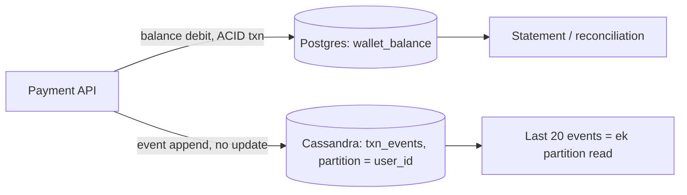
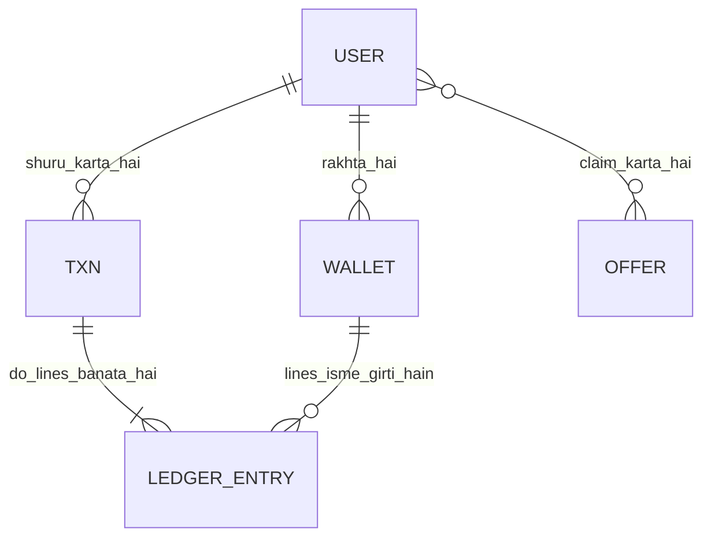
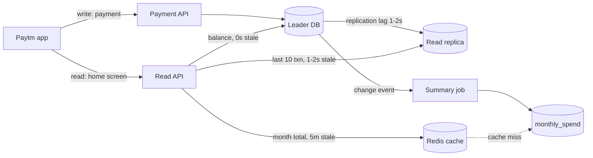
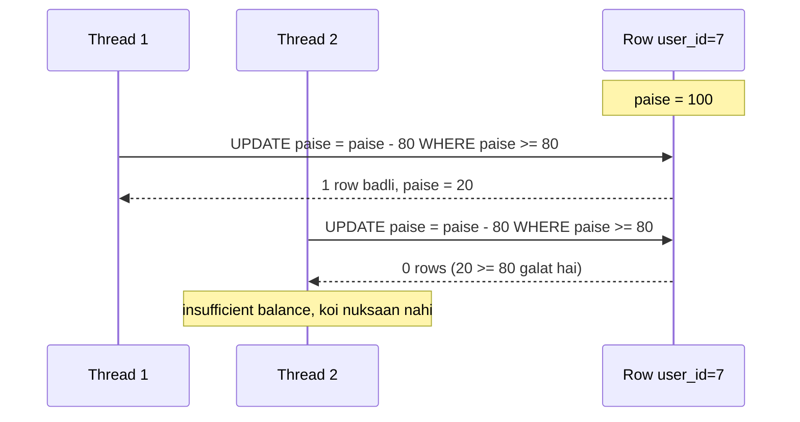
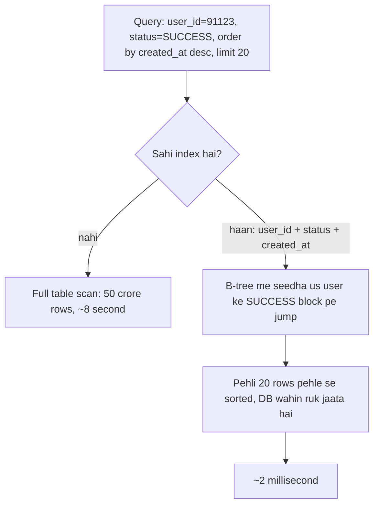
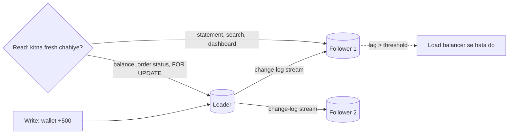

# 1C · DB Dungeon

Sep 30, 2026 · @saurav chaurasiya

**Is doc me 6 lessons:** L1.10 SQL vs NoSQL · L1.10a Data modeling aur schema design · L1.10b Read path vs write path · L1.11 ACID aur isolation levels · L1.12 Indexing · L1.13 Replication

**Padhne ka tareeka — zaroori:** har lesson do hisso me hai. Core (\~20 min) woh hai jo pakka aana chahiye; neeche Deep Dive SDE-2 ke liye hai, pehli baar me chhod sakte ho. Roz ka target: 2 lessons ka Core, ya 1 lesson Core + Deep Dive. Dono ek din me mat karo.

---

## L1.10 — SQL vs NoSQL: Postgres/MySQL vs Cassandra vs MongoDB vs DynamoDB

SQL database wo hai jisme data pehle se tay kiye gaye tables aur columns me rehta hai, aur tum ek saath kai rows pe ek transaction chala sakte ho. NoSQL ek chhatri shabd hai un databases ke liye jo fixed schema chhod dete hain aur badle me horizontal scaling (machine add karke capacity badhana) aur ek particular query pattern pe bahut speed dete hain. Ye lesson dono ke beech chunne ke baare me hai, kisi ek ko "behtar" kehne ke baare me nahi.

**Core · \~20 min** — SDE-1: must-know · SDE-2: must-know

### Ye cheez hai kya

- Database do bade family me baantte hain: **SQL / relational** (Postgres, MySQL) aur **NoSQL** (Cassandra, MongoDB, DynamoDB).
- Relational me data fixed columns wali tables me rehta hai, aur tables `JOIN` (do tables ko ek common column pe jod ke ek result banana) se jude rehte hain.
- "NoSQL" ek cheez ka naam nahi — chaar alag shapes hain: key-value (Redis, DynamoDB), wide-column (Cassandra), document (MongoDB), graph (Neo4j).
- Is lesson ke baad tum interview me bol paoge "main ye DB is wajah se choose karunga", sirf "Cassandra fast hai" nahi.

> **Analogy:** relational DB = sarkari daftar ka register — har page pe wahi columns (naam, date, amount), ek column chhoda toh clerk roke ga, par poora register ek hi almari me. NoSQL = tiffin service ka register — har customer ka parcha alag shape ka ho sakta hai, aur register 20 branches me baant diya hai taaki ek branch ki line choti rahe.

### Sawaal

Ek payment app hai, do tables chahiye:

1. `wallet_balance` — user ka paisa. Roz 50 lakh updates, aur galat balance ek rupee bhi allowed nahi.
2. `txn_events` — har payment ka log (kab, kis device se, kitna). Roz 40 crore rows likhni hain, kabhi update nahi hoti, aur read sirf "is user ke last 20 events".

Dono ek hi Postgres me daal doge, ya alag-alag DB me?

> **Pehle khud socho — 5 min.** Hints: (1) kaunsi table me galat answer ka cost paisa hai, aur kaunsi me sirf ek missing log line? (2) 40 crore rows/din ek machine ki disk me aayenge? (3) `txn_events` pe read pattern kya hai — aur woh pattern pehle se pata hai ya badalta rahega?

### Problem kyun aata hai

1. **Relational DB ek machine pe sabse aacha kaam karta hai.** Transaction aur JOIN isliye chalte hain ki saara data ek jagah dikhta hai. Data ko 20 machines pe baantne ke baad (**sharding** — ek badi table ko tukdo me kaat ke alag machines pe rakhna) cross-machine JOIN aur cross-machine transaction dono mehenge ho jaate hain.
2. **NoSQL ka speed muft nahi hai.** Cassandra/DynamoDB tez isliye hain ki unhone kuch chhoda hai — multi-row transaction, flexible query, aur kabhi strong consistency bhi.
3. **Log-type data aur money-type data ka shape hi alag hai.** Ek me correctness > volume, doosre me volume > correctness.

### Naive approach

Neeche wala code sab kuch ek hi Postgres me rakh deta hai:

```sql
-- ek hi DB, ek hi machine, dono tables
CREATE TABLE wallet_balance (user_id BIGINT PRIMARY KEY, paise BIGINT);
CREATE TABLE txn_events (id BIGSERIAL PRIMARY KEY, user_id BIGINT, kind TEXT, at TIMESTAMPTZ);
```

Kahan tootta hai:

1. `txn_events` me roz \~40 crore rows — kuch hafte me table terabytes me, aur ek machine ki disk khatam.
2. Us ek table ka insert load wahi machine ke `wallet_balance` updates ko slow kar deta hai — **throughput** (ek second me kitna kaam nikla) aur **latency** (ek request ka jawab aane me laga time) dono kharab.
3. Purana log `DELETE` se hatana padta hai, jo table pe bhari kaam hai aur DB ko aur dheema karta hai.
4. Backup aur restore ghanto me chala jaata hai, kyunki DB ka 99% data log ka hai jiski koi zaroorat backup me nahi thi.

### Sahi design

1. **Pehle query pattern likho, phir DB chuno.** Har table pe do sawaal: "kaunsi keys se padhna hai?" aur "galat data ka cost kya hai?"
2. `wallet_balance` → **Postgres/MySQL.** Data chhota hai (gigabytes), par usme ACID transaction chahiye. (**ACID** — atomicity: poora ya bilkul nahi · consistency: rules tootenge nahi · isolation: do transactions ek doosre ka aadha kaam nahi dekhenge · durability: commit hua toh bijli jaane pe bhi rahega.)
3. `txn_events` → **Cassandra ya DynamoDB.** Partition key `user_id`, sort key `at DESC`. (**partition** — data ka ek tukda jo ek machine-group ke zimme hai; key se decide hota hai kaunsa tukda.)
4. Dono ka rishta application code me jodo, DB ke JOIN me nahi — wallet se `user_id` lo, us key se events padho.
5. Naya DB add karne ka rule: **jab tak ek Postgres kaam chala raha hai, mat baanto.** Har naya DB ek naya operational bojh hai (monitoring, backup, on-call).



Ye faisle is design me hain:

1. Paisa ek hi relational DB me — kyunki ek galat balance ka cost ek missing log line se hazaar guna zyada hai.
2. Event store me `UPDATE` nahi, sirf append — isliye conflict ka sawaal hi paida nahi hota.
3. Partition key `user_id` chuni, `txn_id` nahi — kyunki read pattern "ek user ke events" hai; `txn_id` chunne se ek user ke events 20 machines pe bikhar jaate.
4. Purana data **TTL** (time to live — row apne aap expire ho jaati hai) se jaata hai, `DELETE` query se nahi.

### Notebook

SQL = fixed schema + JOIN + ACID, ek machine pe best · NoSQL = query pattern pehle, schema baad me, machines pe baanta hua · paisa → relational, high-volume append-only log → wide-column/key-value · NoSQL ka sawaal "fast chahiye?" nahi hai, "kaunsi keys se padhunga + galti ka cost kya hai?" hai · partition key read pattern se aati hai, warna ek query 20 machines ko chhuegi · naya DB = naya on-call bojh, default relational hi rakho.

### Padhne ke liye

- **[Wikipedia — NoSQL](https://en.wikipedia.org/wiki/NoSQL)** — agar sirf ek padhna hai toh yahi: chaaron NoSQL shapes aur unke trade-offs ek jagah, bina vendor marketing ke.
- [AWS — Choosing between relational (SQL) and NoSQL](https://docs.aws.amazon.com/amazondynamodb/latest/developerguide/SQLtoNoSQL.WhyDynamoDB.html) — side-by-side: wahi kaam SQL me aur DynamoDB me kaisa dikhta hai.
- [Wikipedia — Relational model](https://en.wikipedia.org/wiki/Relational_model) — relational DB ki neev (tables, keys, relations); isse "schema" shabd ka matlab pakka ho jaata hai.
- [Cassandra docs — Data modeling intro](https://cassandra.apache.org/doc/4.0/cassandra/data_modeling/intro.html) — "query pehle, table baad me" waali soch official docs me.

### Kya choose karein aur kyun

| Option | Kab use karo | Kab mat karo |
| --- | --- | --- |
| Postgres / MySQL | paisa, orders, koi bhi cheez jisme multi-row transaction ya badalte query patterns hain | single-machine disk/write limit cross ho rahi ho |
| Cassandra | bahut zyada append-only writes, ek fixed read pattern, multi-datacenter | ad-hoc query chahiye, ya multi-row transaction chahiye |
| DynamoDB | wahi case, par server manage nahi karna | **hot key** (ek hi partition key pe itna traffic ki us partition ki limit chhoo jaaye) wala pattern |
| MongoDB | document shape natural ho (ek order + uske items ek hi document me), fast prototyping | reporting-heavy kaam jisme har taraf JOIN chahiye |

### Interview follow-ups

1. *"NoSQL ACID nahi deta?"* — aaj deta hai, par scope chhota: DynamoDB single-partition transactions, Mongo multi-document transactions. Scale pe woh feature use karne se speed ka faida hi chala jaata hai.
2. *"Eventual consistency ka matlab?"* — (**eventual consistency** — likhne ke thodi der tak koi replica purana data de sakta hai, par time ke saath sab barabar ho jaate hain.) Wallet balance me ye nahi chalega; "last 20 events" me 2 second purana chalega.
3. *"Ek hi DB me dono kar sakte ho?"* — haan, jab tak volume chhota hai. Split ka trigger ek number hona chahiye (disk %, write latency ka **p99** = 100 requests me 99th sabse dheemi request ka time), "future-proofing" nahi.
4. *"Cassandra me JOIN kaise?"* — nahi karte. Data do baar likha jaata hai (denormalization): ek shape read-A ke liye, ek read-B ke liye.
5. *"Interviewer ne poocha 'kaunsa better hai'?"* — jaal hai. Jawab: "workload ke hisaab se", aur do concrete numbers maango (rows/din, read pattern).

### India me kaise hota hai

UPI ka volume hi is split ka sabse saaf example hai — NPCI ke public stats me monthly transaction count arabo me jaata hai ([NPCI UPI product statistics](https://www.npci.org.in/product/upi/product-statistics)). Us scale pe koi payment company ledger aur event-log ek hi DB me nahi rakhti: paisa relational DB me strict transactions ke saath, aur event/audit stream ek append-only store me jahan se reconciliation aur fraud pipelines padhti hain. Paytm/PhonePe type systems me tumhe teeno milenge — relational ledger, key-value cache, aur ek bada append-only store.

### Self-check

(1) `wallet_balance` ke liye relational kyun — ek line me? (2) Partition key kis cheez se decide hoti hai? (3) Hot key kya hai?

### Deep Dive (SDE-2) — jab time ho

#### Do aur naive approaches

- *"MongoDB le lo, schema-less hai, baad me sochenge."* — schema gayab nahi hota, woh application code me chhup jaata hai. 6 mahine baad ek hi collection me 4 alag shapes ke documents milte hain aur koi migration script nahi hai.
- *"Postgres ko hi shard kar denge."* — ho sakta hai (Citus, Vitess), par tab cross-shard transaction aur cross-shard JOIN tumhare sar. Ye 1D · Shard Mountains (abhi banna baaki) ka poora topic hai.

---

## L1.10a — Data modeling aur schema design

Data modeling ka matlab hai: tumhare system ki asli cheezein (user, wallet, transaction, refund) kaunse tables banengi, kis table me kaunse columns honge, kaun kis se juda hoga, aur kaun sa column kaun se query ko sasta banayega. L1.10 me tum SQL ya NoSQL chun rahe the; ye lesson us chune hue store ke andar ka naksha banata hai. Interview framework ka step 4 yahi hai.

### Ye cheez hai kya

- Kis category ki cheez hai — design skill. Kuch install nahi hota, bas tables aur unke rishte kaagaz pe bante hain.
- Kis problem ke liye banayi gayi — ek hi sach (jaise user ka balance) system me kitni jagah likha hai, use control karne ke liye. Jitni jagah likha hai, utni jagah galat ho sakta hai.
- Is lesson ke baad tum kya kar paoge — wallet, transaction aur ledger ka schema whiteboard pe likh paoge, bata paoge kahan normalize karna hai aur kahan jaan-boojh ke copy rakhni hai, aur kab ek table ko todna chahiye.

Teen shabd pehle saaf kar lete hain:

- Normalize karna — ek fact ko sirf ek jagah store karna. User ka naam sirf `user` table me, baaki jagah `user_id`.
- Denormalize karna — jaan-boojh ke ek fact ki copy doosri jagah rakhna, taaki padhne me join na lagana pade. Faayda speed, nuksaan ye ki copy purani ho sakti hai.
- Ledger — paison ka register jisme entries sirf add hoti hain, badalti ya delete nahi hoti. Bank ki passbook ki tarah: galti sudharni ho toh nayi ulti entry daalte hain, purani line nahi mitate.

### Sawaal

Paytm Wallet ka schema design karo. Requirements:

- User ke paas wallet hai, aur balance paise-level accuracy me chahiye.
- User merchant ko pay karta hai; paisa ek wallet se nikal ke doosre me jata hai.
- Har payment ka poora itihaas 7 saal rakhna hai, audit ke liye, aur kabhi badalna nahi hai.
- App ki home screen pe pichhle 20 transactions dikhane hain, 50 ms me.
- Mahine ke end me finance team poochhti hai: 30 September raat 12 baje kisi user ka balance kya tha?

> Pehle khud socho — 5 min. Hints: (1) balance ek column hai ya calculation? (2) ek payment me kitni rows banni chahiye? (3) 7 saal ka itihaas aur home screen ke 20 rows — dono ek hi table se aayenge?

### Problem kyun aata hai

- Paisa alag hai. Ek user ke naam ka spelling galat ho jaye toh support theek kar dega; ek balance galat ho jaye toh company ka nuksaan hai aur regulator poochhega.
- Ek hi sach do jagah rakhne se wo kabhi na kabhi alag ho jayega — crash, retry ya partial failure ke baad. Isko data drift kehte hain.
- Schema badalna mahenga hai. Ek crore rows wale table me column add karna ya type badalna downtime maang sakta hai, isliye pehla naksha bahut maayne rakhta hai.
- Ek table do bilkul alag kaam karti hai: latest 20 rows dikhana (chhota, fast) aur 7 saal ka audit rakhna (bada, slow). Ek hi design dono ko khush nahi kar sakta.
- Access pattern pehle socho, warna tum ek sundar schema bana loge jisme tumhari sabse common query 6 joins maangti hai.

### Naive approach

Pehla obvious solution — ek hi `transactions` table, aur usi me balance ka column:

```sql
-- GALAT: ek table me sab kuch, aur balance bhi yahin
CREATE TABLE transactions (
  id            BIGINT PRIMARY KEY,
  payer_name    VARCHAR(100),      -- naam copy, user table me bhi hai
  payer_phone   VARCHAR(15),       -- yahi phone 40 jagah copy hoga
  payee_name    VARCHAR(100),
  amount        FLOAT,             -- paisa FLOAT me, rounding galat hogi
  payer_balance FLOAT,             -- mutable balance history ke saath mix
  meta          TEXT               -- sab kuch yahin, query karna namumkin
);
```

Ye exactly kahan tootta hai:

- `FLOAT` me 0.1 plus 0.2 exactly 0.3 nahi hota. Lakhon transactions ke baad total mismatch ho jata hai. Paisa integer paise me ya `DECIMAL` me store hota hai, `FLOAT` me kabhi nahi.
- `payer_name` aur `payer_phone` har row me copy hain. User phone badlega toh purani rows jhooth bolengi, aur tum 5 crore rows update nahi kar sakte.
- `payer_balance` ek mutable field hai ek immutable history table me. Concurrent payments pe ye lost update deta hai — wahi problem jo [L1.11 — ACID aur transactions](https://claude.ai/code/artifact/99909fe9-731e-4e31-9e7d-36e0c5aed845) me dekhi thi.
- `meta TEXT` me sab kuch daal diya, toh kal jab poochha jaye ki UPI wale kitne the, tum index hi nahi laga sakte.
- Ek hi table 7 saal ka data aur home screen dono serve kar rahi hai, isliye home screen ke query ka p99 (sabse slow 1 percent requests ka time) data badhne ke saath kharab hota jayega.

### Sahi design

1. Entities alag karo: `user` (kaun hai), `wallet` (kitna paisa hai), `txn` (kya hone ki koshish hui), `ledger_entry` (asal me kya move hua). Chaar cheezein, chaar tables — har ek ka apna lifecycle hai.
2. Paisa integer paise me rakho (`BIGINT`), ya `DECIMAL(18,2)`. Currency ka column alag rakho, kyunki amount bina currency ke adhoora hai.
3. `txn` business event hai, aur usi pe idempotency key ka unique index lagao — duplicate request DB level pe ruk jaye. Detail [L2.1 — Idempotency keys](https://claude.ai/code/artifact/c269ac61-440b-4525-bd04-31baf708dece) me.
4. `ledger_entry` append-only banao: double-entry, matlab ek txn ke do lines — ek wallet se debit (DR), doosre me credit (CR), dono ka amount same. Kisi bhi samay ka balance in lines ka sum hai, isliye finance ka “30 September ko balance kya tha” sawaal ban jata hai ek `WHERE created_at <= ...` query.
5. `wallet.balance_paise` ko ek cached snapshot maano, sach nahi. Sach ledger hai; ye column speed ke liye hai, aur isko usi DB transaction me update karo jisme ledger lines likhi — warna dono alag ho jayenge. `version` column optimistic locking ke liye rakho.
6. Read path ke liye index banao, na ki poora alag table: `(wallet_id, created_at DESC)` pe composite index home screen ke 20 rows ko ek index seek bana deta hai (kaise, ye [L1.12 — Indexes](https://claude.ai/code/artifact/99909fe9-731e-4e31-9e7d-36e0c5aed845) me hai).
7. Variable, schema-less cheezein (gateway ka raw response, device info) ek `JSONB` column me daalo — par sirf woh jinpe tum query nahi karoge. Jis din query karni ho, usko asli column bana lo.

Wallet table — ek row per user per currency, aur balance paise me:

```sql
CREATE TABLE wallet (
  wallet_id     BIGINT      PRIMARY KEY,
  user_id       BIGINT      NOT NULL,
  currency      CHAR(3)     NOT NULL,            -- INR, USD
  balance_paise BIGINT      NOT NULL DEFAULT 0,  -- paise me, rupees me nahi
  version       BIGINT      NOT NULL DEFAULT 0,  -- optimistic locking ke liye
  updated_at    TIMESTAMP   NOT NULL,
  UNIQUE (user_id, currency)
);
```

`txn` table — ek payment attempt ka record, aur idempotency key pe unique index:

```sql
CREATE TABLE txn (
  txn_id          BIGINT      PRIMARY KEY,
  idempotency_key VARCHAR(64) NOT NULL,
  payer_wallet_id BIGINT      NOT NULL REFERENCES wallet(wallet_id),
  payee_wallet_id BIGINT      NOT NULL REFERENCES wallet(wallet_id),
  amount_paise    BIGINT      NOT NULL,
  status          VARCHAR(16) NOT NULL,   -- INITIATED, SUCCESS, FAILED, REVERSED
  created_at      TIMESTAMP   NOT NULL,
  UNIQUE (idempotency_key)
);
```

`ledger_entry` — append-only, ek txn ki do lines, aur home screen wala composite index:

```sql
CREATE TABLE ledger_entry (
  entry_id     BIGINT    PRIMARY KEY,
  txn_id       BIGINT    NOT NULL REFERENCES txn(txn_id),
  wallet_id    BIGINT    NOT NULL REFERENCES wallet(wallet_id),
  direction    CHAR(2)   NOT NULL,   -- DR ya CR
  amount_paise BIGINT    NOT NULL CHECK (amount_paise > 0),
  created_at   TIMESTAMP NOT NULL
);

-- home screen: ek wallet ke latest 20 rows
CREATE INDEX idx_ledger_wallet_time
  ON ledger_entry (wallet_id, created_at DESC);
```

Kisi bhi tareekh ka balance ledger se nikalta hai — DR minus CR:

```sql
SELECT SUM(CASE WHEN direction = 'CR' THEN amount_paise
                ELSE -amount_paise END) AS balance_paise
FROM ledger_entry
WHERE wallet_id = 42
  AND created_at <= '2026-09-30 23:59:59';
```

Poora naksha ek nazar me:



Aakhri line pe dhyaan do — user aur offer ka rishta many-to-many hai (ek user kai offers le sakta hai, ek offer kai users ko milta hai), aur many-to-many SQL me seedha nahi likha jata. Uske liye ek beech ka table lagta hai:

```sql
-- join table: rishta khud ek row hai, aur uske apne fields bhi hain
CREATE TABLE user_offer (
  user_id    BIGINT    NOT NULL,
  offer_id   BIGINT    NOT NULL,
  claimed_at TIMESTAMP NOT NULL,
  PRIMARY KEY (user_id, offer_id)
);
```

### Kya choose karein aur kyun

| Option | Kab use karo | Kab mat karo |
| --- | --- | --- |
| Fully normalized, ek fact ek jagah | Paisa, wallet, ledger — jahan sahi hona speed se zyada zaroori hai | Jab ek common screen ke liye 5 se 6 joins lag rahe hain |
| Selective denormalization, do fields ki copy | Read path pe `payee_name` jaisa field copy karna jo kabhi-kabhi badalta hai | Jab wo field roz badalta hai — purani copy user ko jhooth dikhayegi |
| Ek `JSONB` column | Gateway ka raw response, device info — jinka shape har provider pe alag hai | Jab tumhe us field pe filter, sort ya index chahiye |
| Alag read-model table | Jab reporting query OLTP ko dheema kar rahi hai aur thoda purana data chalega | Jab user ko turant apna naya transaction dikhna chahiye |

Amount ka type bhi ek faisla hai:

| Type | Kab use karo | Kab mat karo |
| --- | --- | --- |
| `BIGINT` paise me | Default choice — exact, fast, sab languages me safe | Jab tumhe 2 se zyada decimal places chahiye, jaise FX rates |
| `DECIMAL(18,8)` | FX rates, interest, per-unit pricing | Normal wallet balance ke liye — overkill hai |
| `FLOAT` ya `DOUBLE` | Paison ke liye kabhi nahi | Hamesha — rounding error exact match tod deta hai |

### India me kaise hota hai

UPI (Unified Payments Interface — NPCI ka real-time payment network) pe mahine ke arabon transactions chalte hain, aur har transaction ka record regulatory retention ke liye saalon rakha jata hai ([NPCI UPI product overview](https://www.npci.org.in/what-we-do/upi/product-overview)). Is scale pe koi bhi wallet apne balance ko “sirf ek mutable column” nahi maanta — balance ke peeche append-only ledger hota hai, kyunki dispute aane pe regulator ko line-by-line itihaas dikhana padta hai.

Double-entry ka ye pattern naya nahi hai; software me iska classic likha hua roop Martin Fowler ke accounting patterns me milta hai, jahan account, entry aur posting rule alag cheezein hain ([Patterns for Accounting](https://www.martinfowler.com/eaaDev/AccountingNarrative.html)). Paytm, PhonePe ya kisi bank ka CBS (Core Banking System — bank ka asli ledger) — sabke andar yahi dhaancha hai, naam alag ho sakte hain.

### Interview follow-ups

- **Balance column rakhoge ya har baar ledger se calculate karoge?** — Dono. Sach ledger hai, aur `wallet.balance_paise` ek cached snapshot hai jo usi DB transaction me update hota hai. Ek background job roz dono ko match karta hai, aur mismatch pe alert karta hai.
- **Ek payment me kitni ledger rows banni chahiye?** — Kam se kam do, jo exactly cancel out karein. Fee bhi hai toh teen (payer DR, payee CR, fee account CR). Har txn ke lines ka sum zero hona chahiye — yahi invariant tumhara sabse achha reconciliation test hai.
- **7 saal ka data ek hi table me rakhoge?** — Nahi. Date pe partition karo (mahine ya saal ke hisaab se) aur purane partitions ko sasta storage pe bhejo. Home screen latest partition se padhta hai.
- **Status column ya status history table?** — Dono chahiye. `txn.status` current state ke liye, aur ek `txn_status_history` table kab kaun state me gaya ye batane ke liye — support ke sawaalon ka 80 percent jawab wahi hai.
- **Schema badalna pada ek crore rows wale table me, kaise karoge?** — Nullable column add karo, naya code dono shapes padhe, backfill batches me chalao, phir default aur NOT NULL add karo. Ek hi step me `ALTER TABLE` kabhi nahi.

### Self-check

1. Paisa `FLOAT` me kyun nahi store karte — ek line me.
2. `wallet.balance_paise` ko sach kyun nahi maanna chahiye, aur sach kaun hai.
3. Many-to-many rishte ke liye kaunsa extra table banta hai, aur uski primary key kya hoti hai.
4. Home screen ke latest 20 transactions ke liye kaunsa composite index banta hai.
5. Ek payment ke ledger lines ka sum kitna hona chahiye, aur ye invariant kaam kya aata hai.

### Notebook

Chaar tables: user, wallet, txn, ledger\_entry · paisa BIGINT paise me, FLOAT kabhi nahi · ledger append-only, ek txn ke do lines, sum zero · balance column = cached snapshot, sach ledger; dono ek hi DB transaction me · access pattern pehle, index baad me — `(wallet_id, created_at DESC)` home screen ke liye · many-to-many = join table, PK dono ids · JSONB sirf un fields ke liye jinpe query nahi karni.

### Padhne ke liye

- [Patterns for Accounting — Martin Fowler](https://www.martinfowler.com/eaaDev/AccountingNarrative.html) — account, entry aur double-entry ka software roop
- [PostgreSQL — Numeric types](https://www.postgresql.org/docs/current/datatype-numeric.html) — kyun `numeric` exact hai aur `float` nahi
- [PostgreSQL — Constraints](https://www.postgresql.org/docs/current/ddl-constraints.html) — unique, check aur foreign key constraints
- [NPCI — UPI product overview](https://www.npci.org.in/what-we-do/upi/product-overview) — UPI ka scale aur basic flow

### Deep Dive (SDE-2) — jab time ho

#### Normalization ke forms, sirf jitna kaam ka hai

- 1NF — ek cell me ek hi value. Comma-separated list ek column me 1NF todta hai.
- 2NF — non-key column poore primary key pe depend kare, uske hisse pe nahi. Composite key wale tables me ye issue aata hai.
- 3NF — non-key column kisi doosre non-key column pe depend na kare. Agar `pincode` se `city` nikal aata hai toh `city` yahan nahi, alag table me.
- Practice me OLTP (Online Transaction Processing — roz ke chhote read-write) schemas 3NF tak jaate hain aur ruk jaate hain.
- Reporting ke liye log jaan-boojh ke star schema banate hain, jo denormalized hota hai — kyunki wahan likhna kam aur padhna zyada hai.

#### One-to-many vs many-to-many

- One-to-many: child table me parent ka foreign key column. Wallet ke ledger entries isi tarah jude hain.
- Many-to-many: beech me join table, primary key dono ids ka pair. `user_offer` wahi hai.
- Join table me apne fields daalne se wo khud ek entity ban jati hai (`claimed_at`, `status`) — yahi sabse common jagah hai jahan log galti se ek cheez ko sirf rishta maan lete hain.
- Index dono directions ke liye chahiye: `(user_id, offer_id)` primary key se mil jata hai, par `(offer_id, user_id)` pe alag index banana padta hai jab tum ek offer ke saare users poochhte ho.
- One-to-one lagne wale rishte 90 percent cases me ek hi table hone chahiye, jab tak unka lifecycle ya access frequency bahut alag na ho.

#### Table kab todte hain

- Jab ek hi table ke kuch columns har read me chahiye aur kuch kabhi-kabhi — bade `TEXT` ya `JSONB` columns ko alag table me nikalna row ko chhota aur cache-friendly banata hai.
- Jab do column-groups ka write rate bahut alag ho — roz badalta `balance` aur kabhi na badalta `kyc_document_number` ek saath nahi rehne chahiye.
- Jab retention alag ho — 90 din ka OTP log aur 7 saal ka ledger ek table me nahi.
- Jab ek group ko alag access control chahiye — PII (Personally Identifiable Information — jisse insaan pehchana jaye) ko alag table me rakhna audit aur encryption dono aasaan karta hai.
- Jo cheez table todne ki wajah nahi hai: “table bahut badi ho gayi”. Uska jawab partitioning aur sharding hai, jo `1D · Shard Mountains` me aata hai.

#### Read path ka naksha alag hota hai

- Ek hi schema se do bilkul alag queries aati hain: user ki home screen (ek wallet, latest 20) aur finance ki report (saare wallets, poora mahina).
- Pehli query index se chalti hai; doosri query poora table scan karti hai aur OLTP ko dheema kar deti hai.
- Isliye reporting ko read replica pe ya ek alag read-model table pe bhejte hain. Yahi soch aage CQRS tak jati hai — `L1.10b — Read path vs write path` aur `L2.8 — CQRS` (dono abhi banna baaki hain).
- Rule of thumb: pehle apni top 5 queries likho, phir schema banao. Ulta karoge toh sundar schema milega aur dheemi app.

---

## L1.10b — Read path vs write path

Har system me data ke do raaste hote hain: **write path** — jab koi nayi cheez record hoti hai (paisa kata, order bana), aur **read path** — jab koi sawaal poochha jaata hai (balance kitna hai, last 10 transactions kya the). Dono ki zarooratein ulti hoti hain, isliye dono ko alag-alag design kiya jaata hai.

### Ye cheez hai kya

- Ye koi tool ya database nahi hai — ye ek soch ka tareeka hai: pehle poochho "kaun sa sawaal poochha jaayega", phir table, index aur cache decide karo.
- Kis problem ke liye: ek hi table se sab kuch karwane ki koshish me write bhi dheema hota hai aur read bhi. Dono raaste alag karke dono tez kiye jaate hain.
- Is lesson ke baad tum kisi bhi feature ke read queries aur write queries alag likh paoge, aur bata paoge ki index, replica, cache aur summary table exactly kis raste pe baithte hain aur unka kya nuksaan hai.

Teen shabd jo baar-baar aayenge:

- **Access pattern** — application asal me data kaise maangti hai: kaun se field se dhoondhti hai, kitni rows chahiye, kis order me.
- **Throughput** (ek second me kitne operations handle ho rahe hain) read aur write ke liye alag-alag naapa jaata hai.
- **Staleness window** — koi copy (cache ya replica) zyada se zyada kitni der purani ho sakti hai.

### Sawaal

Paytm app ka home screen khulte hi teen cheezein dikhti hain: (1) wallet balance, (2) last 10 transactions, (3) "is mahine kitna kharch hua" ka total. Peak par 50,000 users per second home screen kholte hain, lekin asli payments sirf 5,000 per second hote hain.

Abhi teenon cheezein `ledger_entry` table se seedha `SELECT` karke aati hain — wahi table jisme har payment do rows likhta hai (L1.10a wala double-entry ledger, isi doc me upar).

> Pehle khud socho — 5 min. Hints: (1) In teen sawaalon me se kaun sa bilkul abhi ka sach maangta hai aur kaun sa 5 minute purana bhi chal jaayega? (2) Jo table write ke liye achhi hai (chhoti rows, kam index) woh read ke liye kyun bekaar hai? (3) "Is mahine ka total" har request par `SUM()` karne ki jagah kahan rakha ja sakta hai?

### Problem kyun aata hai

- Write path ko chahiye: kam index (har extra index har insert ko dheema karta hai), chhoti rows, ek hi jagah sach — taaki transaction jaldi commit ho.
- Read path ko chahiye: pehle se taiyaar jawab — sorted, joined, jodah hua — taaki ek hi lookup me cheez mil jaaye.
- Ye dono demand ek hi table ko ulti disha me kheenchti hain.
- Ratio aam taur par tedha hota hai: upar ke example me 50,000 read vs 5,000 write, yaani 10:1. Ek hi table dono jhel rahi hai toh 90% load us cheez ka hai jo kahin aur se mil sakta tha.
- Har read optimisation ek **copy** paida karti hai (index, cache, replica, summary table). Us copy ko asli data se milaate rehna write path ka naya kaam ban jaata hai — ByteByteGo ka article isi ko "read path ka fix write path ki problem ban jaata hai" kehta hai.

### Naive approach

- Pehla obvious solution: ek hi table rakho, aur jo screen slow ho uspe ek naya index chipka do.
- Home screen ke teen sawaal, teenon `ledger_entry` pe:

```sql
-- GALAT: ek hi write-optimized table se teenon read sawaal
-- 1) balance
SELECT SUM(amount_paise) FROM ledger_entry WHERE wallet_id = ?;

-- 2) last 10 transactions
SELECT * FROM ledger_entry WHERE wallet_id = ?
ORDER BY created_at DESC LIMIT 10;

-- 3) is mahine ka kharch
SELECT SUM(amount_paise) FROM ledger_entry
WHERE wallet_id = ? AND direction = 'DEBIT'
  AND created_at >= date_trunc('month', now());
```

Ye exactly kahan tootta hai:

- Query 1 har baar us user ka poora history scan karti hai. 3 saal purane user ke 40,000 rows — har home screen par, har baar.
- Query 3 wahi scan dobara karti hai. Ek hi screen ke liye do full scan.
- Teenon ko tez karne ke liye 3 index laga diye, toh ab har payment ko 1 row insert + 3 index update karne padte hain. Write latency badh gayi.
- 50,000 read/sec wahi leader database pe ja rahe hain jahan write bhi ja rahe hain. Leader ka CPU 100% hote hi payments fail hone lagte hain. Yaani **read ne write ko gira diya** — sabse bura failure, kyunki paisa ruk jaata hai.

### Sahi design

1. Har screen aur API ke liye uska access pattern ek line me likho: "kaun si key se, kitni rows, kis order me, kitna purana chalega". Ye L1.10a (Data modeling aur schema design, isi doc me upar) ka seedha agla kadam hai.
2. Har sawaal ko ek **freshness budget** do — kitna purana data chalega:
   - Balance → 0 second. Paisa dikh raha hai; galat nahi ho sakta. Leader se padho.
   - Last 10 transactions → 1-2 second purana chal jaata hai.
   - Mahine ka kharch → 5 minute purana bhi chal jaata hai.
3. Write path ko patla rakho: `ledger_entry` pe sirf wahi index jo likhne ke liye zaroori hai (primary key + `(wallet_id, created_at)`). Baaki sab read ke liye alag jagah banegi.
4. Read path ko layer-by-layer banao, sabse sasti layer pehle:
   - **Denormalized column** — `wallet.balance_paise` ko usi database transaction me update karo jo ledger row likhti hai. Ab balance ek row ka lookup hai, `SUM` nahi.
   - **Index** — `(wallet_id, created_at DESC)` composite index se last-10 bina scan ke milti hai (L1.12, isi doc me neeche).
   - **Read replica** (leader ki chalti-firti copy jo sirf padhne ke liye hai) — last-10 query yahan bhejo (L1.13, isi doc me neeche).
   - **Cache** (Redis jaisi in-memory store) — mahine ka total 5 min TTL (time to live — itni der baad entry khud mit jaati hai) ke saath ([L1.6 — Cache patterns](https://claude.ai/code/artifact/32bb1c8e-3433-417c-a3f4-3a34babed6bf)).
   - **Summary table / materialized view** (pehle se calculate karke rakhi hui table) — `monthly_spend(wallet_id, month, total_paise)`, jo ledger ke change events se bharti hai.
5. Har copy ke liye do line likho: **sync kaise hoti hai** aur **kitni purani ho sakti hai**. Interview me yahi poochha jaata hai; "cache laga denge" apne aap me jawab nahi hai.
6. Jab read model itna alag ho jaaye ki uska apna schema aur apna store chahiye, tab is pattern ka naam **CQRS** ho jaata hai (Command Query Responsibility Segregation — likhne ka model aur padhne ka model do alag cheezein). Woh poora L2.8 — CQRS (abhi banna baaki) me aayega.

Ek write, aur usse nikalte chaar read raste:



### Kya choose karein aur kyun

| Option | Kab use karo | Kab mat karo |
| --- | --- | --- |
| Index | Filter aur sort ek hi table pe hai, aur rows chhaanni hain | Write-heavy table pe 4-5 se zyada index — har index insert ko dheema karta hai |
| Denormalized column | Jawab har baar wahi aggregate ho aur usi transaction me update ho sake | Jab aggregate kai tables ya laakhon rows se banta ho — update bahut mehenga |
| Read replica | 1-2 second purana chalega aur leader se load hatana hai | Jo read turant apne hi write ke baad hota hai (read-your-writes) — wahan leader se padho |
| Cache | Ek hi key baar-baar padhi jaati hai aur stale chalega | Har user ka jawab alag aur ek hi baar padha jaata hai — hit rate kam, fayda zero |
| Summary table / materialized view | Aggregate mehenga hai aur minutes purana chalega | Jab jawab exact aur abhi ka chahiye — jaise balance |

### India me kaise hota hai

NPCI (National Payments Corporation of India — UPI chalane wali sanstha) ne 26 May 2025 ko ek circular nikala jo bilkul isi problem ka jawab hai. **Balance enquiry** ek pure read-path API hai, aur apps use baar-baar maar rahe the. Ab har app ke liye ek customer ko 24 ghante me zyada se zyada **50 balance enquiry** allowed hain, `List Account` 25 per customer per day, aur `List Keys` jaise API sirf non-peak hours me din me ek baar. Peak hours NPCI ne 10am-1pm aur 5pm-9:30pm define kiye hain, aur compliance ki deadline 31 August 2025 thi ([Medianama — NPCI circular, 26 May 2025](https://www.medianama.com/2025/05/223-npci-banks-balance-upi-transaction-guidelines/)).

Matlab seedha hai: read traffic itna badh gaya tha ki woh write path (asli payment) ko nuksaan pahuncha raha tha, isliye regulator ko read path par hi limit lagani padi. Isiliye Paytm aur PhonePe jaise apps home screen ka balance cached dikhate hain aur asli balance enquiry tabhi maarte hain jab user payment kar raha ho ya khud refresh kare.

### Interview follow-ups

- **"Cache laga denge" kaafi hai?** — Nahi. Batana padega ki cache me kya jaayega, key kya hogi, TTL kitna, invalidate kab hoga, aur miss hone par jawab kahan se aayega.
- **Read replica se kaun si query hatani nahi chahiye?** — Jo apne hi write ke turant baad padhi jaati hai. Payment ke baad balance screen replica se padhoge toh purana balance dikhega aur user ghabra jaayega.
- **Summary table kitni purani ho sakti hai?** — Jitna business bardasht kare. Kharch ka graph 5 min purana chalega; settlement report 1 second bhi purani nahi chalegi.
- **Write-heavy system me ye ulta kaise hota hai?** — Logs, metrics aur event ingestion me write 100x zyada hote hain. Wahan index kam se kam rakhte hain, batching karte hain, aur read ke liye alag hi analytics store banate hain.
- **Ye CQRS se alag kaise hai?** — Read path vs write path ek soch hai; CQRS uska sabse aakhri aur sabse mehenga roop — jab read ka apna alag model aur apna store ban jaaye.

### Self-check

1. Home screen ke teen sawaalon me se kis-kis ka freshness budget 0 second hai, aur kyun?
2. `ledger_entry` pe ek naya index lagane se write path par kya asar padta hai?
3. Staleness window ka matlab kya hai, aur read replica ka staleness window kis cheez se decide hota hai?
4. Cache kis case me faayda nahi deta, chaahe laga bhi do?

### Notebook

Write path = fact record karna, read path = sawaal ka jawab dena · Design ka step 0: har screen ka access pattern + freshness budget likho (0s / 1-2s / 5min) · Write ko patla rakho, kam index; read ke liye alag copy banao · Read ki seedhi: denormalized column → index → read replica → cache → summary table · Har copy par do sawaal: sync kaise, stale kitna · Read model ka apna store ban jaaye = CQRS · Read ka load write ko gira de — yahi sabse bura failure hai.

### Padhne ke liye

- [ByteByteGo — The read path versus the write path](https://blog.bytebytego.com/p/the-read-path-versus-the-write-path)
- [Microsoft Learn — CQRS pattern](https://learn.microsoft.com/en-us/azure/architecture/patterns/cqrs)
- [Microsoft Learn — Materialized View pattern](https://learn.microsoft.com/en-us/azure/architecture/patterns/materialized-view)
- [Medianama — NPCI ke naye UPI API limits (26 May 2025)](https://www.medianama.com/2025/05/223-npci-banks-balance-upi-transaction-guidelines/)

### Deep Dive (SDE-2) — jab time ho

#### Do consistency jinhe log aapas me mila dete hain

- **Transactional consistency** — ek transaction ke andar data kabhi aadha-adhoora nahi dikhta. Ye ACID (Atomicity, Consistency, Isolation, Durability — L1.11) wali baat hai.
- **Copy consistency** — koi copy (replica, cache, summary table) asli data se kitni der me milti hai.
- Bug yahin paida hota hai: log kehte hain "hamara DB ACID hai isliye data consistent hai", lekin unki read replica 3 second peeche chal rahi hoti hai. ACID us copy ke baare me kuch nahi kehta.
- Interview me ye farq saaf bolna SDE-2 ka signal hai.

#### Summary table ko sync karne ke teen tareeke

- **Usi transaction me update** — ledger likhte waqt hi `monthly_spend` bhi update. Sabse fresh, lekin write path dheema aur ek hi row par lock contention (kai transactions ka ek hi row ke liye atakna).
- **Periodic job** — raat ko poora recompute. Sasta aur simple, lekin din bhar purana data.
- **Change stream / events** — ledger ka har change Kafka par, aur consumer summary update kare. Fresh bhi aur write path se alag bhi, lekin ab **eventual consistency** (kuch der baad saari copies mil jaati hain, beech me alag dikh sakti hain) aur duplicate events dono handle karne padte hain ([Kafka River zone](https://claude.ai/code/artifact/eeb39ee8-3f52-4c04-b57b-68213f02c429)).

#### Write-heavy system me ulta khel

- Logs, metrics aur event ingestion me write read se 100x zyada hote hain.
- Wahan index kam se kam, batching zyada (ek-ek row ki jagah 1000 rows ek saath), aur LSM-tree wale store (Cassandra, RocksDB) jo har write ko sequential append bana dete hain.
- Read ke liye alag analytics store (ClickHouse, BigQuery jaisa) jisme data minutes purana hota hai aur koi bura nahi maanta.
- Sabak: "read path optimise karo" universal rule nahi hai. Pehle read:write ratio naapo, phir decide karo.

---

## L1.11 — ACID aur isolation levels (paise ka race condition)

ACID ek database transaction ki chaar guarantees ka naam hai: Atomicity (sab change ho ya kuch bhi nahi), Consistency (database ke rules kabhi toote nahi), Isolation (do transactions ek doosre ka aadha kaam na dekhein) aur Durability (commit ho gaya to crash me bhi bacha rahega). Isolation level wo setting hai jo decide karti hai ki "aadha kaam" kitna dikh sakta hai, aur wallet jaise system me yahi ek setting paisa bachati ya gawaati hai.

**Core · \~20 min** — SDE-1: must-know · SDE-2: must-know

### Ye cheez hai kya

- **Transaction** — kai database operations ka ek group jo mil ke ek unit ki tarah chalta hai: ya poora hota hai, ya kuch bhi nahi.
- **ACID** woh chaar guarantee hain jo relational DB transaction ke saath deta hai: Atomicity, Consistency, Isolation, Durability.
- **Isolation level** ek DB setting hai jo batati hai "do transactions ek saath chal rahe hain toh ek doosre ka aadha kaam kitna dikhega". Ye on/off switch nahi — chaar standard levels hain.
- Is lesson ke baad tum ek race condition ka naam le paoge (lost update / dirty read / phantom read) aur bata paoge use kaunsa fix rokta hai.

> **Analogy:** bank ki ek hi passbook do clerk ke haath me. Atomicity = ek entry aadhi likhi nahi rahegi. Isolation = jab clerk A likh raha hai, clerk B ko kitna dikhna chahiye — kuch nahi, ya aadhi likhi line bhi? Isolation level yahi rule hai. Durability = likhne ke baad passbook almari me band; bijli jaaye toh bhi entry rahegi.

### Sawaal

Wallet me ₹100 hai. User ne ek hi second me do ₹80 ke payment mar diye (double tap, ya do device). Do server threads, dono ye chala rahe hain:

```sql
-- dono threads yahi do line chalate hain
SELECT paise FROM wallet WHERE user_id = 7;            -- dono ko 100 mila
UPDATE wallet SET paise = 20 WHERE user_id = 7;        -- 100 - 80, dono ne likha
```

Final balance kya hoga, aur company ka kitna nuksaan?

> **Pehle khud socho — 5 min.** Hints: (1) dono ne `SELECT` kab kiya — ek doosre ke `UPDATE` se pehle ya baad? (2) `20` ki value kahan se aayi — DB se ya application ki memory se? (3) Agar `SET paise = paise - 80` likha hota toh kya badal jaata?

### Problem kyun aata hai

1. **Read aur write ke beech gap hai.** `SELECT` ke baad, `UPDATE` se pehle, DB kisi aur ko bhi wahi row dikha deta hai. Is bug ko **lost update** kehte hain — ek transaction ka update doosre ke upar likh jaata hai aur pehla gum ho jaata hai.
2. **Default isolation level ise nahi rokta.** Postgres ka default Read Committed hai, MySQL/InnoDB ka Repeatable Read. Dono dirty read rokte hain, lost update nahi.
3. **Application me `if` lagane se kuch nahi hota.** `if (balance >= 80)` application ki memory me chala; DB ko is check ka pata hi nahi hai, aur DB hi asli judge hai.

### Naive approach

Is code me check application me hai aur decision purani value pe hai:

```java
// GALAT: balance memory me aaya, phir uspe faisla hua
long balance = db.queryLong("SELECT paise FROM wallet WHERE user_id = ?", 7);
if (balance >= 80) {                       // ye check DB ko dikhta hi nahi
    db.update("UPDATE wallet SET paise = ? WHERE user_id = ?", balance - 80, 7);
}
```

Kahan tootta hai:

1. Dono threads ko `balance = 100` mila → dono ka `if` paas hua → dono ne `paise = 20` likha. ₹160 nikla, DB me sirf ₹80 ki kami. ₹80 company ka nuksaan.
2. Ise `BEGIN ... COMMIT` me lapetne se bhi nahi rukta — transaction atomicity deta hai, race se bachav nahi.
3. Retry lagane se cheez bigadti hai: wahi purani `balance` value dobara use hoti hai.

### Sahi design

Teen tareeke, sabse sasta pehle:

1. **Update ko DB ke andar atomic banao** — value application me mat compute karo, condition `WHERE` me daalo:

```sql
UPDATE wallet SET paise = paise - 80
 WHERE user_id = 7 AND paise >= 80;   -- 0 rows affected = paisa kam tha
```

Row-count check karo: `0` mile toh "insufficient balance" return karo. 2. **Row lock lo** jab ek hi transaction me kai rows ek saath badalni hain (debit + ledger entry):

```sql
BEGIN;
SELECT paise FROM wallet WHERE user_id = 7 FOR UPDATE;  -- row pe taala
UPDATE wallet SET paise = paise - 80 WHERE user_id = 7;
INSERT INTO ledger (user_id, amount) VALUES (7, -80);
COMMIT;                                                  -- taala yahan khulta hai
```

3. **Optimistic version** — taala mat lagao, version match karao:

```sql
UPDATE wallet SET paise = paise - 80, ver = ver + 1
 WHERE user_id = 7 AND ver = 41;      -- 0 rows = beech me koi likh gaya, retry karo
```



Ye faisle is design me hain:

1. Naya balance DB ke andar compute hua (`paise - 80`), application ki purani copy se nahi — isse lost update ka rasta hi band ho gaya.
2. Business rule (`paise >= 80`) `WHERE` me gaya, `if` me nahi — DB hi single judge hai.
3. Success/failure row-count se pata chala, exception se nahi — `0 rows` ek normal business answer hai, error nahi.
4. Isolation level ko chhua hi nahi — sabse sasta fix pehle, kyunki level badalna poore app ko affect karta hai.
5. `FOR UPDATE` sirf tab jab ek transaction me kai rows ka coordinated change ho, kyunki lock lene se **throughput** (per second kitne transactions nikle) girta hai.

### Notebook

ACID = Atomicity (poora ya kuch nahi) · Consistency (rules bane rahenge) · Isolation (aadha kaam nahi dikhega) · Durability (commit = pakka) · lost update = do transactions ne same row purani value se update ki, ek gum · default levels lost update nahi rokte (Postgres = Read Committed, MySQL = Repeatable Read) · fix ka order: atomic `UPDATE ... WHERE` → `SELECT FOR UPDATE` → version column → isolation level badalna (aakhri) · `if` application me = race, condition `WHERE` me = safe · row-count `0` hi "insufficient balance" ka jawab hai.

### Padhne ke liye

- **[PostgreSQL docs — 13.2 Transaction Isolation](https://www.postgresql.org/docs/current/transaction-iso.html)** — ek hi padhna hai toh yahi: chaaron levels, aur har level pe kaunsi anomaly bachti hai, chhote examples ke saath.
- [Wikipedia — ACID](https://en.wikipedia.org/wiki/ACID) — chaar akshar ka seedha matlab ek page me; interview me definition yahin se bolni hai.
- [Wikipedia — Isolation (database systems)](<https://en.wikipedia.org/wiki/Isolation_(database_systems)>) — dirty read / non-repeatable read / phantom read ka table; ratne ke liye sabse aasaan.
- [MySQL 8.0 — InnoDB Transaction Isolation Levels](https://dev.mysql.com/doc/refman/8.0/en/innodb-transaction-isolation-levels.html) — MySQL ka default Postgres se alag hai; agar kaam MySQL pe hai toh ye zaroor.

### Kya choose karein aur kyun

| Option | Kab use karo | Kab mat karo |
| --- | --- | --- |
| Atomic `UPDATE … WHERE cond` | single-row counter ya balance change | ek transaction me kai rows consistent chahiye |
| `SELECT … FOR UPDATE` | debit + ledger insert saath me, transaction chhota ho | lock ke andar network call ya lambi computation (lock hold time = doosron ka wait) |
| Version column (optimistic) | conflict kam ho, retry sasta ho | ek hi row pe bhaari contention — retry storm ban jaata hai |
| `SERIALIZABLE` | correctness ka proof chahiye, load kam ho | high-**TPS** (transactions per second — ek second me kitne transactions) hot rows |

### Interview follow-ups

1. *"Read Committed me kaunsi anomalies bachti hain?"* — non-repeatable read, phantom read, aur lost update (jab tak atomic UPDATE ya lock na ho).
2. *"MVCC kya hai?"* — (**MVCC**, multi-version concurrency control — readers row ka purana version padhte hain, isliye writers unko rokte nahi.) Yahi wajah hai ki Postgres me `SELECT` write se block nahi hota.
3. *"Deadlock kab hota hai?"* — do transactions ne do rows ulte order me lock kar li. Fix: poore codebase me rows ko ek fixed order me lock karo (jaise `user_id` ascending).
4. *"ACID ka C aur CAP ka C same hai?"* — nahi. ACID ka C = DB ke constraints tootenge nahi. CAP ka C = saare nodes ek hi latest value dikhayenge.
5. *"Idempotency isse kaise judi hai?"* — (**idempotent** — wahi request dobara chalane pe result nahi badalta.) Double-tap ka asli fix client ki bheji request-id + DB me unique constraint hai; lock uske baad ka layer hai. Poora topic: 2A · Idempotency Island (abhi banna baaki).

### India me kaise hota hai

UPI me ek payment ke peeche teen jagah state badalti hai — payer ka bank, NPCI ka switch, aur app ka apna wallet/ledger ([Wikipedia — Unified Payments Interface](https://en.wikipedia.org/wiki/Unified_Payments_Interface)). Isliye Paytm/PhonePe type systems me debit kabhi "read-then-write" style me nahi likha jaata: debit ek conditional atomic statement hota hai, uske saath ek ledger row insert hoti hai usi transaction me, aur bahar ki duniya ke liye ek request-id unique index pe tiki hoti hai. Jo bug is lesson me dekha, woh production me "double debit" ticket ban ke aata hai.

### Self-check

(1) Lost update ek line me? (2) Fix ka order kya hai, sasta se mehenga? (3) ACID ke C aur CAP ke C me farq?

### Deep Dive (SDE-2) — jab time ho

#### Do aur naive approaches

- *"`SERIALIZABLE` set kar do, sab problem khatam."* — correctness aa jaati hai, par Postgres me serialization-failure retry loops aur MySQL me lock contention; ek hot row pe throughput gir jaata hai.
- *"Java me `synchronized` laga do."* — sirf ek JVM ke andar kaam karta hai. Do pods chal rahe hain toh do alag lock, aur race waapas.

---

## L1.12 — Indexing (B-tree, composite, covering, LSM)

Index ek alag data structure hai (aksar B+ tree) jo ek ya kai columns ki values ko sorted order me rakhta hai aur har value ke saath us row ka pata jod deta hai. Isse database poora table padhe bina seedha sahi rows tak pahunch jaata hai. Index se padhna tez hota hai aur likhna thoda mehenga, isliye asli sawaal hamesha ye hota hai ki kaunsa index banaya jaaye aur uske columns kis order me rakhe jaayein.

**Core · \~20 min** — SDE-1: must-know · SDE-2: must-know

### Ye cheez hai kya

- **Index** ek alag data structure hai jo DB saath me bana ke rakhta hai, taaki "is column ki value X wali rows kahan hain" ka jawab poori table padhe bina mil jaaye.
- Index na ho toh DB **full table scan** karta hai — pehli row se aakhri tak sab padhta hai.
- Default index **B-tree** hota hai (balanced tree — har lookup me lagbhag utne hi steps, aur values sorted order me rakhi jaati hain, isliye range query aur `ORDER BY` bhi isse chalte hain).
- Is lesson ke baad tum ek slow query dekh ke bata paoge kaunsa index chahiye, aur kyun 10 index laga dena bhi galti hai.

> **Analogy:** mobile ki contacts list. Naam se dhoondhna instant hai, kyunki list naam ke order me sorted hai — tum seedha "S" pe jump karte ho. Par "jiska number 98 se shuru hota hai" dhoondhna ho toh poori list scroll karni padegi. Index = ek column ki sorted list. Number se dhoondhna hai toh number ki apni sorted list banani padegi — aur naya contact add hone pe **dono** list update karni padegi. Wahi index ka cost hai.

### Sawaal

`txn` table me 50 crore rows. Ye query 8 second le rahi hai:

```sql
SELECT * FROM txn
 WHERE user_id = 91123 AND status = 'SUCCESS'
 ORDER BY created_at DESC LIMIT 20;
```

Table pe sirf `PRIMARY KEY (txn_id)` hai. Kaunsa index banaoge, aur usme columns ka order kya hoga?

> **Pehle khud socho — 5 min.** Hints: (1) kaunse columns pe exact match hai aur kis pe sorting? (2) `ORDER BY` ka kaam bhi index kar sakta hai ya nahi? (3) agar `user_id` ka index alag aur `status` ka alag bana do toh DB dono ko ek saath kaise use karega?

### Problem kyun aata hai

1. **Index na ho toh har row padhni padti hai.** 50 crore rows disk se; time rows ke saath seedha badhta jaata hai.
2. **Galat column-order wala composite index bekaar ho jaata hai.** (**composite index** — ek se zyada columns wala ek hi index.) Woh sirf **leftmost prefix** se kaam karta hai: `(status, user_id)` index pe akela `WHERE user_id = ...` use nahi hoga.
3. **`ORDER BY ... LIMIT 20` bina sahi index ke mehenga hai** — DB ko saari matching rows nikaal ke sort karni padti hai, chahiye sirf 20 hi ho.
4. **Har index write ko mehenga karta hai** — ek `INSERT` ko table plus har index update karna padta hai.

### Naive approach

Neeche teen alag single-column index banaye gaye hain:

```sql
-- GALAT: teen alag index, sochte hue ki DB teeno jod lega
CREATE INDEX i1 ON txn (user_id);
CREATE INDEX i2 ON txn (status);
CREATE INDEX i3 ON txn (created_at);
```

Kahan tootta hai:

1. DB aksar ek hi index chunega (`i1`), usse us user ki \~5000 rows nikalega, phir un sab pe `status` filter aur sorting khud karega.
2. `i2` lagbhag useless hai — `SUCCESS` 95% rows me hai. Jis column ki value har jagah same ho (**low cardinality** — distinct values bahut kam), uspe akela index DB use hi nahi karta.
3. Teen index = har insert pe teen extra write. Write throughput gir gaya, read thoda bhi tez nahi hua.
4. `i3` globally sorted hai, par tumhe **ek user ke andar** sorted chahiye — do alag cheezein hain.

### Sahi design

**Step 1 — ek composite index, isi order me:**

```sql
CREATE INDEX idx_txn_user_status_time
  ON txn (user_id, status, created_at DESC);
```

**Step 2 — order ka rule yaad rakho:** pehle equality columns, phir range/sort column. Yahan `user_id` (=) → `status` (=) → `created_at` (sort).

**Step 3 — sabooot maango, andaza nahi:**

```sql
-- plan me "Index Scan using idx_txn_user_status_time" dikhna chahiye
EXPLAIN ANALYZE SELECT * FROM txn
 WHERE user_id = 91123 AND status = 'SUCCESS'
 ORDER BY created_at DESC LIMIT 20;
```

**Step 4 — agar query ke saare columns index me hi aa jaayein, woh covering index hai** (**covering index** — DB jawab index se hi de deta hai, table ko chhuta bhi nahi):

```sql
CREATE INDEX idx_cover ON txn (user_id, status, created_at DESC) INCLUDE (amount);
```

**Step 5 — index ki ginti kam rakho.** Pehle query patterns ki list banao, phir sabse chhota index set chuno jo unko cover kare.



Ye faisle is design me hain:

1. `user_id` pehla rakha — wahi 50 crore ko \~5000 pe le aata hai, matlab sabse **selective** column (jo sabse zyada rows kaat deta hai).
2. `created_at DESC` index me hi sorted hai — isliye `ORDER BY` muft ho gaya aur `LIMIT 20` pe DB ruk jaata hai.
3. `status` ko akela index nahi diya — low cardinality pe akela bekaar hai, par composite ke doosre position pe kaam ka hai.
4. Teen single-column index hata diye — write cost bacha, aur planner ka confusion bhi.
5. `EXPLAIN ANALYZE` ko design ka hissa banaya, baad ki debugging nahi — index banane ke baad plan dekhna compulsory step hai.

### Notebook

Index = ek column-set ki sorted side-structure; default B-tree, jo equality + range + sort teeno deta hai · composite index sirf leftmost prefix se kaam karta hai · column order = pehle equality, phir range/sort · low cardinality column (status, flag) pe akela index bekaar · covering index = query ke saare columns index me, table touch nahi · har extra index = har insert pe extra write · `EXPLAIN ANALYZE` hi sabooot hai · B-tree read-optimized (Postgres/MySQL), LSM write-optimized (Cassandra/RocksDB).

### Padhne ke liye

- **[PostgreSQL docs — Chapter 11: Indexes](https://www.postgresql.org/docs/current/indexes.html)** — ek hi padhna hai toh yahi: multicolumn index, index-only scan aur `EXPLAIN` sab chhote practical examples ke saath.
- [PostgreSQL docs — 11.2 Index Types](https://www.postgresql.org/docs/current/indexes-types.html) — B-tree ke alawa hash, GiST, GIN kab kaam aate hain; ek page me.
- [PostgreSQL docs — 65.1 B-Tree Indexes](https://www.postgresql.org/docs/current/btree.html) — B-tree kaunse operators support karta hai; "`LIKE '%x'` index use nahi karega" ka jawab yahin hai.
- [Wikipedia — Log-structured merge-tree](https://en.wikipedia.org/wiki/Log-structured_merge-tree) — LSM tree B-tree se ulta trade-off kaise leta hai (write fast, read pe compaction ka bojh).

### Kya choose karein aur kyun

| Option | Kab use karo | Kab mat karo |
| --- | --- | --- |
| B-tree (default) | equality + range + `ORDER BY`, kisi bhi read-heavy table pe | pure append table jispe koi read pattern hi nahi |
| Composite index | query me 2-3 columns hamesha saath aate hain | columns ka combination har query me badalta ho |
| Covering index (`INCLUDE`) | ek bahut frequent query jise table touch kiye bina jawab dena hai | index ka size table ke barabar hone lage |
| Hash index | sirf `=` lookup, koi range nahi | range ya sorting chahiye |
| LSM store (Cassandra, RocksDB) | write volume bahut zyada, read pattern fixed | ad-hoc reads, ya read ka **p99** (100 requests me 99th sabse dheemi ka time) tight ho — compaction spikes aate hain |

### Interview follow-ups

1. *"`(a, b)` index pe `WHERE b = 5` chalega?"* — seedha nahi; leftmost prefix `a` chahiye. Postgres kabhi poora index scan kar sakta hai, par woh full scan jitna hi mehenga hai.
2. *"`LIKE` pe index kab lagta hai?"* — `'abc%'` (prefix) pe lagta hai, `'%abc'` pe nahi. Suffix/substring search ke liye trigram ya inverted index chahiye.
3. *"Ek index write ko kitna slow karta hai?"* — roughly ek extra tree update per index per insert, plus page splits. 5+ index wali hot table pe insert latency dikhne lagti hai.
4. *"LSM aur B-tree me asli farq?"* — B-tree jagah pe likhta hai (random writes, read sasta). LSM pehle memory me likhta hai, phir sorted files (SSTable) me sequential flush karta hai; read ko kai files dekhni pad sakti hain, isliye background **compaction** (files ko merge kar ke ginti kam karna) chalti rehti hai. Trade-off = write amplification vs read amplification.
5. *"Index add karne se production down ho sakta hai?"* — haan. Postgres me plain `CREATE INDEX` table ko write-lock karta hai; live system pe `CREATE INDEX CONCURRENTLY` chahiye.

### India me kaise hota hai

Payments me sabse common slow query "ek user ke last N transactions" hi hoti hai, aur uska fix hamesha wahi shape rakhta hai — pehle user/account key, phir time descending. NoSQL me yahi baat index ke bajaye primary key me build hoti hai: DynamoDB me partition key + sort key exactly isi pattern ke liye banaye gaye hain, aur unki best-practices guide pehla hi sawaal "access patterns kya hain" poochti hai ([AWS — Best practices for DynamoDB](https://docs.aws.amazon.com/amazondynamodb/latest/developerguide/best-practices.html)). Paytm/PhonePe scale pe is query ka index galat hone ka matlab ek statement screen ka timeout hai, isliye ye review me pehli cheez dekhi jaati hai.

### Self-check

(1) Composite index me column order ka rule? (2) Low cardinality column pe akela index kyun bekaar? (3) Covering index kya bachaata hai?

### Deep Dive (SDE-2) — jab time ho

#### Do aur naive approaches

- *"Har `WHERE` column pe index bana do."* — 12 index wali table pe insert 5-6 guna mehenga ho jaata hai, planner confuse hota hai, aur index bloat + vacuum/maintenance ka apna cost aa jaata hai.
- *"`SELECT *` rehne do, index se sab aa jaayega."* — nahi. Index me sirf uske columns hote hain; baaki columns ke liye DB ko table pe jaana padta hai (heap fetch), aur covering index ka faida khatam.

---

## L1.13 — Replication (leader-follower, sync/async, lag)

Replication ka matlab hai ek hi data ki kai copies kai machines pe rakhna: ek leader (jahan saare writes jaate hain) aur ek ya kai replica (jo leader se changes copy karte rehte hain). Isse read ka load baant jaata hai aur ek machine marne pe data bach jaata hai. Badle me ek nayi problem aati hai: replica leader se thoda peeche hota hai (replication lag), aur us lag ke andar user ko purana data dikh sakta hai.

**Core · \~20 min** — SDE-1: must-know · SDE-2: must-know

### Ye cheez hai kya

- **Replication** = ek hi data ki kai copies kai machines pe rakhna, taaki ek machine mar jaaye toh data aur service dono bache.
- Sabse common shape **leader-follower** hai: saare writes ek machine (leader) pe jaate hain, aur woh apna change-log doosri machines ko bhejta rehta hai. (**replica** — leader ke data ki copy rakhne wali machine; follower usi ka doosra naam hai.)
- Replication sharding nahi hai. Replication = **wahi data** kai jagah (availability + read scale). Sharding = **alag-alag data** alag jagah (size + write scale).
- Is lesson ke baad tum "read replica laga do" bolne se aage jaake bata paoge ki uska side-effect kya hai aur kaunsa read uspe bhej hi nahi sakte.

> **Analogy:** ration dukan ka register. Asli register manager ke paas hai (leader), aur do helper apne register me manager ki entries copy karte rehte hain (followers). Manager chhutti pe chala jaaye toh dukan band nahi hoti — ek helper manager ban jaata hai (failover). Par helper ka register kabhi 5 entry peeche hota hai (lag) — toh jis aadmi ne abhi entry karayi aur turant helper se poocha, usko "aapka naam nahi hai" mil jaayega.

### Sawaal

Postgres pe load badh gaya. Team ne ek read replica laga diya aur rule banaya: *"saare `SELECT` replica pe, `INSERT/UPDATE/DELETE` leader pe."* Deploy ke baad support tickets aane lage:

- User ne wallet me ₹500 add kiye, success screen bhi aaya, par balance page purana balance dikha raha hai.
- Refund initiate hua, user ne turant refund status page khola — "transaction not found".

Kya hua, aur fix kya hai?

> **Pehle khud socho — 5 min.** Hints: (1) write leader pe gaya — uske turant baad ka read kahan gaya? (2) leader se follower tak data pahunchne me kitna time lagta hai? (3) kaunse reads 2 second purane chal sakte hain, aur kaunse bilkul nahi?

### Problem kyun aata hai

1. **Replication lag.** (**replication lag** — leader pe commit hone aur wahi change follower pe dikhne ke beech ka time.) Normal halat me milliseconds, par bulk update, migration ya network hiccup pe seconds se minutes.
2. **Read-your-own-write toot jaata hai.** User ne khud jo likha woh apne hi agle read me nahi dikha — ye sabse zyada dikhne wala bug hai, aur sabse zyada ticket isi ke aate hain.
3. **Async replication me data loss possible hai.** Leader ne commit kiya, client ko OK bhej diya, aur follower tak pahunchne se pehle leader mar gaya — woh commit gaya.

### Naive approach

Routing ka poora rule bas itna hi tha:

```java
// GALAT: routing sirf query ke keyword se
String target = sql.trim().toUpperCase().startsWith("SELECT")
        ? "replica"       // sab SELECT yahan
        : "leader";       // baaki sab yahan
```

Kahan tootta hai:

1. Write ke turant baad ka `SELECT` replica pe gaya — purana balance mila, ya row hi nahi mili.
2. `SELECT ... FOR UPDATE` bhi "SELECT" se shuru hota hai, par woh replica pe chal hi nahi sakta — follower read-only hai, query error degi.
3. Lag pe koi alarm nahi tha, toh 40-second lag ke dauran bhi traffic replica pe jaata raha.
4. Failover ke waqt kisi ko pata nahi tha kitna data peeche chhoot gaya — kyunki lag kabhi measure hi nahi hua.

### Sahi design

**Step 1 — reads ko freshness se baanto, query type se nahi:**

- *Must-be-fresh (leader pe):* balance, abhi bane order ka status, `FOR UPDATE`, koi bhi read jiska result aage likhne ke faisle me use hoga.
- *Stale-ok (replica pe):* statement history, search, dashboards, analytics, reports.

**Step 2 — read-your-own-write ke liye ek explicit rule banao:** write ke baad us user/session ke reads N second tak leader pe bhejo (session me ek timestamp rakh ke). Zyada pakka tareeka: leader ka commit position lo, aur replica se kaho "is position tak pahunchne ka wait karo, phir jawab do".

**Step 3 — lag ko measure karo aur uspe automatic action rakho:**

```sql
-- Postgres: follower kitna peeche hai
SELECT now() - pg_last_xact_replay_timestamp() AS lag;
```

Threshold cross ho toh us replica ko load balancer ki rotation se nikaal do — alert bhejna kaafi nahi.

**Step 4 — paise wale data pe synchronous ya quorum replication chuno.** (**quorum** — likhne ko N replicas me se majority ka OK chahiye, sab ka nahi; isse ek slow replica poora system nahi rokta.)



Ye faisle is design me hain:

1. Routing ka aadhaar freshness banaya, SQL keyword nahi — kyunki "SELECT" se ye pata hi nahi chalta ki purana data chalega ya nahi.
2. Read-your-own-write ek likha hua rule bana, umeed nahi — lag ko kabhi zero maan ke code nahi likh sakte.
3. Lag ek monitored metric hai jiske saath automatic action juda hai (replica ko rotation se nikaalna), sirf dashboard pe ek graph nahi.
4. Paise ke writes pe synchronous/quorum chuna — thodi latency dekar durability kharidi, kyunki yahan loss ka cost latency se bada hai.
5. Replica ko "scaling ka jawab" nahi maana — replica se **write** load kam nahi hota, sirf read ka bojh baantta hai; write scale karne ke liye sharding chahiye.

### Notebook

Replication = wahi data kai machines pe (availability + read scale); sharding = alag data alag machines pe (size + write scale) · leader-follower: writes leader pe, change-log followers ko · replication lag = commit se follower pe dikhne tak ka time · read routing ka aadhaar freshness requirement hai, SQL keyword nahi · read-your-own-write = write ke baad N second tak us user ke reads leader pe · async = fast par failover pe data loss; sync/quorum = safe par latency · lag pe alarm + replica ko rotation se nikaalne ka automation · replica se write load kam nahi hota.

### Padhne ke liye

- **[Wikipedia — Replication (computing)](<https://en.wikipedia.org/wiki/Replication_(computing)>)** — ek hi padhna hai toh yahi: replication ke saare shapes (leader-based, multi-leader, leaderless) aur unki wajah, bilkul vendor-neutral.
- [PostgreSQL docs — Chapter 26: High Availability, Load Balancing, and Replication](https://www.postgresql.org/docs/current/high-availability.html) — asli system me replication kaise set hota hai, aur failover ka matlab practically kya hai.
- [PostgreSQL docs — 26.1 Comparison of Different Solutions](https://www.postgresql.org/docs/current/different-replication-solutions.html) — ek hi table me har replication approach ka trade-off; interview me bolne layak.
- [Wikipedia — Multi-master replication](https://en.wikipedia.org/wiki/Multi-master_replication) — do leader rakhne pe write-conflict ka sawaal kyun paida hota hai.

### Kya choose karein aur kyun

| Option | Kab use karo | Kab mat karo |
| --- | --- | --- |
| Async leader-follower | read scale chahiye, thoda stale chalega, cross-region replica | read-your-own-write guarantee chahiye bina koi extra routing ke |
| Synchronous (1 sync replica) | paisa/ledger, jahan commit ke baad loss allowed nahi | latency budget tight ho, ya replica network me door ho |
| Quorum (N me majority) | distributed store (Cassandra, etcd) jahan ek slow node system na roke | sirf 2 nodes ho — tab majority ka matlab hi nahi banta |
| Multi-leader / multi-master | offline-first apps, multi-region writes jahan conflict rare aur mergeable ho | paisa, counters, ya koi cheez jahan conflict chup-chaap galat ho jaaye |

### Interview follow-ups

1. *"Failover me exactly kya hota hai?"* — leader ko dead declare karna, sabse aage wala follower chunna, usko promote karna, baaki followers ko uske peeche lagana, aur clients ko naya address batana. Sabse mushkil hissa pehla hai — **split brain** (do machines dono apne ko leader samajh lein) se bachna.
2. *"Async me kitna data ja sakta hai?"* — jitna lag tha. Isliye RPO (recovery point objective — kitna data loss acceptable hai) practically lag ke barabar hota hai.
3. *"Lag badhne ke common kaaran?"* — leader pe ek badi bulk write ya migration, follower pe ek lambi query jo replay ko block kar rahi hai, ya network saturation.
4. *"Follower add karne se SPOF khatam ho gaya?"* — (**SPOF**, single point of failure — ek aisi cheez jiske marne pe poora system mar jaaye.) DB ka SPOF kam hua, par failover manual hai toh SPOF insaan ban gaya.
5. *"Backpressure yahan kahan aata hai?"* — (**backpressure** — downstream slow ho toh upstream ko jaan-boojh ke dheema karna, taaki queue phoote na.) Lag threshold cross karne pe writes ko throttle karna hi is DB ka backpressure hai.

### India me kaise hota hai

UPI-scale pe replication do alag maqsad se lagta hai, aur dono ek hi system me hote hain. Paisa rakhne wale ledger DB pe ek synchronous replica hota hai — wahan sawal "read scale" nahi, "commit ke baad ek bhi transaction gum na ho" hai, aur is scale pe roz arabo transactions hote hain ([NPCI UPI product statistics](https://www.npci.org.in/product/upi/product-statistics)). Uske saath statement, search aur reporting ke liye async replicas hote hain, jahan 2-3 second purana data chalta hai. Paytm/PhonePe type apps me jo "balance abhi update nahi hua" wala complaint aata hai, woh aksar yahi bug hai — ek fresh read galti se stale-ok bucket me chala gaya tha.

### Self-check

(1) Replication aur sharding me farq, ek line me? (2) Read-your-own-write kaise fix karte ho? (3) Synchronous replication ka cost kya hai?

### Deep Dive (SDE-2) — jab time ho

#### Do aur naive approaches

- *"Do leader bana do, dono jagah write ho jaayega."* — multi-leader me write conflict ka sawaal aa jaata hai (dono ne same row badli), aur uska koi muft jawab nahi hai; default last-write-wins data chup-chaap kha jaata hai. Paise pe kabhi nahi.
- *"Synchronous replication sab followers pe laga do, safe rahega."* — ek follower slow ya down hua toh leader ke writes ruk jaate hain: tumne availability ko durability ke naam pe bech diya. Isliye quorum (N me se majority) beech ka raasta hai.

---

## Aage kya

- **Pichhla zone:** [1B · Cache Caves](https://claude.ai/code/artifact/32bb1c8e-3433-417c-a3f4-3a34babed6bf) — cache patterns aur invalidation. Wahan ka "stale read" wala dard bilkul wahi dard hai jo yahan L1.13 me replication lag deta hai; do jagah se aaya ek hi sawaal.
- **Agla zone:** [1D · Shard Mountains (L1.14–L1.16)](https://claude.ai/code/artifact/cfe905e6-6370-43e0-a337-764eeb9ddf1e) — ab ban gaya hai. Jab ek leader ke writes hi na sambhal paayein, tab sharding aata hai; L1.10 ka partition key wahan poora topic ban jaata hai.
- **Aage judne wale dhaage:** L1.11 ka lost update → 2D · Lock Fort (distributed locks) · L1.10 ka eventual consistency → 2A · Idempotency Island · L1.13 ka failover aur split brain → 2E · Resilience Ridge. Teeno abhi banne baaki hain.
