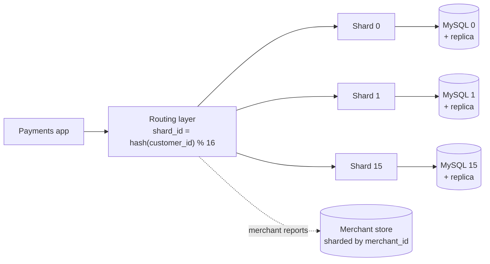
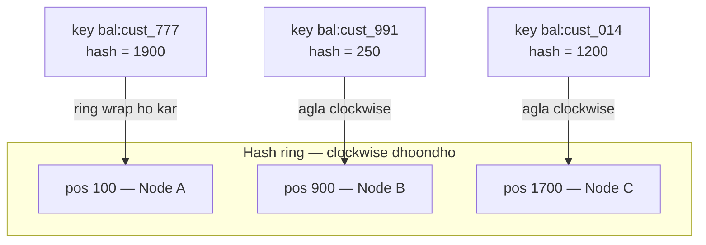
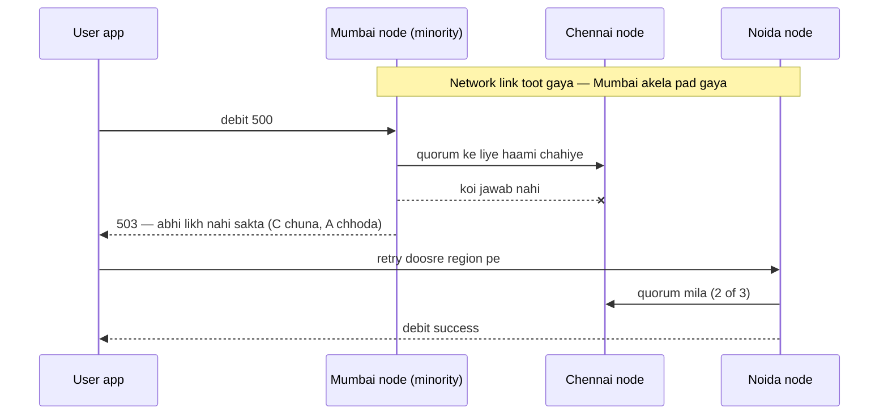
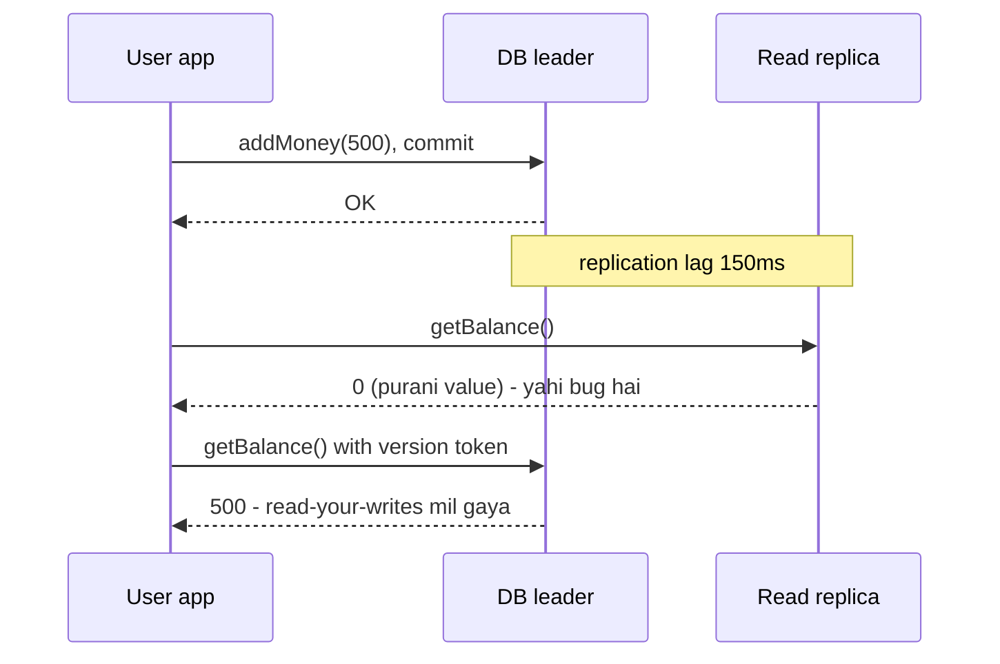
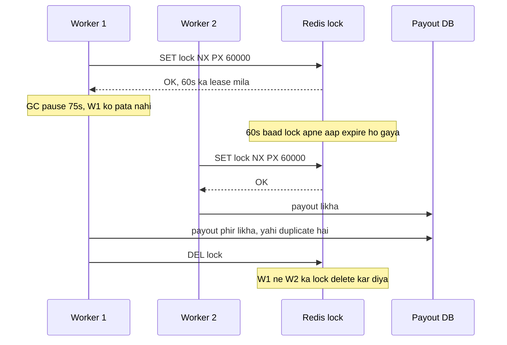
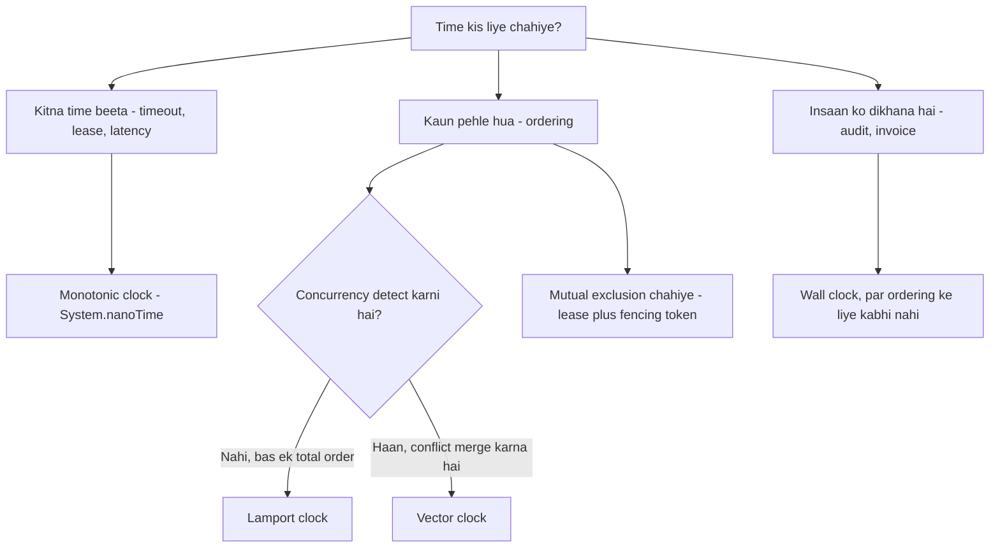

# 1D · Shard Mountains

Oct 1, 2026 · @saurav chaurasiya

Is doc me paanch lessons hain: L1.14 (sharding aur shard key), L1.15 (consistent hashing), L1.16 (CAP aur PACELC), L1.16a (consistency models), L1.16b (time, clocks aur ordering).

---

## L1.14 — Sharding / partitioning aur shard key

Sharding ka matlab hai ek badi table ko tukdon me baant dena aur har tukda ek alag database server pe rakhna. Ek tukde ko shard kehte hain (partition — ek hi table ka ek hissa, jo apne alag server pe rehta hai; dono shabd yahan same matlab me chalte hain). Jis column ko dekh kar decide hota hai ki koi row kaunse shard me jaayegi, use shard key kehte hain.

### Ye cheez hai kya

- Category: database scaling technique — horizontal scaling ka database wala roop
- Kis problem ke liye banayi gayi: jab ek single database server pe data aur write load itna badh jaaye ki badi machine lena (vertical scaling) bhi kaafi na ho
- Is lesson ke baad tum kya kar paoge: kisi payments use-case ke liye shard key choose kar paoge, aur bata paoge ki galat shard key se exactly kya tootega

### Sawaal

Paytm ka `transactions` table 8 billion rows tak pahunch gaya hai. Diwali sale pe peak 12,000 TPS (transactions per second — ek second me kitne requests) likhne pad rahe hain, aur ek single MySQL master ye jhel nahi paa raha. Tumhe table ko 16 shards me todna hai. Kaunsa column shard key banaoge, aur customer ka "mere last 10 transactions dikhao" query us choice pe kaise chalega?

> Pehle khud socho — 5 min. Hints: (1) sabse common read pattern kaunsa hai — customer apna history dekhta hai ya merchant apna? (2) agar shard key `merchant_id` rakh diya, to Diwali pe ek bahut bada merchant kya kar dega? (3) ek transaction me do parties hoti hain, payer aur payee — dono taraf se query aayegi, ek shard key dono ko khush kaise karegi?

### Problem kyun aata hai

- Ek machine ki disk, RAM aur CPU ki limit hoti hai — 8 billion rows ka index RAM me fit nahi hota, toh har query disk tak jaati hai aur latency (ek request ka jawab aane me laga time) badh jaati hai
- Read replica (master ki copy jo sirf padhne ke liye hoti hai) add karne se read load bant jaata hai, lekin write load bilkul kam nahi hota — writes phir bhi ek hi master pe hi jaate hain
- Throughput (ek second me kitna kaam nipat raha hai) ki ceiling aa jaati hai: ek master ka fsync aur redo log ek limit ke baad tez nahi hota
- `ALTER TABLE` aur backup itne bade table pe ghanton lagte hain, aur us dauraan system dheema rehta hai
- Wo ek machine gir gayi to poora payments flow baith gaya — ye SPOF (Single Point Of Failure — wo ek cheez jiske girne se poora system gir jaata hai) hai

### Naive approach

- Pehla obvious idea: `created_at` pe range sharding — Jan–Mar wala data shard 0 me, Apr–Jun shard 1 me, aur aage aise hi
- Padhne me accha lagta hai: purane mahine ke shard thande pade rehte hain, backup easy
- Ye exactly kahan tootta hai: aaj ke saare naye transactions sirf latest shard pe likhe jaayenge. Baaki 15 shards khaali baithe rahenge aur ek shard 100% write load le raha hoga — isi ko hot shard kehte hain (hot key — ek hi key ya shard pe disproportionately zyada traffic aa jaana). Tumne 16 machines ka paisa diya aur scaling ek ki hi mili
- Doosra naive idea: `auto_increment id % 16`. Load to barabar bant jaayega, par ek customer ke 200 transactions 16 shards me bikhar jaayenge — "last 10 transactions" ke liye har baar saare 16 shards se poochna padega (scatter-gather), jo p99 (wo latency jisse 99% requests tez hoti hain, yaani sabse dheemi 1% ko chhod kar sabse bura case) ko bahut kharab karta hai

### Sahi design

1. Access pattern pehle likho, shard key baad me choose karo. Paytm consumer app me sabse zyada chalne wali query hai "is customer ka recent history", toh shard key `customer_id` banti hai.
2. Shard key pe hash lagao, raw value pe nahi: `shard_id = hash(customer_id) % N`. Hash se ek naya customer kisi bhi shard pe pad sakta hai, isliye load barabar rehta hai aur koi shard hot nahi hota.
3. Ek routing layer rakho jo application aur databases ke beech baithe aur shard\_id nikaal kar sahi database pe query bheje. Application code me `if (shard == 3)` jaisi logic mat likho.
4. Ek customer ke saare transactions ek hi shard me rakho. Isko co-location kehte hain, aur isse "last 10" wali query ek hi shard pe single query ban jaati hi.
5. Merchant-side reads ke liye alag rasta do: merchant ko apna settlement report chahiye hota hai, customer-wise nahi. Uske liye ek doosra store rakho jo `merchant_id` se sharded ho, ya reporting ke liye analytics database (jaise BigQuery/Redshift type warehouse) me data bhejo.
6. N ko seedha 16 mat rakho. `N` badalne pe `% N` ka jawab badal jaata hai aur poora data hilana padta hai. Iska theek solution L1.15 me hai — consistent hashing.

Neeche ka diagram dikhata hai ki ek write request routing layer se ho kar apne shard tak kaise pahunchti hai.



### Kya choose karein aur kyun

| Option | Kab use karo | Kab mat karo |
| --- | --- | --- |
| Range sharding (`created_at`, `id` range) | Jab queries hamesha ek range pe hoti hain, jaise "last month ka data", aur purana data archive karna ho | Jab writes hamesha latest range me aate hain — latest shard hot ho jaayega |
| Hash sharding (`hash(customer_id) % N`) | Jab load barabar bantna sabse zaroori ho aur queries ek hi key pe hoti hain | Jab range scan chahiye ("1 Jan se 31 Jan tak sab") — hash se order tut jaata hai |
| Directory / lookup table (key se shard ka mapping ek table me) | Jab tumhe kisi khaas bade customer ko apne dedicated shard pe daalna ho, ya rebalancing pe poora control chahiye | Jab traffic bahut high ho — ye lookup table khud ek naya SPOF aur extra hop ban jaata hai |
| Geo / entity sharding (region ya tenant ke hisaab se) | Jab data residency rule ho (India ka data India me), ya B2B me har client ka data alag rakhna ho | Jab tenants ka size bahut asamaan ho — ek bada tenant apne shard ko akela hi bhar dega |

### India me kaise hota hai

UPI ke scale pe ye theory nahi, rozmarra ki majboori hai. NPCI (National Payments Corporation of India — wo sanstha jo UPI, IMPS, RuPay chalati hai) ke apne numbers ke hisaab se UPI mahine me arbon transactions process karta hai, aur har PSP (Payment Service Provider — Paytm, PhonePe, GPay jaise app jo user ko UPI se jodte hain) ko apna switch aur ledger shard karna padta hai. Paytm aur PhonePe jaise apps me aam pattern ye hai: consumer-facing transaction history `customer_id`/VPA se shard hoti hai, merchant settlement ka data alag `merchant_id`-sharded store me, aur dono ke beech reconciliation asynchronously chalti hai. Vitess (MySQL ke upar ka sharding layer, jo YouTube me bana tha) is tarah ke setup ka common choice hai.

- [NPCI — UPI product overview](https://www.npci.org.in/what-we-do/upi/product-overview)
- [PlanetScale — when to shard MySQL and Postgres](https://planetscale.com/blog/how-to-scale-your-database-and-when-to-shard-mysql)

### Interview follow-ups

- **Shard key kaise choose karte ho?** — Sabse zyada chalne wali query dekho. Jis column pe wo query filter karti hai, wahi shard key banna chahiye, taaki query ek hi shard pe nipat jaaye.
- **Ek customer bahut bada ho gaya (ek hi shard bhar diya) to?** — Us ek key ko directory-based mapping se apne dedicated shard pe bhejo, ya composite shard key use karo jaise `hash(customer_id, month)`.
- **Cross-shard join kaise karoge?** — Database me nahi. Ya to application me do queries maar kar jodo, ya ek denormalized read-model banao jisme dono taraf ka data pehle se mila hua ho.
- **Cross-shard transaction?** — Single ACID transaction nahi milega. Saga pattern lagta hai (2C · Saga Sea me aayega), jisme har step ka apna compensating transaction hota hai (compensating transaction — wo ulta step jo pehle wale step ka asar mita de, jaise debit ke badle refund).
- **Kitne shards se shuru karein?** — Zaroorat se zyada logical shards banao (jaise 1024) aur unhe kam physical machines pe rakho. Load badhne pe logical shard ko nayi machine pe move kar dena rebalancing se sasta padta hai.

### Self-check

1. Shard key aur primary key me kya farak hai?
2. `created_at` pe range sharding karne se kaunsa shard hot ho jaata hai, aur kyun?
3. Hash sharding kis kism ki query ko mehenga bana deta hai?
4. Ek customer ke saare transactions ek hi shard me rakhne ka fayda ek line me batao.

### Notebook

Sharding = ek badi table ko alag-alag servers pe tukdon me baantna · Shard key = wo column jo decide karta hai row kis shard me jaayegi, aur ye sabse common query dekh kar choose hota hai · Range sharding se latest shard hot ho jaata hai, hash sharding load barabar baant deta hai par range scan mehenga kar deta hai · Ek entity ka saara data ek shard me (co-location) rakho, warna har read 16 shards se poochna padega aur p99 gir jaata hai · `% N` ki dikkat: N badalne pe poora data hilta hai — iska jawab consistent hashing hai · Cross-shard transaction nahi milta, Saga se kaam chalta hai.

### Padhne ke liye

- [PlanetScale — Guide to scaling your database: when to shard MySQL and Postgres](https://planetscale.com/blog/how-to-scale-your-database-and-when-to-shard-mysql)
- [Vitess documentation](https://vitess.io/docs/)
- [NPCI — UPI product overview](https://www.npci.org.in/what-we-do/upi/product-overview)

### Deep Dive (SDE-2) — jab time ho

#### Resharding bina downtime

- Do-phase approach: pehle naye shards pe purana data copy karo (backfill), phir change data capture se live changes replicate karo jab tak lag lagbhag zero ho jaaye
- Us ke baad ek chhote window me writes ko freeze karo, routing table switch karo, aur unfreeze karo — Vitess isko "reshard" workflow ke naam se karta hai
- Rollback ka rasta khula rakho: purane shards ko kuch din read-only rakho, mitao mat

#### Hot key detection

- Per-shard QPS aur per-key QPS dono metric me rakho; sirf per-shard dekhne se ek key ka asar chhup jaata hai
- Backpressure lagao (backpressure — jab downstream slow ho to upstream ko jaan-boojh kar dheema karna, taaki poora system na girey), aur us key ke liye rate limit ya dedicated shard rakho

#### Global secondary index

- Shard key ke alawa kisi column pe search chahiye (jaise phone number se transaction dhoondhna) to us column ka apna alag sharded index table banao, jisme `phone -> (shard_id, txn_id)` hota hai
- Ye index asynchronously update hota hai, toh thodi der ke liye stale ho sakta hai — is trade-off ko interview me khud bolna accha padta hai

---

## L1.15 — Consistent hashing

Consistent hashing ek tarika hai keys ko servers pe baantne ka, jisme server add ya remove karne pe sirf thoda sa data hilta hai — poora data nahi. Modulo wale `hash(key) % N` me N badalte hi lagbhag saara mapping badal jaata hai; consistent hashing wahi dard theek karta hai.

### Ye cheez hai kya

- Category: data placement / partitioning algorithm — sharding aur distributed cache dono me use hota hai
- Kis problem ke liye banayi gayi: jab cluster me node aate-jaate rehte hain (scale-up, crash, deploy) aur har baar poora data reshuffle karna sasta nahi hai
- Is lesson ke baad tum kya kar paoge: hash ring khud board pe bana kar samjha paoge, aur bata paoge ki virtual node kyun chahiye

### Sawaal

Paytm ka Redis cluster 10 nodes ka hai aur wo UPI ke liye customer ka balance cache karta hai. Har node pe lagbhag 40 GB data hai aur cache hit rate 96% hai. Diwali traffic ke liye tum 10 se 13 nodes karna chahte ho. Agar placement `hash(customer_id) % N` se hota hai, to N ko 10 se 13 karne ke turant baad kya hoga, aur us ek minute me database ka kya haal hoga?

> Pehle khud socho — 5 min. Hints: (1) `hash % 10` aur `hash % 13` kitne keys ke liye same jawab denge? (2) cache me key na mile to request kahan jaati hai? (3) agar 90% keys ek hi waqt pe miss hone lagein to database ko kitne guna load milega?

### Problem kyun aata hai

- `% N` me N hi divisor hai, toh N badalne pe har key ka jawab badal jaata hai — 10 se 13 karne pe lagbhag 77% keys ka node badal jaata hai
- Cache ke case me badla hua mapping ka matlab hai mass cache miss: wo keys naye node pe khaali milengi, aur har request database tak jaayegi
- Ek hi waqt pe itne saare miss ko cache stampede kehte hain, aur ye aam taur pe database ko gira deta hai — jo cache ki ek node add karne ki chhoti si baat thi, wo poora outage ban jaata hai
- Sharded database me bhi same dikkat: N badalne pe terabytes data network pe hilega, jo ghanton chalega

### Naive approach

- Naive fix: "maintenance window lo, raat 2 baje traffic kam hota hai, tab rehash kar lo"
- Ye tootta hai kyunki payments 24x7 chalta hai — UPI ki raat nahi hoti, aur node crash tumhari permission le kar nahi hota
- Doosra naive fix: "N ko hamesha 2 ki power rakho aur double karo" — isse lagbhag aadha data hilta hai (poora nahi), par phir bhi 10 se 20 nodes jaana padega jab tumhe sirf 3 aur chahiye the, aur 50% data movement bhi bahut hai

### Sahi design

1. Ek badi circular number line socho, 0 se 2^32 − 1 tak, jiske aakhir ke baad wapas 0 aa jaata hai. Isko hash ring kehte hain.
2. Har node ka naam hash karo aur usse ring pe ek position do. Node A ko position 100 mili, B ko 900, C ko 1700.
3. Har key ko bhi hash karo aur ring pe rakho. Key ka owner wo pehla node hai jo us position se clockwise chalte hue milta hai; ring ke end ke baad wapas shuru se dhoondho.
4. Naya node add karo, to wo ring pe ek jagah baith jaata hai aur sirf apne aur apne se pichhle node ke beech wali keys leta hai. Baaki poora ring jahan tha wahin rehta hai — average me sirf `1/N` keys hilti hain.
5. Node hata do, to uski keys uske agle clockwise node ke paas chali jaati hain, baaki kuch nahi badalta.
6. Ek dikkat bachti hai: sirf N positions se ring asamaan bant jaata hai, kisi node ko bada arc mil jaata hai aur wo overload ho jaata hai. Iska ilaj virtual node hai — ek physical node ko ring pe 100–200 chhote tokens ke roop me rakho (A-1, A-2, … A-200). Itne tokens randomly bikhar jaate hain, toh har physical node ko lagbhag barabar hissa milta hai.
7. Replication is ring pe seedha baith jaata hai: key ka data uske owner node ke saath-saath ring me agle 2 nodes pe bhi rakho. Replica = ek hi data ki doosri copy doosre server pe, taaki ek node girne pe data mile.

Neeche ka diagram ek chhota ring dikhata hai aur teen keys ka owner batata hai.



### Kya choose karein aur kyun

| Option | Kab use karo | Kab mat karo |
| --- | --- | --- |
| Modulo hashing (`hash % N`) | Jab N kabhi badalne wala nahi hai, jaise fixed 1024 logical shards jo hamesha 1024 rahenge | Jab nodes aate-jaate rehte hain — ek node add karne pe lagbhag poora data hilega |
| Consistent hashing + virtual nodes | Distributed cache (Redis, Memcached) aur key-value stores, jahan node count badalta rehta hai | Jab tumhe exact control chahiye ki kaunsi key kaunse node pe hai (compliance, per-tenant isolation) |
| Fixed logical shards + directory mapping | Jab rebalancing pe poora control chahiye aur shards ko ek-ek kar ke move karna ho | Jab nodes minute-minute pe badalte hain — directory update hi bottleneck ban jaayega |
| Rendezvous (highest random weight) hashing | Jab ring ka code rakhna hi nahi hai — har key ke liye sabhi nodes ka score nikaal kar max le lo, distribution aur bhi even milta hai | Jab N bada ho aur per-key hot path me har baar N hashes nikaalna mehenga pade |

### India me kaise hota hai

Consistent hashing wo neev hai jispe modern key-value stores khade hain, aur Indian payments stack me ye do jagah dikhta hai: ek, Redis/Memcached cluster jo balance, VPA-to-account mapping aur risk scores cache karta hai; do, Cassandra aur DynamoDB-type stores jo transaction logs rakhte hain. Amazon ka original Dynamo paper is technique ko virtual nodes ke saath detail me likhta hai, aur Cassandra ne wahi token-ring model apnaya. Paytm/PhonePe scale pe cache node add karna routine kaam hai, aur agar placement modulo pe hota to har aisa deploy ek mini-outage hota.

- [Dynamo: Amazon's Highly Available Key-value Store (SOSP 2007, PDF)](https://www.allthingsdistributed.com/files/amazon-dynamo-sosp2007.pdf)
- [Werner Vogels — Amazon's Dynamo](https://www.allthingsdistributed.com/2007/10/amazons_dynamo.html)

### Interview follow-ups

- **Ek node add karne pe kitna data hilta hai?** — Average me `1/N` keys, jahan N nodes ki sankhya hai. Modulo me ye lagbhag saari keys hoti hain.
- **Virtual nodes kyun chahiye?** — Sirf N positions se ring asamaan banta hai aur kisi node ko bada arc mil jaata hai. Har node ke 100–200 tokens rakhne se distribution barabar ho jaata hai.
- **Heterogeneous machines ka kya?** — Badi machine ko zyada virtual nodes do; uska ring pe hissa usi ratio me bada ho jaayega.
- **Ek node gir gaya to uski keys ka data kahan se aayega?** — Replication se: key ka data ring me uske agle R−1 nodes pe bhi pada hota hai, toh padosi turant serve kar deta hai.
- **Cache ke liye consistent hashing sabse zyada kahan bachata hai?** — Node add/remove pe mass cache miss rokne me, jo warna cache stampede bana kar database gira deta hai.

### Self-check

1. `hash % 10` se `hash % 13` karne pe lagbhag kitne percent keys ka node badal jaata hai?
2. Hash ring pe kisi key ka owner node kaise nikalte hain?
3. Virtual node kya hai aur usse kaunsi problem theek hoti hai?
4. Consistent hashing pe replication kaise baithta hai?

### Notebook

Consistent hashing = keys aur nodes dono ko ek circular hash ring pe rakho; key ka owner = uske position se pehla clockwise node · Node add/remove pe average `1/N` keys hilti hain, jabki `% N` me lagbhag saari · Modulo ki dikkat cache me sabse mehengi padti hai: mass miss se cache stampede aur database down · Virtual nodes (ek physical node ke 100–200 tokens) se ring barabar bantta hai aur badi machine ko zyada tokens de sakte ho · Replication = ring me agle R−1 nodes pe copy · Original reference Amazon ka Dynamo paper hai, Cassandra isi model pe chalta hai.

### Padhne ke liye

- [Dynamo: Amazon's Highly Available Key-value Store (PDF)](https://www.allthingsdistributed.com/files/amazon-dynamo-sosp2007.pdf)
- [Werner Vogels — Amazon's Dynamo](https://www.allthingsdistributed.com/2007/10/amazons_dynamo.html)

### Deep Dive (SDE-2) — jab time ho

#### Ring ko code me kaise rakhte hain

- Ek sorted structure rakho jisme token position se node ka mapping ho (Java me `TreeMap<Long, Node>`), aur lookup ke liye `ceilingEntry(hash)` lo; null aaye to `firstEntry()` — yahi ring ka wrap-around hai
- Lookup `O(log V)` me ho jaata hai, jahan V total virtual nodes hain

#### Bounded-load consistent hashing

- Plain consistent hashing me ek node phir bhi average se kaafi zyada load le sakta hai jab keys ki popularity asamaan ho
- Bounded-load variant me har node ka ek capacity cap hota hai; cap bhar jaane pe key clockwise agle node pe chali jaati hai — isse tail load control me rehta hai

#### Rendezvous hashing se comparison

- Har key ke liye sabhi nodes ka `hash(key, node)` nikaalo aur sabse bada score wala node chuno — ring rakhne ki zaroorat nahi, distribution bhi behtar
- Cost per lookup `O(N)` hai, isliye chhote N (dozens) pe accha hai, hazaron nodes pe ring jeet jaata hai

---

## L1.16 — CAP aur PACELC

CAP theorem kehta hai ki jab distributed system me network toot jaaye, to tumhe do me se ek chunna padta hai: sahi jawab dena (consistency) ya jawab dena hi (availability). PACELC us baat ko aage badhata hai: network theek hone par bhi ek chunav bacha rehta hai — latency ya consistency.

### Ye cheez hai kya

- Category: distributed systems ka trade-off framework — koi tool nahi, sochne ka tarika hai
- Kis problem ke liye banayi gayi: multi-node database choose karte waqt honest baat karne ke liye ki kya cheez kis cheez ke badle mil rahi hai
- Is lesson ke baad tum kya kar paoge: kisi payments component ke liye CP ya AP choose kar paoge aur us choice ko business language me justify kar paoge

### Sawaal

Paytm Wallet ka balance 3 datacenters me replicate hota hai: Mumbai, Chennai, Noida. Raat 9 baje Mumbai aur baaki do ke beech ka network link toot jaata hai — Mumbai zinda hai, requests le raha hai, par doosron se baat nahi kar paa raha. Us waqt Mumbai pe ek user 500 rupaye ka debit kar raha hai. Mumbai ko debit allow karna chahiye ya request reject karni chahiye? Aur agar wahi request balance dikhane wali (read-only) hoti to jawab badalta?

> Pehle khud socho — 5 min. Hints: (1) agar Mumbai allow kar de aur Chennai pe bhi wahi user kharch kare to kya hoga? (2) galat balance dikhane ka nuksaan bada hai ya "thodi der baad try karein" dikhane ka? (3) paisa kaatne wala operation aur balance dikhane wala operation — dono ki zaroorat same hai?

### Problem kyun aata hai

- Replicas ke beech data network se jaata hai, aur network kabhi bhi toot sakta hai — ise partition kehte hain (partition — jab cluster do ya zyada hisson me bant jaata hai jo ek doosre se baat nahi kar paate; dhyan do, ye sharding wale "partition" se alag matlab hai)
- Partition ke waqt ek hissa nahi jaan sakta ki doosre hisse me kya likha gaya, toh wo ya purana data de sakta hai ya mana kar sakta hai — teesra option nahi hai
- Single machine ka ACID (Atomicity, Consistency, Isolation, Durability — ek database transaction ka wo guarantee ki ya poora hoga ya bilkul nahi, aur commit hone ke baad tikega) multi-node pe seedha nahi milta; wahan quorum jaisi cheezein lagti hain
- Quorum = writes aur reads ke liye nodes ki minimum sankhya jinki haami chahiye, jaise 3 me se 2. Agar `W + R > N` ho to read ko latest write zaroor milta hai
- Isse ulta rasta hai eventual consistency (eventual consistency — abhi replicas ka jawab alag ho sakta hai, par naye writes ruk jaayein to thodi der me sab ek jaise ho jaayenge)

### Naive approach

- Naive line jo interview me bahut chalti hai: "hum CAP me CA wala system banayenge — consistent aur available dono"
- Ye tootta hai kyunki P (partition) tumhari choice hi nahi hai. Network toot sakta hai, ye fact hai, aur jab tootega tab ya C chhodna padega ya A. "CA" ka matlab practically single node hai, jo scale aur SPOF dono pe fail hai
- Doosra naive rasta: "poore system ke liye ek hi choice le lo, sab CP kar do". Isse balance dikhane wali read bhi partition me fail hone lagti hai, jabki wahan purana balance dikhana bilkul chal jaata

### Sahi design

1. Maan lo P hoga. Sawaal sirf ye hai: partition ke waqt tum C chunte ho ya A.
2. System ko ek unit ki tarah mat treat karo — component ke hisaab se chuno. Paise ka ledger CP hona chahiye, feed/notification/history AP chal jaata hai.
3. Ledger (paisa kaatna) CP: partition me minority side likhna band kar de aur error de. Galat balance se double-spend hota hai, jo baad me reconciliation aur customer complaint banta hai.
4. Read-only balance display AP: purana balance "as of 9:02 PM" label ke saath dikhana "app kaam nahi kar raha" se behtar hai.
5. Latency wali baat alag se socho — yahi PACELC ka ELC hissa hai: else (jab partition nahi hai) bhi tumhe Latency aur Consistency me se chunna padta hai. Strong read ke liye quorum se poochna padta hai, jo ek extra network round-trip aur zyada p99 deta hai.
6. Us choice ko per-query configurable rakho jahan possible ho: debit ke liye strong/quorum read, history screen ke liye local replica se fast read.

Neeche ka diagram partition ke waqt ek CP system ka behaviour dikhata hai.



### Kya choose karein aur kyun

| Option | Kab use karo | Kab mat karo |
| --- | --- | --- |
| CP (partition me consistency chuno, availability chhodo) | Paisa ka ledger, balance debit, seat/stock booking, unique ID allocation | Feed, search, recommendation — wahan reject karna bewajah user ko rokna hai |
| AP (partition me available raho, thoda purana data do) | Transaction history screen, notification, analytics, catalog, read-only display | Kahin bhi jahan do side alag-alag decision le lein aur paisa dobara kharch ho jaaye |
| PC/EC (hamesha consistency, latency ki keemat pe) | Compliance reporting aur wo reads jinpe paisa ka decision hota hai | Har user-facing screen pe — p99 kharab ho jaayega |
| PA/EL (available aur low latency, consistency dheeli) | Bahut high traffic wale read paths jahan purana data acceptable hai | Kisi bhi write path pe jahan invariant tootne se paisa ka nuksaan ho |

### India me kaise hota hai

UPI ka design khud is trade-off ko manta hai. Ek UPI transaction me PSP app, remitter bank, NPCI switch aur beneficiary bank — chaar parties hoti hain, aur inke beech koi ek global ACID transaction nahi chalta. Isliye UPI me "deemed success", timeout aur reversal jaisi cheezein spec ka hissa hain: agar confirmation waqt pe na aaye, transaction pending mana jaata hai aur baad me reconciliation cycle usse settle ya reverse karti hai. Yaani paisa wale core pe CP-type sakhti hai (double-spend nahi hona chahiye), aur status dikhane wale layer pe AP-type narmi ("pending" dikhana theek hai). Paytm, PhonePe aur Razorpay ke status API isi wajah se pending state expose karte hain — wo bug nahi, design hai.

- [NPCI — UPI product overview](https://www.npci.org.in/what-we-do/upi/product-overview)
- [Eric Brewer — CAP Twelve Years Later (InfoQ)](https://www.infoq.com/articles/cap-twelve-years-later-how-the-rules-have-changed/)

### Interview follow-ups

- **CAP me se ek chhodna hai to kaunsa?** — P chhodna option hi nahi hai, kyunki network tootna tumhare haath me nahi. Choice sirf partition ke waqt C ya A ke beech hai.
- **"CA system" jaisi cheez hoti hai?** — Practically sirf single node, jahan partition ka sawaal hi nahi. Wo scale nahi karta aur SPOF hai.
- **PACELC CAP se kya zyada kehta hai?** — CAP sirf partition ke waqt ki baat karta hai. PACELC kehta hai ki normal haalat me bhi (Else) Latency aur Consistency ke beech chunav hota hai — strong read ka matlab extra round-trip hai.
- **Payments me CP kahan aur AP kahan?** — Ledger aur debit CP, history/notification/display AP. Ek hi system me dono ho sakte hain.
- **Eventual consistency payments me chal sakti hai?** — Read path pe haan, agar UI "as of" time ya "pending" saaf bataye. Write path pe nahi, kyunki wahan double-spend ho jaayega.

### Self-check

1. CAP ka P exactly kya hai, aur wo tumhari choice kyun nahi hai?
2. PACELC ka ELC hissa kya kehta hai?
3. Wallet debit CP kyun hona chahiye, aur history screen AP kyun chal jaati hai?
4. `W + R > N` quorum rule kya guarantee deta hai?

### Notebook

CAP: partition hoga hi, toh us waqt Consistency ya Availability me se ek chunna padta hai — "CA system" matlab single node · PACELC: partition me PA/PC, aur normal waqt me bhi EL/EC — strong read ka daam ek extra round-trip hai · Choice poore system ki nahi, component ki hoti hai: ledger/debit CP, history/notification/display AP · Quorum `W + R > N` se read ko latest write milta hai, keemat latency · Eventual consistency = abhi jawab alag, naye writes ruke to thodi der me same · UPI is trade-off ko pending, timeout aur reversal ke roop me spec me hi manta hai.

### Padhne ke liye

- [Eric Brewer — CAP Twelve Years Later: How the "Rules" Have Changed (InfoQ)](https://www.infoq.com/articles/cap-twelve-years-later-how-the-rules-have-changed/)
- [Daniel Abadi — Consistency Tradeoffs in Modern Distributed Database System Design (PACELC, PDF)](https://www.cs.umd.edu/~abadi/papers/abadi-pacelc.pdf)
- [PACELC design principle — Wikipedia](https://en.wikipedia.org/wiki/PACELC_design_principle)

### Deep Dive (SDE-2) — jab time ho

#### Linearizability aur serializability ka farak

- Linearizability ek single object ki baat hai: har operation ek hi kshan pe hua lagna chahiye, aur real-time order dikhna chahiye
- Serializability multiple objects wale transactions ki baat hai: result kisi ek serial order ke barabar hona chahiye, par wo order real time se match karna zaroori nahi
- Strict serializability dono ek saath chahta hai, aur wahi sabse mehenga padta hai

#### Quorum math

- N replicas, W writes ki haami, R reads ki haami: `W + R > N` ho to read ko latest write dikhta hai
- N=3, W=2, R=2 aam setup hai — ek node gir jaane pe bhi chalta rehta hai; W=3 karne se ek node ka girna hi writes rok dega
- Sloppy quorum aur hinted handoff (Dynamo se) availability badhate hain, par tab read purana data de sakta hai

#### Harvest aur yield

- Fox aur Brewer ka framing: yield = kitne percent requests ka jawab mila, harvest = jawab me data ka kitna hissa complete tha
- Isse binary C-ya-A se nikal kar "90% data ke saath 100% availability" jaisi design choice banti hai — search aur feed me ye bahut kaam aata hai

---

## L1.16a — Consistency models

Consistency model ek contract hai jo system tumhe deta hai: "agar tumne ye value likhi, to agli baar padhne pe tumhe kya dikhega". Koi system "consistent hai ya nahi" — ye binary sawaal nahi hai. Sabse strict (linearizability) se sabse dheele (eventual consistency) tak ek poori ladder hai, aur design ka kaam hai ki har read ke liye us ladder me se sahi seedhi chuni jaye.

### Ye cheez hai kya

- Distributed systems ki theory, par roz ke faislon me direct lagti hai: kaunsa database, read leader se ya replica se, cache kitna purana chalega.
- Banayi gayi is problem ke liye: jab ek hi data ek se zyada machine pe copy hota hai (replica — usi data ki doosri copy, dusre server pe), to do readers ko do alag jawab mil sakte hain. Consistency model us "alag jawab" ki exact limit likh deta hai.
- Is lesson ke baad tum kisi bhi read endpoint ke liye bol paoge ki use kaunsa model chahiye, aur system se woh kaise maangoge.

### Sawaal

Paytm Wallet me user ne 500 rupaye add kiye. Write master (leader — woh ek replica jahan saare writes jaate hain) pe gaya aur commit ho gaya. 200 millisecond baad app ka home screen khulta hai aur balance padhta hai; load kam karne ke liye tumne home screen ke reads read replica pe bhej diye hain. User ko balance 0 dikhta hai aur woh customer care pe call kar deta hai.

Usi wallet ka data teen jagah padha jata hai: (1) app ka home screen balance, (2) payment ke waqt "itna balance hai ya nahi" ka check, (3) raat ko finance team ka dashboard jo total float (sab users ka total wallet balance) nikalta hai. Teeno ke liye kaunsa consistency model chahiye, aur kyun?

> Pehle khud socho — 5 min. Hints: (1) kaunsa read galat hone pe paisa galat move hota hai, aur kaunsa read galat hone pe sirf screen bura lagta hai? (2) kya "mera khud ka likha mujhe dikh jaye" kaafi hai, ya "duniya ke har write ka sahi order" chahiye? (3) teeno reads ek hi user ke session ke andar hain ya nahi?

### Problem kyun aata hai

- Data ek se zyada replica pe hai, aur write sab replicas tak ek hi instant me nahi pahunchta. Beech me replication lag hota hai (replication lag — leader pe write hone aur replica tak pahunchne ke beech ka time), jo normal haalat me kuch millisecond aur load ya network dikkat me kuch second ho jata hai.
- Strong guarantee free nahi milti. Har read ko latest value dikhane ke liye ya read leader pe bhejna padta hai (leader pe load badhta hai), ya quorum se padhna padta hai (quorum — replicas ka aisa majority group jisse baat karna zaroori hai, jaise 5 me se 3) — jisme extra network hops lagte hain.
- Isliye ek hi system ke andar alag-alag read paths ko alag-alag model dena normal hai. Interview me "poora system strongly consistent rakhenge" galat jawab hai; "ye read linearizable, ye read eventual" sahi jawab hai.
- Developer ki default aadat "jo likha wahi padhega" single-machine ki aadat hai. Replica wale system me ye assumption chup-chaap toot jaati hai (stale read — purani value mil jaana), aur bug sirf kabhi-kabhi reproduce hota hai, isliye hafton zinda rehta hai.

### Naive approach

- Pehla obvious solution: "saare reads replica se, saare writes master pe — master ka load aadha ho jayega". Simple hai aur zyadatar screens pe kaam karta dikhta hai.
- Woh exactly kahan tootta hai: jab user apne hi action ke turant baad uska result padhta hai. Add money ke baad home screen, profile edit ke baad profile page, order place karne ke baad order list. Replication lag user ko uska khud ka kaam gayab dikhata hai.
- Doosra naive solution: "theek hai, phir saare reads leader se". Correctness aa jati hai par leader bottleneck ban jata hai, aur multi-region me har read ek cross-region hop le leta hai — p99 (99th percentile latency — 100 requests me se 99th sabse slow wali; matlab "sabse slow 1 percent chhod ke baaki sab isse tez") 300 millisecond se upar chala jata hai.

### Sahi design

Pehle ladder samajh lo, strongest se weakest:

1. Linearizability — poora system aisa behave karta hai jaise ek hi copy ho aur jaise har operation ek single timeline pe ek instant me hua ho. Ek baar koi write complete ho gaya, uske baad shuru hone wala koi bhi read us write ko (ya usse naya) dekhega, chahe read kisi bhi client se aaye. Sabse mehenga: leader ya quorum chahiye, aur partition me availability girti hai (partition — network tootne se cluster do hisso me bat jaana, jisme dono hisse ek doosre se baat nahi kar paate).
2. Sequential consistency — saare operations ka ek common order hai jo sab clients dekhte hain, aur ek client ke apne operations us order me apne program order me hain. Par ye order real time se match karne ka vaada nahi karta: koi client purana result dekh sakta hai, lekin order ulta kabhi nahi dikhega.
3. Causal consistency — agar operation B ne A ko dekha (B, A se cause hua), to har node A ko B se pehle hi dekhega. Jo operations ek doosre se related nahi hain (concurrent), unka order kahin bhi ulta ho sakta hai. Comment-reply, chat messages, order status timeline — yahi chahiye.
4. Session guarantees — causal se bhi halke, par practically sabse kaam ke:
   - Read-your-writes — tumne jo likha, tum khud baad me use zaroor padh loge. Doosron ke liye koi vaada nahi.
   - Monotonic reads — tum time me peeche nahi jaoge: ek baar v2 dekh liya, to agla read v1 nahi dega.
   - Monotonic writes — tumhare apne writes har replica pe usi order me lagenge jis order me tumne bheje.
   - Writes-follow-reads — tumne jo padh kar uske jawab me likha, woh jo tumne padha tha uske baad hi dikhega.
5. Eventual consistency — naya write aana band ho jaye to replicas kisi din ek jagah mil jayenge; kab, ye nahi bataya jata (eventual consistency — "thodi der me sab copies barabar ho jayengi", beech me kuch bhi dikh sakta hai). Sabse sasta aur sabse available.

Ab choose karne ka practical tarika:

1. Reads ki list banao — screen by screen, endpoint by endpoint. Model poore system ke liye nahi, ek read ke liye chunte hain.
2. Har read pe poocho: "purana jawab aane pe kya hoga?" Paisa do baar kat jaye ya balance negative ho jaye to linearizable. Screen pe number thoda purana to eventual chalega.
3. Agar read usi user ke apne write ke turant baad hai to read-your-writes kaafi hai, poora linearizable mat maango. Ye product bugs ka sabse sasta fix hai.
4. Read-your-writes do tarike se milta hai: sticky routing (us user ke reads kuch second ke liye leader pe bhejo — sasta, par replica failover pe toot jata hai), ya version token (write ke response me database ka log position do, read ke saath woh token bhejo, replica us position se peeche ho to leader pe forward karo — sahi tarika).
5. Jo reads bache, unhe eventual rakho aur UI me "updating" ya as-of timestamp dikhao, taaki purana number jhooth na lage.

Neeche ka diagram wahi bug aur uska fix dikhata hai: pehla read replica se stale aaya, doosra read version token ke saath leader pe gaya.



### Kya choose karein aur kyun

| Option | Kab use karo | Kab mat karo |
| --- | --- | --- |
| Linearizable (leader read ya quorum read) | Debit se pehle balance check, lock state, unique id allot karna, "ye duplicate hai ya nahi" check | Dashboards, feeds, cross-region read-heavy screens — leader load aur latency dono band bajayenge |
| Sequential | Jab sab clients ko same order chahiye par real-time freshness nahi (replicated state machine, config rollout ka order) | Jab user ko uska khud ka write turant dikhana hai — sequential iska vaada nahi karta |
| Causal | Chat, comment-reply, order status timeline, notification jo kisi event ke baad hi aana chahiye | Paise ke invariant (balance kabhi negative na ho) — causal isko nahi sambhalta |
| Read-your-writes (sticky session ya version token) | Add money ke baad home screen, profile edit ke baad profile page, order place ke baad order list | Jab doosre user ko turant dikhna chahiye (do logon ka shared document) |
| Monotonic reads (ek user ek hi replica pe pinned) | Paginated list, "load more", baar-baar polling karne wali screen | Jab woh replica mar jaye — fallback ka plan pehle se chahiye |
| Eventual | Analytics, total float, aggregate counters, search index, recommendations | Kisi bhi aise read pe jiske base pe paisa move hota hai |

Sawaal ka jawab isi table se nikalta hai: payment ke waqt ka balance check linearizable, home screen read-your-writes, raat ka float dashboard eventual.

### India me kaise hota hai

UPI me do alag sansthaon ke system beech me aate hain — PSP ya app, NPCI ka switch, aur bank ka CBS (Core Banking System — bank ka asli ledger jahan account ka balance rehta hai). App ko bank ke ledger ka latest state turant nahi milta, isliye protocol me pending aur deemed-approved jaise states hain aur unka asli faisla reconciliation file se hota hai. Matlab user ko dikhne wala transaction status kuch der ke liye eventually consistent hota hai.

- Regulator ne is baat ko maan liya hai aur "eventually" ki upper bound likh di hai: RBI ki Harmonisation of Turn Around Time circular failed transactions ke auto-reversal ki deadline aur deadline miss hone pe per-day customer compensation set karti hai ([RBI circular](https://www.rbi.org.in/Scripts/NotificationUser.aspx?Id=11693)).
- Closed-loop wallet (jahan dono side tumhare control me hain) apne ledger pe linearizable debit kar sakta hai: balance check aur debit ek hi transaction me, ek hi shard pe. Cross-bank UPI leg wahi guarantee nahi de sakta, isliye wahan idempotency aur reconciliation lagti hai — [L2.1 — Idempotency keys](https://claude.ai/code/artifact/c269ac61-440b-4525-bd04-31baf708dece).
- Read path kaise banta hai aur cache, replica aur index usme kahan baithte hain, woh [L1.10b — Read path vs write path](https://claude.ai/code/artifact/99909fe9-731e-4e31-9e7d-36e0c5aed845) me hai.

### Interview follow-ups

- **Linearizability aur serializability me farak kya hai?** — Linearizability ek object ke single operations ke real-time order ki baat karti hai. Serializability multi-object transactions ki baat karti hai: result kisi serial order jaisa ho, aur usme real time ka zikr hi nahi hota. Dono saath chahiye to usko strict serializability kehte hain.
- **Read-your-writes bina saare reads leader pe bheje kaise doge?** — Write ke response me client ko ek version token do (database ka log position ya LSN). Read me woh token bhejo. Replica us version se peeche hai to request leader pe forward karo ya thoda wait karo. Sticky routing sasta hai par replica failover pe guarantee toot jaati hai.
- **Quorum se kya milta hai aur kya nahi?** — W plus R greater than N rakhne se likhne wale aur padhne wale replica set me overlap guarantee hota hai, isliye latest value wala replica read me zaroor aata hai. Par ye sirf us ek key ke liye hai, aur sloppy quorum ya hinted handoff on ho to guarantee toot jaati hai.
- **CAP ke baad consistency model kaise chunte ho?** — CAP sirf binary deta hai: partition me CP ya AP, aur usme jo C hai woh linearizability hai. AP chun kar bhi tum causal ya session guarantees de sakte ho, isliye CAP ke baad asli kaam yahi ladder chunna hai (isi doc me upar L1.16 — CAP aur PACELC).
- **Eventual consistency me user ko kya dikhaoge?** — Pending state explicitly, as-of timestamp ke saath. Purana number bina label ke dikhana sabse bura option hai, kyunki user usko sach maan leta hai.

### Self-check

1. Linearizability aur sequential consistency ka exact farak ek line me batao.
2. "Add money ke baad balance 0 dikha" — kaunsa guarantee missing tha, aur usko implement karne ke do tarike kaunse hain?
3. N equals 5, W equals 3, R equals 3 — ye kaunsa guarantee de raha hai aur kaunsa nahi?
4. Causal consistency kis cheez ka order guarantee nahi karti?

### Notebook

Consistency model = "likhne ke baad padhne pe kya dikhega" ka contract, binary nahi, ladder hai · Linearizable = ek hi copy jaisa plus real-time order; sequential = common order par real time nahi; causal = sirf related operations ka order; session = read-your-writes, monotonic reads aur writes; eventual = kabhi mil jayenge · Model poore system ke liye nahi, per-read chunte hain: paise wale read linearizable, user ke apne write ke baad read-your-writes, dashboard eventual · Read-your-writes do tarike: sticky routing (sasta, failover pe toota) ya version token plus replica wait (sahi) · W plus R greater than N quorum overlap deta hai, par sirf single key pe · CAP ka C matlab linearizability; AP chun kar bhi causal aur session guarantees de sakte ho.

### Padhne ke liye

- [Jepsen — Consistency models](https://jepsen.io/consistency/models)
- [Jepsen — Causal consistency](https://jepsen.io/consistency/models/causal)
- [RBI — Harmonisation of Turn Around Time (TAT) and customer compensation for failed transactions](https://www.rbi.org.in/Scripts/NotificationUser.aspx?Id=11693)

### Deep Dive (SDE-2) — jab time ho

#### Session guarantees ko production me kaise lagate hain

- Version token ko API contract ka hissa banao: write response me `read_after` field, read request me wahi header. Client library isko automatically carry kare, warna har team bhool jayegi.
- Replica ko apna lag expose karna chahiye (Postgres me `pg_last_wal_replay_lsn`, MySQL me `Seconds_Behind_Master`). Router us lag ko dekh kar decide karta hai: lag threshold se zyada hai to leader pe bhejo.
- Sticky routing ka failure mode likh ke rakho: replica mar gaya to naya replica mil sakta hai jo usse bhi peeche ho — us case me ek baar leader pe fallback karna padega.

#### CRDT aur monotonic merge

- CRDT (Conflict-free Replicated Data Type — aisa data structure jiska merge hamesha ek hi jawab deta hai, merge ke order se farak nahi padta) se tum eventual consistency me bhi deterministic result paa sakte ho.
- Counter, set aur last-write-wins register ke CRDT versions hain. Par paise ka balance CRDT counter banana khatarnak hai, kyunki "balance kabhi negative na ho" ek global invariant hai aur CRDT local merge pe chalta hai.
- Practical rule: CRDT wahan jahan merge ka matlab union ya max hai (cart items, seen-flags, presence), wahan nahi jahan merge ka matlab subtract hai.

#### Consistency ko test kaise karte ho

- Jepsen ka tarika: concurrent clients ki history record karo, phir check karo ki us history ko kisi valid single-copy order me arrange kiya ja sakta hai ya nahi. Yahi linearizability checking hai.
- Apne system pe iska sasta version: ek test jo write karta hai, turant saare replicas se padhta hai, aur stale read ka distribution record karta hai. Isse p99 staleness ka number milta hai jo design doc me likhne layak hota hai.
- Staging me artificial replication lag inject karo (network delay) aur dekho kaunsi screen tootti hai. Jo screen toote, usko read-your-writes chahiye.

---

## L1.16b — Time, clocks aur ordering

Distributed system me "ye pehle hua ya woh" ka jawab dene ke do tareeke hain: ghadi dekhna (physical clock) ya ginna ki kaunsi cheez kiske baad hui (logical clock). Pehla tareeka jhooth bolta hai, aur jab tum uske upar correctness khadi kar dete ho to paisa galat jagah chala jata hai. Ye lesson batata hai kahan kaunsa clock use karna hai, aur lock ko safe banane ka asli tarika kya hai.

### Ye cheez hai kya

- Distributed systems ka foundation: iske upar distributed locks, conflict resolution, event ordering aur production debugging sab khade hain.
- Banayi gayi is problem ke liye: do alag machines pe hue do events me se pehle kaun hua, ye bina kisi central authority ke decide karna.
- Is lesson ke baad tum kisi bhi `ORDER BY created_at` wale code ko dekh kar bata paoge ki woh kab jhooth bolega, Lamport aur vector clock ka farak bata paoge, aur lease ko fencing token se safe kar paoge.

Roz ki misaal: bank me log apni-apni kalai ki ghadi dekh kar "main pehle aaya tha" bolne lagein to jhagda hoga, kyunki sabki ghadi thodi alag hai. Isliye bank token number deta hai, ek badhta hua counter jo kisi ki ghadi pe depend nahi karta. Logical clock wahi token number hai.

### Sawaal

Ek merchant settlement job galti se do servers pe ek hi waqt chal gaya (cron duplicate ho gaya). Dono workers `payouts` table se `status = 'pending'` rows uthate hain, `ORDER BY created_at` lagate hain, aur process karte hain. Ek merchant ko do baar payout chala gaya.

Team ne fix ye kiya: "Redis me 60 second ka lock lo, phir hi job chalao." Do hafte baad phir double payout ho gaya, aur logs batate hain ki lock dono workers ne ek saath nahi liya tha, pehle ek ne liya, baad me doosre ne. Batao ye kaise hua, aur `ORDER BY created_at` se kaunsa doosra bug chup-chaap aa raha hai.

> Pehle khud socho — 5 min. Hints: (1) lock 60 second ka tha; job 60 second se zyada chal sakta hai kya, aur agar beech me JVM ka GC pause aa jaye to? (2) `created_at` kis machine ki ghadi se bhara gaya tha? (3) lock release karte waqt code kya check karta hai?

### Problem kyun aata hai

- Har server ki apni quartz ghadi hai jo thodi tez ya thodi slow chalti hai (drift — ghadi ka asli time se dheere-dheere khisakna, typically kuch seconds per din). NTP (Network Time Protocol — internet ke time servers se ghadi sync karne ka protocol) use theek karta rehta hai, par correction step me bhi ho sakta hai: ghadi aage kood sakti hai ya peeche chali ja sakti hai.
- Java me `System.currentTimeMillis()` wall clock hai, aur NTP use peeche le ja sakta hai. `System.nanoTime()` monotonic hai (monotonic clock — aisi ghadi jo kabhi peeche nahi jaati), par uska zero point har machine pe alag hai, isliye do machines ke beech compare karne layak nahi.
- Agar do events ke timestamps me farak 5 millisecond hai aur clock error 50 millisecond tak ho sakta hai, to us order ka koi matlab nahi bachta. Yahi `created_at` ordering ka chhupa bug hai.
- Process ruk sakta hai aur usko khud pata nahi chalta: GC pause (garbage collection pause — JVM saare threads rok kar memory saaf karta hai, kabhi-kabhi kai seconds ke liye), page fault, CPU steal, VM migration. Isliye "maine abhi check kiya tha ki lock mera hai" ka matlab "jab main likhunga tab bhi mera hoga" nahi hota.

### Naive approach

- Naive 1: `ORDER BY created_at`, jahan `created_at` app server ya client ne bhara hai. Tootta kahan: do app servers ki ghadi me 40 millisecond ka farak hai, aur refund ka event payment ke event se pehle dikhne lagta hai. Ledger replay ulta ho jata hai.
- Naive 2: tie-breaker lagana, `ORDER BY created_at, id`. Tootta kahan: tie-break tabhi kaam karta hai jab timestamps barabar hon. Yahan woh barabar nahi, ulte hain. Result deterministic galat order hai, jo debug karne me zyada khatarnak hai kyunki woh sahi dikhta hai.
- Naive 3: `SET lock val NX PX 60000`, kaam, phir `DEL lock`. Tootta kahan: job 60 second se zyada chala (ya GC pause aa gaya), lock expire ho gaya, doosre worker ne le liya, ab dono chal rahe hain. Upar se pehla worker apna kaam khatam kar ke `DEL lock` karta hai, jo ab doosre ka lock delete kar deta hai, aur teesra worker andar aa jata hai.

Neeche ka chhota program dikhata hai ki beeta hua time naapne ke liye kaunsa clock sahi hai. Ye khud se clock change nahi karta, sirf dono clocks ka reading saath me print karta hai, aur comments me likha hai ki NTP ke step hone pe kya farak dikhega.

```java
public class ClockDemo {
    public static void main(String[] args) throws InterruptedException {
        // wall clock: insaan ka time, par NTP ise aage-peeche kar sakta hai
        long wallStart = System.currentTimeMillis();
        // monotonic clock: kabhi peeche nahi jata, sirf elapsed naapne ke liye
        long monoStart = System.nanoTime();

        Thread.sleep(200); // maan lo yahan 200ms ka kaam ho raha hai

        long wallElapsedMs = System.currentTimeMillis() - wallStart;
        long monoElapsedMs = (System.nanoTime() - monoStart) / 1_000_000;

        // Normal haalat me dono lagbhag 200 print honge.
        // Lekin agar is beech NTP ne wall clock 5 second peeche kar diya,
        // to wallElapsedMs negative (-4800 jaisa) aa jayega,
        // aur monoElapsedMs phir bhi lagbhag 200 hi rahega.
        System.out.println("wall ms = " + wallElapsedMs);
        System.out.println("mono ms = " + monoElapsedMs);
    }
}
```

Aur ye diagram 60-second lock wala double payout step by step dikhata hai.



### Sahi design

1. Beeta hua time, timeout aur lease ke liye monotonic clock use karo (`System.nanoTime()`), wall clock kabhi nahi.
2. Order ke liye ghadi nahi, counter use karo. Lamport clock: har node ek counter rakhta hai; apna local event hone pe `c = c + 1`; message bhejte waqt `c` saath bhejo; message milne pe `c = max(c, received) + 1`. Guarantee: agar A se B cause hua to `L(A) < L(B)`. Ulta nahi chalta: `L(A) < L(B)` dekh kar ye nahi keh sakte ki A ne B ko cause kiya, woh concurrent bhi ho sakte hain.
3. Agar "ye do writes concurrent the ya nahi" ka jawab chahiye (conflict detect karna hai) to vector clock use karo: har node ek array rakhta hai jisme har node ka counter hai. Do vectors compare karke teen me se ek jawab milta hai: A pehle, B pehle, ya concurrent.
4. Lock ya lease pe correctness tiki ho to fencing token lagao (fencing token — lock service har acquire pe ek strictly badhta hua number deti hai). Worker apni write ke saath woh number bhejta hai, aur storage us number se purane token wali writes reject kar deti hai. Lock chhin jaye to purana worker likh hi nahi sakta, chahe usko pata na ho.
5. Cross-region ordering ke liye aisi clock chahiye jo apni uncertainty bhi bataye: Google ka TrueTime (Spanner me) ya AWS ka ClockBound. Design ka tarika hai ki uncertainty window overlap kar rahi ho to system wait karta hai, guess nahi karta.
6. Logs aur events me dono rakho: wall-clock timestamp (insaan ke liye) aur ek monotonic sequence number ya trace span order (machine ke liye). Order nikalne ke liye hamesha doosra padho.



### Kya choose karein aur kyun

| Option | Kab use karo | Kab mat karo |
| --- | --- | --- |
| Wall clock (`System.currentTimeMillis`) | Insaan ko dikhane wala timestamp, audit log, invoice date, mote daane wali TTL | Do events ka order decide karna, lease ka bacha hua time naapna |
| Monotonic clock (`System.nanoTime`) | Timeout, lease remaining, latency measurement, retry backoff | Do machines ke beech compare karna, ya disk pe store karna |
| Lamport clock | Ek total order chahiye jo causality ko kabhi ulta na kare (event log, replicated state machine) | Jab batana ho ki do writes concurrent the, matlab conflict merge karna ho |
| Vector clock | Multi-master ya offline-first system jahan conflict detect aur merge karna hai | Jab nodes bahut zyada hain, kyunki vector ka size nodes ke saath badhta hai |
| Fencing token | Koi bhi lock ya lease jiske bharose paisa ya file likhi ja rahi hai | Jab lock sirf efficiency ke liye hai (duplicate kaam bachana), tab simple lock kaafi hai |
| Bounded-uncertainty clock (TrueTime, ClockBound) | Cross-region externally consistent commit timestamps | Jab infra woh guarantee deta hi nahi; use assume kar lena sabse bada khatra hai |

### India me kaise hota hai

Ek UPI transaction me teen alag sansthaon ke system lagte hain: PSP ya app, NPCI ka switch, aur bank ka CBS (Core Banking System — bank ka asli ledger). Teeno ki apni ghadi hai aur teeno apna timestamp lagate hain, isliye matching kisi ke `created_at` pe nahi hoti.

- Reconciliation RRN pe hoti hai (RRN — Retrieval Reference Number, switch dwara diya gaya per-transaction unique reference), plus NPCI ki raat wali settlement file. Timestamp sirf context ke liye hota hai, matching key nahi.
- RBI ki TAT circular deadlines business-day units me likhi hain (T plus 1 din type), millisecond me nahi, kyunki cross-institution clocks pe precise ordering ka dawa kiya hi nahi ja sakta: [RBI circular](https://www.rbi.org.in/Scripts/NotificationUser.aspx?Id=11693).
- Internally ordering ke liye database ka apna monotonic sequence (Postgres sequence ya auto-increment id) ya Kafka partition ka offset use hota hai, aur `created_at` sirf display aur mote filtering ke liye. Kafka partition ka per-partition order [1E · Kafka River](https://claude.ai/code/artifact/eeb39ee8-3f52-4c04-b57b-68213f02c429) me aata hai.

### Interview follow-ups

- **`created_at` se order karna kab chalta hai?** — Jab saare events ek hi machine ya ek hi database se timestamp lete hain aur resolution kaafi moti hai. Do alag services ke timestamps compare karna hamesha galat hai.
- **Lamport clock se total order mil jata hai, to vector clock kyun?** — Lamport se tum tie-break kar ke ek order bana sakte ho, par tumhe pata nahi chalega ki woh do writes asal me concurrent the. Jo system conflict merge karta hai (cart, offline notes) usko yahi pata karna hota hai.
- **Redlock ke saath kya dikkat hai?** — Uski safety timing assumptions pe tiki hai: bounded clock error aur bounded pause. Clock step ya GC pause pe do clients ek saath lock maan sakte hain, aur Redlock fencing token nahi deta. Efficiency lock ke liye theek, correctness ke liye consensus system plus fencing token. Poora critique L2.13 — Distributed locks (abhi banna baaki) me aayega.
- **TrueTime ka asli trick kya hai?** — Ghadi ko perfect banana nahi, uski error ko bounded aur known banana. Commit ke waqt system us uncertainty window ka intezaar kar leta hai, taaki order bahar se dekhne pe bhi sahi lage.
- **NTP galat ho jaye to system ko kaise pata chalega?** — Clock offset aur NTP stratum ko metric banao aur us pe alert rakho; nodes ke beech timestamp skew monitor karo. Ye chup-chaap fail hone wali cheez hai, isliye explicit monitoring ke bina kabhi nahi pata chalta.

### Self-check

1. Lease ka bacha hua time naapne ke liye `System.currentTimeMillis()` ya `System.nanoTime()` — kaunsa, aur kyun?
2. Lamport clock ki guarantee ek line me likho, aur ek line me woh kya guarantee nahi karti.
3. Fencing token lock ko safe kaise banata hai, aur storage ki taraf kya badalna padta hai?
4. 60 second ke Redis lock wala double payout bug step by step batao, including `DEL` wali galti.

### Notebook

Wall clock jhooth bolta hai (drift plus NTP step), monotonic clock sirf elapsed ke liye aur do machines me compare ke layak nahi · `ORDER BY created_at` tab tak theek jab tak ek hi ghadi ne likha ho; do services ke timestamps compare karna bug hai · Lamport: `c = max(local, received) + 1`, causality ulti nahi hoti par concurrent detect nahi hota · Vector clock concurrency detect karta hai, par size nodes ke saath badhta hai · Lock correctness ke liye lease plus fencing token chahiye jise storage verify kare; sirf expiry ke bharose GC pause pe toot jata hai · TrueTime aur ClockBound ka idea: error ko bounded aur known banao, phir wait karo, guess mat karo.

### Padhne ke liye

- [Leslie Lamport — Time, Clocks, and the Ordering of Events in a Distributed System (1978)](https://amturing.acm.org/p558-lamport.pdf)
- [Martin Kleppmann — How to do distributed locking](https://martin.kleppmann.com/2016/02/08/how-to-do-distributed-locking.html)
- [RBI — Harmonisation of Turn Around Time (TAT) and customer compensation for failed transactions](https://www.rbi.org.in/Scripts/NotificationUser.aspx?Id=11693)

### Deep Dive (SDE-2) — jab time ho

#### Hybrid Logical Clock (HLC)

- HLC wall clock aur logical counter ko ek hi number me jodta hai: physical part lagbhag asli time ke paas rehta hai, aur logical part causality ko kabhi ulta nahi hone deta.
- Fayda: timestamp insaan ke padhne layak bhi rehta hai aur ordering ke liye safe bhi, isliye CockroachDB aur MongoDB jaise systems isko use karte hain.
- Limit: HLC bhi clock ke bahut bade jump ko handle nahi kar sakta; uske liye bounded-error clock (TrueTime, ClockBound) chahiye.

#### Vector clock ka size problem

- Vector ka size writers ki sankhya ke saath badhta hai, aur mobile clients jaise system me writers lakhon ho sakte hain.
- Practical tarike: vector ko sirf server replicas tak limit rakho (clients ko apna entry na do), purani entries ko prune karo, ya version vector ki jagah "dotted version vector" use karo.
- Isi wajah se bahut systems vector clock chhod kar last-write-wins plus application-level merge chunte hain, aur uski keemat chup-chaap data loss hoti hai.

#### Clock skew ko observe karna

- Minimum metrics: per-node NTP offset, NTP stratum, aur peer ke saath round-trip. Inko dashboard pe rakho, kyunki clock problem kabhi error log me nahi dikhti.
- Ek sasta canary: do nodes ek doosre ko timestamped ping bhejein aur offset estimate record karein; threshold cross ho to alert.
- Release ke waqt dhyan do: VM migration aur host reboot ke baad clock ek baar jump karta hai, aur usi window me lease wala bug dikhta hai.

---

## Aage kya

- Pichhla zone: [1C · DB Dungeon (L1.10–L1.13)](https://claude.ai/code/artifact/99909fe9-731e-4e31-9e7d-36e0c5aed845)
- Agla zone: [1E · Kafka River](https://claude.ai/code/artifact/eeb39ee8-3f52-4c04-b57b-68213f02c429) (L1.17–L1.20)
- Is zone ka cross-reference: cache stampede wali baat [1B · Cache Caves (L1.6–L1.9)](https://claude.ai/code/artifact/32bb1c8e-3433-417c-a3f4-3a34babed6bf) pe depend karti hai, aur cross-shard transactions ka jawab 2C · Saga Sea (L2.9–L2.12) me aayega (abhi banna baaki)
