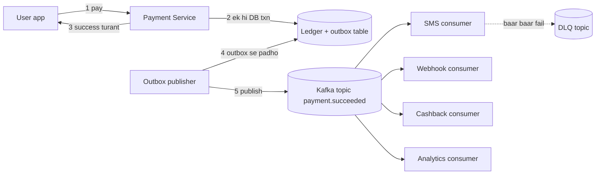
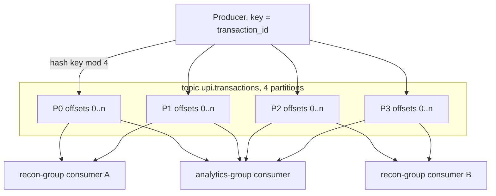
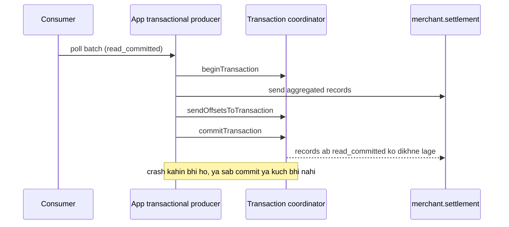
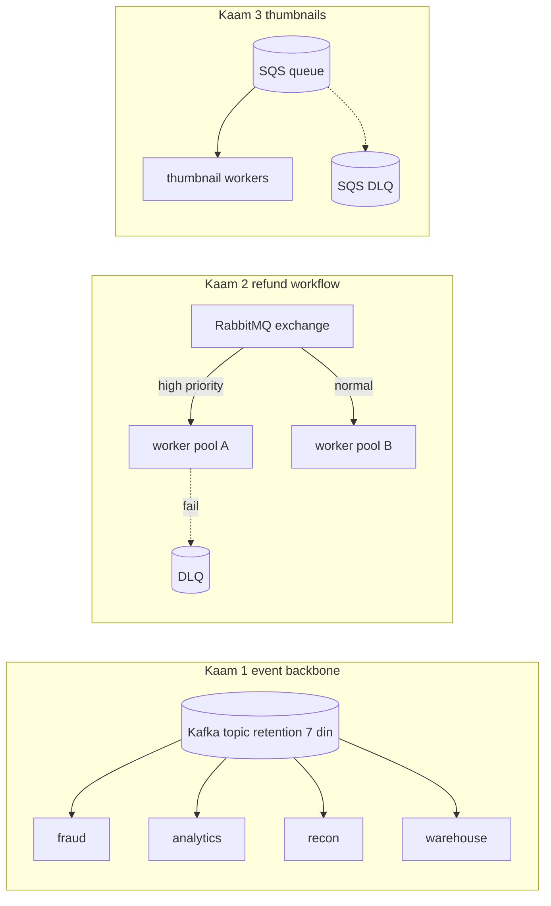
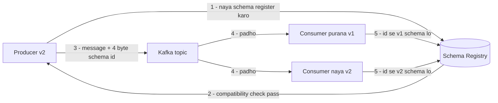

# 1E · Kafka River

Oct 2, 2026 · @saurav chaurasiya

Is doc me L1.17 se L1.20a tak: queue ki zaroorat kyun padti hai, Kafka andar se kaise kaam karta hai, exactly-once ka asli matlab, Kafka vs RabbitMQ vs SQS me se kya kab chunna hai, aur message ka schema waqt ke saath kaise badalte hain bina kisi consumer ko toda.

---

## L1.17 — Queue kyun? (sync chain ka problem)

Queue do services ke beech baitha ek buffer hai: pehli service apna kaam ek message ki tarah likh ke turant aage badh jaati hai, aur doosri service us message ko baad me, apni speed se, uthati hai. Isse caller ko receiver ke poora hone ka intezaar nahi karna padta.

### Ye cheez hai kya

- Category: asynchronous messaging — do services ke beech message pahunchane wala middleware (middleware — beech me baitha software layer jo khud business logic nahi likhta, sirf pahunchata hai)
- Kis problem ke liye banayi gayi: sync chain me ek slow ya down downstream service poore user request ko slow ya fail kar deti hai
- Is lesson ke baad: kisi bhi flow me tum bata paoge kaunsa step sync rehna chahiye, kaunsa queue me jaana chahiye, aur badle me kya kho rahe ho

### Sawaal

Paytm pe UPI (Unified Payments Interface — NPCI ka real-time bank-to-bank transfer rail) payment success hone ke baad 6 kaam hone hain: ledger entry likhna, user ko SMS, user ko push notification, merchant ko webhook, cashback calculate karna, aur ek analytics event. Aaj ye sab ek hi HTTP request ke andar line se chal rahe hain. SMS provider ka p99 (p99 — 100 requests me sabse slow 1 ko chhod kar baaki ka worst time; yaani 99% requests isse tez nipat jaati hain) normally 4 second hai, par dopahar ke peak pe 30 second ho jaata hai.

User ko "Payment successful" screen kab dikhani chahiye, aur baaki 5 kaam kahan jaayenge?

> Pehle khud socho — 5 min. Hints: (1) in 6 kaamon me se kaunsa paisa move karta hai aur kaunsa sirf batata hai? (2) agar SMS fail ho gaya to kya payment ko fail maana jaayega? (3) agar tum kaam queue me daal do, to kya guarantee de sakte ho ki woh message kabhi gum nahi hoga?

### Problem kyun aata hai

- Latency add hoti hai: sync chain me total time = sab steps ka sum. (latency — ek request ka jawab aane me laga time.) 6 steps, har ek 200 ms, to user 1.2 second baitha rahega
- Availability multiply hoti hai: 6 services har ek 99.9% uptime pe hain, to poore chain ka uptime 0.999 ka 6th power = 99.4%. Yaani 1000 me \~6 payments sirf SMS gateway ki wajah se fail
- Throughput mismatch: tumhara payment service 5000 TPS (transactions per second — ek second me kitne transactions nipat rahe hain) le sakta hai, par SMS provider 200 TPS. Sync chain me poora system 200 TPS ka ho jaata hai — chain apne sabse slow link ke barabar hoti hai
- Retry storm: SMS slow hua to caller retry karega, retry se load badhega, load se aur slow — ye apne aap ko feed karta hua loop hai

### Naive approach

- Pehla obvious solution: saare 6 kaam usi request me, har ek ke around try-catch — "fail ho jaaye to log kar denge, payment to ho hi gaya"
- Kahan exactly tootta hai: try-catch latency bachata hi nahi — SMS ka 30 second ka wait abhi bhi request ke andar hai. Aur jo kaam catch block me gira woh hamesha ke liye gum: merchant ka webhook kabhi nahi gaya, aur kisi ko pata bhi nahi chala
- Doosra naive solution: thread pool me daal do aur request turant return kar do. Latency bach gayi, par pool ki queue process ki memory me thi — pod restart hua aur saare pending kaam gayab

Neeche wala snippet exactly woh galti dikhata hai: kaam memory me hai, disk pe kahin likha nahi.

```java
// BURA code — sirf samajhne ke liye
ExecutorService pool = Executors.newFixedThreadPool(10);

void onPaymentSuccess(Payment p) {
    ledger.write(p);            // ye theek hai, sync hona chahiye
    pool.submit(() -> sms.send(p));       // in-memory queue
    pool.submit(() -> webhook.notify(p)); // pod restart = sab gayab
    // koi record nahi ki ye kaam pending the
}
```

### Sahi design

1. 6 kaamon ko do dibbon me baanto. Dibba A = "paisa ya correctness" (ledger entry) — ye sync rahega, usi request me, usi database transaction me. Dibba B = "batane wale / derived kaam" (SMS, push, webhook, cashback, analytics) — ye async jaayega
2. Dibba B ke kaam ko message bana ke ek durable queue me likho. Durable ka matlab: message disk pe likha jaata hai, to broker crash hone pe bhi bacha rehta hai (broker — queue chalane wala server)
3. Message aur ledger entry ek hi database transaction me likho. Isko outbox pattern kehte hain: queue me seedha na likho, apne hi DB ki ek `outbox` table me row daalo, aur ek alag publisher process us table se padh ke broker me bhejta hai. Isse "DB commit ho gaya par message nahi gaya" wali gap khatam ho jaati hai
4. Har kaam ke liye alag consumer rakho (consumer — queue se message uthane wala process). SMS consumer slow hua to webhook consumer pe koi asar nahi
5. Consumer ko idempotent banao — idempotent matlab same message do baar aane pe effect ek hi baar ho. Queues aam taur pe at-least-once deti hain (message kam se kam ek baar aayega, dobara bhi aa sakta hai), to duplicate handle karna consumer ka kaam hai. Abhi ke liye itna: message me ek unique key bhejo, consumer us key ko ek table me insert kare, duplicate insert fail hua to kaam skip kar do. Poori technique L2.1 — Idempotency keys (abhi banna baaki) me aayegi
6. Baar-baar fail hone wale message ko DLQ me bhejo — DLQ (Dead Letter Queue — woh alag queue jahan haar maan ke fail message daal diye jaate hain) taaki woh gum na ho aur koi insaan baad me dekh sake



Ek roz ki misaal: tiffin service. Grahak ko tiffin dena sync hai — woh bhookha khada hai. Par bartan dhona, agle din ka menu likhna, hisaab kitaab — ye sab ek list (queue) me likh diya jaata hai aur baad me ho jaata hai. Grahak ko bartan dhulne tak nahi rokte.

### Kya choose karein aur kyun

| Option | Kab use karo | Kab mat karo |
| --- | --- | --- |
| Sync HTTP call | Jawab user ke faisle ke liye chahiye (balance check, OTP verify), ya step fail hua to poora operation fail hona chahiye | Downstream slow hai, ya uska fail hona user ke liye matter nahi karta |
| Queue me daal do (seedha publish) | Kaam derived hai, thoda late ho sakta hai, aur message gum hone ka chhota risk chalega (analytics event) | Message gum hona paise ya legal obligation se juda ho (merchant settlement webhook) |
| Outbox + queue | Message DB write ke saath exactly tie-up hona chahiye — koi orphan nahi, koi ghost nahi | Prototype hai, ya event ki keemat extra publisher process maintain karne se kam hai |
| In-memory thread pool | Sirf tab jab kaam dubara ho jaana sasta ho aur gum hona chale (cache warm-up) | Kabhi bhi jab kaam ka business matlab ho |

### India me kaise hota hai

PhonePe apne platform pe roz \~100 billion events Kafka se nikaalta hai, aur unka design is lesson ka hi bada version hai. App ka client library event seedha Kafka ko nahi bhejta — pehle local disk pe ek BigQueue me likhta hai, phir ek alag "Ingestor" process us disk se padh ke IngestionService ko bhejta hai, jo Kafka me daalta hai. Yaani producer kabhi Kafka ke slow hone pe nahi rukta: ye wahi outbox idea hai, bas disk pe. Analytics path ka p99 3 second ke andar rakha gaya hai, aur jis team ko 1 second se kam chahiye woh disk step bypass kar sakti hai.

Unhone read aur write workload ko do alag Kafka clusters me bhi baant diya, taaki ek bhaari consumer (jaise koi batch job jo purana data padh raha hai) payment writes ko slow na kare. Reference: [The Kafka Edge: Managing 100 Billion Daily Events at PhonePe](https://tech.phonepe.com/the-kafka-edge-managing-100-billion-daily-events-at-phonepe).

### Interview follow-ups

- **Kaise decide karoge ki step sync rahe ya async?** — Do sawaal: (a) kya user ko iska result abhi chahiye? (b) kya iske fail hone pe poora operation fail hona chahiye? Dono ka jawab "nahi" hai to async
- **Async kar diya to user ko galat "success" to nahi dikha rahe?** — Nahi, agar sirf derived kaam async kiya hai. Jo cheez user ke paise ki sachchai batati hai (ledger) woh sync hi commit hui hai
- **Queue bhi down ho gayi to?** — Outbox table me rows padi rehti hain aur publisher queue wapas aane pe bhej deta hai. Isliye seedha publish se outbox behtar hai
- **Queue se latency khatam ho gayi ya sirf chhup gayi?** — Chhup gayi. User-facing latency gayi, par end-to-end latency ab queue lag ban gayi (lag — message publish hone aur consume hone ke beech ka gap). Usko monitor karna padega

### Self-check

1. Sync chain ka uptime kam kyun hota hai jab ki har service 99.9% par hai?
2. Outbox pattern seedha publish karne se kaunsi exact problem theek karta hai?
3. At-least-once delivery ka consumer ke code pe kya asar padta hai?
4. DLQ kis cheez ko rokne ke liye hai?

### Notebook

Sync chain = latency ka sum, uptime ka product · derived kaam queue me, paise ka kaam sync · outbox = DB row + alag publisher, isse ghost/orphan message khatam · at-least-once default hai, isliye consumer idempotent chahiye · DLQ = baar-baar fail message ka parking, gum hone se bachav · queue latency khatam nahi karti, usko consumer lag me badal deti hai

### Padhne ke liye

- [Apache Kafka — Introduction aur core concepts](https://kafka.apache.org/documentation/#gettingStarted)
- [The Kafka Edge: Managing 100 Billion Daily Events at PhonePe](https://tech.phonepe.com/the-kafka-edge-managing-100-billion-daily-events-at-phonepe)

### Deep Dive (SDE-2) — jab time ho

#### Backpressure kaise design karein

Backpressure ka matlab: jab consumer producer se slow hai, to system producer ko dheere karne ka signal de. Sync HTTP me ye apne aap hota hai (caller block ho jaata hai). Queue me nahi hota — queue bas bharti rehti hai. To tumhe khud banana padta hai: queue depth ya consumer lag pe alert, aur ek threshold ke baad producer side pe rate limit ya low-priority event drop. Bina backpressure ke queue sirf problem ko aage shift karti hai, theek nahi karti.

#### Ordering ki keemat

Queue me daalne ke baad do events ka order guarantee nahi rehta, jab tak tum ek hi partition pe na bhejo (partition — ek topic ka woh hissa jiske andar messages ka order pakka hota hai; details L1.18 me). "Payment succeeded" ke baad "Payment reversed" ulta aa gaya to cashback galat ban jaayega. Do upaay: ek hi key (jaise `order_id`) pe bhejo taaki dono same partition me jaayein, ya consumer ko version/sequence number dekh ke purana event ignore karne do.

#### Outbox publisher ko kaise reliable banate hain

Publisher ko exactly-once nahi, at-least-once banana aasaan hai: row ko `status = SENT` sirf broker ke ack ke baad mark karo, ack na mile to dubara bhejo. Duplicate consumer handle karega. Row par ek `attempt_count` aur `next_retry_at` rakho taaki ek zidd wala message publisher ko block na kare. Change Data Capture (CDC — DB ke transaction log se changes padhne ki technique, jaise Debezium) se bhi yahi kaam hota hai, bina polling ke.

---

## L1.18 — Kafka internals: partitions, consumer groups, offsets, ordering

Kafka ek distributed append-only log hai: messages ek file ke aakhir me jude rehte hain aur bhejne ke baad badalte nahi. Consumer us file me apni jagah (offset) yaad rakh ke aage padhta hai, isliye ek hi message ko kai consumers alag-alag speed se padh sakte hain.

### Ye cheez hai kya

- Category: distributed commit log / event streaming platform — queue se zyada, ye messages ko retention period tak rakhta hai aur dobara padhne deta hai
- Kis problem ke liye banayi gayi: ek hi event stream ko kai teams (payments, fraud, analytics) ko ek saath, high throughput pe, bina ek doosre ko disturb kiye dena
- Is lesson ke baad: tum partition count aur message key khud choose kar paoge, aur bata paoge Kafka order kahan guarantee karta hai aur kahan nahi

### Sawaal

Tum `upi.transactions` naam ka ek Kafka topic design kar rahe ho (topic — ek naam wali stream, jaise ek table ka naam). Peak pe 50,000 events per second aate hain. Ek "reconciliation" consumer ko har transaction ke events usi order me chahiye jis order me woh hue — pehle `INITIATED`, phir `DEBITED`, phir `CREDITED` — warna woh galat mismatch report banayega.

Kitne partitions rakhoge, message key kya rakhoge, aur agar ek bada merchant (jaise ek bijli board) akela 30% traffic laata hai to kya hoga?

> Pehle khud socho — 5 min. Hints: (1) Kafka order kis cheez ke andar guarantee karta hai — topic ke andar ya partition ke andar? (2) key same hone pe partition same rehta hai ya badalta hai? (3) 30% traffic ek hi key pe aane ka naam kya hai aur uska nuksan kya hai?

### Problem kyun aata hai

- Kafka global ordering nahi deta. Order sirf ek partition ke andar guarantee hai, poore topic me nahi — kyunki partitions alag-alag machines pe alag-alag speed se chalte hain
- Partition = parallelism ki unit. Ek partition ko ek consumer group me se sirf ek hi consumer padh sakta hai. To 3 partitions ka matlab, ek group me 3 se zyada consumers kaam hi nahi karenge — chautha khali baitha rahega
- Partition count aur key dono ek hi cheez ko kheenchte hain: order chahiye to kam keys par zyada messages (order safe, parallelism kam); speed chahiye to zyada keys me faila do (parallelism zyada, order gaya)
- Hot key: hot key matlab ek hi key pe disproportionate traffic. Kafka key ka hash le ke partition chunta hai, to ek key hamesha ek hi partition me jaati hai — woh partition dusron se bahut bhaari ho jaata hai aur uska consumer lag karne lagta hai

### Naive approach

- Pehla obvious solution: ek hi partition rakho — "order to poora guarantee ho gaya"
- Kahan tootta hai: ek partition ek machine ka ek disk hai aur usko ek hi consumer padhega. 50,000 events per second usme nahi ghusenge, aur consumer ka lag badhta chala jaayega. Order mil gaya, scale chala gaya
- Doosra naive solution: 200 partitions bana do aur key null chhod do (Kafka messages round-robin bhej dega). Throughput mil gaya, par ek transaction ke INITIATED aur DEBITED do alag partitions me chale gaye — reconciliation consumer ab kabhi order ki guarantee nahi paayega

### Sahi design

1. Order ki asli unit pehchano. Yahan poore topic ka order nahi chahiye — ek transaction ke andar ka order chahiye. To key = `transaction_id` (ya `utr`, UPI ka Unique Transaction Reference). Same key, same partition, order safe
2. Partition count target throughput se nikaalo, order se nahi. Ek partition se ek consumer kitna nipta sakta hai (maan lo 5,000 events/sec) — 50,000 / 5,000 = 10 partitions minimum. Headroom ke liye 2x-3x le ke 24-30 rakh lo
3. Partition badhana aasaan hai, ghatana nahi — aur badhane pe keys ka mapping badal jaata hai (`hash(key) % partitions`), to purani key naye partition me chali jaayegi aur us transition par order toot sakta hai. Isliye shuru me hi headroom rakho
4. Replication rakho: replica matlab usi partition ki doosri machine par rakhi hui exact copy. `replication.factor = 3` ka matlab 3 copies. Ek leader likhna-padhna handle karta hai, baaki followers copy karte hain. Leader mara to ek follower leader ban jaata hai — isse ek broker SPOF (Single Point Of Failure — woh ek cheez jiske marne pe poora system ruk jaaye) nahi banta
5. Durability pakki karo: `acks=all` plus `min.insync.replicas=2`. ISR (In-Sync Replicas — woh replicas jo leader ke saath updated hain) ka matlab: write tab success maana jaayega jab kam se kam 2 in-sync copies ne likh liya. `acks=1` me leader ke marne par abhi-abhi likha message gum ho sakta hai
6. Consumer group se consume karo. Consumer group ek naam hai jisse kai consumer processes aapas me partitions baant lete hain — ek partition ek member ko. Naya member aaya ya purana mara to rebalance hota hai: rebalance matlab Kafka partitions ko members me dobara baant deta hai, aur us dauran consumption ruk jaata hai
7. Offsets commit karna soch ke karo. Offset ek partition ke andar message ka number hai, aur consumer "main yahan tak padh chuka" ye offset commit karke batata hai. Kaam hone ke BAAD commit karo (at-least-once, duplicate possible) — kaam se pehle commit karne par crash hone pe message gum ho jaayega (at-most-once)
8. Hot key ka ilaaj: us ek key ko artificially split karo — key ko `merchantId + "#" + (counter % 8)` bana do, taaki woh 8 partitions me faile. Ye sirf tab karo jab us key ke andar ka order zaroori na ho. Zaroori ho to us merchant ko apna alag topic ya alag consumer pool de do



Diagram me do baatein dekho: ek group ke andar partitions baant diye gaye hain (A ko 2, B ko 2), par doosra group wahi saare partitions dobara, apni speed se padh raha hai. Isi liye Kafka ek queue se zyada hai — message padh lene se delete nahi hota, retention time khatam hone pe delete hota hai.

Ek roz ki misaal: cricket scoreboard. Scoreboard pe balls ek ke baad ek likhi jaati hain aur mitti nahi (append-only log). Commentator, statistician aur fan — teeno usi scoreboard ko apni speed se padh rahe hain, aur har ek ko yaad hai ki woh kaunsi ball tak pahuncha hai (offset).

### Kya choose karein aur kyun

| Option | Kab use karo | Kab mat karo |
| --- | --- | --- |
| Key = entity id (transaction\_id, order\_id) | Us entity ke andar ka order matter karta hai aur entities bahut saari hain | Ek hi entity poora traffic laati ho — woh hot key ban jaayegi |
| Key = null (round-robin) | Order bilkul matter nahi karta, sirf throughput chahiye (raw analytics events) | Koi bhi state machine ya ledger-jaisa flow |
| Key = merchant id | Per-merchant order chahiye, aur merchants ka traffic balanced hai | Ek bada merchant 30% traffic laaye — hot partition pakka |
| Key = entity id + salt (key splitting) | Hot key ko faila kar lag theek karna hai aur us key ke andar order chhodna chalega | Us key ke andar strict ordering chahiye |
| Zyada partitions (sau se upar) | High throughput, zyada consumers chalane hain | Bahut chhota topic — zyada partitions se rebalance slow aur broker pe metadata aur file handle load badhta hai |

### India me kaise hota hai

PhonePe ne apne Kafka clusters me pehle 2 disks per node rakhe the. Traffic badhne par CPU aur network free the par disk I/O bottleneck ban gaya — yaani Kafka ki limit yahan disk thi, compute nahi. Unhone disks 2 se 4 se 8 kiye aur utne hi nodes pe zyada throughput nikaal liya. Ye Kafka ke design ka seedha nateeja hai: Kafka messages ko disk pe sequential append karta hai, to uska scaling sawaal aam taur pe "kitna disk throughput hai" hota hai, "kitna CPU hai" nahi.

Unhone cost attribution bhi "bytes sent" ke hisaab se kiya, taaki har team apne topic ka kharcha dekhe. Reference: [The Kafka Edge: Managing 100 Billion Daily Events at PhonePe](https://tech.phonepe.com/the-kafka-edge-managing-100-billion-daily-events-at-phonepe).

### Interview follow-ups

- **Kafka global ordering deta hai?** — Nahi. Sirf ek partition ke andar. Global order chahiye to ek partition, aur phir throughput ek consumer ki limit par ruk jaayega
- **Partitions se zyada consumers ek group me rakh diye to?** — Extra consumers idle baithenge. Parallelism ki upper limit partition count hai
- **At-least-once aur at-most-once me farak offset commit se kaise aata hai?** — Kaam ke baad commit = at-least-once (crash pe message dobara aayega). Kaam se pehle commit = at-most-once (crash pe message gum)
- **`acks=all` ke saath bhi data loss ho sakta hai?** — Haan, agar `min.insync.replicas=1` ho — tab "all" ka matlab sirf leader hai. Dono settings saath rakhni padti hain
- **Rebalance ka nuksaan kaise kam karein?** — Cooperative sticky assignor, `session.timeout.ms` aur `max.poll.interval.ms` theek set karna, aur consumer ke andar lamba blocking kaam na karna

### Self-check

1. Ordering ki guarantee Kafka me kis scope par hai?
2. Ek consumer group me 3 partitions aur 5 consumers hain — kitne kaam karenge?
3. `acks=all` ke saath `min.insync.replicas` kyun set karna padta hai?
4. Hot partition ko key splitting se theek karne me kya kho jaata hai?
5. Offset commit kaam se pehle karne pe kaunsi delivery guarantee milti hai?

### Notebook

Kafka = append-only log, read karne se message delete nahi hota, retention pe hota hai · order sirf partition ke andar, isliye key = jis entity ka order chahiye · partition count = parallelism ki max limit, ek partition ek consumer per group · partitions badhao, ghatao nahi; badhane pe key mapping badalta hai · durability = acks=all plus min.insync.replicas=2, akela acks=all kaafi nahi · hot key = ek key pe zyada traffic, ilaaj key splitting par order ki keemat par · offset kaam ke baad commit = at-least-once

### Padhne ke liye

- [Apache Kafka — Design aur core concepts](https://kafka.apache.org/documentation/#design)
- [Apache Kafka — Consumer configuration](https://kafka.apache.org/documentation/#consumerconfigs)

### Deep Dive (SDE-2) — jab time ho

#### Consumer lag ko kaise padhein

Consumer lag = (partition ka latest offset) minus (consumer ka committed offset), yaani kitne messages pending hain. Ye Kafka ka sabse important metric hai, kyunki ye sirf "slow" nahi batata — ye batata hai ki tum catch up kar paoge ya nahi. Lag constant hai to consumer bilkul producer ki speed pe hai, yaani koi headroom nahi. Lag badh raha hai to tum peeche gir rahe ho aur retention khatam hone pe data gum hoga. Alert lag ke absolute number par nahi, uske badhne ki rate par lagao, aur per-partition dekho — ek hot partition ka lag average me chhup jaata hai.

#### Rebalance ka asli kharcha

Purane (eager) rebalance me group ka har consumer apne saare partitions chhod deta tha, phir naya assignment milta tha — is beech poora group ruka rehta tha, isko stop-the-world rebalance kehte hain. Agar consumer ka ek poll `max.poll.interval.ms` se zyada le le (kyunki batch bhaari tha), Kafka use dead maan ke rebalance trigger kar dega, jisse aur slow — ye L1.17 ka retry storm ka cousin hai. Ilaaj: `max.poll.records` chhota rakho, cooperative sticky assignor use karo (sirf badle hue partitions move hote hain), aur static group membership se restart par poora rebalance bachao.

#### Retention, compaction aur replay

Do retention policies hain. `delete` = time ya size ke baad purana data hata do (default, events ke liye theek). `compact` = har key ki sirf last value rakho, purani versions hata do — isse topic ek tarah ka durable key-value snapshot ban jaata hai, jo state rebuild karne ke liye bahut useful hai (jaise "har account ka latest status"). Replay yahan se aata hai: consumer group ka offset peeche set kar do aur poora history dobara process ho jaayega — bug fix ke baad derived data rebuild karne ka ye sabse saaf tareeka hai, par tab consumer ka idempotent hona majboori ban jaata hai.

---

## L1.19 — Kafka exactly-once semantics (EOS)

Exactly-once semantics (EOS) Kafka ka woh feature hai jisse ek message ka effect theek ek baar dikhta hai, chahe producer retry kare ya consumer crash ho. Ye do cheezon se banta hai: idempotent producer (duplicate write broker par hi chhant jaata hai) aur transactions (kai writes aur offset commit ek saath commit ya saath abort hote hain).

### Ye cheez hai kya

- Category: delivery guarantee aur transaction mechanism, Kafka ke andar
- Kis problem ke liye banayi gayi: at-least-once me retry se duplicate ban jaate hain, aur "consume karo, transform karo, produce karo" wale pipeline me crash hone pe output do baar likh jaata hai
- Is lesson ke baad: tum bata paoge EOS exactly kahan tak kaam karta hai, kahan nahi, aur kab iski keemat uthani chahiye

### Sawaal

Tumhara ek Kafka Streams-jaisa service hai: `upi.transactions` topic se padhta hai, har merchant ka running total nikaalta hai, aur `merchant.settlement` topic me likhta hai. Ek din process ne output likha, par offset commit karne se pehle pod OOM (Out Of Memory — memory khatam hone pe process ka mar jaana) se mar gaya.

Restart ke baad woh message dobara aayega aur settlement amount double ho jaayega. Aur agar tum offset pehle commit karte to crash pe woh message skip ho jaata aur settlement kam ban jaata. Dono galat hain — ab kya karoge?

> Pehle khud socho — 5 min. Hints: (1) output write aur offset commit do alag systems me ja rahe hain ya ek me? (2) agar dono ek hi Kafka transaction me ho jaayein to? (3) agar tumhara output Kafka me nahi, bank ke API me jaata, to kya wahi solution chalega?

### Problem kyun aata hai

- Producer retry duplicate banata hai: producer ne message bheja, broker ne likh liya, par ack network me gum ho gaya. Producer samjha fail hua, dobara bheja — log me do copies
- Do writes atomically nahi hote: output message Kafka me jaata hai aur offset commit alag jagah. Do steps ke beech crash hone par dono ka state mismatch ho jaata hai — isko dual write problem kehte hain
- At-least-once aur at-most-once me se koi bhi aggregation (sum, count, balance) ke liye theek nahi: pehla zyada ginega, doosra kam
- "Exactly-once" naam bhram paida karta hai: network pe ek message exactly ek baar deliver hona theoretically impossible hai. Jo possible hai woh hai exactly-once processing — delivery dobara ho sakti hai, par effect ek baar hi dikhega

### Naive approach

- Pehla obvious solution: output likhne ke baad turant offset commit kar do, gap chhota kar do
- Kahan tootta hai: gap chhota hua, khatam nahi hua. Jo cheez "kabhi-kabhi" galat hoti hai woh crore transactions pe roz galat hoti hai. Aur settlement me ek bhi double entry audit issue hai
- Doosra naive solution: output topic me likhne se pehle check karo ki woh message pehle se hai ya nahi. Kafka log me key se lookup hota hi nahi (woh database nahi hai), to ye possible nahi

### Sahi design

1. Producer par idempotence chalu karo: `enable.idempotence=true`. Ab producer ko ek PID (Producer ID — broker ka diya hua unique id) milta hai aur har message par ek sequence number jaata hai. Broker per-partition last sequence yaad rakhta hai aur purana ya repeat sequence chup-chaap discard kar deta hai. Isse retry se bana duplicate broker par hi khatam ho jaata hai
2. Transactions chalu karo: producer par ek fix `transactional.id` do. Broker side par ek transaction coordinator ise track karta hai, aur state ek internal topic `__transaction_state` me rehta hai
3. Output write aur input offset commit ek hi transaction me daalo. `sendOffsetsToTransaction(...)` offset commit ko usi transaction ka hissa bana deta hai — isliye "output likha par offset nahi hua" wali haalat hi nahi ban sakti
4. Consumer side par `isolation.level=read_committed` set karo. Iske bina consumer aborted transaction ke messages bhi padh lega aur poora kaam bekaar
5. Kafka Streams me ye sab ek setting se ho jaata hai: `processing.guarantee=exactly_once_v2`. Apne haath se likh rahe ho to neeche ka pattern yaad rakho
6. EOS ki boundary yaad rakho: ye sirf Kafka ke andar atomic hai. Transaction ke beech tumne SMS bhej diya ya bank API call kar diya, to abort hone pe woh wapas nahi aayega. Bahar wale side-effects ke liye phir bhi idempotency key chahiye — L2.1 — Idempotency keys (abhi banna baaki)

Neeche wala code consume-transform-produce ko ek transaction me baandhta hai: output aur offset dono saath commit hote hain.

```java
// EOS producer — output aur offset ek hi transaction me
Properties p = new Properties();
p.put("enable.idempotence", "true");
p.put("transactional.id", "settlement-aggregator-1"); // har instance ka apna fix id
p.put("acks", "all");

KafkaProducer<String, String> producer = new KafkaProducer<>(p);
producer.initTransactions(); // purani adhoori transaction clean ho jaati hai

// consumer par auto-commit band hona chahiye:
// enable.auto.commit=false, isolation.level=read_committed

while (running) {
    ConsumerRecords<String, String> batch = consumer.poll(Duration.ofMillis(200));
    if (batch.isEmpty()) continue;

    producer.beginTransaction();
    try {
        Map<TopicPartition, OffsetAndMetadata> offsets = new HashMap<>();

        for (ConsumerRecord<String, String> r : batch) {
            String out = aggregate(r.value());            // transform
            producer.send(new ProducerRecord<>("merchant.settlement", r.key(), out));
            // is partition ka agla offset note karo
            offsets.put(new TopicPartition(r.topic(), r.partition()),
                        new OffsetAndMetadata(r.offset() + 1));
        }

        // offset commit bhi isi transaction ka hissa — yahi asli trick hai
        producer.sendOffsetsToTransaction(offsets, consumer.groupMetadata());
        producer.commitTransaction();   // output aur offset, dono ek saath
    } catch (ProducerFencedException e) {
        producer.close();               // koi naya instance same id le chuka hai, haar maan lo
        break;
    } catch (KafkaException e) {
        producer.abortTransaction();    // kuch bhi commit nahi hua, batch dobara aayega
    }
}
```



Ek roz ki misaal: auto ka meter. Meter ek hi baar chalta hai aur usi par bill banta hai. Agar driver meter reset kar de aur dobara chalu kare, to safar wahi tha par bill do baar. EOS woh seal hai jo meter par lagta hai: safar dobara record ho jaaye to bhi bill ek hi banega.

### Kya choose karein aur kyun

| Option | Kab use karo | Kab mat karo |
| --- | --- | --- |
| At-most-once (offset pehle commit) | Data loss chalega aur duplicate bilkul nahi chahiye — jaise best-effort metrics | Paisa, ledger, ya koi count jo sahi hona chahiye |
| At-least-once plus consumer-side idempotency key | Default choice: sasta, samajhne me seedha, aur output Kafka ke bahar jaata hai (DB, bank API, SMS) | Bahut saare partitions par aggregation ho rahi ho aur per-message dedupe store mehnga pad jaaye |
| Kafka EOS (transactions) | Kafka se padh ke Kafka me likh rahe ho — streaming aggregation, enrichment, routing | Output Kafka ke bahar jaata hai, ya throughput ekdum maximum chahiye (transactions se latency badhti hai) |
| Kafka Streams `exactly_once_v2` | Streams API use kar rahe ho aur state stores bhi EOS me chahiye | Plain producer aur consumer code hai — tab manual transactions hi likhne padenge |

### India me kaise hota hai

Indian payments me EOS se zyada aam pattern at-least-once plus idempotency key hai, kyunki asli output Kafka ke bahar hota hai — NPCI ka switch, bank ka CBS (Core Banking System — bank ka asli ledger jahan khaate ka balance rehta hai), ya merchant ka webhook endpoint. Kafka transaction un systems tak nahi pahunchti. Isliye design aise hota hai: Kafka at-least-once rahe, aur har downstream call par ek unique reference (UPI me UTR, Unique Transaction Reference) bheja jaaye jisse duplicate call pehchana ja sake.

EOS wahan use hota hai jahan pipeline poori tarah Kafka ke andar hai — jaise raw transaction events se per-merchant aggregates banana, ya fraud features compute karna, jinka output phir bhi ek Kafka topic hai. Reference: [Exactly-once Semantics is Possible: Here's How Apache Kafka Does it](https://www.confluent.io/blog/exactly-once-semantics-are-possible-heres-how-apache-kafka-does-it/).

### Interview follow-ups

- **Kafka exactly-once delivery deta hai?** — Nahi, exactly-once processing deta hai. Message dobara deliver ho sakta hai; duplicate broker ya transaction layer par chhant jaata hai
- **EOS aur idempotency key me farak?** — EOS Kafka ke andar atomicity hai. Idempotency key tumhare apne code me duplicate pehchanne ka tareeka hai, aur Kafka ke bahar ke systems par bhi chalta hai
- **`transactional.id` fix kyun rakhna padta hai?** — Isse broker purani zombie instance ko fence kar deta hai (`ProducerFencedException`). Random id rakhne par purana crashed instance chup-chaap likhta reh sakta hai
- **`read_committed` set na karein to?** — Consumer aborted transaction ke messages bhi padhega, to poora EOS bekaar ho jaayega
- **EOS ki keemat kya hai?** — Extra round trips, commit batching se badhi latency, aur coordinator par state. Isliye isko default nahi, zaroorat par use karte hain

### Self-check

1. Idempotent producer duplicate kaise rokta hai — kis do cheezon se?
2. `sendOffsetsToTransaction` kaunsi exact race condition khatam karta hai?
3. EOS ke saath consumer par kaunsi ek setting zaroori hai, aur na ho to kya hota hai?
4. Output bank API me ja raha hai — EOS kaafi hai ya nahi, aur kyun?
5. `ProducerFencedException` ka matlab kya hai?

### Notebook

EOS = exactly-once processing, delivery nahi · do hisse: idempotent producer (PID plus per-partition sequence) aur transactions (transactional.id plus coordinator) · asli trick sendOffsetsToTransaction — output aur offset ek hi commit me · consumer par isolation.level=read\_committed, warna poora bekaar · boundary Kafka ke andar hai; bahar ke side-effects ke liye idempotency key chahiye · Streams me processing.guarantee=exactly\_once\_v2

### Padhne ke liye

- [Exactly-once Semantics is Possible: Here's How Apache Kafka Does it](https://www.confluent.io/blog/exactly-once-semantics-are-possible-heres-how-apache-kafka-does-it/)
- [Transactions in Apache Kafka](https://www.confluent.io/blog/transactions-apache-kafka/)
- [Apache Kafka — Producer configuration](https://kafka.apache.org/documentation/#producerconfigs)

### Deep Dive (SDE-2) — jab time ho

#### Zombie fencing exactly kya hai

Maan lo tumhara instance network se kat gaya par mara nahi, aur orchestrator ne naya instance utha diya. Ab do instances same partition ke liye likhna chahte hain; purane ko zombie kehte hain. Kafka har `transactional.id` ke saath ek epoch number rakhta hai. Naya instance `initTransactions()` par epoch badha deta hai, aur purane epoch se aaya koi bhi write `ProducerFencedException` se reject ho jaata hai. Isliye `transactional.id` instance-stable hona chahiye (StatefulSet ka ordinal, ya partition assignment se derive kiya hua) — random UUID rakhne par fencing ka poora matlab chala jaata hai.

#### EOS ka throughput par asar

Transaction me commit ek batch par hota hai, to batch bada rakho — par bada batch latency badhata hai. Ye seedha trade-off hai: commit interval ya batch size badhao to throughput behtar aur end-to-end latency kharab. `read_committed` consumer ko LSO (Last Stable Offset — woh offset jiske aage koi adhoori transaction nahi) se aage nahi padhne deta, to ek lambi chalti transaction saare consumers ko rok deti hai. Isliye transaction chhoti rakho aur uske andar koi external call ya lamba sleep na karo.

#### Jab output Kafka ke bahar ho

Is case me EOS kaam nahi karta aur do practical patterns bachte hain. Ek: dedupe store — consumer message ki unique key ko ek table ke unique index me insert kare, aur conflict aane par kaam skip kar de; us key par TTL (Time To Live — kitni der baad entry hat jaaye) rakho warna table badhti rahegi. Do: idempotent downstream — downstream API se hi kaho ki woh unique reference accept kare aur duplicate par wahi purana result return kare. Doosra behtar hai kyunki guarantee usi jagah baithti hai jahan state hai; UPI ka UTR isi tarah use hota hai.

---

## L1.20 — Kafka vs RabbitMQ vs SQS

Teeno messages ek service se doosri tak pahunchate hain, par teeno ka model alag hai: Kafka ek durable log hai jise kai consumer apni speed se padhte hain, RabbitMQ ek smart router hai jo message deliver karke hata deta hai, aur SQS (Simple Queue Service — AWS ki managed queue) ek aisi queue hai jisme tumhe koi server nahi chalana padta.

### Ye cheez hai kya

- Category: messaging systems ka comparison — log-based vs broker-routed vs managed queue
- Kis problem ke liye: interview aur real design dono me yahi sawaal aata hai "queue kaunsi lagaoge aur kyun", aur galat choice se ya cost phatti hai ya guarantee
- Is lesson ke baad: tum teeno ko unke model se pehchan paoge aur ek flow ke liye sahi chun paoge — naam se nahi, zaroorat se

### Sawaal

Ek payments company me teen alag kaam hain:

1. Roz 2 billion transaction events, jinhe 6 different teams (fraud, analytics, recon, ledger, notification, data warehouse) apni-apni speed se padhna chahti hain, aur fraud team ko kabhi-kabhi 7 din purana data dobara process karna padta hai
2. Ek refund workflow, jahan har refund ko ek specific worker tak jaana hai priority ke hisaab se (high-value refunds pehle), aur fail hone par kuch der baad retry hona hai
3. Ek chhoti internal team ka image-thumbnail job, roz \~50,000 messages, aur team me koi infra engineer nahi hai

Teeno ke liye kya chunoge, aur kyun?

> Pehle khud socho — 5 min. Hints: (1) kaunse case me ek message ko kai log padhenge? (2) kaunse case me message ki priority aur routing matter karti hai? (3) kaunse case me operational cost (kaun server chalayega) sabse bada factor hai?

### Problem kyun aata hai

- Teeno ka data model alag hai, isliye teeno ki guarantee aur cost profile alag hai — ek ko doosre ki jagah lagane se design hi bigad jaata hai
- Kafka me message padhne se delete nahi hota (retention tak rehta hai), RabbitMQ aur SQS me consume hone par chala jaata hai. Replay chahiye to ye farak sabse bada hai
- Routing ka kaam kahan hota hai: RabbitMQ me broker routing karta hai (exchange, routing key, per-message priority), Kafka me producer partition chunta hai aur baaki filtering consumer ka kaam hai
- Operational bojh alag hai: Kafka ka cluster chalana apne aap me ek kaam hai (brokers, disks, rebalance), SQS me chalana hi nahi padta par per-request cost aur feature limits hain

### Naive approach

- Pehla obvious solution: "Kafka sabse popular hai, teeno jagah Kafka"
- Kahan tootta hai: refund workflow me per-message priority aur per-message delay chahiye — Kafka me ye nahi hai (log me order fix hai, tum beech se nahi utha sakte). Thumbnail job ke liye Kafka cluster chalana us team ke liye poora ek project ban jaayega
- Doosra naive solution: "sab SQS, managed hai, tension khatam". Par 6 teams ko wahi stream dena SQS me 6 queues me fan-out karna padega (SNS ya EventBridge se) aur 7 din purana replay SQS me nahi hota — message consume hua, chala gaya

### Sahi design

1. Pehla sawaal poochho: ek message ko ek consumer padhega ya kai, aur kya purana data dobara padhna padega? Haan to log-based system chahiye — Kafka
2. Doosra sawaal: routing aur per-message control (priority, delay, selective retry) kitna chahiye? Zyada ho to broker-routed system chahiye — RabbitMQ
3. Teesra sawaal: team ke paas infra chalane ki capacity hai? Nahi, aur volume middling hai, to managed queue — SQS
4. Diye gaye teen kaamon ka answer: (1) transaction event stream — Kafka, kyunki multi-consumer aur replay dono chahiye; (2) refund workflow — RabbitMQ, kyunki priority routing aur per-message retry chahiye; (3) thumbnail job — SQS, kyunki operational cost hi sabse bada factor hai
5. Mix karna galat nahi hai, normal hai. Bade setups me Kafka "event backbone" hota hai aur uske kinare par task queues hoti hain
6. Jo bhi chuno, teen cheezein har case me khud design karni padengi: DLQ, consumer ka idempotent hona, aur lag ya queue-depth ka monitoring. Ye kisi bhi broker ka default nahi hai



### Kya choose karein aur kyun

| Option | Kab use karo | Kab mat karo |
| --- | --- | --- |
| Kafka | Ek stream ko kai independent consumers chahiye; replay ya 7-din retention chahiye; bahut high throughput; per-key ordering chahiye | Per-message priority ya per-message delay chahiye; chhota volume hai; cluster chalane wala koi nahi |
| RabbitMQ | Task queue chahiye jisme broker routing kare — exchange, routing key, priority, per-message TTL, delayed retry; request-reply pattern | Ek message ko kai teams apni speed se padhna chahti hain; replay chahiye; throughput Kafka wale level par ho |
| SQS standard | AWS pe ho, operational bojh zero chahiye, aur very high throughput par simple at-least-once queue kaafi hai | Strict ordering chahiye (standard SQS order guarantee nahi karta); replay chahiye; AWS ke bahar portability chahiye |
| SQS FIFO | Ordering aur dedupe managed queue me chahiye, aur throughput limits ke andar fit ho jaate ho | Throughput bahut high ho — FIFO queue par per-message-group limits lagti hain |
| Database table as queue | Bahut chhota volume, aur tum pehle se transactional DB me likh rahe ho (outbox) | Throughput badh raha ho, ya kai consumers chahiye — DB polling jaldi bottleneck ban jaati hai |

### India me kaise hota hai

Indian payment companies me aam shape ye hai: Kafka event backbone ka kaam karta hai, aur uske aage har domain apna consumer chalata hai. PhonePe 100 billion events per day Kafka se nikaalta hai aur read-heavy consumers ko alag cluster me rakhta hai, taaki analytics ka load payment writes ko disturb na kare — yaani ek hi backbone, par workload ke hisaab se cluster split ([PhonePe](https://tech.phonepe.com/the-kafka-edge-managing-100-billion-daily-events-at-phonepe)).

Merchant-facing kaam — refund processing, webhook retry, settlement file generation — aam taur pe task-queue shape me hote hain, kyunki wahan per-message retry schedule aur priority chahiye, replay nahi. AWS pe baithe setups me yahi kaam SQS par hota hai, aur jahan ordering zaroori ho wahan FIFO queue use hoti hai ([Amazon SQS FIFO queues](https://docs.aws.amazon.com/AWSSimpleQueueService/latest/SQSDeveloperGuide/FIFO-queues.html)).

### Interview follow-ups

- **Kafka ko queue kehna theek hai?** — Poora theek nahi. Kafka ek distributed log hai; queue semantics (consume karke hata do) uske upar consumer group se banti hai. Replay aur multi-consumer isi farak se aate hain
- **RabbitMQ Kafka jitna scale kar sakta hai?** — Aam taur pe nahi, kyunki uska design per-message routing aur acknowledgement par hai, sequential disk log par nahi. Par bahut flows ko Kafka-level throughput chahiye hi nahi
- **SQS standard aur FIFO me kya farak hai?** — Standard: very high throughput, at-least-once, best-effort ordering. FIFO: ordering aur dedupe milta hai, par throughput par limits
- **Teen me se koi exactly-once deta hai?** — Kafka apne andar EOS deta hai (L1.19). Baaki at-least-once dete hain. Teeno case me bahar wale side-effects ke liye idempotency tumhe khud karni hai
- **Ek hi company me teen systems rakhna over-engineering nahi?** — Nahi, agar teen alag shapes hain. Over-engineering tab hai jab ek hi shape ke liye teen systems ho

### Self-check

1. Kafka aur RabbitMQ me message ke life-cycle ka sabse bada farak kya hai?
2. Per-message priority chahiye — teeno me se kaun theek hai aur kaun nahi?
3. 7 din purana data dobara process karna hai — kaun kar sakta hai?
4. SQS standard ordering guarantee karta hai? Nahi to kaunsa variant karta hai?
5. Teeno me se kisme DLQ aur idempotency khud design karni padti hai?

### Notebook

Kafka = durable log, multi-consumer plus replay, per-key order, high throughput · RabbitMQ = broker routing, priority, per-message delay, task queues ke liye · SQS = managed, zero ops, standard me order nahi, FIFO me order par limits ke saath · consume hone par message rehta hai (Kafka) vs chala jaata hai (Rabbit, SQS) — replay ka asli source yahi farak · ek company me teeno ho sakte hain, shape dekho naam nahi · DLQ, idempotency, lag monitoring hamesha tumhara kaam

### Padhne ke liye

- [Apache Kafka — Use cases](https://kafka.apache.org/documentation/#uses)
- [RabbitMQ — AMQP 0-9-1 concepts (exchange, routing key, queue)](https://www.rabbitmq.com/tutorials/amqp-concepts)
- [Amazon SQS — FIFO queues](https://docs.aws.amazon.com/AWSSimpleQueueService/latest/SQSDeveloperGuide/FIFO-queues.html)

### Deep Dive (SDE-2) — jab time ho

#### Fan-out: ek event, kai consumers

Kafka me fan-out muft jaisa hai — har consumer group poora topic independently padhta hai, aur broker ko sirf ek copy rakhni hai. RabbitMQ me fanout exchange har queue me ek copy daalta hai, to 6 consumers ka matlab 6 copies broker ki memory ya disk me. SQS me khud fan-out nahi hai: tum SNS topic ya EventBridge se 6 SQS queues me bhejte ho, phir 6 copies aur 6 queues ka cost. Isliye jab consumers ki ginti badhne wali ho, log-based system ki economics behtar nikalti hai.

#### Retry aur delay ka design teeno me

RabbitMQ me per-message TTL plus dead-letter exchange se delayed retry banta hai — message TTL khatam hone par ek retry queue me chala jaata hai. SQS me per-message `DelaySeconds` aur visibility timeout se hota hai, aur `maxReceiveCount` ke baad message DLQ me chala jaata hai. Kafka me ye built-in nahi hai, kyunki log me tum ek message ko "baad me" nahi utha sakte — pattern hai alag retry topics banana (`retry.5s`, `retry.1m`, `retry.10m`) aur consumer fail hone par message ko agle retry topic me produce kar dena, aur aakhir me DLQ topic.

#### Cost ka asli shape

Kafka ka kharcha mostly fixed hai: brokers, disks, replication ka storage (3x), aur engineer ka time. Volume badhne par per-message cost girta hai, par chhote volume par poora cluster bahut mehnga lagta hai. SQS ulta hai: fixed cost zero, par per-request charge, to high volume par bill tez badhta hai — bas tumhe koi operate nahi karna padta. Interview me is trade-off ko naam se bolna accha padta hai: Kafka me tum capacity khareedte ho, SQS me tum usage khareedte ho.

---

## L1.20a — Serialization aur schema evolution

Serialization matlab apne program ke object ko bytes me badalna, taaki woh network pe ja sake ya disk pe likha ja sake; deserialization ulta kaam hai — bytes se wapas object. Schema (ek message ke andar kaun field hogi, kis type ki, kis number pe — ye likhit niyam) evolution matlab us format ko waqt ke saath badalna, bina purane producer aur consumer ko toda.

### Ye cheez hai kya

- Kis category ki cheez hai: ye data contract hai. Na database, na queue — sirf producer aur consumer ke beech ka likhit agreement.
- Kis problem ke liye banayi gayi: ek Kafka topic pe 40 service likhti hain aur 120 padhti hain. Sabko ek hi din deploy karna possible nahi hota. Schema evolution batata hai ki naya field add karte waqt purane consumer zinda kaise rahenge.
- Is lesson ke baad tum kya kar paoge: JSON vs protobuf vs Avro me se chunna, schema registry ka kaam samajhna, aur koi bhi change dekh ke bata dena ki woh safe hai ya nahi.

Ye lesson [L1.18 — Kafka internals](https://claude.ai/code/artifact/eeb39ee8-3f52-4c04-b57b-68213f02c429) (partition — topic ka ek hissa jo ek hi order me padha jata hai; retention — message topic me kitne din pade rehte hain) aur [L0.4 — API design](https://claude.ai/code/artifact/873676ef-93d2-45e6-a1bc-079a3fa419b3) (versioning, error contract) pe tika hua hai.

### Sawaal

Paytm ke `upi.transaction.events` topic pe tum `TxnEvent` publish karte ho: `txn_id`, `amount` (rupee me, decimal), `status`. Ab do change aaye hain — risk team ko `payer_vpa` field chahiye, aur finance ko `amount` paise me chahiye (decimal se integer). Us topic ko 9 consumer padhte hain, 5 alag team ke. Rolling deploy me 3 din lagenge. Topic ka retention 7 din hai, matlab aaj ka consumer parson ka purana message bhi padhega.

> Pehle khud socho — 5 min. Hints: (1) jo consumer purana code chala raha hai woh naya field dekhega to kya karega (2) ek hi field ka type badalna vs naya field banana — dono ka result kya hoga (3) retention 7 din hai, to compatibility sirf aage ki taraf chahiye ya dono taraf.

### Problem kyun aata hai

- Producer aur consumer alag binary hain, alag deploy hote hain. Ek hi second me sab upgrade nahi hote — 3 din tak purana aur naya code saath chalega.
- Kafka ka message immutable hai: ek baar likha message badal nahi sakte. 7 din retention matlab purane format wale message 7 din tak padhe jayenge.
- Plain JSON me koi type checking nahi hoti. Producer `"amount": "100"` (string) bhej de to consumer runtime pe phategaa, compile time pe nahi — aur pata production me chalega.
- Field rename ya remove karna purane consumer ke liye field gayab kar deta hai. Field ka type badalna parse error ya, usse bura, silent wrong value deta hai.

### Naive approach

- "Hum JSON bhejte hain, naya field add kar dete hain, purana consumer ignore kar dega." Sirf add karne me ye sach hai. Rename, remove aur type-change me ye bilkul nahi chalta.
- "Producer aur consumer ko ek saath deploy kar denge." 5 team ke saath ye coordinate nahi hota, aur retention ki wajah se purane format ke message phir bhi aate rahenge.
- Sabse khatarnak case: type badalna bina field ka naam badle. Neeche wala block dikhata hai ki ek hi field ka matlab badalne pe purana consumer chup-chaap galat paisa nikaal leta hai.

```json
// BURA: v1 producer ne ye bheja - amount rupee me
{"txn_id": "T1", "amount": 100.50, "status": "SUCCESS"}

// v2 producer ne usi field ka matlab badal diya - ab paise me
{"txn_id": "T1", "amount": 10050, "status": "SUCCESS"}

// purana consumer amount ko rupee hi samajhta hai
// refund ke waqt woh 10050 rupee return karega, 100.50 ki jagah
// koi exception nahi, koi alert nahi - sirf 100x ka nuksaan
```

### Sahi design

1. Schema ko ek file me likho aur version do (`.proto` ya `.avsc`). "Contract hamare head me hai" contract nahi hota.
2. Additive-only rule: naya field sirf optional add karo, default value ke saath. Purani field kabhi rename ya renumber nahi — bas deprecated mark karo.
3. Type badalna hai to naya field banao. `amount` ko rehne do, `amount_paisa` add karo, aur ek-do release tak dono likho (dual write). Purana field tab hatao jab saare consumer naye pe aa jayen.
4. Schema registry lagao: ek central service jahan har topic ka schema version register hota hai. Producer start hote waqt naya schema bhejta hai, registry check karta hai ki woh purane se compatible hai ya nahi, aur reject bhi kar sakta hai.
5. Compatibility mode chuno — BACKWARD (naya consumer purana data padh sake), FORWARD (purana consumer naya data padh sake), FULL (dono).
6. Upgrade order usi mode se nikalta hai: BACKWARD me consumer pehle upgrade karo, phir producer. FORWARD me producer pehle. Kafka ka default BACKWARD hota hai, kyunki retention ki wajah se naye consumer ko purana data padhna hi padta hai.

Neeche wala flow dikhata hai ki ek message ke saath poora schema nahi, sirf ek chhota schema id jata hai, aur dono consumer apna-apna schema registry se le lete hain.



Pehla block purana contract hai, dusra wahi contract safely badla hua. Dhyan do: protobuf me field ka naam wire pe nahi jata, sirf field number jata hai — isliye rename free hai aur number badalna fatal hai.

```proto
// v1 contract
message TxnEvent {
  string txn_id = 1;
  double amount  = 2;   // rupee me - ye choice shuru se galat thi
  string status  = 3;
}
```

```proto
// v2 contract - purana number reserve, naya field naye number pe
message TxnEvent {
  reserved 2;              // field number 2 dobara kabhi use nahi hoga
  reserved "amount";       // naam bhi reserve, galti se wapas na aa jaye

  string txn_id      = 1;
  string status      = 3;
  int64  amount_paisa = 4; // naya field - purana consumer ise ignore karega
  string payer_vpa    = 5; // optional, purana consumer ko dikhega hi nahi
}
```

### Kya choose karein aur kyun

| Option | Kab use karo | Kab mat karo |
| --- | --- | --- |
| Plain JSON | Public REST API, merchant webhooks, jahan debugging aasan hona zaroori hai, volume kam ho | Internal high-volume stream — size 3 se 10 guna bada, aur koi type safety nahi |
| JSON Schema + registry | Public contract JSON hi rakhna hai par validation bhi chahiye | CPU aur bandwidth tight ho |
| Protobuf | Internal service-to-service aur high-volume Kafka, gRPC pehle se chal raha ho | Insaan ko raw message padhna ho, ya saari consumer languages me generated code maintain na kar sako |
| Avro | Data lake aur analytics pipeline, Spark/Hadoop ecosystem, schema file ke header me travel kare | Low-latency RPC path, jahan per-message schema lookup ka overhead bhi dikhta hai |

### India me kaise hota hai

- Razorpay ke merchant webhooks JSON me jate hain aur unka payload additive rakha jata hai: naya field aata rehta hai, purana structure nahi hatta, taaki merchant ka purana integration chalta rahe. Yahi forward compatibility ka practical roop hai ([About Webhooks — Razorpay docs](https://razorpay.com/docs/webhooks/)).
- Pattern jo bada payments stack follow karta hai: bahar ki taraf (merchant, bank, partner) JSON — kyunki wahan dusri team debug karti hai aur tum unka deploy control nahi karte. Andar ki taraf (service-to-service, Kafka) protobuf ya Avro — kyunki wahan per-message byte aur CPU 50 crore event per din pe sach me dikhte hain.
- Schema registry ka compatibility check Confluent Platform me built-in hai, aur uska default mode BACKWARD hai — isi liye industry ka default rollout order "consumer pehle, producer baad me" ban gaya ([Schema Evolution and Compatibility — Confluent](https://docs.confluent.io/platform/current/schema-registry/fundamentals/schema-evolution.html)).

### Interview follow-ups

- **Protobuf me field rename safe hai par number badalna nahi — kyun?** — Wire format pe sirf field number aur wire type jate hain, naam nahi. Naam compile-time ki baat hai, number runtime ki.
- **BACKWARD me kaun pehle upgrade hoga, consumer ya producer?** — Consumer. BACKWARD ka matlab hai naya schema purana data padh sakta hai, to pehle consumer ko naya banao; producer baad me naya data bhejega.
- **Field delete karna kis mode me allowed hai?** — BACKWARD me field delete allowed hai aur optional field add allowed hai. FORWARD me ulta: field add allowed, sirf optional field delete allowed. FULL me dono ka intersection — sirf optional field add ya delete.
- **Kafka pe Avro ke saath poora schema har message me jata hai?** — Nahi. Confluent serializer ek magic byte plus 4 byte ka schema id lagata hai; poora schema registry se ek baar aata hai aur client me cache ho jata hai. Avro object container file me schema file ke header me ek baar jata hai — woh case alag hai.
- **Dual write kitne din chalana hai?** — Kam se kam retention window, plus saare consumer ke upgrade ho jane tak. 7 din retention pe 7 din se kam me purana field hatana galat hai.
- **Compatibility check production me pakda jaye ya pehle?** — Pehle. Registry ka check producer start hone pe chalta hai, tab tak code merge ho chuka hota hai. CI me `.proto` ke diff pe breaking-change check chalana sahi jagah hai.

### Self-check

1. Protobuf ka `reserved` keyword kya karta hai aur usse kya accident ruk jata hai?
2. BACKWARD compatibility me producer pehle upgrade karoge ya consumer, aur kyun?
3. Kafka pe Avro message ke aage kitne byte ka schema id jata hai, aur poora schema kahan se aata hai?
4. `double amount` (rupee) ko `int64 amount_paisa` banane ka safe tarika kya hai — teen step me batao.
5. Ek concrete case batao jahan JSON protobuf se behtar hai.
6. FULL compatibility me kaun-kaun change allowed rehte hain?

### Notebook

Serialization = object se bytes · schema evolution = contract badalna bina kisi ko toda · additive-only: optional field add, kabhi rename ya renumber nahi · protobuf me number sach hai, naam nahi · type badalna = naya field + dual write, retention window tak · BACKWARD = consumer pehle, FORWARD = producer pehle, FULL = sirf optional add ya delete · Kafka pe Avro = magic byte + 4 byte schema id + registry lookup · bahar JSON, andar protobuf

### Padhne ke liye

- [Schema Evolution and Compatibility — Confluent](https://docs.confluent.io/platform/current/schema-registry/fundamentals/schema-evolution.html)
- [Language Guide (proto 3) — protobuf.dev](https://protobuf.dev/programming-guides/proto3/)
- [Apache Avro specification, schema resolution](https://avro.apache.org/docs/1.9.2/spec.html)
- [About Webhooks — Razorpay docs](https://razorpay.com/docs/webhooks/)

### Deep Dive (SDE-2) — jab time ho

#### Wire format: field tag aur varint

Protobuf me har field ek tag se shuru hota hai jo `(field_number << 3) | wire_type` hai, aur woh tag varint me likha jata hai — varint matlab chhoti value kam byte leti hai. 1 se 15 tak ke field number ka tag ek byte me aa jata hai; 16 se aage do byte lagte hain. Isliye jo field har message me jati hai (`txn_id`, `status`) unko 1 se 15 ke number do, aur kabhi-kabhi aane wali field ko 16+ pe. 50 crore message per din pe ek byte bhi roz GB me badal jata hai.

#### Schema registry khud SPOF ban jata hai

SPOF (Single Point Of Failure — ek cheez band hui to poora system band). Registry down hua to naya producer pod start nahi ho payega. Teen bachav saath me use hote hain: client side cache (schema id se schema, lamba TTL — time to live, kitni der cache me pada rahega), registry ka state khud Kafka ke `_schemas` topic me hona (isliye registry multi-node chal sakta hai aur restart pe state wapas padh leta hai), aur build time pe schema ko jar ke andar bake kar dena taaki startup pe network call hi na ho.

#### Compatibility check CI me, publish time pe nahi

Registry ka check tab hota hai jab producer chalu hota hai — us waqt tak incompatible change merge ho chuka hai aur deploy pipeline me hai. Behtar jagah CI hai: PR pe `.proto` ya `.avsc` ka diff lekar breaking-change check chalao (Confluent ka Maven plugin, ya buf jaisa tool). Incompatible change PR pe laal ho, production pe nahi.

#### Enum ka trap

Naya enum value add karna purane consumer ke liye khatarnak hai: purana `switch` us value ko nahi jaanta aur `default` me exception phenk deta hai — matlab ek naya status aane se purana consumer poora message drop karne lagta hai. Do rule din ek se: enum me `UNSPECIFIED = 0` rakho (parse hone pe default yahi milega), aur consumer me unknown value pe exception ki jagah message ko skip ya park karo. Isi wajah se bahut jagah `status` ko enum ki jagah string rakhte hain.

#### Compression ke baad protobuf ka faida kitna bachta hai

Kafka per-message compression nahi karta, batch-level karta hai (`compression.type` producer pe). JSON repetitive key ki wajah se 3 se 5 guna compress ho jata hai, protobuf pehle se compact hai to uska compression ratio kam hota hai. Isliye "protobuf 5x chhota hai" ka faida compression ke baad 1.5 se 2 guna reh jata hai. Protobuf tab bhi jeetta hai, par reason size nahi — CPU (parse tez), type safety, aur generated code hai.

#### Schema evolution ka reconciliation se rishta

Agar event ka matlab chup-chaap badal gaya (rupee se paisa), to downstream ledger aur reconciliation job purane assumption pe chalte rahenge aur mismatch 2-3 din baad pakda jayega. Isliye amount jaisi field ka unit schema ke field naam me hona chahiye (`amount_paisa`, na ki `amount`) — naam me unit likhna hi sabse sasta safety check hai.

---

## Aage kya

- Pichla zone: [1D · Shard Mountains](https://claude.ai/code/artifact/cfe905e6-6370-43e0-a337-764eeb9ddf1e) (L1.14–L1.16)
- Agla zone: [1F · Ops Tower (L1.21–L1.23)](https://claude.ai/code/artifact/6a87e8d2-04fb-418e-b433-e5a88508f83e)
- Isse juda: [1B · Cache Caves](https://claude.ai/code/artifact/32bb1c8e-3433-417c-a3f4-3a34babed6bf) (L1.6–L1.9) me cache patterns, aur L2.1 — Idempotency keys (abhi banna baaki) jahan consumer-side duplicate handling poori detail me aayegi
