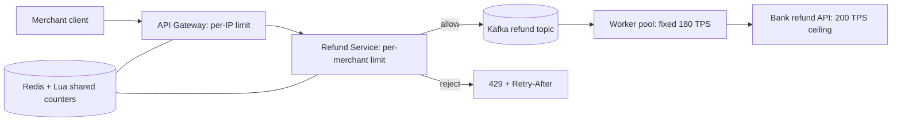
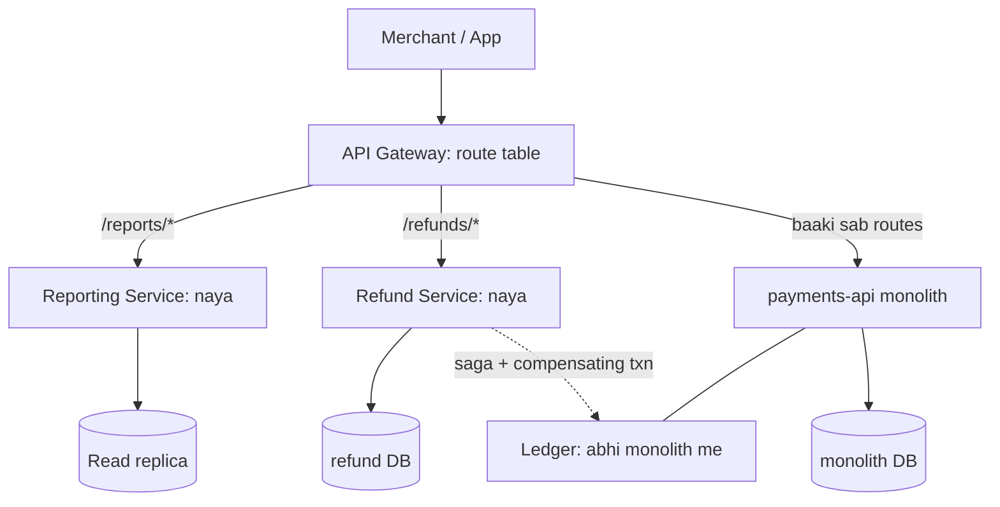
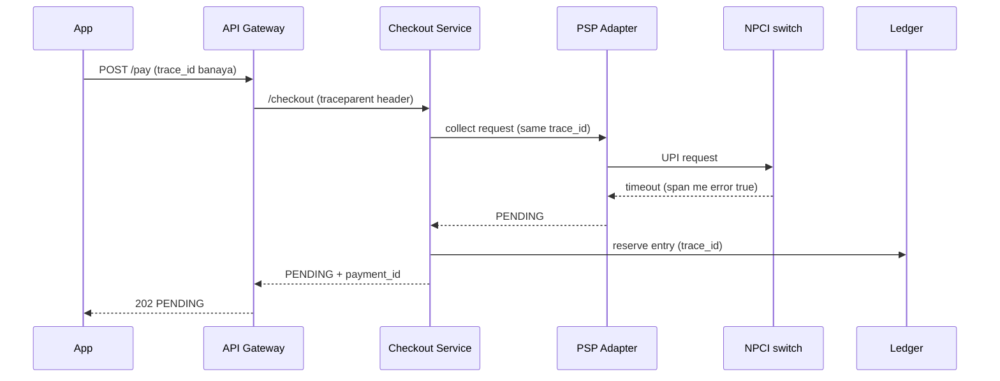
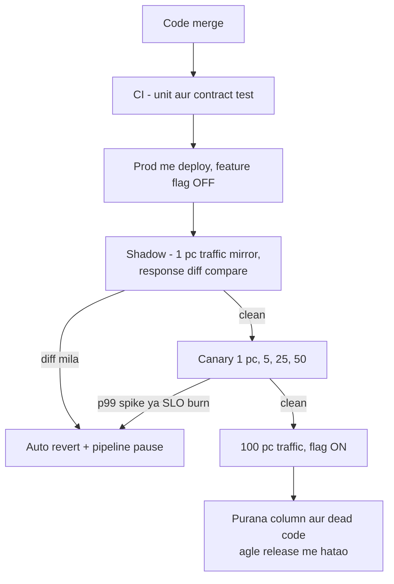

# 1F · Ops Tower

Oct 3, 2026 · @saurav chaurasiya

Is doc me chaar lessons hain: L1.21 Rate limiting, L1.22 Monolith vs Microservices, L1.23 Observability, aur L1.23a Distributed system ka testing aur release. Ye zone Part 1 ka last padav hai — yahan tak aane ke baad tum ek system ko sirf design nahi, chalaa aur safely release bhi kar sakte ho.

---

## L1.21 — Rate limiting

Rate limiting ka matlab hai: ek caller (user, merchant, IP address, ya tumhari hi doosri service) ko ek fixed time window me sirf N requests bhejne dena, aur N se zyada aane pe mana kar dena. Mana karne ka standard tarika HTTP status code `429 Too Many Requests` bhejna hai.

### Ye cheez hai kya

- Category: traffic control. Ye admission control hai — gate pe baithta hai, asli kaam shuru hone se pehle decide karta hai ki request andar aayegi ya nahi.
- Kis problem ke liye: tumhara server infinite nahi hai. Ek buggy client, ek bot, ya ek badi merchant integration poori capacity kha jaati hai, aur phir baaki sab users ko bhi service down dikhti hai.
- Is lesson ke baad: 4 algorithms ka trade-off bata paoge, 20 pods ke beech ek shared atomic counter design kar paoge, aur layered limits (per-IP, per-merchant, per-downstream) lagaa paoge.

Analogy: bank me ek hi cashier window hai. Guard sirf 10 logo ko line me khada hone deta hai, 11th ko bolta hai bees minute baad aao. Guard do kaam karta hai — cashier ko bachata hai, aur line me khade 10 logo ko predictable service deta hai.

### Sawaal

Paytm ka refund API hai: `POST /v1/refunds`. Ek travel merchant ka cron job raat 2 baje chal jaata hai aur 5 minute me 80,000 refund requests maar deta hai. Tumhara refund service 2,000 TPS (transactions per second — ek second me kitni requests) handle karta hai, par peeche bank ka refund API sirf 200 TPS leta hai. Result: refund service ke saare threads bhar gaye, bank timeout dene laga, aur ek dusre chhote merchant ka normal refund bhi fail ho raha hai. Design karo.

> Pehle khud socho — 5 min. Hints: (1) limit kis key pe lagegi — IP, merchant, ya endpoint? (2) tumhare paas 20 server pods hain, counter kahan rakhoge? (3) bank ka 200 TPS ceiling tumhare inbound limit se bilkul alag cheez hai — dono ek saath kaise handle honge?

### Problem kyun aata hai

- Capacity shared hai par clients independent hain. Koi bhi ek client poora pool kha sakta hai — isko noisy neighbour problem kehte hain.
- Downstream tumse dheema hai. Bank 200 TPS leta hai, tum 2,000 bhej sakte ho, toh tum apne hi partner ko gira doge. UPI ke case me NPCI penalty bhi laga sakta hai.
- Retry storm: client fail hone pe turant retry karta hai, load badhta hai, aur zyada fail hota hai. Isko retry amplification kehte hain.
- Threads finite hain. Ek slow downstream pe 500 requests wait kar rahi hain matlab 500 threads blocked hain — naye healthy requests ke liye kuch bacha hi nahi. Ye backpressure ki kami hai (backpressure — jab system full ho to upar wale caller ko saaf saaf ruk jao bolna, chup-chaap queue me daal ke uska wait badhate rehna nahi).

### Naive approach

- Pehla obvious solution: har pod me in-memory counter rakh lo — `Map<merchantId, AtomicInteger>`, har minute reset.
- Kahan tootta hai: tumhare 20 pods hain. Limit 600 req/min set ki, par merchant ko actually 20 × 600 = 12,000 req/min mil gaye, kyunki har pod sirf apna count dekh raha hai. Load balancer requests baant raha hai, counter nahi baantta.
- Doosra naive solution: per-minute fixed window counter. 11:59:59 pe 600 requests aur 12:00:01 pe 600 — 2 second me 1,200 requests nikal gayi. Window ki boundary pe burst leak hota hai.

### Sahi design

1. Limit ki key ek nahi, layers me socho. Per-IP gateway pe (bot protection), per-merchant-per-endpoint service pe (fairness), aur per-downstream outbound client pe (bank ko bachane ke liye).
2. Inbound limit ke liye shared store: Redis me ek counter per key. Redis single-threaded hai aur ek Lua script ko atomically chalata hai (atomic — poora script ek hi step me chalta hai, beech me koi doosra client ghus nahi sakta), isliye padho-badhao-compare 20 pods ke beech bhi safe hai.
3. Algorithm: sliding window counter. Current window aur pichle window ka weighted hissa jodo. Isse boundary burst khatam ho jaata hai aur memory sirf 2 counters ki lagti hai.
4. Reject karne ka saleeka: `429` ke saath `Retry-After: 30` header aur `X-RateLimit-Remaining` bhejo. Client ko exact wait time batana zaroori hai, warna wo 10 ms baad phir try karega.
5. Outbound (bank ki taraf) pe rate limit se behtar concurrency limit plus bounded queue hai: N worker threads aur ek fixed-size queue, taki bank ko 200 TPS se zyada kabhi na jaaye. Queue full ho to caller ko turant 429 ya 503 — chup-chaap wait nahi.
6. Refund jaise async kaam ke liye best design: request turant accept karo, Kafka topic pe daalo, aur consumer ko fixed rate pe chalao. Phir rate limiting reject karne ki jagah traffic ko smooth karne ka kaam karti hai.

Neeche ka diagram wahi design dikhata hai — gateway pe pehli layer, service pe doosri, aur bank se pehle worker pool jo rate fix rakhta hai.



Ye Lua script Redis me chalti hai aur sliding window counter ka faisla ek atomic step me deti hai — 1 matlab allow, 0 matlab 429.

```lua
-- KEYS[1] = current window ka key, KEYS[2] = pichle window ka key
-- ARGV[1] = limit, ARGV[2] = window seconds, ARGV[3] = current window me kitna beet gaya (0.0 se 1.0)
local cur  = tonumber(redis.call('GET', KEYS[1]) or 0)
local prev = tonumber(redis.call('GET', KEYS[2]) or 0)
local elapsed = tonumber(ARGV[3])

-- pichle window ka sirf bacha hua hissa count karo, isse boundary burst nahi nikalta
local weighted = prev * (1 - elapsed) + cur

if weighted + 1 > tonumber(ARGV[1]) then
  return 0                                      -- reject karo
end

redis.call('INCR', KEYS[1])
redis.call('EXPIRE', KEYS[1], tonumber(ARGV[2]) * 2)
return 1                                        -- allow karo
```

### Kya choose karein aur kyun

| Option | Kab use karo | Kab mat karo |
| --- | --- | --- |
| Token bucket (bucket me tokens bharte rehte hain, har request ek token leti hai) | Jab short burst allow karna ho — user ne 5 bar jaldi click kiya, usko block nahi karna | Jab downstream burst bardaasht hi na kare, jaise bank ka 200 TPS hard ceiling |
| Leaky bucket (requests queue me aati hain, fixed rate pe nikalti hain) | Jab downstream ko ekdum smooth rate chahiye; outbound bank calls ke liye best | Jab latency matter karti ho — queue me baithi request ka wait badhta hai |
| Fixed window counter (per minute counter, minute badalne pe reset) | Quick, cheap, internal dashboards ya low-stakes APIs | Public paid API pe — boundary pe 2x burst nikal jaata hai |
| Sliding window counter (current + pichla window weighted) | Default choice public APIs ke liye — accuracy aur memory ka best balance | Jab exact-to-the-millisecond fairness chahiye; tab sliding window log lo (mehnga hai) |

### India me kaise hota hai

- NPCI ne April-May 2025 me UPI ke liye API-level hard limits daal diye, kyunki banks ke check-transaction-status calls se hi outage ho raha tha. Check Transaction Status API ka pehla call original transaction ke 90 second baad hi ho sakta hai; Balance Enquiry 50 requests per app per customer per day; List Account 25 per app per customer per day; AutoPay mandate pe maximum 1 attempt aur 3 retries. Peak hours 10 AM–1 PM aur 5 PM–9:30 PM declare kiye gaye, aur compliance deadline 31 July 2025 thi — non-compliance pe API restrictions aur penalty. ([Inc42 — NPCI additional measures](https://inc42.com/buzz/npci-brings-in-additional-measures-to-curb-upi-outage), [MediaNama](https://www.medianama.com/2025/04/223-npci-new-guidelines-upi-outage/))
- Matlab: India me payment system me rate limiting optional optimisation nahi, regulatory requirement hai. Interview me ye bolna strong signal hai.
- Razorpay apne public API pe `RATE_LIMIT_EXCEEDED` error code aur 429 deta hai, aur docs me clients ko exponential backoff bolta hai. ([Razorpay — Understand APIs](https://razorpay.com/docs/api/understand), [Razorpay error codes](https://razorpay.com/docs/errors/common.md))
- Stripe public me apna multi-tier limiter describe karta hai: request rate limiter, concurrent request limiter, fleet usage load shedder, aur worker utilisation load shedder — chaar alag layers, alag purpose. ([Stripe — Scaling your API with rate limiters](https://stripe.com/blog/rate-limiters))

### Interview follow-ups

- **Limiter ka Redis hi down ho gaya to?** Fail-open ya fail-close decide karo pehle se. Payments me usually fail-open with a conservative local token bucket — business rukna nahi chahiye, par unlimited bhi nahi.
- **429 aur 503 me difference?** 429 matlab tumne limit cross ki, thodi der baad tumhari baari aayegi. 503 matlab server overloaded hai, galti tumhari nahi. Dono me `Retry-After` bhejo.
- **Ek merchant ka hot key Redis ko hi gira de to?** Hot key matlab ek hi key pe itna traffic ki wo ek Redis shard sambhaal na sake. Fix: us merchant ke liye key ko N sub-keys me split karo (`m123:0` se `m123:9`), ya local token bucket plus periodic Redis sync.
- **Rate limit kis layer pe — gateway ya service?** Dono. Gateway coarse aur sasta (per-IP), service fine aur business-aware (per-merchant-per-endpoint). Gateway ko merchant plan ka pata nahi hota.
- **Limit kaise choose karoge number me?** Observed p99 traffic ka 2x se shuru karo, shadow mode me chalao (reject mat karo, sirf log karo), ek hafte ka data dekho, phir enforce karo.

### Self-check

1. Token bucket ke do parameters kaunse hain aur unka matlab kya hai?
2. Fixed window counter ka exact flaw kya hai — ek example number ke saath batao.
3. Distributed limiter me Lua script kyun chahiye, plain GET-INCR kyun nahi?
4. Inbound rate limit aur outbound concurrency limit me kya structural difference hai?
5. `Retry-After` header na bhejne se kya nuksaan hota hai?

### Notebook

Token bucket = burst allowed · Leaky bucket = smooth output rate · Fixed window = boundary pe 2x burst · Sliding window counter = default best trade-off · Redis + Lua = atomic across pods · Reject = 429 + Retry-After + X-RateLimit-Remaining · Layers = per-IP gateway, per-merchant service, per-downstream outbound · Outbound ke liye concurrency limit + bounded queue, rate limit nahi · NPCI 2025: check-status pehla call 90 sec baad, balance enquiry 50/day, autopay 1 + 3 retries · Shadow mode me limit tune karo phir enforce.

### Padhne ke liye

- [Stripe — Scaling your API with rate limiters](https://stripe.com/blog/rate-limiters)
- [Karan Pratap Singh — Rate limiting](https://www.karanpratapsingh.com/courses/system-design/rate-limiting)
- [Inc42 — NPCI brings in additional measures to curb UPI outage](https://inc42.com/buzz/npci-brings-in-additional-measures-to-curb-upi-outage)
- [Razorpay — Understand Razorpay APIs](https://razorpay.com/docs/api/understand)

### Deep Dive (SDE-2) — jab time ho

#### Hot key aur local-plus-global limiter

Ultra-high QPS (queries per second) pe har request pe Redis round-trip 0.5 ms bhi add kare to p99 (p99 — 100 requests me 99th sabse slow request ka time, matlab lagbhag worst-case user experience) kharab ho jaata hai. Pattern: har pod me local token bucket rakho jo global limit ka 1/N hissa hai, aur har 100 ms me Redis se actual consumption sync karo. Trade-off: limit approximate ho jaati hai (kuch percent over-admit), par Redis hot key aur latency dono bach jaate hain.

#### Rate limiting vs load shedding vs admission control

Teen alag cheezein hain. Rate limiting per-caller fairness ke liye hai (tumhara quota khatam). Load shedding system health ke liye hai (server 90% CPU pe hai, sabse kam important traffic drop karo). Admission control queue depth dekh ke decide karta hai (queue me 500 requests hain, 501st ko turant reject karo kyunki uska SLA toh already miss ho chuka hoga). Interview me teeno naam lena aur alag-alag layer pe rakhna SDE-2 signal hai.

#### Sliding window log ki asli cost

Sliding window log me tum har request ka timestamp Redis sorted set me rakhte ho aur purane timestamps `ZREMRANGEBYSCORE` se hata dete ho. Ye perfectly accurate hai, par memory O(limit) per key hai — 10,000 req/min limit wale 50,000 merchants matlab 500 million entries. Isliye production me counter-based sliding window jeetta hai: 2 integers per key, accuracy 99% se upar.

#### Multi-tenant fairness: fair queueing

Jab 1,000 merchants ek hi worker pool share karte hain, pure FIFO queue me ek bada merchant 90% slots le leta hai. Weighted fair queueing me har merchant ki apni sub-queue hoti hai aur worker round-robin se uthata hai, weight merchant ke plan se. Ye Kafka consumer me partition-per-merchant-group se approximate kiya jaata hai.

---

## L1.22 — Monolith vs Microservices

Monolith ek hi deployable unit hai jisme poore application ka code rehta hai — ek jar, ek process, ek database. Microservices me wahi application chhote independently deployable services me tooti hoti hai, har service ka apna code, apni owning team, aur aadarsh roop me apna database.

### Ye cheez hai kya

- Category: architecture style aur team structure ka decision. Ye technical choice se zyada organisational choice hai.
- Kis problem ke liye: jab ek codebase pe itne log kaam karne lagte hain ki deploy, testing aur scaling ek dusre ko block karne lagte hain, tab boundaries banani padti hain.
- Is lesson ke baad: tum interview me microservices ko default jawab nahi doge — tum pehle problem measure karoge, phir boundary justify karoge, aur migration ka safe raasta bata paoge.

Analogy: tiffin service. Shuru me ek hi kitchen hai jahan sabzi, roti, packing aur delivery sab hota hai — fast aur simple. Jab 5,000 tiffin roz jaane lage to roti ki unit, sabzi ki unit aur delivery ki unit alag ho jaati hain. Par ab unke beech coordination ka ek naya kaam paida ho gaya, jo pehle nahi tha. Microservices ka cost yahi coordination hai.

### Sawaal

Paytm ka ek hi `payments-api` monolith hai jisme checkout, refund, settlement, merchant onboarding aur reporting sab modules hain. 40 engineers, ek deploy pipeline, ek deploy me 50 minute, aur reporting ka ek heavy analytics query kal poora checkout gira diya tha. VP bolte hain microservices me tod do. Tum tech lead ho — 6 mahine ka plan banao, aur bolo kya pehle todoge aur kya nahi todoge.

> Pehle khud socho — 5 min. Hints: (1) kaunsa module sabse zyada dard de raha hai, aur kyun? (2) agar refund alag service bana diya to refund aur ledger ka update ek saath kaise hoga? (3) kya kuch aisa hai jo todne se cheezein ulta kharab ho jaayengi?

### Problem kyun aata hai

- Shared failure domain: ek module ka memory leak ya runaway query poore process ko le dooba. Reporting ne checkout gira diya — business ka sabse important path, sabse kam important feature ki wajah se down.
- Deploy coupling: 40 engineers ek hi pipeline ki queue me hain. Ek team ka failing test sabka release rok deta hai, aur 50 minute ka deploy matlab hotfix bhi dheema.
- Scaling coupling: reporting ko RAM chahiye, checkout ko CPU aur low latency. Ek hi box me dono matlab tum dono ke liye over-provision karte ho aur paisa jalaate ho.
- Team coupling: ek file pe teen team ka ownership matlab review aur merge conflict ka constant friction. Conway ka observation yahi hai — system ki shape team ki communication structure jaisi ban jaati hai.

### Naive approach

- Pehla obvious solution: sab kuch ek saath 20 microservices me tod do, big-bang rewrite, 6 mahine me cutover.
- Kahan tootta hai, exactly:
  - Business 6 mahine rukta nahi. Naye features purane monolith me bhi jaate rahenge, matlab tum do codebase maintain kar rahe ho aur rewrite hamesha peeche chhoota rehta hai.
  - Distributed transaction problem: pehle `refund` aur `ledger_entry` ek hi DB transaction me likhte the. Ab do service hain, to ACID (Atomicity Consistency Isolation Durability — ek DB transaction ki guarantee ki ya sab change hoga ya kuch bhi nahi) nahi milta. Refund likh gaya, ledger fail ho gaya, aur paisa books me gayab.
  - Latency jud jaati hai: 8 in-process method calls ab 8 network calls hain, har ek pe 2–5 ms aur failure ki ek nayi possibility.
  - Ops burden: 20 services matlab 20 dashboards, 20 oncall rotations, 20 pipelines. 40 engineers ke liye ye bahut zyada hai.

### Sahi design

1. Pehle dard measure karo, architecture baad me. Teen numbers nikaalo: deploy frequency, MTTR (mean time to recovery — incident shuru hone se theek hone tak ka average time), aur kaunsa module kitne incidents ka source hai. Agar reporting 70% incidents ka source hai to answer microservices nahi, sirf reporting ko alag karna hai.
2. Boundaries business ke hisaab se dhundho, technical layer ke hisaab se nahi. Checkout, refund, settlement, onboarding — ye bounded contexts hain (bounded context — business ka ek aisa hissa jiske andar ke words aur rules self-consistent hain, jaise refund ke andar `amount` ka ek hi clear matlab hai). Galat boundaries: `user-service`, `db-service`, `util-service`.
3. Strangler fig pattern se migrate karo, big bang se nahi. Monolith ke saamne ek routing layer (API gateway) lagao. Pehla module nikalo, gateway se us ek route ko naye service pe bhejo, baaki sab monolith pe hi rahe. Agle module ke liye wahi dohraao. Purana code tab tak chalta rehta hai jab tak naya proven na ho jaaye, aur rollback sirf ek route table change hai. ([Martin Fowler — Strangler Fig](https://martinfowler.com/bliki/StranglerFigApplication.html))
4. Pehla candidate wahi lo jisme sabse zyada dard aur sabse kam coupling ho. Yahan reporting — wo read-only hai, uske paas koi write transaction nahi, isliye extraction safe hai. Checkout sabse last me, kyunki wahan paisa hai.
5. Jab boundary ek business transaction ko kaat de, to saga pattern lagao: do service ke beech ek distributed workflow, jisme har step ka ek compensating transaction hota hai (compensating transaction — galti hone pe pichla step ulta karne wala step, jaise refund ke liye reverse-ledger-entry). Detail me ye `L2.9 — Saga pattern (abhi banna baaki)` me aayega.
6. Beech ka safe option mat bhoolo: modular monolith. Ek hi deployable, par andar strict module boundaries, module-level ownership, aur modules ke beech sirf declared interfaces. Deploy coupling bana rehta hai, par ownership clarity mil jaati hai aur distributed transaction ka dard bilkul nahi aata.

Neeche strangler fig migration ka shape hai: gateway route-by-route traffic shift karta hai, aur monolith dheere-dheere chhota hota jaata hai.



### Kya choose karein aur kyun

| Option | Kab use karo | Kab mat karo |
| --- | --- | --- |
| Monolith (ek deployable, ek DB) | Nayi product, team 15 se kam, requirements roz badal rahe hain, boundaries abhi pata nahi | Jab ek module ke incidents baaki sabko gira rahe hon, ya deploy queue hafte bhar ki ho |
| Modular monolith (ek deployable, andar strict modules) | 15–60 engineers, boundaries clear ho rahi hain, par distributed transaction ka dard nahi chahiye | Jab do modules ki scaling profile bilkul alag ho — ek ko 50 GB RAM, ek ko 200 pods |
| Microservices (alag deployable, alag DB) | Independent scaling, independent deploy aur alag team ownership — teeno chahiye, aur ek platform team maujood hai | Team chhoti hai, ops maturity nahi hai, ya boundaries abhi sirf guess hain |
| Service-per-team (microservices ka practical roop) | Jab har service ka ek clear owning team ho — ek team, ek se teen services | Jab ek team 10 services oncall kar rahi ho; wo tooti hui boundary ka pakka sign hai |

### India me kaise hota hai

- Razorpay AWS pe 100 se zyada microservices chalata hai, hazaaron containers aur nodes, aur 500 se zyada engineers unke observability platform pe. Matlab microservices ke saath ek dedicated platform aur observability investment bhi aayi — services muft nahi aati. ([Coralogix — Razorpay case study](https://coralogix.com/case-studies/razorpay/))
- Indian payments me ek extra constraint hai jo global examples me kam dikhta hai: ledger aur reconciliation ka ek single source of truth banaye rakhna, kyunki RBI/NPCI ke saamne wahi jawab deta hai. Isliye yahan pattern aam hai — edge services (checkout UI, notification, reporting) pehle tootti hain, aur ledger lambe time tak ek hi strongly consistent service rehta hai.
- Monolith-first ka argument serious literature hai, blog opinion nahi: Fowler khud bolte hain ki jab tak boundaries pata na hon, monolith se shuru karna hi sasta padta hai. ([Martin Fowler — MonolithFirst](https://martinfowler.com/bliki/MonolithFirst.html))

### Interview follow-ups

- **Microservices ka sabse bada hidden cost kya hai?** Data. Ek DB transaction ki jagah saga, eventual consistency (eventual consistency — kuch der ke liye do jagah ka data alag dikhega, baad me match ho jaayega), aur cross-service reporting ke liye ek naya pipeline.
- **Ek service ka DB doosri service kabhi padh sakti hai?** Nahi. Wo shared database anti-pattern ban jaata hai aur tum distributed monolith bana dete ho — deploy independence tooti hui, par network latency poora. Read chahiye to API ya event stream.
- **Kitni choti service theek hai?** Paimana lines of code nahi, ownership hai. Agar ek team teen se zyada services oncall kar rahi hai, services bahut choti hain.
- **Distributed monolith kya hai?** Alag deployables jo practically ek saath hi deploy ho sakte hain, kyunki unke beech synchronous call chain aur shared schema hai. Ye dono duniya ka bura hissa hai.
- **Rollback kaise karoge strangler migration me?** Gateway ki route table hi tumhara rollback switch hai — ek route wapas monolith pe point kar do. Isliye migration ke dauraan data dono jagah compatible rakhna padta hai.
- **Kya microservices se performance badhti hai?** Nahi, usually ghatti hai — network hops add hote hain. Fayda independent scaling, isolation aur team velocity ka hai. Interview me ye honestly bolna strong signal hai.

### Self-check

1. Strangler fig pattern me sabse pehla step exactly kya hai?
2. Bounded context ka ek sahi example aur ek galat example batao.
3. Distributed monolith kis cheez se banta hai?
4. Modular monolith microservices ka kaunsa dard bachaata hai, aur kaunsa nahi bachaata?
5. Pehla module extract karne ke liye kis cheez ko criteria banaoge aur kyun?

### Notebook

Monolith = ek deployable ek DB · Microservices = alag deployable alag DB alag team · Pehle dard measure karo: deploy frequency, MTTR, incident source · Boundary business ki (bounded context), technical layer ki nahi · Migration = strangler fig via gateway route table, big bang nahi · Pehla candidate = max dard min coupling, usually read-only module · Business transaction kata to saga + compensating transaction · Modular monolith = beech ka valid option · Shared DB across services = distributed monolith anti-pattern · Microservices latency badhati hai, velocity aur isolation deti hai · Razorpay 100+ services ke saath dedicated observability platform.

### Padhne ke liye

- [Martin Fowler — Microservices](https://martinfowler.com/articles/microservices.html)
- [Martin Fowler — Strangler Fig Application](https://martinfowler.com/bliki/StranglerFigApplication.html)
- [Martin Fowler — MonolithFirst](https://martinfowler.com/bliki/MonolithFirst.html)
- [Coralogix — Razorpay case study (100+ microservices)](https://coralogix.com/case-studies/razorpay/)

### Deep Dive (SDE-2) — jab time ho

#### Database decomposition: sabse mushkil hissa

Code todna aasaan hai, data todna nahi. Safe sequence yahi chalta hai: (1) naye service ko purane DB se padhne do, likhne monolith hi de; (2) phir dual-write — monolith aur naya DB dono me likho, aur ek reconciliation job roz mismatch report kare; (3) jab mismatch kuch hafte tak zero rahe, read ko naye DB pe shift karo; (4) phir monolith ka write hatao. Har step reversible hai, aur reconciliation job hi tumhara proof hai ki data theek hai.

#### Service boundary ka test: ek deploy, ek team, ek failure

Ek proposed boundary acchi hai agar teen baatein sach hon — usko akele deploy kar sakte ho, ek hi team uska code aur oncall dono owns karti hai, aur uska down hona baaki system ko degrade karta hai par poora kill nahi karta. Teen me se ek bhi na ho to boundary galat hai. Interview me ye teen test bol dena poore answer ko structure de deta hai.

#### Synchronous chain ki availability math

Agar ek request 5 services se synchronously guzarti hai aur har service 99.9% available hai, to overall availability 0.999 ki 5th power = 99.5% ho jaati hai — mahine me lagbhag 3.6 ghante downtime, jabki har service apna target hit kar rahi hai. Isliye deep synchronous chains ko event-driven me todna availability ka structural fix hai, optimisation nahi. Ye 1E · Kafka River ke async patterns se seedha jud jaata hai.

#### Conway ka law ulta chalaana

Inverse Conway manoeuvre: pehle teams ko us shape me reorganise karo jo architecture tum chahte ho, phir architecture apne aap us shape me aa jaata hai. Agar tum services tod dete ho par team structure wahi rehta hai, to log cross-service shortcuts bana lenge aur boundaries chhe mahine me ghul jaayengi.

---

## L1.23 — Observability (logs, metrics, traces, SLOs)

Observability ka matlab hai: system ke bahar nikal rahe signals dekh ke tum andar ki haalat samajh lo, bina naya code deploy kiye. Teen basic signals hote hain — logs (kya hua, ek event ki poori detail), metrics (kitna hua, numbers over time), aur traces (ek request ka poora safar, service se service tak).

### Ye cheez hai kya

- Category: operations aur reliability. Ye feature nahi, ye tumhari debugging ki aankh hai.
- Kis problem ke liye: production me wo problem aati hai jo tumne test me kabhi nahi dekhi. Monitoring tumhe bataati hai ki kuch galat hai; observability tumhe bataati hai kya aur kyun galat hai.
- Is lesson ke baad: teen signals ka sahi use bata paoge, ek distributed request ko end-to-end trace kar paoge, aur SLO plus error budget se incident ki priority decide kar paoge.

Analogy: cricket scoreboard. Metrics scoreboard ke numbers hain (runs, wickets, over rate) — ek nazar me haalat. Logs ball-by-ball commentary hain — har event ki detail. Trace ek particular batsman ki poori innings hai — wo kab aaya, kis bowler ne kya daala, kahan out hua. Teeno chahiye; sirf score dekh ke tum nahi bata sakte ki kyun haar rahe ho.

### Sawaal

Subah 10:40 pe support ka message aata hai: kuch merchants bol rahe hain ki UPI payment me customer ka paisa cut gaya par order confirm nahi hua. Tumhare dashboard pe overall success rate 98.7% hai, jo normal lagta hai. Tumhare paas 12 services hain. Batao exactly kaunse signals me, kis order me dekhoge, aur 10 minute me root cause tak kaise pahunchoge.

> Pehle khud socho — 5 min. Hints: (1) 98.7% ka average kis cheez ko chhupa raha hai? (2) ek specific failing payment ka ID mil jaaye to usko 12 services me kaise follow karoge? (3) kya tumhe likha hua pata hai ki tumhara acceptable failure level kitna hai?

### Problem kyun aata hai

- Average jhoot bolta hai. 98.7% overall success ka matlab ye bhi ho sakta hai ki ek bank ka handle 60% pe hai aur baaki sab 100% pe. Aggregate me wo dikhta hi nahi — isliye metrics pe dimensions (bank, payment method, merchant tier) chahiye.
- Request ek service me nahi rehti. 12 services ki 12 alag log streams me ek hi payment ke 12 tukde pade hain, aur unko jodne wala koi common dhaaga nahi hai.
- p50 (median — beech wala user) theek dikhta hai jab p99 (sabse slow 1% users ka time) bilkul tooti hui hoti hai. Payments me wahi 1% complaint karta hai.
- Kitna failure acceptable hai, ye kahin likha hi nahi hai. Isliye har alert pe panic hota hai, aur asli emergency shor me dab jaati hai. Isko alert fatigue kehte hain.

### Naive approach

- Pehla obvious solution: har jagah `log.info` daal do aur zaroorat pe grep karte raho.
- Kahan tootta hai: 12 services, roz terabytes logs. Tumhe payment ID pata hai par pata nahi kis service me dekhna hai, aur ek service ke 20 pods me se kis pod me. Jab tak tum dhundhte ho, 40 minute beet jaate hain aur incident badh jaata hai.
- Doosra naive solution: ek hi dashboard pe overall success rate aur CPU. Ye tumhe confidently bataata hai ki sab theek hai, jab ek bank ka handle poora gir chuka hai.

### Sahi design

1. Har request ke entry point pe ek `trace_id` generate karo, aur usko har downstream call ke header me aage bhejo (HTTP me standard header `traceparent` hai). Har log line me `trace_id` ke saath business keys (`payment_id`, `merchant_id`) bhi daalo. Ab ek payment ka poora safar ek query me nikal aata hai. Isko context propagation kehte hain.
2. Structured logging use karo, plain text nahi — JSON me named fields. Phir `grep` ki jagah `payment_id = X` jaisa query chalega, aur log volume ko field ke hisaab se sample bhi kar sakoge.
3. Metrics pe sirf low-cardinality dimensions rakho: bank handle, payment method, error code, merchant tier. Cardinality ka matlab ek label ke kitne unique values hain — `merchant_id` ko metric label banana (lakhon values) tumhara metrics store uda dega. Wo log aur trace me rakho.
4. Har service pe teen RED metrics rakho: Rate (requests per second), Errors (error percentage), Duration (latency distribution — p50, p95, p99). Infra ke liye USE: Utilisation, Saturation, Errors.
5. Traces ke liye OpenTelemetry standard use karo. Ek span ek operation ka ek time-interval hota hai (span — jaise ek DB call ya ek HTTP call), aur spans ka parent-child tree milke ek trace banata hai. Head sampling (shuru me hi 1% requests chun lena) sasta hai, par tail sampling (poora trace buffer karo, aur end me sirf failed ya slow traces rakho) debugging ke liye kaafi behtar hai.
6. SLI, SLO aur error budget likho. SLI (service level indicator) = measured number, jaise successful UPI payments divided by total UPI payments. SLO (service level objective) = us number ka target, jaise 99.9% over 28 days. Error budget = 100% minus SLO, matlab 28 din me 0.1% failures allowed hain. Alert error budget ke burn rate pe karo, raw error count pe nahi.
7. Alerting ka rule: symptom pe alert karo (merchants ki payments fail ho rahi hain), cause pe nahi (CPU 85% hai). Causes dashboards pe rakho, pager pe nahi.

Neeche ek UPI payment ka trace hai — ek hi `trace_id` saare services se guzarta hai, aur wahi tumhara debugging ka dhaaga hai. Dekho ki failure PSP adapter aur NPCI ke beech hua, par client ko 202 PENDING mila.



### Kya choose karein aur kyun

| Option | Kab use karo | Kab mat karo |
| --- | --- | --- |
| Logs (per-event detail) | Jab ek specific request ki poori kahani chahiye — kya values thi, kaunsa branch chala, kya exception aaya | Kuch count karne ke liye — wo mehnga aur dheema hai; aur high-volume success paths pe full logging ke liye |
| Metrics (numbers over time) | Dashboards, alerts, trends, capacity planning — sasta aur fast | Jab per-request detail chahiye, ya jab label me unique IDs daalne ka man kare |
| Traces (request ka safar) | Multi-service latency aur failure localisation — kaunsa hop slow tha ya kahan toota | Single-service CRUD app me; wahan logs plus metrics kaafi hain |
| SLO plus error budget | Jab decide karna ho ki incident abhi uthao ya Monday ko, aur feature vs reliability ki priority settle karni ho | Jab tumhare paas ek bhi reliable SLI na ho — pehle measurement banao, target baad me |

### India me kaise hota hai

- Razorpay ka scale: AWS pe 100 se zyada microservices, hazaaron containers aur nodes, aur 500 se zyada engineers ek observability platform pe. Unka stated problem yahi tha ki data volume badhne pe purana setup kaafi nahi raha aur ingestion optimise karne ke liye visibility chahiye thi. Matlab observability ka cost control khud ek design problem hai. ([Coralogix — Razorpay case study](https://coralogix.com/case-studies/razorpay/))
- UPI me ek India-specific signal hai jo global systems me nahi hota: per-bank-handle success rate. Ek bank ka handle gir jaata hai aur overall number theek dikhta hai, isliye yahan bank-wise cut ke bina dashboards almost useless hain.
- Ulta bhi sach hai: observability ka galat use outage ki wajah ban sakta hai. NPCI ne 2025 me banks ko bola ki aggressive check-transaction-status polling hi UPI outages ko amplify kar rahi thi, aur pehla status call original transaction ke 90 second baad hi allow kiya. ([Inc42 — NPCI additional measures](https://inc42.com/buzz/npci-brings-in-additional-measures-to-curb-upi-outage))
- SLO aur error budget ka canonical reference Google ka SRE book hai, aur industry interviews me usi vocabulary me baat hoti hai. ([Google SRE — Service Level Objectives](https://sre.google/sre-book/service-level-objectives/))

### Interview follow-ups

- **Monitoring aur observability me farq?** Monitoring pre-defined questions ka jawab deta hai (CPU kitna hai). Observability un questions ka jawab deta hai jo tumne pehle soche hi nahi the — uske liye high-cardinality data aur ad-hoc query chahiye.
- **p99 kyun dekhte ho jab p50 theek hai?** Kyunki ek crore requests pe 1% matlab ek lakh naaraz users. Payments me p99 hi tumhari reputation hai.
- **Cardinality explosion kya hai?** Metric label me bahut saare unique values (jaise `payment_id`) daal dena. Har unique label combination ek naya time series banata hai, aur metrics store memory me hi phat jaata hai.
- **Logs ka cost kaise control karoge?** Sampling (success ka 1%, error ka 100%), retention tiers (7 din hot search, 90 din cold object storage), aur debug logs ko ek dynamic flag ke peeche rakhna.
- **Error budget khatam ho gaya to kya hota hai?** Convention: naye feature rollouts rok do, reliability work ko priority do, jab tak budget recover na ho. Yahi SLO ka asli point hai — wo ek negotiation tool hai, sirf number nahi.
- **Trace sampling me failing request chhoot gayi to?** Isliye tail sampling: pehle poora trace buffer karo, decision end me lo — error ya high latency wale traces 100% rakho, baaki 1%.
- **Ek hi payment ke do service me do alag status dikhein to?** Wo observability ka sawaal nahi, consistency ka hai — aur uska jawab reconciliation hai. Ye `L2.21 — Reconciliation basics (abhi banna baaki)` me aayega.

### Self-check

1. Logs, metrics aur traces me se kaunsa kis sawaal ke liye hai — ek line me teeno.
2. `trace_id` ka kaam exactly kya hai, aur wo kahan generate hota hai?
3. SLI, SLO aur error budget ka ek concrete payments example banao, numbers ke saath.
4. Cardinality explosion kaise hota hai aur usse kaise bachoge?
5. Alert symptom pe kyun hona chahiye aur cause pe kyun nahi?
6. Head sampling aur tail sampling me kaunsa debugging ke liye behtar hai aur kyun?

### Notebook

Logs = ek event ki detail · Metrics = numbers over time, sasta, low cardinality · Traces = ek request ka multi-service safar · trace\_id entry point pe banao, har header me propagate karo, har log line me rakho · Structured JSON logs, plain text nahi · RED = Rate Errors Duration; USE = Utilisation Saturation Errors · p50 jhoot bolta hai, p99 dekho · Metric label me payment\_id kabhi nahi (cardinality explosion) · SLI = measured ratio, SLO = target, error budget = 100% minus SLO · Alert burn rate pe aur symptom pe, cause pe nahi · Tail sampling behtar hai head sampling se · UPI me per-bank-handle cut zaroori, aggregate chhupa deta hai.

### Padhne ke liye

- [Google SRE Book — Service Level Objectives](https://sre.google/sre-book/service-level-objectives/)
- [OpenTelemetry — Traces](https://opentelemetry.io/docs/concepts/signals/traces/)
- [Coralogix — Razorpay observability case study](https://coralogix.com/case-studies/razorpay/)

### Deep Dive (SDE-2) — jab time ho

#### Multi-window multi-burn-rate alerting

Ek hi threshold se alert karne pe do problem hoti hain: dheema leak detect nahi hota, aur chhota spike jhooth bol deta hai. Recommended shape do alerts hai — ek fast burn (1 ghante me budget ka 2% jal gaya, turant page karo) aur ek slow burn (6 ghante me 5% jal gaya, ticket banao). Isse urgent aur non-urgent apne aap alag ho jaate hain, aur oncall ko raat me sirf asli cheez uthati hai.

#### Observability ka cost, ek design constraint ki tarah

High-traffic payments system me telemetry ka bill compute ke bill ke barabar ho sakta hai. Teen lever hote hain: sampling (error 100%, success 1%), cardinality discipline (merchant-level cuts logs me, metrics me nahi), aur retention tiering. Interview me ye bolna ki tumne telemetry cost ko explicitly budget kiya, senior signal hai.

#### Business metrics bhi observability hain

Technical metrics green ho sakte hain jab business tut raha ho — har API 200 de raha hai, par `successful_payments_per_minute` aadha ho gaya kyunki ek bank chup-chaap PENDING de raha hai. Isliye top-level dashboard pe business counters rakho — payments per minute per bank, settlement lag in minutes, refund backlog size — aur alert in pe bhi karo. Yahi symptom-based alerting ka sabse upar ka layer hai.

#### Reconciliation hi sabse sacha signal hai

Payments me ek signal sabse sach bolta hai: tumhara ledger aur bank ka statement match karte hain ya nahi. Daily reconciliation job ka mismatch count hi tumhara sabse important SLI hai, kyunki wo paise ka sach bataata hai, service health ka nahi. Ek system 100% uptime pe bhi galat ho sakta hai agar uske books match na karein.

---

## L1.23a — Distributed system ka testing aur release

Testing yahan ye pata karne ka kaam hai ki jab 20 service, 3 database aur ek queue ek saath chal rahe hain to system kahan aur kaise tootega. Release ka matlab naye code ko production me itna dheere dalna ki galti sirf thode users tak pahunche aur minute bhar me wapas li ja sake. Dono ek hi cheez ke do aadhe hisse hain — risk ko chhota rakhna.

### Ye cheez hai kya

- Kis category ki cheez hai: ye process aur tooling hai, naya component nahi. Isme koi service add nahi hoti, discipline add hoti hai.
- Kis problem ke liye banayi gayi: unit test apne method ke andar ka bug pakadta hai. Production ka bug integration, timing, load aur partial failure (ek hissa gira, baaki chal raha hai) se aata hai — aur woh staging me reproduce nahi hota.
- Is lesson ke baad tum kya kar paoge: ek load test plan likhna, canary vs blue-green chunna, ek chaos experiment design karna, aur bata dena ki release ke waqt kaun chaar graph dekhne hain.

Ye lesson [L1.23 — Observability](https://claude.ai/code/artifact/6a87e8d2-04fb-418e-b433-e5a88508f83e) pe seedha tika hua hai — jo metric tum release ke waqt dekhna chahte ho, woh pehle se exist karna chahiye.

### Sawaal

Kal subah 9 baje tum `payments-api` ka naya version release kar rahe ho, jisme amount validation ka code badla hai aur ek naya column (`settlement_batch_id`) add hua hai. Peak 4,000 TPS (transactions per second — ek second me kitne requests) 11 baje aata hai. Tumhare paas 40 pod hain, ek rolling deploy, ek Grafana dashboard aur ek on-call banda. Poora release plan likho: kis order me kya, kitna traffic, kya dekhoge, aur rollback ka trigger kya hoga.

> Pehle khud socho — 5 min. Hints: (1) 4,000 TPS ka 1 percent bhi 40 TPS hai — 15 minute me 36,000 asli request (2) rollback ka faisla insaan lega ya ek query (3) naya column bhi saath gaya hai — code rollback hoga to DB ka kya.

### Problem kyun aata hai

- Staging ka data chhota aur traffic banawati hota hai. Production me hot key (ek hi key pe disproportionate load — jaise 10 bade merchant pe 80 percent traffic), ganda merchant payload aur asli cache-miss pattern milte hain.
- Partial failure test me kabhi nahi chalti: ek downstream 2 second slow ho gaya, error nahi diya. Thread pool bhar gaya aur poora service baith gaya — jabki "koi error" nahi tha.
- Ek deploy do cheez ek saath badalta hai: code aur DB schema. Code rollback ho jata hai, migration nahi.
- Average sab chhupa deta hai: p99 (99 percent request isse tez poori hoti hain — matlab sabse slow 1 percent ko chhodkar) 4 second ho jaye aur average phir bhi 40 ms dikhega.

### Naive approach

- "QA ne staging pe pass kar diya, deploy kar do." Staging pe 50 TPS chale the, production 4,000 pe hai — 80 guna farak.
- "Rolling deploy hai, Kubernetes khud sambhal lega." Rolling deploy pod badalta hai; ye nahi dekhta ki naye pod ka error rate paanch guna ho gaya hai. Usko sirf ye pata hai ki process zinda hai.
- "Rollback hai na, zaroorat padi to kar denge." Jab tak rollback ek baar chalaya nahi, woh plan nahi hai — ummeed hai.
- Exactly kahan tootta hai: 40 me se 20 pod naye ho gaye, aadhe user fail ho rahe hain, aur pata 25 minute baad support ticket se chalta hai. Un 25 minute me 4,000 TPS pe lakhon request gayi hain.

### Sahi design

1. Release se pehle load test: peak ka 1.5 guna traffic, production jaisa data. Target ye nahi ki pass ho jaye — target ye hai ki pata chale sabse pehle kya tootta hai (app CPU, DB connection pool, ya koi downstream).
2. Deploy aur release ko alag karo: code deploy karo feature flag OFF ke saath. Flag se release karo. Rollback ka matlab flag off karna hai, naya deploy nahi — yani 10 second, 10 minute nahi.
3. DB migration ko expand, migrate, contract me todo: pehle column add karo nullable (purana code bhi chalta rahe), phir naya code deploy karo, aur purana column kisi agle release me hatao. Ek release me sirf additive change.
4. Canary: 1 percent traffic naye version pe 15 minute, phir 5, 25, 50, 100. Har step pe teen check — error rate, p99 latency, aur ek business metric (jaise successful payments per minute).
5. Gate automated rakho: 5 minute window pe ek query chalao aur threshold cross hone pe pipeline khud revert kare. Insaan ke faisle pe mat chhodo — raat 2 baje koi dashboard nahi dekh raha hoga.
6. Chaos experiment alag din, release ke din nahi: hypothesis likho ("ek DB replica gira to read path cache se chalega aur error rate 0.1 percent se neeche rahega"), blast radius (kitna hissa affect hoga) chhota chuno, business hours me chalao jab team maujood ho, aur kill switch pehle se taiyaar rakho.

Neeche wala flow ek release ka poora rasta dikhata hai, jahan har gate khud revert kar sakta hai.



### Kya choose karein aur kyun

| Option | Kab use karo | Kab mat karo |
| --- | --- | --- |
| Rolling deploy | Stateless service, chhota change, rollback sasta ho | DB migration saath ho, ya change risky ho — isme koi metric gate nahi hai |
| Blue-green | Poora environment swap karna ho, instant rollback chahiye, release window chhota ho | Infra do guna chalane ka cost na de sako, ya service stateful ho |
| Canary | High-traffic service, aur tumhare paas metric se judge karne ka tareeka ho | Traffic kam ho (1 percent me signal hi nahi aayega), ya change sab users ko ek saath chahiye |
| Shadow ya mirror traffic | Read-heavy ya pure-transform path, jahan response ka diff compare karna hai | Side effect wala write path — do baar paisa kat jayega |
| Feature flag | Business logic change, kill switch chahiye, ya A/B karna ho | Library ya infra upgrade — woh flag se on-off nahi hota |

### India me kaise hota hai

- Razorpay ka Checkout service (500+ RPS, monolith se Go microservice migration chal raha hai) canary se pehle shadow analysis chalata hai. Traefik 1 percent production traffic ko naye commit wale mirror deployment pe copy karta hai; ek comparator middleware dono responses ka diff nikalta hai, known noisy field (experiment id, random id) ignore karta hai, aur `shadow_mode_diff_key_counter` naam ka Prometheus counter per-field diff ginta hai. Spinnaker 5 minute window ki PromQL query chalata hai — unexpected diff zero to rollout canary pe aage badhta hai, warna woh khud commit revert karke pipeline pause kar deta hai aur insaan review karta hai ([From Risk to Safety — Razorpay Engineering](https://engineering.razorpay.com/from-risk-to-safety-mastering-deployments-with-shadow-analysis-1e2402161083)). User ko hamesha production ka hi response milta hai, mirror ka nahi.
- Dhyan dene wali line usi article se: 500 RPS pe 1 se 2 percent canary traffic bhi kaafi asli traffic hai — isi liye unhone canary se pehle ek aisa step rakha jisme user ko kuch bhi pahunchta hi nahi.
- Burst event ka prep bhi padhne layak hai: [Handling Burst Traffic during IPL — Razorpay Engineering](https://engineering.razorpay.com/ipl-razorpays-second-innings-ae7c86b0894c) aur [Swiggy ka NYE war room](https://blog.swiggy.com/life-at-swiggy/heres-how-swiggy-setup-a-war-room-for-nye/) — dono ka core idea ek hai: peak se pehle load test aur capacity plan, peak ke dauraan release freeze, aur ek jagah baithe dashboard plus on-call.

### Interview follow-ups

- **Canary me 1 percent traffic kaafi hai?** — TPS pe depend karta hai. 4,000 TPS pe 1 percent = 40 TPS, 15 minute me 36,000 request — signal mil jayega. 20 TPS wali service pe 1 percent = 0.2 TPS, 15 minute me 180 request — usme kuch dikhega hi nahi. Chhoti service pe blue-green ya 50 percent canary better hai.
- **Deploy aur release me fark?** — Deploy matlab binary machine pe pahunch gaya. Release matlab user ko dikhne laga. Feature flag inhe alag karta hai, aur isi se rollback sasta hota hai.
- **DB migration ke saath rollback kaise karoge?** — Expand, migrate, contract. Ek release me sirf additive (nullable column add). Purana column drop tab, jab naya code ek-do release se stable chal raha ho. Isse code rollback karne pe DB ka kuch nahi todna padta.
- **Chaos experiment aur outage me kya fark hai?** — Chaos me chaar cheez pehle se hoti hain: ek likha hua hypothesis, chhota blast radius, kill switch, aur monitoring. In chaaro ke bina woh chaos nahi, bas outage hai.
- **Release ke waqt kaun metric dekhoge?** — Chaar: error rate (5xx), p99 latency, saturation (CPU, thread pool, DB connection), aur ek business metric. Business metric sabse zaroori — service 200 OK de sakti hai aur phir bhi successful payment aadhe ho sakte hain.
- **Shadow traffic kis path pe nahi lagaoge?** — Kisi bhi write ya side-effect wale path pe. Payment capture mirror kar diya to paisa do baar kategaa, SMS do baar jayega.
- **Agar p99 canary pe 20 percent badh gaya par error rate normal hai — aage badhoge?** — Nahi. Latency badhna saturation ka pehla signal hai; 100 percent traffic pe wahi 20 percent timeout ban jayega. Rollback karke pehle wajah dhoondho.

### Self-check

1. Deploy aur release me kya fark hai, aur feature flag kahan fit hota hai?
2. Expand, migrate, contract ke teen step kya hain, aur contract kab karte ho?
3. Shadow traffic kis tarah ke endpoint pe nahi lagana chahiye, aur kyun?
4. 20 TPS wali service pe 1 percent canary kyun bekaar hai, aur uski jagah kya karoge?
5. Chaos experiment ki chaar precondition kaun si hain?
6. Release ke waqt dekhe jane wale chaar metric ginao, aur batao inme business metric kyun sabse important hai.

### Notebook

Load test peak ka 1.5x, production jaisa data · deploy aur release alag, flag se release · expand-migrate-contract, contract agle release me · canary 1-5-25-50-100 with automated query gate aur auto-revert · shadow traffic sirf read ya transform path pe, write pe kabhi nahi · release ke chaar graph: error rate, p99, saturation, business metric · chaos = hypothesis + chhota blast radius + kill switch + monitoring · jab tak rollback chalaya nahi, woh plan nahi hai

### Padhne ke liye

- [Chapter 16, Canarying Releases — Google SRE Workbook](https://sre.google/workbook/canarying-releases/)
- [From Risk to Safety: Mastering Deployments with Shadow Analysis — Razorpay Engineering](https://engineering.razorpay.com/from-risk-to-safety-mastering-deployments-with-shadow-analysis-1e2402161083)
- [Handling Burst Traffic during IPL — Razorpay Engineering](https://engineering.razorpay.com/ipl-razorpays-second-innings-ae7c86b0894c)
- [Swiggy ka NYE war room](https://blog.swiggy.com/life-at-swiggy/heres-how-swiggy-setup-a-war-room-for-nye/)

### Deep Dive (SDE-2) — jab time ho

#### Load test jo jhooth na bole: open vs closed model

Closed model me tum fix 100 thread chalate ho aur har thread response ka wait karta hai — server slow hua to load khud kam ho jata hai, aur graph jhootha shaant dikhta hai. Asli users aise nahi karte: unka arrival rate fix hota hai, server slow ho to bhi request aati rehti hai aur queue bharti hai. Isliye open model (arrival rate fix — 4,000 request per second aate rahenge, chahe response aaye ya na aaye) use karo; k6, Gatling aur Locust teeno me arrival-rate mode hota hai. Data bhi real jaisa rakho — 80 percent traffic 10 merchant pe, warna cache hit ratio jhootha achha dikhega.

#### SLO burn rate pe gate lagao, raw threshold pe nahi

SLO (Service Level Objective — jaise "99.9 percent request 300 ms ke andar"). Raw threshold ("error rate 1 percent se zyada to rollback") ek chhoti spike pe bhi rollback kar deta hai, aur log us gate ko ignore karna seekh jate hain. Burn rate dekhna behtar hai: error budget kitni tezi se kharch ho raha hai. Do window saath rakho — 5 minute ka fast burn (14 guna rate) matlab turant rollback, aur 1 ghante ka slow burn (6 guna) matlab alert aur insaan dekhe. Google SRE workbook me isi ko multiwindow multi-burn-rate alert kaha gaya hai.

#### Contract testing: 20-service end-to-end test ki jagah

Har PR pe 20 service ka poora environment khada karna possible nahi. Consumer-driven contract test me consumer apni expectation ek file me likhta hai (mujhe ye field chahiye, is type ki), aur provider ki CI un saari contract file ke against chalti hai. Provider ne field hata di to provider ki build laal hoti hai — production nahi. Ye [L1.20a — Serialization aur schema evolution](https://claude.ai/code/artifact/eeb39ee8-3f52-4c04-b57b-68213f02c429) ka CI wala roop hai: wahan registry run time pe rokta hai, yahan CI merge se pehle.

#### Chaos: payments me kya tod ke sabse zyada seekhte hain

- Downstream 2 second slow (timeout nahi, slow) — ye thread pool kha jata hai aur sabse zyada cascading failure isi se aati hai.
- Ek DB replica gira — read path cache aur baaki replica pe fallback karega, ya poora load primary pe daal ke usse bhi mar dega.
- Kafka consumer lag 10 minute — isme backpressure (jab consumer dheere ho to upstream ko jaan-boojh kar rokna, bounded queue ke zariye) ka asli test hota hai. Iska poora lesson L2.17a — Backpressure (abhi banna baaki) hai.
- Ek AZ (availability zone — ek alag data centre building) gayab — isse pata chalta hai ki quorum (kitne node ka agree karna zaroori hai) aur replica placement sach me AZ ke across hain ya nahi.

Har experiment ka ek line ka hypothesis pehle likho, warna result ko interpret karne ka koi tareeka nahi bachta.

#### Release ke din ka checklist

- Freeze window: peak hours me release nahi (payments me 10-11 am aur 7-9 pm).
- On-call ko pehle batao, aur rollback command terminal me paste karne layak taiyaar rakho.
- Rollback ek baar staging pe chala ke dekho — 2 minute me hota hai ya 20.
- Migration ka reverse script likha hua aur review kiya hua ho.
- Do banda: ek sirf dashboard dekhe, dusra deploy chalaye. Ek hi aadmi dono nahi kar sakta.
- Release note me ek line: "iska rollback trigger ye hai" — pehle se, baad me nahi.

---

## Aage kya

- Pichla zone: [1E · Kafka River (L1.17–L1.20)](https://claude.ai/code/artifact/eeb39ee8-3f52-4c04-b57b-68213f02c429)
- Agla zone: `2A · Idempotency Island (L2.1–L2.5)` — abhi banna baaki. Part 2 wahan se shuru hota hai, aur wo poora payments-specific hai.
- Is zone se jude purane zones: [1B · Cache Caves (L1.6–L1.9)](https://claude.ai/code/artifact/32bb1c8e-3433-417c-a3f4-3a34babed6bf) · [1C · DB Dungeon (L1.10–L1.13)](https://claude.ai/code/artifact/99909fe9-731e-4e31-9e7d-36e0c5aed845) · [1D · Shard Mountains (L1.14–L1.16)](https://claude.ai/code/artifact/cfe905e6-6370-43e0-a337-764eeb9ddf1e)
- Agla zone: [2A · Idempotency Island (L2.1–L2.5)](https://claude.ai/code/artifact/c269ac61-440b-4525-bd04-31baf708dece) — idempotency keys, delivery semantics, retries aur backoff, dead letter queues, webhooks.
