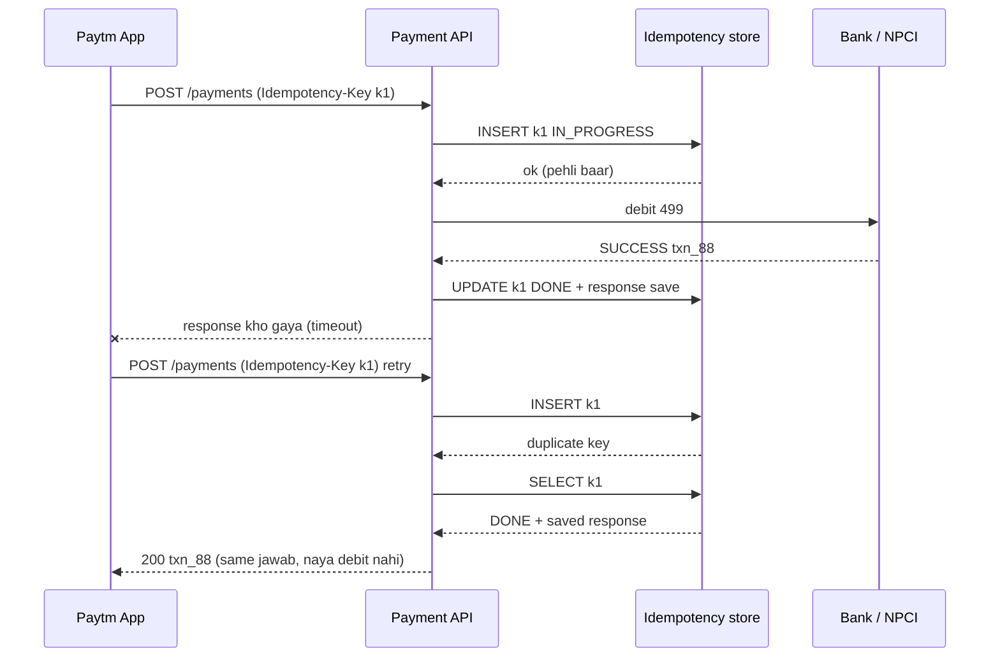
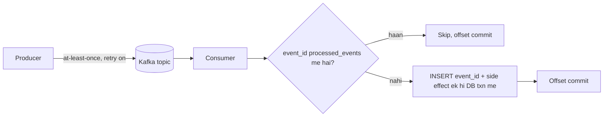
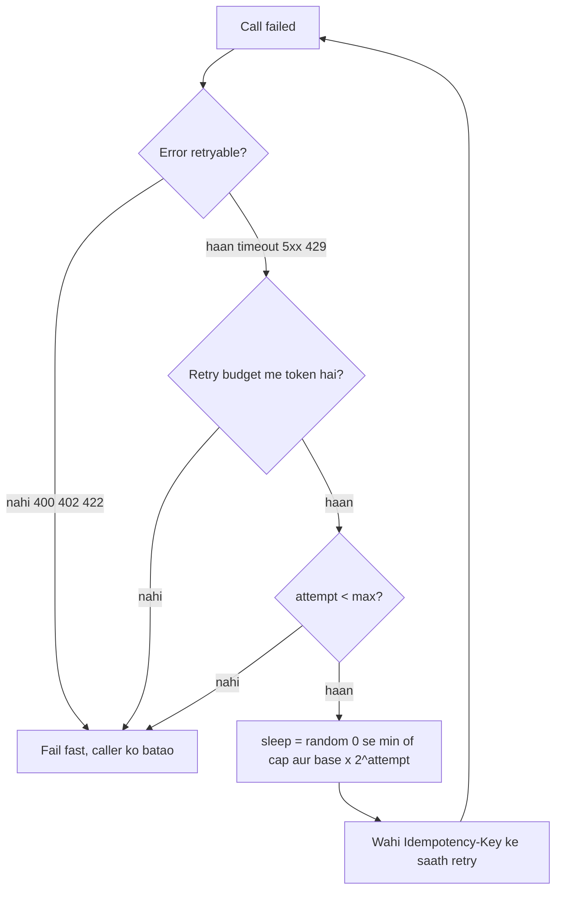
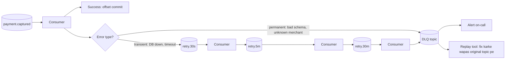
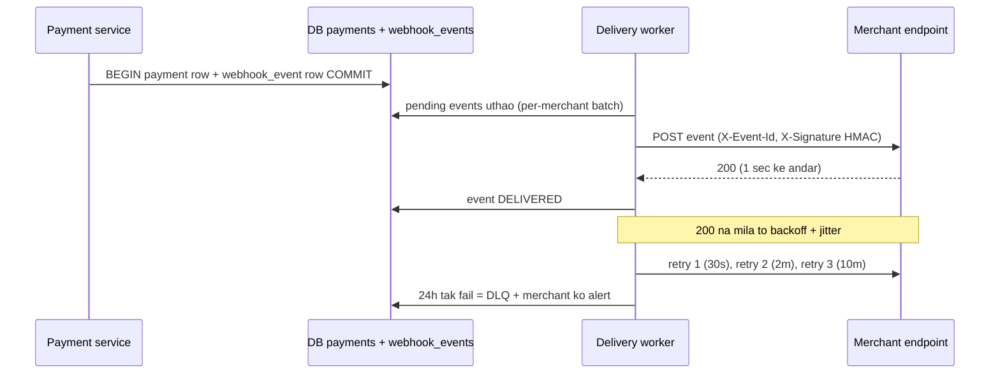

# 2A · Idempotency Island

Oct 4, 2026 · @saurav chaurasiya

Is doc me L2.1 se L2.5 tak — idempotency keys, delivery semantics, retries aur backoff, dead letter queues, aur webhooks.

---

## L2.1 — Idempotency keys

Idempotent ka matlab: ek hi request ko ek baar bhejo ya paanch baar, system ki final state same rahegi. Idempotency key ek unique string hoti hai jo client har naye payment attempt ke saath bhejta hai, aur server us key ko yaad rakh leta hai — doosri baar wahi key aaye to server naya payment nahi banata, pehle wala hi jawab wapas de deta hai.

### Ye cheez hai kya

- Category: API correctness ka pattern — reliability layer, business logic nahi.
- Kis problem ke liye: network pe koi bhi request do baar pahunch sakti hai (timeout, retry, user ka double-tap). Paise me double charge sabse mehnga bug hai.
- Is lesson ke baad: tum ek payment API design kar paoge jisme retry safe hai, aur interview me "double payment kaise rokoge" ka poora jawab de paoge.

### Sawaal

Paytm ka "Pay" button. User ne 499 rupaye ka recharge kiya. Request gateway tak gayi, paisa kat gaya, lekin response wapas aate waqt user ka 4G chala gaya — app ko timeout mila. App ne apne aap request dobara bhej di. Design karo taaki user ka 998 na kat jaye, aur user ko sahi status bhi dikhe.

> Pehle khud socho — 5 min. Hints: (1) key kaun banata hai, client ya server? (2) key kahan store hogi aur kitni der? (3) jab pehli request abhi bhi chal rahi ho aur doosri aa jaye, tab kya?

### Problem kyun aata hai

- Network sirf do jawab deta hai — "ho gaya" ya "pata nahi". Timeout ka matlab failure nahi hota; request succeed bhi ho sakti hai aur response kho sakta hai.
- Client ko fark nahi pata chalta, isliye woh retry karta hai — yahi sahi behaviour hai, warna genuine failures kabhi recover nahi honge.
- Beech me baithe sab log apna retry add karte hain: mobile SDK, load balancer, service mesh, gateway. Ek user tap se 5 requests ban jaati hain.
- `POST /payments` by default idempotent nahi hai — HTTP spec ke hisaab se POST ka matlab "naya resource banao" hai, to server har baar naya payment banayega.

### Naive approach

- Pehla obvious solution: DB me check karo ki "same user, same amount, last 1 minute me koi payment hai kya" — agar hai to skip karo.
- Ye exactly kahan tootta hai:
  - User genuinely do baar 499 ka recharge karna chahta ho to? System usko block kar dega — legit payment reject.
  - Do requests ek hi millisecond me aayi to dono ka SELECT khaali aayega, dono INSERT kar dengi. Ye wahi check-then-act race hai jo [L1.11 — ACID & isolation](https://claude.ai/code/artifact/99909fe9-731e-4e31-9e7d-36e0c5aed845) me dekha tha.
  - "Same amount" ka andaza galat hai — business ko client ki intent chahiye, guess nahi.

### Sahi design

1. **Client key banata hai**, server nahi. Client ek UUID v4 (random 128-bit id, collision ki chance practically zero) banata hai jab user button dabata hai, aur usko `Idempotency-Key` header me bhejta hai. Agar client retry kare to **wahi** key bhejta hai — nayi nahi.
2. Server request aane pe pehle idempotency store me us key ko **insert karne ki koshish** karta hai, `status = IN_PROGRESS` ke saath. Insert ek unique constraint ke bharose hota hai — isliye race me sirf ek hi jeet sakta hai.
3. Insert safal hua to ye pehli request hai: payment process karo, phir usi row me `status = DONE`, response ka HTTP status code aur poora response body save karo.
4. Insert fail hua (duplicate key) to row padho:
   - `DONE` hai to stored response wapas kar do, bilkul same status code ke saath. Naya kaam zero.
   - `IN_PROGRESS` hai to `409 Conflict` do — "pehli request chal rahi hai, thodi der me poocho". Client thoda ruk ke retry karega.
5. Key ke saath **request body ka hash** bhi store karo. Agar wahi key doosre amount ke saath aaye, to ye client ka bug hai — `422` de do, chupchaap purana response na do.
6. Key ka TTL (time to live — kitni der baad entry delete ho) 24 ghante se 7 din. Store durable hona chahiye.



Table ka shape roughly aisa hota hai:

```sql
CREATE TABLE idempotency (
  key           VARCHAR(255) PRIMARY KEY,   -- client ka UUID, unique constraint yahi hai
  request_hash  CHAR(64)     NOT NULL,      -- body ka SHA-256, mismatch pakadne ke liye
  status        VARCHAR(16)  NOT NULL,      -- IN_PROGRESS | DONE
  response_code SMALLINT,                   -- 200 / 402 — jo bhi pehli baar hua tha
  response_body TEXT,                       -- jaisa ka taisa replay karne ke liye
  created_at    TIMESTAMP    NOT NULL
);
```

### Kya choose karein aur kyun

| Option | Kab use karo | Kab mat karo |
| --- | --- | --- |
| SQL table (Postgres/MySQL) ke unique index pe | Payments, refunds — jahan key aur payment ek hi DB transaction me commit ho sakein | Bahut high write rate pe, jahan DB pehle se hot ho |
| Redis `SET key value NX` | Bahut high TPS (transactions per second — ek second me kitni requests), low-value operations | Payments ka primary store — Redis default me durable nahi; eviction se key gayab ho sakti hai |
| Redis `noeviction` + AOF ek alag cluster me | Jab SQL bottleneck ho aur failure window chhoti rakhni ho | Jab tum eviction policy aur persistence config verify na kar sako — dekho [L1.8 — Eviction & TTL](https://claude.ai/code/artifact/32bb1c8e-3433-417c-a3f4-3a34babed6bf) |
| Natural key (merchant ka order\_id) alag key ki jagah | Jab merchant ke paas pehle se ek unique order id ho | Jab merchant hi duplicate order\_id bhej sakta ho |

### India me kaise hota hai

- Stripe ka model industry ka reference hai: client UUID v4 bhejta hai `Idempotency-Key` header me (255 characters tak), Stripe pehli request ka **status code aur body dono** save karta hai aur retry pe wahi lautata hai — 500 error bhi. Keys 24 ghante baad prune ho jaati hain, aur same key doosre parameters ke saath aaye to error milta hai ([Stripe idempotent requests](https://docs.stripe.com/api/idempotent_requests)).
- Razorpay Payouts me idempotency header hai, aur duplicate key pe wahi payout object wapas milta hai, naya payout nahi banta ([Razorpay idempotency](https://razorpay.com/docs/api/x/payout-idempotency/)).
- Airbnb ne apna payments framework "Orpheus" likha jisme idempotency key request ke saath aati hai aur DB me ek dedicated table me rehti hai; unka core rule hai ki idempotency row aur business row ek hi DB transaction me commit hon ([Airbnb — avoiding double payments](https://medium.com/airbnb-engineering/avoiding-double-payments-in-a-distributed-payments-system-2981f6b070bb)).
- UPI me layer alag hai: NPCI ke paas har transaction ka RRN (Retrieval Reference Number — 12 digit ka unique number) hota hai, aur PSP app apne txnId se dedup karta hai. Isliye app-level idempotency key aur RRN dono track hote hain.

### Interview follow-ups

- **"Key client banaye ya server?"** — Client. Server banayega to client ko key lene ke liye ek extra call karni padegi, aur wahi call bhi retry ho sakti hai — problem shift ho gayi, hal nahi hui.
- **"Idempotency row aur payment row alag DB me hon to?"** — Tab atomicity toot jaati hai: payment ho gaya par key save nahi hui, to retry dobara charge karega. Ek hi DB, ek hi transaction — ya phir outbox pattern (L2.11 — Outbox pattern, abhi banna baaki).
- **"IN\_PROGRESS row stuck reh gayi to?"** — Row pe `created_at` dekho; ek lease timeout (jaise 60 second) ke baad reaper job us row ko reclaim kare, aur underlying payment ka status gateway se poochh ke settle kare.
- **"GET aur DELETE pe key chahiye?"** — Nahi. HTTP spec ke hisaab se woh already idempotent hain; Stripe inme key accept hi nahi karta.
- **"TTL ke baad wahi key dobara aaye to?"** — Woh naya payment ban jayega. Isliye TTL retry window se kaafi bada rakho (24 ghante minimum, payments me 7 din behtar).

### Self-check

1. Idempotency key kaun generate karta hai aur retry pe woh badalti hai ya nahi?
2. Server duplicate key dekhe to kaun-kaun si teen cheezein check karta hai?
3. Request hash store karne ki kya zaroorat hai?
4. `IN_PROGRESS` state pe server kya status code bhejta hai aur kyun?

### Notebook

Idempotent = N baar = 1 baar, final state same · Key client banata hai (UUID v4), retry pe wahi key · Server pe unique-constraint INSERT se race jeetti hai, SELECT-then-INSERT se nahi · Store karo: key + request hash + status + response code + response body · Duplicate + DONE = stored response replay; duplicate + IN\_PROGRESS = 409; hash mismatch = 422 · Key row aur business row ek hi DB transaction me · TTL 24h–7 din, durable store, noeviction.

### Padhne ke liye

- [Stripe — Idempotent requests](https://docs.stripe.com/api/idempotent_requests)
- [Razorpay — Idempotency for payouts](https://razorpay.com/docs/api/x/payout-idempotency/)
- [Airbnb Engineering — Avoiding double payments in a distributed payments system](https://medium.com/airbnb-engineering/avoiding-double-payments-in-a-distributed-payments-system-2981f6b070bb)

### Deep Dive (SDE-2) — jab time ho

#### Idempotency aur transaction boundary

Sabse common production bug: payment commit ho gaya par idempotency row commit nahi hui, ya ulta. Do hi safe design hain — (a) dono writes ek hi relational transaction me, ya (b) idempotency row pehle commit karo `IN_PROGRESS` ke saath, phir payment, phir `DONE`. Option (b) me crash hone pe row `IN_PROGRESS` me reh jaati hai, aur recovery job gateway se actual status poochh ke decide karta hai — isko reconciliation kehte hain (L2.21 — Reconciliation, abhi banna baaki).

#### Key scope kitna bada

Key globally unique ho ya per-merchant? Per-merchant scope (`merchant_id + key`) behtar hai: do merchants ki keys galti se collide nahi karengi, aur table ko merchant\_id pe shard karna aasaan ho jaata hai.

#### Idempotency vs deduplication

Idempotency client ki intent pe based hai — client kehta hai "ye wahi request hai". Deduplication server ka andaza hai — server content dekh ke guess karta hai. Payments me hamesha intent chahiye, andaza nahi.

#### Fingerprint ki jagah PII na daalo

Stripe explicitly kehta hai: key me email ya personal identifier mat daalo. Key logs, metrics aur error traces me chali jaati hai — woh ek data leak ka raasta ban jaata hai.

---

## L2.2 — Delivery semantics

Jab ek message ya request ek service se doosri tak jaata hai, to teen hi guarantees possible hain: at-most-once (zyada se zyada ek baar — kho sakta hai), at-least-once (kam se kam ek baar — duplicate ho sakta hai), aur exactly-once (theek ek baar). Teesri sabse zyada chaahi jaati hai aur sabse kam samjhi jaati hai.

### Ye cheez hai kya

- Category: distributed systems ka fundamental trade-off — ye koi library setting nahi, design choice hai.
- Kis problem ke liye: network message drop kar sakta hai aur duplicate bhi de sakta hai. Tumhe decide karna hai ki kaunsa dard sehna hai.
- Is lesson ke baad: tum bata paoge ki "exactly-once" ka asli matlab kya hai, aur payments me industry kya karti hai.

### Sawaal

PhonePe pe payment successful hone ke baad user ko SMS, push notification aur cashback — teeno trigger hote hain. Notification service ek Kafka queue se events padhti hai. Decide karo: SMS ke liye kaunsi guarantee, aur cashback credit ke liye kaunsi? Dono ka jawab alag hona chahiye.

> Pehle khud socho — 5 min. Hints: (1) SMS do baar jaane se kya nuksaan? (2) cashback do baar jaane se kya nuksaan? (3) message kho jaane se kya nuksaan, dono case me?

### Problem kyun aata hai

- Consumer message process karne ke baad "ho gaya" bolta hai (offset commit karta hai). Process aur commit ke beech crash ho gaya to message dobara aayega.
- Agar consumer pehle commit kare, phir process kare, to commit ke baad crash pe message hamesha ke liye gaya.
- Producer ki taraf bhi wahi: send ke baad ack na mile to producer retry karega — broker ke paas do copies.
- Do alag systems ke beech atomic commit possible nahi hai bina coordination ke, aur coordination mehnga aur blocking hai (L2.9 — 2PC, abhi banna baaki).

### Naive approach

- Pehla obvious solution: "Kafka me exactly-once setting on kar do, baat khatam."
- Ye exactly kahan tootta hai: Kafka ki exactly-once semantics sirf **Kafka ke andar** kaam karti hai — consume, process, aur produce-back-to-Kafka, saath me offset commit, sab ek atomic transaction me. Lekin jaise hi tum Kafka ke bahar koi side effect karte ho — bank ko API call, SMS bhejna, Postgres me row likhna — woh guarantee khatam. Kafka transaction SMS gateway ko rollback nahi kar sakta.

### Sahi design

1. **Transport se at-least-once lo.** Yahi realistic hai: producer retry kare, consumer processing ke **baad** offset commit kare.
2. **Consumer ko idempotent banao.** Har message ke saath ek stable unique id ho (event\_id, ya txnId). Consumer processing se pehle ek `processed_events` table me us id ka INSERT kare — duplicate key mila to message chupchaap skip kar do.
3. **Effective-once** soch: duplicate messages aayenge, par unka asar ek baar hoga. Industry isko "exactly-once processing" kehti hai, aur ye at-least-once delivery aur idempotent consumer ka jod hai.
4. **Side effect ki nature se guarantee chuno** — jo naturally idempotent hai (ek row ko `status = SUCCESS` set karna) usme kuch extra nahi chahiye; jo counter badhata hai (cashback credit, retry count) usme dedup table zaroori hai.



### Kya choose karein aur kyun

| Option | Kab use karo | Kab mat karo |
| --- | --- | --- |
| At-most-once | Metrics, access logs, non-critical telemetry — jahan ek data point kho jaana chalta hai | Paisa, ledger entry, order, ya koi bhi user-visible state |
| At-least-once + idempotent consumer | Default choice har payment system me | Jab side effect ka dedup karna possible hi na ho (jaise third-party SMS jo koi dedup id accept nahi karta) |
| Kafka transactional EOS (`read_committed`) | Kafka-to-Kafka stream processing, aggregation pipelines | Jab consumer ka side effect Kafka ke bahar ho — dekho [L1.19 — Kafka exactly-once](https://claude.ai/code/artifact/eeb39ee8-3f52-4c04-b57b-68213f02c429) |
| Outbox pattern | Jab DB write aur event publish dono atomic chahiye | Jab tumhara DB CDC ya polling relay support na kare |

### India me kaise hota hai

- Confluent ka official position bhi yahi hai: Kafka ki exactly-once guarantee Kafka topics ke beech hai, external systems ke liye idempotent sink chahiye ([Confluent — Exactly-once semantics](https://www.confluent.io/blog/exactly-once-semantics-are-possible-heres-how-apache-kafka-does-it/)).
- UPI me NPCI ka protocol khud at-least-once jaisa behave karta hai: PSP ko callback na mile to woh check-status call karta hai. Yahi reason hai ki NPCI ne check-status pe rate limit lagayi hai — dekho [L1.21 — Rate limiting](https://claude.ai/code/artifact/6a87e8d2-04fb-418e-b433-e5a88508f83e).
- Razorpay webhooks explicitly bolte hain ki events order me nahi aa sakte aur duplicate aa sakte hain, aur `x-razorpay-event-id` header se duplicity check karo ([Razorpay webhook best practices](https://razorpay.com/docs/webhooks/best-practices/)).

### Interview follow-ups

- **"Exactly-once possible hai ya nahi?"** — Pure message delivery ke level pe nahi (two generals problem). Processing ke level pe haan — at-least-once delivery aur idempotent consumer se. Interview me ye distinction bolna strong signal hai.
- **"Offset pehle commit karein ya baad me?"** — Baad me. Pehle commit = at-most-once = message loss. Payments me kabhi nahi.
- **"Dedup table kitni purani entries rakhega?"** — Retry window se zyada. Kafka me retention 7 din ho to dedup table bhi 7+ din, warna purani replay dobara process ho jayegi.
- **"Ordering ka kya?"** — Kafka me ordering sirf ek partition ke andar hai. Same entity (wallet id, order id) ko partition key banao, warna "credit before debit" jaisa ulta order dikh sakta hai.

### Self-check

1. Teen delivery semantics kaunsi hain, aur har ek me kya galat ho sakta hai?
2. Kafka ki exactly-once guarantee kahan khatam ho jaati hai?
3. "Effective-once" kaunsi do cheezon ka jod hai?
4. Consumer offset processing se pehle commit kare to kaunsi guarantee milti hai?

### Notebook

At-most-once = kho sakta hai; at-least-once = duplicate ho sakta hai; exactly-once = transport pe practically nahi · Payments ka default: at-least-once transport + idempotent consumer = effective-once · Offset hamesha processing ke BAAD commit · Dedup: event\_id ka INSERT + side effect ek hi DB txn me · Kafka EOS sirf Kafka-to-Kafka, external sink pe nahi · Dedup table ka retention Kafka retention se bada.

### Padhne ke liye

- [Confluent — Exactly-once semantics are possible](https://www.confluent.io/blog/exactly-once-semantics-are-possible-heres-how-apache-kafka-does-it/)
- [Razorpay — Webhook best practices](https://razorpay.com/docs/webhooks/best-practices/)

### Deep Dive (SDE-2) — jab time ho

#### Two generals problem

Do army generals ko ek hi waqt attack karna hai, par messenger pakda ja sakta hai. Proof hai ki finite messages me dono ko certainty nahi mil sakti. Yahi reason hai ki network pe exactly-once delivery theoretically impossible hai — isliye hum processing ko idempotent banate hain, delivery ko perfect banane ki koshish nahi karte.

#### Idempotent producer kaise kaam karta hai

Kafka ka idempotent producer broker ke paas ek PID (producer id) aur per-partition sequence number rakhta hai. Broker us sequence ko dekh ke duplicate retry pehchaan leta hai aur chupchaap drop kar deta hai. Ye sirf ek producer session ke andar duplicates rokta hai — application-level retry (naya producer, naya PID) ise bypass kar jaata hai.

#### Ordering aur idempotency ka rishta

Agar consumer idempotent hai to out-of-order messages bhi handle karne padte hain. Trick: state machine banao jisme transitions one-way hon — `PENDING` se `SUCCESS` allowed, `SUCCESS` se `PENDING` ignored. Isse purana message late aa jaye to woh naya state kharab nahi kar sakta.

---

## L2.3 — Retries, backoff, jitter

Retry ka matlab failed call dobara karna. Backoff ka matlab har retry ke beech ka gap badhate jaana. Jitter ka matlab us gap me thoda random time milana, taaki saare clients ek hi second pe dobara na tootein. Teeno ek saath chahiye — akela retry system ko gira deta hai.

### Ye cheez hai kya

- Category: resilience pattern, client side pe.
- Kis problem ke liye: transient failure (thodi der ka network glitch, ek pod restart) se automatic recovery, bina downstream ko maare.
- Is lesson ke baad: tum retry policy design kar paoge jo recovery me madad kare, retry storm na banaye.

### Sawaal

Paytm ka payment service bank ke API ko call karta hai. Bank ka server 30 second ke liye slow ho gaya aur timeout de raha hai. Tumhare paas 200 pods hain, har pod 500 requests per second handle kar raha hai. Retry policy design karo. Saath me batao: 30 second baad bank up hota hai — kya tumhara system usko turant dobara gira dega?

> Pehle khud socho — 5 min. Hints: (1) kitni baar retry? (2) gap kaise badhega? (3) jab 30 second ka outage khatam ho, saare clients kab retry karenge? (4) kaunse errors pe retry karna HI nahi chahiye?

### Problem kyun aata hai

- Retry "selfish" hota hai — AWS ki Builders' Library ka exact shabd. Ek retry downstream se dugna kaam maangta hai, theek us waqt jab woh pehle se struggle kar raha hai.
- Retry amplification: agar stack ki har layer apne aap 3 retry kare, to 5 layers me database pe load **243 guna** ho jaata hai (3 ki power 5). Ye AWS ka diya hua number hai.
- Thundering herd: outage ke dauran saare clients ka timer same waqt start hota hai, to woh sab same millisecond pe retry karte hain — service up hote hi dobara gir jaati hai.
- Har error retryable nahi hota. `400 Bad Request` ya "insufficient balance" ko 5 baar retry karne se kuch nahi badlega, bas load barhega.

### Naive approach

- Pehla obvious solution: HTTP client me `maxRetries = 3`, `retryDelay = 1s` set kar do, har error pe retry.
- Ye exactly kahan tootta hai:
  - Fixed 1 second delay = saare clients 1, 2, 3 second pe exactly ek saath retry karte hain. Outage recover hote hi spike.
  - Har error pe retry = `402 insufficient funds` bhi 3 baar jayega, aur non-idempotent POST double charge kar sakta hai.
  - Har layer apna retry karegi, to 3 nahi, 243 requests banengi.

### Sahi design

1. **Pehle idempotency, phir retry.** Bina idempotency key, non-idempotent POST ka retry hi allowed nahi hona chahiye. Ye L2.1 — Idempotency keys (isi doc me upar) pe seedha depend karta hai.
2. **Errors ko classify karo.** Retry sirf transient pe: timeout, connection reset, `429`, `500`, `502`, `503`, `504`. Retry kabhi nahi: `400`, `401`, `403`, `404`, `422`, aur business declines.
3. **Capped exponential backoff.** Gap `base * 2^attempt` se badhao par ek max pe cap karo, warna 10th retry 17 minute baad hoga.
4. **Full jitter lagao.** Fixed exponential ka bhi same problem hai — sab clients same exponential curve pe hain. Full jitter: `sleep = random(0, min(cap, base * 2^attempt))`.
5. **Retry budget rakho.** Ek token bucket jisme normal requests tokens bharti hain aur retries tokens kharchti hain. Error rate badhe to bucket khaali ho jaata hai aur retries apne aap band — ye retry storm ka hard brake hai.
6. **Sirf ek layer pe retry karo.** Decide karo ki retry kaun karega — gateway ya service — aur baaki layers pe retry off. Ye 243x problem ka asli fix hai.
7. **Retry ke saath deadline bhejo.** Request ke saath ek "ye kaam X millisecond ke baad bekaar hai" deadline bhejo, taaki downstream wo kaam shuru hi na kare jo waqt pe khatam nahi hoga.



Ye chhota Java snippet full-jitter backoff aur error classification dono dikhata hai:

```java
// Full jitter backoff: har attempt pe gap 0 se exponential cap ke beech random
long backoffMillis(int attempt, long baseMs, long capMs) {
    long exp = Math.min(capMs, baseMs * (1L << attempt));   // base * 2^attempt, capped
    return ThreadLocalRandom.current().nextLong(0, exp + 1); // 0 se exp ke beech random
}

// Retry sirf transient errors pe. Business decline pe retry = bekaar load.
boolean isRetryable(int httpStatus) {
    return httpStatus == 429 || httpStatus == 500 || httpStatus == 502
            || httpStatus == 503 || httpStatus == 504;
}
```

### Kya choose karein aur kyun

| Option | Kab use karo | Kab mat karo |
| --- | --- | --- |
| Fixed delay | Kabhi nahi, production me | Hamesha — thundering herd banata hai |
| Exponential, no jitter | Jab client bilkul ek ho (single cron job) | Multi-instance service — sab ek saath retry karenge |
| Full jitter: `random(0, min(cap, base*2^n))` | Default. Spread sabse accha, implement sabse aasaan | Jab tumhe guaranteed minimum gap chahiye |
| Decorrelated jitter | Jab full jitter ka average wait bahut kam lage | Jab simple rakhna zyada important ho |
| Retry budget / token bucket | Har high-traffic service me, backoff ke saath | Akela — ye backoff ki jagah nahi leta, uske saath chalta hai |

### India me kaise hota hai

- AWS ki Builders' Library me concrete guidance hai: timeout ko downstream ke p99.9 latency (woh latency jisse 99.9% requests tez hain) se set karo, capped exponential backoff lagao, aur error surge pe token bucket se retry rate control karo. Wahi article 243x amplification ka example deta hai ([AWS — Timeouts, retries, and backoff with jitter](https://aws.amazon.com/builders-library/timeouts-retries-and-backoff-with-jitter/)).
- AWS ka architecture blog full jitter aur decorrelated jitter ka simulation compare karta hai — full jitter sabse kam total work aur sabse kam contention deta hai ([AWS — Exponential backoff and jitter](https://aws.amazon.com/blogs/architecture/exponential-backoff-and-jitter/)).
- UPI me retry ka protocol NPCI define karta hai, marzi se nahi hota: pending transaction ka pehla status check thodi der baad, aur ek fixed window me gine-chune attempts. Isliye PSP apps me check-status ek scheduled job hoti hai, blind loop nahi — dekho [L1.21 — Rate limiting](https://claude.ai/code/artifact/6a87e8d2-04fb-418e-b433-e5a88508f83e).

### Interview follow-ups

- **"Jitter kyun, exponential kaafi nahi?"** — Exponential gap badhata hai par phase same rakhta hai. Saare clients ka 4th retry ek hi second pe padega. Jitter phase todta hai.
- **"Timeout kitna rakhoge?"** — Downstream ke p99 ya p99.9 latency ke thoda upar. Bahut chhota = healthy requests fail; bahut bada = thread pool bhar jayega aur caller khud down ho jayega.
- **"Retry se double payment ho gaya, kya galti thi?"** — Idempotency key nahi thi, ya key thi par retry pe nayi key generate ho rahi thi.
- **"Har layer retry kar rahi hai, kaise pata chalega?"** — Request pe ek `retry-attempt` header ya trace attribute propagate karo aur metrics me count karo. Downstream ka request count upstream se kaafi zyada dikhe to amplification confirm.
- **"429 pe retry karna chahiye?"** — Haan, par `Retry-After` header ko respect karo. Woh server ki di hui exact guidance hai, tumhare backoff se behtar.

### Self-check

1. Full jitter ka formula kya hai?
2. 5 layers, har layer 3 retries — database pe kitna guna load?
3. Kaunse teen HTTP status codes pe retry nahi karna chahiye?
4. Retry budget kis cheez se banta hai aur kab kaam aata hai?

### Notebook

Retry sirf transient pe: timeout, 429, 5xx · Kabhi nahi: 400, 401, 403, 404, 422, business decline · Full jitter = random(0, min(cap, base \* 2^attempt)) · 5 layers x 3 retries = 243x load, isliye retry sirf EK layer pe · Retry budget = token bucket, error surge pe retries apne aap band · Timeout = downstream p99/p99.9 ke thoda upar · Retry ke liye idempotency key pre-condition hai · 429 pe Retry-After header follow karo.

### Padhne ke liye

- [AWS Builders' Library — Timeouts, retries, and backoff with jitter](https://aws.amazon.com/builders-library/timeouts-retries-and-backoff-with-jitter/)
- [AWS Architecture Blog — Exponential backoff and jitter](https://aws.amazon.com/blogs/architecture/exponential-backoff-and-jitter/)

### Deep Dive (SDE-2) — jab time ho

#### Decorrelated jitter

Full jitter ka ek side effect hai: average sleep exponential ke aadhe se bhi kam ho sakta hai, to total attempts zyada ho jaate hain. Decorrelated jitter isko balance karta hai — `sleep = min(cap, random(base, previous_sleep * 3))`. Pichhla sleep yaad rakhta hai, isliye gap monotonically badhta hai par phase random rehta hai.

#### Retry vs circuit breaker

Retry ek request ke liye hai, circuit breaker poore downstream ke liye. Breaker error rate dekhta hai aur threshold cross hone pe saari calls turant fail karna shuru kar deta hai — isse downstream ko saans lene ka waqt milta hai. Dono ek saath: breaker open ho to retry bhi na ho (L2.16 — Circuit breaker, abhi banna baaki).

#### Server-side load shedding

Client kitna bhi acha behave kare, kuch clients to buggy honge. Isliye server ko apni raksha khud karni hai: queue depth dekho, aur limit cross hone pe naye requests ko turant `503` aur `Retry-After` do. Dheere jawab dene se bura hai jaldi "na" bol dena — woh client ka timeout budget bachata hai.

#### Idempotency key retry ke saath kaise badalti hai

Ek rule yaad rakho: key **business attempt** ke saath bandhi hai, HTTP call ke saath nahi. User ek baar "Pay" dabaye = ek key, chahe andar 7 retries hon. User dobara "Pay" dabaye = nayi key.

---

## L2.4 — Dead letter queues

Dead letter queue (DLQ) ek alag queue hoti hai jahan woh messages jaate hain jo bar-bar process hone me fail ho rahe hain. Iska maqsad ek hi kharab message ko poori queue rokne se bachana hai, aur us message ko investigate karne ke liye safe jagah dena hai.

### Ye cheez hai kya

- Category: messaging reliability pattern, consumer side pe.
- Kis problem ke liye: "poison message" — ek aisa message jo kabhi succeed nahi hoga (corrupt payload, missing merchant, schema mismatch) aur infinite retry loop bana deta hai.
- Is lesson ke baad: tum DLQ setup design kar paoge jisme kuch kho na jaye aur on-call insaan ko pata chale ki karna kya hai.

### Sawaal

Paytm ka settlement service Kafka se `payment.captured` events padhta hai aur merchant ke ledger me entry daalta hai. Ek merchant ka record DB me delete ho gaya, to uske saare events pe `MerchantNotFound` exception aa raha hai. Consumer retry kar raha hai, aur us partition ka lag 4 lakh messages ho gaya — baaki merchants ka settlement bhi ruk gaya. Design karo.

> Pehle khud socho — 5 min. Hints: (1) kitni baar retry ke baad haar maanoge? (2) fail hua message kahan jayega? (3) DLQ me message ke saath kya-kya store karoge? (4) DLQ bhar gaya to kaun jaagega?

### Problem kyun aata hai

- Kafka me ek partition ke messages order me process hote hain. Ek message atka to uske peeche ka sab atka — isko head-of-line blocking kehte hain.
- Agar tum fail hone pe offset commit kar do aur message chhod do, to data chup-chaap kho gaya — paise me ye unacceptable hai.
- Agar infinite retry karo to lag badhta jaayega aur poora pipeline rukega.
- Do tarah ke failures ko alag karna zaroori hai: transient (DB restart ho raha hai — retry se theek ho jayega) aur permanent (payload me amount `null` hai — kabhi theek nahi hoga).

### Naive approach

- Pehla obvious solution: `try-catch` me exception pakdo, log likho, offset commit kar do, aage badho.
- Ye exactly kahan tootta hai: message gaya. Teen mahine baad audit me pata chalega ki 4 lakh settlements missing hain, aur log rotate ho chuke honge. Payments me "log kar diya" durability nahi hai — DLQ ek **durable store** hai, log ek text file.

### Sahi design

1. **Teen levels banao**: in-process retry (2-3 baar, milliseconds me) transient blips ke liye; ek **retry topic** with delay (30s, 5min, 30min) un failures ke liye jo thodi der me theek ho sakte hain; aur **DLQ** un ke liye jo nahi honge.
2. **Max receives ki limit set karo.** SQS me ise redrive policy kehte hain — `maxReceiveCount` cross hone pe message apne aap DLQ me chala jaata hai. Kafka me ye tumhe khud likhna padta hai (attempt count header me).
3. **Permanent failures ko turant DLQ bhejo**, retry na karo. Schema validation fail, unknown merchant, negative amount — inko 3 baar try karna waste hai.
4. **DLQ message me context store karo**, sirf payload nahi: original topic, partition, offset, attempt count, last exception class aur message, stack trace, aur pehle failure ka timestamp. Bina iske DLQ ek kabristan ban jaata hai jahan koi nahi jaata.
5. **DLQ ki depth pe alert lagao.** DLQ me ek bhi message aaye to woh ek bug hai. `dlq_depth > 0` pe warning, `> 100` pe page.
6. **Replay ka raasta banao.** Ek chhota admin tool jo DLQ se message uthaye, fix hone ke baad original topic pe wapas daale. Ye tool din 1 pe banao, incident ke beech me nahi.



### Kya choose karein aur kyun

| Option | Kab use karo | Kab mat karo |
| --- | --- | --- |
| SQS redrive policy (`maxReceiveCount`) | SQS pe ho — ye built-in hai, code zero | Jab tumhe attempt ke hisaab se alag-alag delay chahiye |
| Kafka retry topics with increasing delay | Kafka pe ho aur transient failures common hon | Jab strict per-key ordering chahiye — retry topic order tod deta hai |
| Kafka pause/seek (retry in place) | Jab ordering absolutely zaroori ho | Jab ek poison message poori partition rok de sakta ho |
| DLQ ke bajaye DB me `failed_events` table | Jab replay ko SQL se query aur filter karna ho | High volume pe — DB khud queue ban jaata hai |

### India me kaise hota hai

- AWS SQS me DLQ first-class feature hai: source queue pe redrive policy set karo, aur `maxReceiveCount` se zyada baar receive hua message apne aap DLQ me chala jaata hai; SQS ek redrive API bhi deta hai messages wapas bhejne ke liye ([AWS — Amazon SQS dead-letter queues](https://docs.aws.amazon.com/AWSSimpleQueueService/latest/SQSDeveloperGuide/sqs-dead-letter-queues.html)).
- Razorpay webhooks me DLQ ka ulta side dikhta hai: agar tumhara endpoint 24 ghante tak non-2xx deta rahe, Razorpay us webhook ko **disable** kar deta hai — matlab unke taraf ka retry budget khatam, aur recovery ka zimma tumhara ([Razorpay webhook best practices](https://razorpay.com/docs/webhooks/best-practices/)).
- Kafka Connect me `errors.tolerance` aur `errors.deadletterqueue.topic.name` config se DLQ built-in milta hai, saath me original record ka header context.

### Interview follow-ups

- **"DLQ aur retry topic me fark?"** — Retry topic temporary parking hai, usme se message apne aap wapas process hota hai. DLQ terminal hai — wahan se insaan ya tool nikalta hai.
- **"Retry topic ordering tod deta hai, chalega?"** — Payments me often nahi. Fix: same key ke events ko ek `pending` state me rakho aur order-sensitive processing ko state machine se guard karo, ya us key ke liye partition pause karo.
- **"DLQ me messages pade rehte hain, koi dekhta nahi — kaise theek karoge?"** — DLQ depth ko ek SLO banao (jaise "DLQ 24 ghante se zyada non-empty nahi hoga") aur usko on-call ke dashboard pe rakho. Metric ke bina DLQ ek landfill hai.
- **"Replay se duplicate process nahi ho jayega?"** — Issi liye consumer idempotent hona chahiye (L2.1 ka dedup table). Replay tab safe hai.

### Self-check

1. Poison message kya hai aur woh Kafka partition ko kaise rokta hai?
2. Transient aur permanent failure ka treatment kaise alag hoga?
3. DLQ message ke saath kaunse paanch context fields store karne chahiye?
4. SQS me DLQ trigger karne wali config ka naam kya hai?

### Notebook

DLQ = durable parking for messages jo process nahi ho rahe; log DLQ nahi hai · Head-of-line blocking: ek poison message poori partition rok deta hai · 3 levels: in-process retry, retry topics (30s/5m/30m), phir DLQ · Permanent failure (bad schema, unknown merchant) seedha DLQ, retry nahi · DLQ me store: topic, partition, offset, attempts, exception, stack, first-failure time · Alert on dlq\_depth > 0; replay tool din 1 pe banao · Replay safe sirf tab jab consumer idempotent ho · SQS: redrive policy + maxReceiveCount.

### Padhne ke liye

- [AWS — Amazon SQS dead-letter queues](https://docs.aws.amazon.com/AWSSimpleQueueService/latest/SQSDeveloperGuide/sqs-dead-letter-queues.html)
- [Razorpay — Webhook best practices](https://razorpay.com/docs/webhooks/best-practices/)

### Deep Dive (SDE-2) — jab time ho

#### Non-blocking retry ka cost

Retry topics ordering tod dete hain. Agar tumhara domain order pe depend karta hai (wallet ka debit-then-credit), to non-blocking retry chup-chaap corruption kar sakta hai. Safe pattern: us entity ke liye ek "blocked" marker DB me daalo, aur jab tak woh clear na ho us entity ke naye events bhi retry topic pe hi jaayein. Throughput kam hoga, correctness bachegi.

#### DLQ pe backpressure

Backpressure ka matlab: jab consumer slow ho to producer ko dheere karna. DLQ ka khud ka backpressure bhi dekho — agar DLQ bhi bhar jaaye to kuch systems messages drop karne lagte hain. DLQ pe retention lamba rakho (14 din se zyada) aur usko kisi bhi auto-cleanup se bahar rakho.

#### Poison message pehchanne ki automation

Ek pattern jo kaam karta hai: DLQ consumer exception class ke hisaab se messages ko group kare aur top-3 exception types ko alert me likhe. On-call ko "4 lakh messages fail" ke bajaye "3.9 lakh MerchantNotFound for merchant mrc\_8812" dikhega — root cause minute me mil jaayega.

---

## L2.5 — Webhooks & retry

Webhook ek HTTP callback hai: tumhari service kisi event ke hone pe merchant ke URL pe POST karti hai. Polling ka ulta — merchant poochhta nahi, tum bata dete ho. Design ka saara maza receiver ke bharose ke bina reliability nikaalne me hai.

### Ye cheez hai kya

- Category: integration pattern — do companies ke systems ke beech event delivery.
- Kis problem ke liye: merchant ko payment status turant chahiye, aur woh har second tumhara API poll nahi kar sakta.
- Is lesson ke baad: tum webhook producer aur consumer dono ki taraf se design kar paoge, aur "webhook kho gaya" wale incidents handle kar paoge.

### Sawaal

Tum Razorpay jaise gateway ho. 50,000 merchants hain. Payment success hone pe har merchant ke `webhook_url` pe event bhejna hai. Problem: 200 merchants ke server down hain, 50 ka server 30 second leta hai jawab dene me, aur 10 ne galat URL daal diya hai. Design karo taaki ek slow merchant baaki 49,999 ko affect na kare, aur koi event kho na jaye.

> Pehle khud socho — 5 min. Hints: (1) delivery synchronous hogi ya queue se? (2) slow merchant ko kaise isolate karoge? (3) receiver ko kaise pata chalega ki event tumse aaya hai? (4) kitni der tak retry?

### Problem kyun aata hai

- Receiver tumhare control me nahi hai. Woh down ho sakta hai, slow ho sakta hai, 200 bhej ke bhi andar crash kar sakta hai.
- Agar delivery payment ke same request thread me hai, to ek slow merchant tumhare payment API ki latency bigaad dega.
- HTTP pe koi delivery guarantee nahi — timeout ka matlab "pata nahi", to retry zaroori, to duplicate zaroori.
- Receiver ko verify karna padta hai ki event genuinely tumse aaya, warna koi bhi fake "payment success" POST kar ke muft saaman le jayega.

### Naive approach

- Pehla obvious solution: payment success hone ke baad usi request me merchant ke URL pe `HttpClient.post(...)` kar do.
- Ye exactly kahan tootta hai:
  - Merchant ka server 30 second lega, to tumhara payment API bhi 30 second lega. Thread pool bhar jayega, payment hi fail hone lagenge.
  - Merchant down hai to event hamesha ke liye gaya — koi retry nahi, koi record nahi.
  - 200 down merchants ke 200 threads block — ye bulkhead failure hai (L2.17 — Bulkhead, abhi banna baaki).

### Sahi design

1. **Delivery ko async karo.** Payment transaction commit hone ke saath ek `webhook_event` row likho (same DB transaction me — ye outbox pattern hai). Ek alag worker us table se padh ke deliver kare. Payment API ka latency merchant pe depend nahi karega.
2. **Per-merchant isolation.** Delivery workers ko merchant ke hisaab se partition karo (merchant\_id pe hashing), aur per-merchant concurrency limit lagao. Ek slow merchant apni queue bhare, doosron ki nahi.
3. **Event ko unique id do** (`event_id`) aur usko header me bhejo. Receiver isi se dedup karega.
4. **HMAC signature bhejo.** Event body ko ek shared secret se HMAC-SHA256 karo aur signature header me daalo. Receiver wahi compute kar ke compare karega — isse sender verify ho jaata hai. Comparison constant-time hona chahiye.
5. **Retry schedule with backoff aur jitter**, aur ek total time budget (24 ghante industry standard hai). Budget khatam = event DLQ me, aur merchant ko dashboard pe batao.
6. **Receiver ki taraf**: endpoint ka kaam sirf (a) signature verify, (b) event\_id dedup check, (c) event ko apni internal queue me daalna, (d) `200` return karna. Business processing async. Target: 1 second se kam response.
7. **Reconciliation fallback do.** Webhook best-effort hai; sach ka source tumhara `GET /payments/{id}` API hai. Merchant ko ek daily reconciliation report bhi do.



Receiver side ka core — signature verify aur dedup, dono zaroori:

```java
// Receiver: pehle signature, phir dedup, phir turant 200. Processing async.
@PostMapping("/webhooks/razorpay")
public ResponseEntity<Void> onWebhook(@RequestBody byte[] rawBody,
                                      @RequestHeader("X-Razorpay-Signature") String sig,
                                      @RequestHeader("x-razorpay-event-id") String eventId) {
    // 1. Signature RAW bytes pe. Parsed JSON ko dobara serialize karne se bytes badal jaate hain.
    byte[] expected = hmacSha256(rawBody, WEBHOOK_SECRET);
    if (!MessageDigest.isEqual(expected, hexDecode(sig))) {   // constant-time compare
        return ResponseEntity.status(401).build();
    }
    // 2. Dedup: duplicate insert fail hoga, matlab event pehle hi aa chuka hai
    if (!processedEvents.tryInsert(eventId)) {
        return ResponseEntity.ok().build();   // already seen: 200 do, warna sender retry karega
    }
    // 3. Kaam async, response turant. Sender ka timeout chhota hota hai.
    internalQueue.publish(rawBody);
    return ResponseEntity.ok().build();
}
```

### Kya choose karein aur kyun

| Option | Kab use karo | Kab mat karo |
| --- | --- | --- |
| Webhook (push) | Merchant ko near-real-time update chahiye, event rate high | Jab merchant public HTTPS endpoint host na kar sake |
| Polling (`GET /payments/{id}`) | Reconciliation, ya jab merchant firewall ke peeche ho | Primary mechanism ke roop me high volume pe — waste calls |
| Webhook + polling fallback | Default production setup — push fast hai, poll sach hai | Kabhi nahi; fallback hamesha chahiye |
| Thin webhook (sirf id bhejo, merchant GET kare) | Jab payload me sensitive data ho ya payload bada ho | Jab merchant ka extra GET call afford na ho |

### India me kaise hota hai

- Razorpay non-2xx ko delivery failure maanta hai aur 24 ghante tak exponential backoff se retry karta hai; 24 ghante continuous fail hone pe webhook **disable** ho jaata hai. Woh explicitly kehte hain ki events order me nahi aa sakte, aur `x-razorpay-event-id` se duplicity check karo. Response 5 second me na aaye to timeout maan ke resend hota hai, aur signature verify karna mandatory hai with TLS 1.2 minimum ([Razorpay webhook best practices](https://razorpay.com/docs/webhooks/best-practices/)).
- Stripe ka model wahi hai: signed events, `event.id` se dedup, aur sabse badi advice — 2xx turant do, processing baad me karo.
- UPI me "webhook" ka equivalent NPCI ka callback hai PSP tak. Callback miss hone pe PSP check-status call karta hai — bilkul wahi push aur poll fallback ki jodi.

### Interview follow-ups

- **"Signature raw body pe ya parsed JSON pe?"** — Raw bytes pe. JSON parse karke dobara serialize karne pe key order ya whitespace badal jaata hai aur HMAC mismatch ho jaata hai. Ye sabse common webhook bug hai.
- **"Webhook endpoint slow hai, kya karoge?"** — Endpoint ka kaam sirf verify, enqueue aur 200. Agar business logic andar hai to sender ka timeout hit hoga aur woh retry bhejega — ab tum same event ko do baar process kar rahe ho, aur dono dheere.
- **"Events out of order aa gaye to?"** — Event me `created_at` ya version rakho, aur state machine se purane event ko ignore karo. `SUCCESS` ke baad aaya `PENDING` event drop ho jaye.
- **"Merchant ka URL badalna hai, migration kaise?"** — Dono URLs pe thodi der bhejo (dual-write window), merchant confirm kare, phir purana band. Webhook config versioned rakho.
- **"Duplicate pe 200 kyun, 409 nahi?"** — Kyunki sender ke liye duplicate bhi success hai. 409 dene se woh retry karega aur loop banega.

### Self-check

1. Webhook delivery ko payment request ke same thread me kyun nahi rakhna chahiye?
2. HMAC signature raw body pe kyun compute karna chahiye?
3. Razorpay kitni der tak retry karta hai aur uske baad kya karta hai?
4. Receiver duplicate event pe kaunsa status code bhejega aur kyun?

### Notebook

Webhook = push callback; sach ka source hamesha GET API hai, webhook best-effort · Delivery async: webhook\_event row payment ke SAME txn me (outbox), worker alag · Per-merchant partition + concurrency limit, warna ek slow merchant sabko rokega · Bhejo: unique event\_id header + HMAC-SHA256 signature on RAW body · Receiver: verify, dedup, enqueue, 200 — sab 1 sec me; processing async · Duplicate pe 200 do, 409 nahi · Razorpay: non-2xx = failure, 24h exponential backoff, phir webhook disable; 5 sec timeout · Push aur poll fallback hamesha dono.

### Padhne ke liye

- [Razorpay — Webhook best practices](https://razorpay.com/docs/webhooks/best-practices/)
- [Razorpay — Webhook FAQs](https://razorpay.com/docs/webhooks/faqs/)

### Deep Dive (SDE-2) — jab time ho

#### Webhook fan-out ka scale

50,000 merchants aur 10,000 events per second pe delivery khud ek distributed system ban jaata hai. Pattern: events ko merchant\_id pe Kafka partition karo, har partition ka consumer ek bounded thread pool ke saath, aur per-merchant rate limit ek shared Redis token bucket se. Metric jo matter karta hai: per-merchant delivery lag ka p99, global average nahi.

#### Slow consumer detection

Ek merchant jo 4.9 second me jawab deta hai (timeout 5 second hai) sabse khatarnak hai — woh fail nahi hota, bas sab kuch dheere kar deta hai. Isko pakadne ke liye per-merchant latency track karo aur threshold cross hone pe us merchant ko ek alag "slow lane" pool me daal do.

#### Replay API merchant ko do

Merchant ka server 3 ghante down tha aur tumhara retry budget khatam ho gaya. Unko ek `POST /webhooks/replay?from=...&to=...` API do taaki woh khud missed events maang sakein. Ye support tickets drastically kam karta hai, aur tumhare DLQ ko manually chhedna nahi padta.

#### Secret rotation

HMAC secret rotate karna padta hai. Design: do secrets active rakho (current aur previous), receiver dono se verify kare. Sender naye secret pe switch kare, merchant confirm kare, phir purana retire. Bina overlap window ke rotation = guaranteed outage.

---

## Aage kya

- Pichhla zone: [1F · Ops Tower (L1.21–L1.23)](https://claude.ai/code/artifact/6a87e8d2-04fb-418e-b433-e5a88508f83e) — rate limiting, monolith vs microservices, observability.
- Agla zone: [2B · Ledger Library (L2.6–L2.8)](https://claude.ai/code/artifact/a7c567e0-66cb-46fe-b7c9-9c20739857eb) — double-entry ledger, balance aur snapshot, CQRS aur read model.
- Is zone se judi cheezein jo aage aayengi: L2.9 — 2PC, L2.10 — Saga pattern, L2.11 — Outbox pattern, L2.16 — Circuit breaker, L2.17 — Bulkhead, L2.21 — Reconciliation (sab abhi banna baaki).
