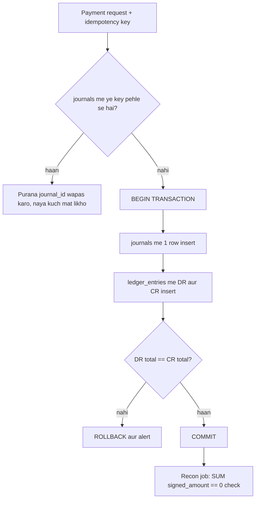
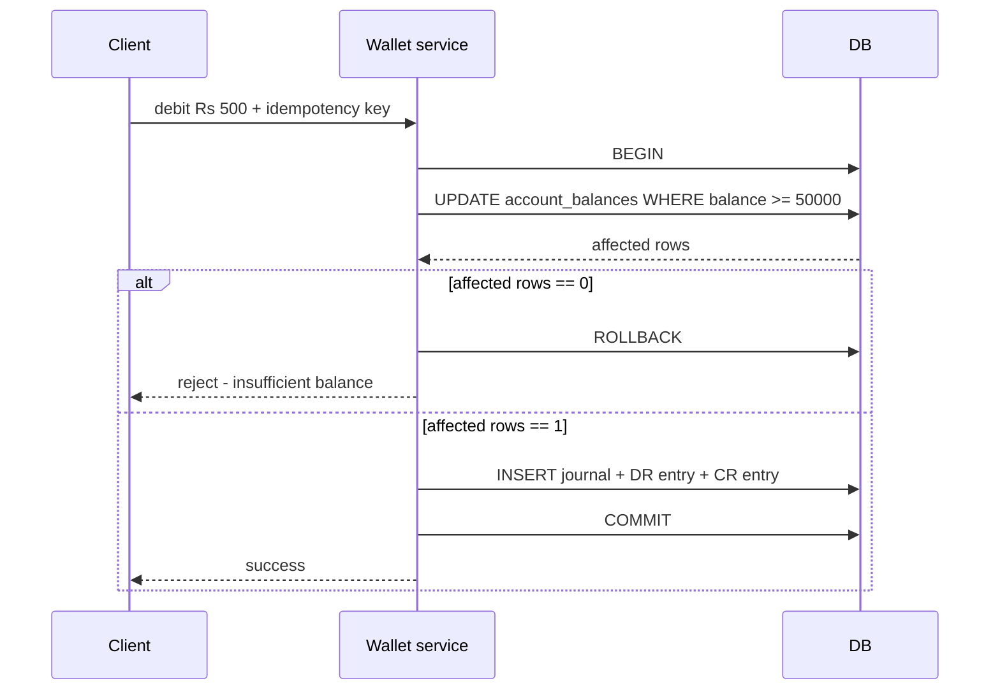
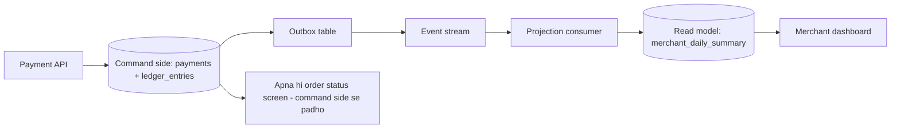

# 2B · Ledger Library

Oct 10, 2026 · @saurav chaurasiya

Is doc me L2.6 (double-entry ledger), L2.7 (balance, snapshot aur reversal) aur L2.8 (CQRS aur read model) hain.

---

## L2.6 — Double-entry ledger

Ledger ek append-only table hai (append-only = sirf naya row add hota hai, purana row kabhi update ya delete nahi hota) jisme paise ki har movement ek line banti hai. Double-entry ka matlab: ek bhi rupaya aise nahi likha jaata ki sirf kisi ek jagah se ghata ho — har ghataav (debit) ke saamne barabar ka jamaav (credit) likha jaata hai, isliye poore system ke saare amounts ka signed total hamesha zero rehta hai.

### Ye cheez hai kya

- Kis category ki cheez hai: ye ek data modeling pattern hai, koi DB product nahi. MySQL, Postgres, kisi me bhi ban jaata hai.
- Kis problem ke liye banayi gayi: paisa gayab ho jaana ya do baar ban jaana pakadne ke liye, aur "ye balance itna kyun hai" ka line-by-line proof dene ke liye.
- Is lesson ke baad tum kya kar paoge: wallet ya payments ke liye ledger schema likh paoge, aur bata paoge ki `balance` column kab rakhna theek hai aur kab wo jhooth bolta hai.

### Sawaal

Paytm wallet me user A merchant M ko Rs 500 bhejta hai. Tumhare paas ek hi table hai — `wallets(user_id, balance)` — aur code do UPDATE chalata hai: A ka balance 500 kam, M ka 500 zyada.

Do mahine baad finance team do sawaal laati hai: (1) "is merchant ke 14 August ke Rs 500 kahan se aaye?" (2) "system me aaj total kitna paisa hai, aur kal se 2 lakh kam kyun hai?" Usi beech ek incident bhi hai — deploy ke dauraan pehla UPDATE commit ho gaya aur dusre se pehle pod mar gaya.

Teeno ka jawab kaise doge?

> Pehle khud socho — 5 min. Hints: (1) `balance` apne aap me ek fact hai ya kisi history ka result? (2) do alag row ke UPDATE ko atomic kaun banata hai (atomic = ya poora hota hai ya bilkul nahi hota)? (3) accountants 600 saal se ye problem kaise solve karte aa rahe hain?

### Problem kyun aata hai

- `balance` ek derived number hai — usme "kyun badla" ki koi information nahi hoti. Overwrite hua, purani value gayi.
- Ek business event = do row ka update. Beech me crash hua to ek side ka asar reh jaata hai, aur system khud se bata nahi sakta ki kuch toota hai.
- Do concurrent debit ek hi row padhkar likhein to lost update ho jaata hai — ek debit gayab. Ye `L2.14 — Optimistic vs pessimistic locking (abhi banna baaki)` ka ilaaka hai.
- Dispute, chargeback, audit aur bank ke saath reconciliation — sabko line-item proof chahiye hota hai, aakhri balance nahi.
- Money ko `double`/`float` me rakhna: Java me `0.1 + 0.2` ka jawab `0.30000000000000004` aata hai. Paise me rounding error ka matlab ek din mismatch.

### Naive approach

- Sirf `wallets(user_id, balance)` rakho, har payment pe do UPDATE maar do.
- Ye exactly kahan tootta hai:
  - Pehla UPDATE commit, dusra fail — paisa gayab, aur koi check ise pakadta nahi.
  - Refund ke liye balance wapas badhana padta hai; original debit ka koi nishaan nahi bachta, isliye "Rs 500 do baar refund hue kya?" ka jawab hi nahi hai.
  - Same request do baar aane pe 1000 kat jaata hai. Ye [L2.1 — Idempotency keys](https://claude.ai/code/artifact/c269ac61-440b-4525-bd04-31baf708dece) pe depend karta hai, aur idempotency bhi tabhi kaam karti hai jab per-request ek record bachta ho.
  - "Kal raat 12 baje balance kya tha" kabhi nahi pata chalega, kyunki history hi nahi hai.

### Sahi design

1. Do cheezein alag karo: `accounts` (kaun paisa rakh sakta hai — user wallet, merchant payable, bank nostro, fee income) aur `ledger_entries` (paise ki har movement).
2. Har business event ke liye ek `journal` row banao. Uske neeche kam se kam DO entries — ek debit, ek credit — aur dono ka amount barabar.
3. Journal aur uski saari entries ek hi DB transaction me insert karo. Yahan ACID (Atomicity, Consistency, Isolation, Durability — matlab ya poora batch likha jaata hai ya kuch bhi nahi) ka faayda uthana hai.
4. Entries pe `UPDATE` ya `DELETE` kabhi nahi. Galti sudharni ho to ulti direction ki nayi reversal entry daalo.
5. Amount `BIGINT` me paise store karo (Rs 500.25 = 50025), `DOUBLE` me kabhi nahi.
6. Balance = us account ki entries ka sum. Fast chahiye to snapshot (L2.7).
7. Invariant jo tumhara trip-wire hai: `SELECT SUM(signed_amount) FROM ledger_entries` hamesha 0. Ise hourly chalao — zero se hile to alert.

Schema aise dikhta hai — teen table, teeno ka kaam alag:

```sql
-- accounts: kaun paisa rakh sakta hai
CREATE TABLE accounts (
  account_id   VARCHAR(40) PRIMARY KEY,
  account_type VARCHAR(20) NOT NULL,   -- USER_WALLET / MERCHANT_PAYABLE / BANK_NOSTRO / FEE_INCOME
  currency     CHAR(3)     NOT NULL
);

-- journals: ek business event (ek payment, ek refund, ek fee)
CREATE TABLE journals (
  journal_id      VARCHAR(40) PRIMARY KEY,
  journal_type    VARCHAR(20) NOT NULL,
  idempotency_key VARCHAR(80) NOT NULL UNIQUE,  -- same request dobara = same journal
  created_at      DATETIME(3) NOT NULL
);

-- ledger_entries: paise ki actual movement, append-only
CREATE TABLE ledger_entries (
  entry_id    BIGINT AUTO_INCREMENT PRIMARY KEY,
  journal_id  VARCHAR(40) NOT NULL,
  account_id  VARCHAR(40) NOT NULL,
  direction   CHAR(2)     NOT NULL,   -- DR ya CR
  amount      BIGINT      NOT NULL,   -- paise me, hamesha positive
  created_at  DATETIME(3) NOT NULL,
  FOREIGN KEY (journal_id) REFERENCES journals(journal_id),
  FOREIGN KEY (account_id) REFERENCES accounts(account_id),
  INDEX idx_account_entry (account_id, entry_id)
);
```

Rs 500 ka wallet-to-merchant transfer ek journal aur do entries banta hai:

| journal\_id | account\_id | direction | amount (paise) |
| --- | --- | --- | --- |
| j-1001 | user:A | DR | 50000 |
| j-1001 | merchant:M | CR | 50000 |

Write path aise chalta hai:



### Kya choose karein aur kyun

| Option | Kab use karo | Kab mat karo |
| --- | --- | --- |
| Sirf `balance` column | Non-money counters (points, likes, streaks) jahan galti se kuch nahi bigadta | Kisi bhi asli paise ke liye |
| Double-entry ledger, `balance` sirf cache | Wallet, payments, refunds — yahi default hai | Jab ek hi account pe per-second lakhs entries likhni hon (hot account — Deep Dive dekho) |
| Event-sourced ledger (sirf events, balance poora derive) | Jab audit aur "us din balance kya tha" sabse important ho | Chhoti team me — replay aur projection maintain karna bada kaam hai |
| Ready-made ledger service (TigerBeetle, Modern Treasury jaisi) | Jab ledger tumhara core product nahi hai aur speed chahiye | Jab data residency ya regulator ke localisation rules allow na karein |

### India me kaise hota hai

- Paytm apne distributed DB me InnoDB customise karta hai, sharding key se logical DB layer banata hai aur data centres ke beech Paxos-based replication chalata hai — ledger jaisa write-heavy load isi par baithta hai ([Paytm engineering blog](https://paytm.com/blog/engineering/how-paytm-handles-millions-of-digital-transactions-safely-everyday/)).
- Uber ne ledger ke liye alag store banaya (LedgerStore), jisme entries immutable hain aur trillions of indexes manage hote hain ([Uber blog](https://www.uber.com/us/en/blog/how-ledgerstore-supports-trillions-of-indexes/)).
- Immutability practically kaise enforce karte hain — DB permissions, no-update constraints, correction-by-reversal — iska breakdown Modern Treasury ne likha hai ([Modern Treasury](https://www.moderntreasury.com/journal/enforcing-immutability-in-your-double-entry-ledger)).

### Interview follow-ups

- **"Ledger ke saath balance column rakhoge ya nahi?"** — Rakho, par source of truth entries hain; balance ek cache hai jo entries se dobara banaya ja sakta hai.
- **"Entry galat ho gayi to?"** — Reversal entry, UPDATE nahi. Audit trail me original aur reversal dono dikhte hain.
- **"Ek DB transaction me kitni entries?"** — Ek journal ki saari entries. Warna partial journal ban jaayega jo invariant tod dega.
- **"Cross-currency transfer?"** — Do currency ke do journal, beech me ek FX account. Ek entry me do currency kabhi nahi.
- **"Ledger shard kaise karoge?"** — `account_id` pe, aur cross-shard transfer saga se (`2C · Saga Sea`), 2PC se nahi.

### Self-check

1. Double-entry ka ek-line invariant kya hai, aur usko production me kaise test karoge?
2. `amount` ko `BIGINT` paise me kyun rakhte hain, `DOUBLE` me kyun nahi?
3. Reversal entry aur row UPDATE me farq kya hai, aur audit ke liye kaun behtar hai?
4. Ek wallet product me kam se kam kaunse chaar account types rakhoge, aur kyun?

### Notebook

Ledger = append-only entries, balance = unka sum · Har journal me DR total == CR total, isliye system ka SUM(signed) hamesha 0 · Amount BIGINT paise me, float kabhi nahi · Galti ka ilaaj reversal entry, row UPDATE nahi · Journal pe unique idempotency\_key se same request dobara aaye to naya paisa nahi banta · Trip-wire: hourly SUM(signed\_amount) == 0 check, hile to alert

### Padhne ke liye

- [Enforcing immutability in your double-entry ledger — Modern Treasury](https://www.moderntreasury.com/journal/enforcing-immutability-in-your-double-entry-ledger)
- [How LedgerStore supports trillions of indexes — Uber](https://www.uber.com/us/en/blog/how-ledgerstore-supports-trillions-of-indexes/)
- [How Paytm handles millions of digital transactions safely everyday](https://paytm.com/blog/engineering/how-paytm-handles-millions-of-digital-transactions-safely-everyday/)

### Deep Dive (SDE-2) — jab time ho

#### Account types aur sign convention

- Asset account (bank nostro = bank me tumhara asli paisa, user ka trust account) pe debit se balance badhta hai.
- Liability account (user wallet = tumhara us user ko dena) pe credit se balance badhta hai. User ka Rs 500 wallet me hona tumhare liye liability hai, asset nahi.
- Isliye "wallet me paisa aaya" = nostro DR + user wallet CR. Ye sign convention ek baar likhkar team me fix kar do, warna aadha code ulta likhega.

#### Hot account problem

- Hot key ka matlab: ek hi row ya partition pe disproportionate traffic (partition = data ka ek hissa jo ek machine pe rehta hai).
- Settlement me ek merchant payable account pe lakhs entries aati hain, aur agar balance usi row pe update ho raha hai to wo row lock ka queue ban jaata hai.
- Ilaaj: balance row ko N sub-accounts me todo (`merchant:M#0` se `merchant:M#9`), balance = unka sum. Ye sharding (data ko tukdon me baantna) ka chhota version hai.
- Dusra ilaaj: entries append karo, balance alag se batch me compute karo (L2.8 ka read model).

#### Pending vs posted

- Card authorization me paisa pehle hold hota hai, settle baad me. Isliye do tarah ke balance chahiye: `posted` (settled entries ka sum) aur `available` (posted minus active holds).
- Hold ko bhi ledger me entry banao — user wallet DR, ek `pending_holds` account CR. Capture pe hold reverse karo aur asli journal daalo; expire pe sirf reverse karo.
- Isse "available balance kyun kam dikh raha hai" ka jawab bhi line-item me milta hai.

---

## L2.7 — Balance, snapshot aur reversal

Balance nikaalne ka sabse sahi tareeka hai us account ki saari ledger entries ka sum lena, par chaar saal purane wallet pe wo sum lakhs rows padhega aur passbook page kabhi fast nahi khulega. Ye lesson teen cheezein jodta hai: balance ko fast banane ke liye snapshot, debit ko safe banane ke liye atomic conditional update, aur galti sudharne ke liye reversal.

### Ye cheez hai kya

- Kis category ki cheez hai: performance aur correctness techniques, jo [L2.6 — Double-entry ledger](https://claude.ai/code/artifact/a7c567e0-66cb-46fe-b7c9-9c20739857eb) ke ledger ke upar lagti hain.
- Kis problem ke liye banayi gayi: `SUM()` slow ho jaata hai, do parallel debit balance ko negative kar dete hain, aur immutable entry me galti ko mitaya nahi ja sakta.
- Is lesson ke baad tum kya kar paoge: snapshot schema likh paoge, ek atomic conditional debit likh paoge, aur reversal aur refund ka farq bata paoge.

### Sawaal

PhonePe wallet ka ek purana user hai jiske chaar saal me 2.1 lakh ledger entries hain. Passbook page khulne me 3 second lag raha hai (latency = ek request ka jawab aane me laga time), aur p99 9 second hai (p99 = sabse slow 1% requests chhodkar, baaki 99% ka jawab is time ke andar aa jaata hai).

Usi din ek bug report bhi aaya: do parallel debit requests ne ek user ka balance minus Rs 40 kar diya.

Dono problem ek hi raat me fix karni hain. Kya karoge?

> Pehle khud socho — 5 min. Hints: (1) `SUM()` ko kam rows pe kaise chalaoge? (2) "balance >= amount" check aur actual debit ke beech dusra request ghus gaya to kya hoga? (3) negative balance ko DB khud kaise rok sakta hai?

### Problem kyun aata hai

- Full sum ka cost entries ke saath badhta jaata hai — aaj 2 lakh rows, agle saal 5 lakh. Code same, page slow.
- Read-modify-write race: request 1 ne balance 500 padha, request 2 ne bhi 500 padha, dono ne Rs 400 ka debit pass kar diya. Dono sahi soche, result galat.
- Entries immutable hain, to "galat entry mita do" option hi nahi hai — sudhaarne ka alag mechanism chahiye.
- Month-end statement ke liye "30 September 23:59 pe balance kya tha" chahiye hota hai, jo aaj ke sum se nahi milta.

### Naive approach

- Pehla naive: app me balance padho, `if (balance >= amount)` check karo, phir `UPDATE wallets SET balance = :newBalance`.
  - Check aur write ke beech dusra thread ghus jaata hai. Dono ka check pass, dono ka write — ek debit gayab ya balance negative.
  - `:newBalance` app me calculate karna sabse bura hai: wo purani value pe based hai, jo write ke time tak stale ho sakti hai.
- Dusra naive: `UPDATE wallets SET balance = balance - 500 WHERE user_id = 'A'`.
  - Ye atomic hai (DB khud subtract karta hai), par condition nahi hai — balance minus me chala jaayega aur koi error nahi aayega.

### Sahi design

1. Entries hi source of truth. Uske upar ek derived row: `account_balances(account_id, balance, last_entry_id, version)`.
2. Debit ek hi conditional UPDATE se karo — check aur write ek statement me:

```sql
-- affected rows 1 = debit ho gaya, 0 = itna balance hi nahi tha
UPDATE account_balances
   SET balance       = balance - 50000,
       last_entry_id = :entryId,
       version       = version + 1
 WHERE account_id = 'user:A'
   AND balance    >= 50000;
```

3. Ye UPDATE aur ledger entries ka INSERT ek hi DB transaction me rakho. Affected rows 0 aaye to ROLLBACK aur request reject.
4. DB pe ek safety net bhi daalo: `ALTER TABLE account_balances ADD CONSTRAINT bal_nonneg CHECK (balance >= 0);`. Code me bug aaya to DB mana kar dega.
5. Snapshot: `account_snapshots(account_id, as_of, balance, last_entry_id)` nightly likho. Passbook balance = latest snapshot ka balance + uske `last_entry_id` ke baad ki entries ka sum. Ye sum chhota rehta hai.
6. Ek rebuild job snapshot ko entries se dobara compute kare aur compare kare. Mismatch = alert (recon ka kaam, `2F · Recon Ruins`).
7. Reversal: original journal ke saamne ek naya journal daalo — DR aur CR ulte, aur `reverses_journal_id` me original ka id. Original row ko chhuo mat.
8. Reversal aur refund alag cheezein hain. Reversal = "ye entry galat thi, system ki galti". Refund = asli business event jisme paisa merchant se user ko wapas jaata hai, uska apna naya journal banta hai.

Debit ka flow:



### Kya choose karein aur kyun

| Option | Kab use karo | Kab mat karo |
| --- | --- | --- |
| Har read pe poora `SUM()` | Chhote accounts, internal tools, ek-baar ki report | Passbook, dashboard, kuch bhi user-facing |
| Balance row + conditional UPDATE | Wallet debit decision — yahi default hai | Jab ek hi account pe hazaron writes per second aayein |
| Snapshot + uske baad ka delta sum | Passbook, monthly statement, month-end closing | Jab entries hi kam hon — extra machinery ka faayda nahi |
| Balance ko N sub-accounts me todna | Hot merchant ya settlement account | Normal user wallet — bina zaroorat complexity |

### India me kaise hota hai

- Paytm ne write performance ke liye LSM technique use ki hai, jisse balance aur entry writes ek hi path pe tez rehte hain ([Paytm engineering blog](https://paytm.com/blog/engineering/how-paytm-handles-millions-of-digital-transactions-safely-everyday/)).
- Ledger ke upar balances, holds aur "available vs posted" ka practical design Modern Treasury ne detail me rakha hai ([Modern Treasury — ledgers tech talk](https://www.moderntreasury.com/journal/ledgers-tech-talk)).

### Interview follow-ups

- **"Balance row aur entries me mismatch mila, kis pe bharosa karoge?"** — Entries pe. Balance ko entries se rebuild karo aur mismatch ka alert raise karo.
- **"Negative balance kaise rokte ho?"** — Conditional UPDATE (`AND balance >= amount`) plus DB CHECK constraint. Sirf app-level `if` kaafi nahi.
- **"Snapshot kitne interval pe lena chahiye?"** — Delta rows ke hisaab se, time ke hisaab se nahi. Target rakho: snapshot ke baad 1000 se kam entries.
- **"Reversal ka invariant pe kya asar?"** — Koi nahi. Reversal bhi DR aur CR ka pair hai, isliye signed sum 0 hi rehta hai.
- **"Refund ko idempotent kaise banaoge?"** — `refund_id` pe unique key journal pe, jaise [L2.1 — Idempotency keys](https://claude.ai/code/artifact/c269ac61-440b-4525-bd04-31baf708dece) me padha.

### Self-check

1. Conditional UPDATE race condition ko kaise rokta hai, jabki app-level `if` nahi rok paata?
2. Snapshot ke baad ka balance kis formula se nikalta hai?
3. Reversal aur refund me business ke hisaab se farq kya hai?
4. Balance row ke `version` column ka kaam kya hai?

### Notebook

Balance = snapshot + uske baad ki entries ka sum, poora SUM nahi · Debit = ek conditional UPDATE jisme `AND balance >= amount`, app me `if` nahi · Affected rows 0 = insufficient balance, rollback · DB CHECK (balance >= 0) safety net ki tarah · Galti = reversal journal with reverses\_journal\_id, row edit nahi · Refund alag business event hai, reversal nahi

### Padhne ke liye

- [Ledgers tech talk — Modern Treasury](https://www.moderntreasury.com/journal/ledgers-tech-talk)
- [Payment ledger design for billing systems](https://dodopayments.com/blogs/payment-ledger-design/)

### Deep Dive (SDE-2) — jab time ho

#### Version column aur optimistic locking

- `version` column se tum detect kar sakte ho ki tumhare padhne ke baad koi aur likh gaya: `WHERE account_id = ? AND version = ?`. Affected rows 0 = kisi aur ne pehle likh diya, retry karo.
- Isko optimistic locking kehte hain (optimistic = maan lo conflict nahi hoga, pakda jaaye to retry karo). Pessimistic locking (`SELECT ... FOR UPDATE`) row ko pehle se lock kar leta hai.
- Pure balance debit ke liye conditional UPDATE hi kaafi hai; version tab chahiye jab tum ek saath kai field badal rahe ho.

#### Closing balance aur month-end

- Accounting me month close ka matlab: us mahine ki entries freeze, aur closing balance agle mahine ka opening balance ban jaata hai.
- Isliye snapshot ko month boundary pe bhi lo, sirf nightly nahi — statement usi se banta hai aur wo number kabhi badalna nahi chahiye.
- Late-arriving entry (bank ne 2 din baad bheji) ko purane mahine me ghusao mat. Use current mahine me `posted_date` aaj aur `value_date` purani rakhkar daalo.

#### Snapshot rebuild job

- Job ka shape: har account ke liye last snapshot lo, uske baad ki entries ka sum karo, result ko `account_balances.balance` se compare karo.
- Poore DB pe ek saath mat chalao — account\_id ke range me batch karo, aur throughput (per second kitna kaam) ko throttle karo taaki live traffic na mare.
- Mismatch mile to balance ko entries se overwrite karo aur ek incident ticket banao. Silently fix karna sabse khatarnak hai — phir root cause kabhi nahi milta.

---

## L2.8 — CQRS aur read model

CQRS (Command Query Responsibility Segregation — likhne wala model aur padhne wala model alag-alag rakhna) ka matlab hai ki tum ek hi data ke do roop rakhte ho: ek jahan correctness sabse zaroori hai (ledger entries, normalized), aur ek jo sirf dikhane ke liye bana hai aur isliye pehle se judi hui shape me padha rehta hai (passbook, merchant dashboard).

### Ye cheez hai kya

- Kis category ki cheez hai: architecture pattern hai — koi library ya DB product nahi.
- Kis problem ke liye banayi gayi: read aur write ki zarooratein ulti hoti hain. Write ko normalized aur strict chahiye (normalized = ek fact sirf ek jagah likha ho), read ko denormalized aur fast chahiye (denormalized = padhne ke liye data pehle se ek row me jod diya gaya ho).
- Is lesson ke baad tum kya kar paoge: ek read model table design kar paoge, uska lag handle kar paoge, aur bata paoge ki CQRS kab overkill hai.

### Sawaal

Razorpay-jaisa merchant dashboard banana hai. Merchant ko chahiye: last 30 din ka settled, pending aur refunded breakdown; top 10 failure reasons; aur daily amount ka graph.

Ye data teen jagah bikhra hai — `payments`, `refunds` aur `ledger_entries`. Abhi dashboard har page load pe 6 JOIN wali query chalata hai. Peak par primary DB ka CPU 90% chala jaata hai aur live payments ka p99 bhi badh jaata hai.

Kya karoge?

> Pehle khud socho — 5 min. Hints: (1) dashboard ko 2 minute purana data chalega ya nahi? (2) jo number roz-roz same rehta hai, usko har page load pe compute karna zaroori hai? (3) ek hi DB write aur analytics dono kyun kar raha hai?

### Problem kyun aata hai

- Write path ko normalized schema chahiye taaki correctness simple rahe. Read path ko ulta chahiye — sab kuch ek row me, bina JOIN.
- Dono ek hi DB pe hain, isliye dashboard ki ek heavy query live payments ko bhi slow kar deti hai. Ye [L1.10b — Read path vs write path](https://claude.ai/code/artifact/99909fe9-731e-4e31-9e7d-36e0c5aed845) ka seedha extension hai.
- Read fast karne ke liye index add karte jaao to write slow hote jaate hain — har INSERT pe saare index bhi update hote hain.
- Dashboard ke numbers (din ka total, count) har baar ginne padte hain, jabki wo kal ke din ke liye kabhi nahi badalne.

### Naive approach

- Dashboard ki query read replica pe bhej do (replica = primary DB ki copy jo sirf read ke liye use hoti hai).
- Ye kahan tak kaam karta hai aur kahan tootta hai:
  - Faayda asli hai — primary ka CPU bach jaata hai.
  - Par query ab bhi wahi 6 JOIN hai; replica pe bhi 4 second legi, aur dashboard slow hi rahega.
  - Replica lag (replica ka data primary se kitna peeche hai) pe kuch socha nahi gaya — merchant ko apna abhi-abhi kiya refund dikhega hi nahi aur wo support ticket kaategaa.
  - Jaise merchants badhenge, ek hi replica bhi kaafi nahi padega.

### Sahi design

1. Command side (likhne wala): `payments`, `refunds`, `ledger_entries` — normalized, strongly consistent, sirf validated writes. Yahi source of truth hai.
2. Har committed write ek event banata hai, aur wo event outbox se publish hota hai (`2C · Saga Sea` me outbox pattern aata hai).
3. Ek projection (projection = ek consumer jo events padhkar read-model table likhta hai) alag table me denormalized rows banata hai:

```sql
-- read model: ek merchant, ek din, ek row. Koi JOIN nahi.
CREATE TABLE merchant_daily_summary (
  merchant_id    VARCHAR(40) NOT NULL,
  day            DATE        NOT NULL,
  settled_paise  BIGINT      NOT NULL DEFAULT 0,
  pending_paise  BIGINT      NOT NULL DEFAULT 0,
  refunded_paise BIGINT      NOT NULL DEFAULT 0,
  txn_count      INT         NOT NULL DEFAULT 0,
  last_event_id  BIGINT      NOT NULL,   -- kahan tak apply ho chuka hai
  PRIMARY KEY (merchant_id, day)
);
```

4. Dashboard sirf isi table ko padhta hai: `WHERE merchant_id = ? AND day BETWEEN ? AND ?`. Query simple, index ek, time milliseconds me.
5. Read model eventually consistent hota hai (eventual consistency = write ke turant baad read purana data de sakta hai, par thodi der me dono mil jaate hain). Isliye UI pe "as of 02:41" jaisa timestamp dikhao — chhupao mat.
6. Read-your-writes alag se handle karo (read-your-writes = apna khud ka likha hua turant khud ko dikhna chahiye). Jis screen pe user ne khud action kiya hai, wahan command side se padho ya response me updated row hi wapas bhej do. Ye [L1.16a — Consistency models](https://claude.ai/code/artifact/cfe905e6-6370-43e0-a337-764eeb9ddf1e) me detail me hai.
7. Projection idempotent rakho (idempotent = same event do baar aaye to final result ek baar ka hi rahe): `last_event_id` se aage wale event hi apply karo, ya `processed_events(event_id)` pe unique key rakho.
8. Rebuild possible rakho: projection ko zero se events replay karke dobara banaya ja sakna chahiye. Isliye read model me koi aisa data mat rakho jo kisi event se derive na ho.



### Kya choose karein aur kyun

| Option | Kab use karo | Kab mat karo |
| --- | --- | --- |
| Same DB, JOIN wali query | Internal admin tool, kam traffic, data chhota | User-facing dashboard, ya jab write path usi DB pe ho |
| Read replica pe wahi query | Jab query khud theek hai, bas primary ka load hatana hai | Jab query hi heavy hai — replica pe bhi slow rahegi |
| CQRS, projection table usi DB me | Pehla qadam — kam operational cost, bada faayda | Jab read volume se DB hi overload ho raha ho |
| CQRS, alag read store (ClickHouse, Elasticsearch) | Analytics, full-text search, bade aggregates | Jab team chhoti ho — ek aur system chalana padta hai |

### India me kaise hota hai

- Paytm sharding key se logical DB layer banata hai aur read traffic ko alag se handle karta hai, taaki transaction ka write path analytics se na takraaye ([Paytm engineering blog](https://paytm.com/blog/engineering/how-paytm-handles-millions-of-digital-transactions-safely-everyday/)).
- Uber ka LedgerStore immutable entries ke upar alag se materialized indexes banata hai — wahi CQRS ka read-side idea hai, ledger ke scale pe ([Uber blog](https://www.uber.com/us/en/blog/how-ledgerstore-supports-trillions-of-indexes/)).

### Interview follow-ups

- **"CQRS aur read replica me farq?"** — Replica wahi schema rakhta hai; CQRS read ke liye nayi shape banata hai. Replica se query same rehti hai, CQRS se query badal jaati hai.
- **"Projection peeche reh gaya to?"** — Lag ko metric banao (`now - last_event_time`), threshold pe alert, aur UI pe as-of time dikhao. Lag bahut badhe to dashboard pe banner.
- **"Projection me bug tha, 3 din ka data galat hai — kya karoge?"** — Fix deploy karo, phir projection ko replay karo. Isliye events ko retain karna zaroori hai.
- **"Ek event do baar aa gaya to?"** — `last_event_id` ya `processed_events` unique key — projection idempotent hona chahiye, kyunki stream at-least-once deliver karti hai.
- **"CQRS kab nahi karoge?"** — Jab ek hi query thodi slow hai, ya team chhoti hai. Pehle index aur replica try karo; CQRS do systems ka maintenance hai.

### Self-check

1. CQRS me command side aur read side me se source of truth kaun hai?
2. Read model ko rebuild kar paane ke liye kis cheez ko preserve karna padega?
3. Projection idempotent kaise banate hain, aur zaroori kyun hai?
4. Read-your-writes problem ko CQRS me kaise handle karte hain?

### Notebook

CQRS = write model normalized aur strict, read model denormalized aur fast · Events outbox se nikalte hain, projection unhe read-model rows me badalta hai · Read model eventually consistent, UI pe as-of time dikhao · Apne khud ke action wale screen command side se padho · Projection idempotent: last\_event\_id ya processed\_events unique key · Read model hamesha replay se rebuild hona chahiye · Pehle index aur replica, phir CQRS

### Padhne ke liye

- [CQRS pattern — Microsoft Azure Architecture Center](https://learn.microsoft.com/azure/architecture/patterns/cqrs)
- [CQRS — Martin Fowler](https://martinfowler.com/bliki/CQRS.html)

### Deep Dive (SDE-2) — jab time ho

#### CQRS aur event sourcing ek cheez nahi hain

- CQRS sirf ye kehta hai ki read aur write ke model alag ho. Write side bilkul normal tables ho sakti hai.
- Event sourcing kehta hai ki state hi events se banegi — current state koi table me nahi, events hi truth hain.
- Dono saath chal sakte hain, par CQRS ke liye event sourcing zaroori nahi. Interview me ise alag rakhna sabse badi plus point hoti hai.

#### Projection lag ko monitor kaise karein

- Teen metric: consumer lag (kitne events pending), projection lag (`now - last applied event time`), aur error rate.
- Alert projection lag pe lagao, pending count pe nahi — traffic badhne pe count badhega par lag normal ho sakta hai.
- Backpressure bhi socho: projection slow hai to events jama hone lagte hain. Bounded queue aur drop/block ka decision `L2.17a — Backpressure (abhi banna baaki)` ka topic hai.

#### Read model ka schema badalna

- Naya column chahiye: naya column add karo nullable, projection ka naya version deploy karo, phir purane data ke liye replay chalao.
- Breaking change chahiye: nayi table banao (`merchant_daily_summary_v2`), usme replay karo, verify karo, phir read ko switch karo. Purani table kuch din rakho.
- Isi liye read model ko "disposable" maanke design karte hain — use dobara banana sasta hona chahiye.

---

## Aage kya

- Pichla zone: [2A · Idempotency Island](https://claude.ai/code/artifact/c269ac61-440b-4525-bd04-31baf708dece) — L2.1 se L2.5 (idempotency keys, retries, DLQ, webhooks).
- Agla zone: [2C · Saga Sea](https://claude.ai/code/artifact/429b3ea6-a261-431d-a384-a0c6eb68a9f6) — L2.9 (2PC aur woh kyun avoid hota hai), L2.10 (saga pattern), L2.11 (outbox pattern), L2.12 (CDC / Debezium).
- Jo is doc me reference hua aur abhi doc me nahi hai: `L2.14 — Optimistic vs pessimistic locking` (`2D · Lock Fort`), `L2.17a — Backpressure` (`2E · Resilience Ridge`), aur `2F · Recon Ruins` ka recon job.
