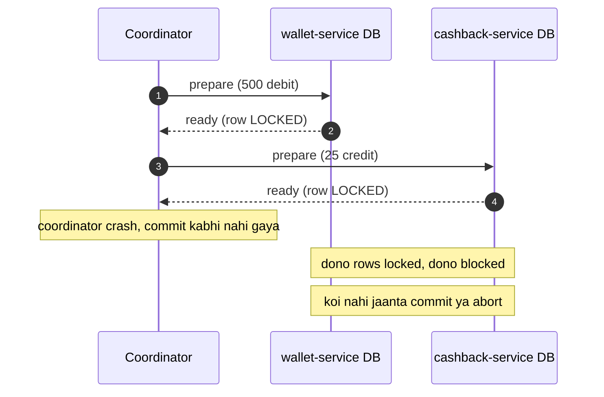
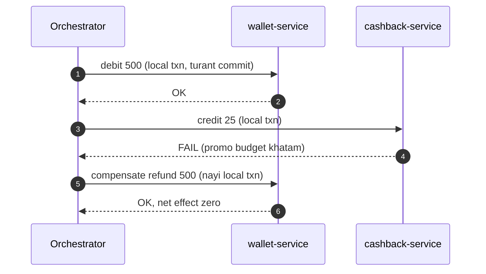
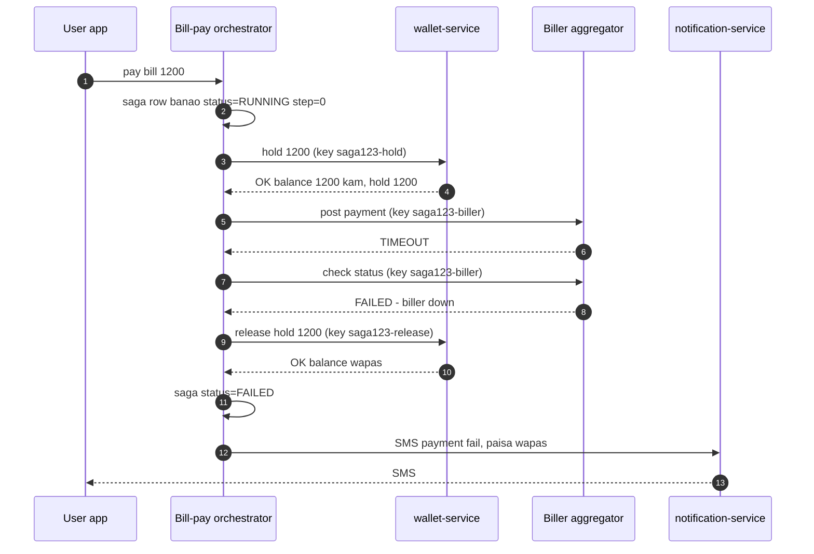
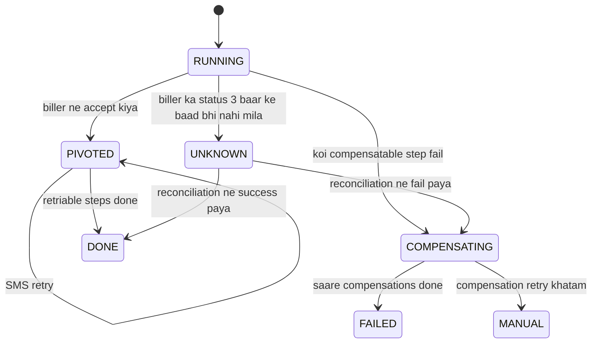
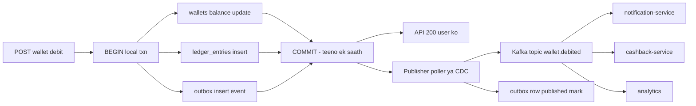
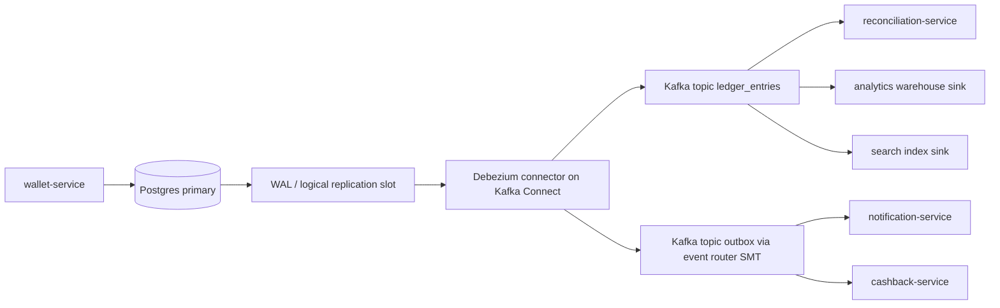

# 2C · Saga Sea

Oct 11, 2026 · @saurav chaurasiya

Is doc me L2.9 (2PC aur woh kyun avoid hota hai), L2.10 (Saga pattern), L2.11 (Outbox pattern) aur L2.12 (CDC / Debezium) hain — yani do ya zyada services ke beech paisa move karne ke saare safe tareeke.

---

## L2.9 — 2PC & why avoided

Two-Phase Commit (2PC — do phase me commit) ek protocol hai jisme ek coordinator (ek alag process jo poori transaction ko chalata hai) pehle sabhi databases se poochta hai "commit kar paoge?", aur sabka haan aane ke baad hi sabko "ab commit karo" bolta hai. Maqsad ye hai ki do alag-alag databases me bhi atomicity (ya sab change ho jaaye, ya kuch bhi na ho) mil jaaye.

### Ye cheez hai kya

- Kis category ki cheez hai: distributed transaction protocol — ek handshake, koi database feature nahi.
- Kis problem ke liye banayi gayi: do alag databases me ek saath likhna, bina aadha-adhoora state chhode.
- Is lesson ke baad tum kya kar paoge: 2PC ka mechanism board pe draw kar paoge, aur usse zyada zaroori — bata paoge ki payments me ise kyun avoid karte hain aur jagah pe kya aata hai.

Do shabd pehle, kyunki aage har line me aayenge. **ACID** database transaction ki chaar guarantees hain — Atomicity (sab ya kuch nahi), Consistency (rules kabhi toote nahi), Isolation (do transactions ek doosre ka aadha kaam na dekhein), Durability (commit ho gaya to crash me bhi rahega). **Lock** ka matlab: ek row ko ek transaction ne pakad liya, doosre ko chhodne tak intezaar karna padega.

### Sawaal

Paytm me do alag services hain, dono ke apne database: `wallet-service` (user ka balance) aur `cashback-service` (promo ka cashback ledger). User 500 rupaye ka recharge karta hai. Business rule: wallet se 500 debit ho aur cashback 25 credit ho — dono ya koi nahi. Tum XA / 2PC se ye karne ja rahe ho. Design karo aur phir batao raat ke 11 baje peak traffic pe kya tootega.

> Pehle khud socho — 5 min. Hints: (1) coordinator khud bhi ek machine pe chalta hai, woh bhi mar sakti hai. (2) prepare ke baad commit aane tak wallet ki row pe lock laga rehta hai. (3) ek service 200 ms slow ho gayi to baaki sab kya kar rahi hain.

### Problem kyun aata hai

- Ek service ka database doosri service ke database ki row nahi dekh sakta, to `BEGIN ... COMMIT` sirf ek DB ke andar kaam karta hai.
- Paisa do jagah likhna padta hai (balance aur cashback ledger), aur beech me process mar sakta hai.
- Network pe "request fail hui" aur "request pahunch gayi, jawab kho gaya" dono ek jaise dikhte hain — client ko pata nahi chalta kya hua.

### Naive approach

- Pehla obvious solution: ek XA transaction kholo. XA ek standard hai jisme kai databases ek hi global transaction me shaamil ho jaate hain; Java me ise JTA (Java Transaction API) se chalate hain. Coordinator phase 1 me sabko `prepare` bhejta hai, phase 2 me `commit`.
- Yahan tootta hai:
  - **Coordinator SPOF hai.** SPOF (Single Point Of Failure — ek hi cheez jiske marne se poora system ruk jaaye). Agar coordinator `prepare` ke baad mar gaya, participants ne haan bol diya hai, lock pakad ke baithe hain, aur unhe nahi pata commit karna hai ya abort. Ye "blocking" state hai — coordinator ke wapas aane tak koi aage nahi badh sakta.
  - **Locks lambe time tak rehte hain.** Lock hold time = network round trip + sabse slow participant. Ek DB 300 ms le raha hai to teeno ki rows 300 ms se zyada tak locked. Hot row (jaise merchant ka settlement account) pe iska matlab hai poori queue lag gayi — throughput (ek second me kitni transactions nipat rahi hain) gir jaata hai.
  - **Availability multiply hoti hai, add nahi.** Teen services jinme se har ek 99.9% uptime pe hai, 2PC me sabka saath chalna zaroori hai: 0.999 x 0.999 x 0.999 = 99.7%. Jitne participants badhao, utna neeche.
  - **Latency badh jaati hai.** Latency = ek request ka jawab aane me laga time. 2PC me do round trip hote hain (prepare, commit) plus coordinator ka durable log — p99 (100 me sabse slow 1 request ka time) kaafi kharab hota hai.
  - **Har store 2PC support hi nahi karta.** Kafka, Redis, DynamoDB, bahut se HTTP APIs me XA jaisa prepare/commit nahi hai. NPCI ya bank ka API tumhare XA transaction me join nahi karega.

### Sahi design

Sahi jawab ye hai ki do databases ko ek transaction me baandhne ki koshish band kar do. Uske bajaye:

1. Har service apne database me **ek local ACID transaction** kare — yahan 2PC ki zaroorat nahi, normal `BEGIN ... COMMIT` kaafi hai.
2. Steps ko ek **sequence** me chalao, aur agar beech me koi step fail ho to pichhle steps ko ulta karne ke liye alag se **compensating transaction** chalao (compensating transaction = pehle kiye gaye kaam ko business level pe ulta karne wali nayi transaction, jaise debit ke badle refund — pichhla commit mitta nahi, uske upar ulta entry padti hai). Ye Saga hai — isi doc me agla lesson L2.10.
3. Event bhejne aur DB likhne ko atomic rakhne ke liye **outbox** table use karo (L2.11), aur usse Kafka tak CDC se le jao (L2.12).
4. Beech ke faili state ko dikhane ke liye ek **status field** rakho (`INITIATED`, `DEBITED`, `COMPLETED`, `REVERSED`) — user ko "processing" dikhao, jhooth nahi bolo.

Neeche wahi scenario jisme coordinator prepare ke baad marta hai — dekh lo participants kahan atak jaate hain.



Aur yahan wahi kaam saga tarike se, jisme koi lock cross-service nahi jaata.



### Kya choose karein aur kyun

| Option | Kab use karo | Kab mat karo |
| --- | --- | --- |
| Ek hi DB me local transaction | Dono tables ek hi database me daal sakte ho (wallet + ledger entry) — ye best hai, sabse simple | Services alag team ki hain aur unka schema share nahi kar sakte |
| 2PC / XA | Ek hi team ke do databases, low traffic, batch job, legacy ERP — jahan latency matter nahi karti | User-facing payment path, high TPS (transactions per second — ek second me kitni transactions), ya koi participant jo XA support nahi karta |
| Saga + compensation | Cross-service paisa move, bahar ke API shaamil, high traffic | Business compensate hi nahi kar sakta (jaise email bhej diya to wapas nahi aayega — aise step ko sabse aakhir me rakho) |
| Outbox + CDC events | Local commit ke saath event ki guarantee chahiye | Sirf ek service hai aur koi event consumer nahi |

### India me kaise hota hai

UPI khud 2PC nahi hai, aur yahi iska sabse accha sabook hai. Ek P2P payment me payer ke bank ka debit aur payee ke bank ka credit do alag legs hain, do alag systems me, do alag CBS (Core Banking System — bank ka asli ledger jahan actual balance rehta hai) pe. NPCI (National Payments Corporation of India — UPI, IMPS, RuPay chalane wali body) koi global lock nahi leti. Iske bajaye:

- Debit leg pehle hota hai, credit leg uske baad. Beech me transaction pending ya deemed-accepted state me reh sakti hai.
- Agar credit leg fail ho jaaye, to debit ko **reversal** se theek kiya jaata hai — yani compensating transaction, exactly Saga wali soch.
- Regulator ne iske liye time limit bhi fix ki hai: RBI ke TAT (Turn Around Time) circular ke hisaab se failed transaction ka auto-reversal fix deadline me hona chahiye, warna bank ko customer ko per-day compensation dena padta hai ([RBI notification](https://www.rbi.org.in/Commonman/English/scripts/Notification.aspx?Id=3074), [NPCI circular IMPS/UPI OC-93](<https://www.npci.org.in/PDF/npci/imps/circular/2019/IMPS-UPI-I-OC-93-I-FY-19-20-I-Harmonisation-of-Turn-Around-Time(TAT)-and-customer-compensation-for-failed-transaction.pdf>)).
- Paytm / PhonePe jaisi PSP app me wallet, UPI switch, cashback aur notification sab alag services hain — inke beech koi XA transaction nahi hota, saga aur event hi chalte hain.

Yahi wajah hai ki har Indian payments interview me "2PC kyun nahi" favourite sawaal hai: jawab me compensation, TAT aur reconciliation aane chahiye, sirf "slow hai" nahi.

### Interview follow-ups

- **2PC exactly kahan block hota hai?** Phase 1 ke baad, phase 2 se pehle. Participants ne `prepare` pe haan bol di hai, lock pakad liya hai, aur apne aap decide nahi kar sakte — coordinator ke jawab ka wait hi ek hi option hai.
- **3PC se theek ho jaata hai?** Nahi. 3PC ek extra phase daal ke blocking kam karta hai, par network partition (network do hisson me kat jaana) me phir bhi galat decision le sakta hai, aur ek extra round trip bhi lagta hai. Practically koi nahi use karta.
- **To Google Spanner 2PC kaise use karta hai?** Spanner 2PC ko Paxos-replicated participants ke upar chalata hai, yani har participant khud fault-tolerant hai, aur TrueTime se clock error bounded hai. Matlab 2PC tab marta hai jab participants single machine hon — properly replicated setup me chal sakta hai, par wo infra tumhare paas nahi hai.
- **Saga me isolation chala jaata hai, phir?** Haan — beech ke state doosre dekh sakte hain (ise "lack of isolation" kehte hain). Fix: semantic lock, yani row pe `status = PENDING` rakhna aur business rules me pending amount ko already-spent maanna (jaise wallet me `hold` amount).
- **Agar compensation bhi fail ho jaaye?** Usko retry karo (backoff ke saath), aur baar-baar fail ho to DLQ (Dead Letter Queue — jahan na-nipatne wale messages ja ke baith jaate hain, L2.4) me daal ke manual ops ya reconciliation job (L2.21) pe chhod do. Compensation ko idempotent (idempotent = ek hi request do baar aa jaaye to effect ek hi baar lage) banana zaroori hai.

### Self-check

1. 2PC ke do phases ka naam, aur har phase me kaun kisse kya poochta hai?
2. Coordinator crash hone ke baad participant khud decide kyun nahi kar sakta — ek line me.
3. Teen services jo har ek 99.9% available hain, 2PC me combined availability kitni?
4. Compensating transaction aur database rollback me farak kya hai?
5. UPI me credit leg fail hone pe kya hota hai, aur usme regulator ka role kya hai?

### Notebook

2PC = prepare phase + commit phase, ek coordinator ke under · fail point: prepare ke baad coordinator crash = participants blocked with locks held · cost: 2 round trips + lock hold time = latency aur throughput dono kharab · availability multiply hoti hai (0.999 ka cube = 99.7%) · payments me jagah: per-service local ACID txn + Saga + compensating transaction + outbox events · UPI khud isi model pe: debit aur credit alag legs, fail pe reversal, RBI TAT deadline ke andar.

### Padhne ke liye

- [Pattern: Saga — microservices.io](https://microservices.io/patterns/data/saga.html) — 2PC ki jagah kya aata hai, pattern ki asli definition.
- [RBI: Harmonisation of Turn Around Time and customer compensation for failed transactions](https://www.rbi.org.in/Commonman/English/scripts/Notification.aspx?Id=3074) — reversal ki legal deadline.
- [NPCI circular IMPS/UPI OC-93 (TAT)](<https://www.npci.org.in/PDF/npci/imps/circular/2019/IMPS-UPI-I-OC-93-I-FY-19-20-I-Harmonisation-of-Turn-Around-Time(TAT)-and-customer-compensation-for-failed-transaction.pdf>) — wahi cheez operational form me.

### Deep Dive (SDE-2) — jab time ho

#### Heuristic decision vs blocking

Asli XA implementations me ek "presumed abort" rule hota hai: participant ek timeout ke baad khud abort kar deta hai. Isse blocking khatam hoti hai par naya problem aata hai — coordinator ne commit decide kiya tha aur participant ne abort kar diya, to data diverge ho gaya. Isko heuristic decision kehte hain, aur iske baad reconciliation hi bachta hai. Yahi dikhata hai ki 2PC ka blocking ek bug nahi, trade-off ka doosra sira hai.

#### Lock hold time ka maths

Agar ek hot row pe lock average `H` milliseconds hold hota hai, to us row pe max throughput `1000/H` transactions per second hai — chahe tumhare paas 100 servers hon. H = 50 ms matlab 20 TPS. 2PC me H me do network round trip aur sabse slow participant ka disk fsync bhi shaamil hai. Isi wajah se hot wallet / hot key (L2.15) ke saath 2PC sabse pehle marta hai.

#### Kab 2PC genuinely theek hai

Ek hi service ke andar do resource — jaise ek SQL database aur ek JMS queue, dono same app server pe, same datacenter me, low traffic. Yahan XA ki latency chhipi rehti hai aur coordinator ka crash window chhota hai. Isliye purane enterprise Java stacks me XA common tha; microservices ke aane se problem badla, protocol nahi.

#### Saga chunne ke baad kya extra design karna padta hai

2PC chhodne ka matlab hai ki atomicity ki zimmedari database se nikal ke tumhare application me aa gayi. Yani: saga state ko durable store karna, retry aur idempotency khud handle karni, beech ke state user ko dikhane ka plan banana, aur ek reconciliation job rakhna jo bachi hui mismatch pakde. Interview me yahi list bol dena 2PC ke nuksaan ginaane se zyada impressive hota hai.

---

## L2.10 — Saga pattern

Saga ek pattern hai jisme ek badi business transaction ko chhoti-chhoti local transactions ki sequence me tod diya jaata hai, har step apne hi database me turant commit ho jaata hai, aur agar beech me koi step fail ho jaaye to pehle ke steps ko ulta karne ke liye alag se compensating transaction chalayi jaati hai. Yani rollback database nahi karta — tum karte ho, business logic se.

### Ye cheez hai kya

- Kis category ki cheez hai: distributed transaction ka pattern (koi library nahi, soch ka tareeka).
- Kis problem ke liye banayi gayi: cross-service paisa move karna, jahan 2PC ki qeemat affordable nahi hai (pichhla lesson L2.9).
- Is lesson ke baad tum kya kar paoge: ek payment flow ko steps + compensations me tod paoge, orchestration aur choreography me se chunna justify kar paoge, aur bata paoge saga state kahan store hota hai.

Ek roz ka analogy: tiffin service. Tum order karte ho, woh dabba banata hai, delivery boy uthata hai, tum paisa dete ho. Agar delivery boy nahi aaya, to "poora din undo" nahi hota — ek nayi action hoti hai: refund. Yahi compensating transaction hai. Purana kaam mitta nahi, uske upar ulta kaam chadhta hai.

### Sawaal

PhonePe pe user 1,200 rupaye ka electricity bill bharta hai wallet se. Flow ke teen hisse hain: (1) wallet se 1,200 debit, (2) biller aggregator ke API pe payment post karna, (3) user ko SMS bhejna. Biller ka API 2 me se 1 baar 8 second ka timeout deta hai, aur kabhi-kabhi timeout ke baad bhi payment andar se successful ho jaata hai. Is flow ko saga ki tarah design karo: steps, compensations, aur har step ka failure handling.

> Pehle khud socho — 5 min. Hints: (1) kaunsa step compensate ho sakta hai aur kaunsa nahi. (2) timeout ka matlab "fail" nahi hota — pehle pata karo asli status kya hai. (3) SMS bhej diya to wapas nahi aa sakta, to usko sequence me kahan rakhoge.

### Problem kyun aata hai

- Teen steps teen alag systems me hain — ek local `COMMIT` teeno ko cover nahi karta.
- Beech me crash hone pe system aadhe state me reh jaata hai: paisa kat gaya par bill nahi bhara.
- Bahar ka API (biller) tumhare control me nahi hai — na uska transaction, na uski speed, na uska sach-much ka status.
- Kuch steps irreversible hote hain: SMS, email, push notification — bhejne ke baad wapas nahi aate.

### Naive approach

- Pehla obvious solution: ek service me try-catch likho — `try { debit(); callBiller(); sendSms(); } catch (e) { refund(); }`.
- Yahan tootta hai:
  - Agar `callBiller()` timeout de aur andar se success ho gaya ho, to `refund()` chala dena matlab bill bhi bhara aur paisa bhi wapas — company ka nuksaan. Timeout ko fail maan lena saga ki sabse badi galti hai.
  - Agar process `debit()` ke turant baad crash ho jaaye, to `catch` block hi nahi chalega. In-memory try-catch durable nahi hai — crash ke saath hi plan gayab ho gaya.
  - `refund()` khud fail ho sakta hai. Phir kaun retry karega? Code me koi jagah nahi bachi.
  - SMS sabse pehle chala diya aur baad me fail hua, to user ko jhooth pahuncha diya — wapas nahi le sakte.

### Sahi design

Saga ko ek durable state machine ki tarah socho, in-memory function call ki tarah nahi.

1. **Saga state ko DB me likho.** Ek `payment_saga` row: `saga_id`, `user_id`, `amount`, `step` (kahan tak pahunche), `status` (`RUNNING`, `COMPENSATING`, `DONE`, `FAILED`). Har step ke pehle aur baad me ye row update hoti hai, usi local transaction me jisme us step ka kaam hota hai. Crash ke baad ek recovery job in rows ko dekh ke adhoora saga wahin se uthata hai.
2. **Steps ko teen category me baanto.**
   - *Compensatable* — ulta kiya ja sakta hai (wallet debit ka ulta refund).
   - *Pivot* — woh ek step jiske baad saga sirf aage hi badhta hai (biller pe payment accept ho gaya). Pivot ke baad compensation nahi, sirf retry.
   - *Retriable* — pivot ke baad ke steps, jo bas safal hone tak retry hote rehte hain (SMS, loyalty points). Inhe sabse aakhir me rakho.
3. **Hold lo, seedha debit mat karo.** Wallet me `balance` se amount kaato aur usi amount ko `hold` me daalo, dono ek hi local transaction me. Isse user usi paise ko dobara kharch nahi kar sakta (ye "semantic lock" hai — DB lock nahi, business level ka lock). Biller confirm hone pe hold release karke actual debit, fail hone pe hold wapas balance me.
4. **Har step aur har compensation idempotent banao.** Idempotent = wahi request do baar aane pe effect ek hi baar lage. Iska tareeka: har step pe ek unique key bhejo (`saga_id` + step name) aur receiving side us key ko unique index me store kare — dobara aaya to purana jawab wapas de do. Ye L2.1 (Idempotency keys) ka seedha application hai.
5. **Timeout pe status check karo, refund nahi.** Biller timeout de to retry se pehle uska status API maaro ("check status"). Teen baar check karne ke baad bhi pata na chale to saga ko `UNKNOWN` me daalo aur reconciliation job (L2.21) ke liye chhod do — ye scheduled job dono taraf ke records milata hai aur sach ka faisla karta hai.
6. **Compensation retry + DLQ.** Compensation fail ho to exponential backoff ke saath retry (L2.3), aur limit ke baad DLQ (Dead Letter Queue — na-nipatne wale messages ki alag queue, L2.4) me daal ke alert bajao.



Aur ye hai saga ka state machine — interview me isko board pe banana sabse zyada marks dilata hai.



### Kya choose karein aur kyun

| Option | Kab use karo | Kab mat karo |
| --- | --- | --- |
| Orchestration (ek service poore flow ka boss hai, baaki ko call karta hai) | Paisa involve ho, 3 se zyada steps, compensation ka order matter kare, flow ko ek jagah dekhna ho (payments me default) | Flow bilkul simple ho, ya ek central service banane se team bottleneck ban jaaye |
| Choreography (har service event sunti hai aur apna agla event publish karti hai, koi boss nahi) | Steps loosely coupled hon, side effects hon (analytics, email, loyalty), services alag teams ki hon | Debugging ka plan na ho — flow kisi ek jagah likha nahi hota, aur circular event chains ban jaati hain |
| 2PC / XA | Dono DB ek team ke, low traffic, latency ki parwah nahi | User-facing payment path (L2.9 me poora kaaran) |
| Ek hi DB me ek local transaction | Saare tables ek DB me laa sakte ho | Services ka ownership alag hai |

### India me kaise hota hai

- **UPI collect / mandate flow saga hi hai.** Debit leg, credit leg aur confirmation alag-alag systems me hote hain; fail hone pe reversal (compensation) chalta hai, aur uski deadline RBI ke TAT circular se bandhi hai ([RBI notification](https://www.rbi.org.in/Commonman/English/scripts/Notification.aspx?Id=3074)).
- **"Payment pending hai" screen** jo tum Paytm ya PhonePe pe dekhte ho, wahi saga ka beech ka state hai — na success, na fail. App jhooth nahi bolti, bas state dikhati hai.
- **Check-status call rate-limited hai.** NPCI ke rules ke mutabik PSP pehla status check kuch second baad kar sakta hai aur do ghante me ginti ke hi check — isliye saga ko "bar bar poochne" ke bajaye backoff + reconciliation pe design karna padta hai (L1.21 me ye numbers hain).
- **Razorpay ne monolith se microservices jaate waqt exactly yahi problem solve kiya** — financial data consistency without distributed transactions, events aur reconciliation ke saath ([Razorpay journey, Arpit Bhayani ke saath](https://arpitbhayani.me/videos/razorpay-journey-to-microservices-data-consistency/)).

### Interview follow-ups

- **Saga aur 2PC me ek line ka farak?** 2PC me atomicity database deta hai aur locks hold hote hain; saga me atomicity tum code se banate ho aur koi lock cross-service nahi jaata — badle me isolation chhodni padti hai.
- **Pivot step kya hai aur usse pehle-baad ka rule?** Pivot wo step hai jiske baad peeche nahi hat sakte. Pivot se pehle sab compensatable hona chahiye, pivot ke baad sab sirf retriable — isliye irreversible kaam (SMS, email) hamesha pivot ke baad.
- **Compensation idempotent kaise banate ho?** `saga_id` + step name ko idempotency key bana ke receiving service me unique constraint pe daal do; dusri baar same key aaye to pehla result wapas karo, kaam dobara mat karo.
- **Saga state kahan rakhoge — Redis me chalega?** Nahi, durable store me (SQL table) — saga state kho gaya to adhoora paisa kahin atak gaya. Redis me rakhna hai to persistence on aur `noeviction` policy, par SQL table default jawab hai.
- **Orchestration me orchestrator mar gaya to?** Saga row DB me hai, isliye kuch khoya nahi. Orchestrator ki kai instances chalti hain; ek recovery job purane `RUNNING` rows ko uthata hai aur `step` se aage chalata hai. Isi wajah se state ko step-by-step persist karna zaroori hai.
- **User ko kya dikhaoge jab saga beech me ho?** "Processing" + ek expected time. Success ya fail dono jhooth hain. Paise wale app me ye product decision bhi hai, sirf technical nahi.

### Self-check

1. Saga ke teen step categories kaunse hain aur sequence me unka order kya hona chahiye?
2. Biller timeout aane pe tum refund kyun nahi chalate — do line me?
3. Semantic lock kya hai, aur wallet me woh kaise dikhta hai?
4. Orchestration kab chunoge aur choreography kab — ek-ek wajah?
5. Saga state kahan store hota hai aur crash ke baad kaun usse aage badhata hai?

### Notebook

Saga = badi txn ko local txns ki sequence me todna, fail pe compensating txn (ulta kaam, rollback nahi) · steps: compensatable, phir pivot, phir retriable — irreversible kaam (SMS) pivot ke baad · saga state durable SQL row me, step aur status ke saath; recovery job adhoore saga uthata hai · timeout = unknown, pehle check-status, refund baad me; 3 baar ke baad reconciliation · har step aur compensation idempotent (saga\_id + step = key) · isolation chali jaati hai, fix = semantic lock jaise wallet hold · orchestration = payments ka default, choreography = side effects ke liye.

### Padhne ke liye

- [Pattern: Saga — microservices.io](https://microservices.io/patterns/data/saga.html) — orchestration vs choreography aur countermeasures (semantic lock, commutative updates).
- [Razorpay: monolith se microservices, financial data consistency](https://arpitbhayani.me/videos/razorpay-journey-to-microservices-data-consistency/) — Indian payments context me yahi pattern.

### Deep Dive (SDE-2) — jab time ho

#### Isolation anomalies aur countermeasures

Saga me ACID ka "I" nahi milta, aur iske teen classic problems hain. *Lost update*: saga ke beech me doosra transaction usi row ko badal deta hai aur saga ka compensation usko mita deta hai. *Dirty read*: doosra transaction saga ka beech ka state padh leta hai (wallet me kam balance dikh gaya jo aage wapas aa jaayega). *Fuzzy read*: ek hi saga do baar padhe to do different values. Counter-measures: semantic lock (`status = PENDING` + business rule), commutative updates (add/subtract jo kisi bhi order me same result de), re-read value before compensating, aur "by value" routing — chhoti amount choreography se, badi amount strict orchestration se.

#### Saga log vs event-sourced saga

Do tareeke hote hain state rakhne ke. *Saga log*: ek row, jisme current step aur status rehta hai, update-in-place. *Event-sourced saga*: har step ka event append hota hai aur current state events ko replay karke nikalta hai (L2.7, L2.8 ka connection). Event-sourced version audit ke liye behtar hai — paise wale system me regulator poochta hai "ye state kaise aaya" — par replay logic aur schema evolution ka kharcha aata hai (L1.20a).

#### Ek irreversible step jab zaroori ho beech me

Kabhi business aise step maangta hai jo compensate nahi ho sakta par pivot ke pehle aana zaroori hai (jaise KYC provider pe ek paid API hit). Teen tareeke: (a) us step ko do hisson me todo — "reserve" (compensatable) aur "confirm" (pivot ke baad), (b) us step ka kharcha loss maan ke accept karo aur business se approve karao, (c) poore flow ko async kar do aur user se baad me confirmation lo. Interview me option (a) bolna sabse strong hai — isse reservation pattern kehte hain.

#### Saga ko kab mat chuno

Agar saare steps ek hi service aur ek hi database me ho sakte hain, to saga over-engineering hai — ek local transaction kaafi hai, aur woh strictly behtar hai. Interview me is line se shuru karna ("pehle main dekhunga ki ye ek hi DB me aa sakta hai ya nahi") seniority dikhata hai: saga ek majboori ka pattern hai, choice ka nahi.

---

## L2.11 — Outbox pattern

Outbox pattern ka idea ek line me hai: event ko kisi message broker pe bhejne ke bajaye, use apne hi database me ek `outbox` table me, business row ke saath usi ek local transaction me likho — aur ek alag process baad me us table se padh ke Kafka pe publish kare. Isse "DB me likha par event nahi gaya" wala gap khatam ho jaata hai.

### Ye cheez hai kya

- Kis category ki cheez hai: data consistency pattern, ek table + ek background publisher.
- Kis problem ke liye banayi gayi: dual write problem — do jagah likhna (DB aur broker) jisme beech me crash ho sakta hai.
- Is lesson ke baad tum kya kar paoge: outbox table ka schema likh paoge, publisher ke do tareeke (poller aur CDC) compare kar paoge, aur bata paoge consumer ko idempotent kyun hona padta hai.

Ek roz ka analogy: courier. Tum khud post office nahi bhaagte. Tum letter apne ghar ke "outbox" tray me rakh dete ho, aur postman roz aake utha leta hai. Letter tray me rakhna aur register me entry karna — dono ek hi baar me, ek hi jagah. Postman ke aane tak letter kho nahi sakta.

### Sawaal

Paytm `wallet-service` me ek API hai: `POST /wallet/debit`. Usko do kaam karne hain — (1) `wallets` table me balance kam karna aur `ledger_entries` me do entries daalni, (2) Kafka topic `wallet.debited` pe ek event bhejna jisko `notification-service`, `cashback-service` aur `analytics` sunte hain. Tum ye code likh rahe ho. Batao: woh exact line kaunsi hai jahan process marne se data galat ho jaayega, aur usko kaise theek karoge?

> Pehle khud socho — 5 min. Hints: (1) DB commit aur Kafka send do alag network calls hain. (2) order ulta kar do to kya hoga — pehle Kafka, phir DB? (3) agar event aur row ek hi DB me ho jaayein, to kitni jagah likhni padegi?

### Problem kyun aata hai

- Database aur Kafka do alag systems hain. Dono ko ek transaction me baandhna 2PC hai, aur Kafka XA support nahi karta (L2.9).
- `commit` ke baad aur `producer.send()` ke pehle process mar sakta hai: paisa kat gaya, event nahi gaya, notification nahi aaya, cashback nahi mila. Ye silent bug hai — koi error log bhi nahi.
- Ulta order bhi kaam nahi karta: pehle Kafka pe event bhej diya aur phir DB commit fail ho gaya, to duniya ko ek aisi ghatna ka pata chal gaya jo hui hi nahi. Ye phantom event hai, aur paise me ye zyada khatarnak hai.
- Kafka ka `send()` async hota hai — return ho jaane ka matlab delivery nahi, agar `acks` theek set na ho.

### Naive approach

- Pehla obvious solution: `@Transactional` method ke andar hi DB bhi likho aur Kafka pe bhi bhej do.
- Yahan tootta hai:
  - Kafka transaction ka hissa nahi hai. Transaction rollback hone pe bhi event chala jaata hai.
  - Agar `send()` ko commit ke baad rakha, to commit aur send ke beech ka crash window reh jaata hai. Window chhota hai, par 10 crore transactions pe "chhota" ka matlab roz kai hazaar missing events.
  - `send()` ko commit ke andar rakhne se transaction lamba ho jaata hai — Kafka slow hua to DB lock hold time badh gaya, aur hot row pe throughput gir gaya.
  - Retry daal dene se duplicate events ban jaate hain, aur consumer idempotent nahi hai to cashback do baar mil gaya.

### Sahi design

Event ko bhi "data" maan lo, aur usi database me likho. Phir sirf ek jagah likhni padti hai, aur local ACID transaction poora kaam kar deta hai.

1. **Outbox table banao.** Business row aur event row dono ek hi transaction me insert karo.
2. **Transaction commit hone ke baad ek alag publisher** outbox se un rows ko padhta hai jo abhi publish nahi hui, Kafka pe bhejta hai, aur safal hone pe row ko `published` mark karta hai (ya delete kar deta hai).
3. **Publisher do tarah ka ho sakta hai**: ek simple poller (`SELECT ... WHERE published_at IS NULL ORDER BY id LIMIT 100 FOR UPDATE SKIP LOCKED`), ya log-based CDC jo DB ke write-ahead log se padhta hai — wo agla lesson L2.12 hai.
4. **Ordering ko key se sambhalo.** Kafka me ordering sirf ek partition ke andar guarantee hai (L1.18), isliye event ki Kafka key = `aggregate_id` (yahan `wallet_id`) rakho, taaki ek wallet ke saare events ek hi partition me, sahi order me jaayein.
5. **Consumer ko idempotent banao.** Outbox at-least-once deta hai (kam se kam ek baar, kabhi do baar) — kyunki publisher Kafka pe bhej ke mark karne se pehle mar sakta hai. Isliye har event me ek `event_id` ho aur consumer usko `processed_events` table me unique index ke saath likhe; dobara aaya to chup-chaap skip kare.
6. **Outbox table ko chhota rakho.** Published rows ko ek cleanup job se purge karo (ya partition drop karo), warna ye table hi sabse bada ban jaayega aur insert slow ho jaayega.

Schema, jo interview me likhne layak hai — `aggregate_id` ordering ke liye, `event_id` consumer ki idempotency ke liye, `published_at` publisher ke liye.

```sql
CREATE TABLE outbox (
  id            BIGSERIAL PRIMARY KEY,   -- insert order = event order
  event_id      UUID        NOT NULL UNIQUE,  -- consumer isse duplicate pakadta hai
  aggregate_type VARCHAR(40) NOT NULL,   -- 'wallet'
  aggregate_id  VARCHAR(64) NOT NULL,    -- wallet id, Kafka key banega
  event_type    VARCHAR(64) NOT NULL,    -- 'wallet.debited'
  payload       JSONB       NOT NULL,
  created_at    TIMESTAMPTZ NOT NULL DEFAULT now(),
  published_at  TIMESTAMPTZ              -- NULL = abhi bheja nahi
);

-- publisher ko sirf un-published rows chahiye, isliye partial index
CREATE INDEX outbox_pending_idx ON outbox (id) WHERE published_at IS NULL;
```

Aur poora flow — dhyaan do ki ek hi commit me do table likhti hain, uske baad publisher alag se chalta hai.



### Kya choose karein aur kyun

| Option | Kab use karo | Kab mat karo |
| --- | --- | --- |
| Dual write (DB commit, phir `producer.send`) | Event lose hona bilkul matter na kare — jaise ek debug log | Paisa, notification, ya koi bhi event jiska miss hona user ko dikhega |
| Outbox + poller | SQL DB hai, team chhoti, infra simple rakhna hai, 1000 events/sec tak | Lakh events per second, ya publisher ki latency 100 ms se kam chahiye (polling interval hi floor ban jaata hai) |
| Outbox + log-based CDC (Debezium) | High volume, low latency chahiye, Kafka Connect already chal raha ho | Team Kafka Connect operate nahi kar sakti, ya DB ka logical replication slot allowed nahi |
| Kafka transactions (exactly-once, L1.19) | Source bhi Kafka ho (Kafka se padha, Kafka me likha) | Source ek SQL database ho — Kafka transaction DB ko cover nahi karta |

### India me kaise hota hai

- **Payments me ye default hai, option nahi.** Wallet debit ke saath cashback, notification, ledger sync aur risk scoring — sab events pe chalte hain. Ek event miss hone ka matlab hai customer complaint aur reconciliation break.
- **Razorpay ne monolith se microservices jaate waqt isi problem pe kaam kiya**: financial events ko DB ke saath atomically likhna aur phir publish karna, taaki services ke beech paisa ka record diverge na ho ([Razorpay journey](https://arpitbhayani.me/videos/razorpay-journey-to-microservices-data-consistency/)).
- **Reconciliation outbox ke saath sasta ho jaata hai.** Bank ya NPCI ki file se milaan karte waqt tumhare paas ek ordered, replayable event stream hota hai — isliye "us din 11:40 pe kya hua tha" ka jawab mil jaata hai bina DB history dekhe (L2.21).
- **Spring Boot wale Indian payment stacks me** aksar ye `@Transactional` method ke andar ek `OutboxRepository.save(...)` ki tarah dikhta hai, aur publisher ek alag scheduled job ya Debezium connector hota hai.

### Interview follow-ups

- **Dual write problem ek line me?** Do alag systems me likhna jisme na koi shared transaction hai na koi atomic guarantee — beech ka crash ek ko likha aur doosre ko chhoda hua chhod deta hai.
- **Outbox exactly-once deta hai?** Nahi, at-least-once. Publisher Kafka pe bhej ke `published_at` set karne se pehle mar sakta hai, to wahi event dobara jaayega. Exactly-once ka asar consumer ki idempotency se aata hai, publisher se nahi.
- **Poller se DB pe load kitna padta hai?** Ek chhota indexed query har 100-500 ms pe. Bachne ke liye: partial index (sirf pending rows), `FOR UPDATE SKIP LOCKED` taaki kai publisher instances aapas me na takrayein, aur published rows ka regular purge.
- **`SKIP LOCKED` kyun?** Isse ek publisher instance ne jo rows lock ki hain, doosra instance unko chhod ke aage badh jaata hai — bina iske dono ek hi batch pe block ho jaate aur scaling nahi hoti.
- **Ordering guarantee kaise milti hai?** Outbox me `id` insert order deta hai, aur Kafka pe key = `aggregate_id` rakhne se ek entity ke events ek partition me ordered rehte hain. Global ordering nahi milti — aur zaroorat bhi nahi hoti.
- **Outbox row me poora payload rakhoge ya sirf id?** Poora payload (self-contained event). Sirf id rakhne pe consumer ko wapas call karna padega, jo coupling aur load dono badhata hai — aur us waqt tak data badal bhi chuka hoga.

### Self-check

1. Dual write problem kya hai, aur "pehle Kafka phir DB" se woh theek kyun nahi hota?
2. Outbox insert aur business row insert ek hi transaction me kyun zaroori hai?
3. `FOR UPDATE SKIP LOCKED` kya solve karta hai?
4. Outbox kaunsi delivery semantic deta hai, aur duplicate kaun sambhalta hai?
5. Kafka key me kya daaloge aur kyun?

### Notebook

Dual write problem = DB aur broker do alag systems, beech ka crash ek ko likhta hai doosre ko nahi · outbox = event ko business row ke saath usi local txn me ek `outbox` table me likho · publisher alag process: poller (`SKIP LOCKED`, partial index) ya log-based CDC · delivery = at-least-once, isliye consumer me `event_id` + unique index = idempotent · ordering: `id` = insert order, Kafka key = `aggregate_id` (ek partition me ordered) · published rows purge karo warna table phoolta hai · phantom event se bachne ke liye kabhi commit se pehle publish mat karo.

### Padhne ke liye

- [Pattern: Transactional outbox — microservices.io](https://microservices.io/patterns/data/transactional-outbox) — pattern, forces aur dono publisher variants.
- [Razorpay: financial data consistency journey](https://arpitbhayani.me/videos/razorpay-journey-to-microservices-data-consistency/) — Indian payments scale pe ye pattern.

### Deep Dive (SDE-2) — jab time ho

#### Poller ki latency aur batch size ka trade-off

Polling interval `T` aur batch size `B` do knob hain. Event ki average latency `T/2` hai aur worst case `T` plus publish time. `T` ghatane se DB pe query load badhta hai; `B` badhane se ek batch ka publish lamba hota hai aur ek failure pe zyada rows retry hoti hain. Practical starting point: `T` = 200 ms, `B` = 100, aur `pending_rows` ka ek gauge metric jisse pata chale publisher pichhad raha hai ya nahi — ye backpressure ka seedha signal hai (L2.17a).

#### Outbox ke bina bhi chalta hai: listen-to-yourself

Ek alternative hai "listen to yourself": API pehle Kafka pe ek command event likhti hai, aur apni hi service us event ko consume karke DB me likhti hai. Isse dual write nahi hota, par do naye problems aate hain — user ko synchronous jawab nahi de sakte ("accepted" bolna padega), aur read-your-writes toot jaata hai (user ne debit kiya, refresh pe purana balance dikha). Paise wale UI me outbox is wajah se zyada common hai.

#### Outbox table ki growth aur partitioning

1,000 events per second pe ek din me 8.6 crore rows. Teen tareeke: (a) publish hone ke baad row delete kar do — sabse simple, par audit trail chala gaya, (b) `published_at` set karke daily partitions banao aur purane partition `DROP` karo — delete se bahut sasta, kyunki `DELETE` dead tuples aur vacuum ka load laata hai, (c) published rows ko ek archive table ya object store me move karo. Payments me (b) + (c) ka combination chalta hai, kyunki regulator audit trail maangta hai.

#### Outbox aur saga ka joint design

Saga (L2.10) ko outbox ke saath milao to ek saaf shape banta hai: saga ka har step apni local transaction me (i) business row badalta hai, (ii) saga state row update karta hai, (iii) agle step ka command event outbox me daalta hai — teeno ek hi commit me. Crash kahin bhi ho, DB me saga ka sach aur agla kaam dono maujood hain, aur publisher unko aage le jaata hai. Interview me saga aur outbox ko alag-alag bolne ke bajaye isi tarah jod ke bolna sabse strong jawab hai.

---

## L2.12 — CDC (Debezium)

CDC (Change Data Capture — database me jo bhi badla, usko ek stream ki tarah bahar nikalna) ek technique hai jisme tum table ko baar-baar query karne ke bajaye database ke apne transaction log se padhte ho, aur har insert, update aur delete ko ek event bana ke Kafka jaisi stream pe bhej dete ho. Debezium isi kaam ka sabse popular open-source tool hai.

### Ye cheez hai kya

- Kis category ki cheez hai: data integration tool — Kafka Connect ke upar chalne wala connector.
- Kis problem ke liye banayi gayi: ek database ke changes ko doosre systems (analytics, search, reconciliation, cache) tak le jaana, bina application code badle aur bina primary DB pe query load daale.
- Is lesson ke baad tum kya kar paoge: log-based CDC aur query-based polling me farak bata paoge, Debezium ka flow draw kar paoge, aur outbox ke saath CDC ko jod paoge.

Ek roz ka analogy: cricket scoreboard. Tum har 5 min me poora ground dobara ginne nahi jaate. Ek scorer ball-by-ball commentary likhta hai, aur jisko bhi score chahiye woh us commentary ko padh leta hai. Transaction log wahi ball-by-ball commentary hai — database usse replication ke liye already likh raha hai, CDC usi ko padh leta hai.

**Transaction log** ka matlab: Postgres me WAL (Write-Ahead Log — har change pehle is log me likha jaata hai, phir table me), MySQL me binlog. Ye log replication aur crash recovery ke liye already maujood hai, isliye CDC ek extra kharcha nahi, ek free side-effect hai.

### Sawaal

Paytm ka `ledger_entries` table roz 20 crore rows badhta hai. Teen cheezein chahiye: (1) reconciliation service ko har entry near-real-time me, (2) analytics warehouse me roz ka data, (3) merchant dashboard ka search index. Teeno teams aake bol rahi hain "humein bas ek read replica de do, hum query kar lenge". Tum is pe kya design karoge, aur teeno ko replica dene me kya galat hai?

> Pehle khud socho — 5 min. Hints: (1) kaunsi entry delete hui, ye query se kaise pata chalega. (2) `updated_at > last_run` wali query ka bharosa kis cheez pe hai. (3) teen teams ke teen alag query patterns se replica pe kya hoga.

### Problem kyun aata hai

- Query-based polling ko batana padta hai "kya badla" — aur database us sawaal ka seedha jawab nahi deta, sirf "abhi kya hai" deta hai.
- `DELETE` hui rows query me dikhti hi nahi — woh gayab ho jaati hain, aur downstream me stale copy padi reh jaati hai.
- Beech ke states chhoot jaate hain: ek row 10 second me teen baar badli, polling ko sirf aakhri value milti hai. Paise me "kaise pahuncha" bhi matter karta hai, sirf "kahan hai" nahi.
- `updated_at` ka bharosa clock pe hai, aur do app servers ka clock drift kar sakta hai — isliye `updated_at` se ordering jhooth bol sakti hai (L1.16b).
- Lambi chal rahi transaction ka `updated_at` purana ho sakta hai par commit baad me hota hai — to woh row poller ki window se nikal jaati hai aur permanently miss ho jaati hai.
- Teen consumers ka matlab teen polling queries ka load primary ya replica pe, jo actual traffic ke saath compete karta hai.

### Naive approach

- Pehla obvious solution: ek nightly (ya 5-minute) batch job: `SELECT * FROM ledger_entries WHERE updated_at > :lastRun ORDER BY updated_at`.
- Yahan tootta hai:
  - Deletes bilkul miss. Downstream index me woh entry zinda reh jaayegi.
  - Boundary pe rows miss: commit order aur `updated_at` order ek jaise nahi hote (upar wali lambi transaction wali wajah).
  - Intermediate states miss — status `PENDING -> FAILED -> RETRIED` ki kahani kho gayi.
  - Scale pe query hi bhaari ho jaati hai: 20 crore rows pe index scan plus data transfer, aur peak hours me ye primary ki latency badha deta hai.
  - Trigger-based CDC (table pe trigger laga ke audit table me likhna) is problem ko theek karta hai par write latency badha deta hai — har insert ab do insert hai, usi transaction ke andar.

### Sahi design

Database ke transaction log ko hi source of truth maan lo.

1. **Debezium connector chalao** Kafka Connect ke upar. Postgres me ye ek logical replication slot banata hai, MySQL me binlog reader ki tarah connect hota hai.
2. **Pehle snapshot, phir stream.** Shuru me connector poore table ka ek consistent snapshot leta hai (ya tumhari config ke hisaab se skip karta hai), uske baad log se aage ke changes stream karta rehta hai. Dono ek hi topic me jaate hain, isliye consumer ko do code path nahi likhne padte.
3. **Har table ka apna topic.** `ledger_entries` ke changes `dbserver.public.ledger_entries` me. Message key = table ka primary key, isliye ek hi row ke saare changes ek partition me ordered rehte hain (L1.18 ka wahi rule).
4. **Event ka shape**: `before`, `after`, `op` (`c` create, `u` update, `d` delete, `r` snapshot read) aur `source` (LSN / binlog position, timestamp). `before` aur `after` dono hone ki wajah se downstream ko diff pata chal jaata hai.
5. **Outbox ke saath milao.** Agar tum L2.11 wala `outbox` table use kar rahe ho, to Debezium ka Outbox Event Router SMT (Single Message Transform — Kafka Connect me ek chhota transform jo message ko bhejne se pehle badal deta hai) us table ko padh ke business-shaped events seedha sahi topic pe daal deta hai — yani tumhe apna poller nahi likhna padta ([Debezium outbox event router](https://debezium.io/documentation/reference/transformations/outbox-event-router.html)).
6. **Consumer idempotent rakho.** CDC bhi at-least-once hai (kam se kam ek baar) — connector restart pe kuch events dobara aa sakte hain. Har event me LSN / binlog position hota hai; usko dedupe ke liye use karo, ya `event_id` wala outbox approach lo.
7. **Schema change ka plan banao.** Column add hone pe event ka shape badal jaata hai. Schema registry + backward-compatible changes (L1.20a) ke bina rolling deploy me consumer toot jaayega.



### Kya choose karein aur kyun

| Option | Kab use karo | Kab mat karo |
| --- | --- | --- |
| Query polling (`updated_at > last_run`) | Chhota table, deletes na hote hon, beech ke state matter na karein, infra simple rakhna ho | Paisa ka data, deletes hon, ya ordering pe bharosa karna ho |
| Trigger-based CDC (DB trigger se audit table) | DB ka log access na mile (managed DB, restrictive policy) | Write latency sensitive ho — har write ab do write hai, usi txn me |
| Log-based CDC (Debezium) | Near-real-time chahiye, deletes aur intermediate states chahiye, primary pe query load nahi daalna | Team Kafka Connect operate na kar sake, ya DB logical decoding allow na kare |
| Outbox + CDC (dono) | Business-shaped events chahiye, internal table schema downstream pe leak nahi karna | Sirf raw table replication chahiye analytics ke liye |
| Application dual write | Kabhi nahi, jab data matter kare | L2.11 me poora kaaran |

### India me kaise hota hai

- **Reconciliation CDC se chalti hai.** Bank / NPCI ki settlement file ke saath apni side milane ke liye ek ordered, replayable stream chahiye hota hai — nightly batch se mismatch 24 ghante baad pata chalta hai, jo TAT deadline ke liye bahut late hai ([RBI TAT notification](https://www.rbi.org.in/Commonman/English/scripts/Notification.aspx?Id=3074)).
- **Razorpay ka microservices journey** isi shape pe gaya: services ke beech financial data ko events se consistent rakhna, bina distributed transaction ([Razorpay case](https://arpitbhayani.me/videos/razorpay-journey-to-microservices-data-consistency/)).
- **Merchant dashboard ka search aur analytics** aksar CDC sink hote hain — primary SQL se Kafka, phir Elasticsearch ya warehouse. Isse L1.10b wala read-path / write-path ka alag design natural ho jaata hai.
- **Ek practical dard**: managed Postgres pe logical replication slot ki permission chahiye hoti hai, aur agar connector band pad gaya to slot ka WAL jamta rehta hai aur disk bhar sakta hai. Indian teams me ye real incident hai — monitoring me `replication slot lag` dalna padta hai.

### Interview follow-ups

- **Log-based CDC query polling se behtar kyun hai — do sabse strong wajah?** Deletes aur intermediate states dono capture hote hain, aur primary pe koi query load nahi padta (log already likha ja raha hai).
- **Debezium exactly-once deta hai?** Nahi, at-least-once. Restart pe duplicate aa sakte hain, isliye consumer ko LSN ya event id se dedupe karna padta hai.
- **Ordering ki guarantee kya hai?** Ek table ki ek primary key ke liye ordering guaranteed hai (same partition). Do alag tables ke events ke beech global order nahi milta — agar woh chahiye to outbox use karo, kyunki wahan ek hi table me insert order ban jaata hai.
- **Tombstone event kya hai?** Delete ke baad Debezium ek `null` value wala message bhejta hai usi key pe, taaki compacted topic (jahan Kafka purane values hata deta hai, sirf latest key rakhta hai) me woh key poori tarah gayab ho jaaye.
- **Raw table CDC ke nuksaan?** Tumhara internal schema poore organization ka public contract ban jaata hai — column rename karne se doosri team ki service toot sakti hai. Isliye business events ke liye outbox + event router behtar hai, aur raw CDC analytics tak limit rakho.
- **Snapshot lete waqt table lock hota hai?** Modern Debezium incremental snapshot kar sakta hai — chunks me, streaming ke saath-saath, bina lamba lock. Purane versions me poora snapshot ek consistent read me hota tha jo badi tables pe bhaari tha.

### Self-check

1. WAL ya binlog kya hai, aur CDC usko kyun padhta hai table ko kyun nahi?
2. `updated_at > last_run` wali polling kis do wajahon se rows miss kar sakti hai?
3. Debezium event me `before`, `after`, `op` aur `source` kya batate hain?
4. Outbox Event Router SMT kya karta hai, aur usse kya likhna bach jaata hai?
5. Ek Debezium connector band pad gaya — database pe kya risk hai?

### Notebook

CDC = DB ke transaction log (Postgres WAL, MySQL binlog) se changes nikaal ke stream banana · polling vs log-based: polling deletes aur intermediate states miss karti hai, clock pe bharosa karti hai, primary pe load daalti hai · Debezium = Kafka Connect connector; pehle snapshot phir streaming; topic per table, key = primary key · event shape: before, after, op (c/u/d/r), source (LSN) · Outbox Event Router SMT = outbox table se business events, apna poller likhne ki zaroorat nahi · at-least-once, consumer dedupe LSN ya event\_id se · raw table CDC = internal schema public contract ban jaata hai, isliye outbox se business events behtar · ops risk: ruka hua replication slot WAL jama karta hai, disk bhar sakta hai.

### Padhne ke liye

- [Debezium: Outbox Event Router](https://debezium.io/documentation/reference/transformations/outbox-event-router.html) — outbox table ko events me badalne ka official transform.
- [Pattern: Transactional outbox — microservices.io](https://microservices.io/patterns/data/transactional-outbox) — CDC aur poller dono variants ek jagah.

### Deep Dive (SDE-2) — jab time ho

#### Replication slot ka operational khatra

Postgres me logical replication slot database ko batata hai ki "ye WAL abhi consume nahi hua, mitao mat". Agar Debezium connector down ho gaya aur kisi ne notice nahi kiya, WAL jamta rehta hai aur disk full ho sakta hai — jo primary ko hi gira deta hai. Isliye do alerts zaroori hain: `pg_replication_slots` ka lag bytes, aur connector ka task status. Ye CDC ka sabse common production incident hai, aur interview me iska zikr karna direct seniority signal hai.

#### Snapshot ke teen tareeke

`initial` (poora table padho, phir stream), `never` (sirf aage ke changes, purana data manually load karo), aur `incremental` (chunk-by-chunk snapshot jo streaming ke saath chalta hai, bina lamba lock). Badi payments tables pe `incremental` hi practical hai; `initial` ek 500 GB table pe ghanton chal sakta hai aur us dauran lag badhta rehta hai. Chunk size aur snapshot ki priority dono tune karni padti hai.

#### CDC ke event raw hote hain, business events nahi

Raw CDC event batata hai "ledger\_entries me ek row insert hui jisme amount 500 aur type DEBIT hai". Business event batata hai "wallet.debited: user U ka 500 kata, reason recharge". Pehla tumhare schema se bandha hai, doosra tumhare domain se. Rule of thumb: doosri team jo event consume karegi usko business event do (outbox + event router se), aur raw CDC sirf analytics / warehouse ke liye rakho. Isse schema refactor karne ki aazadi bachi rehti hai.

#### CDC lag ko kaise maapo aur kya target rakho

Teen numbers track karo: DB ke commit se Kafka me message aane tak ka time (end-to-end lag), connector ka WAL lag bytes, aur consumer group ka offset lag. Reconciliation ke liye near-real-time ka matlab aksar p99 ka 5-10 second hota hai, warehouse ke liye minute chalte hain. Lag badhne par pehla sawaal ye hota hai ki bottleneck connector hai, Kafka hai, ya sink — aur yahi jagah hai jahan bounded queue aur backpressure (L2.17a) ka concept lagta hai.

---

## Aage kya

- Pichhla zone: [2B · Ledger Library](https://claude.ai/code/artifact/a7c567e0-66cb-46fe-b7c9-9c20739857eb) — L2.6 double-entry ledger, L2.7 event sourcing, L2.8 CQRS.
- Agla zone: [2D · Lock Fort](https://claude.ai/code/artifact/97588686-7110-4318-8124-3a8727c7604e) (L2.13 distributed locks, L2.14 optimistic vs pessimistic, L2.15 hot wallet / hot key).
- Jo lessons is zone se judte hain: L2.1 (idempotency keys), L2.3 (retries aur backoff), L2.4 (dead letter queues), L1.18 (Kafka internals), L1.20a (serialization aur schema evolution), L2.21 (reconciliation).
