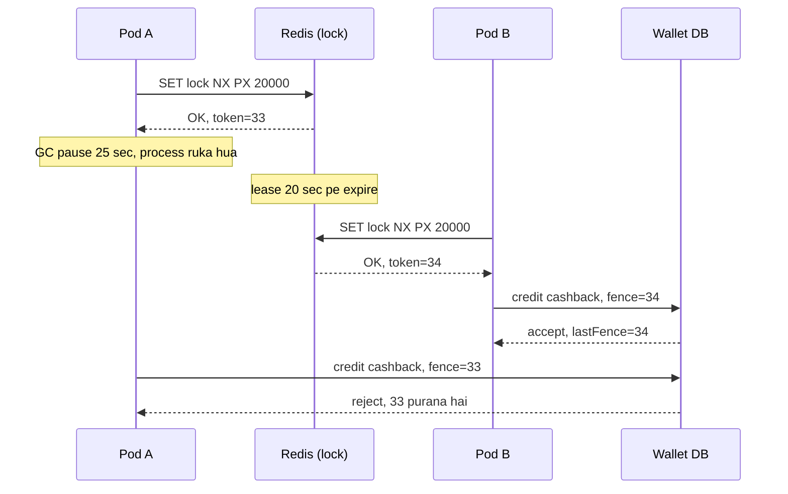
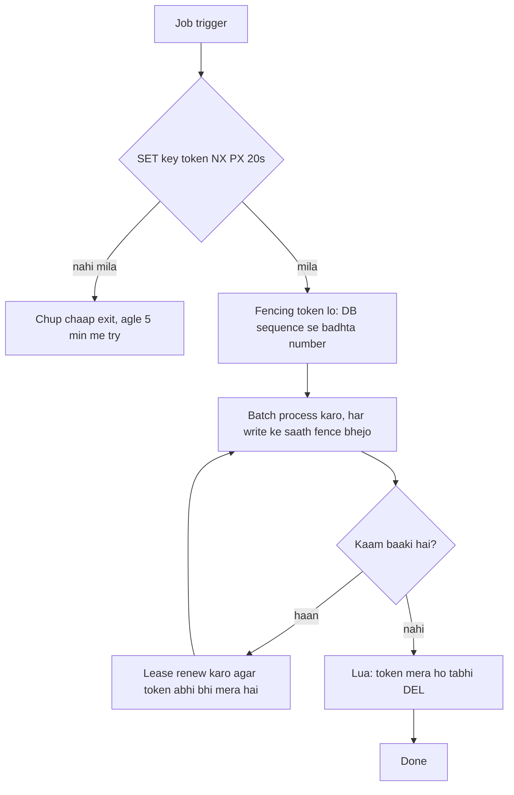
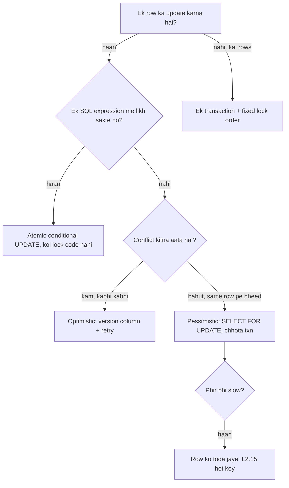
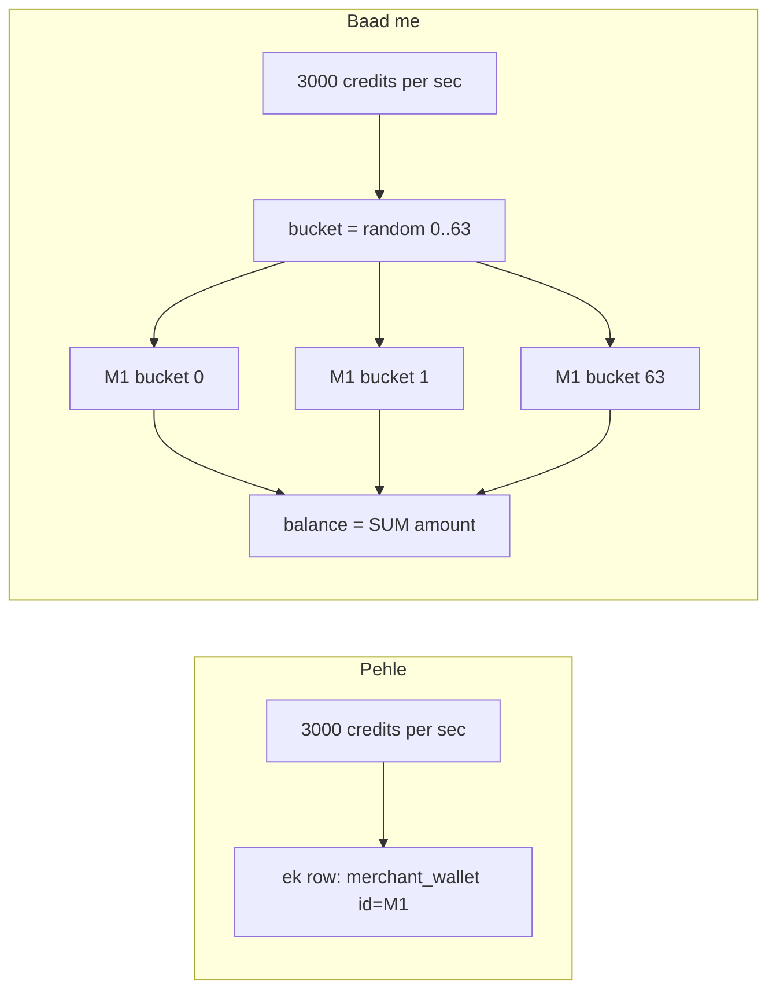

# 2D · Lock Fort

Oct 12, 2026 · @saurav chaurasiya

Is doc me teen lessons hain: L2.13 Distributed locks, L2.14 Optimistic vs pessimistic locking, aur L2.15 Hot wallet / hot key.

---

## L2.13 — Distributed locks

Distributed lock ek aisa taala hai jo ek machine ke andar nahi, poore cluster me kaam karta hai: bahut se servers me se sirf ek hi server ek time pe ek particular resource (ek wallet, ek file, ek cron job) ko chhu sake. Java ka `synchronized` keyword sirf ek JVM (Java Virtual Machine — ek chalta hua Java process) ke andar kaam karta hai, isliye 12 pods wale deployment me woh kaafi nahi hai — 12 alag JVM, 12 alag taale, koi ek doosre ko nahi jaanta.

### Ye cheez hai kya

- Category: coordination primitive — yaani machines ke beech aapas me tay karne ka tareeka, kisi kaam ka actual business logic nahi
- Kis problem ke liye: do ya zyada servers ek hi kaam ek saath na kar dein (duplicate cashback, duplicate settlement file, duplicate debit)
- Is lesson ke baad tum: Redis se ek safe lock likh paoge, uski exact limits bata paoge, fencing token aur lease samjha paoge, aur interview me "Redlock use karoge?" ka seedha jawab de paoge

### Sawaal

Paytm me ek `cashback-credit` job hai jo har 5 minute pe chalti hai: pending cashback rows padhti hai aur user ke wallet me paise daalti hai. Service 12 pods pe deploy hai aur har pod me apna scheduler chal raha hai. Agar do pods ek saath chal gaye, ek user ko cashback do baar mil jayega — yaani asli paisa bahar chala gaya. Tumhe design karna hai ki ek time pe sirf ek pod ye job chalaye.

> Pehle khud socho — 5 min. Hints: (1) lock pe expiry na ho toh kya hoga jab lock lene wala pod crash kar jaye? (2) expiry 60 second hai aur job 90 second le gayi toh? (3) lock chhodte waqt tumhe kaise pata chalega ki jo lock tum delete kar rahe ho woh tumhara hi hai?

### Problem kyun aata hai

- App tier stateless aur multi-pod hai — 12 pods ka matlab 12 scheduler, aur sab ek hi minute pe jaagte hain
- Network partition (network ka do hisson me kat jaana, par dono hisse zinda rehte hain) me dono hisse khud ko "main hi leader hoon" maan sakte hain
- GC pause (Garbage Collection pause — JVM jab memory saaf karta hai toh poora process kuch der ke liye ruk jaata hai) kai seconds ka ho sakta hai. Us dauraan pod ka lock expire ho sakta hai aur pod ko iska pata bhi nahi chalega
- Clock drift (do machines ki ghadi ka aapas me alag chalna) lease ka hisaab galat kar deta hai — ye seedha [L1.16b — Time, clocks & ordering](https://claude.ai/code/artifact/cfe905e6-6370-43e0-a337-764eeb9ddf1e) ka natija hai

### Naive approach

- Pehla obvious solution: Redis me `SETNX lock:cashback 1` — "agar key nahi hai toh bana do". Jisko `1` mila woh leader, baaki chup chaap wapas so jaayein.
- Tootta kahan hai (1): expiry hi nahi hai. Leader pod crash ho gaya toh key hamesha Redis me padi rahegi aur job dobara kabhi nahi chalegi. Poore cluster ka deadlock (sab ek doosre ka intezaar karte reh jaana).
- Fix try 1: `SET lock:cashback 1 NX EX 60` — ab 60 second me khud expire ho jayega. Naya bug: Pod A ko 70 second lag gaye, lock 60 pe expire hua, Pod B ne le liya, aur phir Pod A ne kaam khatam karke `DEL lock:cashback` chala diya. Pod A ne Pod B ka lock delete kar diya — ab teesra pod bhi ghus sakta hai.
- Fix try 2: value me ek random token rakho aur delete se pehle check karo ki value tumhara token hai. Par "check karo, phir delete karo" do alag commands hain; unke beech me lock expire ho sakta hai, isliye isko ek Lua script me atomic (poora-ya-kuch-nahi, beech me koi aur ghus na sake) banana padega.
- Aur ek baat jo dhyaan se samajhna: in sab fixes ke baad bhi lock sirf "mostly" kaam karta hai. GC pause wali kahani kisi bhi lease-based lock ko tod sakti hai.

### Sahi design

1. Lock lo ek hi command me: `SET lock:<resource> <randomToken> NX PX <leaseMs>`. `NX` = sirf tab banao jab key na ho, `PX` = itne milliseconds me khud mit jao.
2. Lease chhoti rakho — 10 se 30 second — aur kaam chalte rehte renew karte raho (heartbeat). Poore kaam ke liye ek ghante ka lock lena galat hai: crash hua toh ek ghanta sab atak jayega.
3. Chhodte waqt Lua script se atomic compare-and-delete: `if redis.call('get', KEYS[1]) == ARGV[1] then return redis.call('del', KEYS[1]) else return 0 end`.
4. Lock ko correctness ka bharosa mat maano. Har write ke saath ek fencing token bhejo. Fencing token ek badhta hua number hai (1, 2, 3, ...) jo lock milne par mila tha; DB ya storage usse yaad rakhta hai aur usse chhote number wali write reject kar deta hai. Isse GC pause wala purana pod nuksaan nahi kar sakta.
5. Jahaan asli paisa hai, wahaan lock ko sirf efficiency ke liye use karo aur correctness DB se nikalo: conditional `UPDATE`, unique index, ya idempotency key ([L2.1 — Idempotency keys](https://claude.ai/code/artifact/c269ac61-440b-4525-bd04-31baf708dece)). Lock fail ho gaya toh bas duplicate kaam hua; DB constraint fail ho gaya toh duplicate paisa gaya — dono ka nuksaan bahut alag hai.

Ye diagram dikhata hai ki GC pause lock ko kaise todta hai aur fencing token usse kaise bachata hai:



Aur ye lock lene-chhodne ka poora flow:



### Kya choose karein aur kyun

| Option | Kab use karo | Kab mat karo |
| --- | --- | --- |
| Single Redis `SET NX PX` | Efficiency lock: duplicate cron run, duplicate report generation, duplicate email. Sasta aur ek line ka code. | Jahaan do baar chalne se paisa ya data kharab ho. Redis failover pe lock do logon ko mil sakta hai. |
| Redlock (5 alag Redis nodes pe majority) | Jab ek Redis node ke down hone pe bhi efficiency lock chahiye. | Correctness ke liye. Fencing token generate nahi karta aur clock/pause assumptions pe tika hai — Kleppmann ki yahi objection hai. |
| ZooKeeper / etcd lease + fencing token | Leader election, correctness wala mutual exclusion, cluster membership. Consensus se chalta hai aur badhta hua zxid/revision deta hai jo fence ban sakta hai. | Jab operational cost na uthana ho ya per-request latency bahut tight ho. Ek aur cluster maintain karna padta hai. |
| DB row lock (`SELECT ... FOR UPDATE`) | Jab resource already ek DB row hai — ek wallet, ek order. Transaction ke saath hi atomic hai, alag system nahi chahiye. | Lambe kaam ke liye. Row lock transaction ke khatam hone tak rehta hai aur baaki writers wait karte hain. |
| Conditional UPDATE / unique index | Paise ka koi bhi path. `UPDATE wallet SET bal=bal-? WHERE id=? AND bal>=?` ya `UNIQUE(idempotency_key)` — DB khud double kaam rok deta hai. | Jab kaam DB ke bahar hai (file bheji, email gaya) — tab constraint laga hi nahi sakte. |

### India me kaise hota hai

- UPI me double-credit se bachne ka pehla hathiyaar lock nahi hota, uniqueness hoti hai: har transaction ka apna RRN / UTR hota hai aur ledger me uspe unique constraint rehta hai. Pod do baar bhi chal jaye, doosra insert fail hota hai.
- Razorpay apne payout API me yahi soch publicly document karta hai: client ek idempotency key bhejta hai, aur same key pe dobara request aane par naya payout nahi banta, purana response wapas milta hai — [Razorpay idempotency docs](https://razorpay.com/docs/razorpayx/api/idempotency/).
- PhonePe apne scale ki kahaani apne tech blog pe likhta hai; wahan ka baar-baar aane wala theme bhi yahi hai — sync coordination kam, append-only aur idempotent writes zyada ([tech.phonepe.com](https://tech.phonepe.com/engineeringphonepe-chronicling-our-technology-journey/)).
- Practical pattern jo Indian payments teams me common hai: Redis lock sirf "cron ko do baar na chalne do" ke liye, aur paisa chhune wali har row pe DB-level constraint. Lock best-effort hai, DB final sach hai.

### Interview follow-ups

- **"Lock ke do maqsad kaun se hote hain?"** — Efficiency (duplicate kaam se bachna, fail hone pe sirf paisa-nahi nuksaan) aur correctness (data kharab hone se bachna). Dono ke liye solution alag hai; Kleppmann ka poora article isi farak pe hai.
- **"Redlock safe hai ya nahi?"** — Efficiency ke liye theek, correctness ke liye nahi. Wajah: fencing token nahi deta, aur uski safety network delay, process pause aur clock accuracy ki timing assumptions pe tiki hai.
- **"Fencing token kya hai, ek line me?"** — Lock ke saath mila ek badhta hua number, jo storage ko bhejte ho; storage usse chhote number wali write reject kar deta hai, isliye purana ruka hua client nuksaan nahi kar sakta.
- **"Lease renew karte waqt kya galti hoti hai?"** — Blind `EXPIRE` maar dena. Renew bhi conditional hona chahiye: pehle check karo ki value abhi bhi tumhara token hai, warna tum kisi aur ka lock lamba kar rahe ho.
- **"Lock lene wala pod mar gaya aur lease 30 min thi, kya karoge?"** — Lease chhoti rakho aur renew karo. Lambi lease ka matlab lamba outage; chhoti lease ka matlab zyada renew traffic — ye tradeoff bolna hi jawab hai.
- **"Redis cluster me `SET NX` kafi hai?"** — Nahi, failover ke waqt replica me lock key replicate hui hi na ho toh do clients ko lock mil sakta hai. Redis replication async hai.

### Self-check

1. `SET key val NX PX 30000` me `NX` aur `PX` me se kaun kya karta hai?
2. Lock release karte waqt Lua script kyun chahiye, do alag Redis commands se kaam kyun nahi chalta?
3. Fencing token kahan check hota hai — lock service me ya storage me?
4. Kleppmann ke hisaab se Redlock ki do buniyadi kamiyan kaun si hain?
5. Ek payments flow me tum lock aur unique constraint me se kis pe paisa daav pe lagaoge, aur kyun?

### Notebook

Distributed lock = cluster bhar me mutual exclusion; `synchronized` sirf ek JVM me chalta hai · `SET key token NX PX 20s` + Lua compare-and-delete = minimum safe Redis lock · lease chhoti + renew, warna crash = lamba outage · GC pause ya clock drift kisi bhi lease lock ko tod sakta hai, isliye fencing token (badhta number, storage reject kare purana) · Redlock efficiency ke liye theek, correctness ke liye nahi · paise ke path pe lock best-effort, DB constraint final sach.

### Padhne ke liye

- [How to do distributed locking — Martin Kleppmann](https://martin.kleppmann.com/2016/02/08/how-to-do-distributed-locking.html)
- [Is Redlock safe? — antirez ka jawab](https://www.antirez.com/news/101)
- [Distributed Locks with Redis — Redis docs](https://redis.io/docs/latest/develop/clients/patterns/distributed-locks/)
- [Razorpay payout idempotency](https://razorpay.com/docs/razorpayx/api/idempotency/)

### Deep Dive (SDE-2) — jab time ho

#### Lease, lock aur leader election me farak

- Lock = mutual exclusion, bina time limit ka concept.
- Lease = time-bound lock. Lock dene wala keh raha hai "ye tumhara hai agle 20 second tak". Expiry ki wajah se crash recover ho jata hai, par timing assumption aa jati hai.
- Leader election = ek lease jo lagataar renew hoti rehti hai, plus baaki nodes ko pata hai ki leader kaun hai. ZooKeeper me ephemeral sequential node, etcd me lease + key.

#### ZooKeeper se fencing token kaise milta hai

- ZooKeeper har znode create pe ek badhta hua `zxid` deta hai; etcd har write pe `revision` deta hai.
- Yahi number fencing token ban jata hai — tumhe apna counter banane ki zaroorat nahi.
- Storage side pe ek column `last_fence` rakho aur write condition me `WHERE last_fence < :fence` lagao. Ye idempotency key se mila ke sochna: idempotency "same request dobara" rokti hai, fencing "purana client" rokta hai.

#### Lock ke bina kaam chalane ke 4 tareeke

- Partition by key: har wallet ka kaam uske shard ke single consumer pe bhejo. Ek partition me ek hi consumer hoga toh lock ki zaroorat hi nahi — Kafka ka ordering model yahi hai.
- Conditional write: `UPDATE ... WHERE version = :seen` (ye L2.14 ka topic hai).
- Unique constraint: duplicate ko DB khud mana kare.
- Single-writer design: ek entity ka owner ek hi service rakho, baaki uske events padhein.

#### Jahaan lock chahiye hi chahiye

- Kaam DB ke bahar ho aur usse undo na kiya ja sake: NPCI ko file bhejna, SMS/notification bhejna, external API pe non-idempotent call.
- Yahaan lock + fencing + external system ki apni idempotency key, teeno chahiye. Agar external system idempotency key accept nahi karta toh kisi bhi lock se poori guarantee nahi milti — ye honestly interview me bolna strong jawab hai.

---

## L2.14 — Optimistic vs pessimistic locking

Database ke andar do bilkul alag soch hain ki ek hi row pe do log ek saath likhne aayein toh kya karna chahiye. Pessimistic locking kehta hai "pehle taala lagao, phir padho aur likho" — doosra banda line me khada rahega. Optimistic locking kehta hai "taala mat lagao, bas likhte waqt check karlo ki beech me kisi ne badla nahi" — agar badal gaya toh write fail karo aur dobara try karo.

### Ye cheez hai kya

- Category: concurrency control — DB ke andar ka tareeka, koi alag service nahi. L2.13 ka distributed lock DB ke bahar tha, ye DB ke andar hai.
- Kis problem ke liye: lost update. Do transactions ek hi row padhte hain, dono apne hisaab se naya value likhte hain, aur ek ka kaam gayab ho jaata hai.
- Is lesson ke baad tum: `SELECT ... FOR UPDATE` aur version-column, dono likh paoge, aur bata paoge ki wallet debit me kaun sa sahi hai aur kyun.

### Sawaal

Paytm wallet me `wallet(user_id, balance, version)` table hai. User ka balance 100 rupaye hai. Usne do tabs se ek saath 80-80 rupaye ke do payments kar diye. Dono requests do alag pods pe gayin, dono ne balance 100 padha, dono ne socha "80 nikal sakte hain", aur dono ne 20 likh diya. Result: 160 rupaye nikal gaye, balance 20 dikh raha hai. Tumhe ye rokna hai, aur ye bhi batana hai ki tumhara fix 50,000 TPS (transactions per second — ek second me kitne requests) pe kaisa behave karega.

> Pehle khud socho — 5 min. Hints: (1) kya aisi ek SQL line likh sakte ho jo padhna aur likhna ek hi statement me kar de? (2) agar nahin, toh row ko lock karne ka kya cost hai? (3) agar fail ho gaya toh user ko error dikhaoge ya retry karoge?

### Problem kyun aata hai

- Read aur write do alag steps hain. Beech me jo time hai, usme doosra transaction ghus sakta hai. Isko read-modify-write race kehte hain.
- Default isolation level (DB ka default "kitna alag-thalag rakhna hai" setting) ye race nahi rokta. Postgres ka default Read Committed hai, MySQL InnoDB ka Repeatable Read — dono me application-level lost update ho sakta hai, details [L1.11 — ACID & isolation](https://claude.ai/code/artifact/99909fe9-731e-4e31-9e7d-36e0c5aed845) me.
- MVCC (Multi-Version Concurrency Control — readers purana version padhte hain, writers ko rokte nahi) isi liye tez hai, par iska matlab ye bhi hai ki "maine jo padha woh ab bhi sach hai" ki koi guarantee nahi.

### Naive approach

- Pehla obvious solution: application me padho, Java me `if (balance >= amount)` check karo, phir `UPDATE wallet SET balance = :newBalance WHERE user_id = :id` likh do.
- Tootta kahan hai: `:newBalance` application ke paas purana number hai. Jo transaction baad me commit hoga, uska likha hua number jeet jayega aur pehle wale ka kaam gayab ho jayega. Check bhi jhooth bol raha hai, kyunki check aur write ke beech balance badal gaya.
- Doosra naive fix: `SELECT ... FOR UPDATE` har jagah lagana. Correct hai, par agar transaction ke andar external API call ya lambi calculation hai toh row minutes ke liye locked rahegi aur baaki sab queue me. Lock kaafi dair tak hold karna correctness nahi, availability ka problem ban jata hai.

### Sahi design

1. Jahaan ho sake, lock hi mat lo — ek atomic conditional UPDATE likho. Yahi sabse saaf jawab hai: `UPDATE wallet SET balance = balance - :amt WHERE user_id = :id AND balance >= :amt`. DB khud row lock karta hai, khud arithmetic karta hai. 0 rows affected ka matlab "paise nahi the".
2. Jab ek se zyada row ek saath badalni ho (ledger me debit entry + credit entry + wallet row), toh ek transaction ke andar rakho aur rows ko hamesha ek hi order me chhuo (chhota `account_id` pehle). Isse deadlock (do transactions ek doosre ke lock ka intezaar karte reh jaana) nahi hoga.
3. Pessimistic chahiye ho toh `SELECT ... FOR UPDATE` lo, par transaction chhota rakho: lock ke andar sirf DB ka kaam, koi HTTP call nahi, koi sleep nahi. Lock lene ke baad balance dobara padho — lock ke pehle padha hua number purana hai.
4. Optimistic chahiye ho toh ek `version` column rakho: `UPDATE wallet SET balance = :new, version = version + 1 WHERE user_id = :id AND version = :seenVersion`. 0 rows = koi aur pehle likh gaya = retry karo (jitter ke saath, taaki sab ek saath dobara na takraayein).
5. Retry ki limit rakho (3 se 5) aur uske baad saaf error do. Infinite retry ek hidden outage hai.

Kaun kahan fit hota hai, ye decision flow:



Java side pe ye is tarah dikhta hai. Niche ka code optimistic retry loop hai — compile aur run karne layak, bas JDBC connection apna daal dena:

```java
import java.sql.*;

public class OptimisticDebit {

  // Ek baar koshish karta hai. true = ho gaya, false = version badal gaya tha, retry karo.
  private static boolean tryDebit(Connection c, long userId, long paise) throws SQLException {
    long balance, version;
    // Step 1: current balance aur version padho (koi lock nahi lagaya)
    try (PreparedStatement ps = c.prepareStatement(
        "SELECT balance, version FROM wallet WHERE user_id = ?")) {
      ps.setLong(1, userId);
      try (ResultSet rs = ps.executeQuery()) {
        if (!rs.next()) throw new SQLException("wallet nahi mila: " + userId);
        balance = rs.getLong("balance");
        version = rs.getLong("version");
      }
    }
    // Step 2: business rule application me check karo
    if (balance < paise) throw new IllegalStateException("insufficient balance");
    // Step 3: likhte waqt version match karao. Beech me koi likh gaya toh 0 rows milenge.
    try (PreparedStatement ps = c.prepareStatement(
        "UPDATE wallet SET balance = ?, version = version + 1 "
      + "WHERE user_id = ? AND version = ?")) {
      ps.setLong(1, balance - paise);
      ps.setLong(2, userId);
      ps.setLong(3, version);
      return ps.executeUpdate() == 1;
    }
  }

  // 4 baar tak retry, har baar thoda zyada rukte hue (jitter)
  public static void debit(Connection c, long userId, long paise) throws SQLException {
    for (int attempt = 1; attempt <= 4; attempt++) {
      if (tryDebit(c, userId, paise)) { c.commit(); return; }
      c.rollback();
      try { Thread.sleep(10L * attempt + (long) (Math.random() * 10)); }
      catch (InterruptedException e) { Thread.currentThread().interrupt(); break; }
    }
    throw new SQLException("bahut zyada conflict, baad me try karo");
  }
}
```

Dhyaan do ki is poore code ki zaroorat tabhi padti hai jab balance application me calculate karna ho. Sirf paise kaatne ke liye ek line kaafi hai: `UPDATE wallet SET balance = balance - ? WHERE user_id = ? AND balance >= ?`, aur `executeUpdate()` ka 0 return hi "insufficient balance" ka jawab hai. Interview me pehle yahi bolna chahiye.

### Kya choose karein aur kyun

| Option | Kab use karo | Kab mat karo |
| --- | --- | --- |
| Atomic conditional UPDATE | Jab naya value purane se calculate ho sakta hai (`balance - amt`) aur condition SQL me likhi ja sakti hai. Sabse tez, sabse kam code. | Jab decision ke liye kai tables padhne padein ya application logic chahiye. |
| Optimistic (version column) | Conflict kam ho — user profile, merchant config, order status. Readers ko koi wait nahi karna padta. | Ek hi row pe bheed ho. Har retry wasted kaam hai; high contention pe throughput (ek second me kitna kaam nikla) gir jata hai. |
| Pessimistic (`SELECT ... FOR UPDATE`) | Conflict zyada ho aur retry mehnga ho. Multi-row transfer jahaan sab rows lock karke hi aage badhna hai. | Lambe transaction me, ya jab lock ke andar external call karni ho. Writers line me lag jaate hain aur p99 (woh latency jisse 99% requests tez hain) phat jata hai. |
| `SERIALIZABLE` isolation | Jab business rule kai rows pe faila hua ho aur tum manually sochna hi na chahte ho. DB khud serialization failure dega. | High TPS pe. Postgres me ye serialization failures ke retry ka jhanjhat deta hai, MySQL me extra locking. |
| Queue pe serialize karna | Jab ek entity pe bahut writes aayein — ek wallet ki saari requests ek hi Kafka partition pe, ek consumer. Lock khatam, order free. | Jab user ko turant synchronous jawab chahiye aur queue lag badhaane ki gunjaish nahi. |

### India me kaise hota hai

- Wallet aur ledger ke liye Indian payments stack me RDBMS hi default hai, aur debit ka canonical pattern wahi ek-line conditional update hai. Postgres me row-level lock modes aur unka exact behaviour official docs me saaf likha hai — [PostgreSQL explicit locking](https://www.postgresql.org/docs/current/explicit-locking.html).
- MySQL InnoDB wale setup me `SELECT ... FOR UPDATE` aur `FOR SHARE` ka behaviour aur `NOWAIT` / `SKIP LOCKED` ke options — [MySQL locking reads](https://dev.mysql.com/doc/refman/8.4/en/innodb-locking-reads.html). `SKIP LOCKED` India me settlement aur payout worker queues me bahut use hota hai: kai workers ek hi table se kaam uthate hain aur locked rows chhod ke aage badh jaate hain.
- UPI ke TAT (Turn Around Time — jawab dene ki tay ki hui time limit) tight hote hain, isliye lock ke andar NPCI ko call karna practically mana hai. Pattern: pehle local DB me hold/reserve ek chhote transaction me, phir lock chhod ke bahar network call, phir result aane pe doosra chhota transaction. Yahi [L2.10 — Saga pattern](https://claude.ai/code/artifact/429b3ea6-a261-431d-a384-a0c6eb68a9f6) ka asli rozmarra ka roop hai.

### Interview follow-ups

- **"Lost update ko ek line SQL me kaise rokoge?"** — `UPDATE wallet SET balance = balance - :amt WHERE user_id = :id AND balance >= :amt`, aur 0 rows affected ko "insufficient balance" maano.
- **"Optimistic locking me asli lock kahan hai?"** — Kahin nahi. Sirf write ke waqt ek condition hai. "Optimistic" naam bas soch ka hai: maan ke chal rahe ho ki conflict nahi hoga.
- **"High contention pe optimistic kyun bura hai?"** — Har conflict ek poora wasted round trip hai. Jitni bheed badhti hai, utne retries, utna hi throughput girta hai. Pessimistic wahan fair queue bana deta hai.
- **"Deadlock kaise rokoge?"** — Rows ko hamesha ek fixed order me lock karo (chhota id pehle), lock timeout rakho, transaction chhota rakho, aur deadlock error pe retry karo.
- **"`SELECT ... FOR UPDATE NOWAIT` aur `SKIP LOCKED` ka farak?"** — `NOWAIT` turant error deta hai agar row locked hai; `SKIP LOCKED` locked rows ko chhod ke baaki de deta hai. Worker queues ke liye `SKIP LOCKED`, user-facing turant jawab ke liye `NOWAIT`.
- **"Version column ki jagah `updated_at` use kar sakte ho?"** — Theek se nahi. Do updates ek hi millisecond me ho sakte hain aur clock peeche bhi ja sakta hai ([L1.16b](https://claude.ai/code/artifact/cfe905e6-6370-43e0-a337-764eeb9ddf1e)). Monotonic counter hi bharosemand hai.

### Self-check

1. Lost update ko apne shabdon me do line me define karo.
2. Optimistic locking me `WHERE version = :seen` ke bina kya toot jata hai?
3. `SELECT ... FOR UPDATE` lene ke baad balance dobara kyun padhna chahiye?
4. Wallet debit ke liye tum optimistic ya pessimistic chunoge, aur tumhara ek-line jawab kya hai?
5. Deadlock se bachne ka sabse sasta rule kya hai?

### Notebook

Lost update = do transactions ne same row padha, dono ne likha, ek ka kaam gayab · pehla jawab hamesha atomic conditional UPDATE, `balance >= amt` condition SQL me, 0 rows = insufficient · optimistic = `WHERE version = :seen` + bounded retry with jitter, low contention ke liye · pessimistic = `SELECT FOR UPDATE`, chhota txn, lock ke andar koi network call nahi · multi-row pe fixed lock order warna deadlock · worker queue = `SKIP LOCKED` · ek hi row pe bheed ho toh locking nahi, row todna hi fix hai (L2.15).

### Padhne ke liye

- [PostgreSQL — Explicit Locking](https://www.postgresql.org/docs/current/explicit-locking.html)
- [PostgreSQL — Transaction Isolation](https://www.postgresql.org/docs/current/transaction-iso.html)
- [MySQL — Locking Reads (`FOR UPDATE`, `SKIP LOCKED`)](https://dev.mysql.com/doc/refman/8.4/en/innodb-locking-reads.html)

### Deep Dive (SDE-2) — jab time ho

#### Postgres me `SELECT FOR UPDATE` asal me kya karta hai

- Row pe exclusive row-level lock lagta hai, transaction khatam hone tak. Plain `SELECT` phir bhi chalta rehta hai, kyunki MVCC readers ko rokta nahi — sirf writers aur doosre lockers rukte hain.
- `FOR NO KEY UPDATE`, `FOR SHARE`, `FOR KEY SHARE` kamzor versions hain. Foreign key check `FOR KEY SHARE` leta hai, isliye parent row ko `FOR UPDATE` karna child inserts ko block kar sakta hai — ye real production surprise hai.
- Read Committed me `FOR UPDATE` lock milne ke baad row ko dobara evaluate karta hai; isliye lock ke baad fresh value padhna zaroori hai.

#### Serialization failure aur retry budget

- `SERIALIZABLE` me Postgres `40001` (serialization failure) deta hai. Ye bug nahi, design hai — application ko retry karna hoga.
- Retry budget decide karo: kitne retries, kitna backoff, aur retry ke dauraan user ko kya dikhega. Payments me retry ke saath idempotency key zaroori hai, warna retry khud duplicate ban jata hai.
- Monitoring: conflict rate ek first-class metric hona chahiye. Conflict rate badh raha hai = contention badh rahi hai = L2.15 ka waqt aa gaya.

#### Optimistic locking aur ledger ka rishta

- Double-entry ledger ([L2.6](https://claude.ai/code/artifact/a7c567e0-66cb-46fe-b7c9-9c20739857eb)) append-only hota hai: entries insert hoti hain, update nahi. Append-only me lost update ka concept hi nahi hota.
- Balance phir derived ban jaata hai — entries ka sum, ya ek cached running balance jo entries se recompute ho sakta hai.
- Isliye mature payments design me optimistic vs pessimistic ka sawaal sirf cached balance row pe aata hai, poore ledger pe nahi. Interview me ye distinction bolna SDE-2 signal hai.

#### Jab dono option fail karein

- Agar ek hi row pe hazaron writes aa rahe hain toh na optimistic chalega (sab retry karenge) na pessimistic (sab queue me). Teen aage ke raste: row ko N sub-rows me todo (L2.15), ya writes ko ek partition ke single consumer pe serialize karo, ya batching karo — 100 debits ek transaction me.
- Batching ka chhipa cost: ek batch fail hone pe poora batch dobara. Isliye batch chhota rakho aur per-item idempotency key rakho.

---

## L2.15 — Hot wallet / hot key

Hot key woh ek key hoti hai jiske paas baaki sabse kai guna zyada traffic aa jaata hai — ek merchant ka wallet, ek celebrity ka post, ek IPL match ka scoreboard. Problem ye hai ki cluster me kaam key ke hisaab se baanta jaata hai, isliye ek hot key ka matlab hai ek shard (data ka ek tukda jo ek machine group pe rehta hai) ya ek row pe poora load, aur baaki machines khaali baithi hain. Hot wallet usi cheez ka payments wala roop hai: ek merchant account jisme hazaron customers ek saath paisa daal rahe hain.

### Ye cheez hai kya

- Category: data distribution / contention problem. Ye na locking ka bug hai na DB ka — ye key chunne ka natija hai.
- Kis problem ke liye: load uneven ho jaana, taaki ek row ya ek partition baaki sabko peeche khinch le.
- Is lesson ke baad tum: hot key pehchaan paoge, uska read-side aur write-side fix alag-alag bata paoge, aur hot wallet ke liye balance-splitting design likh paoge.

### Sawaal

Paytm pe ek badi electricity biller merchant hai. Mahine ki 1 se 5 tareekh ke beech 2 lakh log usko bill bharte hain, aur peak pe 3,000 TPS (transactions per second) aate hain — sab ek hi `merchant_wallet` row pe credit. Har credit ko `UPDATE merchant_wallet SET balance = balance + :amt WHERE id = :mid` karna padta hai. Baaki 50 lakh merchants ke paas milakar bhi itna load nahi hai. Latency badh rahi hai aur deadlock aur lock-wait timeout ke errors aa rahe hain. Design karo.

> Pehle khud socho — 5 min. Hints: (1) kya sach me balance ko turant sahi dikhna zaroori hai, ya 2 second purana chalega? (2) ek row pe 3,000 writes ko kaise kai rows me baant sakte ho? (3) agar baant diya toh balance padhna kaise kaam karega?

### Problem kyun aata hai

- Sharding key ke hash pe chalti hai ([L1.14 — Sharding & shard key](https://claude.ai/code/artifact/cfe905e6-6370-43e0-a337-764eeb9ddf1e)), isliye ek key hamesha ek hi shard pe jaati hai. Ek key ka traffic kabhi do machines me nahi bantega, chaahe cluster me 100 nodes ho.
- Ek row pe serialized writes ka natural limit hota hai. Write lock hold karne ka time + commit (disk pe pakka likhna) ka time milke batata hai ki ek row per second kitne updates le sakti hai — aam taur pe kuch sau, hazaron nahi.
- Cache ka bhi apna hot key problem hai: ek Redis key ek hi slot pe aur ek hi node pe rehti hai, isliye ek viral key us node ka CPU khaa jaati hai — Redis khud ise shard imbalance ki wajah ke roop me document karta hai.
- Hot key aksar predictable nahi hota. Mahine ki 1 tareekh, sale ka din, match ka over — pattern business se aata hai, data distribution se nahi.

### Naive approach

- Pehla obvious solution: machine badi kar do (vertical scaling) ya shards badha do.
- Tootta kahan hai: shards badhane se hot key fir bhi ek shard pe hi rahegi. Ye exactly woh case hai jahaan horizontal scaling kaam nahi karta, kyunki unit of distribution (key) hi bada hai.
- Doosra naive fix: `SELECT ... FOR UPDATE` lagake order bana dena. Ab correctness theek hai par queue lambi ho gayi — 3,000 requests ek row ka intezaar kar rahi hain, p99 latency (woh latency jisse 99% requests tez hain) seconds me chala jaata hai, aur upar wale services pe timeouts ki barish shuru ho jaati hai.
- Teesra naive fix: Redis me balance rakh lo aur `INCRBY` kar do. Tez hai, par Redis crash pe paisa gayab — wallet balance cache me rakhna payments me galat hai.

### Sahi design

1. Pehle maapo. Per-key counters nikalo — top 20 keys by QPS (queries per second) aur by write latency. Bina data ke hot key guess karna waqt ki barbaadi hai.
2. Write-side fix: ek balance row ko N buckets me todo. `merchant_balance(merchant_id, bucket_no, amount)` me 64 rows banao. Har credit random bucket pe jaata hai, yaani 3,000 writes 64 rows pe baant gaye — per row sirf \~47. Ye wahi "write sharding" hai jo AWS DynamoDB ke liye document karta hai, bas apne SQL me.
3. Read-side fix: balance padhna `SELECT SUM(amount) FROM merchant_balance WHERE merchant_id = :mid`. Ye 64 rows ka sum hai — sasta. Ya ek rollup job har 10 second me sum ko ek summary row me likh de aur dashboard wahan se padhe.
4. Debit (paise nikalna) ko sambhalo: sum pe `balance >= amt` check nahi lagta. Do raste — ya debits ko ek single "settlement bucket" pe hi bhejo (debits bahut kam hote hain, credits zyada), ya debit ke waqt buckets ko ek order me lock karke consolidate karo.
5. Read-heavy hot key (merchant dashboard, txn count) ko cache karo short TTL (Time To Live — cache entry kitni der zinda rahegi) ke saath, aur stampede se bachao ([L1.9 — Stampede, penetration, avalanche](https://claude.ai/code/artifact/32bb1c8e-3433-417c-a3f4-3a34babed6bf)).
6. Cache-level hot key ke liye local in-process cache (har pod ke andar 1-2 second ka micro-cache) lagao, taaki Redis ke ek node pe bheed na pahunche.
7. Append-only soch sabse saaf hai: ledger me credit ek naya row hai, update nahi. N rows ka contention zero hota hai; balance derived value ban jaata hai ([L2.6 — Double-entry ledger](https://claude.ai/code/artifact/a7c567e0-66cb-46fe-b7c9-9c20739857eb)).

Ek row ko 64 buckets me todne ka picture:



Analogy jo yaad rahegi: bank ki ek hi counter pe 3,000 log line me khade hain. Counter tez karne (bigger machine) se line thodi chhoti hogi, par asli fix 64 counters kholna hai aur din ke end me total jodna hai.

### Kya choose karein aur kyun

| Option | Kab use karo | Kab mat karo |
| --- | --- | --- |
| Bucket splitting (N rows per entity) | Write-heavy hot row: merchant credits, counters, likes. Contention N guna kam ho jaata hai. | Jab har write pe exact total aur `>= 0` check chahiye. Sum padhna extra kaam hai aur debit path complicated ho jaata hai. |
| Append-only ledger + derived balance | Paise ka koi bhi system. Contention khatam, audit trail free. | Jab balance read bahut-bahut frequent ho aur rollup pipeline maintain na kar sako. |
| Rollup / summary table | Dashboard aur reporting, jahaan 5-10 second purana chalega. | Jab authorization decision isi number pe lena ho — stale balance se galat approve ho sakta hai. |
| Local micro-cache (per pod, 1-2s TTL) | Read-heavy hot key: config, merchant profile, feature flag. Redis node ko bachata hai. | Jab data turant sahi chahiye. Har pod ka apna stale copy hoga, 1-2 second ka skew maanna padega. |
| Key me random suffix (cache side) | Jab ek Redis key ek node ko garam kar rahi ho. `key:0` se `key:9` banao, read pe random chuno. | Write path pe — phir N copies ko consistent rakhna padega, jo nayi bug factory hai. |
| Queue pe serialize (ek partition, ek consumer) | Jab order maayne rakhta ho aur sync jawab zaroori na ho. Lock bhi khatam ho jaata hai. | Jab user ko turant confirmation chahiye. Queue lag add hota hai. |

### India me kaise hota hai

- Bill payments aur recharge ke bade billers India me classic hot merchant hain: mahine ki pehli tareekhon pe load 10 guna tak chala jaata hai. Isliye merchant-side accounting aksar append-only entries pe hoti hai aur settlement time pe aggregate hota hai, live row update pe nahi — yahi [L2.6](https://claude.ai/code/artifact/a7c567e0-66cb-46fe-b7c9-9c20739857eb) ka design hai.
- Redis apne docs me hot key imbalance ko explicitly ek shard-overload wajah batata hai aur per-key tracking suggest karta hai — [Redis: hot key imbalance overloading a shard](https://support.redislabs.com/hc/en-us/articles/27000007793042-Hot-Key-Imbalance-Overloading-a-Shard).
- Write sharding ka official likha hua version AWS DynamoDB docs me milta hai, aur wahi idea SQL buckets pe utarta hai — [Using write sharding to distribute workloads evenly](https://docs.aws.amazon.com/amazondynamodb/latest/developerguide/bp-partition-key-sharding.html) aur [partition key design best practices](https://docs.aws.amazon.com/amazondynamodb/latest/developerguide/bp-partition-key-design.html).
- PhonePe ne apni scale ki kahaani me baar-baar yahi theme uthaya hai: single-writer hot paths ko todna aur idempotent append-only writes pe jaana — [tech.phonepe.com](https://tech.phonepe.com/engineeringphonepe-chronicling-our-technology-journey/).

### Interview follow-ups

- **"Hot key ko shards badhane se kyun theek nahi kiya ja sakta?"** — Kyunki distribution ka unit key hai. Ek key ka hash ek hi shard pe jaata hai; 10 shard ho ya 1,000, woh key ek hi jagah rahegi.
- **"Bucket count kitna rakhoge?"** — Peak write rate ko per-row safe rate se divide karo, phir headroom ke liye 2-4 guna. 3,000 TPS aur \~100 writes/row/sec safe maano toh 30 chahiye, 64 lo. Aur bucket count badalna migration hai, isliye shuru me hi thoda zyada rakho.
- **"64 buckets ke baad `balance >= amount` check kaise karoge?"** — Sum pe atomically check nahi kar sakte. Debits ko ek dedicated bucket pe bhejo (credits zyada, debits kam), ya debit ke waqt buckets consolidate karo, ya hold/reserve pattern use karo.
- **"Read hot key ka fix write hot key se kaise alag hai?"** — Read hot key ko copy karke solve karte hain (cache, replica, local micro-cache). Write hot key ko todkar solve karte hain (buckets, append-only). Copy karna writes ka fix nahi hai.
- **"Hot key detect kaise karoge production me?"** — Per-key metrics sampling, Redis me `--hotkeys` / keyspace notifications, DB me lock-wait aur deadlock counters per table, aur slow query log me repeated same-row updates.
- **"Celebrity problem ka social media version?"** — Ek user ke crore followers. Fan-out on write wahan nahi chalega; un keys ke liye fan-out on read karte hain. Soch wahi hai: hot entity ko normal path se bahar nikal do.

### Self-check

1. Hot key ko apne shabdon me define karo, aur bolo ki shards badhana kyun kaam nahi karta.
2. Write hot key aur read hot key ke fix me buniyadi farak kya hai?
3. Ek wallet row ko 64 buckets me todne par balance padhna kaise badalta hai?
4. Buckets ke baad debit ka `>= 0` check kahan tootta hai, aur tum kya karoge?
5. Append-only ledger hot key problem ko kaise gayab kar deta hai?

### Notebook

Hot key = ek key pe baaki sabse kai guna load; distribution ka unit key hai, isliye shard badhane se fix nahi hota · ek row ka write limit kuch sau per second, hazaron nahi · write fix = todo (N buckets per entity, random bucket pe credit, balance = SUM) · read fix = copy karo (cache, replica, per-pod 1-2s micro-cache) · bucket count = peak TPS / safe per-row rate, phir 2-4x headroom · buckets ke baad `>= 0` check sum pe atomic nahi, debits ek bucket pe ya hold pattern · sabse saaf raasta append-only ledger, balance derived.

### Padhne ke liye

- [AWS DynamoDB — Using write sharding to distribute workloads evenly](https://docs.aws.amazon.com/amazondynamodb/latest/developerguide/bp-partition-key-sharding.html)
- [AWS DynamoDB — Best practices for partition keys](https://docs.aws.amazon.com/amazondynamodb/latest/developerguide/bp-partition-key-design.html)
- [Redis — Hot key imbalance overloading a shard](https://support.redislabs.com/hc/en-us/articles/27000007793042-Hot-Key-Imbalance-Overloading-a-Shard)
- [ScyllaDB — Per-partition query rate limiting](https://www.scylladb.com/2024/04/17/per-partition-query-rate-limiting/)

### Deep Dive (SDE-2) — jab time ho

#### Bucket count badalna ek migration hai

- Agar aaj 16 buckets hain aur kal 64 chahiye, toh purane rows ke sum ka matlab nahi badalta — bas naye buckets me amount 0 se shuru hoga. Isliye bucket count badhana safe hai, ghatana nahi.
- Ghatane ke liye consolidation job chalao: purane extra buckets ka amount nikaal ke surviving buckets me jodo, ek transaction me, aur us dauraan us merchant ke writes ko ek bucket pe pin kar do.
- Bucket number ko `merchant_id` ke hash se fix karna galat hai — phir sab credits ek hi bucket pe jaayenge. Random ya round-robin hona chahiye.

#### Hold / reserve pattern se debit ka sawaal hal karna

- Debit ke time poora balance check karne ki jagah pehle ek `hold` row banao: `holds(user_id, amount, status, expires_at)`.
- Available balance = `SUM(buckets) - SUM(active holds)`. Hold banane ka check ek chhote transaction me hota hai, bahar ka network call hold ke andar hota hai, aur result aane pe hold `settled` ya `released` ho jaata hai.
- Hold ko expiry do, warna crash hone pe paisa hamesha ke liye block ho jaayega. Expiry sweeper job zaroori hai — aur woh job khud L2.13 wala lock chahegi.

#### Backpressure ka rishta

- Hot key pe aane wali bheed ko sirf peeche dhakel dena bhi ek valid design hai: per-key rate limit lagao aur client ko 429 do. ScyllaDB iske liye per-partition rate limiting feature deta hai.
- Yahi soch Backpressure (consumer slow ho toh producer ko dheere karna) ka hissa hai — L2.17a Backpressure (abhi banna baaki).
- Payments me per-key rate limit lagate waqt dhyaan: limit idempotent retry ko block na kare, warna genuine retry fail ho jaayega.

#### Celebrity problem ke teen roop

- Social: ek user ke crore followers, fan-out on write se fan-out on read pe switch.
- Commerce: ek product ka flash sale, inventory row pe bheed — fix inventory ko N buckets me todna aur oversell ko reconciliation se handle karna.
- Payments: ek biller merchant, credits ki barish — fix append-only entries aur settlement-time aggregation.
- Teeno me pattern ek hai: hot entity ko normal uniform path se bahar nikaalo aur uske liye alag raasta banao.

---

## Aage kya

- Pichhla zone: [2C · Saga Sea](https://claude.ai/code/artifact/429b3ea6-a261-431d-a384-a0c6eb68a9f6) — L2.9 se L2.12, 2PC se CDC tak
- Agla zone: 2E · Resilience Ridge — L2.16 Circuit breaker, L2.17 Bulkhead, L2.17a Backpressure, L2.18 Graceful degradation, L2.19 Feature flags, L2.20 Multi-region (abhi banna baaki)
- Is zone ke baad study order me boss levels aate hain: C1 UPI PSP app, C2 Payment gateway, C3 Digital wallet
- Study order me agla level: [C1 · UPI PSP app (PhonePe/Paytm)](https://claude.ai/code/artifact/b1a2731a-8cb5-4fa6-9e4b-307bdb7ec1aa) — pehla payments boss, L2.13 se L2.15 ka sab kuch isme lagta hai

* Agla zone: [2E · Resilience Ridge](https://claude.ai/code/artifact/4769dea3-018e-41e1-ae18-253fa36a6d21) — L2.16 (circuit breaker), L2.17 (bulkhead), L2.17a (backpressure), L2.18 (graceful degradation), L2.19 (feature flags), L2.20 (multi-region). L2.13 ka fencing wala idea wahan L2.20 me wapas aata hai.
