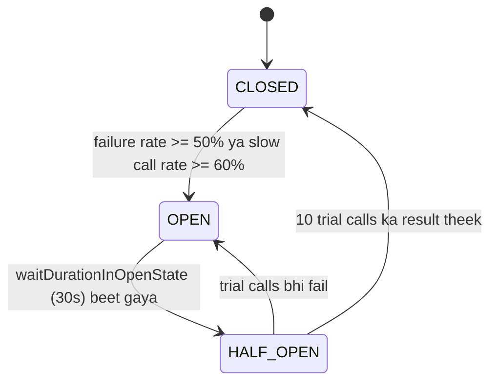
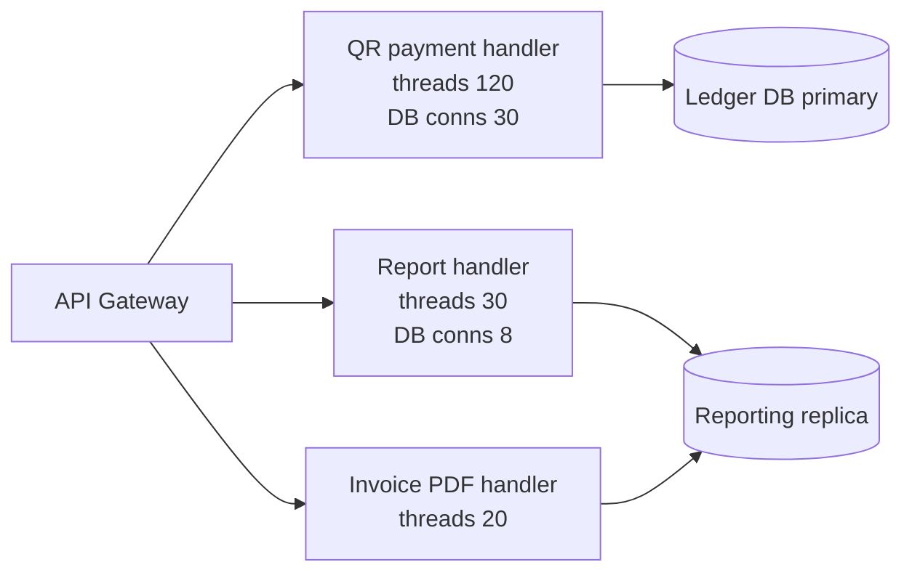
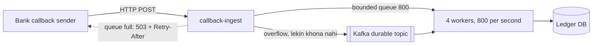
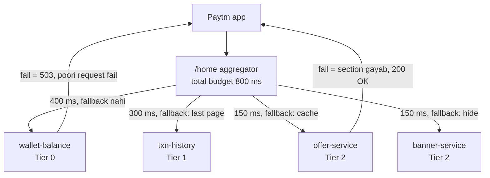
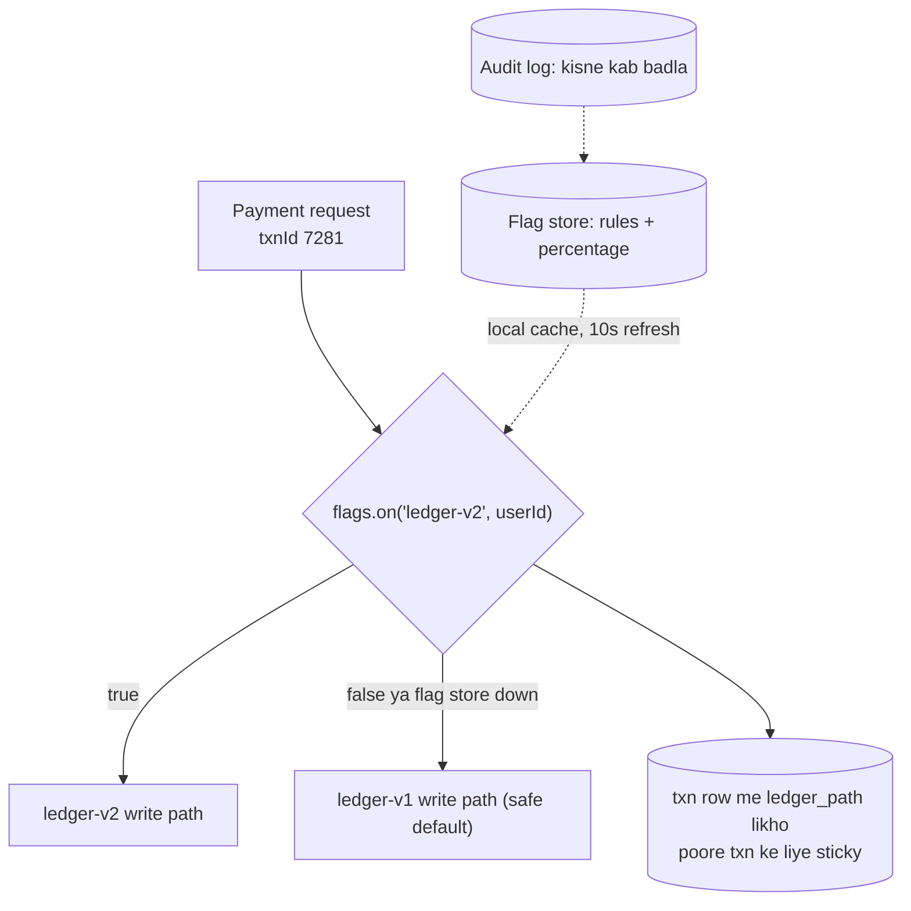
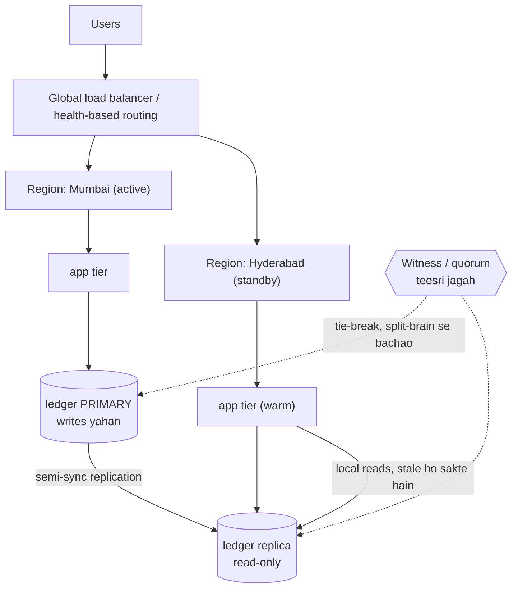

# 2E · Resilience Ridge

Oct 14, 2026 · @saurav chaurasiya

Is doc me L2.16 (Circuit breaker), L2.17 (Bulkhead), L2.17a (Backpressure), L2.18 (Graceful degradation), L2.19 (Feature flags) aur L2.20 (Multi-region) hain.

---

## L2.16 — Circuit breaker

Circuit breaker ek wrapper hai jo kisi doosre service ko call karne se pehle khud se poochta hai "ye service pichhli kuch calls me kaisa behave kar rahi thi?" — agar bahut failures ho rahe the to wo call bhejta hi nahi, caller ko turant fail kar deta hai.

### Ye cheez hai kya

- Category: resilience pattern. Ye client side par baithta hai, yani jo call kar raha hai uske apne process ke andar — downstream server ke andar nahi.
- Kis problem ke liye banayi gayi: cascading failure (ek service slow hui, to uske saare callers slow ho gaye, aur unke callers bhi — poora system girr gaya).
- Is lesson ke baad tum breaker ke teen states bata paoge, config numbers khud choose kar paoge, aur bata paoge ki payments me kaunsi call pe breaker lagana theek hai aur kaunsi pe khatarnak.

### Sawaal

Paytm wallet se bank account me paisa bhejne ka flow hai. Tumhara `payout-service` ek partner bank ka API call karta hai (`POST /neft`). Normally 300 ms me response aata hai. Aaj raat 11 baje bank ka API 30 second tak hang karne laga, tumhara timeout bhi 30s set hai, aur service me 200 threads ka pool hai. 2 minute me poora `payout-service` down ho gaya — aur uske saath wallet balance check API bhi down ho gayi, jiska us bank se koi lena-dena nahi hai. Ye kaise hua, aur isko kaise rokoge?

> Pehle khud socho — 5 min. Hints: (1) 200 threads, har call 30 second block — ek minute me kitni requests handle hongi? (2) balance check API usi thread pool se serve ho rahi thi ya alag se? (3) agar tumhe pehle se pata tha ki bank down hai, to call karne ka fayda kya tha?

### Problem kyun aata hai

- Timeout lamba hota hai, to har failing request ek thread (aur ek HTTP connection) utne time ke liye kabze me rakhti hai. Pool khaali ho jaata hai aur baaki saari API bhi atak jaati hain. Isko resource exhaustion kehte hain.
- Jab downstream already down hai, retry karna aur bura hai: tum marte hue service pe load badha rahe ho. Isko retry storm kehte hain.
- Har request ko alag-alag fail hone ka wait karana waste hai. Pehli 50 calls fail hui hain to 51st ka outcome pehle se pata hai.
- Downstream jab recover kar raha hota hai, saara ruka hua traffic ek saath usko dobara maar deta hai. Isko thundering herd kehte hain (sab clients ek hi waqt daud padte hain).

### Naive approach

- "Timeout kam kar dete hain, 2 second." — thoda help karta hai, lekin 2s x hazaar requests abhi bhi pool kha jaata hai, aur legit slow calls bina wajah fail hone lagti hain.
- "Retry 3 baar kar dete hain." — ulta asar: down service pe 3 guna load.
- "Alert aayega, hum manually feature off kar denge." — aadmi 10 minute me react karta hai; outage 10 second me phail jaata hai.

### Sahi design

Breaker ek chhoti state machine hai jo calls ke outcomes ko ek sliding window (pichhli N calls, ya pichhle N second ki calls) me ginta hai.

1. CLOSED — normal haalat. Calls jaa rahi hain, har result (success / failure / slow) window me record ho raha hai.
2. Window me failure rate threshold (default 50%) cross hua, to breaker OPEN ho jaata hai.
3. OPEN — koi call downstream tak nahi jaati. Caller ko turant `CallNotPermittedException` milta hai, microseconds me, 30 second me nahi. Yahi resource exhaustion rokta hai.
4. `waitDurationInOpenState` (default 60 second) ke baad breaker HALF\_OPEN ho jaata hai.
5. HALF\_OPEN — sirf thodi si trial calls (default 10) jaane deta hai. Unka failure rate theek nikla to wapas CLOSED, warna wapas OPEN. Yahi thundering herd rokta hai.

HALF\_OPEN state hi breaker ko automatic banata hai; uske bina kisi aadmi ko jaake breaker reset karna padta.

Do cheezein aur zaroori hain:

- `slowCallRateThreshold` — sirf errors nahi, dheemi calls bhi breaker trip kar sakti hain. Payments me yahi zyada kaam aata hai: bank API `200 OK` deta hai lekin 20 second me.
- `ignoreExceptions` — har exception failure nahi hai. `InsufficientBalanceException` ek normal business outcome hai; usko ginoge to breaker bina wajah khulega.

Ye diagram breaker ki state machine dikhata hai.



Ye config ek bank payout call ke liye breaker set karta hai aur business exception ko failure nahi ginta.

```java
// Resilience4j config: partner bank ke payout API ke liye
CircuitBreakerConfig cfg = CircuitBreakerConfig.custom()
    // pichhle 20 second ki calls dekho (count-based nahi, time-based)
    .slidingWindowType(CircuitBreakerConfig.SlidingWindowType.TIME_BASED)
    .slidingWindowSize(20)
    // 20 se kam calls hui to decision na lo, warna 1 fail = 100% rate
    .minimumNumberOfCalls(20)
    .failureRateThreshold(50.0f)            // 50% fail -> OPEN
    .slowCallDurationThreshold(Duration.ofSeconds(2))
    .slowCallRateThreshold(60.0f)           // 60% calls 2s se slow -> OPEN
    .waitDurationInOpenState(Duration.ofSeconds(30))
    .permittedNumberOfCallsInHalfOpenState(10)
    // paisa kam hai - ye bank ki galti nahi, isko failure na gino
    .ignoreExceptions(InsufficientBalanceException.class)
    .build();

// Breaker per-bank banao, per-service nahi - SBI down hona HDFC ko na roke
CircuitBreakerRegistry registry = CircuitBreakerRegistry.of(cfg);
CircuitBreaker cb = registry.circuitBreaker("payout-" + bankCode);
```

### Kya choose karein aur kyun

| Option | Kab use karo | Kab mat karo |
| --- | --- | --- |
| Count-based window (pichhli N calls) | Steady traffic, jahan har second sau calls jaati hain | Kam traffic wala endpoint — 2 ghante purani calls pe aaj ka decision galat hai |
| Time-based window (pichhle N second) | Spiky traffic, aur payments me generally — decision hamesha "abhi" ka hona chahiye | Bahut kam traffic — window me 2 calls hongi aur noise pe trip ho jaayega (isliye `minimumNumberOfCalls` lagao) |
| Breaker + fallback (purana data ya queue) | Read path: balance dikhana, offer list, txn history | Write path jahan paisa hilta hai — jhoota success dena sabse badi galti hai |
| Sirf timeout, breaker ke bina | Ek hi call, koi fan-out nahi, aur caller ke paas us call ka apna alag pool hai | Shared thread ya connection pool — tab breaker chahiye hi |
| Manual kill switch (feature flag) | Partner ke saath pehle se tay planned downtime | Automatic failure detection ki jagah — aadmi itna fast nahi hai |

### India me kaise hota hai

- UPI me ek PSP app (PhonePe, Paytm) ko bahut se bank endpoints call karne padte hain aur har bank ka uptime alag hai. NPCI khud "technical decline" track karta hai: Paytm ke blog ke mutabiq ye rate 2016 me 8-10% tha aur 2024 me 0.7-0.8% par aa gaya ([Paytm blog — UPI decline rate](https://paytm.com/blog/payments/upi/upi-decline-rate-drops-to-0-8-global-expansion/)). Jo 0.8% bachta hai, usme bada hissa kisi ek bank ka remitter ya beneficiary side down hona hota hai — isliye per-bank breaker ki zaroorat hamesha rehti hai.
- Production me breaker per downstream instance nahi, per bank banta hai (bank code ya IFSC prefix ke hisaab se). Resilience4j me iska matlab ek `CircuitBreakerRegistry` aur `registry.circuitBreaker("payout-" + bankCode)`.
- Jab remitter bank ka breaker OPEN ho, PSP app aam taur par us bank ko UI me "currently unavailable" dikha deta hai ya user ko doosre linked account par bhej deta hai. Ye graceful degradation hai — L2.18 me isi doc me aage.
- Martin Fowler ka original note yahi kehta hai ki breaker akela problem solve nahi karta: client ko decide karna padta hai ki reject hui call ka kya karein — fail karo, baad ke liye queue karo, ya thoda purana data dikhao ([Martin Fowler — CircuitBreaker](https://martinfowler.com/bliki/CircuitBreaker.html)).

### Interview follow-ups

- **Breaker client side pe hai ya server side?** — Client side. Server apne aap ko bachane ke liye rate limiting lagata hai; breaker caller ko downstream se bachata hai.
- **Retry aur breaker ko saath me kaise rakhein?** — Retry ko breaker ke bahar rakho. Tab breaker OPEN hone pe retry bhi turant fail ho jaata hai aur down service pe load nahi padta. Agar retry breaker ke andar ho to 3 attempts = 3 failure records, breaker jaldi khulega (kabhi ye chahiye bhi hota hai, par soch ke karo).
- **Breaker OPEN hai aur user ne paisa bhejne ko kaha hai, to kya karein?** — Transaction ko PENDING mark karo, request ko durable queue ya outbox me daalo, user ko "processing" dikhao. Fake success kabhi nahi.
- **Breaker per-process hota hai, 50 pods me 50 alag breakers — ye problem hai?** — Haan. Har pod ko alag se seekhna padta hai ki bank down hai, aur har pod apni trial calls bhejta hai (50 x 10 = 500 trial calls). Chhote fleet me theek hai; bade fleet me `permittedNumberOfCallsInHalfOpenState` kam rakho ya central health signal use karo.
- **Kaunsi exceptions failure na ginein?** — Business outcomes: insufficient balance, invalid VPA, galat MPIN, limit exceeded. 4xx validation errors bhi nahi. Sirf 5xx, timeouts aur connection errors.

### Self-check

1. Breaker ke teen normal states kaunse hain, aur HALF\_OPEN kis problem ko rokta hai?
2. `minimumNumberOfCalls` kyun chahiye jab `failureRateThreshold` already 50% set hai?
3. `slowCallRateThreshold` kis failure mode ko pakadta hai jo `failureRateThreshold` miss kar deta hai?
4. Breaker ko per-bank banane ka kya fayda hai?

### Notebook

Breaker = client-side state machine over sliding window · CLOSED -> OPEN (failure ya slow rate) -> HALF\_OPEN (trial calls) -> CLOSED · OPEN me fail-fast se thread pool bachta hai, HALF\_OPEN se thundering herd rukta hai · time-based window + minimumNumberOfCalls payments ke liye theek · business exceptions ignoreExceptions me · per-bank breaker, state per-pod hoti hai · write path pe fallback = PENDING + outbox, fake success never

### Padhne ke liye

- [Resilience4j — CircuitBreaker](https://resilience4j.readme.io/docs/circuitbreaker)
- [Martin Fowler — CircuitBreaker](https://martinfowler.com/bliki/CircuitBreaker.html)

### Deep Dive (SDE-2) — jab time ho

#### Breaker state 50 pods me share karna

Per-pod breaker ka matlab hai ki fleet ko downstream failure "seekhne" me N guna calls lagti hain. Do raaste hain. Pehla: central health signal — ek chhota service bank-wise health compute karke Redis me rakhta hai, aur pods wahan se padh ke apna breaker force-open karte hain. Isme problem hai ki ab wo Redis ek SPOF (single point of failure — ek cheez jiske girne se poora system girta hai) ban gaya, to fallback me local breaker chahiye. Doosra: per-pod breaker hi rakho par `permittedNumberOfCallsInHalfOpenState` ko 2-3 pe rakho aur `waitDurationInOpenState` me jitter daalo, taaki 50 pods ek saath trial na karein.

#### Breaker ki observability

Breaker ki state transition ek event hai, metric nahi — isko log karo aur alert karo. Minimum teen cheezein export karo: current state per breaker (gauge), state transitions (counter), aur `notPermittedCalls` (counter). Agar sirf error rate dekhte raho to breaker OPEN hone pe error rate gir jaayega aur dashboard jhoot bolega ki sab theek hai. Observability ka baseline L1.23 me hai.

#### Breaker vs load shedding

Breaker outbound calls ko rokta hai (main kisko call kar raha hoon). Load shedding inbound requests ko rokta hai (mujhe kaun call kar raha hai, aur kya main utna le sakta hoon). Dono chahiye: breaker ke bina tum doosron ko maarte ho, load shedding ke bina doosre tumhe. Load shedding ka simple version hai queue depth ya p99 latency dekh ke 503 dena — p99 ka matlab hai sau requests me 99th sabse slow wali request ka time, yani "kharab case" latency.

---

## L2.17 — Bulkhead

Bulkhead ka matlab hai resources ko alag-alag dabbon me baant dena, taaki ek kaam ke kharab hone par doosre kaam ke paas apne resources bache rahein. Naam jahaz se aaya hai: ship ke andar waterproof deewarein hoti hain, ek compartment me paani bhar jaaye to poora jahaz nahi doobta.

### Ye cheez hai kya

- Category: resource isolation pattern. Breaker decide karta hai "call karni hai ya nahi"; bulkhead decide karta hai "is call ko kitne resources milenge".
- Kis problem ke liye banayi gayi: ek slow dependency saare shared threads aur connections kha jaati hai, aur usse bilkul unrelated APIs bhi down ho jaati hain. Isko noisy neighbour problem kehte hain.
- Is lesson ke baad tum semaphore aur thread-pool bulkhead ka farak bata paoge, Little's Law se pool size nikaal paoge, aur HLD diagram me pools dikha paoge.

### Sawaal

Paytm ka `merchant-api` service teen kaam karta hai: (a) QR payment accept karna, (b) merchant ka settlement report banana, (c) GST invoice ka PDF banana. Sab ek hi Tomcat me, 200 threads shared. Report aur PDF, dono ek legacy reporting DB ko hit karte hain jo kabhi-kabhi 40 second leta hai. Mahine ke pehle din report traffic 10 guna ho gaya aur QR payments fail hone lage — jo reporting DB se bilkul related nahi hain. Aisa design karo ki QR payment kabhi na gire.

> Pehle khud socho — 5 min. Hints: (1) 200 threads kiske beech baantoge? (2) agar report ke liye sirf 8 DB connections rakho to 9vi report request ka kya hoga? (3) QR payment ko kitni concurrency chahiye — 2400 requests per second aur 50 ms latency pe hisaab lagao.

### Problem kyun aata hai

- Shared thread pool me koi priority nahi hoti. Jo request pehle aa gayi usko thread mil jaata hai, chahe wo 40 second wali report ho.
- Slow dependency ka hold time lamba hota hai, to wo per-request zyada thread-seconds kha jaati hai. Thodi si requests bhi poora pool bhar deti hain.
- Connection pool pe bhi wahi baat: HikariCP pool me 20 connections hain, reporting queries ne 18 le liye, to payment ka `UPDATE wallet` connection ke liye wait karega.
- Breaker late pakadta hai: jab tak failure rate 50% hua, pool already khaali ho chuka hota hai. Isliye bulkhead breaker se pehle wali defence hai.

### Naive approach

- "Threads badha dete hain, 200 se 2000." — Har thread ka apna stack hota hai (JVM me default aam taur par 512 KB se 1 MB), context switching badhta hai, aur DB connections to abhi bhi 20 hi hain. Problem shift hua, khatam nahi hua.
- "Reporting ko async kar dete hain." — Direction theek hai par akela kaafi nahi: async me bhi agar ek hi executor shared hai to wahi problem wapas aayegi.

Ye snippet wahi galti dikhata hai — teen bilkul alag kaam, ek hi pool.

```java
// BURA: teen alag-alag kaam, ek hi shared pool
ExecutorService shared = Executors.newFixedThreadPool(200);

shared.submit(() -> acceptQrPayment(req));      // ~50 ms ka kaam
shared.submit(() -> buildSettlementReport(m));  // ~40 second ka kaam
shared.submit(() -> renderGstInvoice(m));       // ~5 second ka kaam

// Report traffic 10x hua -> 200 threads report me busy ->
// QR payment queue me pada rehta hai aur client ka timeout ho jaata hai
```

### Sahi design

Do tarah ke bulkhead hote hain:

1. Semaphore bulkhead — apna thread pool nahi banata, sirf ek counter rakhta hai ki "is dependency pe abhi kitni calls chal rahi hain". `maxConcurrentCalls` (Resilience4j me default 25) cross hua to nayi call `maxWaitDuration` (default 0, yani turant) tak wait karti hai aur phir `BulkheadFullException` se fail ho jaati hai. Kaam calling thread hi karta hai.
2. Thread pool bulkhead — apna bounded pool aur bounded queue banata hai: `coreThreadPoolSize`, `maxThreadPoolSize`, `queueCapacity` (default 100). Call doosre thread pe chalti hai, to caller ka thread turant free ho jaata hai. Ye sirf async calls ke liye hai ([Resilience4j — Bulkhead](https://resilience4j.readme.io/docs/bulkhead)).

Size nikalne ka formula Little's Law hai: `concurrency = arrival rate x latency`. QR payment: 2400 rps x 0.05 s = 120 concurrent. Reporting: 2 rps x 4 s = 8 concurrent.

3. Har workload ka apna pool do — thread pool aur DB connection pool, dono.
4. Har pool bounded ho, queue bhi bounded. Unbounded queue ka matlab hai failure ko memory me chhupana (yahi L2.17a ka core point hai).
5. Nesting ka tarika: Retry sabse bahar, uske andar CircuitBreaker, aur Bulkhead sabse andar asli call ke paas. Tab bulkhead full hone pe attempt turant laut aata hai aur breaker usko record kar leta hai.

Ye diagram ek hi gateway ke peeche teen alag compartments dikhata hai.



Ye code har dependency ko apna bulkhead deta hai aur full hone pe 503 bhejta hai.

```java
// Har dependency ka apna bulkhead - ek doosre ka hissa nahi khaate
BulkheadRegistry registry = BulkheadRegistry.ofDefaults();

Bulkhead qrBh = registry.bulkhead("qr-payment", BulkheadConfig.custom()
    .maxConcurrentCalls(120)                 // Little's Law: 2400 rps x 50 ms
    .maxWaitDuration(Duration.ofMillis(20))  // 20 ms se zyada wait mat karo
    .build());

Bulkhead reportBh = registry.bulkhead("reporting", BulkheadConfig.custom()
    .maxConcurrentCalls(8)                   // reporting DB ko 8 se zyada mat maaro
    .maxWaitDuration(Duration.ZERO)          // full hai to turant reject
    .build());

// executeCallable checked Exception bhi throw karta hai, isliye dono catch chahiye.
// BulkheadFullException ek RuntimeException hai, to usko pehle catch karna legal hai.
try {
    String report = reportBh.executeCallable(() -> buildSettlementReport(merchantId));
    respondOk(report);
} catch (BulkheadFullException e) {
    // 503 + Retry-After. 500 mat do - 500 se client samjhega ki bug hai.
    respond(503, "Report queue full, 5 min me try karo");
} catch (Exception e) {
    respond(502, "Report ban nahi paayi");
}
// QR payment ka bulkhead alag hai, to wo ab bhi normal chal raha hai
```

### Kya choose karein aur kyun

| Option | Kab use karo | Kab mat karo |
| --- | --- | --- |
| Semaphore bulkhead | Sync blocking call, overhead kam chahiye, caller ka thread hi kaam karega | Jab caller ka thread free karna ho — semaphore usko block hi rakhta hai |
| Thread pool bulkhead | Async call (CompletableFuture), caller thread turant free chahiye | Plain sync code me — ye async API deta hai aur ek extra thread hop ka cost hai |
| Alag DB connection pool per workload | Ek hi DB ko do bahut alag workload hit karte hain (OLTP + report) | Pools itne chhote ho jaayein ki normal traffic me bhi wait ho; total connections DB ki limit ke andar rakho |
| Alag service, alag deployment | Workload ka SLA aur owning team dono alag hain | Sirf isolation ke liye — nayi service ka matlab naya deploy, naya on-call, ek extra network hop |
| Unbounded queue | Kabhi nahi | Hamesha — unbounded queue failure ko memory me chhupata hai |

### India me kaise hota hai

- UPI PSP me sabse common bulkhead per-bank hota hai: har remitter bank ke liye alag HTTP connection pool aur alag concurrency limit. SBI ka endpoint slow hua to uske 40 permits khatam ho jaate hain, baaki banks ke permits chhute hi nahi. Yahi wajah hai ki ek bank down hone pe poora app down nahi hota, aur 0.7-0.8% technical decline ek bank tak limited reh jaata hai ([Paytm blog — UPI decline rate](https://paytm.com/blog/payments/upi/upi-decline-rate-drops-to-0-8-global-expansion/)).
- Consumer-facing payment API aur merchant-facing settlement ya report API aam taur par alag service me, alag read replica pe rakhi jaati hain, taaki month-end ka report load payment path ko chhuye hi na.
- Library defaults chhote hain (semaphore 25 concurrent, thread pool queue 100). Production me inko Little's Law se naapo, default pe mat chhodo ([Resilience4j — Bulkhead](https://resilience4j.readme.io/docs/bulkhead)).

### Interview follow-ups

- **Bulkhead aur rate limiter me farak?** — Rate limiter rate capt karta hai (requests per second), bulkhead concurrency (ek saath kitni chal rahi hain). Slow downstream ke liye concurrency wali limit zyada kaam ki hai: 10 rps bhi 40 second latency pe 400 concurrent ban jaata hai.
- **Bulkhead full hone pe kaunsa HTTP status?** — 503, ya 429 agar tum chahte ho ki client baad me retry kare, saath me `Retry-After` header. 500 nahi.
- **Semaphore bulkhead thread free nahi karta, to fayda kya?** — Fayda ye hai ki us dependency pe kitne threads atak sakte hain uski ceiling lag jaati hai. Pool 200 ka hai, bulkhead 30 ka — baaki 170 threads doosre kaam ke liye bache rahe.
- **`queueCapacity` kitna rakhein?** — Chhota. Queue me pada request zyadatar client ki taraf se already timeout ho chuka hota hai, to usko process karna pure waste hai. Payments me aksar 0 se 10.
- **Ek pod me limit 120 hai aur 50 pods hain — downstream pe total concurrency?** — 50 x 120 = 6000. Downstream ki capacity se ulta hisaab lagao aur per-pod limit nikalo, ya distributed limiter use karo.

### Self-check

1. Bulkhead aur circuit breaker ke kaam ka farak ek line me?
2. Little's Law se: 1000 requests per second aur 200 ms latency — kitni concurrency chahiye?
3. Semaphore aur thread pool bulkhead me se kaunsa async calls ke liye hai, aur kyun?
4. Bulkhead full hone pe 500 kyun galat status hai?

### Notebook

Bulkhead = resources ko compartments me baantna · breaker "call karein ya nahi", bulkhead "kitne resources" · semaphore = counter, caller thread blocks; thread pool = apna bounded pool + queue, async only · size = Little's Law (rps x latency) · threads aur DB connections dono baanto · queue chhoti aur bounded, unbounded never · full hone pe 503 + Retry-After · per-bank pools = ek bank down hone pe app zinda

### Padhne ke liye

- [Resilience4j — Bulkhead](https://resilience4j.readme.io/docs/bulkhead)
- [Martin Fowler — CircuitBreaker](https://martinfowler.com/bliki/CircuitBreaker.html)

### Deep Dive (SDE-2) — jab time ho

#### Little's Law thoda detail me

Little's Law kehta hai: `L = lambda x W`, jahan L system me ek waqt pe maujood items hain, lambda arrival rate hai aur W har item ka average time. Iska sabse kaam ka use ulta chalana hai: pool size tumhari capacity hai, to jab latency badhti hai to arrival rate utna hi girna chahiye warna queue banegi. Example: 120 permits aur 50 ms latency = 2400 rps handle hoga. Wahi downstream 500 ms pe chala gaya, to 120 permits sirf 240 rps handle karenge — yani 10 guna capacity drop, bina kisi error ke. Isliye latency alert error-rate alert se pehle bajna chahiye.

#### Connection pool bulkhead (HikariCP)

Threads baant dene se kaam poora nahi hota, kyunki asli scarce resource aam taur par DB connection hoti hai. Ek service me ek hi `DataSource` rakhna sabse common galti hai. Theek tarika: do `DataSource` banao — ek primary pe chhota-tez OLTP pool (`maximumPoolSize` 30, `connectionTimeout` 250 ms, taaki wait lamba na ho), aur ek read replica pe reporting pool (`maximumPoolSize` 8, `connectionTimeout` 2000 ms). Replication ka basic L1.13 me hai. Dhyan rakho: total connections across all pods DB ke `max_connections` se kaafi neeche rahein, warna bulkhead DB ke level pe toot jaayega.

#### Bulkhead se cell-based architecture tak

Bulkhead ka bada version cell-based (ya shuffle sharding) architecture hai: poore stack ki chhoti-chhoti independent copies banao aur har customer ko ek cell assign karo. Ek cell girne pe sirf utne hi users affected hote hain, aur blast radius (ek failure kitne users tak pahunchti hai) pehle se pata hota hai. Payments me iska natural cut bank ya merchant hota hai. Cost ye hai ki capacity planning aur deployment dono N guna complex ho jaate hain, aur cross-cell operations (ek cell ke user se doosre cell ke user ko paisa) ko ab distributed transaction treat karna padta hai.

---

## L2.17a — Backpressure

Backpressure ka matlab hai: jab consumer (jo kaam process kar raha hai) producer (jo kaam bhej raha hai) se dheema ho, to producer ko bata dena ki "ruk jao, main pichhad raha hoon" — aur producer ko sach me rukna pade. Agar ye signal nahi hai, to extra kaam kahin jama hota rehta hai — aksar memory me — aur ek din pod gir jaata hai.

### Ye cheez hai kya

- Category: flow control. Ye ek signal hai jo ulti direction me jaata hai — data aage jaata hai, backpressure peeche aata hai.
- Kis problem ke liye banayi gayi: unbounded buffering. Producer tez, consumer dheema, aur beech me ek aisi queue jiski koi limit nahi — result hai OutOfMemoryError ya ghante purana data process karna.
- Is lesson ke baad tum bata paoge ki backpressure kahan lagana hai, block karna hai ya drop karna hai, aur queue ka size Little's Law se kaise choose karna hai.

### Sawaal

Paytm ka `callback-ingest` service banks ke se-to-se callbacks leta hai (bank bolta hai "txn 7281 ab SUCCESS hai"). Normal load 400 callbacks per second hai. Har callback pe tum ledger update karte ho, jisme 5 ms lagta hai, aur tumhare paas 4 worker threads hain. Raat ko ek bank ne apna 3 ghante ka backlog ek saath bhej diya — 5000 callbacks per second, 20 minute tak. Tumhara pod 8 minute me `OutOfMemoryError` se mar gaya, restart hua, aur phir mar gaya. Design karo ki pod zinda rahe aur ek bhi callback na khoye.

> Pehle khud socho — 5 min. Hints: (1) 4 threads x 5 ms = kitne callbacks per second process ho sakte hain? (2) 5000 aa rahe hain aur utne process ho rahe hain — baaki kahan ja rahe hain? (3) agar tum HTTP pe 503 return karo, to bank kya karega?

### Problem kyun aata hai

- 4 threads x (1 / 0.005 s) = 800 callbacks per second ki capacity hai. 5000 aa rahe hain, to 4200 per second kahin jama ho rahe hain. 8 minute me ye 20 lakh objects ban jaate hain — heap khatam.
- Unbounded queue failure ko chhupa deti hai. Service error nahi deti, metrics healthy dikhte hain, latency chupchap badhti rehti hai, aur phir ek jhatke me poora pod marta hai. Chhupi hui failure, alert ke saath aane wali failure se zyada khatarnak hai.
- Queue me pada hua kaam aksar bekaar ho chuka hota hai: client ne 2 second me timeout kar diya, par tum 90 second baad usko process karte ho.
- Restart se problem solve nahi hoti, badhti hai: backlog waise hi pada hai aur ab ek fresh pod usi 5000 rps ko face karta hai (crash loop).

### Naive approach

- "Heap badha dete hain, 4 GB se 16 GB." — Sirf crash ka time 8 minute se 32 minute kar diya. Arrival rate capacity se zyada hai, to koi bhi buffer kabhi na kabhi bharega.
- "Queue ko unbounded rakhte hain, ye safe hai." — Ye exactly ulta hai: unbounded queue ka matlab hai "main failure ko memory me chhupaunga".

Ye wahi galti hai — `Executors.newFixedThreadPool` andar se unbounded queue use karta hai.

```java
// BURA: newFixedThreadPool andar se ek unbounded LinkedBlockingQueue banata hai
ExecutorService pool = Executors.newFixedThreadPool(4);

void onCallback(Callback c) {
    pool.submit(() -> ledger.apply(c)); // submit kabhi mana nahi karta
    respond(200, "OK");                  // bank ko hamesha OK - jhooth hai
}
// 5000 rps aaye, 800 rps process hua -> queue me 4200 rps jama -> OOM
```

### Sahi design

Teen sawaal order me poocho: queue bounded hai? bharne pe kya karoge? aur ye signal producer tak pahunch raha hai?

1. Queue ko bounded karo. `ArrayBlockingQueue(1000)` jaisa fixed size. Yahi sabse bada single fix hai.
2. Queue size Little's Law se nikalo: `queue = throughput x acceptable wait`. 800 per second capacity aur 1 second se zyada wait accept nahi — to queue 800 ke aas-paas. Isse badi queue sirf latency badhati hai, throughput nahi.
3. Bharne pe policy choose karo — block karo (producer ko rok do) ya reject karo (503 do). Payments me jo paisa move karti hain unko kabhi drop nahi karte; unke liye reject karo aur producer ko retry karne do.
4. Signal ko producer tak pahuncha do. HTTP me iska matlab hai 503 ya 429 with `Retry-After`. Kafka me ye natural hai: consumer `poll()` karta hai, yani kaam khud kheenchta hai — jitna slow poll karoge, utna hi kam kaam milega (iska matlab hai ki consumer lag badhega, par memory nahi). Reactive Streams me consumer `request(n)` bhejta hai aur producer utne se zyada element bhej hi nahi sakta ([Reactive Streams](https://www.reactive-streams.org/)).
5. Jo kaam ab nahi ho sakta par khona bhi nahi chahiye, usko durable jagah bhejo — Kafka topic ya outbox table — memory me nahi. Memory me pada data restart pe gayab ho jaata hai.

Ye diagram dikhata hai ki signal kis direction me jaata hai.



Ye chhota demo dikhata hai ki bounded queue bharne pe sach me mana kar deti hai.

```java
import java.util.concurrent.*;

public class BackpressureDemo {
    public static void main(String[] args) throws Exception {
        // sirf 2 slots ki queue - jaan ke chhoti rakhi hai demo ke liye
        BlockingQueue<Integer> q = new ArrayBlockingQueue<>(2);

        q.put(1); // slot 1 bhara
        q.put(2); // slot 2 bhara

        // teesra: put() yahan hamesha ke liye block ho jaata, isliye
        // offer() with timeout use karte hain - 200 ms wait, phir false
        boolean accepted = q.offer(3, 200, TimeUnit.MILLISECONDS);

        System.out.println("teesra message accepted? " + accepted); // false
        System.out.println("queue size = " + q.size());             // 2
        // false mila - ab iska matlab bank ko 503 bhejna hai, chupchap
        // memory me rakhna nahi
    }
}
```

Aur production wala version: bounded queue ke saath `CallerRunsPolicy`.

```java
// Bounded queue + CallerRunsPolicy = sabse saste backpressure.
// Pool aur queue dono full hue to submit karne wala thread KHUD kaam karta hai,
// yani producer apne aap dheema ho jaata hai.
ThreadPoolExecutor pool = new ThreadPoolExecutor(
        4, 4,                                      // 4 core, 4 max threads
        0L, TimeUnit.MILLISECONDS,
        new ArrayBlockingQueue<>(800),             // BOUNDED - yahi asli fix hai
        new ThreadPoolExecutor.CallerRunsPolicy());

// Dhyan: CallerRunsPolicy HTTP thread ko busy kar deta hai, to Tomcat ka
// accept queue bharega aur load balancer ko pata chalega. Ye feature hai, bug nahi.
```

### Kya choose karein aur kyun

| Option | Kab use karo | Kab mat karo |
| --- | --- | --- |
| Block (producer ko rok do) | Producer tumhare andar hai — ek internal pipeline stage, ya batch job | Producer ek HTTP request hai — block karne se uska timeout hoga aur wo retry bhejega, load double |
| Reject with 503 / 429 + Retry-After | Producer bahar hai aur retry kar sakta hai (bank callback, merchant API) | Producer retry nahi karta — tab reject ka matlab data loss hai |
| Drop oldest | Sirf latest value matter karti hai — price tick, device heartbeat, progress bar | Paisa, ledger entry, ya koi bhi audit-able event |
| Drop newest | Sampling chalega — metrics, analytics events | Koi bhi txn ya callback |
| Durable spill (Kafka, outbox table) | Kaam ab nahi ho sakta par khona bilkul nahi chahiye — payments ka default | Jab latency hard requirement ho; durable spill hamesha minutes ka lag laata hai |
| Unbounded queue | Kabhi nahi | Hamesha |

### India me kaise hota hai

- UPI aur card callbacks me producer ek bank ya aggregator hota hai, jo aam taur par apne aap retry karta hai. Isliye India ke payment stacks me default choice "503 + Retry-After" hoti hai, block nahi: bank ka retry tumhare liye free durable buffer hai.
- Ye hi wajah hai ki PSP apps webhook ingest aur webhook processing ko alag karte hain: ingest API sirf validate karke Kafka me likh deta hai (kuch millisecond), aur asli ledger processing ek consumer karta hai. Ingest fast hai to queue bharti hi nahi; aur consumer ke pichhadne ka matlab consumer lag hai, memory nahi.
- Jab consumer lag badhta hai, sabse badi galti hai usko "parallelism badhao" se theek karna. Ledger DB ki write capacity fix hai, to zyada consumers sirf DB pe contention badhayenge. Pehle ye dekho ki lag ka reason throughput hai ya ek hot partition.
- NPCI khud is pressure ko timeouts aur check-status limits se manage karta hai: har PSP ko bataya jaata hai ki status kitni der baad aur kitni baar poochna hai. Ye bhi backpressure hai — bas policy ke roop me, code ke roop me nahi. Rate limiting ka baseline L1.21 me hai.

### Interview follow-ups

- **Kafka me backpressure built-in hai ya nahi?** — Consumer side pe haan, kyunki consumer pull karta hai (`poll`). Producer side pe tumhe khud lagana padta hai: `buffer.memory` bhar jaane pe `send()` `max.block.ms` tak block karta hai aur phir exception deta hai.
- **503 aur 429 me se kaun?** — 429 bolta hai "tumne limit cross ki" (client ki galti), 503 bolta hai "main overloaded hoon" (meri haalat). Overload ke liye 503, declared rate limit ke liye 429. Dono me `Retry-After` do.
- **Agar producer retry nahi karta to kya karein?** — Tab reject karna data loss hai, to tumhe durable spill chahiye: ingest par sirf append karo (Kafka ya ek `inbox` table), aur processing baad me karo.
- **Queue bounded hai, pod zinda hai, par lag 2 ghante ka hai — ye theek hai?** — Correctness ke liye theek hai, business ke liye nahi. Lag ko ek SLO banao aur alert karo. Zinda rehna pehla step hai, kaafi nahi.
- **Backpressure aur rate limiting me farak?** — Rate limiting ek pehle se tay limit hai (1000 rps, chahe tum khaali ho ya bhare). Backpressure tumhari asli haalat se nikalta hai (queue kitni bhari hai, ab kya ho raha hai). Adaptive hai, isliye zyada accurate aur zyada mehnat ka.

### Self-check

1. 6 threads aur 10 ms per task — capacity kitni requests per second hai?
2. `Executors.newFixedThreadPool(4)` me chhupi hui kya khatarnak baat hai?
3. Block aur reject me se kaun choose karoge jab producer ek bank ka HTTP callback ho, aur kyun?
4. Drop oldest kis tarah ke data pe theek hai aur payments me kyun nahi?

### Notebook

Backpressure = consumer se producer ki taraf jaane wala "dheere" signal · unbounded queue = failure ko memory me chhupana, OOM · queue size = throughput x acceptable wait (Little's Law) · bharne pe: block (internal producer) ya 503/429 + Retry-After (external producer) · drop sirf latest-value data pe, paise pe never · khona nahi chahiye to durable spill (Kafka, outbox) · Kafka consumer pull = natural backpressure, lag badhta hai memory nahi · CallerRunsPolicy + ArrayBlockingQueue = sasta aur effective

### Padhne ke liye

- [Reactive Streams](https://www.reactive-streams.org/)
- [Resilience4j — Bulkhead](https://resilience4j.readme.io/docs/bulkhead)

### Deep Dive (SDE-2) — jab time ho

#### Ye concept pehle kahan aa chuka hai

Backpressure ek naya pattern nahi, ek lens hai jo tumne already teen jagah dekha hai. L2.4 (dead letter queue) me: DLQ hi ek bounded system ka overflow outlet hai — jo message baar-baar fail ho raha hai usko main flow se nikaal dena, taaki wo pipeline ko block na kare. T7 (ExecutorService) me: `ThreadPoolExecutor` ka queue aur uski `RejectedExecutionHandler` exactly ye decision hai — block, reject, ya caller-runs. T9 (producer-consumer) me: `BlockingQueue` ka `put()` khud backpressure hai, kyunki wo producer thread ko sula deta hai. Teenon ek hi baat hain, teen level pe: thread, service, aur system.

#### Kafka consumer me pause aur resume

Kafka consumer me ek aur level ka control hai. Agar tum `poll()` me 500 records le aaye aur downstream (DB) slow hai, to teen galat raaste hain: records ko apni memory me rakh lo (OOM), ya `max.poll.interval.ms` cross karo (broker samjhega consumer mar gaya aur rebalance kara dega — yani sabse bura waqt pe rebalance). Sahi raasta hai `consumer.pause(partitions)` call karna, pending kaam khatam karo, phir `resume()`. Beech me `poll()` call karte raho (paused partitions se records nahi aayenge) taaki heartbeat chalta rahe aur rebalance na ho. Doosra tareeka hai `max.poll.records` ko chhota rakhna, taaki ek batch ka kaam `max.poll.interval.ms` me aaram se poora ho jaaye.

#### Queueing theory ka ek kaam ka result

Utilization badhte hi wait time linearly nahi, exponentially badhta hai. Simple M/M/1 model me average wait `W = utilization / (1 - utilization) x service_time` ke hisaab se chalta hai. 50% utilization pe wait = 1 x service time. 90% pe = 9 x. 95% pe = 19 x. 99% pe = 99 x. Iska practical matlab ye hai: payments system ko 70-75% utilization se zyada pe mat chalao, kyunki wahan se aage traffic me thodi si bhi badhotri p99 latency ko kai guna kar deti hai. Aur yahi kaaran hai ki "server busy hai, queue me daal do" ek point ke baad kaam karna band kar deta hai — queue badhane se latency badhti hai, capacity nahi.

---

## L2.18 — Graceful degradation

Graceful degradation ka matlab hai: system ka ek hissa kharab ho jaaye to poora system band karne ke bajaye, kam zaroori features band karo aur core kaam chalta rakho. Paytm app me offers load na hon to chalega; paisa bhejna band ho gaya to nahi chalega.

### Ye cheez hai kya

- Category: availability design. Ye ek product decision hai jo code me likha jaata hai — kaunsa feature zaroori hai aur kaunsa nahi.
- Kis problem ke liye banayi gayi: all-or-nothing aggregation. Ek screen 8 services se data maangti hai aur sabka wait karti hai, to uski availability saari 8 ki availability ka guna ban jaati hai, aur latency sabse slow wali ke barabar.
- Is lesson ke baad tum features ko tiers me baant paoge, per-dependency timeout budget bana paoge, aur bata paoge ki kahan stale data dikhana theek hai aur kahan paap hai.

### Sawaal

Paytm app ka home screen ek `/home` API se banta hai, jo 8 services ko parallel call karta hai: wallet balance, recent transactions, offers, scratch cards, banner list, recharge suggestions, credit score teaser, aur notification count. API sabka response aane ka wait karti hai, total timeout 3 second hai. Aaj `offer-service` ka ek dependency slow ho gaya aur wo 3 second lene laga. Nateeja: poora home screen fail ho gaya aur user paisa bhej hi nahi paaya. Aisa design karo ki offers down hone par bhi user paisa bhej sake.

> Pehle khud socho — 5 min. Hints: (1) agar har service 99.9% available hai, to 8 ka "sab chahiye" wala AND kitna available hai? (2) offers ke liye 3 second ka wait dena sahi hai? (3) offers ka data kal ka chalega ya nahi — aur balance ka?

### Problem kyun aata hai

- Fan-out ki availability multiply hoti hai. 8 dependencies, har ek 99.9% — to "sab chahiye" wali screen ki availability 0.999 ki 8vi power = 99.2% ho jaati hai. Yani mahine me \~6 ghante down, jabki koi ek service bhi itni kharab nahi thi.
- Fan-out ki latency maximum hoti hai, average nahi. 8 parallel calls me p99 wo hai jo sabse slow dependency ka p99 hai. p99 ka matlab hai sau requests me 99vi sabse slow wali request ka time.
- Ek shared timeout (3 second) ka matlab hai ki sabse kam zaroori dependency ko bhi poora 3 second milta hai. Budget ki koi priority nahi.
- Code aksar ek hi try-catch me poora aggregation wrap karta hai, to ek section ka exception poori response ko le dubta hai.

### Naive approach

- "Sab calls ko try-catch me daal dete hain." — Direction theek hai par aadha kaam: exception pakad lene se latency theek nahi hoti. Offer service 3 second slow hai, exception nahi de rahi — to user 3 second wait karega hi.
- "Total timeout 500 ms kar dete hain." — Ab balance call bhi 500 ms me fail hone lagegi, jo asli zaroori cheez hai.
- "Offers ko bilkul hata dete hain." — Business ko manzoor nahi. Degradation ka point hi ye hai ki normal time me feature rahe, kharab time me khud hat jaaye.

### Sahi design

1. Features ko tiers me baanto, aur ye likh ke rakho. Tier 0: paisa bhejna, balance dikhana, UPI PIN flow. Tier 1: recent transactions, notification count. Tier 2: offers, scratch cards, banners, credit score teaser.
2. Per-dependency timeout budget do, shared nahi. Total 800 ms me se balance ko 400 ms, transactions ko 300 ms, offers ko 150 ms. Tier jitna neeche, budget utna chhota.
3. Response partial ho sakti hai: har section apna status leke aaye (`OK`, `STALE`, `UNAVAILABLE`), aur UI us hisaab se section hide kare ya skeleton dikhaye. API 200 deti hai, bas kam data ke saath.
4. Fallback ki seedhi (ladder) banao: live call -> cache se purana data -> static default -> section gayab. Jahan ye seedhi khatam ho wahi us feature ki asli availability hai.
5. Overload me khud se Tier 2 band karne ka switch rakho (kill switch, L2.19 me aage). Yahi "load shedding by priority" hai.
6. Correctness ko kabhi degrade na karo. Purana offer dikhana theek hai; purana balance dikhana ya "payment successful" bolna jab pata nahi — ye kabhi nahi. Agar balance purana dikhana hi pade, to uske saath waqt likho ("10:42 tak") aur paisa bhejne se pehle fresh check karo.

Ye diagram ek aggregator dikhata hai jisme har section ka apna budget aur apna fallback hai.



Ye code har section ko apna timeout aur apna fallback deta hai.

```java
// Home screen aggregator: har section ka apna timeout aur apna fallback.
// Tier 0 fail hua to poori request fail (sahi hai).
// Tier 2 fail hua to section gayab, request zinda.
CompletableFuture<Balance> balanceF = CompletableFuture
        .supplyAsync(() -> walletClient.balance(userId), ioPool)
        .orTimeout(400, TimeUnit.MILLISECONDS);        // Tier 0 - koi fallback nahi

CompletableFuture<List<Offer>> offersF = CompletableFuture
        .supplyAsync(() -> offerClient.forUser(userId), ioPool)
        .orTimeout(150, TimeUnit.MILLISECONDS)         // Tier 2 - chhota budget
        .exceptionally(e -> offerCache.getOrEmpty(userId)); // stale, warna khaali list

CompletableFuture<List<Txn>> txnF = CompletableFuture
        .supplyAsync(() -> txnClient.recent(userId, 5), ioPool)
        .orTimeout(300, TimeUnit.MILLISECONDS)
        .exceptionally(e -> List.of());                 // Tier 1 - khaali chalega

HomeScreen screen = new HomeScreen();
screen.balance = balanceF.join();   // yahan exception aa sakta hai - aana chahiye
screen.offers  = offersF.join();    // kabhi exception nahi - exceptionally laga hai
screen.txns    = txnF.join();
screen.offersStale = offerCache.wasServed(userId); // UI ko batao ki data purana hai
```

### Kya choose karein aur kyun

| Option | Kab use karo | Kab mat karo |
| --- | --- | --- |
| Stale cache se purana data dikhao | Offers, banners, catalog, profile photo — jahan purana hona bas thoda bura hai | Balance, limits, aur koi bhi number jiske bharose user paisa bhejega |
| Section ko chupchap hide karo | Tier 2 widgets — scratch card, credit score teaser | Tier 0 — user ko dikhna chahiye ki kya kaam nahi kar raha |
| Static default dikhao | Fixed cheezein — default banner, help links, standard fee table | Jo user-specific ho; galat user ka data dikhana isse bhi bada bug hai |
| Accept karo aur baad me process karo (queue) | Write path jo turant hona zaroori nahi — autopay setup, profile update | Jo flow user ke saamne confirm hona chahiye, jaise merchant pe QR payment |
| Hard fail (503 + saaf message) | Tier 0 — balance ya PIN flow down hai | Tier 2 — ek widget ke liye poora screen marna sabse badi galti hai |

### India me kaise hota hai

- UPI me degradation ka sabse saaf example bank-level hai: remitter bank down hai to PSP app us account ko "currently unavailable" dikha deta hai aur user ko doosre linked account par bhejta hai. Poora app down nahi hota. Ye L2.16 ke per-bank breaker ke upar bana hua product behaviour hai.
- Status unknown hone par India ke payment apps ka standard behaviour hai transaction ko PENDING dikhana, success ya failure nahi. NPCI ka check-status flow isi ke liye bana hai, aur isliye "pending" ko ek first-class state banana zaroori hai. Technical declines ka paimana 2024 me 0.7-0.8% tha ([Paytm blog — UPI decline rate](https://paytm.com/blog/payments/upi/upi-decline-rate-drops-to-0-8-global-expansion/)); jo bhi is bucket me hai, uske liye PENDING hi imaandar jawab hai.
- Merchant side pe common degradation hai settlement report ko "T+1 ke baad" shift kar dena jab reporting pipeline pichhad rahi ho, jabki QR payment acceptance normal chalta rahe. Ye L2.17 ke bulkhead ka natural product-level jodi hai.
- Martin Fowler ka point yahi hai ki breaker apne aap kaafi nahi — client ko decide karna padta hai ki rejected call pe kya dikhana hai: fail karo, queue karo, ya thoda purana data dikhao ([Martin Fowler — CircuitBreaker](https://martinfowler.com/bliki/CircuitBreaker.html)). Graceful degradation usi decision ko pehle se likh ke rakhna hai.

### Interview follow-ups

- **8 dependencies, har ek 99.9% — screen ki availability?** — "Sab chahiye" pe 99.2%. Tiering ke baad Tier 0 ki 2 dependencies pe 99.8% — Tier 2 ke failures availability me count hi nahi hote.
- **Partial response pe kaunsa HTTP status?** — 200, saath me per-section status field. 206 use mat karo, wo byte ranges ke liye hai aur clients usko theek handle nahi karte.
- **Stale data dikhane ka sabse bada risk?** — User us data pe action le leta hai. Isliye rule simple hai: stale data read-only display ke liye theek, kisi bhi write decision ke liye nahi.
- **Degradation ko test kaise karoge?** — Chaos experiment: ek dependency ko jaan ke 5 second slow karo staging me aur dekho ki screen render hui ya nahi. Isko release checklist me daalo — warna fallback code likha hua hai par kabhi chala hi nahi.
- **Tier kaun decide karega, engineer ya product?** — Product, likhit roop me. Engineer ka kaam hai ye list demand karna, kyunki overload ke waqt ye decision 2 baje raat ko nahi liya ja sakta.

### Self-check

1. Fan-out ki availability multiply kyun hoti hai, aur tiering usko kaise theek karta hai?
2. Shared total timeout aur per-dependency budget me farak kya hai?
3. Fallback ki seedhi ke chaar step order me likho.
4. Kaunsi ek cheez hai jo kabhi degrade nahi karni chahiye?

### Notebook

Graceful degradation = kam zaroori feature gira do, core zinda rakho · fan-out me availability multiply, latency maximum · features ko Tier 0/1/2 me baanto, likh ke rakho · per-dependency timeout budget, shared nahi · partial response: 200 + per-section status · fallback ladder: live -> stale cache -> static -> hide · overload me Tier 2 pehle band (kill switch) · correctness never degrade: unknown = PENDING, fake success never

### Padhne ke liye

- [Martin Fowler — CircuitBreaker](https://martinfowler.com/bliki/CircuitBreaker.html)
- [Resilience4j — CircuitBreaker](https://resilience4j.readme.io/docs/circuitbreaker)

### Deep Dive (SDE-2) — jab time ho

#### Timeout budget poore call chain me

Ek request gateway se aggregator, aggregator se wallet, wallet se ledger DB tak jaati hai. Agar har level apna timeout alag se set kare to aksar ulta ho jaata hai: gateway ka timeout 1 second hai par wallet ka 3 second — yani gateway chhod chuka hoga aur wallet abhi bhi kaam kar raha hoga (ye wasted work hai, aur worse, wo kaam complete ho sakta hai jabki client ko fail bataya gaya). Theek tarika hai deadline propagation: gateway request ke saath ek absolute deadline bhejta hai (header me, jaise `x-deadline-ms`), aur har downstream apna timeout `deadline - now` se nikalta hai, apne config se nahi. Isse teen fayde hain: koi level apne caller se zyada wait nahi karta, retries automatically budget ke andar rehte hain, aur jo kaam bekaar ho chuka hai wo turant chhod diya jaata hai. Payments me ek chetawani: deadline par chhodna sirf read path pe safe hai. Write path pe "main chhod raha hoon" ka matlab "kuch hua nahi" nahi hota — wahan idempotency key aur status check chahiye.

#### Degradation ko automatic banana

Manual kill switch se shuru karo, par mature system usko signal se chalata hai. Pattern hai: ek controller har 10 second me core SLI dekhta hai (Tier 0 p99 latency, error rate, queue depth), aur jab wo threshold cross karein to Tier 2 features ko automatically off kar deta hai; haalat theek hone pe dheere-dheere wapas on karta hai (ek-ek feature, beech me wait). Isme do khatre hain. Pehla: oscillation — off karne se load girta hai, controller on kar deta hai, load wapas badhta hai. Fix hai hysteresis (off karne ka threshold on karne se alag rakho) aur cooldown. Doosra: controller khud ek SPOF ban jaata hai, to uska default "sab on" hona chahiye, "sab off" nahi.

#### Availability ka hisaab tiering ke saath

Tiering ka asli fayda number me dikhta hai. Maan lo 8 dependencies hain, har ek 99.9%. Sab chahiye: 99.2%. Ab 2 ko Tier 0 banao aur 6 ko optional: Tier 0 availability = 99.8%, aur baaki 6 ke failures user-visible availability me count nahi hote (woh sirf feature-level metric me dikhte hain). Yani ek line ka architecture change availability ko 99.2% se 99.8% le aaya, bina koi extra server lagaye — sirf ye tay karke ki kya zaroori hai. Isliye interview me "availability kaise badhaoge" ka pehla jawab replication nahi, scope reduction hona chahiye.

---

## L2.19 — Feature flags

Feature flag (ya feature toggle) ek switch hai jo code me `if` ki tarah baitha hota hai, par uski value deploy ke bahar se aati hai — config se, database se, ya ek flag service se. Isse "code ship karna" aur "feature on karna" do alag kaam ban jaate hain.

### Ye cheez hai kya

- Category: release aur operations technique. Ye resilience zone me isliye hai ki sabse tez rollback flag ka hota hai, deploy ka nahi.
- Kis problem ke liye banayi gayi: naya code production me chalane ka risk. Flag ke bina rollback ka matlab hai naya build banao aur deploy karo (minutes se ghante); flag ke saath rollback ek config change hai (seconds).
- Is lesson ke baad tum flag ke chaar type pehchaan paoge, bata paoge ki kaunsa flag kitni der zinda rehna chahiye, aur payments me flag ki do special sharten bata paoge.

### Sawaal

Tumne wallet ka naya double-entry ledger write path likha hai (`ledger-v2`). Purana path 6 saal se chal raha hai aur din ke 4 crore transactions handle karta hai. Naya path tez hai aur reconciliation easy karta hai, par usne koi production traffic nahi dekha. Tum ise kaise ship karoge, aur agar 2 baje raat ko mismatch dikhe to 60 second me kaise band karoge, bina deploy kiye?

> Pehle khud socho — 5 min. Hints: (1) pehle din kitne percent traffic naye path pe bhejoge? (2) ek transaction beech me hai aur tabhi flag off ho gaya — kya hoga? (3) flag service hi down ho jaaye to tumhara code kya karega?

### Problem kyun aata hai

- Deploy ek bada, slow, all-or-nothing step hai. Rollback me build, image push aur rolling restart lagta hai — jab paisa galat ja raha ho to ye bahut der hai.
- Naye code ka asli behaviour sirf production traffic pe pata chalta hai: wahan ka data ganda hota hai, load asli hota hai, aur edge cases wahi milte hain.
- Long-lived branch (code ko merge na karna jab tak feature poora na ho) apne aap me ek risk hai: merge conflict badhta hai aur review bada hota chala jaata hai.
- Alag-alag audience ko alag behaviour dena (internal testers, 1% users, ek merchant) code me hard-code karne se ye logic kabhi hatta hi nahi.

### Naive approach

- "Branch pe kaam karte hain, poora ho jaane pe ek saath merge aur deploy." — Pehle din 100% traffic naye path pe. Agar kuch galat hai to 4 crore transactions galat honge.
- "Config file me ek boolean rakh dete hain." — Theek shuruaat hai, par config change ka matlab abhi bhi restart hai, aur per-user rollout nahi ho sakta.
- "Flag ko hamesha ke liye chhod dete hain, kya bigadta hai." — 6 mahine baad code me 40 flags hain, 2 power 40 combinations hain, aur koi nahi jaanta kaunsa path live hai. Ye asli technical debt hai.

### Sahi design

Fowler flags ko do dimensions pe baantta hai: kitni der zinda rahenge (longevity), aur kitni jaldi badalte hain (dynamism) ([Martin Fowler — Feature Toggles](https://martinfowler.com/articles/feature-toggles.html)).

1. Flag ka type tay karo. Release toggle: adhura code dormant ship karne ke liye, ek-do hafte zinda, value static. Experiment toggle: A/B test ke cohorts, per-request dynamic par config static — result aane tak mat chhedo. Ops toggle: operator ke haath ka switch, kuch short-lived aur kuch lambi umar wale kill switches. Permissioning toggle: kis user group ko feature dikhega — saalon tak zinda, per-request decide hota hai.
2. Flag ko code se alag rakho. Decision point (`if (flags.on(...))`) aur decision logic (kaun on hai) do alag cheezein hon, warna rollout rules poore codebase me bikhar jaate hain.
3. Safe default rakho. Flag padhna kabhi request fail nahi kara sakta. Flag store down ho to pichhla known value use karo, aur wo bhi na ho to safe default — jo aam taur par "purana rasta" hota hai.
4. Rollout ki seedhi: internal users -> 1% -> 5% -> 25% -> 50% -> 100%. Har step pe metrics dekho. Ye canary release hai; iska baseline L1.23a me hai.
5. Payments ki pehli special shart: flag per-transaction sticky ho. Ek transaction ka decision shuru me ek baar lo aur usko transaction ke saath store karo (`ledger_path = v2`). Beech me flag badla to bhi usi transaction ka doosra hissa purane path pe nahi jaana chahiye, warna debit naye ledger me aur credit purane me chala jaayega.
6. Payments ki doosri special shart: flag change auditable ho. Kisne, kab, kya badla — ye log zaroori hai, kyunki mismatch investigate karte waqt pehla sawaal yahi hota hai ki "us waqt kaunsa path on tha".
7. Flag ko marne ki tareekh do. Release toggle ka kaam 100% rollout ke baad khatam hai — flag aur purana path dono hata do. Isko ek ticket banao, intention nahi.

Ye diagram dikhata hai ki decision kahan hota hai aur kahan store hota hai.



Ye code safe default aur local cache dono dikhata hai — flag service down hone pe request nahi marti.

```java
import java.util.Map;
import java.util.concurrent.ConcurrentHashMap;

interface FlagStore {
    // null matlab "is flag ke baare me pata nahi"
    Boolean lookup(String key, String userId);
}

public class Flags {
    private final FlagStore store;
    // pichhla known-good value, taaki store down hone pe behaviour na badle
    private final Map<String, Boolean> lastGood = new ConcurrentHashMap<>();

    public Flags(FlagStore store) { this.store = store; }

    public boolean on(String key, String userId, boolean safeDefault) {
        try {
            Boolean v = store.lookup(key, userId);
            if (v != null) {
                lastGood.put(key, v);
                return v;
            }
        } catch (RuntimeException e) {
            // flag service down - request ko fail nahi karte, chupchap aage badhte hain
        }
        return lastGood.getOrDefault(key, safeDefault);
    }

    public static void main(String[] args) {
        // Store jo hamesha fail karta hai - flag service down ka simulation
        Flags flags = new Flags((k, u) -> { throw new RuntimeException("flag store down"); });

        // ledger-v2 ka safe default false hai, yani purana bharosemand rasta
        System.out.println("ledger-v2 on? " + flags.on("ledger-v2", "u123", false));
        // output: ledger-v2 on? false
    }
}
```

### Kya choose karein aur kyun

| Option | Kab use karo | Kab mat karo |
| --- | --- | --- |
| Release toggle | Adhura feature main branch me merge karna hai par on nahi karna | Lambe samay ke liye — ek-do hafte me hatna chahiye, warna debt |
| Experiment toggle (A/B) | Do variant me se kaunsa behtar hai, ye data se tay karna hai | Jab tak result statistically meaningful na ho — beech me config badalna poore test ko barbaad karta hai |
| Ops toggle / kill switch | Non-vital feature ko overload me band karna, ya naye code ka emergency rollback | Normal product configuration ke liye — wo config hai, flag nahi |
| Permissioning toggle | Beta users, internal staff, enterprise-only features | Short-term rollout ke liye — iske liye release toggle hai |
| Env variable + restart | Chhoti team, ek-do flag, dynamic badalne ki zaroorat nahi | Jab 60 second me band karna ho — restart itna fast nahi |
| Flag service (dynamic, per-user) | Percentage rollout aur kill switch dono chahiye | Jab tum uske down hone ka plan na banao — tab wo naya SPOF hai |

### India me kaise hota hai

- Payment stacks me flag ka sabse bada use rollout nahi, routing hota hai: kis bank ke liye kaunsa rail (UPI, IMPS, NEFT), kis aggregator pe kitna traffic, kaunsa PSP handle. Ye dynamic honi chahiye, kyunki ek partner ke down hone pe traffic shift 2 minute me karna padta hai, aur deploy se ye possible nahi.
- Regulated payment systems me flag change ko change management treat kiya jaata hai: kisne badla, kab, kis approval pe — sab record hota hai. Isliye production flag ko chat pe "off kar do" bol ke band karna acceptable practice nahi; usko ek audited action hona chahiye.
- Jab NPCI koi naya timeout ya TAT (turn-around time) rule deta hai, team usko hard-code nahi karti — flag ya config me rakhti hai, taaki circular ke din behaviour badal sake bina release ke.
- Rollout me percentage ka base user nahi, aksar merchant ya bank hota hai. Kyunki failure ka blast radius bhi usi dimension pe hota hai: ek bank ke liye naya code todna ek-do bank ke users tak limited rehta hai.

### Interview follow-ups

- **Flag aur config me farak?** — Config system ka settled behaviour batata hai (timeout 400 ms, pool 30). Flag ek temporary branch hai jisko hatna hai. Flag ko permanently rakhne ka matlab hai ki wo config ban gaya — to usko config banao aur flag ki tarah treat karna band karo.
- **Flag service down ho gaya to?** — Local cached value, phir safe default. Aur safe default lagbhag hamesha "purana rasta" hona chahiye, kyunki wo pehle se chalta hua jaana-pehchana code hai.
- **Flag beech-transaction badal gaya to?** — Isliye decision ek baar lo aur transaction row me likh do. Flag read karna idempotent nahi hai; decision likhna idempotent hai.
- **Kitne flags zyada hain?** — Jo flag 100% pe hai aur 2 hafte se hai, wo zyada hai. Count se zyada important hai ki har flag ka ek owner aur ek removal date ho.
- **Flag se shadow / dark launch kaise karoge?** — Dono path chalao, par sirf purane ka result use karo, aur naye ka result compare karke metric me daalo. Payments me ye bahut kaam ka hai: naya ledger likhta hai ek shadow table me, tum roz mismatch count dekhte ho, aur mismatch 0 hone ke baad hi flag ko real traffic pe le jaate ho.

### Self-check

1. Fowler ke chaar flag types kaunse hain, aur konsa sabse lamba zinda rehta hai?
2. Flag store down hone pe tumhara code kya karega — teen step order me?
3. Payments me flag ko per-transaction sticky kyun rakhna padta hai?
4. Flag aur config me ek line ka farak?

### Notebook

Flag = deploy ke bahar se aane wala switch; ship karna aur on karna alag kaam · chaar type: release (hafta), experiment (test tak), ops kill switch (kuch lambe), permissioning (saal) · decision point aur decision logic alag rakho · safe default = purana rasta; store down pe cached value phir default · rollout: internal -> 1% -> 5% -> 25% -> 100%, metrics dekhte hue · payments: per-txn sticky decision (txn row me likho) + audit log · har flag ka owner aur removal date · shadow launch: dono chalao, purana use karo, mismatch count dekho

### Padhne ke liye

- [Martin Fowler — Feature Toggles](https://martinfowler.com/articles/feature-toggles.html)

### Deep Dive (SDE-2) — jab time ho

#### Flag evaluation ka cost

Flag har request pe padha jaata hai, to uska cost request ke latency budget me aata hai. Network call per flag per request bilkul galat hai: 10 flags x 2 ms = 20 ms, aur flag service down hone pa poora system down. Sahi pattern hai local evaluation: flag service se rules (percentage, user list, bucketing seed) poll karke memory me rakho, aur decision process ke andar hi lo — yani ek `HashMap` lookup plus ek hash. Isse do fayde hain: evaluation microseconds me hota hai, aur flag service ka down hona sirf "rules purane hain" bana rehta hai, outage nahi. Cost ye hai ki change propagate hone me refresh interval ka time lagta hai (10-30 second), isliye emergency kill switch ke liye alag, fast channel rakho — jaise ek pub-sub push.

#### Consistent bucketing

Percentage rollout me "random 5%" galat hai, kyunki har request pe naya random matlab ek hi user ko kabhi naya aur kabhi purana path milega. Sahi tarika hai deterministic bucketing: `bucket = murmur3(flagKey + ":" + userId) % 100`, aur `bucket < percentage` hone pe flag on. Isse teen cheezein milti hain: ek user ko hamesha wahi experience, percentage badhane pe pehle wale users andar hi rehte hain (kyunki unka bucket nahi badla), aur `flagKey` ko hash me daalne se do alag flags ka 5% alag-alag users hota hai — warna hamesha wahi unlucky 5% saare experiments jhelta rehta hai.

#### Flags aur database migrations

Sabse dikkat wali jagah ye hai: flag se code toggle karna aasan hai, schema toggle karna nahi. Isliye migration ka rule hai expand aur contract. Pehle expand: naya column ya table add karo, purane code ko chhue bina (nullable, default ke saath). Phir dono likho: naya code dono jagah likhta hai, padhta purani jagah se — ye flag ke peeche. Phir read switch: flag se reads naye source pe le jao, writes dono jagah rehne do (ye tumhara rollback point hai). Jab confidence aa jaaye, contract: purani jagah likhna band, aur bahut baad me column drop. Har step ek alag deploy aur alag flag hai; poora kaam ek flag me karne ki koshish ka matlab hai ki rollback karte waqt tumhare paas aadha-likha data hoga.

---

## L2.20 — Multi-region

Multi-region ka matlab hai ek hi system ko do ya zyada bhaugolik roop se alag data centre groups (regions) me chalana, taaki ek poora region gir jaane pe bhi service chalti rahe. Ek region ka girna real hai: power, fibre cut, cooling, flood, ya cloud provider ka apna outage.

### Ye cheez hai kya

- Category: disaster recovery (DR) aur high availability architecture. Ye system design ka sabse mehnga aur sabse galat samjha jaane wala hissa hai.
- Kis problem ke liye banayi gayi: ek region apne aap me SPOF hai (single point of failure — ek cheez jiske girne se poora system girta hai), chahe us region ke andar tumne 3 availability zones aur 5 replicas lagaye hon.
- Is lesson ke baad tum RPO aur RTO naap paoge, active-passive aur active-active ka farak bata paoge, aur bata paoge ki ledger ko multi-region karna kyun sabse mushkil hissa hai.

### Sawaal

Paytm ka wallet ledger ek region (Mumbai) me hai: primary Postgres, 3 replicas, 3 availability zones. RBI ka niyam hai ki payment data India me hi rahe. Business ne kaha hai: "poora Mumbai region gir jaaye to maximum 1 minute ka data loss acceptable hai, aur 15 minute me wapas live hona chahiye." Do-region design banao. Aur batao ki tum simply dono region me writes kyun nahi le sakte.

> Pehle khud socho — 5 min. Hints: (1) "1 minute data loss" aur "15 minute me live" — inke technical naam kya hain? (2) Mumbai se Hyderabad round trip \~20-30 ms hai; agar har commit ko ye wait karna pade to 4 crore transactions per day pe iska kya asar? (3) do region ek hi wallet se paisa kaat rahe hain — balance kaun decide karega?

### Problem kyun aata hai

- Ek region ke andar ki redundancy (3 AZ, 5 replicas) region-level failure se nahi bachati. Correlated failure asli khatra hai: ek hi control plane, ek hi network backbone, ek hi provider.
- Cross-region sync replication latency kharidti hai. Agar commit ko doosre region ka acknowledgement chahiye, to har write pe 20-30 ms extra lagta hai — jo payments ke p99 budget me bahut bada hissa hai.
- Cross-region async replication data loss kharidti hai. Primary gir gaya aur last 30 second ka replication lag tha, to wo 30 second ke transactions chale gaye. Ledger me iska matlab hai: paisa hila par record nahi bana.
- Dono region me ek hi account pe write lena conflict hai, aur paise ka conflict "last write wins" se solve nahi hota. Do region ek saath balance 100 dekh ke 80-80 kaat denge — yahi double spend hai. CAP ka exactly yahi point hai: partition ke waqt consistency ya availability, dono nahi.
- Failback me split-brain ka khatra hai: purana primary wapas uthta hai, apne aap ko abhi bhi primary samajhta hai, aur writes lene lagta hai.

### Naive approach

- "DB ko dono region me likh dete hain, multi-master." — Balance ke liye koi single source of truth nahi bachta. Ledger me ye accept karne layak nahi.
- "DNS failover laga denge." — DNS clients aur resolvers me cache hoti hai, to traffic turant nahi hilta. Aur zyada badi baat: DNS traffic hilata hai, database primary nahi hilata.
- "Roz raat ko backup lete hain, wahi DR hai." — Iska RPO 24 ghante hai. Payments ke liye ye DR nahi, archive hai.
- "Automatic failover on kar dete hain." — Network blip pe failover ho gaya aur purana primary bhi zinda raha, to do primary ban gaye. Bina fencing ke automatic failover data corruption ka seedha raasta hai.

### Sahi design

Do number pehle tay karo, poore system ke liye nahi, data ki har class ke liye alag:

- RPO (recovery point objective) — kitna data loss acceptable hai, time me. "1 minute" matlab RPO = 60 second.
- RTO (recovery time objective) — kitni der me wapas live hona hai. "15 minute" matlab RTO = 15 minute.

1. Data ko class me baanto. Ledger aur transactions: RPO 0 ka target. User profile: RPO kuch minute. Analytics aur reports: RPO ek ghanta bhi chalega. Sabko RPO 0 dene ki koshish ka matlab hai sab kuch sabse mehnge tier pe chalana.
2. Ledger ke liye ek hi writer region rakho. Doosre region me synchronous (ya semi-synchronous) replica rakho, aur dono region India me hon.
3. Reads ko local region se serve karo (read replicas), writes ko home region pe route karo. Isse normal din me latency local rehti hai.
4. Agar sach me active-active chahiye, to writes ko data se baanto, traffic se nahi: har account ka ek hi home region ho jo uske writes own karta hai. Dono region "active" hain, par ek account ke liye kabhi dono nahi. Cross-region transfer (ek region ke account se doosre ke account me) ko ek distributed transaction maano — saga ya outbox ke saath.
5. Failover deliberate ho, automatic nahi (ya automatic ho to fencing ke saath). Promotion se pehle purane primary ko fence karo — yani uske writes ko reject karna pakka karo. Quorum ya witness ko teesri jagah rakho taaki do region ke beech tie-break ho sake.
6. Failover ko practise karo. Jo DR test nahi hua, wo DR nahi hai — wo ek document hai. Planned failover drill schedule me rakho.
7. Multi-region ko un cheezon ke liye mat becho jo ye theek nahi karta: kharab deploy, kharab data, ya ek bug — ye sab dono region me ek saath pahunchenge. Unke liye feature flag aur canary release hai (L2.19 aur L1.23a).

Ye diagram ek active-passive ledger aur region-pinned reads dikhata hai.



Ye code account ko ek deterministic home region deta hai — region-pinned active-active ka core idea.

```java
import java.util.List;

public final class RegionRouter {
    // dono region India me - RBI ka data localisation niyam
    private static final List<String> REGIONS = List.of("in-mumbai", "in-hyderabad");

    private final String localRegion;

    public RegionRouter(String localRegion) { this.localRegion = localRegion; }

    // Account ka home region uske id se nikalta hai, traffic se nahi.
    // Math.abs(x % n) safe hai: % ka result ki magnitude hamesha n se chhoti hoti hai.
    public String homeRegionFor(String accountId) {
        int idx = Math.abs(accountId.hashCode() % REGIONS.size());
        return REGIONS.get(idx);
    }

    // Write sirf home region me. Baaki jagah se write mana karo, warna double spend.
    public boolean canWriteLocally(String accountId) {
        return localRegion.equals(homeRegionFor(accountId));
    }

    public static void main(String[] args) {
        RegionRouter mumbai = new RegionRouter("in-mumbai");
        String home = mumbai.homeRegionFor("acct-1001");

        // Sabse zaroori property: ek hi account ka home HAMESHA wahi nikle
        boolean stable = home.equals(mumbai.homeRegionFor("acct-1001"));
        System.out.println("home stable? " + stable);   // true

        System.out.println("acct-1001 ka home = " + home);
        System.out.println("Mumbai se write allowed? " + mumbai.canWriteLocally("acct-1001"));
        // Agar home Hyderabad nikla to Mumbai false dega - aur yahi chahiye:
        // request ko home region pe forward karo, yahan likho hi na.
    }
}
```

### Kya choose karein aur kyun

| Option | Kab use karo | Kab mat karo |
| --- | --- | --- |
| Backup aur restore | Analytics, logs, archive — jahan RPO ghanton me chalega | Ledger ya koi bhi money movement — RPO bahut bada hai |
| Pilot light (doosre region me sirf data replicate, app band) | Cost sabse zyada matter karta ho aur RTO ghanta-do ghanta chalega | RTO 15 minute ho — app tier ko scratch se khada karne me utna waqt nahi bachta |
| Active-passive / warm standby | Ledger ke liye default — ek writer, doosri jagah warm app + sync replica | Jab tum failover drill na karo — bina test standby bharosa nahi, bas kharcha hai |
| Active-active, data se pinned (account ka home region) | Bahut bada scale, aur dono region ka traffic kaam me lana hai | Jab cross-region transfers common hon — har ek distributed transaction ban jaayega |
| Active-active multi-master (dono jagah ek hi row pe write) | Append-only, conflict-free data — jaise event log, metrics | Balance, inventory, seat booking — jahan conflict ka matlab paisa ya double booking hai |

### India me kaise hota hai

- RBI ke 6 April 2018 ke circular ke mutabiq payment system providers ko apne operate kiye gaye payment systems ka poora data "stored in a system only in India" rakhna hota hai; transaction ke foreign leg ka data zaroorat pe bahar bhi rakha ja sakta hai ([RBI — Storage of Payment System Data](https://www.rbi.org.in/Scripts/NotificationUser.aspx?Id=11244)). Iska seedha design asar: India ke payment system ka multi-region matlab hai ek se zyada Indian region (Mumbai, Hyderabad, Pune, Chennai) — Singapore ya Frankfurt ko DR region banane ka option hi nahi hai.
- Isi circular ne compliance reporting ki tareekh 15 October 2018 aur CERT-In empanelled auditors se certified System Audit Report ki tareekh 31 December 2018 rakhi thi — yani DR design sirf engineering choice nahi, ek audited cheez hai.
- PSP ka DR plan apne DB tak khatam nahi hota: UPI me tumhe NPCI ke endpoints se connectivity bhi chahiye. Agar tumhara standby region NPCI ke saath provisioned nahi hai, to failover ke baad tum zinda hoke bhi transaction nahi kar paoge. Yahi wajah hai ki network aur partner connectivity ko failover checklist ka pehla item banaya jaata hai.
- Practice me ledger ke liye active-active multi-master bahut kam dikhta hai, kyunki ek account pe do region ke write ka conflict business level pe (yani paise me) resolve karna acceptable nahi hota. Jo conflict-free data hai — jaise event log ya notification — wo aaram se dono jagah likha jaata hai.
- Jab ek bank ya ek rail down ho to wo region failure nahi hai, aur uska ilaaj multi-region nahi — wo per-bank breaker aur routing flags se handle hota hai. Technical decline ka 0.7-0.8% bucket zyadatar isi kism ka hota hai ([Paytm blog — UPI decline rate](https://paytm.com/blog/payments/upi/upi-decline-rate-drops-to-0-8-global-expansion/)).

### Interview follow-ups

- **RPO 0 aur RTO 0 dono chahiye — possible hai?** — RPO 0 ke liye synchronous replication chahiye, jo har write pe cross-region latency jodti hai. RTO 0 ke liye standby ko already traffic leta hua hona chahiye. Dono technically possible hain, par cost latency aur paisa dono me hai — interview me ye trade-off bolna hi asli jawab hai.
- **Failover ke baad purana primary wapas aa gaya — kya karoge?** — Usko kabhi apne aap primary mat banne do. Fencing token ya epoch number use karo: naya primary epoch 8 pe hai, purana 7 pe — storage layer epoch 7 ke writes reject karega. Fencing ka yahi concept L2.13 (distributed locks) me bhi aata hai.
- **Witness teesri jagah kyun?** — Do region ke beech partition hone pe dono ke paas aadha-aadha vote hota hai, to koi majority nahi banta. Teesri jagah ka chhota witness majority banata hai — isse ye tay hota hai ki do me se kaun primary banega aur split-brain nahi hota.
- **Multi-region se latency kam hoti hai, ye theek hai?** — Reads ke liye haan (local replica se padho). Writes ke liye nahi — write ko home region tak jaana padta hai, to kuch users ke liye write latency badh bhi sakti hai.
- **Kya multi-region availability badhata hai?** — Infrastructure failure ke liye haan. Software failure ke liye nahi: kharab deploy, kharab migration aur kharab config dono region me ek saath pahunchte hain. Isliye DR ke saath canary release zaroori hai, warna tumne ek hi bug do jagah replicate kar liya.

### Self-check

1. RPO aur RTO ek-ek line me, aur "maximum 1 minute data loss" kis me aata hai?
2. Cross-region synchronous replication kya kharidti hai aur kiski keemat pe?
3. Ledger ke liye active-active multi-master kyun galat hai, ek concrete example ke saath?
4. Witness ko teesri jagah rakhne se kaunsi problem hall hoti hai?
5. Multi-region kaunsi do failures theek nahi karta?

### Notebook

Multi-region = ek region girne pe bhi zinda rehna; region apne aap me SPOF hai · RPO = kitna data loss, RTO = kitni der me wapas · har data class ka apna RPO (ledger 0, analytics 1 ghanta) · sync replication = latency ka cost, async = data loss ka cost · ledger: ek writer region + sync replica, dono India me · active-active sirf data se pinned (account ka home region), multi-master balance pe never · failover deliberate + fencing/epoch, witness teesri jagah · untested DR = no DR · kharab deploy aur kharab data multi-region se nahi bachte · RBI: payment data India me hi

### Padhne ke liye

- [RBI — Storage of Payment System Data (6 April 2018)](https://www.rbi.org.in/Scripts/NotificationUser.aspx?Id=11244)
- [Paytm blog — UPI decline rate](https://paytm.com/blog/payments/upi/upi-decline-rate-drops-to-0-8-global-expansion/)

### Deep Dive (SDE-2) — jab time ho

#### RPO ko naapna, maan lena nahi

Log kehte hain "hamara RPO 1 minute hai" aur uska matlab samajhte hain "replication lag 1 minute hai". Ye galat hai. Asli RPO = peak replication lag, normal nahi. Lag tab sabse zyada hota hai jab traffic sabse zyada ho — yani exactly us waqt jab outage ka asar sabse bada hoga. Isliye RPO ko aise naapo: replication lag ka p99 peak hour me, aur uske upar failover detect karne ka time jodo. Do practical cheezein: lag ko transaction count me bhi naapo ("30 second" ki jagah "4,000 transactions"), kyunki business ko seconds nahi, transactions samajh aate hain; aur lag pe alert rakho RPO ke aadhe pe, poore pe nahi.

#### Fencing aur epoch

Split-brain se bachne ka asli mechanism timeouts nahi, monotonically badhta hua number hai. Har promotion ke saath epoch (ya term) 1 se badhta hai, aur storage layer ya quorum service us epoch ko yaad rakhti hai. Naya primary epoch 8 ke saath writes karta hai; purana primary jab epoch 7 ke saath aata hai to uske writes reject hote hain — bina is baat ki parwah ki wo khud ko kya samajh raha hai. Isi wajah se timeout-based lock (jaise plain Redis lock) correctness ke liye kaafi nahi hota — GC pause ke baad purana holder apne aap ko valid samajhta rehta hai. L2.13 me yahi critique detail me hai.

#### Cross-region cost ka hisaab

Multi-region ka bill teen hisson me aata hai, aur log sirf pehla dekhte hain. Pehla: duplicate compute aur storage — standby region ka kharcha, jo warm standby me lagbhag 2x ho jaata hai. Doosra: data transfer — cross-region replication traffic per GB charge hota hai, aur write-heavy ledger me ye surprisingly bada bill banta hai. Teesra, aur sabse chhupa hua: engineering ka waqt — do region ka matlab hai har deploy, har migration, har secret rotation aur har drill do jagah. Isliye ek honest DR design pehle ye poochta hai: "kya hum RTO 4 ghante par jee sakte hain?" Agar haan, to pilot light bahut sasta hai. Payments me aksar jawab "nahi" hota hai — par ye jawab business se likhwa ke lena chahiye, apne aap maan ke nahi.

---

## Aage kya

- Pichhla zone: [2D · Lock Fort](https://claude.ai/code/artifact/97588686-7110-4318-8124-3a8727c7604e) — L2.13 se L2.15. L2.20 ka fencing wala point wahin se aata hai.
- Agla zone: [2F · Recon Ruins](https://claude.ai/code/artifact/93d00bdd-f45f-441f-946c-c84355b5c05e) (L2.21 Reconciliation, L2.22 Sharding transactions, L2.23 Replicas aur caching in payments).
- Isse juda hua: [1F · Ops Tower](https://claude.ai/code/artifact/6a87e8d2-04fb-418e-b433-e5a88508f83e) me L1.21 (rate limiting), L1.23 (observability) aur L1.23a (testing aur release) hain — L2.19 aur L2.20 ke canary aur drill wale hisse unke upar khade hain.
- Isse juda hua: [2A · Idempotency Island](https://claude.ai/code/artifact/c269ac61-440b-4525-bd04-31baf708dece) me L2.3 (retries, backoff, jitter) aur L2.4 (dead letter queues) hain — L2.16 ka retry-vs-breaker aur L2.17a ka overflow wala point unse jude hain.
