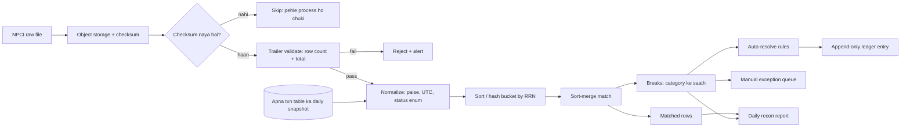
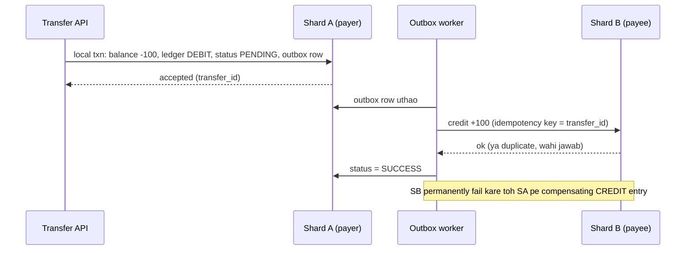
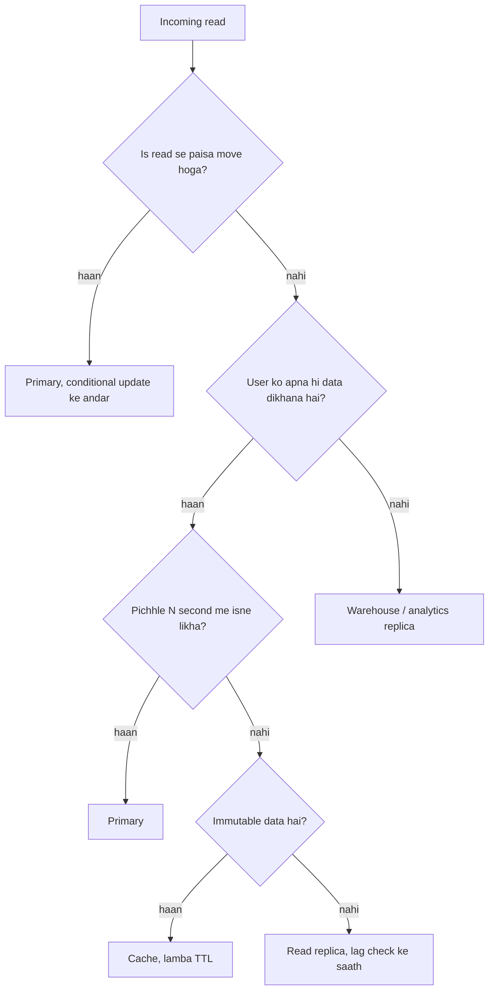

# 2F · Recon Ruins

Oct 16, 2026 · @saurav chaurasiya

**Is doc me 3 lessons:** L2.21 Reconciliation · L2.22 Sharding transactions · L2.23 Replicas aur caching in payments.

**Padhne ka tareeka** — har lesson me pehle *Sawaal* padho, 5 minute khud socho, phir aage badho. Code aur diagram skip mat karo.

---

## L2.21 — Reconciliation

Reconciliation (do alag-alag records ko line-by-line milakar ye check karna ki dono ek hi kahani keh rahe hain) ek roz chalne wala batch process hai: ek taraf tumhara apna database, doosri taraf bank ya network ka bheja hua settlement file. Jo rows dono me mil jaati hain woh matched hain; jo nahi milti unhe break (mismatch — ek jagah row hai doosri jagah nahi, ya amount alag hai) kehte hain, aur unhe rule ya insaan fix karta hai.

### Ye cheez hai kya

- Kis category ki cheez hai: ye fancy distributed algorithm nahi, ek **batch data pipeline** hai — file ingest, normalize, match, exceptions, report. Payments company me ye paise ki correctness ka aakhri defence hai.
- Kis problem ke liye banayi gayi: distributed system me do parties ke paas apna-apna record hota hai. Timeout, retry, deemed approval, manual refund — in sab se dono records alag ho jaate hain. Recon un differences ko roz pakad leta hai, mahine baad nahi.
- Is lesson ke baad tum kya kar paoge: 2 crore rows per day wale recon pipeline ka design bol paoge, sahi match key choose kar paoge, aur breaks ko category-wise naam de paoge.

Roz ki misaal: bank ki passbook aur ghar ki diary. Mahine ke end me dono milate ho — jo entry diary me hai par passbook me nahi, wahi asli sawaal hai. Recon yahi kaam hai, bas 2 crore lines pe aur roz.

### Sawaal

Paytm pe ek din me lagbhag 2 crore UPI transactions hote hain. NPCI (National Payments Corporation of India — UPI chalane wali sanstha) har subah ek raw settlement file bhejta hai jisme pichle din ke saare transactions ka final status hota hai. Tumhara apna `txn` table bhi usi din ka data rakhta hai. File subah 7 baje aati hai; 9 baje tak finance team ko report chahiye — kitna matched, kitna missing, kitna amount mismatch, aur har break ka reason.

> Pehle khud socho — 5 min. Hints: (1) Match kis field pe karoge — apna internal `txn_id` ya bank ka reference number? (2) 2 crore rows ko ek SQL join mat socho; sorted merge ya hash buckets socho. (3) Agar wahi file galti se dobara aa gayi toh kya hoga?

### Problem kyun aata hai

- **Timeout ke baad status pata hi nahi chalta** — request bheji, response nahi aaya. Tumhare paas `PENDING`, bank ke paas `SUCCESS`. Ye sabse common break hai.
- **Deemed approved** — NPCI ka niyam: beneficiary bank time pe jawab na de toh transaction ko approved maan liya jaata hai aur baad me reverse ho sakta hai. Matlab ek hi transaction ka status din me do baar badal sakta hai.
- **Retry se duplicate** — idempotency key (ek hi request ko dobara pehchanne wala unique id) na ho toh same payment do baar chala jaata hai. Bank ke paas 2 rows, tumhare paas 1.
- **Units aur format alag** — tum paise me store karte ho (`1050` = Rs 10.50), file rupees me deti hai (`10.50`). Float me compare karoge toh galat match milega.
- **Timezone aur cut-off alag** — bank ka din 23:00 IST pe band, tumhara midnight pe. Boundary wale transactions missing dikhenge jabki woh hain.
- **File late ya aadhi aa gayi** — adhoori file pe recon chala diya toh har row break dikhegi aur asli break us shor me dab jaayega.

### Naive approach

- Pehla obvious solution: file ko ek temp table me load karo aur production DB pe ek bada join maar do.

Neeche wala query theek lagta hai par production me teen tarah se fatta hai.

```sql
-- GALAT: production DB pe 2 crore x 2 crore ka join, aur amount float me compare
SELECT t.txn_id, t.amount, b.amount
FROM txn t
FULL OUTER JOIN bank_file b ON t.txn_id = b.txn_id
WHERE t.amount <> b.amount OR t.txn_id IS NULL OR b.txn_id IS NULL;
```

Ye exactly kahan tootta hai:

- **Join key hi galat hai.** Bank ke paas tumhara internal `txn_id` hota hi nahi; woh apna RRN (Retrieval Reference Number — NPCI/bank ka 12-digit unique transaction number) bhejta hai. Jo column dono taraf nahi hai, uspe join bekaar hai.
- **Galat database.** Ye wahi DB hai jispe live payments chal rahe hain. 2 crore rows ka full outer join usko ghanto ke liye slow kar dega.
- **Float comparison.** Agar `amount` `FLOAT`/`DOUBLE` hai toh `10.50 <> 10.499999` nikal sakta hai. Paisa hamesha integer paise me ya `DECIMAL` me rakho, kabhi float me nahi.
- **Dobara load = duplicate.** File do baar aa gayi toh temp table me 4 crore rows; recon khud hi naye breaks paida kar dega.
- **Output useless hai.** Ek lambi mismatch list bina reason ke. Finance team iske saath kuch nahi kar sakti.

### Sahi design

1. **Ingest** — file ko object storage (S3 jaisa blob store) me jaisi hai waisi rakho, aur uska SHA-256 checksum (file ka fingerprint — ek hi file dobara aaye toh checksum same aayega) plus row count ek `recon_file` table me likho. Checksum pehle se maujood hai toh file skip. Yahi cheez poore recon ko idempotent (ek hi kaam do baar karo, result wahi rahe) banati hai.
2. **Validate** — file ke trailer me diya row count aur total amount actual rows se match karo. Match na ho toh file reject karo, alert bhejo, recon mat chalao. Aadhi file pe recon chalana sabse mehnga blunder hai.
3. **Normalize** — dono sides ko ek hi shape me laao: `amount_paise` as `BIGINT`, `txn_time` as UTC, status apne enum me map (`SUCCESS` / `FAILED` / `PENDING` / `REVERSED`). Ye normalized rows ek alag recon database (ya warehouse) me jaate hain, production DB me nahi.
4. **Match key chuno** — pehli pasand RRN ya UTR (Unique Transaction Reference — har bank transfer ka unique number). Iska matlab: jis din transaction bana tha usi din bank ka RRN apne `txn` row me store karna zaroori hai. RRN na ho toh fallback composite key: `(amount_paise, payer_vpa, business_date)`.
5. **Match algorithm** — dono sides ko match key pe sort karo aur **sort-merge** chalao (do sorted lists ko saath-saath aage badhate hue compare karna), ya key ka hash lekar N buckets banao aur har bucket alag worker pe match karo. Dono O(n log n) hain aur parallel chalte hain; 2 crore rows isi tarah 20 minute me nikal jaate hain.
6. **Breaks ko category do** — sirf mismatch mat likho, har break ka naam ho: `OUR_PENDING_BANK_SUCCESS`, `OUR_SUCCESS_BANK_MISSING`, `BANK_SUCCESS_OUR_MISSING`, `AMOUNT_MISMATCH`, `DUPLICATE_AT_BANK`, `STATUS_REVERSED`. Category hi batati hai ki kya action lena hai.
7. **Auto-resolve rules** — safe categories machine khud theek kare: `OUR_PENDING_BANK_SUCCESS` par apna status `SUCCESS` karo aur user ko credit do; `OUR_SUCCESS_BANK_MISSING` par T+1 (transaction ke agle working day) tak wait karo, phir reversal raise karo. Baaki manual queue me jaayein.
8. **Har fix ek nayi ledger entry ho** — purani row edit mat karo, append-only entry likho taaki audit trail bana rahe. Ye [L2.6 — Ledger aur double-entry](https://claude.ai/code/artifact/a7c567e0-66cb-46fe-b7c9-9c20739857eb) pe seedha depend karta hai.
9. **Report aur alert** — matched percentage, break count by category, aur aged breaks (2 din se khuli hui). Break rate threshold cross kare toh on-call ko page karo.

Poora flow ek nazar me:



### Kya choose karein aur kyun

| Option | Kab use karo | Kab mat karo |
| --- | --- | --- |
| Batch recon (T+1 file) | Jab counterparty sirf din me ek baar file deta hai — bank, NPCI, card network. Default yahi hai. | Jab break ka paisa user ka atka hua hai aur 24 ghante intezaar nahi kara sakte. |
| Near-real-time recon (har 5-15 min) | Jab counterparty ka status API hai (PG webhook, UPI status check) aur pending transactions jaldi settle karne hain. | Jab counterparty sirf end-of-day file deta hai — tab ye sirf API cost badhayega. |
| Three-way recon (apna DB + PG + bank statement) | Jab beech me ek aggregator hai aur fees/commission bhi match karni hai. | Chhoti scale pe, jahan ek hi counterparty hai — overhead faltu hai. |
| Production DB pe hi recon | Kabhi nahi, chhote PoC ke alawa. | Hamesha mat karo: live payments slow ho jaayenge aur ek galat query lock laga degi. |

### India me kaise hota hai

NPCI UPI settlement ek din me kai cycles me hota hai aur member banks ko raw settlement file milti hai, jisse woh apne internal records match karte hain ([NPCI UPI Settlement Process](https://www.npci.org.in/PDF/npci/others/UPI-Settlement-Process.pdf)). Banking core products isi file ko extract karke apne transactions se match karte hain ([Oracle Banking Payments — UPI Reconciliation Extraction](https://docs.oracle.com/en/industries/financial-services/banking-payments/14.8.1.0.0/inuug/upi-reconciliation-extraction.html)).

Merchant side pe Razorpay ek combined recon report deta hai: `GET /v1/settlements/recon/combined`, jisme har settled row ke saath `entity_id`, `type` (payment / refund / transfer / adjustment), `amount`, `fee`, `tax`, `settlement_utr` aur `settled_at` aate hain. Merchant apne bank statement ko `settlement_utr` pe match karta hai, aur `fee` plus `tax` ki wajah se bank me credit hamesha order amount se kam hota hai — ye gap break nahi, expected hai ([Razorpay settlement recon API](https://razorpay.com/docs/api/settlements/fetch-recon)).

### Interview follow-ups

- **Match key ke liye apna id ya bank ka RRN?** — Bank ka RRN/UTR, kyunki wahi dono systems me common hai. Isliye RRN ko response milte hi apne `txn` row me store karna design ka hissa hai.
- **Recon job beech me crash ho gaya toh?** — File-level checksum plus per-bucket checkpoint rakho. Re-run sirf un buckets ko dobara chalaye jo complete nahi hue; matched rows dobara likhne se kuch na badle (idempotent writes).
- **Ek transaction aaj break hai, kal file me aa gaya — kya karoge?** — Break ko close karo, delete mat karo. Break ka lifecycle `OPEN -> AUTO_RESOLVED / MANUAL_RESOLVED` ho, taaki aging metrics sahi rahein.
- **Amount mismatch mila — paisa kiska sach maana jaaye?** — Bank ka record settlement ka sach hai (paisa wahan move hua), tumhara record intent ka. Apne ledger me adjustment entry daalo, bank ka number overwrite karke apna mat likho.
- **Recon ko rok dein toh kya hoga?** — Kuch din tak kuch nahi dikhega, phir pending transactions ka backlog aur customer complaints badhenge. Recon failure ka khud ka alert hona chahiye, kyunki iska absence silent hota hai.

### Self-check

1. Break ki 4 categories bina dekhe likho aur har ek ka auto-resolve rule batao.
2. Recon ko idempotent banane ke liye exactly kya store karte ho, aur kahan?
3. Amount compare karte waqt `FLOAT` kyun mana hai, uski jagah kya?
4. Sort-merge match aur hash-bucket match me kaunsa kab behtar hai?

### Notebook

Recon = apna record vs counterparty record, roz, line by line · Match key = bank ka RRN/UTR, apna txn\_id nahi — isliye RRN response milte hi save karo · Pipeline = ingest (checksum) → validate (trailer) → normalize (paise, UTC) → sort-merge match → categorised breaks → auto-resolve + manual queue → report · File checksum store karna hi re-run ko safe banata hai · Amount hamesha BIGINT paise, kabhi float nahi · Har auto-fix ek nayi append-only ledger entry, purani row edit nahi · Recon alag DB pe chale, production pe kabhi nahi.

### Padhne ke liye

- [NPCI — UPI Settlement Process](https://www.npci.org.in/PDF/npci/others/UPI-Settlement-Process.pdf)
- [Razorpay — Fetch settlement recon report](https://razorpay.com/docs/api/settlements/fetch-recon)
- [Oracle Banking Payments — UPI Reconciliation Extraction](https://docs.oracle.com/en/industries/financial-services/banking-payments/14.8.1.0.0/inuug/upi-reconciliation-extraction.html)

### Deep Dive (SDE-2) — jab time ho

#### Exactly-once matching aur safe re-runs

- Recon run ko ek `recon_run` row do: `run_id`, `business_date`, `file_checksum`, `status`, `bucket_progress`.
- Har bucket ka output `(run_id, bucket_id)` key pe likho. Re-run same key pe overwrite kare — isse duplicate matched rows nahi banenge.
- Auto-resolve actions ko bhi apni idempotency key do: `recon_fix:{run_id}:{rrn}`. Ye [L2.1 — Idempotency keys](https://claude.ai/code/artifact/c269ac61-440b-4525-bd04-31baf708dece) ka hi direct application hai.

#### Three-way recon

- Merchant ke liye teen records hote hain: apna order table, PG ka settlement report, aur bank statement ka credit line.
- Pehle order vs PG match karo (key: PG payment id), phir PG vs bank match karo (key: UTR + settlement amount).
- Fee aur tax ko expected difference ki tarah model karo: `bank_credit = sum(order_amount) - sum(fee) - sum(tax) - refunds`. Jab tak ye equation balance hai, individual rows ka chhota antar break nahi hai.

#### Break aging aur SLA

- Har break pe `first_seen_at` rakho aur age buckets banao: 0-1 din, 1-3 din, 3+ din.
- 3+ din wale breaks pe hard alert: inme aksar asli customer ka paisa atka hota hai.
- Metric jo dashboard pe hona chahiye: daily match rate, auto-resolve rate, aur oldest open break ki age. Teenon me se aakhri wala sabse honest signal hai.

---

## L2.22 — Sharding transactions

Sharding (ek bade table ko tukdon me baant kar alag-alag databases pe rakhna; har tukda ek shard) payments me isliye alag problem ban jaati hai kyunki paisa do logon ke beech move hota hai — aur woh do log alag-alag shards pe ho sakte hain. Is lesson me hum shard key choose karna, cross-shard transfer handle karna, aur bina downtime resharding karna dekhenge.

### Ye cheez hai kya

- Kis category ki cheez hai: data partitioning ka ek applied case. Basic sharding theory [1D · Shard Mountains](https://claude.ai/code/artifact/cfe905e6-6370-43e0-a337-764eeb9ddf1e) me hai (L1.14–L1.16); yahan sirf payments-specific decisions hain.
- Kis problem ke liye banayi gayi: ek single database ki write capacity, disk aur backup time ki limit hoti hai. Transaction table roz badhta hai aur kabhi chhota nahi hota, isliye ek din baantna hi padta hai.
- Is lesson ke baad tum kya kar paoge: shard key defend kar paoge, cross-shard transfer ka flow bata paoge, aur live system ko resharding ka plan de paoge.

Roz ki misaal: ek hi bank branch me 2 crore log line me lage hain. Tum 64 branches khol dete ho aur customer ko uske account number se branch assign karte ho. Problem tab aati hai jab paisa branch 7 ke A se branch 52 ke B ko bhejna ho — ek hi counter pe dono kaam nahi ho sakte.

### Sawaal

Paytm Wallet ka `txn` table ek single PostgreSQL instance pe hai. Roz lagbhag 2 crore rows aa rahe hain, 18 mahine ka data rakhna hai (compliance), aur table ab 4 TB ke aas-paas hai. Peak pe 8,000 TPS (transactions per second — ek second me kitne requests) write aa rahe hain aur write p99 (99 percent requests isse tez complete hoti hain) 900 ms tak chala gaya hai. Tumhe is data ko shard karna hai, aur system ek second ke liye bhi band nahi ho sakta.

> Pehle khud socho — 5 min. Hints: (1) Sabse zyada chalne wali query kaunsi hai — user ka passbook? (2) A se B transfer me kitne shards involve honge? (3) 64 shards aaj kaafi hain, par 2 saal baad 128 chahiye honge — tab kya karoge?

### Problem kyun aata hai

- **Write ceiling** — ek primary node ek hi WAL (write-ahead log — har change pehle isme likha jaata hai) sequentially likhta hai. Us single stream ke aage CPU badhane se kuch nahi hota.
- **Index ka size** — 4 TB table pe B-tree index RAM me nahi aata, isliye har lookup disk pe jaata hai aur latency (ek request ko poora hone me laga time) badh jaati hai.
- **Backup aur restore ka time** — 4 TB restore karne me ghante lagte hain. Ek payments system ka RTO (Recovery Time Objective — kitne time me wapas chalu hona hai) itna lamba nahi ho sakta.
- **Hot key** — hot key matlab ek aisi key jispe baaki sabse bahut zyada traffic aata hai. Ek bada merchant (jaise ek bijli board) ke wallet pe roz 50 lakh transactions aa sakte hain. Uske shard pe load baaki shards se 50 guna hoga.
- **Paisa do taraf chalta hai** — ek transfer me debit A ka aur credit B ka hota hai. Agar A aur B alag shards pe hain toh ek database transaction kaafi nahi rahta.

### Naive approach

- Pehla obvious solution: `txn_id` ka hash lekar 64 shards me evenly baant do. Load perfectly balanced ho jaata hai.
- Woh exactly kahan tootta hai:

```sql
-- GALAT: txn_id pe shard kiya, ab user ka passbook nikalna hai
-- ye query har ek shard pe chalani padegi, phir app me merge + sort
SELECT * FROM txn WHERE user_id = 91234 ORDER BY created_at DESC LIMIT 20;
```

- **Scatter-gather** — app ko 64 shards se pooch kar results merge karne padte hain. Latency sabse slow shard ke barabar ho jaati hai, aur ek shard slow hua toh poora passbook slow.
- **Balance ek jagah nahi rehta** — user ka wallet balance aur uske transactions alag-alag shards pe bikhre hain, toh balance update aur ledger write ek transaction me nahi ho sakte.
- **Pagination tootti hai** — 64 shards se top-20 lene ke liye har shard se 20 laane padte hain: 1280 rows uthakar 20 dena. Deep pages pe ye aur bura hota hai.

### Sahi design

1. **Access pattern pehle likho.** Wallet me 95 percent queries ek hi aakaar ki hoti hain: *is user ka balance* aur *is user ke last N transactions*. Shard key wahi hona chahiye jo in queries me hamesha maujood ho.
2. **Shard key = `user_id` ka hash** (ya `wallet_id`). Hash isliye, raw range nahi, kyunki sequential ids se naye users ek hi shard pe gir jaate hain.
3. **Ek user ka saara data ek hi shard pe rakho** — `wallet`, `txn` aur `ledger_entry`, teeno. Isse user ka debit, uski ledger entry aur uska balance update ek hi local ACID transaction (ACID — Atomicity, Consistency, Isolation, Durability; ya toh poora change hota hai ya kuch nahi) me ho jaate hain.
4. **Logical shards, physical nodes se zyada banao.** 1024 logical shards banao aur unhe 16 physical nodes pe map karo. Aage badhna sirf mapping badalna hai, poora re-hashing nahi — yahi [consistent hashing](https://claude.ai/code/artifact/cfe905e6-6370-43e0-a337-764eeb9ddf1e) ka practical roop hai.
5. **Routing ek jagah rakho.** Ek patla shard-router library ya proxy ho jo `user_id -> logical shard -> physical node` resolve kare. Har service apna hisaab na lagaye, warna reshard ke din 40 services badalni padengi.
6. **Cross-shard transfer ko do local transactions me todo.** A ke shard pe debit (status `PENDING`) plus ek outbox row, phir B ke shard pe credit, phir A pe status `SUCCESS`. Beech me failure pe compensating transaction (ulta entry daal kar asar khatam karna — purani entry mitana nahi) se reverse karo. Ye poora pattern [2C · Saga Sea](https://claude.ai/code/artifact/429b3ea6-a261-431d-a384-a0c6eb68a9f6) me hai.
7. **Distributed 2PC se bacho.** 2PC (two-phase commit — coordinator sab participants se pehle haan poochta hai, phir commit bolta hai) payments scale pe locks lamba pakad kar rakhta hai, aur coordinator down hone pe rows blocked reh jaate hain. Saga plus idempotency ([L2.1 — Idempotency keys](https://claude.ai/code/artifact/c269ac61-440b-4525-bd04-31baf708dece)) practical raasta hai.
8. **Hot merchant ko alag treat karo.** Bade merchants ke liye shard key ko `(merchant_id, bucket_0..15)` bana do taaki load 16 sub-keys pe bat jaaye; balance periodically ek rollup row me sum karke rakho.
9. **Resharding ko ek chaalu process maano, ek event nahi.** Naye shards banao, purane se changes continuously replicate karo, lag zero hone pe ek chhote write-freeze me traffic switch karo, phir purana data cleanup karo. Vitess ka Reshard workflow bilkul yahi karta hai.

Cross-shard transfer ka flow:



### Kya choose karein aur kyun

| Option | Kab use karo | Kab mat karo |
| --- | --- | --- |
| Shard by `user_id` hash | Wallet, passbook, balance — jab 95 percent queries ek user ke andar hain. Payments me default. | Jab main query merchant-wise ya date-wise reporting hai; woh query har shard pe jaayegi. |
| Shard by `txn_id` hash | Append-only event log jahan sirf id se lookup hota hai. | Jab user ka history nikalna padta hai — scatter-gather me doob jaoge. |
| Shard by date (time range) | Archival aur cold data, jahan purane mahine read-only ho jaate hain. | Live writes ke liye: aaj ka shard hamesha hot rahega aur baaki idle. |
| Geo / region sharding | Jab regulation kehti hai data desh me rahe, ya latency region-wise kam karni hai. | Jab users regions ke beech paisa bhejte hain — har transfer cross-shard ban jaayega. |
| Abhi shard mat karo | Jab ek primary plus read replicas aur sahi indexes se kaam chal raha hai. Sharding operationally mehnga hai. | Jab write p99 lagataar badh raha hai aur table backup window se bada ho chuka hai. |

### India me kaise hota hai

UPI ka monthly volume arab-on transactions tak pahunch chuka hai aur har mahine badhta hai; NPCI apne product statistics page pe ye numbers publish karta hai ([NPCI UPI product statistics](https://www.npci.org.in/what-we-do/upi/product-statistics)). Is scale pe koi bhi PSP (Payment Service Provider — woh app jo tumhe UPI deta hai, jaise Paytm ya PhonePe) ek single database pe nahi reh sakta; user-level sharding wahan default hai.

MySQL pe sharding ka sabse common production tool Vitess hai. Vitess logical shards (keyspaces) rakhta hai aur apne `Reshard` workflow se live traffic ke saath shard count badalta hai: naye shards pe continuous VReplication chalta hai, lag zero hone pe traffic switch hota hai, aur zarurat pade toh wapas reverse bhi kiya ja sakta hai ([Vitess Reshard](https://vitess.io/docs/14.0/reference/vreplication/reshard)).

### Interview follow-ups

- **Shard key kaise choose karoge, ek line me?** — Jo field har high-traffic query ke `WHERE` me already maujood hai, aur jiski cardinality itni ho ki load bat jaaye.
- **Cross-shard transfer me 2PC kyun nahi?** — Coordinator failure pe rows locked reh jaate hain aur availability gir jaati hai. Saga plus idempotent credit wahi outcome deta hai, bina global lock ke.
- **Ek shard down ho gaya toh?** — Sirf us shard ke users affect hote hain, poora system nahi — yahi sharding ka availability fayda hai. Lekin har shard ka apna replica hona chahiye, warna har shard ek SPOF (Single Point Of Failure — ek aisa hissa jiske girne pe uska poora kaam ruk jaata hai) ban jaata hai.
- **Reporting queries ka kya, jo saare shards pe chalti hain?** — Unhe OLTP (online transaction processing — live app ka database) se hatao. CDC (change data capture — DB ke changes ko stream ki tarah bahar bhejna) se warehouse me daalo aur report wahan chalao.
- **64 se 128 shards kaise jaoge?** — Logical shards already 1024 the, toh sirf mapping badlegi: aadhe logical shards naye nodes pe move honge, replication se copy hoga, aur cutover ek chhote write-freeze me hoga.

### Self-check

1. `user_id` hash aur `txn_id` hash me se wallet ke liye kaunsa, aur kyun — do line me.
2. Cross-shard transfer ke 4 steps bina dekhe likho, saath me failure pe kya hota hai.
3. Logical shards physical nodes se zyada kyun banate hain?
4. Hot merchant ka load kaise todoge?

### Notebook

Shard key = woh field jo har hot query ke WHERE me hai; wallet me `user_id` hash · Ek user ka wallet + txn + ledger ek hi shard pe, taaki debit ek local ACID transaction rahe · Logical shards (1024) physical nodes (16) se zyada, reshard = sirf mapping badalna · Cross-shard transfer = debit PENDING + outbox, phir credit (idempotency key), phir status SUCCESS; fail pe compensating entry, 2PC nahi · Hot merchant = key ko sub-buckets me todo, balance rollup se nikaalo · Reporting saare shards pe mat chalao, CDC se warehouse bhejo · Reshard live hota hai: replicate, lag zero, chhota freeze, switch.

### Padhne ke liye

- [Vitess — Reshard workflow](https://vitess.io/docs/14.0/reference/vreplication/reshard)
- [Vitess — VReplication overview](https://vitess.io/docs/14.0/reference/vreplication/vreplication)
- [NPCI — UPI product statistics](https://www.npci.org.in/what-we-do/upi/product-statistics)

### Deep Dive (SDE-2) — jab time ho

#### Shard directory vs algorithmic routing

- Algorithmic: `shard = hash(user_id) % 1024`. Tez hai, koi lookup nahi, par ek specific user ko move karna mushkil.
- Directory: ek lookup table `user_id -> logical shard`. Ek slow user ya bade merchant ko haath se move kar sakte ho, par ab woh directory khud ek SPOF hai — usko cache karo aur replicate karo.
- Practical mix: algorithmic default plus ek chhoti override table un hazaar accounts ke liye jo special hain.

#### Resharding ke dauran double-write

- Phase 1: purane shard pe likho, naye pe replicate karo.
- Phase 2: dono pe likho aur purane se padho (shadow read se dono ka jawab compare karo).
- Phase 3: naye se padho, purane pe likhna band.
- Har phase ke beech do metrics chahiye: row count ka antar aur checksum. Ye recon ka hi chhota version hai — L2.21 wali soch yahan bhi seedhe lagti hai.

#### Secondary index jo shard key nahi hai

- `phone_number -> user_id` jaisi lookup ke liye ek alag global index table banao, jo khud `phone_number` pe sharded ho.
- Woh table eventually consistent (thodi der baad dono jagah data ek jaisa ho jaata hai, turant nahi) ho sakti hai, par uska lag monitor karo.
- Paise ka faisla kabhi eventually consistent index pe mat lo — pehle `user_id` resolve karo, phir uske shard pe authoritative read karo.

---

## L2.23 — Replicas aur caching in payments

Replica (primary database ki ek copy jo uske changes thodi der baad follow karti hai) aur cache (ek tez memory store jo baar-baar maange jaane wale jawab rakhta hai) dono read load kam karne ke liye hain. Payments me inka asli sawaal performance nahi, trust hai: kaunsa read purana data bardaasht kar sakta hai aur kaunsa bilkul nahi.

### Ye cheez hai kya

- Kis category ki cheez hai: read-path optimisation. General theory [1B · Cache Caves](https://claude.ai/code/artifact/32bb1c8e-3433-417c-a3f4-3a34babed6bf) (L1.6–L1.9) aur read path vs write path [L1.10b](https://claude.ai/code/artifact/99909fe9-731e-4e31-9e7d-36e0c5aed845) me hai; yahan sirf paise wale faisle hain.
- Kis problem ke liye banayi gayi: balance aur passbook ke reads writes se 50 se 100 guna zyada hote hain. Sab primary pe bhejoge toh primary gir jaayega; sab replica ya cache pe bhejoge toh kabhi-kabhi galat paisa dikhega.
- Is lesson ke baad tum kya kar paoge: har read ko teen buckets me daal paoge — money decision, user display, analytics — aur har bucket ke liye sahi source choose kar paoge.

Roz ki misaal: cricket scoreboard. TV pe score 2-3 second purana ho toh chalta hai; lekin umpire out dene se pehle TV dekh kar faisla nahi karta, woh field ka asli haal dekhta hai. Display read aur decision read ka yahi farq hai.

### Sawaal

Paytm app khulte hi do cheezein dikhti hain: wallet balance aur last 10 transactions. Peak pe 50,000 reads per second aa rahe hain, jabki writes sirf 8,000 per second hain. Primary database CPU 85 percent pe baitha hai aur zyadatar load in dono reads ka hai.

Tum sab reads ek read replica pe bhej dete ho. Agle din complaints aati hain: user ne abhi-abhi 500 rupaye bheje, home screen pe purana balance dikh raha hai; aur ek user ne balance 100 dekh kar 100 ka payment try kiya jabki asli balance 20 tha.

> Pehle khud socho — 5 min. Hints: (1) In do complaints me se kaunsi sirf irritating hai aur kaunsi paisa kharaab kar sakti hai? (2) "Apna hi likha hua turant dikhna chahiye" — is guarantee ka naam kya hai? (3) Balance cache karna chahiye ya nahi — aur agar haan, toh invalidate kab?

### Problem kyun aata hai

- **Replication lag** — replica primary se thoda peeche chalti hai, normal me milliseconds, load ya network hiccup pe seconds. Lag kabhi guaranteed zero nahi hota.
- **Read-your-writes toot jaata hai** — read-your-writes ka matlab: jo maine abhi likha hai woh mujhe turant dikhna chahiye. Replica se padhne pe ye guarantee chali jaati hai aur user ko lagta hai paisa gayab ho gaya.
- **Stale cache se galat decision** — cached balance pe bharosa karke debit allow kar diya toh user overdraft kar sakta hai. Ye irritation nahi, paisa ka nuksaan hai.
- **Cache invalidation miss** — refund, chargeback ya recon ka auto-fix balance badalta hai, par woh code path cache delete karna bhool jaata hai. Purana balance ghanto tak chipka reh jaata hai.
- **Thundering herd** — ek popular key ka cache expire hua aur ek hi waqt me hazaar requests DB pe gir gayin. Cache ne load kam karne ki jagah spike bana diya.
- **Failover ke baad peeche chala jaana** — primary gira aur ek lagging replica ko promote kiya, toh kuch committed writes gayab dikh sakte hain. Isliye payments me synchronous replication kam se kam ek replica pe chahiye.

### Naive approach

- Pehla obvious solution: balance ko Redis me 60 second TTL (time to live — cache entry kitni der zinda rahegi) ke saath rakh do, aur baaki saare reads replica pe bhej do.
- Woh exactly kahan tootta hai:

```java
// GALAT: debit ka faisla cache se padhe hue balance pe
long balance = cache.getBalance(userId);      // 60 second tak purana ho sakta hai
if (balance < amount) {
    throw new InsufficientBalanceException();  // ya isse bhi bura: check pass ho gaya
}
db.debit(userId, amount);                      // koi condition nahi, blind debit
cache.setBalance(userId, balance - amount);    // lost update: do parallel requests
```

- **Check aur debit ke beech ka gap** — do parallel requests dono cache se 100 padhti hain, dono 80 ka debit allow kar deti hain. Final balance negative.
- **`cache.setBalance` khud race hai** — dono requests apna calculated value likhti hain, ek doosre ko overwrite kar deti hain.
- **60 second TTL kisi ko khush nahi karta** — user ke liye bahut lamba (purana balance dikhta hai) aur safety ke liye bahut lamba (galat debit). Ek hi number se dono problem solve nahi hoti.

### Sahi design

1. **Reads ko teen buckets me baanto.** Money decision reads (debit se pehle balance, duplicate check, limit check), user display reads (home screen balance, passbook), aur analytics/reporting reads. Teeno ka source alag hoga.
2. **Money decision kabhi cache ya replica se nahi.** Balance ka faisla primary pe, aur ideally read hi mat karo — seedha conditional write karo taaki check aur debit ek hi atomic step ban jaayein:

```java
// SAHI: check aur debit ek hi atomic conditional update me
// rows == 0 ka matlab hi "paisa kam tha" hai; alag se SELECT nahi chahiye
int rows = jdbc.update(
    "UPDATE wallet SET balance_paise = balance_paise - ? " +
    "WHERE user_id = ? AND balance_paise >= ?",
    amountPaise, userId, amountPaise);
if (rows == 0) {
    throw new InsufficientBalanceException(userId);
}
```

3. **Display balance ke liye read-your-writes do.** Sabse simple tareeka: write ke baad us user ko N seconds (jitna tumhara p99 replication lag hai, plus margin) tak primary pe route karo — ek chhota marker cache me rakho, `rw:{userId}` with TTL. Marker maujood hai toh primary, warna replica.
4. **Passbook replica se padho, aur honest raho.** List read lag bardaasht kar sakti hai. Agar lag threshold se zyada hai toh UI pe "abhi update ho raha hai" dikhao, chupchaap purana data mat do.
5. **Cache wahi karo jo badalta nahi.** Ek completed transaction ka detail immutable (banne ke baad kabhi badalta nahi) hai — use lambe TTL ke saath cache karo. Balance mutable hai — use cache karo toh write-through plus explicit invalidation ke saath, sirf TTL ke bharose nahi.
6. **Invalidation ko ek hi jagah rakho.** Balance badalne wale saare raaste (payment, refund, cashback, recon auto-fix) ek hi `WalletWriter` se jaayein jo commit ke baad cache key delete kare. Har service apna `cache.delete` likhega toh ek na ek bhool jaayega.
7. **Thundering herd rokо** — TTL me jitter daalo (60 second ki jagah 50 se 70 ke beech random) aur single-flight karo: ek hi key ke liye ek hi request DB pe jaaye, baaki uska jawab wait karein.
8. **Replication lag ko metric banao, assumption nahi.** `replica_lag_seconds` har replica pe measure karo. Lag threshold cross kare toh us replica ko load balancer se nikaal do — ye [2E · Resilience Ridge](https://claude.ai/code/artifact/4769dea3-018e-41e1-ae18-253fa36a6d21) wala health check hi hai.
9. **Kam se kam ek synchronous replica rakho.** Commit tabhi successful maano jab ek replica ne bhi likh liya ho. Thodi latency badhegi, par failover pe committed paisa gayab nahi hoga.

Kaunsa read kahan jaata hai:



### Kya choose karein aur kyun

| Option | Kab use karo | Kab mat karo |
| --- | --- | --- |
| Primary se read | Har woh read jiske baad paisa move hota hai: balance check, limit check, duplicate check. | Passbook, search, reporting — ye primary ko bewajah bharenge. |
| Async read replica | Passbook, transaction history, search, support dashboard. Lag metric ke saath. | Debit ka faisla, ya turant apna likha dikhana. |
| Sync replica | Jab failover pe ek bhi committed transaction kho nahi sakta. | Jab write latency ka budget bahut tight hai aur data itna critical nahi. |
| Cache (immutable data) | Completed txn details, merchant profile, bank list, IFSC lookup. | Balance, limits, status — jo badalte rehte hain. |
| Cache (mutable, write-through) | Hot merchant ka aggregate, jo ek jagah se likha jaata hai aur thoda purana chal sakta hai. | Jab invalidation ke saare raaste tum control nahi karte. |
| Koi cache nahi | Jab query already 5 ms me chal rahi hai sahi index ke saath. | Jab wahi query 50,000 baar per second aa rahi hai. |

### India me kaise hota hai

NPCI ne 2025 me UPI ke non-transactional APIs pe saaf limits lagayi: balance enquiry ek customer ke liye ek app me din me 50 baar, aur linked account list 25 baar — saath me peak hours (subah 10 se 1 aur shaam 5 se 9:30) me ye APIs chalane pe rok, taaki network ka core payment traffic bacha rahe ([Medianama — NPCI guidelines on balance checks](https://www.medianama.com/2025/05/223-npci-banks-balance-upi-transaction-guidelines/)).

Iska design sabak seedha hai: bank ka balance ek mehnga, rate-limited upstream read hai. Isliye PSP apps balance ko apne paas cache karte hain aur usko "as of" time ke saath dikhate hain, aur actual payment ke waqt bank se authoritative check karate hain. Volume ka paimana NPCI ke apne statistics page pe hai ([NPCI UPI product statistics](https://www.npci.org.in/what-we-do/upi/product-statistics)).

### Interview follow-ups

- **Balance cache karna chahiye ya nahi?** — Display ke liye haan, decision ke liye bilkul nahi. Ek hi number do kaam nahi kar sakta, isliye do alag paths rakho.
- **Read-your-writes kaise doge bina sab primary pe bheje?** — Write ke baad us user ke liye ek short-lived marker rakho aur utni der primary pe route karo; ya write ka position token (LSN) client ko do aur replica se tabhi padho jab woh us position tak pahunch gayi ho.
- **Cache aur DB ke beech inconsistency kaise pakdoge?** — Ek background sampler chalao jo random keys pe dono se padh kar compare kare, aur mismatch rate ko metric banaye. Ye bhi recon ka hi chhota roop hai.
- **Redis poora down ho jaaye toh?** — System chalta rehna chahiye, bas dheere. Single-flight plus circuit breaker lagao taaki saare requests ek saath DB pe na giren.
- **Replica lag 30 second ho gaya, kya karoge?** — Us replica ko rotation se nikaalo, reads primary ya doosri replica pe bhejo, aur agar sab lag rahi hain toh non-critical reads ko degrade karo (passbook ko "thodi der me try karein" bolna theek hai, balance galat dikhane se behtar).

### Self-check

1. Teen read buckets ke naam likho aur har ek ka data source.
2. Balance check ko conditional `UPDATE` me kyun badla, alag `SELECT` kyun hataya?
3. Read-your-writes dene ke do tareeke batao.
4. Thundering herd kya hai aur usko rokne ke do upaay kya hain?

### Notebook

Teen read buckets: money decision (primary, conditional update), user display (read-your-writes window ke saath replica), analytics (warehouse) · Balance ka check alag SELECT nahi, `UPDATE ... WHERE balance >= amount` aur `rows == 0` hi insufficient · Cache sirf immutable cheezein lambe TTL pe; mutable ko write-through plus ek hi jagah se invalidation · TTL me jitter plus single-flight se thundering herd rukta hai · `replica_lag_seconds` metric ho, lag zyada toh replica rotation se bahar · Kam se kam ek sync replica, warna failover pe committed paisa gayab · NPCI ne balance enquiry 50 per day capped ki hai, isliye upstream balance mehnga read hai.

### Padhne ke liye

- [Medianama — NPCI ki balance enquiry aur API limits](https://www.medianama.com/2025/05/223-npci-banks-balance-upi-transaction-guidelines/)
- [NPCI — UPI product statistics](https://www.npci.org.in/what-we-do/upi/product-statistics)
- [Razorpay — Settlement recon report](https://razorpay.com/docs/api/settlements/fetch-recon)

### Deep Dive (SDE-2) — jab time ho

#### Read-your-writes ke teen implementations

- **Sticky-to-primary window**: write ke baad N second tak us user ke reads primary pe. Simple, par primary pe extra load.
- **Position token**: write ka log position (PostgreSQL me LSN) client ko do; read ke waqt replica se pooch lo ki woh us position tak pahunch gayi hai ya nahi. Precise hai, par client ko token carry karna padta hai.
- **Monotonic session**: per-session last-seen position server-side session store me rakho. Beech ka raasta, par ab session store ek nayi dependency hai.

#### Cache patterns ka paisa-wala version

- **Cache-aside**: app padhta hai, miss pe DB se bhar deta hai. Default, par invalidation app ki zimmedari.
- **Write-through**: app DB aur cache dono ek saath likhta hai. Consistency behtar, write latency thodi zyada.
- **Write-behind**: pehle cache, baad me DB. Paise ke liye mana hai — cache gira toh committed dikha hua paisa gayab.
- Negative caching: "ye txn id exist nahi karta" ko bhi 1-2 second cache karo, warna status-check loops DB pe bharosa tod denge.

#### Degradation ka plan

- Har read path ke liye pehle se likho: cache down toh kya, replica down toh kya, dono down toh kya.
- Payments me sahi degradation order ye hai: pehle analytics band, phir passbook ko stale-with-warning, phir search band — aur balance plus payment path sabse aakhir me, kabhi galat value dikhane se pehle error dena behtar.
- Ye decisions ek runbook me likho, kyunki incident ke waqt koi soch kar faisla nahi karta.

---

## Aage kya

- Pichhla zone: [2E · Resilience Ridge](https://claude.ai/code/artifact/4769dea3-018e-41e1-ae18-253fa36a6d21) (L2.16–L2.20) — retries, circuit breaker, backpressure, multi-region.
- Agla zone: [2G · Security Vault](https://claude.ai/code/artifact/f0f0e8e4-dde8-492e-9a80-08a35792d4e7) (L2.24 Tokenization aur PCI-DSS, L2.25 Encryption aur HSM, L2.26 Fraud / risk engine).
- Related: [2B · Ledger Library](https://claude.ai/code/artifact/a7c567e0-66cb-46fe-b7c9-9c20739857eb) (recon ka ledger side), [1D · Shard Mountains](https://claude.ai/code/artifact/cfe905e6-6370-43e0-a337-764eeb9ddf1e) (sharding theory), [1B · Cache Caves](https://claude.ai/code/artifact/32bb1c8e-3433-417c-a3f4-3a34babed6bf) (cache theory).
