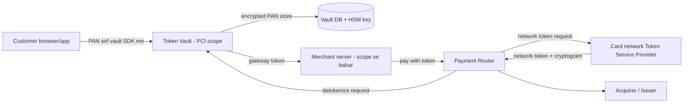
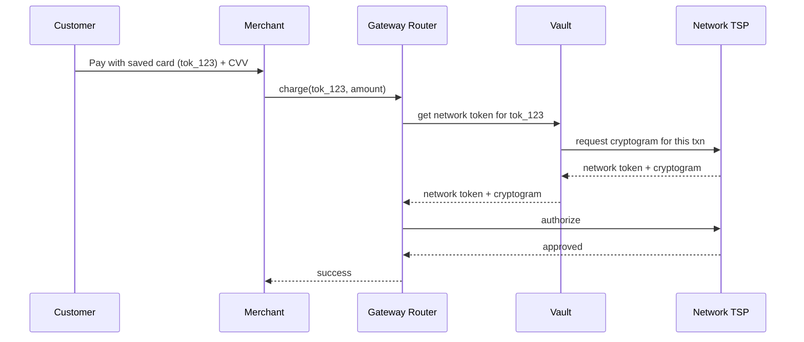
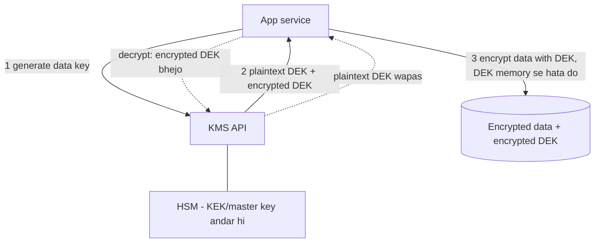
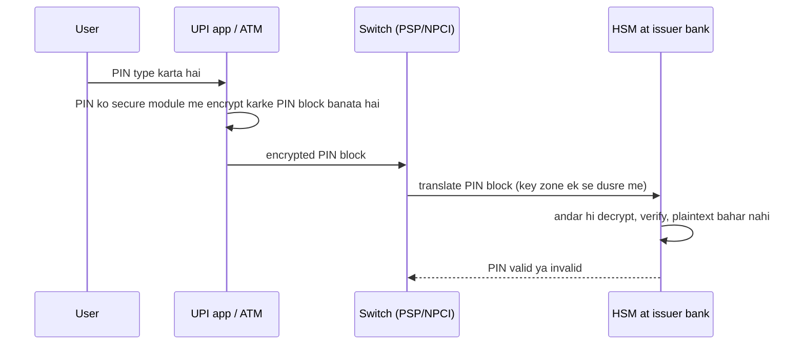
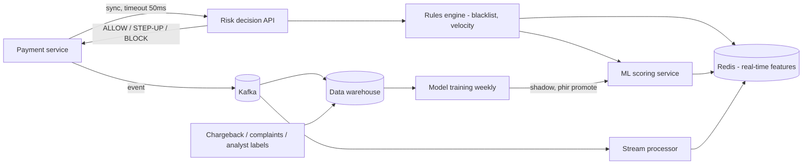

# 2G · Security Vault

Oct 16, 2026 · @saurav chaurasiya

**Is doc me 3 lessons:** L2.24 Tokenization aur PCI-DSS · L2.25 Encryption aur HSM · L2.26 Fraud / risk engine

**Padhne ka tareeka** — Har lesson pehle khud socho (5 min), phir design padho, phir Self-check. Deep Dive tab padho jab SDE-2 level chahiye.

---

## L2.24 — Tokenization aur PCI-DSS

**Tokenization** matlab sensitive data (jaise 16 digit card number) ko ek bekaar-sa random string (token) se replace kar dena, taaki asli data sirf ek hi surakshit jagah (vault) me rahe. PCI-DSS (Payment Card Industry Data Security Standard — card data rakhne wali har company ke liye security rules ka set) ka bojh isse bahut kam ho jata hai.

### Ye cheez hai kya

- Category: security pattern, data protection ka hissa.
- Problem: card number har service, DB, log aur backup me phail jata hai, aur har jagah PCI audit ka scope badh jata hai.
- Is lesson ke baad tum: card tokenization vault design kar paoge, network token aur gateway token ka farak samjha paoge, aur bata paoge ki RBI ne card-on-file ke liye kya mandate kiya.
- Analogy: cloakroom ki parchi. Tum coat (card number) cloakroom me jama karte ho aur parchi (token) le jaate ho. Parchi kho jaye to koi coat nahi le jata, kyunki coat sirf cloakroom counter pe milta hai.

### Sawaal

Tum Razorpay jaisa payment gateway bana rahe ho. 8 lakh merchants hain, 5 crore saved cards, peak 12,000 TPS (transactions per second — ek second me kitne payment requests). Merchant ko "One-click checkout" chahiye, matlab card baar baar save hona chahiye. Lekin 2022 se RBI kehta hai ki merchant ya gateway asli card number apne paas store nahi kar sakta. Design batao jisme saved-card checkout ho aur card number kam se kam jagah rahe.

> Pehle khud socho — 5 min. Hints: (1) card number kitni jagah touch hota hai: app, API, DB, logs, analytics? (2) kya token ko seedha card number me reverse kiya ja sakta hai? (3) merchant ka token kisi dusre merchant pe kaam kare to kya hoga?

### Problem kyun aata hai

- PAN (Primary Account Number — card ka 16 digit number) agar 40 microservices se guzre to 40 services PCI scope me aati hain.
- Logs, Kafka topics, data warehouse aur backups me bhi PAN chhup ke baith jata hai.
- Ek breach = card data leak = bank aur network (Visa/Mastercard/RuPay) ka penalty + brand damage.
- RBI ke card-on-file (CoF — merchant ke paas card details saved rehna) rules ke baad merchant ko PAN store karne ki permission hi nahi hai.
- CVV (card verification value — card ke peeche ke 3 digit) kisi bhi case me store karna PCI me allowed nahi hai, authorization ke baad bhi nahi.

### Naive approach

- Pehla idea: card number ko DB me AES encrypt karke `cards` table me rakho, aur har service ko decrypt key de do.
- Kahan tootta hai:
  - Har service ke paas key hai, matlab har service PCI scope me. 40 services = 40 audits.
  - Ek service compromise hui to key se 5 crore cards decrypt ho sakte hain.
  - Analytics team ko "last 4 digits" chahiye to bhi poora decrypt karna padta hai.
  - Encrypted data PCI me phir bhi "cardholder data" mana jata hai, to scope kam nahi hota.
  - RBI mandate ke baad merchant ka apna encrypted PAN rakhna hi non-compliant hai.

### Sahi design

1. **Vault service alag banao.** Sirf ek chhoti, hardened service PAN dekhti hai. Baaki sab services sirf token dekhti hain.
2. **Card capture isolated rakho.** Browser/app se card seedha vault ke iframe/SDK me jata hai, merchant server tak PAN pahunchta hi nahi.
3. **Token generate karo.** Token random hota hai (math se PAN se linked nahi), format jaise `tok_9fA3...`. Vault table me `token -> encrypted PAN, expiry, merchant_id, created_at` store hota hai.
4. **Token merchant-bound rakho.** Token sirf usi merchant ke liye valid hai jisne create karaya, taaki chura hua token kisi aur site pe kaam na kare.
5. **Payment ke time detokenize.** Sirf payment-routing service vault se PAN mangti hai (mTLS — dono taraf certificate check — aur allow-list ke saath) aur network ko bhejti hai.
6. **Network token use karo.** RBI mandate me asli token card network (Visa/Mastercard/RuPay) jaari karta hai. Is token ka kaam sirf ek merchant + ek device/channel pe hota hai.
7. **Display ke liye last4 aur card brand alag store karo**, taaki UI aur analytics ko PAN chahiye hi na.

Sequence ek saved-card payment ka:

### Kya choose karein aur kyun

| Option | Kab use karo | Kab mat karo |
| --- | --- | --- |
| Encrypted PAN apne DB me | Tum khud issuer ya acquirer ho aur PCI Level 1 audit already hai | Merchant ya gateway ho aur RBI CoF mandate lagu hai |
| Gateway token (vault-based, apna random token) | Apne platform ke andar saved card ka reference chahiye (internal reference ke liye) | Is token ko akela network pe bhejna ho, network isse nahi samajhta |
| Network token (Visa/Mastercard/RuPay jaari karta hai) | Card-on-file, subscription, one-click checkout. RBI compliant raasta | Naya card pehli baar enter ho raha ho, tab PAN se hi flow shuru hota hai |
| Format-preserving token (16 digit jaisa dikhne wala) | Legacy system jisse 16 digit ka format chahiye | Naye systems, kyunki real PAN jaisa dikhne se galti se leak ka risk badhta hai |
| Hosted payment page / iframe (PCI SAQ A) | Merchant chhota hai aur PCI scope bilkul kam rakhna hai | Fully custom native UX chahiye aur tumhare paas strong security team hai |

### India me kaise hota hai

- RBI ne 2021-22 me card-on-file tokenisation mandate kiya. Merchants aur payment aggregators 1 October 2022 ke baad customer ka asli card number store nahi kar sakte. Saved cards ko card network ke token se replace karna pada. Ek acchi summary: [RBI's Card Tokenisation Notification: Guidelines and Legal Implications](https://ksandk.com/banking/rbi-card-tokenization-guidelines/).
- Token card network ke Token Service Provider (TSP — wo service jo token banati hai aur PAN se map rakhti hai) ke paas banta hai. Token merchant + card + device/channel ke combination ke liye hota hai.
- Customer ki consent aur OTP (additional factor authentication) ke baad hi token banta hai. Customer kabhi bhi token delete kar sakta hai.
- Razorpay ka TokenHQ is poore flow ko handle karta hai. Merchant ko PAN dikhta hi nahi. Docs: [Razorpay TokenHQ](https://razorpay.com/docs/payments/payment-methods/cards/token-hq.md). Dual token model ka bhi page hai: [dual token](https://razorpay.com/docs/payments/payment-methods/cards/token-hq/dual-token).
- Paytm aur PhonePe jaise large players khud ya apne PA (Payment Aggregator) ke through yehi network token model chalate hain. Unka apna vault PCI-DSS Level 1 certified hota hai.
- PCI Security Standards Council ke tokenization guidelines ka reference: [PCI SSC Tokenization Guidelines](https://east.pcisecuritystandards.org/pdfs/pr_110812_Tokenization_Guidelines.pdf).

### Interview follow-ups

- **Token aur encryption me farak kya hai?** — Encrypted data key se wapas original ban sakta hai. Random token ka PAN se koi math relation nahi hota, sirf vault ke lookup table se mapping milti hai. Isliye token se PCI scope kam hota hai.
- **Token leak ho jaye to kya hoga?** — Network token sirf us merchant/device pe aur har transaction ke saath ek cryptogram (ek-baar-ka-use proof) ke saath chalta hai. Leak hua token dusri jagah bekaar hai. Network usse turant deactivate kar sakta hai.
- **Vault ko scale kaise karoge?** — Vault stateless API + sharded DB (token pe hash sharding). Detokenize path read-heavy hai to read replica aur HSM-backed key cache. Vault ek SPOF (single point of failure — wo jagah jiske girne se sab ruk jaye) na bane, isliye multi-AZ.
- **CVV kahan store karoge?** — Kahin nahi. CVV sirf transaction ke time bheja jata hai, authorization ke baad store karna PCI me allowed nahi.
- **Deterministic token vs random token?** — Deterministic (same PAN pe same token) se duplicate card pehchanna aasan hai, lekin ek merchant ke andar hi. Random token zyada safe hai. Dedup chahiye to PAN ka salted hash alag rakhte hain.
- **Card expire ya reissue hone pe token ka kya?** — Network token lifecycle management karta hai: issuer naya card number deta hai to TSP token ka PAN mapping update kar deta hai. Merchant ko kuch karna nahi padta.

### Self-check

1. Tokenization aur encryption me kya farak hai, aur scope kam kaun karta hai?
2. RBI ke CoF mandate ke baad merchant kya store kar sakta hai aur kya nahi?
3. Gateway token aur network token me kya farak hai?
4. Vault design me sirf kaun si service PAN dekh sakti hai, aur kyun?
5. CVV store kyun nahi kar sakte?

### Notebook

Token = random reference, PAN sirf vault me · Encrypted PAN phir bhi PCI scope me aata hai · RBI CoF: merchant PAN store nahi karega (1 Oct 2022 se) · Network token = merchant + device bound + cryptogram per txn · CVV kabhi store nahi · Vault chhota, isolated, mTLS + HSM key + multi-AZ.

### Padhne ke liye

- [RBI's Card Tokenisation Notification: Guidelines and Legal Implications](https://ksandk.com/banking/rbi-card-tokenization-guidelines/)
- [Razorpay TokenHQ docs](https://razorpay.com/docs/payments/payment-methods/cards/token-hq.md)
- [PCI SSC Tokenization Guidelines (PDF)](https://east.pcisecuritystandards.org/pdfs/pr_110812_Tokenization_Guidelines.pdf)
- [PCI compliance tokenization: Why tokens reduce scope while encryption doesn't](https://stripe.com/resources/more/pci-compliance-tokenization)

### Deep Dive (SDE-2) — jab time ho

#### PCI-DSS scope kya hota hai

- CDE (Cardholder Data Environment — wo systems jo PAN store, process ya transmit karte hain) audit ka scope hai.
- Jo system CDE se connected hai wo bhi scope me aa sakta hai. Isliye network segmentation (alag VPC, firewall) zaroori hai.
- SAQ (Self-Assessment Questionnaire — chhote merchants ke liye audit ka form): SAQ A sabse halka hai (hosted page), SAQ D sabse bhaari.

#### Vault ka data model

- Table `vault_cards`: `token_id` (PK), `merchant_id`, `pan_ciphertext`, `dek_id` (kis data key se encrypt hua), `expiry`, `last4`, `brand`, `status`, `created_at`.
- Index `(merchant_id, last4)` customer support ke liye. PAN pe koi plain index nahi, search ke liye salted HMAC rakhte hain.
- Audit log append-only: kisne kab detokenize kiya. Ye log bhi PAN-free hona chahiye.

#### Token types ka taxonomy

- Single-use token (ek hi payment), multi-use token (CoF), network token (TSP jaari karta hai), device token (Apple Pay jaisa wallet, per-device).
- Cryptogram TAVV (Token Authentication Verification Value — har transaction ke liye alag proof ki ye token asli device/merchant se aa raha hai).

#### Failure modes

- Vault down: saved-card payments ruk jayenge. Fallback: customer se naya card dalwana, ya network token ka cached cryptogram nahi ho sakta (har txn naya). Isliye vault multi-region active-active ([L2.20 multi-region](https://claude.ai/code/artifact/4769dea3-018e-41e1-ae18-253fa36a6d21) dekho).
- Detokenize pe timeout: idempotency key ke saath retry ([L2.1 — Idempotency keys](https://claude.ai/code/artifact/c269ac61-440b-4525-bd04-31baf708dece) pe depend karta hai) taaki double charge na ho.

---

## L2.25 — Encryption aur HSM

**Encryption** data ko ek secret key se aisi shakal me badalna hai jo bina key ke padhi na ja sake. HSM (Hardware Security Module — ek tamper-proof machine jisme keys andar hi bani rehti hain aur kabhi bahar nahi aati) un keys ko chori hone se bachata hai.

### Ye cheez hai kya

- Category: security infrastructure, key management ka hissa.
- Problem: data DB me ho, network pe ho ya backup me, har jagah padha ja sakta hai agar key aur data saath-saath chori ho jayein.
- Is lesson ke baad tum: at-rest vs in-transit encryption ka farak bata paoge, envelope encryption ka flow draw kar paoge, aur batayoge ki PIN jaisi cheezein HSM me kyun jaati hain.
- Analogy: bank locker. Tijori (data) me paisa hai, tijori ki chaabi (data key) ek chhote dabbe me hai, aur us dabbe ki chaabi bank manager ke vault (HSM) me rehti hai. Manager vault se chaabi kabhi bahar nahi nikalta, bas dabba kholke wapas rakh deta hai.

### Sawaal

Tumhara payment platform 4 TB sensitive data rakhta hai: bank account numbers, KYC (Know Your Customer — customer ki pehchaan ke documents) docs aur settlement files. Daily 50 crore API calls, sab HTTPS pe. Auditor poochta hai: DB disk chori ho gayi to kya hoga? Key kahan hai? Key kaun rotate karta hai aur kitne din me? PIN verification kahan hota hai? Design batao jisme ek DB dump leak hone se bhi data safe rahe.

> Pehle khud socho — 5 min. Hints: (1) kya poore 4 TB ko ek hi key se encrypt karna theek hai? (2) key rotate karni ho to 4 TB dobara encrypt karna padega? (3) key ko app server ki config me rakhna kyun galat hai?

### Problem kyun aata hai

- Data teen jagah rehta hai: at rest (disk/DB/backup), in transit (network pe), in use (memory me). Teeno ka alag treatment chahiye.
- Key aur data same jagah ho to encryption ka koi fayda nahi.
- Key rotation (purani key badal kar nayi lagana) na ho to ek leaked key hamesha ke liye khatra rehti hai.
- PIN, CVV jaise secrets ko software me decrypt karna risky hai kyunki server ki memory dump se key mil sakti hai.
- Compliance: PCI-DSS, RBI ke data localisation aur NPCI ke security rules, sab key management ki baat karte hain.

### Naive approach

- Ek hi AES key app config ya environment variable me rakho, usi se poora DB encrypt karo.
- Kahan tootta hai:
  - Config repo me ya server pe hai, to jo bhi server me ghus gaya usko key mil gayi.
  - Rotation ke liye 4 TB re-encrypt karna padega. 4 TB at 200 MB/s lagbhag 5.5 ghante ka pure disk read+write, aur is dauran downtime ya inconsistent reads.
  - Ek key pe lakhon encryptions karne se cryptographic limits bhi touch ho sakti hain.
  - Kisne kab key use ki, uska koi audit trail nahi.
  - TLS khud configure nahi kiya to old protocol (TLS 1.0) pe downgrade ho sakta hai.

### Sahi design

1. **In transit:** sab jagah TLS 1.2+ (Transport Layer Security — HTTPS ka encryption layer). Service-to-service mTLS (dono taraf certificate verify hota hai).
2. **At rest, envelope encryption:** har record ya file ke liye ek DEK (Data Encryption Key — chhoti, bahut saari, data ko encrypt karti hai) banao. DEK ko ek KEK (Key Encryption Key — badi key, DEK ko encrypt karti hai) se encrypt karo. Encrypted DEK data ke saath store hota hai.
3. **KEK ko KMS me rakho.** KMS (Key Management Service — keys banane, rotate karne aur access control karne ki service) KEK kabhi bahar nahi deta. App sirf "is DEK ko decrypt karo" request bhejti hai.
4. **KMS ka root HSM me hoga.** HSM me master key hardware ke andar bani rehti hai aur tamper hone par khud mit jati hai. FIPS 140-2/3 certified HSM use karte hain.
5. **Key rotation:** KEK ko har saal rotate karo. Naya KEK banao, sirf DEKs ko re-wrap karo (chhote 32 byte ke, data nahi chhuna). 4 TB ka data wahin rehta hai.
6. **Access control aur audit:** har decrypt call IAM role se jaati hai aur log hoti hai. Prod keys dev ke paas nahi.
7. **PIN jaise secrets HSM ke andar hi verify karo.** PIN block translate aur verify HSM ke andar hota hai, software ko PIN ka plaintext kabhi nahi milta.

PIN verification ka flow, bank ke HSM me:

### Kya choose karein aur kyun

| Option | Kab use karo | Kab mat karo |
| --- | --- | --- |
| Symmetric (AES-256-GCM) | Bulk data encrypt karna: DB columns, files, backups. Tez hai | Do alag parties ke beech key share karna mushkil ho |
| Asymmetric (RSA/ECC) | Key exchange, digital signature, TLS handshake, certificates | Bade data ko seedha encrypt karna, bahut slow hai |
| Envelope encryption (DEK + KEK) | Bada data, rotation chahiye, har record alag key | Bahut chhota use-case jahan KMS call ka latency bojh bhaari lage (tab data key cache karo) |
| Cloud KMS (software-managed, HSM-backed) | Zyada tar app secrets, DB encryption. Managed aur audit-ready | Tumhe poora physical control ya custom PIN/payment HSM commands chahiye |
| Dedicated payment HSM (on-prem/cloud HSM) | PIN verify, card keys, PIN block translate, EMV cryptogram | Normal app secrets ke liye, ye mehnga aur slow throughput wala hai |
| App-level field encryption | Sirf kuch sensitive columns (account number, PAN) | Un columns pe range query ya sorting chahiye, kyunki ciphertext pe search nahi hota |

### India me kaise hota hai

- UPI me PIN kabhi merchant ya PSP app ke paas plaintext me nahi jata. PIN ek secure library (NPCI Common Library) se encrypt hokar issuer bank tak jata hai, aur issuer bank ka HSM usse verify karta hai. HSM vendors ka UPI solution: [Thales UPI Solution datasheet](https://cpl.thalesgroup.com/sites/default/files/content/data_sheets/field_document/2020-04/upi-solution-ds.pdf).
- Ek bank ka real case study (Yes Bank ne HSM se mobile payment kaise secure kiya): [Yes Bank secures mobile payment](https://cpl.thalesgroup.com/sites/default/files/content/case_studies/field_document/2020-04/yes-bank-secures-mobile-payment-cs.pdf).
- NPCI ka UPI ke liye information security compliance framework (key management, encryption, audit sab cover karta hai): [KPMG ka UPI Information Security Compliance Framework 2025 summary](https://assets.kpmg.com/content/dam/kpmgsites/in/pdf/2025/07/unified-payments-interface-upi-information-security-compliance-framework-2025.pdf).
- PCI SSC ki India ke payment security landscape pe presentation: [Evolving Payment Security Landscape of India](https://www.pcisecuritystandards.org/wp-content/uploads/2025/11/APCM_WEDNESDAY_DAY-1_11_Evolving-Payment-Security-Landscape-of-India-South-Asia_Anuj_FINAL.pdf).
- Paytm/PhonePe jaise PSPs aur Razorpay jaise gateways cloud KMS (AWS/GCP/Azure) ya apne HSM cluster pe keys rakhte hain. Exact internal setup public nahi hai, lekin PCI-DSS Level 1 ke liye key management ka evidence dena padta hai.
- KMS ka concept aur envelope encryption: [AWS KMS cryptography essentials](https://docs.aws.eu/kms/latest/developerguide/kms-cryptography.html).

### Interview follow-ups

- **Envelope encryption kyun, seedha KMS se encrypt kyun nahi?** — KMS ke API calls ka size limit (4 KB) aur latency/throughput limit hoti hai. DEK local rakh ke bulk data local encrypt karte hain, KMS sirf chhoti DEK ko wrap karta hai.
- **KEK rotate karne par data dobara encrypt karna padta hai?** — Nahi. Sirf encrypted DEKs ko naye KEK se re-wrap karte hain. Data jaisa hai waisa rahta hai.
- **KMS down ho jaye to?** — Plaintext DEK ko short TTL ke saath memory me cache karo, aur multi-region KMS key replicate karo. Cache TTL chhota rakho taaki compromise ki window kam rahe.
- **HSM aur KMS me farak?** — HSM ek physical tamper-resistant device hai jisme keys hardware ke andar rehti hain. KMS ek service hai jo HSM ke upar bani hai aur API, IAM aur audit deti hai.
- **Encryption at rest se kya SQL injection rukega?** — Nahi. App ke paas decrypt ka access hai to attacker app ke through plaintext padh leta hai. Isliye access control aur field-level encryption alag chahiye.
- **GCM mode kyun?** — AES-GCM encrypt ke saath integrity (authentication tag) bhi deta hai, to data tamper hua to decrypt fail ho jata hai. Plain CBC me ye nahi milta.

### Self-check

1. At rest, in transit aur in use encryption me kya farak hai?
2. Envelope encryption me DEK aur KEK ka kya role hai?
3. Key rotation me data dobara kyun encrypt nahi karna padta?
4. HSM ki zarurat PIN verify ke liye kyun padti hai?
5. KMS down hone par service ko kaise zinda rakhoge?

### Notebook

TLS 1.2+ in transit, mTLS inside · AES-256-GCM at rest · DEK per record, KEK in KMS, root in HSM · Rotation = DEK re-wrap, data nahi chhuna · PIN plaintext HSM ke bahar kabhi nahi · Har decrypt call IAM + audit log ke saath.

### Padhne ke liye

- [AWS KMS cryptography essentials](https://docs.aws.eu/kms/latest/developerguide/kms-cryptography.html)
- [Envelope encryption using AWS KMS (CloudThat)](https://www.cloudthat.com/resources/blog/envelope-encryption-using-aws-kms)
- [Thales UPI Solution datasheet (HSM in UPI)](https://cpl.thalesgroup.com/sites/default/files/content/data_sheets/field_document/2020-04/upi-solution-ds.pdf)
- [UPI Information Security Compliance Framework 2025 (KPMG)](https://assets.kpmg.com/content/dam/kpmgsites/in/pdf/2025/07/unified-payments-interface-upi-information-security-compliance-framework-2025.pdf)

### Deep Dive (SDE-2) — jab time ho

#### Key hierarchy

- Root key (HSM ke andar) -> KEK (per service/tenant) -> DEK (per record/file). Har level pe rotation schedule alag.
- Split knowledge aur dual control: master key do ya teen logon ke key components (key ceremony) se banti hai, koi akela puri key nahi jaanta.

#### Rotation strategy

- Key version data ke saath store karo (`key_id`, `version`), taaki decrypt ke time sahi version mil jaye.
- Lazy re-encryption: purana data tab re-encrypt karo jab wo padha ya likha jaye, ya background job se throttle karke.
- Compromise hone par emergency rotation: purani key disable, impacted DEKs ko turant re-wrap, aur audit se pata lagao kiska access tha.

#### Latency aur caching

- KMS decrypt call 5-20 ms hoti hai. 12,000 TPS pe har request pe call karna possible nahi.
- Plaintext DEK ko process memory me 5 minute ke liye cache karo. Cache me sirf encrypted-at-rest wala nahi, memory dump ka risk accept karna padta hai, isliye TTL chhota.
- KMS pe throttle limit hit hone par backoff aur circuit breaker lagao ([L2.17 — Circuit breaker aur resilience](https://claude.ai/code/artifact/4769dea3-018e-41e1-ae18-253fa36a6d21) dekho).

#### Secrets aur nonce ki galtiyan

- AES-GCM me ek key ke saath same nonce (IV) do baar use karna poora security tod deta hai. Nonce random 96 bit ya counter se unique rakho.
- Logs me ciphertext ya key ID bhi accidentally leak na ho, redaction filter lagao.

---

## L2.26 — Fraud / risk engine

**Fraud / risk engine** ek service hai jo har payment ke saath real time me decide karti hai ki transaction allow, block ya extra verification (OTP/PIN) ke saath chale. Ye rules (seedhe if-else) aur ML model (data se seekha hua score) dono mila ke kaam karta hai.

### Ye cheez hai kya

- Category: real-time decision system, payment path ka hissa.
- Problem: chor stolen card, naye account ya mule account (dusron ka paisa nikalne ke liye use hone wale accounts) se paisa nikalte hain, aur har payment pe insaan check nahi kar sakta.
- Is lesson ke baad tum: rules + ML ka hybrid design bata paoge, velocity check implement karne ka tareeka samjhaoge, aur 100 ms ke andar fraud decision ka latency budget bana paoge.
- Analogy: airport security. Pehle tez X-ray (rules), phir jis bag pe shak ho uski alag jaanch (ML score + manual review). Zyada tight karoge to line lambi (false positives), loose karoge to chori.

### Sawaal

Tum Paytm/PhonePe jaisa UPI app bana rahe ho. Peak pe 8,000 TPS aur payment ke saath fraud decision milna chahiye p99 (99% requests is time ke andar complete hon) 80 ms ke andar. Roz ek crore se zyada transactions aur fraud rate lagbhag 0.01% hai, matlab har 10,000 me 1 fraud. Design batao jisme zyada fraud pakda jaye lekin sahi users ke payment na rukein.

> Pehle khud socho — 5 min. Hints: (1) "pichhle 10 minute me is user ne kitne payment kiye" jaisa feature kahan se aayega? (2) 80 ms me kitna model inference aur kitna feature lookup afford kar sakte ho? (3) agar fraud engine hi down ho jaye to payment allow karoge ya block?

### Problem kyun aata hai

- Fraud ek 1-in-10,000 event hai. Data bahut imbalanced hai, to simple accuracy bekaar hai (sab ko "safe" bolo to 99.99% accuracy mil jati hai).
- Fraudsters pattern badalte hain, to purane rules aur model jaldi purane ho jaate hain (concept drift — data ka pattern time ke saath badalna).
- Fraud decision payment path me hai, to ye slow hua to payment ka p99 latency khud badh jata hai.
- False positive (sahi user ka payment galat block) seedha revenue aur trust ka nuksan hai.
- Fraud ka confirmed label dino ya hafton baad aata hai (chargeback/complaint), to model ko training label late milta hai.

### Naive approach

- Har payment ke time DB pe query: "is user ke pichhle 10 min ke payments count karo" (`SELECT COUNT(*) ... WHERE user_id=? AND ts > now()-10min`), phir kuch if-else rules.
- Kahan tootta hai:
  - 8,000 TPS pe 8,000 aggregate queries per second primary DB pe. DB ka p99 seconds me chala jayega.
  - Rules code me hardcode hain, naya fraud pattern aaye to deploy karna padta hai (ghante ya din).
  - Sirf rules hain, to fraudster threshold ke thoda neeche rehkar bach nikalta hai (jaise Rs 49,999 jab limit Rs 50,000 ho).
  - Fraud engine fail ho to payment ya to sab block ya sab allow, koi plan nahi.
  - Model offline train hota hai, lekin online features alag tarah se calculate hote hain (training-serving skew — training aur live me feature ka alag value aana).

### Sahi design

1. **Decision API payment path me synchronous rakho**, lekin strict timeout ke saath (jaise 50 ms). Request: user, device, amount, payee, IP, location. Response: `ALLOW`, `REVIEW (step-up OTP)`, `BLOCK`.
2. **Real-time features Redis me rakho.** Velocity counters (pichhle 1 min, 10 min, 1 ghante me kitne txn/amount) sliding window ya bucketed counter se. Redis atomic `INCR` + expiry use karo ([L1.8 — Redis](https://claude.ai/code/artifact/32bb1c8e-3433-417c-a3f4-3a34babed6bf) dekho).
3. **Stream pipeline features update kare.** Payment events Kafka pe jaate hain ([L1.18 — Kafka](https://claude.ai/code/artifact/eeb39ee8-3f52-4c04-b57b-68213f02c429)), ek consumer (Flink/Spark Streaming) Redis ke counters aur long-term features update karta hai.
4. **Rules engine pehle, ML baad me.** Rules sasti hard-blocks pakadte hain (blacklisted device, sanctioned payee, 5 failed PIN). Jo bacha uska ML model score nikalta hai (0 se 1).
5. **Decision policy:** score < 0.3 allow, 0.3 se 0.8 step-up (OTP ya pin dobara), > 0.8 block. Thresholds config se badalte hain, deploy se nahi.
6. **Fail-open ya fail-closed policy:** timeout par chhote amount pe allow (fail-open, user experience), bade amount pe step-up ya block (fail-closed). Ye business ka decision hai.
7. **Feedback loop:** chargeback, user complaint aur analyst ke labels warehouse me aate hain, model weekly retrain hota hai, shadow mode me naye model ko test karke phir promote.

Latency budget 80 ms p99 ke liye:

| Step | Budget (ms) |
| --- | --- |
| Network + request parse | 5 |
| Feature fetch (Redis, parallel) | 10 |
| Rules engine | 5 |
| ML inference | 20 |
| Decision + response | 5 |
| Slack (jitter, GC pause) | 35 |

### Kya choose karein aur kyun

| Option | Kab use karo | Kab mat karo |
| --- | --- | --- |
| Sirf rules | Shuruaat me, clear known patterns (blacklist, velocity limit), explainable decision chahiye | Pattern badalte rehte hain aur rules ke hazaron if-else ho jaayein |
| Sirf ML model | Bahut data aur labels hain, subtle patterns pakadne hain | Naye fraud type ka label nahi hai (cold start), ya regulator ko reason chahiye |
| Hybrid (rules + ML) | Production payments me default. Rules hard-blocks, ML gray area | Team chhoti hai aur dono maintain nahi kar sakti |
| Sync decision (payment ke saath) | Paisa nikalne se pehle rokna hai (UPI debit, card auth) | Heavy analysis jo 100 ms me nahi hota |
| Async decision (baad me review) | Complex graph/network analysis, mule account detection, post-facto freeze | Paisa turant nikal jata ho aur wapas nahi aata |
| Fail-open | Chhote amount, user experience important | Bade amount ya high-risk merchant |

### India me kaise hota hai

- NPCI UPI ke upar fraud monitoring chalata hai: transaction-level risk checks, aur PSP apps ko bhi apne risk controls rakhne padte hain. Framework ka overview: [UPI Information Security Compliance Framework 2025 (KPMG)](https://assets.kpmg.com/content/dam/kpmgsites/in/pdf/2025/07/unified-payments-interface-upi-information-security-compliance-framework-2025.pdf).
- RBI ne digital payments me additional authentication aur fraud risk management ko mandatory banaya hai (jaise card payments me AFA — Additional Factor of Authentication, matlab OTP/PIN jaisa dusra check). PSP/PA ko fraud monitoring setup rakhna padta hai.
- Paytm, PhonePe, Razorpay sab real-time risk engine chalate hain: device fingerprint, velocity, geo, payee reputation jaise signals. Unka exact model public nahi hai, lekin architecture ka common pattern wahi hai jo upar dikhaya.
- Real-time fraud detection architecture ka ek acchi reference (feature store, streaming, latency): [Real-time fraud detection architecture](https://tacnode.io/post/real-time-fraud-detection-architecture).
- System design interview ke angle se: [System Design Interview: Fraud Detection System](https://techinterview.org/system-design-fraud-detection/).

### Interview follow-ups

- **Fraud check sync hoga ya async?** — Paisa nikalne se pehle wala check sync hota hai (50-80 ms budget). Complex graph analysis aur mule account detection async chalte hain aur account freeze ya later action trigger karte hain.
- **Velocity check kaise implement karoge?** — Redis me per-user counter, sliding window ya time buckets ke saath. `INCR key` + `EXPIRE`. Window ke hisaab se multiple keys (1 min, 10 min, 1 hr).
- **False positives kaise kam karoge?** — Risk score ko 3 zone me baanto (allow/step-up/block). Gray zone me block ki jagah OTP maango. Good users ki whitelist/trust score badhao. Precision aur recall dono track karo.
- **Model badalna ho to production risk kaise kam karoge?** — Shadow mode (naya model score karta hai par decision nahi leta), phir canary (1-5% traffic), phir full rollout. Purane model se tulna.
- **Fraud engine ka latency payment ko slow kare to?** — Features pehle se Redis me precompute, model chhota (gradient boosting), parallel fetch, strict timeout aur fail-open/closed policy. Circuit breaker lagao ([L2.17 aur resilience patterns](https://claude.ai/code/artifact/4769dea3-018e-41e1-ae18-253fa36a6d21)).
- **Training-serving skew kaise roko?** — Ek hi feature definition offline (training) aur online (serving) dono ke liye use karo, feature store ke through. Online values ko log karke training me wahi use karo.

### Self-check

1. Rules aur ML me kab kaun better hai, aur hybrid kyun default hai?
2. Velocity check Redis me kaise implement hota hai?
3. 80 ms p99 ka latency budget kaise baantoge?
4. Fail-open aur fail-closed me kab kaun choose karoge?
5. Fraud label late aaye to feedback loop kaise design karoge?

### Notebook

Fraud 1 in 10,000, accuracy useless, precision/recall dekho · Hybrid: rules pehle, ML baad me · Velocity = Redis counters with TTL · Decision: allow, step-up, block · Timeout 50 ms, fail-open chhote amount pe, fail-closed bade pe · Shadow, canary, phir promote.

### Padhne ke liye

- [Real-time fraud detection architecture (Tacnode)](https://tacnode.io/post/real-time-fraud-detection-architecture)
- [System Design Interview: Fraud Detection System](https://techinterview.org/system-design-fraud-detection/)
- [UPI Information Security Compliance Framework 2025 (KPMG)](https://assets.kpmg.com/content/dam/kpmgsites/in/pdf/2025/07/unified-payments-interface-upi-information-security-compliance-framework-2025.pdf)

### Deep Dive (SDE-2) — jab time ho

#### Features ki categories

- Velocity: txn count aur total amount per user/device/payee, 1 min se 24 ghante tak.
- Device aur identity: naya device, rooted phone, SIM change ke baad pehla payment, VPN/proxy IP.
- Behaviour: user ka usual amount, time of day, payee jaise pehle kabhi paid kiya ya nahi.
- Graph: kai accounts ek hi device ya payee ko paisa bhej rahe hain (mule ring).

#### Model aur metrics

- Gradient boosting (XGBoost/LightGBM) inference 1-5 ms me ho jata hai, deep model bhaari hota hai. Pehle simple model.
- Metrics: precision (jo block kiye unme kitne asli fraud), recall (kitne fraud pakde), aur business metric: false positive rate aur fraud loss in basis points.
- Class imbalance: PR-AUC dekho, ROC-AUC dhokha de sakta hai.

#### Feedback loop aur drift

- Label delay: chargeback 30-90 din me aata hai. Recent data ke liye proxy labels (user complaint, analyst decision) use karo.
- Drift monitoring: feature distribution aur score distribution ka daily alert. Fraudster adapt karte hain, to model ka performance gir sakta hai.
- Adversarial: threshold ghumaake test karne wale ko pakdo (kisi account se baar baar chhoti amounts, card testing).

#### Failure modes aur consistency

- Redis counter lag: stream pipeline late ho to velocity count kam dikhega. Critical counters synchronous path me update karo (payment attempt hote hi `INCR`), baaki async.
- Retry pe double count: idempotency key ke basis par ek hi event ek baar gino ([L2.1 — Idempotency keys](https://claude.ai/code/artifact/c269ac61-440b-4525-bd04-31baf708dece)).
- Is lesson ka full boss version: [C7 · Fraud detection engine](https://claude.ai/code/artifact/fb52d447-8183-4e92-94e4-e704674416b9).

---

## Aage kya

- Pichhla: [2F · Recon Ruins](https://claude.ai/code/artifact/93d00bdd-f45f-441f-946c-c84355b5c05e)
- Agla: HLD bosses, shuruaat [C1 · UPI PSP app](https://claude.ai/code/artifact/b1a2731a-8cb5-4fa6-9e4b-307bdb7ec1aa)
- Related: [2A · Idempotency Island](https://claude.ai/code/artifact/c269ac61-440b-4525-bd04-31baf708dece) · [2E · Resilience Ridge](https://claude.ai/code/artifact/4769dea3-018e-41e1-ae18-253fa36a6d21) · [1B · Cache Caves](https://claude.ai/code/artifact/32bb1c8e-3433-417c-a3f4-3a34babed6bf) · [1E · Kafka River](https://claude.ai/code/artifact/eeb39ee8-3f52-4c04-b57b-68213f02c429)
