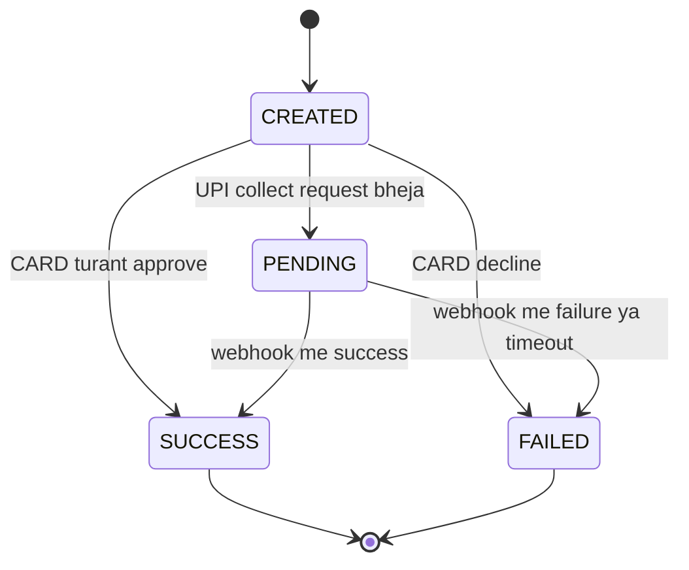
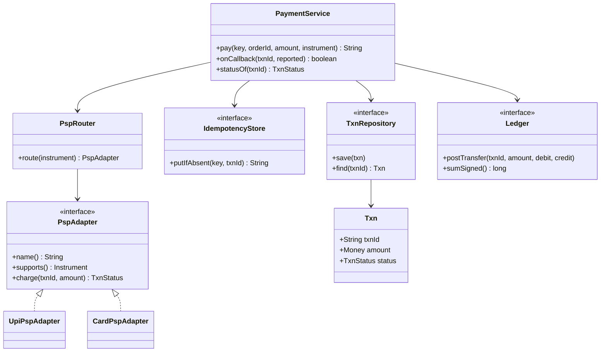

# D1 · Payment gateway / UPI flow

Oct 10, 2026 · @saurav chaurasiya

Is doc me LLD case study D1 hai — ek chhota payment gateway core, haath se code karne ke liye.

---

## D1 — Payment gateway / UPI flow

Payment gateway ek service hai jo merchant ke checkout aur asli paisa chalane wale systems (bank, UPI, card network) ke beech khadi rehti hai. Uska kaam paisa khud rakhna nahi hai — uska kaam hai har payment attempt ka ek record banana, usko sahi rail pe bhejna, aur jo jawab aaye (ya na aaye) usko ek saaf status me badalna.

### Ye cheez hai kya

- Kis category ki cheez hai: LLD case study hai — classes, interfaces aur ek status machine ka design. Koi naya framework nahi.
- Kis problem ke liye banayi gayi: ek payment ke peeche kai external systems hote hain, jawab late aata hai, aur wahi jawab do baar bhi aa sakta hai. Ye sab seedha if-else me likho to code do mahine me handle se bahar ho jaata hai.
- Is lesson ke baad tum kya kar paoge: ek chalne layak gateway core likh paoge jisme idempotency, PSP routing, status machine aur ledger posting — chaaron hon. PSP (Payment Service Provider — wo partner jo tumhari taraf se bank ya UPI tak request pahunchata hai).

### Sawaal

Tumhe Razorpay jaisa ek chhota payment gateway ka core likhna hai. Requirements:

1. Merchant `POST /payments` karta hai: amount, instrument (UPI ya CARD), aur header me ek `Idempotency-Key`.
2. UPI me PSP turant final jawab nahi deta. Collect request jaata hai, user apne app me approve karta hai, aur result webhook se aata hai (webhook = PSP tumhare server pe HTTP call karke result batata hai).
3. CARD me jawab usi call me aa jaata hai.
4. Webhook do-teen baar bhi aa sakta hai — PSP at-least-once bhejta hai (at-least-once = kam se kam ek baar, matlab duplicate possible hai).
5. Success pe double-entry ledger me entry padni chahiye — exactly ek baar.
6. Kal CARD ke liye ek naya PSP aur ek naya instrument (NETBANKING) add karna hai. Tumhara kitna code badlega?

> Pehle khud socho — 10 min, aur classes kaagaz pe likho. Hints: (1) kaun-kaun interface banega aur kyun? (2) status machine me terminal state kaunse hain, aur terminal ke baad kya allowed hai? (3) duplicate webhook ko kaun rokega — code ka `if` ya DB ka constraint?

### Problem kyun aata hai

- External system ka jawab teen roop me aata hai: success, failure, aur "pata nahi" (timeout). Teesra sabse common hai aur usko handle na karna sabse badi galti hai.
- Ek hi payment ko teen jagah se badla jaata hai: API call, webhook, aur status-check cron. Teeno ek hi record pe likhte hain.
- Naye payment method aate rehte hain. Agar method ka logic service ke if-else me hai, to har naya method purana chalu code chhoota hai — aur yahi code paisa handle karta hai.
- Paise ko `double` me rakhna chhoti galti lagti hai, par production me mismatch deti hai.
- Status ka "truth" code me kai jagah bikhra ho (kahin `status == 2`, kahin `isDone()`) to ek din do jagah ki definition alag ho jaati hai.

### Naive approach

- Ek controller method, usme instrument ka if-else, aur balance ko ek `Map<String, Double>` me rakh do. PSP ko call karo aur maan lo ki ho gaya.
- Ye exactly kahan tootta hai — neeche ka code chalaoge to khud dikh jaayega:

Ye bura version do payment lega aur dono ko merchant ke balance me jod dega, bina PSP ka final jawab aaye:

```java
import java.util.*;

// Bura version: ek hi method me sab kuch, na idempotency na status machine.
public class BadGateway {

    static Map<String, Double> balances = new HashMap<>(Map.of("merchant", 0.0));

    // Demo ke liye stub: asli duniya me ye network call hai.
    static void callUpi(String orderId, double amt) { }
    static void callCard(String orderId, double amt) { }

    static String pay(String orderId, double amount, String method) {
        if (method.equals("UPI")) {
            callUpi(orderId, amount);          // jawab PENDING hota hai, par hum wait nahi kar rahe
        } else if (method.equals("CARD")) {
            callCard(orderId, amount);
        }
        // Success maan liya, bina PSP ka final status aaye.
        balances.put("merchant", balances.get("merchant") + amount);
        return "OK";
    }

    public static void main(String[] args) {
        pay("order-1", 0.1, "UPI");
        pay("order-1", 0.2, "UPI");   // user ne dobara tap kiya — dobara credit ho gaya
        System.out.println("merchant balance = " + balances.get("merchant"));
    }
}
```

Output:

```text
merchant balance = 0.30000000000000004
```

- Is ek line me teen bug ek saath dikh rahe hain:
  - Same order do baar credit ho gaya — koi idempotency nahi.
  - PSP ne kuch confirm nahi kiya, phir bhi paisa jod diya — koi status machine nahi.
  - `0.1 + 0.2` ka jawab `0.3` nahi aaya — `double` me paisa rakhne ka natural nateeja.

### Sahi design

1. `Money` ek value object banao jo paise (`long`) me rehta hai aur constructor me hi invalid amount reject kar deta hai. Galat object ban hi nahi paata.
2. `TxnStatus` ek enum, aur usi enum pe `isTerminal()` method. Status ka truth ek hi jagah rahega.
3. `PspAdapter` ek interface, aur har payment method ka apna implementation — ye Strategy pattern hai (`2C · Behavior Bazaar` me P13 me aata hai).
4. `PspRouter` ek `EnumMap` rakhta hai: instrument se adapter. Naya method = naya class + ek registration line; `PaymentService` me ek bhi `if` nahi badlega. Ye Open-Closed principle hai (S2, `1B · SOLID Temple`).
5. `IdempotencyStore.putIfAbsent` — ek atomic "kaun jeeta" check. Jo pehle jeeta usi ka txn banega, baaki ko wahi purana txnId milega.
6. `onCallback` me sabse pehla check: txn already terminal hai kya. Hai to chup-chaap `false` lautao — duplicate webhook ka ilaaj yahi hai.
7. `Ledger.postTransfer` har success pe DR aur CR ka pair daalta hai, isliye signed sum hamesha 0 rehta hai ([L2.6 — Double-entry ledger](https://claude.ai/code/artifact/a7c567e0-66cb-46fe-b7c9-9c20739857eb)).
8. Repo, ledger aur idempotency store — teeno interface rakho. Test me in-memory implementation chalega, prod me DB wala.

Status machine aisi hai — terminal state se koi arrow bahar nahi jaata:



Classes aur unke beech ke rishte:



Poora chalne layak code — ek file me save karo (`GatewayDemo.java`), `javac GatewayDemo.java` aur `java GatewayDemo` chalao:

```java
import java.util.*;
import java.util.concurrent.*;

// Payment gateway ka core: ek order banao, PSP ko bhejo, callback aane pe ledger likho.
public class GatewayDemo {

    // ---------- Domain ----------

    // Paisa hamesha integer paise me. double/float money ke liye kabhi nahi.
    static final class Money {
        final long paise;
        Money(long paise) {
            if (paise <= 0) throw new InvalidAmountException("amount must be > 0, mila: " + paise);
            this.paise = paise;
        }
        @Override public String toString() { return "Rs " + (paise / 100) + "." + String.format("%02d", paise % 100); }
    }

    enum Instrument { UPI, CARD }

    // Status machine. Terminal status ke baad koi badlav allowed nahi.
    enum TxnStatus {
        CREATED, PENDING, SUCCESS, FAILED;
        boolean isTerminal() { return this == SUCCESS || this == FAILED; }
    }

    // Domain exceptions (O7 ka pattern): ek base, uske neeche specific.
    static class PaymentException extends RuntimeException {
        PaymentException(String m) { super(m); }
    }
    static class InvalidAmountException extends PaymentException {
        InvalidAmountException(String m) { super(m); }
    }
    static class UnknownTxnException extends PaymentException {
        UnknownTxnException(String m) { super(m); }
    }

    static final class Txn {
        final String txnId;
        final String orderId;
        final Money amount;
        final Instrument instrument;
        final String psp;
        TxnStatus status;
        Txn(String txnId, String orderId, Money amount, Instrument instrument, String psp) {
            this.txnId = txnId; this.orderId = orderId; this.amount = amount;
            this.instrument = instrument; this.psp = psp; this.status = TxnStatus.CREATED;
        }
    }

    // ---------- Ports (interfaces) ----------

    interface TxnRepository {
        void save(Txn t);
        Txn find(String txnId);
    }

    // Idempotency: ek key sirf ek baar jeet sakti hai.
    interface IdempotencyStore {
        String putIfAbsent(String key, String txnId); // null = ye key nayi thi
    }

    interface Ledger {
        void postTransfer(String txnId, Money amount, String debitAccount, String creditAccount);
        long sumSigned();
        int entryCount();
    }

    // Har payment method ke liye ek adapter (Strategy pattern).
    interface PspAdapter {
        String name();
        Instrument supports();
        TxnStatus charge(String txnId, Money amount);
    }

    // ---------- In-memory implementations ----------

    static final class InMemoryTxnRepo implements TxnRepository {
        private final Map<String, Txn> byId = new ConcurrentHashMap<>();
        @Override public void save(Txn t) { byId.put(t.txnId, t); }
        @Override public Txn find(String txnId) {
            Txn t = byId.get(txnId);
            if (t == null) throw new UnknownTxnException("txn nahi mila: " + txnId);
            return t;
        }
    }

    static final class InMemoryIdempotencyStore implements IdempotencyStore {
        private final Map<String, String> keys = new ConcurrentHashMap<>();
        @Override public String putIfAbsent(String key, String txnId) { return keys.putIfAbsent(key, txnId); }
    }

    // Double-entry ledger: har transfer pe do entry, signed sum hamesha 0.
    static final class InMemoryLedger implements Ledger {
        // Har entry: ek line text (padhne ke liye) aur ek signed amount (check ke liye).
        private final List<String> lines = new ArrayList<>();
        private final List<Long> signed = new ArrayList<>();
        @Override public synchronized void postTransfer(String txnId, Money amount, String debit, String credit) {
            lines.add(txnId + " DEBIT  " + debit + " " + amount);
            signed.add(-amount.paise);                 // debit = minus
            lines.add(txnId + " CREDIT " + credit + " " + amount);
            signed.add(amount.paise);                  // credit = plus
        }
        @Override public synchronized long sumSigned() {
            long total = 0;
            for (long v : signed) total += v;
            return total;
        }
        @Override public synchronized int entryCount() { return lines.size(); }
    }

    // UPI: PSP turant SUCCESS nahi deta - collect request jaata hai, jawab callback me aata hai.
    static final class UpiPspAdapter implements PspAdapter {
        @Override public String name() { return "upi-psp"; }
        @Override public Instrument supports() { return Instrument.UPI; }
        @Override public TxnStatus charge(String txnId, Money amount) { return TxnStatus.PENDING; }
    }

    // Card: is demo me 2000 paise se bade amount decline ho jaate hain.
    static final class CardPspAdapter implements PspAdapter {
        @Override public String name() { return "card-psp"; }
        @Override public Instrument supports() { return Instrument.CARD; }
        @Override public TxnStatus charge(String txnId, Money amount) {
            return amount.paise > 2000 ? TxnStatus.FAILED : TxnStatus.SUCCESS;
        }
    }

    // Instrument dekhkar sahi adapter chunta hai. Naya method = naya adapter, is class me if-else nahi.
    static final class PspRouter {
        private final Map<Instrument, PspAdapter> byInstrument = new EnumMap<>(Instrument.class);
        PspRouter(List<PspAdapter> adapters) {
            for (PspAdapter a : adapters) byInstrument.put(a.supports(), a);
        }
        PspAdapter route(Instrument i) {
            PspAdapter a = byInstrument.get(i);
            if (a == null) throw new PaymentException("is instrument ke liye koi PSP nahi: " + i);
            return a;
        }
    }

    // ---------- Service ----------

    static final class PaymentService {
        private final TxnRepository repo;
        private final IdempotencyStore idem;
        private final Ledger ledger;
        private final PspRouter router;
        private int seq = 0;

        PaymentService(TxnRepository repo, IdempotencyStore idem, Ledger ledger, PspRouter router) {
            this.repo = repo; this.idem = idem; this.ledger = ledger; this.router = router;
        }

        // Ek payment shuru karta hai. Same idempotencyKey dobara aaye to purana hi txn wapas.
        synchronized String pay(String idempotencyKey, String orderId, Money amount, Instrument instrument) {
            String newTxnId = "txn-" + (seq + 1);
            String existing = idem.putIfAbsent(idempotencyKey, newTxnId);
            if (existing != null) return existing;   // duplicate request, dobara charge nahi
            seq++;                                   // id tabhi consume hota hai jab key nayi thi

            PspAdapter psp = router.route(instrument);
            Txn t = new Txn(newTxnId, orderId, amount, instrument, psp.name());
            repo.save(t);

            t.status = psp.charge(newTxnId, amount);
            if (t.status == TxnStatus.SUCCESS) ledger.postTransfer(t.txnId, t.amount, "user:" + orderId, "merchant:acme");
            repo.save(t);
            return newTxnId;
        }

        // PSP ka callback. Terminal txn pe dobara aaya to chup-chaap ignore.
        synchronized boolean onCallback(String txnId, TxnStatus reported) {
            Txn t = repo.find(txnId);
            if (t.status.isTerminal()) return false;      // already settled, kuch mat karo
            if (!reported.isTerminal()) return false;     // sirf final status maante hain
            t.status = reported;
            if (reported == TxnStatus.SUCCESS) ledger.postTransfer(t.txnId, t.amount, "user:" + t.orderId, "merchant:acme");
            repo.save(t);
            return true;
        }

        TxnStatus statusOf(String txnId) { return repo.find(txnId).status; }
    }

    // ---------- Demo ----------

    public static void main(String[] args) {
        Ledger ledger = new InMemoryLedger();
        PaymentService svc = new PaymentService(
                new InMemoryTxnRepo(),
                new InMemoryIdempotencyStore(),
                ledger,
                new PspRouter(List.of(new UpiPspAdapter(), new CardPspAdapter())));

        // 1. UPI payment: PSP ne collect request bheja, abhi PENDING hai.
        String t1 = svc.pay("key-A", "order-1", new Money(50000), Instrument.UPI);
        System.out.println("1. " + t1 + " status=" + svc.statusOf(t1));

        // 2. User ne dobara tap kiya - same key, to same txn, naya charge nahi.
        String t1again = svc.pay("key-A", "order-1", new Money(50000), Instrument.UPI);
        System.out.println("2. dubara same key -> " + t1again + " (same txn? " + t1.equals(t1again) + ")");

        // 3. PSP ka success callback aaya - ledger me pehli baar entry padi.
        System.out.println("3. callback applied=" + svc.onCallback(t1, TxnStatus.SUCCESS)
                + " status=" + svc.statusOf(t1) + " ledgerEntries=" + ledger.entryCount());

        // 4. Wahi callback PSP ne retry kiya - ab ignore hona chahiye.
        System.out.println("4. duplicate callback applied=" + svc.onCallback(t1, TxnStatus.SUCCESS)
                + " ledgerEntries=" + ledger.entryCount());

        // 5. Card payment jo decline ho gaya - koi ledger entry nahi.
        String t2 = svc.pay("key-B", "order-2", new Money(99900), Instrument.CARD);
        System.out.println("5. " + t2 + " status=" + svc.statusOf(t2) + " ledgerEntries=" + ledger.entryCount());

        // 6. Invariant: double-entry ka signed sum hamesha 0.
        System.out.println("6. ledger signedSum=" + ledger.sumSigned());

        // 7. Galat amount pe domain exception.
        try { svc.pay("key-C", "order-3", new Money(0), Instrument.UPI); }
        catch (InvalidAmountException e) { System.out.println("7. reject: " + e.getMessage()); }
    }
}
```

Chalane pe exactly ye output aata hai:

```text
1. txn-1 status=PENDING
2. dubara same key -> txn-1 (same txn? true)
3. callback applied=true status=SUCCESS ledgerEntries=2
4. duplicate callback applied=false ledgerEntries=2
5. txn-2 status=FAILED ledgerEntries=2
6. ledger signedSum=0
7. reject: amount must be > 0, mila: 0
```

In saat lines me poora design proof ho jaata hai: line 2 idempotency, line 3-4 duplicate webhook, line 5 failure pe koi ledger entry nahi, line 6 double-entry invariant, line 7 invalid input constructor me hi ruka.

### Kya choose karein aur kyun

| Option | Kab use karo | Kab mat karo |
| --- | --- | --- |
| Service me instrument ka if-else | Ek-do din ka prototype, sirf ek method | Jahan naye method aane wale hain — matlab har real gateway |
| Strategy: ek `PspAdapter` per method/PSP | Default. Naya method = naya class, purana code chhua nahi jaata | Jab sach me ek hi method hai aur kabhi nahi badlega |
| Status machine enum + `isTerminal()` | Default. Rule ek jagah, test karna aasan | Jab states 15 se zyada ho jaayein aur guard conditions complex hon |
| Poori state-machine library (Spring StateMachine jaisi) | Bahut states, visual config aur audit chahiye | Chaar state ke liye — overkill, ek extra dependency |
| Idempotency in-memory map me | Sirf test aur local demo | Production me — multi-instance me ek instance ki memory doosre ko nahi dikhti |
| Idempotency DB unique key pe | Production default | Jab key ka TTL chahiye aur volume bahut ho — phir Redis + DB dono |

### India me kaise hota hai

- UPI me chaar party hoti hain: payer ka PSP app, payer ka bank, payee ka bank aur payee ka PSP. Beech me NPCI ka central switch baitha hota hai, jo request route karta hai aur VPA (Virtual Payment Address, jaise `naam@bank`) ko asli account tak resolve karta hai ([M2P — NPCI, mapper, switch aur PSP](https://m2pfintech.com/blog/npci-mapper-switch-and-psp-decoding-the-upi-transaction-journey/)).
- Payer PSP request NPCI ko bhejta hai, NPCI payer bank se debit karwata hai aur payee bank ko credit ka instruction deta hai. Isi liye UPI ka jawab synchronous nahi hota — beech me kai hop hain aur koi bhi hop timeout de sakta hai ([Razorpay — UPI kaise kaam karta hai](https://razorpay.com/learn/upi/)).
- Gateway (Razorpay, Paytm) merchant ke saamne ek hi simple API rakhta hai, aur peeche ye poora four-party flow handle karta hai. Isliye gateway ka code "PSP adapter" shape me hi likha jaata hai — har rail ka apna adapter.
- Paytm ki tarah kuch companies gateway aur PSP dono hain, isliye wahan adapter ek internal service ko point karta hai, kisi third party ko nahi — interface wahi rehta hai.

### Interview follow-ups

- **"PSP ka jawab hi nahi aaya, timeout ho gaya — kya karoge?"** — Txn `PENDING` rakho, aur ek status-check job se PSP ka status API poll karo. User ko "failed" tab tak mat batao jab tak terminal status confirm na ho — warna wo dobara pay karega aur paisa do baar katega.
- **"Idempotency key production me kahan rakhoge?"** — DB me unique constraint pe. In-memory map multi-instance me bekaar hai, kyunki doosre pod ko wo key dikhti hi nahi.
- **"Webhook ko authenticate kaise karoge?"** — Body pe HMAC signature header verify karo (HMAC = shared secret se banaya gaya ek fingerprint), aur timestamp window rakho taaki purana webhook replay na ho sake.
- **"NETBANKING add karna hai, kitna code badlega?"** — Ek naya `PspAdapter` class aur router ki list me ek entry. `PaymentService` ki file khuli bhi nahi jaayegi.
- **"Status update aur ledger posting atomic kaise rakhoge?"** — Ek hi DB transaction me, aur bahar nikalna ho to outbox pattern se. Do alag systems hon to saga chahiye (`2C · Saga Sea`).
- **"Code me `synchronized` hai — prod me chalega?"** — Nahi. Wo ek JVM ka lock hai. Prod me uski jagah DB ka unique key aur conditional update leta hai.

### Self-check

1. Terminal status ka rule ek line me kya hai, aur wo code me kahan likha hai?
2. `PspRouter` hata do to kaunsa design principle tootega?
3. Duplicate webhook ko exactly kaunsi line rokti hai?
4. In-memory `IdempotencyStore` production me kyun fail karega?
5. `Money` ka validation constructor me kyun hai, setter me kyun nahi?

### Notebook

Gateway paisa nahi rakhta, record aur status rakhta hai · Teen jawab hote hain: success, failure, aur timeout — teesra sabse common · Idempotency = atomic putIfAbsent, prod me DB unique key · Status enum pe isTerminal(), terminal ke baad koi badlav nahi · Duplicate webhook ka ilaaj terminal check hai, retry count nahi · Har payment method ka apna PspAdapter, service me if-else nahi · Success pe DR+CR pair, isliye signedSum 0

### Padhne ke liye

- [NPCI, mapper, switch aur PSP — UPI transaction journey](https://m2pfintech.com/blog/npci-mapper-switch-and-psp-decoding-the-upi-transaction-journey/)
- [UPI kaise kaam karta hai — Razorpay](https://razorpay.com/learn/upi/)

### Deep Dive (SDE-2) — jab time ho

#### Teesra jawab: timeout aur status reconciliation

- PSP call pe do timeout rakho: connect timeout (connection banne ka wait) aur read timeout (jawab ka wait). Read timeout aane ka matlab "fail" nahi hai — matlab "pata nahi".
- Isliye ek `pending_txn_check` job chahiye: jo txn 2 minute se `PENDING` hai, uska status PSP se poocho. Backoff ke saath poocho (pehle 2 min, phir 5, phir 15), har 10 second nahi.
- Job aur webhook dono `onCallback` hi call karein — do raaste, ek hi entry point. Terminal check dono ko safe bana deta hai.
- Din ke end me PSP ki settlement file se reconcile karo. Jo txn tumhare paas PENDING hai par file me success hai, wo tumhara data loss hai (`2F · Recon Ruins`).

#### Webhook security aur replay

- Signature verify karo body ke raw bytes pe, parsed JSON pe nahi — JSON re-serialize hone pe signature toot jaata hai.
- Replay rokne ke liye timestamp header check karo (5 minute ki window) aur `event_id` ko ek `processed_events` table me unique key ke saath rakho.
- Webhook endpoint ko idempotent aur fast rakho: receive karo, validate karo, queue me daalo, 200 lauta do. Bhaari kaam webhook ke andar mat karo — PSP timeout pe retry bhej dega.

#### `synchronized` ki shortcut aur uska asli roop

- Demo me `pay` aur `onCallback` `synchronized` hain — isse ek JVM me race nahi hota, aur padhne me design saaf dikhta hai.
- Do pod chalne par ye lock bekaar hai: dono pod ka apna lock hai. Prod me correctness DB se aati hai — `idempotency_key` pe unique index, aur `UPDATE txn SET status = ? WHERE txn_id = ? AND status = 'PENDING'` jiska affected rows 0 matlab koi aur pehle kar gaya.
- Distributed lock (Redis) ka man karega, par uske apne problems hain — wo bahas `L2.13` (`2D · Lock Fort`) me hai. Pehla jawab hamesha "DB constraint" hona chahiye, lock nahi.

---

## Aage kya

- Ye case study in zones pe tiki hai: [1A · OOP Village](https://claude.ai/code/artifact/cc69c0d1-92e9-4c1d-afd8-8add12f3e7db) (O7 exception design), [1B · SOLID Temple](https://claude.ai/code/artifact/f98bb328-8939-4ef4-a9a6-24c5ce970199) (S2 open-closed), [2C · Behavior Bazaar](https://claude.ai/code/artifact/d1ac6852-9994-4501-9b0a-7d0f654e5c38) (P13 Strategy), [2A · Idempotency Island](https://claude.ai/code/artifact/c269ac61-440b-4525-bd04-31baf708dece) (L2.1 idempotency keys) aur [2B · Ledger Library](https://claude.ai/code/artifact/a7c567e0-66cb-46fe-b7c9-9c20739857eb) (L2.6 double-entry).
- Pichla LLD zone: [Part 3 · Thread Jungle](https://claude.ai/code/artifact/05d7fa44-518a-49fd-a70c-40ac902f184f) — T1 se T12.
- Agla case study: `D2 — Digital wallet` (abhi banna baaki). Usme yahi gateway ke peeche wallet balance, hold aur refund ka LLD aayega.
