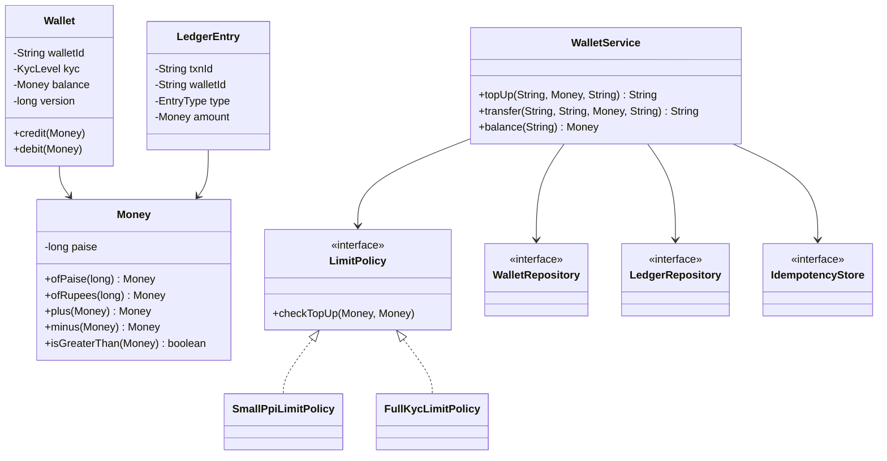

# D2 · Digital wallet

Oct 15, 2026 · @saurav chaurasiya

**Is doc me 1 boss level hai:** D2 — Digital wallet (Java machine coding). Boss level matlab case study, 150 XP. Pehle 45 min khud code likho, phir doc padho — ye level sirf padhne se nahi aata.

---

## D2 — Digital wallet

Digital wallet ek aisa system hai jo user ke paise ka balance rakhta hai, usme paisa daalne-nikaalne dete hai, aur har movement ka permanent record likhta hai. Paytm Wallet, PhonePe Wallet, Amazon Pay balance — sab yahi hain. Machine coding round me ye sabse common paisa-wala sawaal hai, kyunki isme concurrency, idempotency aur clean design teeno ek saath test ho jaate hain.

RBI ki bhasha me isko PPI (Prepaid Payment Instrument — pehle paisa bharo, phir kharch karo) kehte hain.

### Ye cheez hai kya

- Kis category ki cheez hai: ek stateful service jiska core ek mutable balance aur ek immutable (badla na ja sakne wala) history hai. Design ki poori ladai in dono ko sach me rakhne ki hai.
- Kis problem ke liye banayi gayi: chhoti payments ke liye har baar bank ko na bulana pade — paisa pehle se wallet me pada ho, payment turant ho jaaye.
- Is lesson ke baad tum kya kar paoge: 45 minute ke machine coding round me thread-safe, idempotent wallet likh paoge, double-entry ledger ke saath, aur interviewer ke "do requests ek saath aayi toh?" ka jawab code me dikha paoge.

Iske do jodidaar levels: [D3 — Splitwise](https://claude.ai/code/artifact/ea3677ad-81fd-4911-b64a-341b000d17ea) (wahan balance do logon ke beech hai, yahan ek user ka hai) aur HLD side pe [C2 — Payment gateway](https://claude.ai/code/artifact/789bc35f-d2eb-42fd-8b80-804af8af526b) (wahan tumne system level pe wahi ledger dekha tha).

### Sawaal

Paytm Wallet ka core likho, Java me, 45 minute me. Requirements jo interviewer dega:

- User apne wallet me bank se paisa daal sakta hai (top-up).
- User kisi merchant ko ya doosre user ko paisa bhej sakta hai.
- Balance kabhi negative nahi ho sakta.
- Har transaction ka permanent record ho — user statement dekh sakta hai.
- Network timeout pe client same request dobara bhejega. Paisa do baar nahi katna chahiye.
- Do payment requests ek hi wallet pe ek hi time pe aa sakti hain.
- Chhoti KYC wale wallet ka max balance 10,000 rupaye hai, full KYC wale ka 2 lakh.

> Pehle khud socho — 5 min. Hints: (1) Balance ko `double` me rakhoge ya nahi, aur kyun? (2) "Balance check karo, phir ghatao" ke beech me doosra thread aa gaya toh? (3) Balance sach hai, ya ledger sach hai — agar dono alag bol rahe hain toh kis pe bharosa karoge?

### Problem kyun aata hai

- Paisa decimal me hota hai, aur `double`/`float` decimal ko exactly store nahi karte. `0.1 + 0.2` Java me `0.30000000000000004` deta hai. Lakhon transactions ke baad ye error jam jaata hai.
- `if (balance >= amount) { balance -= amount; }` do steps hain. Check aur update ke beech me doosra thread aa gaya, toh dono requests paas ho jaayengi aur balance negative ho jaayega. Isko check-then-act race condition kehte hain.
- Client ka retry tumhare liye nayi request jaisa dikhta hai. Idempotent (same request do baar aaye toh asar ek hi baar ho) na hone se customer ka paisa do baar kat jaayega.
- Sirf `balance` field rakhne se history nahi bachti. Dispute me "paisa kahan gaya" ka jawab nahi hoga, aur ek buggy update balance ko chup-chaap galat kar dega.
- Transfer me do wallets pe lock lena padta hai. Agar A se B aur B se A ek hi time pe chale, aur dono apna-apna pehla lock le lein, toh deadlock (dono ek doosre ka intezaar karte hue hamesha ke liye atak jaate hain).
- Limits business rule hain, aur business rules badalte rehte hain. Unhe `if` ke dher me likhne se code har naye RBI circular pe tootta hai.

### Naive approach

Pehla obvious solution yahi hota hai — ek class, ek `double` balance, ek method. Neeche wala code galat hai, isme chaar alag bugs hain.

```java
// GALAT: ye code interview me reject hone ka sabse chhota raasta hai
class BadWallet {
    private double balance;              // bug 1: paise ke liye double

    public void topUp(double amount) {
        balance = balance + amount;      // bug 2: koi limit check nahi
    }

    public boolean pay(double amount) {
        if (balance >= amount) {         // bug 3: check aur update ke beech
            balance = balance - amount;  //         doosra thread aa sakta hai
            return true;
        }
        return false;
    }

    public double getBalance() {
        return balance;                  // bug 4: koi history nahi, sirf aakhri number
    }
}
```

Ye exactly kahan tootta hai:

- `double` me 100 rupaye 100 ki jagah 99.99999999 ban sakta hai. Ledger kabhi balance nahi karega.
- Do threads ek saath `pay(500)` bulaayein jab balance 500 hai: dono ko `balance >= amount` true milega, dono ghata denge, balance -500 ho jaayega.
- Client ne timeout pe `pay(120)` dobara bheja, toh 240 kat gaye. Koi tareeka nahi hai pata karne ka ki ye wahi request thi.
- Balance 380 dikh raha hai lekin kyun 380 hai, ye koi nahi bata sakta. Audit me ye system fail hai.
- Limit badalne pe tumhe `topUp` ka body badalna padega — ek nayi KYC category aayi toh `if-else` ki seedhi badhti jaayegi.

### Sahi design

1. **Paisa `long` paise me rakho, apni `Money` class ke andar.** Decimal kabhi `double` me nahi. `Money` immutable ho — plus/minus naya object dete hain, purana nahi badalte.
2. **Balance ko sach ka doosra naam maano, pehla nahi.** Pehla sach ledger hai: ek append-only (sirf naye rows judte hain, purane kabhi edit nahi hote) list of entries. Balance uska cached sum hai.
3. **Double-entry likho.** Har transaction do entries banata hai: ek jagah DEBIT, doosri jagah CREDIT, dono ka amount barabar. Isse koi bhi paisa "gayab" nahi ho sakta — total debit hamesha total credit ke barabar rahega.
4. **Limits ko Strategy pattern me daalo.** `LimitPolicy` interface, aur KYC level ke hisaab se implementation. Nayi category aayi toh nayi class, purana code chhua bhi nahi ([P20 Strategy](https://claude.ai/code/artifact/d1ac6852-9994-4501-9b0a-7d0f654e5c38)).
5. **Storage ko interface ke peeche chhupao.** `WalletRepository` aur `LedgerRepository` interfaces; demo me in-memory implementation, production me SQL — service ko farak nahi padta ([P24 Repository](https://claude.ai/code/artifact/d1ac6852-9994-4501-9b0a-7d0f654e5c38)).
6. **Idempotency ko ek alag store banao.** Client ka `idempotencyKey` to `txnId` ka mapping. Key pehli baar aayi toh kaam karo; dobara aayi toh purana `txnId` wapas do, kaam dobara mat karo ([L2.1 Idempotency keys](https://claude.ai/code/artifact/c269ac61-440b-4525-bd04-31baf708dece)).
7. **Per-wallet lock lo, poore service pe nahi.** `ConcurrentHashMap` me wallet id se ek lock object nikalo. Isse do alag wallets ke payments ek doosre ko nahi rokte ([T6 ConcurrentHashMap](https://claude.ai/code/artifact/05d7fa44-518a-49fd-a70c-40ac902f184f)).
8. **Transfer me dono lock ek hi order me lo.** Wallet id ko compare kar ke chhota pehle. Isse circular wait nahi banta, matlab deadlock nahi hota ([T11 Deadlocks](https://claude.ai/code/artifact/05d7fa44-518a-49fd-a70c-40ac902f184f)).
9. **Pehle saare checks, phir mutation.** Balance check, limit check, dono pehle. Tabhi balance badlo. Agar tum beech me mutate karke phir exception phenk doge, object aadha-adhura badla reh jaayega — ye asli interview me pakda jaane wala bug hai.
10. **Domain exceptions banao, `Exception` mat phenko.** `WalletException` base, uske neeche `InsufficientBalanceException`, `LimitExceededException`, `WalletNotFoundException` ([O7 Exception design](https://claude.ai/code/artifact/cc69c0d1-92e9-4c1d-afd8-8add12f3e7db)).

Ye diagram batata hai kaun kis pe depend karta hai. Dhyaan do: `WalletService` sirf interfaces pe depend karta hai, concrete storage pe nahi.



Pehla building block: `Money`. Paise `long` me, class immutable, aur `equals`/`hashCode` jodi me override ([O6](https://claude.ai/code/artifact/cc69c0d1-92e9-4c1d-afd8-8add12f3e7db) ka seedha application).

```java
// Money: amount ko paise me (long) rakhta hai, isliye koi rounding error nahi.
public final class Money implements Comparable<Money> {

    private final long paise;

    private Money(long paise) {
        this.paise = paise;
    }

    public static Money ofPaise(long paise) {
        if (paise < 0) {
            throw new IllegalArgumentException("Money negative nahi ho sakti: " + paise);
        }
        return new Money(paise);
    }

    public static Money ofRupees(long rupees) {
        return ofPaise(rupees * 100L);
    }

    public long paise() {
        return paise;
    }

    public Money plus(Money other) {
        return new Money(this.paise + other.paise);
    }

    // minus apne aap guard karta hai -- Money kabhi negative nahi hoti
    public Money minus(Money other) {
        if (other.paise > this.paise) {
            throw new IllegalArgumentException("Money negative ho jaati");
        }
        return new Money(this.paise - other.paise);
    }

    public boolean isGreaterThan(Money other) {
        return this.paise > other.paise;
    }

    @Override
    public int compareTo(Money other) {
        return Long.compare(this.paise, other.paise);
    }

    // equals aur hashCode dono saath me -- warna HashMap/HashSet me ye object kho jaata hai
    @Override
    public boolean equals(Object o) {
        if (this == o) return true;
        if (!(o instanceof Money)) return false;
        return this.paise == ((Money) o).paise;
    }

    @Override
    public int hashCode() {
        return Long.hashCode(paise);
    }

    @Override
    public String toString() {
        return "Rs " + (paise / 100) + "." + String.format("%02d", paise % 100);
    }
}
```

Domain exceptions: ek base class, uske neeche specific wajahein. Caller `catch (WalletException e)` likh ke sab pakad sakta hai, ya specific wali pakad sakta hai.

```java
public class WalletException extends RuntimeException {
    public WalletException(String message) {
        super(message);
    }
}
```

```java
public class WalletNotFoundException extends WalletException {
    public WalletNotFoundException(String walletId) {
        super("Wallet nahi mila: " + walletId);
    }
}
```

```java
public class InsufficientBalanceException extends WalletException {
    public InsufficientBalanceException(String walletId, Money chahiye, Money hai) {
        super("Balance kam hai wallet " + walletId + ": chahiye " + chahiye + ", hai " + hai);
    }
}
```

```java
public class LimitExceededException extends WalletException {
    public LimitExceededException(String message) {
        super(message);
    }
}
```

Ledger ki ek line. Ye object banne ke baad kabhi badalta nahi — ledger append-only hai, isliye entry ko edit karne ka koi method hi nahi hai.

```java
public enum EntryType { CREDIT, DEBIT }
```

```java
import java.time.Instant;
import java.util.UUID;

public final class LedgerEntry {

    private final String entryId;
    private final String walletId;
    private final String txnId;
    private final EntryType type;
    private final Money amount;
    private final Instant at;

    public LedgerEntry(String walletId, String txnId, EntryType type, Money amount) {
        this.entryId = UUID.randomUUID().toString();
        this.walletId = walletId;
        this.txnId = txnId;
        this.type = type;
        this.amount = amount;
        this.at = Instant.now();
    }

    public String entryId() { return entryId; }
    public String walletId() { return walletId; }
    public String txnId() { return txnId; }
    public EntryType type() { return type; }
    public Money amount() { return amount; }
    public Instant at() { return at; }

    @Override
    public String toString() {
        return txnId + " | " + walletId + " | " + type + " | " + amount;
    }
}
```

KYC level aur limit policy. `LimitPolicy` ek interface hai, isliye nayi RBI category aane pe nayi class likhni hai, purana code nahi chhedna.

```java
public enum KycLevel { SMALL, FULL }
```

```java
public interface LimitPolicy {
    Money maxBalance();
    // top-up allowed hai ya nahi -- nahi hai toh exception phenko
    void checkTopUp(Money currentBalance, Money topUp);
}
```

```java
// Chhoti KYC wala wallet: max balance 10,000 rupaye
public final class SmallPpiLimitPolicy implements LimitPolicy {

    private static final Money MAX = Money.ofRupees(10_000);

    @Override
    public Money maxBalance() {
        return MAX;
    }

    @Override
    public void checkTopUp(Money currentBalance, Money topUp) {
        if (currentBalance.plus(topUp).isGreaterThan(MAX)) {
            throw new LimitExceededException(
                "Small PPI ka max balance " + MAX + " hai, ye top-up usse aage le jaata hai");
        }
    }
}
```

```java
// Full KYC wala wallet: max balance 2 lakh rupaye
public final class FullKycLimitPolicy implements LimitPolicy {

    private static final Money MAX = Money.ofRupees(200_000);

    @Override
    public Money maxBalance() {
        return MAX;
    }

    @Override
    public void checkTopUp(Money currentBalance, Money topUp) {
        if (currentBalance.plus(topUp).isGreaterThan(MAX)) {
            throw new LimitExceededException(
                "Full KYC PPI ka max balance " + MAX + " hai, ye top-up usse aage le jaata hai");
        }
    }
}
```

Wallet entity. `version` field production me optimistic locking ke liye hai: `UPDATE ... WHERE id = ? AND version = ?`, 0 rows mile toh koi aur pehle badal gaya ([L2.14](https://claude.ai/code/artifact/97588686-7110-4318-8124-3a8727c7604e)).

```java
public final class Wallet {

    private final String walletId;
    private final String userId;
    private final KycLevel kyc;
    private Money balance;
    private long version;

    public Wallet(String walletId, String userId, KycLevel kyc) {
        this.walletId = walletId;
        this.userId = userId;
        this.kyc = kyc;
        this.balance = Money.ofPaise(0);
        this.version = 0;
    }

    public String walletId() { return walletId; }
    public String userId() { return userId; }
    public KycLevel kyc() { return kyc; }
    public Money balance() { return balance; }
    public long version() { return version; }

    public void credit(Money amount) {
        this.balance = this.balance.plus(amount);
        this.version++;
    }

    public void debit(Money amount) {
        if (amount.isGreaterThan(this.balance)) {
            throw new InsufficientBalanceException(walletId, amount, this.balance);
        }
        this.balance = this.balance.minus(amount);
        this.version++;
    }
}
```

Teen storage interfaces. Demo in-memory chalega, production SQL — `WalletService` ko pata bhi nahi chalega.

```java
import java.util.List;
import java.util.Optional;

public interface WalletRepository {
    Optional<Wallet> find(String walletId);
    void save(Wallet wallet);
}
```

```java
import java.util.List;

public interface LedgerRepository {
    // ek transaction ki saari entries ek saath -- aadhi entries kabhi nahi
    void append(List<LedgerEntry> entries);
    List<LedgerEntry> forWallet(String walletId);
    List<LedgerEntry> all();
}
```

```java
import java.util.Optional;

public interface IdempotencyStore {
    // key nayi hai toh txnId store karke Optional.empty(); purani hai toh stored txnId
    Optional<String> putIfAbsent(String key, String txnId);
}
```

In-memory implementations. `ConcurrentHashMap.putIfAbsent` `null` deta hai jab key nahi thi, warna purani value — yahi hamara idempotency check hai.

```java
import java.util.Optional;
import java.util.concurrent.ConcurrentHashMap;
import java.util.Map;

public final class InMemoryWalletRepository implements WalletRepository {

    private final Map<String, Wallet> store = new ConcurrentHashMap<>();

    @Override
    public Optional<Wallet> find(String walletId) {
        return Optional.ofNullable(store.get(walletId));
    }

    @Override
    public void save(Wallet wallet) {
        store.put(wallet.walletId(), wallet);
    }
}
```

```java
import java.util.ArrayList;
import java.util.Collections;
import java.util.List;

public final class InMemoryLedgerRepository implements LedgerRepository {

    private final List<LedgerEntry> entries = Collections.synchronizedList(new ArrayList<>());

    @Override
    public void append(List<LedgerEntry> batch) {
        entries.addAll(batch);
    }

    @Override
    public List<LedgerEntry> forWallet(String walletId) {
        List<LedgerEntry> out = new ArrayList<>();
        synchronized (entries) {
            for (LedgerEntry e : entries) {
                if (e.walletId().equals(walletId)) {
                    out.add(e);
                }
            }
        }
        return out;
    }

    @Override
    public List<LedgerEntry> all() {
        synchronized (entries) {
            return new ArrayList<>(entries);
        }
    }
}
```

```java
import java.util.Map;
import java.util.Optional;
import java.util.concurrent.ConcurrentHashMap;

public final class InMemoryIdempotencyStore implements IdempotencyStore {

    private final Map<String, String> store = new ConcurrentHashMap<>();

    @Override
    public Optional<String> putIfAbsent(String key, String txnId) {
        return Optional.ofNullable(store.putIfAbsent(key, txnId));
    }
}
```

Asli dimaag `WalletService` me hai. Teen cheezein dhyaan se dekho: per-wallet lock, lock ordering, aur "pehle saare checks phir mutation".

```java
import java.util.HashMap;
import java.util.List;
import java.util.Map;
import java.util.Optional;
import java.util.UUID;
import java.util.concurrent.ConcurrentHashMap;

public class WalletService {

    private static final String BANK_SOURCE = "BANK_SOURCE";

    private final WalletRepository wallets;
    private final LedgerRepository ledger;
    private final IdempotencyStore idempotency;
    private final Map<KycLevel, LimitPolicy> policies;

    // per-wallet lock objects -- poore service pe ek lock lena bekaar slow hai
    private final Map<String, Object> locks = new ConcurrentHashMap<>();

    public WalletService(WalletRepository wallets,
                         LedgerRepository ledger,
                         IdempotencyStore idempotency,
                         Map<KycLevel, LimitPolicy> policies) {
        this.wallets = wallets;
        this.ledger = ledger;
        this.idempotency = idempotency;
        this.policies = new HashMap<>(policies);
    }

    private Object lockFor(String walletId) {
        return locks.computeIfAbsent(walletId, k -> new Object());
    }

    private Wallet load(String walletId) {
        return wallets.find(walletId)
                      .orElseThrow(() -> new WalletNotFoundException(walletId));
    }

    private LimitPolicy policyFor(Wallet wallet) {
        LimitPolicy p = policies.get(wallet.kyc());
        if (p == null) {
            throw new WalletException("Is KYC level ki policy set nahi hai: " + wallet.kyc());
        }
        return p;
    }

    // Bank se wallet me paisa. Do entries: wallet CREDIT, bank source DEBIT.
    public String topUp(String walletId, Money amount, String idempotencyKey) {
        synchronized (lockFor(walletId)) {
            Wallet wallet = load(walletId);

            // 1. pehle saare checks
            policyFor(wallet).checkTopUp(wallet.balance(), amount);

            // 2. phir idempotency key reserve karo
            String txnId = UUID.randomUUID().toString();
            Optional<String> pehleSeHai = idempotency.putIfAbsent(idempotencyKey, txnId);
            if (pehleSeHai.isPresent()) {
                return pehleSeHai.get();   // yahi request pehle aa chuki hai, kuch nahi karna
            }

            // 3. tab mutation
            wallet.credit(amount);
            wallets.save(wallet);
            ledger.append(List.of(
                new LedgerEntry(walletId, txnId, EntryType.CREDIT, amount),
                new LedgerEntry(BANK_SOURCE, txnId, EntryType.DEBIT, amount)
            ));
            return txnId;
        }
    }

    // Ek wallet se doosre me paisa. Dono locks chhote id se bade id ke order me.
    public String transfer(String fromId, String toId, Money amount, String idempotencyKey) {
        if (fromId.equals(toId)) {
            throw new WalletException("Khud ko transfer nahi kar sakte: " + fromId);
        }

        // lock ordering -- isse circular wait nahi banta, matlab deadlock nahi hota
        String pehla = fromId.compareTo(toId) < 0 ? fromId : toId;
        String doosra = fromId.compareTo(toId) < 0 ? toId : fromId;

        synchronized (lockFor(pehla)) {
            synchronized (lockFor(doosra)) {
                Wallet from = load(fromId);
                Wallet to = load(toId);

                // 1. pehle saare checks -- mutation se pehle, warna aadha kaam ho jaata hai
                if (amount.isGreaterThan(from.balance())) {
                    throw new InsufficientBalanceException(fromId, amount, from.balance());
                }
                policyFor(to).checkTopUp(to.balance(), amount);

                // 2. phir idempotency key
                String txnId = UUID.randomUUID().toString();
                Optional<String> pehleSeHai = idempotency.putIfAbsent(idempotencyKey, txnId);
                if (pehleSeHai.isPresent()) {
                    return pehleSeHai.get();
                }

                // 3. tab mutation
                from.debit(amount);
                to.credit(amount);
                wallets.save(from);
                wallets.save(to);
                ledger.append(List.of(
                    new LedgerEntry(fromId, txnId, EntryType.DEBIT, amount),
                    new LedgerEntry(toId, txnId, EntryType.CREDIT, amount)
                ));
                return txnId;
            }
        }
    }

    public Money balance(String walletId) {
        return load(walletId).balance();
    }

    public List<LedgerEntry> statement(String walletId) {
        return ledger.forWallet(walletId);
    }

    // Ledger se balance -- ye cached balance se match hona chahiye, warna bug hai
    public Money balanceFromLedger(String walletId) {
        long total = 0;
        for (LedgerEntry e : ledger.forWallet(walletId)) {
            total += (e.type() == EntryType.CREDIT) ? e.amount().paise() : -e.amount().paise();
        }
        return Money.ofPaise(total);
    }

    // Double-entry ka invariant: har txn ke debits aur credits barabar
    public boolean isLedgerBalanced() {
        Map<String, Long> perTxn = new HashMap<>();
        for (LedgerEntry e : ledger.all()) {
            long signed = (e.type() == EntryType.CREDIT) ? e.amount().paise() : -e.amount().paise();
            perTxn.merge(e.txnId(), signed, Long::sum);
        }
        for (Long net : perTxn.values()) {
            if (net != 0L) {
                return false;
            }
        }
        return true;
    }
}
```

Chhota demo `main`. Comments me likha hai ki har line kya print karegi — chala ke milao.

```java
import java.util.Map;

public class Main {

    public static void main(String[] args) {
        WalletRepository wallets = new InMemoryWalletRepository();
        LedgerRepository ledger = new InMemoryLedgerRepository();
        IdempotencyStore idem = new InMemoryIdempotencyStore();

        WalletService service = new WalletService(wallets, ledger, idem, Map.of(
            KycLevel.SMALL, new SmallPpiLimitPolicy(),
            KycLevel.FULL, new FullKycLimitPolicy()
        ));

        wallets.save(new Wallet("W-SAURAV", "U1", KycLevel.FULL));
        wallets.save(new Wallet("W-CHAIWALA", "U2", KycLevel.SMALL));

        // 1. bank se 500 rupaye daalo
        String t1 = service.topUp("W-SAURAV", Money.ofRupees(500), "key-topup-1");
        System.out.println("1. Top-up ke baad: " + service.balance("W-SAURAV"));
        // 1. Top-up ke baad: Rs 500.00

        // 2. wahi key dobara -- paisa dobara nahi aana chahiye, wahi txnId milna chahiye
        String t1Again = service.topUp("W-SAURAV", Money.ofRupees(500), "key-topup-1");
        System.out.println("2. Same key dobara: " + service.balance("W-SAURAV")
                           + ", wahi txnId? " + t1.equals(t1Again));
        // 2. Same key dobara: Rs 500.00, wahi txnId? true

        // 3. chaiwale ko 120 rupaye
        service.transfer("W-SAURAV", "W-CHAIWALA", Money.ofRupees(120), "key-pay-1");
        System.out.println("3. Transfer ke baad: Saurav=" + service.balance("W-SAURAV")
                           + ", Chaiwala=" + service.balance("W-CHAIWALA"));
        // 3. Transfer ke baad: Saurav=Rs 380.00, Chaiwala=Rs 120.00

        // 4. balance se zyada bhejne ki koshish
        try {
            service.transfer("W-SAURAV", "W-CHAIWALA", Money.ofRupees(10_000), "key-pay-2");
        } catch (InsufficientBalanceException e) {
            System.out.println("4. Ruk gaya: " + e.getMessage());
        }
        // 4. Ruk gaya: Balance kam hai wallet W-SAURAV: chahiye Rs 10000.00, hai Rs 380.00

        // 5. chaiwale ka wallet SMALL hai, max 10,000 -- 120 + 9,990 usse aage chala jaata hai
        try {
            service.topUp("W-CHAIWALA", Money.ofRupees(9_990), "key-topup-2");
        } catch (LimitExceededException e) {
            System.out.println("5. Ruk gaya: " + e.getMessage());
        }
        // 5. Ruk gaya: Small PPI ka max balance Rs 10000.00 hai, ye top-up usse aage le jaata hai

        // 6. invariant check -- ye hamesha true hona chahiye
        System.out.println("6. Ledger balanced? " + service.isLedgerBalanced());
        System.out.println("   Ledger se nikala balance: " + service.balanceFromLedger("W-SAURAV"));
        // 6. Ledger balanced? true
        //    Ledger se nikala balance: Rs 380.00
    }
}
```

Do cheezein is demo me chhupi hui hain, aur interview me yahi bolne layak hain:

- Step 4 aur 5 me exception checks ke dauraan aaya, idempotency key reserve hone se PEHLE. Isliye `key-pay-2` aur `key-topup-2` kharab nahi hui — client wahi key le ke sahi amount se dobara try kar sakta hai.
- Step 6 do tareeke se balance nikaalta hai: cached `balance` field se aur ledger ke sum se. Dono barabar hain. Production me yahi check ek nightly job banta hai — isko reconciliation kehte hain.

### Kya choose karein aur kyun

Balance ko concurrent-safe banane ke teen tareeke hain. Interviewer yahi poochta hai.

| Option | Kab use karo | Kab mat karo |
| --- | --- | --- |
| `synchronized` per-wallet lock | Single JVM machine coding round, in-memory state — sabse saaf aur samjhane me aasan | Multi-server production me — do servers ke locks ek doosre ko nahi dikhte |
| `AtomicLong` + CAS (compare-and-swap) balance pe | Sirf balance badalna ho, koi doosra field ya ledger entry saath me na likhni ho | Jab ek hi atomic kaam me balance aur ledger dono likhne hain — CAS do cheezein ek saath nahi karta |
| DB row lock ya optimistic version | Asli production wallet — `UPDATE wallet SET bal = bal - ? WHERE id = ? AND bal >= ?` | Machine coding me, jab DB hi nahi hai — interviewer in-memory solution maang raha hai |

Balance ka sach kahan rakha jaaye:

| Option | Kab use karo | Kab mat karo |
| --- | --- | --- |
| Sirf balance field | Kabhi nahi — history gayab, dispute me jawab nahi | Paise wale kisi bhi system me |
| Sirf ledger (balance har baar sum karo) | Jab transactions kam hain, ya audit sabse zaroori hai | Jab wallet ke 50 lakh entries hain — har payment pe sum nahi kar sakte |
| Ledger (sach) + cached balance (speed) | Yahi production answer hai — aur nightly job dono ko milata hai | Jab tum reconciliation job likhne ko taiyaar na ho — tab drift pakda nahi jaayega |

Limits ko kaise code karein:

| Option | Kab use karo | Kab mat karo |
| --- | --- | --- |
| `if-else` seedhi service ke andar | Ek hi limit ho aur kabhi na badle | Regulated product me — RBI circular aane pe service class dobara likhni padegi |
| Strategy (`LimitPolicy` interface) | Jab categories hain (SMALL, FULL) aur naye aa sakte hain | Jab sach me ek hi niyam hai — tab ye over-engineering hai |
| Rules engine / config-driven | Jab limits roz product team badalti ho | 45 min ke interview me — time khatam ho jaayega |

### India me kaise hota hai

- RBI wallet ko PPI (Prepaid Payment Instrument) kehta hai, aur uske limits circular se aate hain, product team ki marzi se nahi. April 2026 ke draft Master Direction ke hisaab se full-KYC PPI ka max balance 2 lakh rupaye hai, aur small PPI ka 10,000 rupaye ([Medianama ka summary RBI ke draft PPI rules pe](https://www.medianama.com/2026/04/223-rbi-prepaid-payment-instruments-rules-wallet-limits-escrow-norms/)). Yahi do numbers upar ke `FullKycLimitPolicy` aur `SmallPpiLimitPolicy` me hain.
- Small PPI sirf goods aur services ke liye hai — na cash withdrawal, na P2P (person to person) transfer. Matlab tumhare code me `transfer` method ko KYC level bhi dekhna padega, sirf balance nahi. Full-KYC PPI me P2P 25,000 rupaye per month tak, aur cash se load 10,000 rupaye per month tak (same source).
- Small PPI banane ke liye OTP-verified mobile number aur self-declared identity kaafi hai, aur usko 2 saal ke andar full KYC me upgrade kiya ja sakta hai. Full-KYC PPI ek holder ke paas ek hi hoti hai, minimum 1 saal validity ke saath (same source).
- Non-bank issuer ka collected paisa ek alag INR escrow account me rehna chahiye, kisi scheduled commercial bank me, apne business ke paise se mila ke nahi. Day-end escrow balance outstanding PPIs ko cover karna chahiye, aur statutory auditor quarterly certify karta hai (same source).
- Isliye asli Paytm Wallet me ek teesri entity hoti hai jo is doc me nahi hai: escrow account ka apna ledger. Jab tum kehte ho "total user balances = escrow balance", wo ek invariant hai jo roz check hota hai. Upar wala `isLedgerBalanced()` usi soch ka chhota version hai.
- Ye draft hai, final circular nahi — comments 22 May 2026 tak khule the. Interview me "RBI PPI limits" bolo, exact number pe zyada confidence mat dikhao, ye badalte rehte hain.

### Interview follow-ups

- **Server multiple hain, `synchronized` kaam nahi karega. Kya karoge?** Lock DB me le jao: `UPDATE wallet SET balance = balance - ? WHERE wallet_id = ? AND balance >= ?` ek hi atomic statement hai, 0 rows affected matlab insufficient balance. Ya Redis me distributed lock, lekin uske saath fencing token ka dard aata hai ([L2.13](https://claude.ai/code/artifact/97588686-7110-4318-8124-3a8727c7604e)).
- **Ledger 5 crore rows ka ho gaya. Statement API slow hai. Kya karoge?** `(wallet_id, created_at DESC)` pe composite index, aur keyset pagination (`WHERE created_at < :lastSeen`), OFFSET nahi. Purana data monthly partitions me, 6 mahine se purana cold storage me.
- **Balance field aur ledger ka sum alag nikle toh kis pe bharosa karoge?** Ledger pe. Wo append-only hai, isliye usko galat karne ke liye naya galat row likhna padta hai; balance ko ek buggy `UPDATE` chup-chaap galat kar deta hai. Fix bhi ledger se karo — balance ko recompute karo, ledger ko chhedo mat.
- **Refund kaise handle karoge?** Nayi transaction, do nayi entries, ulti direction me. Original entries ko kabhi delete ya edit nahi karte — ye append-only ka matlab hai.
- **Do threads ek hi `idempotencyKey` se ek hi time pe aa gaye toh?** `ConcurrentHashMap.putIfAbsent` atomic hai, isliye ek jeetega aur doosra purana `txnId` dekhega. Par dono `synchronized` block ke andar hain, isliye wo bhi serialize ho jaate hain — yahan do safety layers hain.
- **`Money` ko `BigDecimal` se kyun nahi banaya?** `BigDecimal` sahi hai lekin dheema hai aur `equals` scale dekhta hai, isliye `1.0` aur `1.00` alag nikalte hain — ye bug ka khula darwaza hai. `long` paise simple aur tez hai. Multi-currency aaye toh `Money` me currency field jodo, `BigDecimal` nahi.
- **Agar interviewer `ReentrantLock` maange?** `synchronized` ki jagah per-wallet `ReentrantLock` rakho. Fayda: `tryLock(timeout)` milta hai, isliye deadlock hone pe tum hamesha ke liye nahi atakte — timeout pe exception de ke nikal jaate ho ([T3](https://claude.ai/code/artifact/05d7fa44-518a-49fd-a70c-40ac902f184f)).

### Self-check

1. `double balance` ki do alag problems batao — ek rounding wali, ek concurrency wali.
2. `transfer` me lock chhote wallet id se pehle kyun lete hain? Agar na lein toh exact kya hoga?
3. Code me checks mutation se pehle kyun hain? Ulta kar dene se kaunsa bug aayega?
4. `idempotencyKey` reserve karna checks ke baad kyun rakha, pehle kyun nahi?
5. Double-entry ka invariant ek line me likho, aur batao `isLedgerBalanced()` usko kaise check karta hai.
6. Single JVM se multi-server pe jaate waqt kaunsi ek line sabse pehle todegi?

### Notebook

`Money` = immutable `long` paise, `equals`+`hashCode` jodi me · Ledger append-only = sach, balance = uska cached sum, nightly job dono milata hai · Double-entry: har txn pe ek DEBIT ek CREDIT, barabar · Per-wallet `synchronized` lock `ConcurrentHashMap` se, poore service pe nahi · Transfer me lock ordering chhote id se — warna deadlock · Pehle saare checks, phir idempotency key reserve, phir mutation · Limits Strategy pattern me (`LimitPolicy`), RBI circular pe nayi class · Multi-server pe `synchronized` bekaar, DB conditional UPDATE lo.

### Padhne ke liye

- [RBI ke draft PPI Master Direction ka summary — wallet limits aur escrow norms](https://www.medianama.com/2026/04/223-rbi-prepaid-payment-instruments-rules-wallet-limits-escrow-norms/) — full-KYC vs small PPI ke numbers, escrow ke rules.
- [Razorpay ka ledger service aur data consistency](https://arpitbhayani.me/videos/razorpay-journey-to-microservices-data-consistency/) — asli company me double-entry ledger alag service kaise banti hai.

### Deep Dive (SDE-2) — jab time ho

#### Single JVM se multi-server tak

- `synchronized` sirf ek JVM ke andar kaam karta hai. Do servers ek saath wahi wallet uthaayein toh dono ke locks ek doosre ko dikhte hi nahi.
- Sabse saaf fix: lock database ko do. `UPDATE wallet SET balance = balance - ?, version = version + 1 WHERE wallet_id = ? AND balance >= ?` ek hi atomic statement hai. Return value 0 mila toh insufficient balance.
- Idempotency store bhi shared hona chahiye — in-memory map ki jagah Redis (`SET key value NX EX 86400`) ya ek DB table jiska unique index `idempotency_key` pe ho. DB table zyada safe hai: Redis eviction pe key gayab ho sakti hai aur duplicate nikal jaayega.
- Ledger append aur balance update ek hi DB transaction me hone chahiye. Agar ledger alag service me hai, toh outbox pattern lagta hai — yahi [C2](https://claude.ai/code/artifact/789bc35f-d2eb-42fd-8b80-804af8af526b) me Razorpay ka design tha.

#### Hot wallet problem

- Ek merchant wallet pe peak pe 2,000 TPS aa sakta hai (sale ke time). Per-wallet lock ab bottleneck ban jaata hai — sab ek hi row ke peeche line me khade hain.
- Fix: us ek wallet ko N sub-balances me todo (`wallet_shard` rows, 0 se 15). Credit random shard pe, debit kisi aise shard pe jisme paisa ho. Total balance = sab shards ka sum.
- Cost: "balance kitna hai" ab ek row ka read nahi, N rows ka sum hai. Aur debit ke liye shard chunna thoda logic maangta hai.
- Doosra fix: debits ko queue me daal ke batch karo. Latency badhti hai, throughput badhta hai. Wallet ke liye ye theek hai kyunki customer "payment processing" screen already dekh raha hai.

#### Transfer jo do services ke beech hai

- Agar `from` wallet ek service me hai aur `to` doosri me (ya doosre bank me), toh ek hi transaction nahi ho sakta.
- Tab saga pattern lagta hai: pehle `from` pe hold lagao (amount reserve, balance se kam dikhao), phir `to` pe credit karo, phir hold release karo. Beech me fail hua toh compensating transaction (hold wapas kholo) chalao ([L2.10 Saga](https://claude.ai/code/artifact/429b3ea6-a261-431d-a384-a0c6eb68a9f6)).
- Hold ko ledger me alag entry type banao (`HOLD`, `HOLD_RELEASED`), warna tum balance field me ek chhupa hua state machine bana dete ho.
- Hold ka TTL (time to live — kitni der baad apne aap khatam) rakho. Warna ek crashed saga customer ka paisa hamesha ke liye block kar degi.

#### Testing: concurrency bug kaise pakdein

- Ek test likho jisme 100 threads ek hi wallet pe ek saath 1 rupaya debit karein, aur balance 100 rupaye ho. Ant me balance exactly 0 hona chahiye aur `isLedgerBalanced()` true.
- `ExecutorService` plus `CountDownLatch` se saare threads ek hi instant pe chhodo ([T7](https://claude.ai/code/artifact/05d7fa44-518a-49fd-a70c-40ac902f184f), [T12](https://claude.ai/code/artifact/05d7fa44-518a-49fd-a70c-40ac902f184f)). Warna threads ek-ek kar ke chalenge aur race kabhi nahi dikhegi.
- Idempotency test: same key se 50 threads ek saath bhejo, balance sirf ek baar badalna chahiye.
- Deadlock test: thread A, wallet 1 se 2 bheje; thread B, wallet 2 se 1 bheje; 1000 baar loop. Lock ordering hatao, test atak jaayega — yahi proof hai ki ordering kaam kar rahi thi.

#### Interview me 45 minute kaise baantein

- 0 se 5 min: requirements clarify. Zaroor poochho: multi-server ya single JVM? Persistence chahiye ya in-memory? Multi-currency?
- 5 se 12 min: entities aur interfaces bolo (`Money`, `Wallet`, `LedgerEntry`, teen repositories, `LimitPolicy`). Interviewer ko design pehle dikhao, code baad me.
- 12 to 35 min: `WalletService` likho — `topUp` aur `transfer`. Yahan tumhare 80 percent marks hain.
- 35 to 42 min: demo `main` likho aur bolo har line kya print karegi.
- 42 to 45 min: khud bolo ki kya chhoda — persistence, multi-server locking, hot wallet. Apni limitations khud batana strong signal hai.
- Jo cheez time kam ho toh chhodo: `statement` pagination, multi-currency, refunds. Jo kabhi na chhodo: `long` paise, per-wallet lock, lock ordering, idempotency.

---

## Aage kya

- Pichhla case study: [D3 — Splitwise](https://claude.ai/code/artifact/ea3677ad-81fd-4911-b64a-341b000d17ea)
- Agla case study: [D1 — Payment gateway / UPI flow](https://claude.ai/code/artifact/3a14c198-3582-4167-9d22-bb2756140172)
- Isi topic ka HLD side: [C2 — Payment gateway (Razorpay)](https://claude.ai/code/artifact/789bc35f-d2eb-42fd-8b80-804af8af526b)
- Zone jahan se concepts aaye: [1A OOP Village](https://claude.ai/code/artifact/cc69c0d1-92e9-4c1d-afd8-8add12f3e7db) · [1B SOLID Temple](https://claude.ai/code/artifact/f98bb328-8939-4ef4-a9a6-24c5ce970199) · [2C Behavior Bazaar](https://claude.ai/code/artifact/d1ac6852-9994-4501-9b0a-7d0f654e5c38) · [Part 3 Thread Jungle](https://claude.ai/code/artifact/05d7fa44-518a-49fd-a70c-40ac902f184f)
