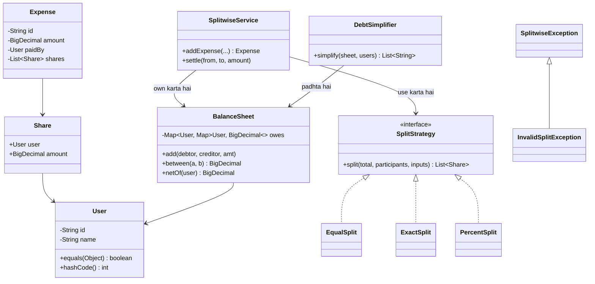

# D3 · Splitwise

Oct 14, 2026 · @saurav chaurasiya

Is doc me LLD case study D3 (Splitwise) hai — machine coding round ka ek classic sawaal, poore chalne layak Java ke saath.

---

## D3 — Splitwise

Splitwise ek expense sharing app hai: ek group ke log kharche karte hain, har kharcha kisi ek ne diya hota hai, aur app hisaab rakhta hai ki ab kis pe kiska kitna paisa bakaya hai. Machine coding round me ye sawaal isliye poocha jaata hai ki ismein teen cheezein ek saath test hoti hain — strategy pattern, paise ka precise hisaab, aur ek graph jaisa balance model.

### Ye cheez hai kya

- Category: LLD case study (boss level). 60 se 90 minute ka machine coding problem.
- Kis problem ke liye: ek group ke andar kai log, kai kharche, aur kai tarah ke split (barabar, exact amount, percent) — aur ant me minimum transactions me hisaab barabar karna.
- Is lesson ke baad tum ye khud se likh paoge: split strategies, ek pairwise balance sheet, aur debt simplification — aur bata paoge ki paise ka remainder kahan jaata hai.
- Prerequisites: [O6 — equals, hashCode & collections](https://claude.ai/code/artifact/cc69c0d1-92e9-4c1d-afd8-8add12f3e7db) (User ko `HashMap` ki key banane ke liye), [O7 — Exception design](https://claude.ai/code/artifact/cc69c0d1-92e9-4c1d-afd8-8add12f3e7db) (invalid split reject karne ke liye), aur [P20 — Strategy](https://claude.ai/code/artifact/d1ac6852-9994-4501-9b0a-7d0f654e5c38).

### Sawaal

Tum PhonePe me "Split Bill" feature bana rahe ho. Requirements ye hain:

- User add kar sako; ek group ke log kharche share karte hain.
- Expense add kar sako: amount, kisne diya, kaun-kaun share kar raha hai, aur split ka type — EQUAL, EXACT (har bande ka exact rupaya), ya PERCENT.
- Kisi bhi waqt poochha ja sake: "X pe kitna bakaya hai" aur "X ko kisse kitna lena hai".
- Ek settle-up API ho: X ne Y ko paisa de diya, hisaab update ho.
- Aur sabse important: group ka poora hisaab **minimum number of transactions** me khatam karne ka tareeka batao.

Teen log hain — Saurav, Riya, Aman. Saurav ne 1200 ka dinner diya (teenon me barabar). Riya ne 900 ka cab diya (teenon me barabar). Ab batao: pairwise kaun kisko kitna de, aur minimum kitne transactions me sab barabar ho jaayega?

> Pehle khud socho — 5 min. Hints: (1) "kaun kisko kitna de" aur "har bande ka net kitna hai" — ye do alag cheezein hain; kaunsi simplification ke kaam aayegi? (2) 1000 ko 3 me barabar baanto — 333.33 teen baar = 999.99; ek paisa kahan gaya? (3) 3 log hain to pairwise 3 debts ban sakte hain — kya 3 se kam transactions me kaam ho sakta hai?

### Problem kyun aata hai

- Paisa `double` me rakhna galat hai. `0.1 + 0.2` `double` me `0.30000000000000004` deta hai. Ledger me ye bug audit me pakda jaata hai, isliye `BigDecimal` (ya paise ko integer paise me rakhna) hi sahi hai.
- Barabar split me remainder bachta hai. 1000 ka 3 me split karoge to 333.33 x 3 = 999.99 — ek paisa gaayab. Iska ghar pehle se tay karna padta hai, warna total match nahi karega.
- Split ke types badhte rehte hain (EQUAL, EXACT, PERCENT, SHARES, ADJUSTMENT). Agar `if-else` ya `switch` me likhoge to har naye type pe purani class badlegi — [S2 (Open/Closed)](https://claude.ai/code/artifact/f98bb328-8939-4ef4-a9a6-24c5ce970199) ka ulta.
- Pairwise debts aur net balance do alag models hain. Interview me log in dono ko mila dete hain, aur phir simplification likhna mushkil ho jaata hai.
- `User` ko `HashMap` ki key banane ke liye `equals` aur `hashCode` chahiye. Bina inke do "same" user do alag entries ban jaate hain aur balance baant jaata hai.

### Naive approach

- Har expense ko as-is store karna aur sawaal poochne pe poora list scan karna. Chhote group me chalega, par "X pe kitna bakaya hai" har baar O(expenses) ho jaayega.
- Split ko `switch` me likhna, jo har naye type pe class badalne pe majboor karta hai.
- Sirf net balance rakhna (per-user ek number) — tab "Riya ko Saurav se kitna lena hai" ka jawab hi nahi de paoge.

Ye wahi galtiyan ek jagah — `double`, `switch`, aur sirf net balance.

```java
// BURA: double, switch, aur sirf net balance
class BadSplitwise {
    Map<String, Double> net = new HashMap<>();  // paisa double me - galat

    void addExpense(String type, double amount, String paidBy, List<String> people) {
        if (type.equals("EQUAL")) {             // naya type = yahi method badlega
            double each = amount / people.size();   // remainder gaayab
            for (String p : people) net.merge(p, -each, Double::sum);
            net.merge(paidBy, amount, Double::sum);
        } else if (type.equals("EXACT")) {
            // ...
        }
    }
    // "Riya ko Saurav se kitna lena hai" - iska jawab is model me hai hi nahi
}
```

### Sahi design

Paanch step me socho:

1. Paisa `BigDecimal` me, scale 2 ke saath. Kabhi `double` nahi.
2. Split ko ek `SplitStrategy` interface ke peeche rakho — naya split type = nayi class, purani class chhuo hi nahi.
3. Balance ko **pairwise** rakho: `Map<User, Map<User, BigDecimal>>`. Ek entry ka matlab "A ko B ko itna dena hai", aur dono direction me ulta sign rakho taaki `between(a, b)` aur `between(b, a)` apne aap consistent rahein.
4. Net balance ko pairwise se **derive** karo, alag se store mat karo — do source of truth rakhne se wo kabhi na kabhi diverge karte hain.
5. Simplification ko ek alag class me rakho (`DebtSimplifier`). Ye net balances leke greedy chalti hai: sabse bada lender aur sabse bada borrower lo, chhoti amount settle karo, aage badho. Ye optimal number of transactions ki guarantee nahi deti (wo NP-hard hai) par practice me bahut acha karti hai, aur n-1 se zyada transactions kabhi nahi deti.

Ye class diagram poora design dikhata hai.



Pehla hissa: domain exceptions, `User`, `Share`, aur teen split strategies.

```java
import java.math.BigDecimal;
import java.math.RoundingMode;
import java.util.*;

// ---------- domain exceptions (O7 ka pattern) ----------
class SplitwiseException extends RuntimeException {
    SplitwiseException(String msg) { super(msg); }
}
class InvalidSplitException extends SplitwiseException {
    InvalidSplitException(String msg) { super(msg); }
}

// ---------- User: equals aur hashCode id pe (O6 ka contract) ----------
final class User {
    private final String id;
    private final String name;
    User(String id, String name) { this.id = id; this.name = name; }
    String id() { return id; }
    String name() { return name; }
    @Override public boolean equals(Object o) {
        if (this == o) return true;
        if (!(o instanceof User)) return false;
        return id.equals(((User) o).id);
    }
    @Override public int hashCode() { return id.hashCode(); }
    @Override public String toString() { return name; }
}

// ---------- ek bande ka hissa ----------
final class Share {
    final User user;
    final BigDecimal amount;
    Share(User user, BigDecimal amount) { this.user = user; this.amount = amount; }
    @Override public String toString() { return user + "=" + amount; }
}

// ---------- paise ke helpers: scale 2, HALF_UP ----------
final class Money {
    static final BigDecimal ZERO = new BigDecimal("0.00");
    static BigDecimal of(String s) { return new BigDecimal(s).setScale(2, RoundingMode.HALF_UP); }
    static BigDecimal r(BigDecimal b) { return b.setScale(2, RoundingMode.HALF_UP); }
}

// ---------- Strategy (P20): naya split type = nayi class ----------
interface SplitStrategy {
    List<Share> split(BigDecimal total, List<User> participants, List<BigDecimal> inputs);
}

final class EqualSplit implements SplitStrategy {
    @Override public List<Share> split(BigDecimal total, List<User> ps, List<BigDecimal> ignored) {
        if (ps.isEmpty()) throw new InvalidSplitException("participant list khaali hai");
        BigDecimal n = BigDecimal.valueOf(ps.size());
        // DOWN se neeche round karo, aur bacha hua paisa aakhri bande ko do -
        // isse shares ka sum hamesha exactly total ke barabar rehta hai
        BigDecimal each = total.divide(n, 2, RoundingMode.DOWN);
        List<Share> out = new ArrayList<>();
        BigDecimal given = Money.ZERO;
        for (int i = 0; i < ps.size(); i++) {
            if (i < ps.size() - 1) {
                out.add(new Share(ps.get(i), each));
                given = given.add(each);
            } else {
                out.add(new Share(ps.get(i), Money.r(total.subtract(given))));
            }
        }
        return out;
    }
}

final class ExactSplit implements SplitStrategy {
    @Override public List<Share> split(BigDecimal total, List<User> ps, List<BigDecimal> amounts) {
        if (amounts == null || amounts.size() != ps.size())
            throw new InvalidSplitException("har participant ke liye ek amount chahiye");
        BigDecimal sum = Money.ZERO;
        for (BigDecimal a : amounts) sum = sum.add(a);
        // sum total se match karna hi chahiye, warna expense hi invalid hai
        if (Money.r(sum).compareTo(Money.r(total)) != 0)
            throw new InvalidSplitException("shares ka sum " + Money.r(sum) + " hai, total " + Money.r(total));
        List<Share> out = new ArrayList<>();
        for (int i = 0; i < ps.size(); i++) out.add(new Share(ps.get(i), Money.r(amounts.get(i))));
        return out;
    }
}

final class PercentSplit implements SplitStrategy {
    @Override public List<Share> split(BigDecimal total, List<User> ps, List<BigDecimal> pct) {
        if (pct == null || pct.size() != ps.size())
            throw new InvalidSplitException("har participant ke liye ek percent chahiye");
        BigDecimal sum = Money.ZERO;
        for (BigDecimal p : pct) sum = sum.add(p);
        if (sum.compareTo(new BigDecimal("100")) != 0)
            throw new InvalidSplitException("percent ka sum " + sum + " hai, 100 nahi");
        List<Share> out = new ArrayList<>();
        BigDecimal given = Money.ZERO;
        for (int i = 0; i < ps.size(); i++) {
            if (i < ps.size() - 1) {
                BigDecimal amt = total.multiply(pct.get(i))
                        .divide(new BigDecimal("100"), 2, RoundingMode.DOWN);
                out.add(new Share(ps.get(i), amt));
                given = given.add(amt);
            } else {
                // EqualSplit wala hi trick: remainder aakhri bande ko
                out.add(new Share(ps.get(i), Money.r(total.subtract(given))));
            }
        }
        return out;
    }
}
```

Doosra hissa: `Expense`, pairwise `BalanceSheet`, service, simplifier, aur chalne wala demo.

```java
// ---------- Expense: ek record, logic nahi ----------
final class Expense {
    final String id, description;
    final BigDecimal amount;
    final User paidBy;
    final List<Share> shares;
    Expense(String id, String description, BigDecimal amount, User paidBy, List<Share> shares) {
        this.id = id; this.description = description; this.amount = amount;
        this.paidBy = paidBy; this.shares = shares;
    }
}

// ---------- pairwise balance: "A ko B ko kitna dena hai" ----------
final class BalanceSheet {
    private final Map<User, Map<User, BigDecimal>> owes = new HashMap<>();

    void add(User debtor, User creditor, BigDecimal amt) {
        if (debtor.equals(creditor)) return;              // khud ko kuch nahi dena
        owes.computeIfAbsent(debtor, k -> new HashMap<>()).merge(creditor, amt, BigDecimal::add);
        // ulta side ulte sign me - isse dono directions hamesha consistent rehte hain
        owes.computeIfAbsent(creditor, k -> new HashMap<>()).merge(debtor, amt.negate(), BigDecimal::add);
    }

    BigDecimal between(User a, User b) {
        return owes.getOrDefault(a, Map.of()).getOrDefault(b, Money.ZERO);
    }

    // net ko derive karte hain, store nahi - ek hi source of truth
    BigDecimal netOf(User u) {
        BigDecimal net = Money.ZERO;
        for (BigDecimal v : owes.getOrDefault(u, Map.of()).values()) net = net.add(v);
        return Money.r(net.negate());   // plus = is bande ko lena hai
    }
}

// ---------- service: orchestration, hisaab nahi (S1 - SRP) ----------
final class SplitwiseService {
    private final BalanceSheet sheet = new BalanceSheet();
    private int seq = 0;

    Expense addExpense(String desc, BigDecimal amount, User paidBy, List<User> ps,
                       SplitStrategy strategy, List<BigDecimal> inputs) {
        List<Share> shares = strategy.split(amount, ps, inputs);  // invalid hua to exception
        for (Share s : shares) sheet.add(s.user, paidBy, s.amount);
        return new Expense("exp-" + (++seq), desc, amount, paidBy, shares);
    }

    // settle-up = ulti direction ka entry. Delete nahi karte, append karte hain.
    void settle(User from, User to, BigDecimal amount) { sheet.add(to, from, amount); }

    BalanceSheet sheet() { return sheet; }
}

// ---------- debt simplification: greedy min cash flow ----------
final class DebtSimplifier {
    static List<String> simplify(BalanceSheet sheet, List<User> all) {
        List<Map.Entry<User, BigDecimal>> nets = new ArrayList<>();
        for (User u : all) nets.add(Map.entry(u, sheet.netOf(u)));
        nets.sort((x, y) -> y.getValue().compareTo(x.getValue()));  // bade lender pehle

        Deque<Map.Entry<User, BigDecimal>> cred = new ArrayDeque<>();
        Deque<Map.Entry<User, BigDecimal>> debt = new ArrayDeque<>();
        for (Map.Entry<User, BigDecimal> e : nets) {
            if (e.getValue().signum() > 0) cred.add(e);
            else if (e.getValue().signum() < 0) debt.add(e);
        }

        List<String> txns = new ArrayList<>();
        BigDecimal c = null, d = null;
        User cu = null, du = null;
        // DHYAN: condition me "c != null ||" aur "d != null ||" zaroori hai.
        // Sirf !cred.isEmpty() && !debt.isEmpty() likhoge to jo lender ya borrower
        // haath me pakda hua hai (c ya d) wo loop ke bahar reh jaayega aur ek
        // settlement chup-chaap gayab ho jaayegi. Ye is problem ka sabse common bug hai.
        while ((c != null || !cred.isEmpty()) && (d != null || !debt.isEmpty())) {
            if (c == null) { var e = cred.poll(); cu = e.getKey(); c = e.getValue(); }
            if (d == null) { var e = debt.poll(); du = e.getKey(); d = e.getValue().negate(); }
            BigDecimal pay = c.min(d);
            txns.add(du + " -> " + cu + " : " + Money.r(pay));
            c = c.subtract(pay);
            d = d.subtract(pay);
            if (c.signum() == 0) c = null;   // ye lender pura ho gaya
            if (d.signum() == 0) d = null;   // ye borrower pura ho gaya
        }
        return txns;
    }
}

public class SplitwiseDemo {
    public static void main(String[] args) {
        User saurav = new User("u1", "Saurav");
        User riya = new User("u2", "Riya");
        User aman = new User("u3", "Aman");
        List<User> all = List.of(saurav, riya, aman);
        SplitwiseService app = new SplitwiseService();

        app.addExpense("dinner", Money.of("1200"), saurav, all, new EqualSplit(), null);
        app.addExpense("cab", Money.of("900"), riya, all, new EqualSplit(), null);

        System.out.println("-- pairwise --");
        System.out.println("Riya -> Saurav : " + Money.r(app.sheet().between(riya, saurav)));
        System.out.println("Aman -> Saurav : " + Money.r(app.sheet().between(aman, saurav)));
        System.out.println("Aman -> Riya   : " + Money.r(app.sheet().between(aman, riya)));

        System.out.println("-- net (plus = lena hai) --");
        for (User u : all) System.out.println(u + " : " + app.sheet().netOf(u));

        System.out.println("-- simplified --");
        for (String t : DebtSimplifier.simplify(app.sheet(), all)) System.out.println(t);

        System.out.println("-- equal split ka remainder --");
        System.out.println(new EqualSplit().split(Money.of("1000"), all, null));

        System.out.println("-- galat exact split --");
        try {
            app.addExpense("movie", Money.of("600"), saurav, all, new ExactSplit(),
                    List.of(Money.of("200"), Money.of("200"), Money.of("100")));
        } catch (InvalidSplitException e) {
            System.out.println("rejected: " + e.getMessage());
        }
    }
}
```

Ye demo ka asli output hai (Java 21 pe chala ke verify kiya gaya):

```text
-- pairwise --
Riya -> Saurav : 100.00
Aman -> Saurav : 400.00
Aman -> Riya   : 300.00
-- net (plus = lena hai) --
Saurav : 500.00
Riya : 200.00
Aman : -700.00
-- simplified --
Aman -> Saurav : 500.00
Aman -> Riya : 200.00
-- equal split ka remainder --
[Saurav=333.33, Riya=333.33, Aman=333.34]
-- galat exact split --
rejected: shares ka sum 500.00 hai, total 600.00
```

Isme teen cheezein dhyan se dekho. Pehla: pairwise me teen debts hain par simplified me do transactions hain — Riya ka 100 lena aur 300 dena apne aap cancel ho gaya. Doosra: net ka sum hamesha 0 hona chahiye (500 + 200 - 700 = 0); ye tumhara invariant hai aur isko test me assert karo. Teesra: 1000 ka teen me split me aakhri bande ko 333.34 mila — remainder gaayab nahi hua.

### Kya choose karein aur kyun

| Option | Kab use karo | Kab mat karo |
| --- | --- | --- |
| `BigDecimal` scale 2 ke saath | Interview me default — padhne me saaf aur rupaye-paise natural lagte hain | Bahut high throughput inner loop — `BigDecimal` object allocate karta hai |
| `long` me paise (minor units) | Production ledger — tez, exact, aur overflow tak koi rounding nahi | Jab currency ke decimal places alag-alag hon aur code me unit chhup jaaye |
| `double` | Kabhi nahi, paise ke liye | Hamesha |
| Pairwise balance (`Map<User, Map<User, BigDecimal>>`) | Jab "X ko Y se kitna" poochha jaata hai — Splitwise ka asli requirement | Bahut bade group (hazaron log) — memory n ke square me badhti hai |
| Sirf net balance (per user ek number) | Jab sirf "X pe total kitna" chahiye, jaise ek simple wallet | Jab pairwise detail dikhani ho — ye jaankari wapas nahi aati |
| Expense list rakho aur balance har baar recompute karo | Audit aur "kaise bana" dikhane ke liye — event sourcing wala idea | Hot read path — har query O(expenses) ho jaayegi; dono rakho, balance ko derived state maano |
| Greedy debt simplification | Interview me aur practice me — simple, tez, n-1 se zyada transactions kabhi nahi | Jab "provably minimum" chahiye — wo NP-hard hai; is baat ko bol dena hi marks deta hai |

### India me kaise hota hai

- India me split-bill feature apne aap paisa transfer nahi karta. App sirf hisaab rakhti hai (ledger), aur settle karne ke liye UPI ki collect request ya ek normal P2P transfer trigger karti hai. Yani tumhara `settle()` method do hisson me tootta hai: ek payment initiate karna, aur payment confirm hone par balance sheet update karna.
- Isi wajah se `settle()` ko idempotent banana padta hai. UPI callback do baar aa sakta hai, aur agar tum dono baar balance sheet me entry daal doge to user ka hisaab galat ho jaayega. Production me `settle()` ek `settlement_id` leta hai aur usko unique key banata hai — yahi [L2.1 (idempotency keys)](https://claude.ai/code/artifact/c269ac61-440b-4525-bd04-31baf708dece) ka pattern hai.
- Payment ka status teen tarah ka hota hai, do nahi: SUCCESS, FAILURE, aur PENDING. Jab tak PENDING hai, balance sheet ko nahi chhedna chahiye — warna user ko lagega hisaab ho gaya aur baad me paisa wapas aa jaayega. Technical declines ka bucket 2024 me 0.7-0.8% tha ([Paytm blog — UPI decline rate](https://paytm.com/blog/payments/upi/upi-decline-rate-drops-to-0-8-global-expansion/)), yani har hazaar settlement me kuch PENDING aayenge hi.
- Production me balance sheet ko "mutable map" ki tarah nahi, append-only entries ki tarah rakha jaata hai: har expense aur har settlement do entries banata hai (ek debit, ek credit), aur balance in entries ka sum hota hai. Ye [L2.6 (double-entry ledger)](https://claude.ai/code/artifact/a7c567e0-66cb-46fe-b7c9-9c20739857eb) hai. Fayda: kisi bhi waqt poochha ja sake ki "ye number kaise bana", aur delete ki zaroorat hi na pade.

### Interview follow-ups

- **`BigDecimal` me `equals` aur `compareTo` ka farak?** — `equals` value aur scale dono match karvaata hai, to `new BigDecimal("2.0").equals(new BigDecimal("2.00"))` `false` hai. `compareTo` sirf numeric value dekhta hai, to wahan `0` aata hai. Paise ki comparison me hamesha `compareTo` use karo ([BigDecimal javadoc](https://docs.oracle.com/en/java/javase/21/docs/api/java.base/java/math/BigDecimal.html)) — isi wajah se code me `ExactSplit` validation `compareTo` se likhi hai.
- **Greedy minimum transactions deta hai ya nahi?** — Nahi, guarantee nahi. Minimum cash flow nikalna NP-hard hai (subset-sum type problem). Greedy n-1 transactions ki upper bound deta hai aur practice me aksar optimal hi nikalta hai. Interview me ye honestly bol dena strong signal hai.
- **Group me 1000 log hon to pairwise map ka size?** — Worst case n ka square, yani 10 lakh entries. Fix: pairwise map me sirf non-zero entries rakho (zero hone pe key hata do), aur group-level view ke liye net balance plus simplification use karo.
- **Concurrency kaise handle karoge?** — Do log ek saath expense add kar rahe hain to `HashMap` corrupt ho sakta hai. Interview me do options bolo: pure group ke liye ek lock (simple, group-level serialization), ya per-group actor/queue jisse ek group ke updates ek-ek chalte hain. Append-only entries ke saath concurrency aur easy ho jaati hai, kyunki write ek pure insert ban jaata hai.
- **Expense edit ya delete kaise karoge?** — Purani entries ko mat badlo. Ulti entries daalo (reversal) aur phir nayi expense daalo. Isse history bachi rehti hai aur audit possible rehta hai.
- **Settlement ke baad balance exactly zero aana chahiye — test kaise likhoge?** — Invariant test: kisi bhi sequence of expenses aur settlements ke baad sab users ke `netOf()` ka sum exactly `0.00` hona chahiye. Ye ek property-based test ke liye perfect hai.

### Self-check

1. 1000 ko 3 logo me barabar baanta — kaunse bande ko kitna mila, aur remainder ka rule kya hai?
2. Pairwise balance aur net balance me farak, aur simplification kis pe chalti hai?
3. `DebtSimplifier` ke `while` loop me `c != null ||` aur `d != null ||` kyun zaroori hai?
4. Paise ki comparison me `equals` ki jagah `compareTo` kyun?
5. Naya split type (SHARES) add karna hai — kaunsi existing class badlegi?

### Notebook

Split types = Strategy (EQUAL, EXACT, PERCENT), naya type = nayi class · paisa BigDecimal scale 2 (ya long minor units), double never · equal split: DOWN round + remainder aakhri bande ko, sum == total · balance pairwise `Map<User, Map<User, BigDecimal>>`, dono direction ulte sign me · net ko derive karo, store nahi · User me equals/hashCode id pe (O6) · invalid split = InvalidSplitException (O7) · simplify = greedy biggest lender vs biggest borrower, n-1 bound, minimum ki guarantee nahi (NP-hard) · invariant: sab nets ka sum 0.00 · settle() idempotent + PENDING state · edit/delete = reversal entry, mutate never

### Padhne ke liye

- [BigDecimal javadoc (Java 21)](https://docs.oracle.com/en/java/javase/21/docs/api/java.base/java/math/BigDecimal.html)
- [Paytm blog — UPI decline rate](https://paytm.com/blog/payments/upi/upi-decline-rate-drops-to-0-8-global-expansion/)

### Deep Dive (SDE-2) — jab time ho

#### Rounding ka distribution problem

"Remainder aakhri bande ko" ek saaf rule hai par insaaf wala nahi: agar ek group roz 1000 ka kharcha 3 me baant raha hai, to aakhri bande pe roz ek paisa extra padta hai. Teen behtar tareeke hain. Pehla: remainder ko payer ko do — wo already poora paisa de chuka hai, to ek paisa uska bojh kam karna sahi lagta hai. Doosra: largest remainder method — jiska fractional part sabse bada tha usko extra paisa do (percent split me ye sabse fair hai). Teesra: rotate karo — expense id ke hash se tay karo kis bande ko extra paisa milega, taaki lambe samay me ye barabar bant jaaye. Jo bhi choose karo, usko ek jagah likho aur test karo, kyunki ye exactly wo cheez hai jo production me "1 paisa mismatch" wale tickets banati hai.

#### Pairwise ko append-only bana dena

Jo design upar hai usme `BalanceSheet` mutable hai: `merge` se number badalta hai aur purana value chala jaata hai. Production me isko ulta kar do — ek `ledger_entries` table rakho jisme har row immutable ho (`entry_id`, `expense_id` ya `settlement_id`, `debtor`, `creditor`, `amount`, `created_at`), aur balance ko in rows ka `SUM` maano. Teen fayde: har number ke peeche uska proof hai; concurrency easy ho jaati hai kyunki write ek pure `INSERT` hai; aur idempotency free mil jaati hai, kyunki `(settlement_id, debtor, creditor)` pe unique index daal do to duplicate callback apne aap reject ho jaayega. Cost ye hai ki read path pe aggregate chahiye — to current balance ko ek derived table ya cache me rakho, aur usko kabhi source of truth na maano. Yahi [L2.6](https://claude.ai/code/artifact/a7c567e0-66cb-46fe-b7c9-9c20739857eb) ka asli roop hai.

#### Minimum cash flow aur uski haqeeqat

Net balances mil jaane ke baad sawaal ye hai: kam se kam kitne transfers me sab zero kiye ja sakte hain? Agar koi subset of users ka net sum exactly 0 ho, to us subset ko alag se andar hi andar settle kiya ja sakta hai — yani answer "n minus (number of zero-sum groups)" hota hai. Par zero-sum subsets dhoondhna hi subset-sum hai, jo NP-hard hai, isliye exact answer sirf chhote n pe (bitmask DP se, lagbhag 2 ki power n) nikalta hai. Practical raasta: greedy chalao (n-1 ki upper bound milti hai), aur n chhota ho (15-20 tak) to bitmask DP se exact nikaal lo. Ek product-level baat bhi yaad rakho: log aksar "optimal" transfers nahi chahte — wo us bande ko paisa dena chahte hain jisse unhone liya tha. Isliye asli apps simplification ko optional feature rakhte hain, default nahi.

---

## Aage kya

- Pichhla case study: [D9 · Rate limiter](https://claude.ai/code/artifact/1a82c7a8-3aa0-49a2-b8d8-bb9398c1d502).
- Agla case study: [D2 · Digital wallet](https://claude.ai/code/artifact/4df48566-b65f-4525-ac39-494302d44562). Wahan ye hi balance-sheet idea asli paise ke saath aata hai.
- Base: [LLD Part 0 · Base Camp](https://claude.ai/code/artifact/1068ad91-026e-4eae-965e-3dabebf25471) me A0 (machine coding ka approach) hai — har case study usi 6-step order me attempt karo.
- Prerequisites: [1A · OOP Village](https://claude.ai/code/artifact/cc69c0d1-92e9-4c1d-afd8-8add12f3e7db) (O6, O7), [1B · SOLID Temple](https://claude.ai/code/artifact/f98bb328-8939-4ef4-a9a6-24c5ce970199) (S1, S2), [2C · Behavior Bazaar](https://claude.ai/code/artifact/d1ac6852-9994-4501-9b0a-7d0f654e5c38) (P20 Strategy, P24 Repository).
